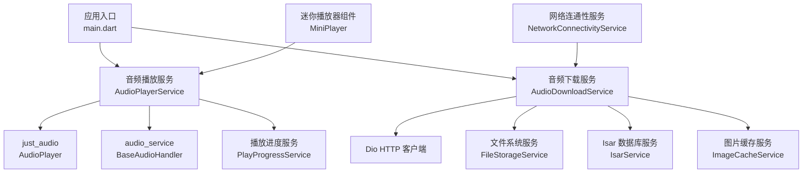
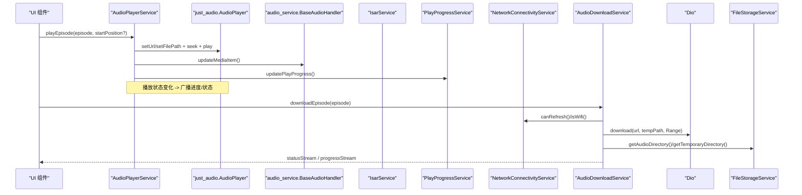
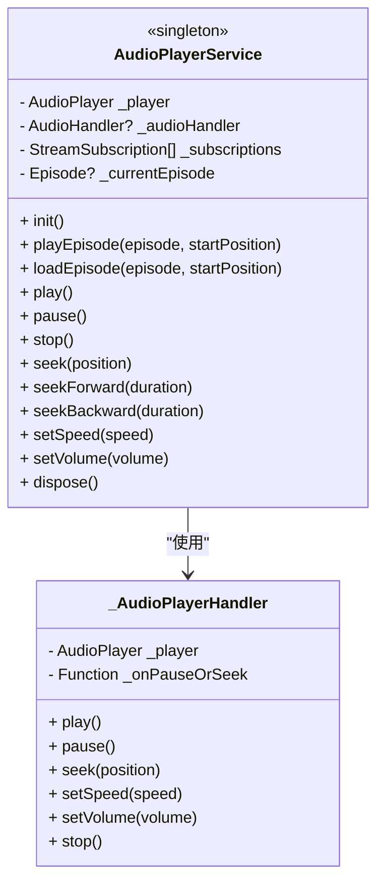
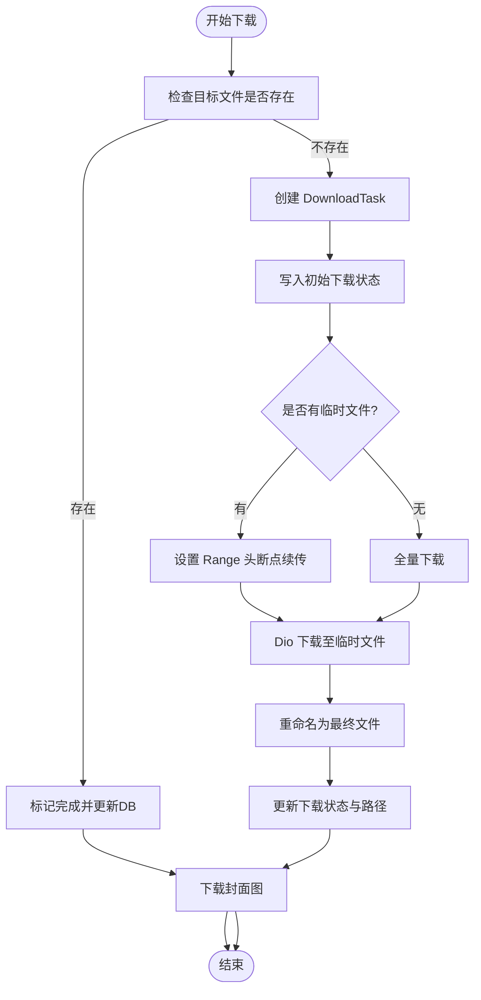
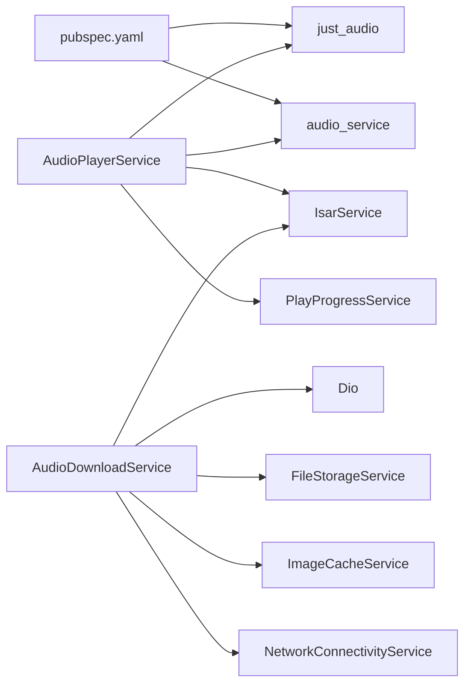

# 音频播放库集成

<cite>
**本文引用的文件**   
- [pubspec.yaml](file://pubspec.yaml)
- [audio_player_service.dart](file://lib/data/services/audio_player_service.dart)
- [audio_download_service.dart](file://lib/data/services/audio_download_service.dart)
- [play_progress_service.dart](file://lib/core/services/play_progress_service.dart)
- [network_connectivity_service.dart](file://lib/core/services/network_connectivity_service.dart)
- [mini_player.dart](file://lib/presentation/widgets/organisms/mini_player/mini_player.dart)
- [audio_download_usage.md](file://docs/audio_download_usage.md)
- [download_queue_debug.md](file://docs/download_queue_debug.md)
- [main.dart](file://lib/main.dart)
</cite>

## 目录
1. [简介](#简介)
2. [项目结构](#项目结构)
3. [核心组件](#核心组件)
4. [架构总览](#架构总览)
5. [详细组件分析](#详细组件分析)
6. [依赖关系分析](#依赖关系分析)
7. [性能与优化](#性能与优化)
8. [故障排查指南](#故障排查指南)
9. [结论](#结论)
10. [附录](#附录)

## 简介
本文件为 TinyCast 应用的音频播放库集成提供完整技术文档，覆盖 just_audio 与 audio_service 的集成配置、后台播放与锁屏控制、通知栏管理、音频下载服务（断点续传、队列管理、存储空间监控）、播放器状态管理（播放控制、进度跟踪、错误处理、资源释放）、跨平台兼容性、内存与电池优化策略，以及音频格式支持、流媒体处理与缓存策略的配置方法。

## 项目结构
本项目采用分层组织：数据层包含音频播放与下载服务；核心层提供播放进度、网络连通性等通用能力；展示层通过迷你播放器等组件消费服务。关键入口在应用启动时初始化音频服务与系统能力。

图表来源
- [main.dart:106-129](file://lib/main.dart#L106-L129)
- [audio_player_service.dart:100-134](file://lib/data/services/audio_player_service.dart#L100-L134)
- [audio_download_service.dart:155-177](file://lib/data/services/audio_download_service.dart#L155-L177)

章节来源
- [pubspec.yaml:60-66](file://pubspec.yaml#L60-L66)
- [main.dart:106-129](file://lib/main.dart#L106-L129)

## 核心组件
- AudioPlayerService：封装 just_audio 播放器与 audio_service 后台任务，提供播放控制、进度流、速度/音量控制、当前节目信息、播放完成事件、持久化播放位置与媒体项更新。
- AudioDownloadService：实现音频下载、断点续传、并发队列、暂停/恢复/取消、进度与状态流、封面图缓存、批量下载与播客清理。
- PlayProgressService：统一维护播放历史与剧集播放进度，同步到 Isar 数据库并标记已播放。
- NetworkConnectivityService：检测网络类型（WiFi/蜂窝/以太网），用于下载策略控制。
- MiniPlayer：UI 层组件，消费播放服务状态并提供用户交互。

章节来源
- [audio_player_service.dart:31-134](file://lib/data/services/audio_player_service.dart#L31-L134)
- [audio_download_service.dart:129-194](file://lib/data/services/audio_download_service.dart#L129-L194)
- [play_progress_service.dart:8-42](file://lib/core/services/play_progress_service.dart#L8-L42)
- [network_connectivity_service.dart:44-62](file://lib/core/services/network_connectivity_service.dart#L44-L62)
- [mini_player.dart](file://lib/presentation/widgets/organisms/mini_player/mini_player.dart)

## 架构总览
下图展示了从 UI 到播放引擎与后台服务的调用链，以及下载流程中的网络与存储交互。

图表来源
- [audio_player_service.dart:192-300](file://lib/data/services/audio_player_service.dart#L192-L300)
- [audio_player_service.dart:326-343](file://lib/data/services/audio_player_service.dart#L326-L343)
- [audio_download_service.dart:196-408](file://lib/data/services/audio_download_service.dart#L196-L408)
- [network_connectivity_service.dart:44-62](file://lib/core/services/network_connectivity_service.dart#L44-L62)

## 详细组件分析

### AudioPlayerService（播放与后台）
- 初始化与订阅：创建 AudioPlayer，监听 playbackEventStream、playerStateStream、positionStream，设置默认音量，初始化 audio_service 并注册 _AudioPlayerHandler。
- 播放加载：优先本地文件路径（支持多目录兼容），不存在则回退到远程 URL；支持起始位置与自动播放；更新媒体项与 lastPlayedAt。
- 播放控制：play/pause/stop/togglePlayPause/seek/seekForward/seekBackward/setSpeed/setVolume。
- 进度与状态：通过 StreamController 广播 PlaybackState、PlaybackProgress、speed/volume、currentEpisode、episodeCompleted。
- 播放完成：仅发送 episodeCompleted 事件，业务逻辑由上层 Provider 处理。
- 持久化：暂停或 seek 后保存播放进度，超过阈值标记已播放。
- 资源释放：取消订阅、关闭控制器、释放播放器。

图表来源
- [audio_player_service.dart:31-134](file://lib/data/services/audio_player_service.dart#L31-L134)
- [audio_player_service.dart:586-652](file://lib/data/services/audio_player_service.dart#L586-L652)

章节来源
- [audio_player_service.dart:100-134](file://lib/data/services/audio_player_service.dart#L100-L134)
- [audio_player_service.dart:192-300](file://lib/data/services/audio_player_service.dart#L192-L300)
- [audio_player_service.dart:345-467](file://lib/data/services/audio_player_service.dart#L345-L467)
- [audio_player_service.dart:469-507](file://lib/data/services/audio_player_service.dart#L469-L507)
- [audio_player_service.dart:560-583](file://lib/data/services/audio_player_service.dart#L560-L583)

### AudioDownloadService（下载与队列）
- 任务模型：DownloadTask 记录 episodeId、URL、相对路径、临时路径、取消令牌、状态、进度、字节数、错误信息等。
- 队列管理：DownloadQueue 维护入队/出队、活跃下载集合、完成/失败列表，限制最大并发数。
- 下载流程：检查目标文件是否存在；若存在直接标记完成并触发封面图下载；否则创建任务、写入初始状态、计算断点续传 Range、执行下载、重命名临时文件、更新数据库与封面图。
- 控制接口：pause/resume/cancel/deleteDownloadedEpisode/isEpisodeDownloaded/getDownloadProgress 等。
- 事件与流：按 episodeId 提供 DownloadStatus 与 progress 流，同时提供全局事件流。
- 批量与清理：downloadEpisodesBatch、removeAllDownloadsForPodcast、unfollowPodcast 等。

图表来源
- [audio_download_service.dart:196-408](file://lib/data/services/audio_download_service.dart#L196-L408)

章节来源
- [audio_download_service.dart:23-51](file://lib/data/services/audio_download_service.dart#L23-L51)
- [audio_download_service.dart:53-113](file://lib/data/services/audio_download_service.dart#L53-L113)
- [audio_download_service.dart:129-194](file://lib/data/services/audio_download_service.dart#L129-L194)
- [audio_download_service.dart:410-481](file://lib/data/services/audio_download_service.dart#L410-L481)
- [audio_download_service.dart:539-576](file://lib/data/services/audio_download_service.dart#L539-L576)
- [audio_download_service.dart:630-673](file://lib/data/services/audio_download_service.dart#L630-L673)

### PlayProgressService（播放进度与历史）
- 更新播放进度：写入播放历史仓库，并同步到 Episode 的 playProgress 与 lastPlayedAt。
- 标记已播放：当进度达到阈值时标记 isPlayed=true，并同步到 Episode。
- 创建/更新历史记录：构造 PlayHistory 对象并持久化。

章节来源
- [play_progress_service.dart:17-42](file://lib/core/services/play_progress_service.dart#L17-L42)
- [play_progress_service.dart:44-70](file://lib/core/services/play_progress_service.dart#L44-L70)
- [play_progress_service.dart:72-104](file://lib/core/services/play_progress_service.dart#L72-L104)
- [play_progress_service.dart:106-144](file://lib/core/services/play_progress_service.dart#L106-L144)

### 迷你播放器与 UI 集成
- MiniPlayer 作为 UI 层组件，订阅播放服务提供的状态流（播放状态、进度、速度、音量、当前节目），并提供播放/暂停、快进/快退、进度条、速度选择、音量控制等交互。
- 建议将播放控制委托给 AudioPlayerService，避免在 UI 中直接操作底层播放器。

章节来源
- [mini_player.dart](file://lib/presentation/widgets/organisms/mini_player/mini_player.dart)

## 依赖关系分析
- pubspec.yaml 声明了 just_audio 与 audio_service 依赖版本，确保跨平台音频能力。
- AudioPlayerService 依赖 just_audio 与 audio_service，并通过 IsarService 与 PlayProgressService 进行数据持久化。
- AudioDownloadService 依赖 Dio、FileStorageService、IsarService、ImageCacheService 与 NetworkConnectivityService。

图表来源
- [pubspec.yaml:60-66](file://pubspec.yaml#L60-L66)
- [audio_player_service.dart:100-134](file://lib/data/services/audio_player_service.dart#L100-L134)
- [audio_download_service.dart:155-177](file://lib/data/services/audio_download_service.dart#L155-L177)

章节来源
- [pubspec.yaml:60-66](file://pubspec.yaml#L60-L66)

## 性能与优化
- 内存优化
  - 及时取消 StreamSubscription 并关闭 StreamController，避免内存泄漏。
  - 下载完成后删除临时文件，避免重复占用空间。
  - 合理限制并发下载数量，避免内存与带宽峰值。
- 电池优化
  - 在网络不可用或蜂窝网络下延迟大文件下载，优先 WiFi。
  - 减少不必要的频繁 IO，合并进度上报频率。
  - 后台播放时使用系统原生服务（audio_service）降低 Flutter 层开销。
- 流媒体与缓存
  - just_audio 支持网络流式播放，结合缓冲位置提升体验。
  - 下载文件优先落盘，播放时优先本地路径，减少网络请求。
  - 封面图异步缓存，避免阻塞主流程。
- 跨平台兼容性
  - iOS/Android 使用 audio_service 提供锁屏控制与通知栏。
  - 桌面端（macOS/Windows/Linux）通过 window_manager 与多窗口支持，音频播放仍走 just_audio。
  - 文件路径获取使用 path_provider，保证各平台一致性。

[本节为通用指导，不直接分析具体文件]

## 故障排查指南
- 下载队列未执行
  - 检查队列长度与活跃下载计数，确认是否达到最大并发上限。
  - 查看日志中“Processing download queue”相关输出，定位无法启动的原因。
- 下载中断与失败
  - 检查网络类型与权限，确认服务器支持 Range 头以实现断点续传。
  - 查看 DioException 类型与消息，区分超时、取消、网络错误等。
- 播放位置未恢复
  - 确认播放进度是否被正确保存到 PlayProgressService 与 Isar。
  - 检查 Episode.playProgress 与 lastPlayedAt 字段更新。
- 本地文件找不到
  - 检查 _findLocalAudioPath 的多目录兼容逻辑（Application Support 与 Documents）。
  - 确认 downloadedPath 是否为相对路径且文件实际存在。

章节来源
- [download_queue_debug.md](file://docs/download_queue_debug.md)
- [audio_download_service.dart:410-481](file://lib/data/services/audio_download_service.dart#L410-L481)
- [audio_player_service.dart:509-538](file://lib/data/services/audio_player_service.dart#L509-L538)

## 结论
TinyCast 的音频播放与下载体系以 AudioPlayerService 与 AudioDownloadService 为核心，结合 just_audio 与 audio_service 实现了稳定的前台/后台播放、锁屏控制与通知管理；下载服务具备断点续传、并发队列、进度与状态流、封面图缓存与批量管理能力；播放进度通过 PlayProgressService 统一持久化。整体架构清晰、职责分离明确，具备良好的可测试性与可扩展性。建议在后续迭代中持续优化内存与电池使用，完善错误提示与重试机制，并加强跨平台行为的一致性验证。

[本节为总结，不直接分析具体文件]

## 附录
- 音频格式支持与流媒体处理
  - just_audio 支持常见音频格式（如 MP3、AAC、FLAC 等）与网络流式播放，具体支持取决于平台原生解码器。
  - 建议对异常格式进行降级处理（如提示不支持或转码）。
- 缓存策略配置
  - 下载文件存放于应用支持目录，临时文件存放于临时目录，播放完成后迁移至永久目录。
  - 定期清理旧文件与已播放内容，避免占用过多存储空间。
- 使用示例参考
  - 音频下载功能使用指南提供了完整的 API 调用示例与最佳实践。

章节来源
- [audio_download_usage.md:1-254](file://docs/audio_download_usage.md#L1-L254)
- [pubspec.yaml:60-66](file://pubspec.yaml#L60-L66)