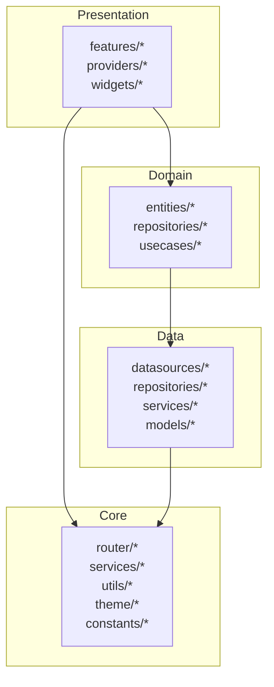
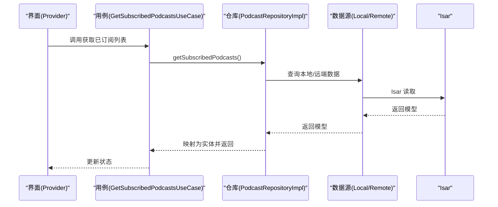
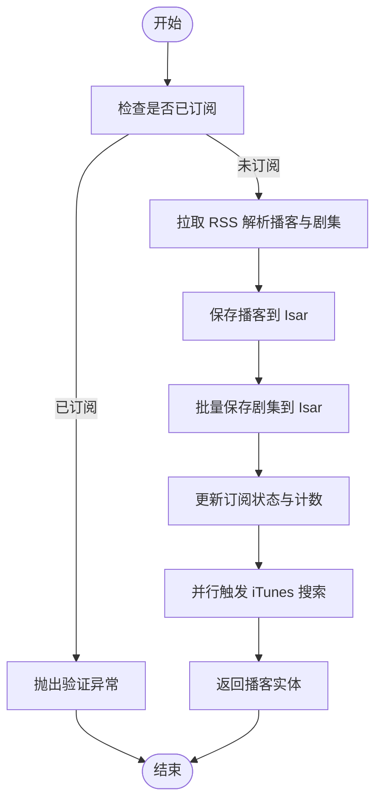
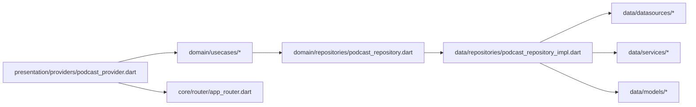

# 功能开发指南

<cite>
**本文引用的文件**   
- [README.md](file://README.md)
- [pubspec.yaml](file://pubspec.yaml)
- [main.dart](file://lib/main.dart)
- [app_router.dart](file://lib/core/router/app_router.dart)
- [podcast_repository.dart](file://lib/domain/repositories/podcast_repository.dart)
- [podcast_repository_impl.dart](file://lib/data/repositories/podcast_repository_impl.dart)
- [podcast_model.dart](file://lib/data/models/podcast_model.dart)
- [podcast_entity.dart](file://lib/domain/entities/podcast.dart)
- [get_subscribed_podcasts_usecase.dart](file://lib/domain/usecases/get_subscribed_podcasts_usecase.dart)
- [podcast_provider.dart](file://lib/presentation/providers/podcast_provider.dart)
- [settings_service.dart](file://lib/data/services/settings_service.dart)
</cite>

## 目录
1. [简介](#简介)
2. [项目结构](#项目结构)
3. [核心组件](#核心组件)
4. [架构总览](#架构总览)
5. [详细组件分析](#详细组件分析)
6. [依赖分析](#依赖分析)
7. [性能考虑](#性能考虑)
8. [故障排查指南](#故障排查指南)
9. [结论](#结论)
10. [附录](#附录)

## 简介
本指南面向希望在 TinyCast 应用上基于 Clean Architecture 快速、高质量地新增功能模块的开发者。内容涵盖：
- 在现有分层架构（presentation / domain / data / core）中组织新功能
- 页面开发与路由接入
- 状态管理（Riverpod）与 Provider 设计
- 数据持久化（Isar）与模型映射
- 用户交互流程与错误处理
- 命名规范、代码风格与测试部署建议
- 以“设置页面”和“进度跟踪服务”为例，给出端到端实现路径

## 项目结构
TinyCast 采用 Flutter + Riverpod + Isar 的跨平台方案，遵循 Clean Architecture 分层：
- presentation：UI 层（页面、组件、Provider）
- domain：领域层（实体、仓库接口、用例）
- data：数据层（数据源、仓库实现、服务、模型）
- core：公共能力（路由、主题、工具、服务、常量）

图表来源
- [main.dart:106-177](file://lib/main.dart#L106-L177)
- [app_router.dart:20-132](file://lib/core/router/app_router.dart#L20-L132)

章节来源
- [README.md:1-6](file://README.md#L1-L6)
- [pubspec.yaml:1-196](file://pubspec.yaml#L1-L196)

## 核心组件
- 应用入口与多窗口初始化：main.dart 负责初始化数据库、音频服务、日志、Supabase、主题加载，并根据参数启动不同窗口（主窗口、设置窗口、订阅窗口、剧集详情窗口）。
- 路由系统：app_router.dart 集中定义页面路由与跳转方法，支持传递参数与打开新窗口。
- 播客仓库：domain 层定义 PodcastRepository 接口；data 层提供 PodcastRepositoryImpl 实现，协调本地/远端数据源与刷新服务。
- 状态管理：presentation/providers/podcast_provider.dart 使用 Riverpod Notifier 管理播客相关状态，封装用例调用与错误处理。
- 设置服务：data/services/settings_service.dart 通过 Isar 持久化设置项并提供监听流，支持从 SharedPreferences 迁移。

章节来源
- [main.dart:106-194](file://lib/main.dart#L106-L194)
- [app_router.dart:20-186](file://lib/core/router/app_router.dart#L20-L186)
- [podcast_repository.dart:1-42](file://lib/domain/repositories/podcast_repository.dart#L1-L42)
- [podcast_repository_impl.dart:15-524](file://lib/data/repositories/podcast_repository_impl.dart#L15-L524)
- [podcast_provider.dart:98-264](file://lib/presentation/providers/podcast_provider.dart#L98-L264)
- [settings_service.dart:8-272](file://lib/data/services/settings_service.dart#L8-L272)

## 架构总览
下图展示一次“订阅播客”的完整调用链，体现 Presentation → Domain → Data 的分层协作与错误处理。

图表来源
- [podcast_provider.dart:148-172](file://lib/presentation/providers/podcast_provider.dart#L148-L172)
- [get_subscribed_podcasts_usecase.dart:1-17](file://lib/domain/usecases/get_subscribed_podcasts_usecase.dart#L1-L17)
- [podcast_repository_impl.dart:186-207](file://lib/data/repositories/podcast_repository_impl.dart#L186-L207)

## 详细组件分析

### 页面开发与路由接入
- 新增页面步骤
  - 在 lib/presentation/features/<feature>/ 下创建页面与子组件
  - 在 app_router.dart 中添加路由名称与 PageRouteBuilder
  - 在需要跳转的地方使用 AppRouter.navigateTo(...) 或 openSettingsWindow/openSubscribeWindow 等窗口方法
- 示例参考
  - 主页、库、收藏、历史、下载、订阅、设置、搜索、剧集详情等路由均在 app_router.dart 中统一维护

章节来源
- [app_router.dart:20-132](file://lib/core/router/app_router.dart#L20-L132)
- [app_router.dart:171-186](file://lib/core/router/app_router.dart#L171-L186)

### 状态管理与 Provider 设计
- 推荐模式
  - 使用 NotifierProvider 管理业务状态，封装 loading/success/error 状态与数据
  - 将用例封装为 Provider，便于复用与替换
  - 对异步操作进行 try/catch，保证失败时保留已有数据
- 示例参考
  - podcast_provider.dart 展示了订阅、取消订阅、加载列表、按 ID 查询、最新剧集等用例的状态管理

章节来源
- [podcast_provider.dart:98-264](file://lib/presentation/providers/podcast_provider.dart#L98-L264)

### 数据持久化与模型映射
- 实体与模型
  - domain/entities 定义纯数据实体（如 Podcast、Episode）
  - data/models 定义 Isar 集合模型（带注解），并通过生成器生成 .g.dart
- 映射与仓库实现
  - data/mappers 负责 Model ↔ Entity 转换
  - data/repositories 实现仓库接口，组合本地/远端数据源与服务

章节来源
- [podcast_entity.dart:1-74](file://lib/domain/entities/podcast.dart#L1-L74)
- [podcast_model.dart:1-78](file://lib/data/models/podcast_model.dart#L1-L78)
- [podcast_repository_impl.dart:15-524](file://lib/data/repositories/podcast_repository_impl.dart#L15-L524)

### 设置页面与设置服务（端到端示例）
- 目标
  - 新增/修改设置项，持久化到 Isar，并在多窗口间实时同步
- 关键步骤
  - 在 settings_service.dart 中新增读写方法与枚举映射
  - 在 presentation/providers 中暴露 SettingsProvider（可参考 podcast_provider 的模式）
  - 在 settings 页面中读取/写入设置，并监听变更
- 参考实现
  - settings_service.dart 提供了 loadSettings/watchSettings 以及各字段 setter，支持迁移与类型映射

章节来源
- [settings_service.dart:8-272](file://lib/data/services/settings_service.dart#L8-L272)

### 进度跟踪服务（播放进度）
- 目标
  - 记录每集播放进度，支持断点续播与跨窗口同步
- 建议实现
  - 在 data/services 中新增 PlayProgressService，封装 Isar 读写与 Stream 监听
  - 在 domain/usecases 中定义 UpdatePlayProgressUseCase
  - 在 presentation/providers 中暴露 PlaybackProvider，聚合播放器状态与进度更新
- 参考模式
  - 可借鉴 settings_service.dart 的 watch 模式与事务写入方式

章节来源
- [settings_service.dart:42-82](file://lib/data/services/settings_service.dart#L42-L82)

### 典型流程图：订阅播客

图表来源
- [podcast_repository_impl.dart:39-141](file://lib/data/repositories/podcast_repository_impl.dart#L39-L141)

## 依赖分析
- 分层依赖方向
  - presentation 依赖 domain 与 core
  - domain 不依赖 data 与 presentation
  - data 依赖 domain 与 core
- 关键依赖关系图

图表来源
- [podcast_provider.dart:50-96](file://lib/presentation/providers/podcast_provider.dart#L50-L96)
- [podcast_repository.dart:1-42](file://lib/domain/repositories/podcast_repository.dart#L1-L42)
- [podcast_repository_impl.dart:1-14](file://lib/data/repositories/podcast_repository_impl.dart#L1-L14)

章节来源
- [pubspec.yaml:1-196](file://pubspec.yaml#L1-L196)

## 性能考虑
- 避免空屏闪烁：在 Provider 加载中优先保留已有数据，再替换为新数据
- 并发控制：对重复请求（如 iTunes 搜索）使用 Future 缓存，避免重复网络请求
- 数据库优化：合理使用索引与批量写入，减少事务次数
- 资源清理：在窗口关闭或应用退出时释放监听与后台任务

[本节为通用指导，无需引用具体文件]

## 故障排查指南
- 常见问题定位
  - 路由无法跳转：检查 app_router.dart 中的路由名与参数类型
  - 状态不更新：确认 Provider 是否正确监听数据变化，是否存在异常吞掉
  - 设置未生效：检查 Isar 事务写入与 watch 流是否正常
  - 订阅失败：查看仓库实现的日志与异常信息，确认 RSS 解析与本地保存逻辑
- 调试建议
  - 启用 Logger 输出关键节点耗时与结果
  - 使用单元测试覆盖用例与仓库实现
  - 使用集成测试验证页面交互与数据一致性

章节来源
- [podcast_repository_impl.dart:129-141](file://lib/data/repositories/podcast_repository_impl.dart#L129-L141)
- [podcast_repository_impl.dart:489-522](file://lib/data/repositories/podcast_repository_impl.dart#L489-L522)
- [settings_service.dart:154-191](file://lib/data/services/settings_service.dart#L154-L191)

## 结论
通过遵循 Clean Architecture 分层与 Riverpod 状态管理模式，结合 Isar 高性能本地存储，开发者可以在 TinyCast 中以一致的方式扩展新功能。建议在新功能开发中严格遵循命名规范、错误处理与日志记录，确保可维护性与可测试性。

[本节为总结性内容，无需引用具体文件]

## 附录
- 命名规范
  - 目录：小写下划线分隔（如 lib/presentation/features/home）
  - 类与方法：帕斯卡命名（如 PodcastRepositoryImpl）
  - Provider：以 Feature + Provider 命名（如 PodcastProvider）
- 代码风格
  - 统一的异常包装与日志输出
  - 异步操作需包含 try/catch 与 finally 清理
  - 使用 const 构造与不可变数据提升性能
- 测试与部署
  - 单元测试：用例与仓库实现
  - Widget 测试：页面交互
  - 集成测试：端到端流程
  - 构建参数：通过 --dart-define 注入环境变量（如 Supabase 配置）

[本节为通用指导，无需引用具体文件]