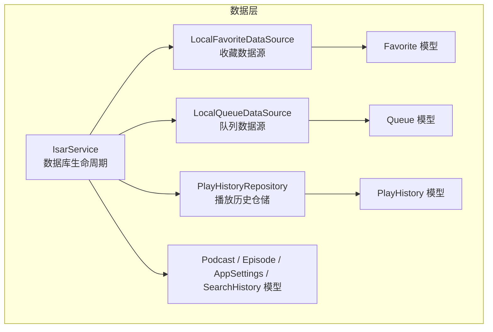
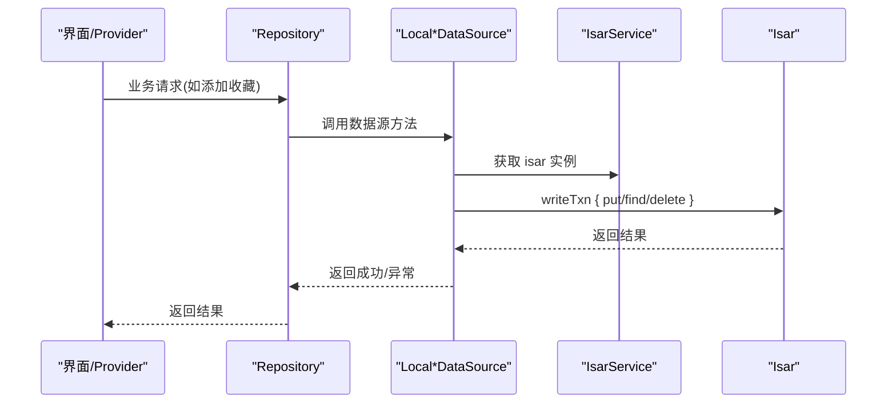
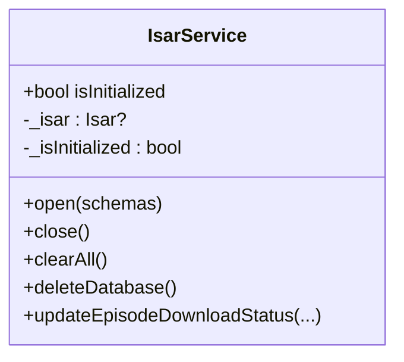
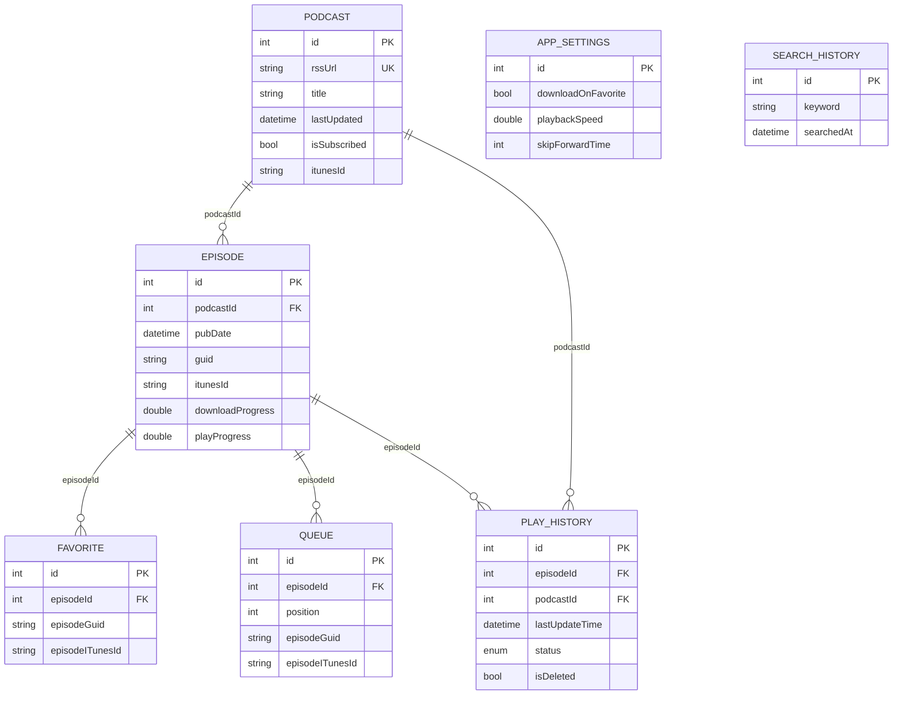
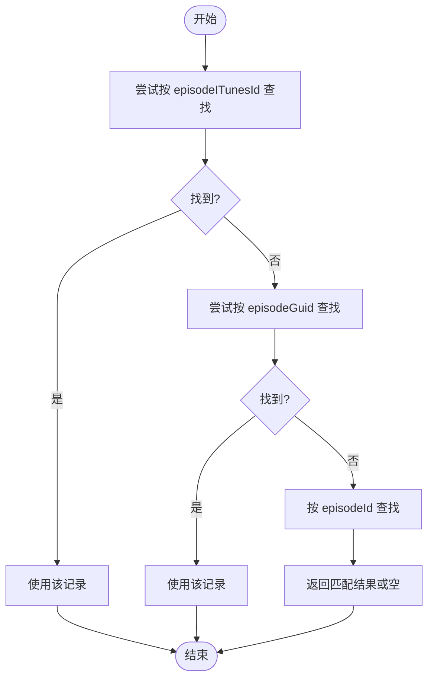
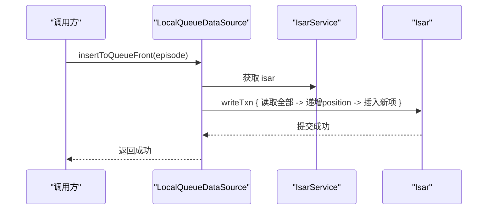
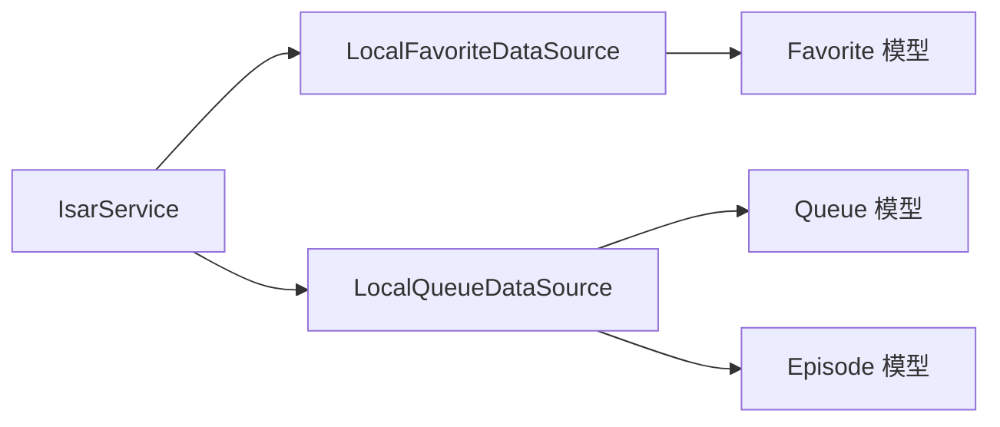

# 数据持久化

<cite>
**本文引用的文件**   
- [lib/data/database/isar_service.dart](file://lib/data/database/isar_service.dart)
- [lib/data/models/podcast_model.dart](file://lib/data/models/podcast_model.dart)
- [lib/data/models/episode_model.dart](file://lib/data/models/episode_model.dart)
- [lib/data/models/favorite_model.dart](file://lib/data/models/favorite_model.dart)
- [lib/data/models/play_history_model.dart](file://lib/data/models/play_history_model.dart)
- [lib/data/models/queue_model.dart](file://lib/data/models/queue_model.dart)
- [lib/data/datasources/local_favorite_datasource.dart](file://lib/data/datasources/local_favorite_datasource.dart)
- [lib/data/datasources/local_queue_datasource.dart](file://lib/data/datasources/local_queue_datasource.dart)
- [docs/database.md](file://docs/database.md)
</cite>

## 目录
1. [简介](#简介)
2. [项目结构](#项目结构)
3. [核心组件](#核心组件)
4. [架构总览](#架构总览)
5. [详细组件分析](#详细组件分析)
6. [依赖关系分析](#依赖关系分析)
7. [性能与索引优化](#性能与索引优化)
8. [数据迁移策略](#数据迁移策略)
9. [缓存机制与文件存储](#缓存机制与文件存储)
10. [数据同步方案](#数据同步方案)
11. [最佳实践与示例](#最佳实践与示例)
12. [故障排查指南](#故障排查指南)
13. [结论](#结论)

## 简介
本文件面向 TinyCast 应用的数据持久化层，系统性说明 Isar 数据库的设计与使用方式，涵盖模型定义、索引优化、查询构建、数据迁移策略、缓存机制与数据同步方案。文档同时给出文件存储、网络缓存和本地数据管理的最佳实践，并提供完整的数据持久化示例，帮助读者设计高效的数据模型、执行复杂查询和优化存储空间使用。

## 项目结构
TinyCast 的本地数据层围绕 Isar 展开，采用“模型 + 数据源 + 仓库”的分层组织：
- 模型层：Isar 集合模型（Podcast、Episode、Favorite、Queue、PlayHistory、SearchHistoryModel、AppSettingsModel）
- 数据源层：Local*DataSource 封装对 Isar 的具体读写操作
- 服务层：IsarService 负责数据库生命周期管理、事务封装、通用维护方法
- 文档层：database.md 提供技术概览、Schema 生成与维护说明

图表来源
- [lib/data/database/isar_service.dart:14-59](file://lib/data/database/isar_service.dart#L14-L59)
- [lib/data/datasources/local_favorite_datasource.dart:8-13](file://lib/data/datasources/local_favorite_datasource.dart#L8-L13)
- [lib/data/datasources/local_queue_datasource.dart:9-13](file://lib/data/datasources/local_queue_datasource.dart#L9-L13)
- [docs/database.md:432-439](file://docs/database.md#L432-L439)

章节来源
- [docs/database.md:1-56](file://docs/database.md#L1-L56)
- [lib/data/database/isar_service.dart:14-59](file://lib/data/database/isar_service.dart#L14-L59)

## 核心组件
- IsarService：单例式数据库服务，负责打开/关闭数据库、清空/删除数据库、版本常量、常用写入封装（如更新剧集下载状态）。所有集合在 open() 时注册。
- 模型集合：
  - Podcast：播客元数据，包含标题、作者、封面、订阅状态、iTunes 扩展字段等；关键字段 rssUrl 唯一索引，title 与 lastUpdated 有索引。
  - Episode：剧集元数据，关联 podcastId，记录音频信息、下载/播放进度、时间戳、iTunes 扩展字段；podcastId 与 pubDate 有索引。
  - Favorite：收藏记录，支持 episodeId、episodeGuid、episodeITunesId 多路匹配。
  - Queue：待播放队列，支持 episodeId、guid、iTunesId 多路匹配，position 有序。
  - PlayHistory：播放历史，快照 episode 标题/描述/封面，支持软删除与状态枚举，lastUpdateTime 索引。
  - SearchHistoryModel：搜索关键词与时间。
  - AppSettingsModel：应用设置单例（id=0），含自动下载策略、播放速度、音量、睡眠定时器等。

章节来源
- [lib/data/models/podcast_model.dart:1-78](file://lib/data/models/podcast_model.dart#L1-L78)
- [lib/data/models/episode_model.dart:1-67](file://lib/data/models/episode_model.dart#L1-L67)
- [lib/data/models/favorite_model.dart:1-20](file://lib/data/models/favorite_model.dart#L1-L20)
- [lib/data/models/queue_model.dart:1-29](file://lib/data/models/queue_model.dart#L1-L29)
- [lib/data/models/play_history_model.dart:1-51](file://lib/data/models/play_history_model.dart#L1-L51)
- [docs/database.md:58-322](file://docs/database.md#L58-L322)

## 架构总览
数据访问路径遵循 Domain → Repository → DataSource → IsarService → Isar 的调用链。数据源统一通过 IsarService.isar 获取实例，并在 writeTxn 中执行原子写入。

图表来源
- [lib/data/datasources/local_favorite_datasource.dart:40-68](file://lib/data/datasources/local_favorite_datasource.dart#L40-L68)
- [lib/data/datasources/local_queue_datasource.dart:66-103](file://lib/data/datasources/local_queue_datasource.dart#L66-L103)
- [lib/data/database/isar_service.dart:38-59](file://lib/data/database/isar_service.dart#L38-L59)

## 详细组件分析

### IsarService（数据库服务）
- 职责：单例管理、open/close/clearAll/deleteDatabase、常用写入封装（如 updateEpisodeDownloadStatus）
- 关键点：
  - 在 open() 中注册所有 CollectionSchema
  - 非产品模式启用 inspector
  - 所有写操作建议包裹在 writeTxn 中保证一致性

图表来源
- [lib/data/database/isar_service.dart:14-137](file://lib/data/database/isar_service.dart#L14-L137)

章节来源
- [lib/data/database/isar_service.dart:14-137](file://lib/data/database/isar_service.dart#L14-L137)

### 模型与索引（Podcast、Episode、Favorite、Queue、PlayHistory、AppSettings、SearchHistory）
- Podcast：rssUrl 唯一索引，title、lastUpdated 普通索引；itunes 扩展字段丰富
- Episode：podcastId、pubDate 索引；下载/播放进度、时间戳完善
- Favorite：episodeId 索引；支持 guid/iTunesId 回退匹配
- Queue：episodeId、position 索引；支持 guid/iTunesId 回退匹配
- PlayHistory：episodeId、podcastId、lastUpdateTime 索引；状态枚举、软删除
- AppSettings：单例 id=0；自动下载策略、睡眠定时器枚举
- SearchHistory：searchedAt 索引

图表来源
- [lib/data/models/podcast_model.dart:1-78](file://lib/data/models/podcast_model.dart#L1-L78)
- [lib/data/models/episode_model.dart:1-67](file://lib/data/models/episode_model.dart#L1-L67)
- [lib/data/models/favorite_model.dart:1-20](file://lib/data/models/favorite_model.dart#L1-L20)
- [lib/data/models/queue_model.dart:1-29](file://lib/data/models/queue_model.dart#L1-L29)
- [lib/data/models/play_history_model.dart:1-51](file://lib/data/models/play_history_model.dart#L1-L51)
- [docs/database.md:324-396](file://docs/database.md#L324-L396)

章节来源
- [docs/database.md:58-322](file://docs/database.md#L58-L322)

### LocalFavoriteDataSource（收藏数据源）
- 关键逻辑：
  - 优先按 episodeITunesId 匹配，其次 episodeGuid，最后 episodeId
  - 添加前检查重复，避免冗余
  - 所有写操作在 writeTxn 中执行
  - 统一异常包装为 AppException

图表来源
- [lib/data/datasources/local_favorite_datasource.dart:14-37](file://lib/data/datasources/local_favorite_datasource.dart#L14-L37)

章节来源
- [lib/data/datasources/local_favorite_datasource.dart:1-134](file://lib/data/datasources/local_favorite_datasource.dart#L1-L134)

### LocalQueueDataSource（队列数据源）
- 关键逻辑：
  - 插入/插播到队首时计算并维护 position 顺序
  - 移除后对后续项重新编号
  - 支持按 podcastId/guid/iTunesId 批量清理
  - 多路匹配策略与收藏一致

图表来源
- [lib/data/datasources/local_queue_datasource.dart:105-148](file://lib/data/datasources/local_queue_datasource.dart#L105-L148)

章节来源
- [lib/data/datasources/local_queue_datasource.dart:1-323](file://lib/data/datasources/local_queue_datasource.dart#L1-L323)

## 依赖关系分析
- IsarService 被各数据源注入或单例获取
- 数据源依赖模型类进行序列化/反序列化
- 仓库层（如 PlayHistoryRepository）聚合数据源能力，向上暴露领域接口

图表来源
- [lib/data/database/isar_service.dart:14-59](file://lib/data/database/isar_service.dart#L14-L59)
- [lib/data/datasources/local_favorite_datasource.dart:8-13](file://lib/data/datasources/local_favorite_datasource.dart#L8-L13)
- [lib/data/datasources/local_queue_datasource.dart:9-13](file://lib/data/datasources/local_queue_datasource.dart#L9-L13)

章节来源
- [docs/database.md:400-439](file://docs/database.md#L400-L439)

## 性能与索引优化
- 已用索引：
  - Podcast：title、rssUrl(unique)、lastUpdated
  - Episode：podcastId、pubDate
  - Favorite：episodeId
  - Queue：episodeId、position
  - PlayHistory：episodeId、podcastId、lastUpdateTime
- 查询优化建议：
  - 优先使用带索引字段过滤（如 pubDate、lastUpdateTime）
  - 排序尽量基于索引字段（如 sortByPubDateDesc/Asc、sortByLastUpdateTimeDesc）
  - 避免全表扫描，合理使用 filter().findFirst()/findAll()
- 事务与并发：
  - 所有写操作使用 writeTxn，确保原子性
  - 批量更新（如队列重编号）应在同一事务内完成

章节来源
- [docs/database.md:494-502](file://docs/database.md#L494-L502)
- [lib/data/datasources/local_queue_datasource.dart:119-138](file://lib/data/datasources/local_queue_datasource.dart#L119-L138)

## 数据迁移策略
- Schema 代码生成：
  - 使用 build_runner 生成 .g.dart 与 Schema
  - 新增字段时 Isar 自动处理迁移（新增字段默认值）
- 版本管理：
  - IsarService 中维护 _currentVersion（当前为 1）
  - 修改字段需重新运行生成命令
- 建议流程：
  - 变更模型 → 运行生成 → 验证 Inspector → 回归测试

章节来源
- [docs/database.md:442-465](file://docs/database.md#L442-L465)
- [lib/data/database/isar_service.dart:16-17](file://lib/data/database/isar_service.dart#L16-L17)

## 缓存机制与文件存储
- 本地文件路径：
  - 数据库文件位于 ApplicationDocumentsDirectory/tinycast.isar
- 媒体与图片缓存：
  - Episode 与 Podcast 支持 artworkPath/downloadedPath 指向本地文件
  - 下载完成后更新 isDownloaded、downloadedPath、downloadProgress
- 清理策略：
  - 可通过 IsarService.clearAll()/deleteDatabase() 重置
  - 结合外部缓存服务（如 image_cache_service、audio_download_service）进行空间回收

章节来源
- [docs/database.md:18-42](file://docs/database.md#L18-L42)
- [lib/data/database/isar_service.dart:75-102](file://lib/data/database/isar_service.dart#L75-L102)
- [lib/data/models/episode_model.dart:39-47](file://lib/data/models/episode_model.dart#L39-L47)

## 数据同步方案
- 同步标识：
  - 模型普遍包含 supabaseId 用于云端同步映射
- 回退关联：
  - Favorite/Queue/PlayHistory 支持 episodeITunesId、episodeGuid、episodeId 三级回退匹配，保障跨设备/多区域一致性
- 同步方向：
  - 本地优先（离线可用），网络恢复后合并冲突（由上层 sync_service 协调）

章节来源
- [docs/database.md:385-396](file://docs/database.md#L385-L396)
- [lib/data/models/favorite_model.dart:1-20](file://lib/data/models/favorite_model.dart#L1-L20)
- [lib/data/models/queue_model.dart:1-29](file://lib/data/models/queue_model.dart#L1-L29)
- [lib/data/models/play_history_model.dart:1-51](file://lib/data/models/play_history_model.dart#L1-L51)

## 最佳实践与示例
- 设计高效数据模型
  - 明确主键与业务唯一键（rssUrl 唯一索引）
  - 合理设置索引字段（高频过滤/排序字段）
  - 使用枚举与快照字段提升查询与展示效率（PlayHistory.status、快照字段）
- 执行复杂查询
  - 使用 filter().and()/or() 组合条件
  - 利用 sortBy* 系列方法进行索引排序
  - 多路匹配（iTunesId/guid/id）提高鲁棒性
- 优化存储空间
  - 及时更新 downloadedPath 与 artworkPath，避免重复下载
  - 定期清理无效队列与收藏
  - 使用软删除（isDeleted）保留可恢复的历史记录
- 示例流程（添加收藏）
  - 调用 LocalFavoriteDataSource.addFavorite(episode)
  - 内部按 iTunesId/guid/id 检查重复
  - 在 writeTxn 中写入 Favorite 记录
  - 返回成功或抛出 AppException

章节来源
- [lib/data/datasources/local_favorite_datasource.dart:40-68](file://lib/data/datasources/local_favorite_datasource.dart#L40-L68)
- [docs/database.md:494-502](file://docs/database.md#L494-L502)

## 故障排查指南
- 常见问题
  - 数据库未初始化：调用 isar 前需先 open()
  - 权限问题：文件系统异常导致无法访问数据库目录
  - 索引不生效：确认字段是否标注 @Index() 且已重新生成 schema
- 调试工具
  - 启用 Isar Inspector（开发模式）查看实时数据
  - 使用 Logger 输出日志定位问题（数据源已内置 emoji 前缀日志）
- 恢复手段
  - clearAll() 清空数据
  - deleteDatabase() 删除数据库文件并重建

章节来源
- [lib/data/database/isar_service.dart:31-36](file://lib/data/database/isar_service.dart#L31-L36)
- [lib/data/database/isar_service.dart:54-58](file://lib/data/database/isar_service.dart#L54-L58)
- [docs/database.md:488-491](file://docs/database.md#L488-L491)

## 结论
TinyCast 的数据持久化以 Isar 为核心，通过清晰的模型定义、合理的索引设计与严格的事务控制，实现了高性能、类型安全与可扩展的本地数据存储。配合回退关联、软删除与快照机制，系统在离线可用性、数据一致性与用户体验方面具备良好表现。建议在后续迭代中持续优化索引策略、完善清理与同步流程，并结合 Inspector 与日志体系进行监控与排障。