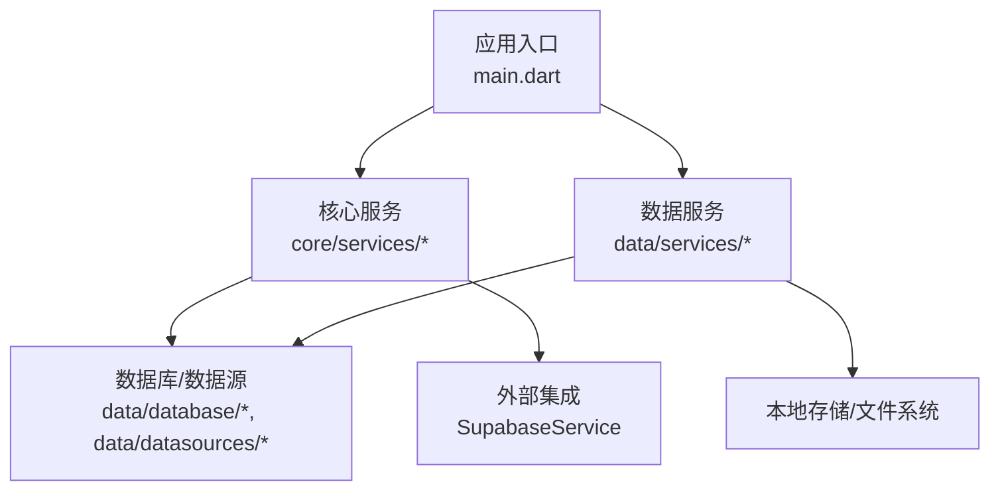
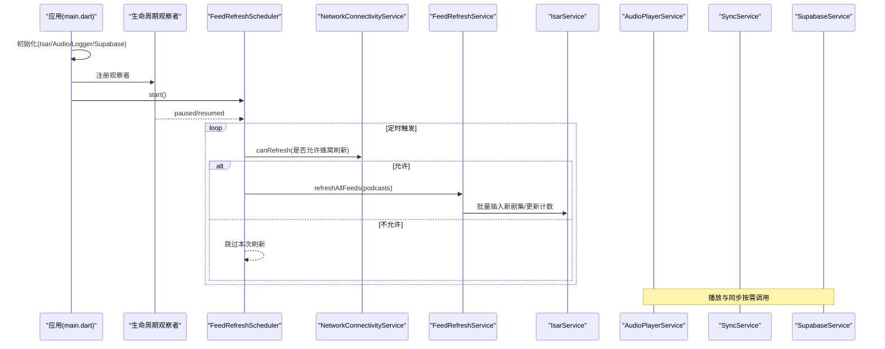
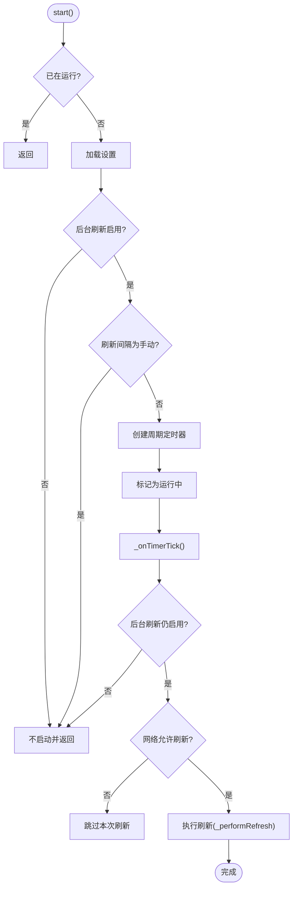
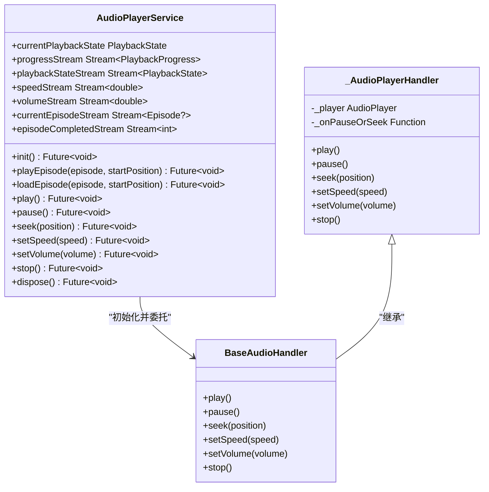
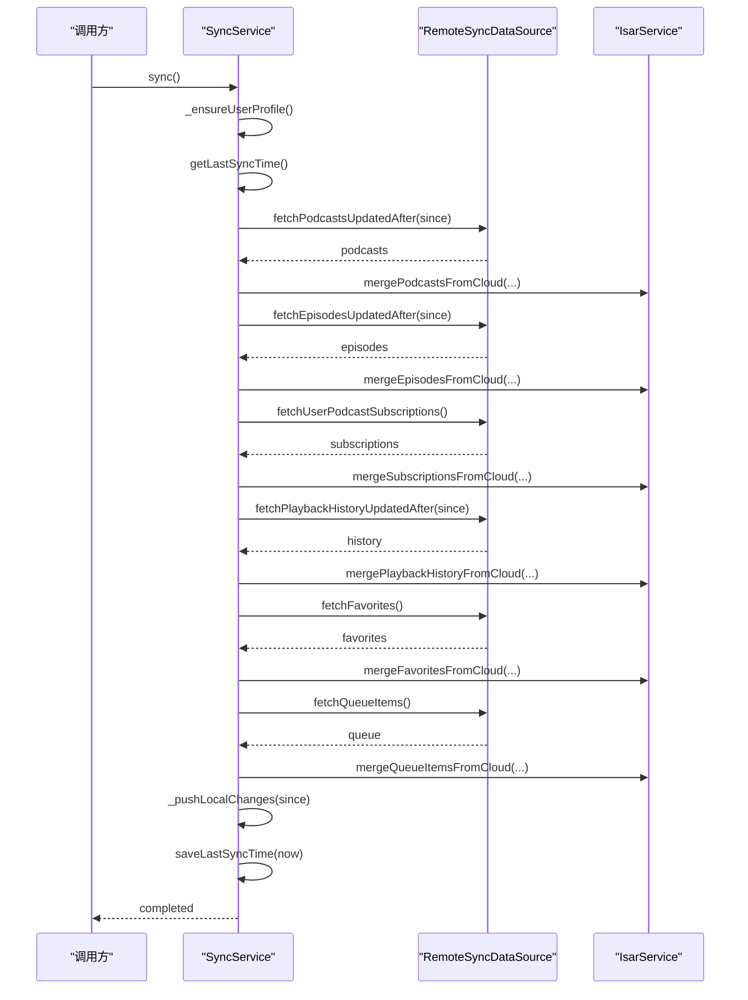
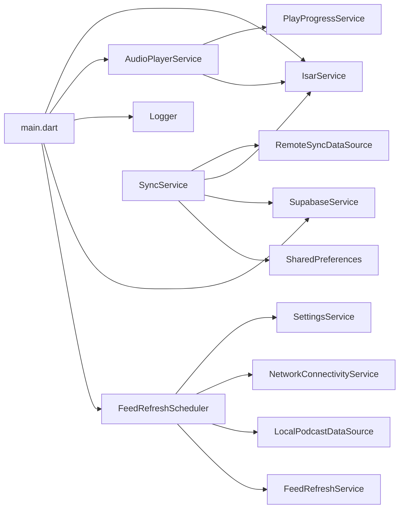

# 服务开发

<cite>
**本文引用的文件**   
- [main.dart](file://lib/main.dart)
- [feed_refresh_scheduler.dart](file://lib/core/services/feed_refresh_scheduler.dart)
- [audio_player_service.dart](file://lib/data/services/audio_player_service.dart)
- [supabase_service.dart](file://lib/core/services/supabase_service.dart)
- [sync_service.dart](file://lib/core/services/sync_service.dart)
- [play_progress_service.dart](file://lib/core/services/play_progress_service.dart)
- [feed_refresh_service.dart](file://lib/data/services/feed_refresh_service.dart)
</cite>

## 目录
1. [简介](#简介)
2. [项目结构](#项目结构)
3. [核心组件](#核心组件)
4. [架构总览](#架构总览)
5. [详细组件分析](#详细组件分析)
6. [依赖关系分析](#依赖关系分析)
7. [性能考量](#性能考量)
8. [故障排查指南](#故障排查指南)
9. [结论](#结论)
10. [附录：服务开发示例与最佳实践](#附录：服务开发示例与最佳实践)

## 简介
本文件面向 TinyCast 应用的服务层开发，聚焦以下目标：
- 阐述服务的架构设计与生命周期管理
- 说明依赖注入机制（Riverpod Provider）与服务间通信方式
- 记录后台任务处理、定时任务与事件驱动的实现模式
- 给出错误处理与日志记录策略
- 提供可复用的业务服务开发示例，涵盖异步操作与服务状态管理

## 项目结构
TinyCast 采用分层组织：
- core：通用能力（服务、工具、路由、主题、Provider）
- data：数据访问（数据库、数据源、仓库、数据服务）
- domain：领域模型与用例
- presentation：界面与交互

服务相关的关键位置：
- core/services：系统级服务（同步、网络、播放进度、Supabase 客户端等）
- data/services：业务数据服务（音频播放、RSS 刷新、下载、缓存等）
- main.dart：应用启动、全局初始化、生命周期观察者、多窗口入口

图表来源
- [main.dart:106-194](file://lib/main.dart#L106-L194)
- [feed_refresh_scheduler.dart:12-47](file://lib/core/services/feed_refresh_scheduler.dart#L12-L47)
- [audio_player_service.dart:31-134](file://lib/data/services/audio_player_service.dart#L31-L134)
- [supabase_service.dart:8-47](file://lib/core/services/supabase_service.dart#L8-L47)

章节来源
- [main.dart:106-194](file://lib/main.dart#L106-L194)

## 核心组件
- FeedRefreshScheduler：基于定时器与网络条件检查的后台刷新调度器
- AudioPlayerService：封装 just_audio 与 audio_service，提供播放控制、状态流、媒体项更新与播放进度持久化
- SupabaseService：单例管理 Supabase 客户端初始化与获取
- SyncService：端到端的数据同步编排（拉取合并 + 推送覆盖），支持进度回调与失败步骤保护
- PlayProgressService：播放进度与“已播放”状态的统一写入与同步

章节来源
- [feed_refresh_scheduler.dart:12-47](file://lib/core/services/feed_refresh_scheduler.dart#L12-L47)
- [audio_player_service.dart:31-134](file://lib/data/services/audio_player_service.dart#L31-L134)
- [supabase_service.dart:8-47](file://lib/core/services/supabase_service.dart#L8-L47)
- [sync_service.dart:42-127](file://lib/core/services/sync_service.dart#L42-L127)
- [play_progress_service.dart:8-42](file://lib/core/services/play_progress_service.dart#L8-L42)

## 架构总览
整体架构以“服务 + 数据源 + 数据库”为核心，通过 Riverpod Provider 进行依赖注入与状态共享。关键流程包括：
- 应用启动时初始化 Isar、AudioPlayer、Logger、Supabase
- 注册生命周期观察者，按前台/后台切换启停定时刷新
- 播放服务暴露 Stream 供 UI 订阅，同时与系统媒体中心联动
- 同步服务协调拉取与推送，保证多设备一致性

图表来源
- [main.dart:106-194](file://lib/main.dart#L106-L194)
- [feed_refresh_scheduler.dart:49-115](file://lib/core/services/feed_refresh_scheduler.dart#L49-L115)
- [feed_refresh_service.dart:204-239](file://lib/data/services/feed_refresh_service.dart#L204-L239)
- [audio_player_service.dart:100-134](file://lib/data/services/audio_player_service.dart#L100-L134)
- [supabase_service.dart:18-32](file://lib/core/services/supabase_service.dart#L18-L32)

## 详细组件分析

### FeedRefreshScheduler（定时刷新调度器）
职责
- 根据设置决定是否启用后台刷新与刷新间隔
- 结合网络条件（是否允许蜂窝网络）决定执行时机
- 周期触发或立即触发刷新，完成后广播 onRefreshCompleted
- 响应应用生命周期变化，暂停/恢复时启停定时器

关键实现要点
- 使用 Timer.periodic 周期性执行 _onTimerTick
- 每次 tick 读取最新设置并校验网络条件
- 通过 FeedRefreshService.refreshAllFeeds 批量刷新
- 异常捕获与日志记录，避免定时器崩溃

图表来源
- [feed_refresh_scheduler.dart:49-115](file://lib/core/services/feed_refresh_scheduler.dart#L49-L115)

章节来源
- [feed_refresh_scheduler.dart:12-165](file://lib/core/services/feed_refresh_scheduler.dart#L12-L165)

### AudioPlayerService（音频播放服务）
职责
- 封装 just_audio 播放器与 audio_service 系统媒体通道
- 暴露播放状态、进度、速度、音量、当前剧集等 Stream
- 支持本地文件优先回退到远程 URL 播放
- 自动保存播放进度并在达到阈值标记为“已播放”
- 维护媒体项信息，与系统通知栏/锁屏控件联动

关键实现要点
- init 阶段初始化 AudioHandler 并订阅播放器事件流
- playEpisode/loadEpisode 统一加载逻辑，自动选择本地/远程源
- 播放完成事件仅广播，业务逻辑由上层 Provider 处理
- dispose 阶段释放资源并关闭所有 StreamController

图表来源
- [audio_player_service.dart:31-134](file://lib/data/services/audio_player_service.dart#L31-L134)
- [audio_player_service.dart:586-653](file://lib/data/services/audio_player_service.dart#L586-L653)

章节来源
- [audio_player_service.dart:31-584](file://lib/data/services/audio_player_service.dart#L31-L584)

### SupabaseService（云端客户端服务）
职责
- 单例管理 Supabase 客户端初始化
- 提供 client 访问器，未初始化时抛出明确错误
- 在 Riverpod 中通过 Provider 暴露客户端实例

关键点
- initialize 仅在首次调用生效
- isInitialized 用于判断可用性
- 与 main.dart 中的 AppConfig 配合，编译期参数注入

章节来源
- [supabase_service.dart:8-55](file://lib/core/services/supabase_service.dart#L8-L55)
- [main.dart:47-72](file://lib/main.dart#L47-L72)

### SyncService（数据同步服务）
职责
- 编排完整同步流程：准备 -> 拉取合并 -> 推送覆盖 -> 完成
- 支持分表进度回调（SyncProgress）
- 对失败步骤进行保护，不推进 last_sync_timestamp
- 处理订阅、收藏、队列、播放历史等多表合并与冲突解决

关键流程
- _pullAndMergeCloudChanges：依次拉取播客、剧集、订阅、播放历史、收藏、队列并合并
- _pushLocalChanges：将本地变更推送到云端，必要时做全量替换（如队列）
- safeStep 包装每个子步骤，失败不影响其他步骤成功部分

图表来源
- [sync_service.dart:80-127](file://lib/core/services/sync_service.dart#L80-L127)
- [sync_service.dart:168-218](file://lib/core/services/sync_service.dart#L168-L218)
- [sync_service.dart:222-380](file://lib/core/services/sync_service.dart#L222-L380)

章节来源
- [sync_service.dart:42-127](file://lib/core/services/sync_service.dart#L42-L127)
- [sync_service.dart:168-380](file://lib/core/services/sync_service.dart#L168-L380)

### PlayProgressService（播放进度服务）
职责
- 统一更新播放进度与“已播放”状态
- 同步更新 Episode 实体的 playProgress 与 lastPlayedAt
- 与 Isar 事务结合确保一致性

章节来源
- [play_progress_service.dart:8-146](file://lib/core/services/play_progress_service.dart#L8-L146)

### FeedRefreshService（RSS 刷新服务）
职责
- 单集刷新：冷却时间控制、退化模式（失败次数阈值）、增量去重（GUID）
- 批量刷新：分块并发（最大并发数限制），汇总统计结果

章节来源
- [feed_refresh_service.dart:51-239](file://lib/data/services/feed_refresh_service.dart#L51-L239)

## 依赖关系分析
- 启动依赖链：main.dart 初始化 Isar、AudioPlayer、Logger、Supabase；注册生命周期观察者；启动 FeedRefreshScheduler
- 服务间依赖：
  - FeedRefreshScheduler 依赖 SettingsService、NetworkConnectivityService、LocalPodcastDataSource、FeedRefreshService
  - AudioPlayerService 依赖 IsarService、PlayProgressService、just_audio、audio_service
  - SyncService 依赖 RemoteSyncDataSource、IsarService、SupabaseService、SharedPreferences
  - PlayProgressService 依赖 PlayHistoryRepository、IsarService

图表来源
- [main.dart:106-194](file://lib/main.dart#L106-L194)
- [feed_refresh_scheduler.dart:12-47](file://lib/core/services/feed_refresh_scheduler.dart#L12-L47)
- [audio_player_service.dart:31-134](file://lib/data/services/audio_player_service.dart#L31-L134)
- [sync_service.dart:42-127](file://lib/core/services/sync_service.dart#L42-L127)

章节来源
- [main.dart:106-194](file://lib/main.dart#L106-L194)

## 性能考量
- 定时刷新
  - 冷却时间与退化模式降低频繁请求压力
  - 批量刷新分块并发，限制最大并发数
  - 网络条件检查避免蜂窝网络下不必要的刷新
- 播放服务
  - 本地文件优先，减少网络开销
  - 事件流广播使用 broadcast Stream，避免重复订阅
  - 播放进度节流保存，避免频繁写库
- 同步服务
  - 先拉后推，避免误删远端数据
  - 分表进度回调，便于 UI 反馈与中断恢复
  - 失败步骤保护，防止脏状态扩散

[本节为通用指导，不直接分析具体文件]

## 故障排查指南
- 定时刷新不触发
  - 检查设置中是否启用后台刷新与刷新间隔
  - 检查网络条件是否允许刷新（蜂窝/移动网络）
  - 查看调度器日志输出，确认定时器是否创建与停止
- 播放异常
  - 检查本地文件是否存在，不存在则回退远程 URL
  - 确认播放器状态重置逻辑（加载失败时 stop 并清空当前剧集）
  - 查看播放进度保存是否成功
- 同步失败
  - 检查用户是否登录且 Supabase 已初始化
  - 查看各子步骤日志，定位失败表与原因
  - 确认 last_sync_timestamp 未被推进（失败时不应推进）

章节来源
- [feed_refresh_scheduler.dart:88-115](file://lib/core/services/feed_refresh_scheduler.dart#L88-L115)
- [audio_player_service.dart:192-300](file://lib/data/services/audio_player_service.dart#L192-L300)
- [sync_service.dart:80-127](file://lib/core/services/sync_service.dart#L80-L127)

## 结论
TinyCast 的服务层以清晰的分层与职责分离为基础，通过单例服务与 Riverpod Provider 实现松耦合与易测试性。定时刷新、播放服务与同步服务分别覆盖了后台任务、媒体播放与数据一致性三大核心场景。统一的日志与错误处理策略提升了可观测性与可维护性。

[本节为总结，不直接分析具体文件]

## 附录：服务开发示例与最佳实践

### 如何创建可复用的业务服务
- 使用单例或构造函数注入，便于测试与替换依赖
- 对外暴露清晰的 API 与事件流（Stream），避免内部状态泄露
- 将 I/O 与业务逻辑解耦，数据访问下沉至数据源/仓库

参考实现
- FeedRefreshService：单例 + 构造注入，暴露 refreshSingleFeed/refreshAllFeeds
- AudioPlayerService：单例 + 事件流，封装播放器与系统媒体通道

章节来源
- [feed_refresh_service.dart:51-73](file://lib/data/services/feed_refresh_service.dart#L51-L73)
- [audio_player_service.dart:31-134](file://lib/data/services/audio_player_service.dart#L31-L134)

### 如何处理异步操作
- 使用 async/await 与 Future 组合，避免嵌套回调
- 对长时间运行的任务进行分块与并发控制
- 使用 try/catch 包裹关键路径，记录错误并返回稳定结果

参考实现
- FeedRefreshService.refreshAllFeeds：分块并发与结果聚合
- SyncService.sync：分步编排与失败保护

章节来源
- [feed_refresh_service.dart:204-239](file://lib/data/services/feed_refresh_service.dart#L204-L239)
- [sync_service.dart:80-127](file://lib/core/services/sync_service.dart#L80-L127)

### 如何管理服务状态
- 使用 Riverpod Provider 管理跨组件状态
- 在服务内暴露 Stream 供 UI 订阅，保持单向数据流
- 对状态变更进行幂等处理，避免重复更新

参考实现
- AudioPlayerService：播放状态、进度、速度、音量、当前剧集等 Stream
- SyncService：SyncProgress 回调用于 UI 展示同步进度

章节来源
- [audio_player_service.dart:47-77](file://lib/data/services/audio_player_service.dart#L47-L77)
- [sync_service.dart:16-40](file://lib/core/services/sync_service.dart#L16-L40)

### 服务间通信机制
- 事件流（Stream）：适用于一对多广播（如播放状态、刷新完成）
- 回调函数：适用于进度上报（如 SyncProgressCallback）
- Provider：适用于状态共享与依赖注入

章节来源
- [feed_refresh_scheduler.dart:32-36](file://lib/core/services/feed_refresh_scheduler.dart#L32-L36)
- [sync_service.dart:40-47](file://lib/core/services/sync_service.dart#L40-L47)
- [supabase_service.dart:49-55](file://lib/core/services/supabase_service.dart#L49-L55)

### 错误处理与日志记录策略
- 统一日志标签与级别，便于检索与过滤
- 关键路径 try/catch 捕获并记录堆栈
- 对外返回结构化结果（如 FeedRefreshResult/BatchRefreshResult）

章节来源
- [feed_refresh_scheduler.dart:108-115](file://lib/core/services/feed_refresh_scheduler.dart#L108-L115)
- [audio_player_service.dart:282-299](file://lib/data/services/audio_player_service.dart#L282-L299)
- [sync_service.dart:123-127](file://lib/core/services/sync_service.dart#L123-L127)

### 生命周期管理与清理
- 应用启动时初始化必要服务，注册生命周期观察者
- 应用进入后台/退出时停止定时器与释放资源
- dispose 中关闭所有 StreamController 与订阅

章节来源
- [main.dart:106-194](file://lib/main.dart#L106-L194)
- [feed_refresh_scheduler.dart:154-163](file://lib/core/services/feed_refresh_scheduler.dart#L154-L163)
- [audio_player_service.dart:560-584](file://lib/data/services/audio_player_service.dart#L560-L584)