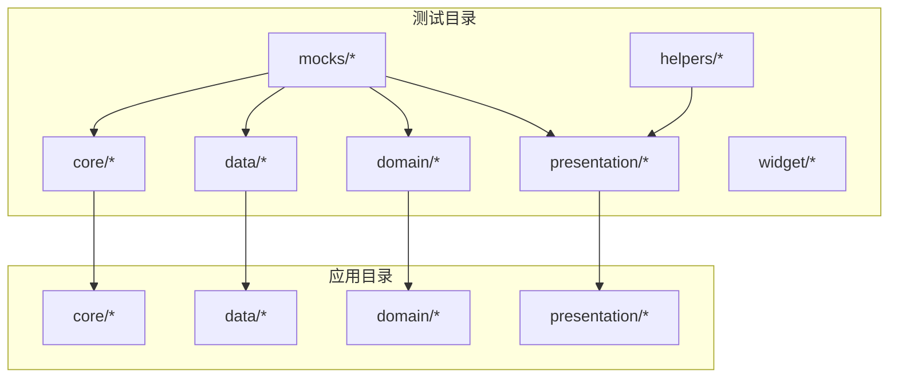
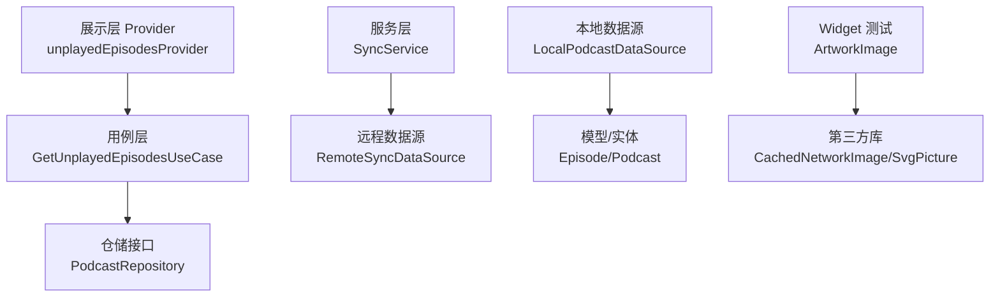
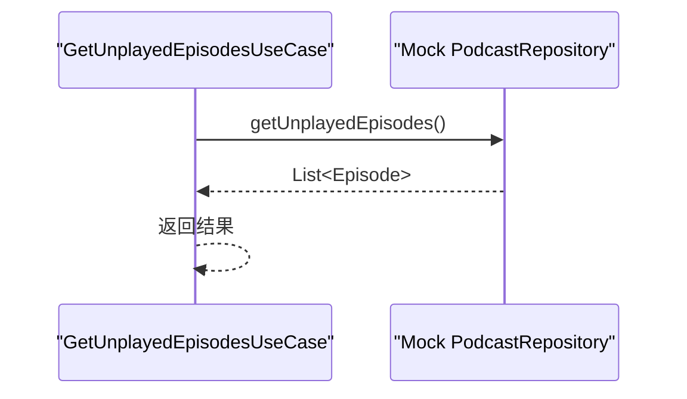
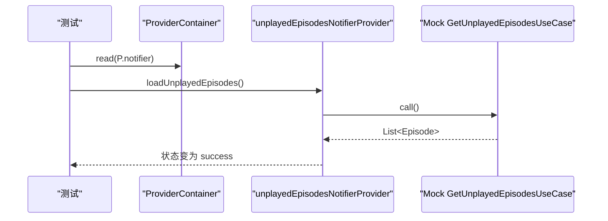
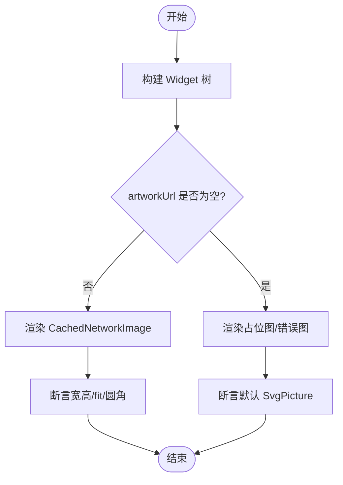
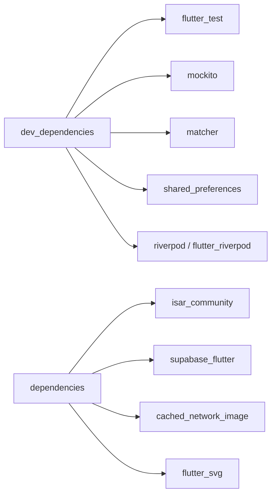

# 测试策略

<cite>
**本文引用的文件**   
- [pubspec.yaml](file://pubspec.yaml)
- [test/helpers/test_helpers.dart](file://test/helpers/test_helpers.dart)
- [test/mocks/mock_factory.dart](file://test/mocks/mock_factory.dart)
- [test/core/providers/sync_provider_test.dart](file://test/core/providers/sync_provider_test.dart)
- [test/core/services/sync_service_test.dart](file://test/core/services/sync_service_test.dart)
- [test/data/datasources/local_podcast_datasource_test.dart](file://test/data/datasources/local_podcast_datasource_test.dart)
- [test/domain/usecases/get_unplayed_episodes_usecase_test.dart](file://test/domain/usecases/get_unplayed_episodes_usecase_test.dart)
- [test/presentation/providers/podcast_provider_test.dart](file://test/presentation/providers/podcast_provider_test.dart)
- [test/presentation/providers/unplayed_episodes_provider_test.dart](file://test/presentation/providers/unplayed_episodes_provider_test.dart)
- [test/presentation/widgets/atoms/artwork_image_test.dart](file://test/presentation/widgets/atoms/artwork_image_test.dart)
</cite>

## 目录
1. [简介](#简介)
2. [项目结构](#项目结构)
3. [核心组件](#核心组件)
4. [架构总览](#架构总览)
5. [详细组件分析](#详细组件分析)
6. [依赖分析](#依赖分析)
7. [性能考虑](#性能考虑)
8. [故障排查指南](#故障排查指南)
9. [结论](#结论)
10. [附录](#附录)

## 简介
本文件为 TinyCast 应用的测试策略文档，覆盖单元测试、集成测试与 Widget 测试的编写方法与最佳实践。重点说明 Mock 对象创建、测试数据准备、测试环境搭建，以及异步代码、Provider（Riverpod）与数据库（Isar/SharedPreferences）的测试策略。通过仓库中现有测试样例，提炼可复用的模式与规范，确保代码质量与功能稳定性。

## 项目结构
TinyCast 采用分层架构：presentation（UI/Provider）、domain（UseCase/Entity/Repository 接口）、data（DataSource/Model/Service）。测试目录按层组织，便于定位与隔离测试范围。

图表来源
- [pubspec.yaml:148-176](file://pubspec.yaml#L148-L176)

章节来源
- [pubspec.yaml:148-176](file://pubspec.yaml#L148-L176)

## 核心组件
- 测试辅助工具
  - TestHelpers：封装 pumpWidget、pumpAndSettleWithDelay、交互操作（tap/drag/longPress）、断言与通用包装器，提升 Widget 测试一致性。
  - MockFactory：统一 Mock 行为设置（thenReturn/thenThrow/thenAnswer/verify/capture），减少样板代码。
- 测试数据与资源
  - test-data：提供 RSS XML 等静态数据，用于解析或网络模拟。
- 依赖与框架
  - flutter_test、mockito、matcher、riverpod、shared_preferences、isar_community 等，见 pubspec.yaml。

章节来源
- [test/helpers/test_helpers.dart:1-202](file://test/helpers/test_helpers.dart#L1-L202)
- [test/mocks/mock_factory.dart:1-397](file://test/mocks/mock_factory.dart#L1-L397)
- [pubspec.yaml:148-176](file://pubspec.yaml#L148-L176)

## 架构总览
测试分层与依赖关系如下：
- 单元测试：针对 UseCase、Service、Data Source 逻辑，使用 Mock 隔离外部依赖。
- Provider 测试：基于 ProviderContainer + overrides 注入 Mock UseCase，验证状态流转与异步结果。
- Widget 测试：使用 MaterialApp/Scaffold/MediaQuery/Directionality 等包裹，配合 TestHelpers 快速构建 UI 场景。
- 集成测试：标记 skip，待完整 Supabase + Isar + Riverpod 环境后启用。

图表来源
- [test/domain/usecases/get_unplayed_episodes_usecase_test.dart:1-127](file://test/domain/usecases/get_unplayed_episodes_usecase_test.dart#L1-L127)
- [test/presentation/providers/unplayed_episodes_provider_test.dart:1-290](file://test/presentation/providers/unplayed_episodes_provider_test.dart#L1-L290)
- [test/core/services/sync_service_test.dart:1-566](file://test/core/services/sync_service_test.dart#L1-L566)
- [test/data/datasources/local_podcast_datasource_test.dart:1-153](file://test/data/datasources/local_podcast_datasource_test.dart#L1-L153)
- [test/presentation/widgets/atoms/artwork_image_test.dart:1-800](file://test/presentation/widgets/atoms/artwork_image_test.dart#L1-L800)

## 详细组件分析

### 单元测试：UseCase 与 Service
- UseCase 测试要点
  - 使用 @GenerateMocks 生成 Repository 的 Mock。
  - Arrange：构造输入实体；Act：调用 UseCase；Assert：验证返回值与调用次数。
  - 异常路径：Mock 抛出异常，断言上层正确传播。
- Service 测试要点
  - 使用 SharedPreferences.setMockInitialValues 初始化本地存储。
  - 使用 @GenerateMocks 生成 RemoteSyncDataSource 的 Mock。
  - 验证时间戳读取/写入、数据转换映射、PlayHistory 重构逻辑。
  - 集成测试用例以 skip 占位，等待完整环境。

图表来源
- [test/domain/usecases/get_unplayed_episodes_usecase_test.dart:1-127](file://test/domain/usecases/get_unplayed_episodes_usecase_test.dart#L1-L127)

章节来源
- [test/domain/usecases/get_unplayed_episodes_usecase_test.dart:1-127](file://test/domain/usecases/get_unplayed_episodes_usecase_test.dart#L1-L127)
- [test/core/services/sync_service_test.dart:1-566](file://test/core/services/sync_service_test.dart#L1-L566)

### Provider 测试（Riverpod）
- 容器与依赖注入
  - 使用 ProviderContainer 并通过 overrides 注入 Mock UseCase。
  - setUp/tearDown 管理容器生命周期。
- 异步与状态流
  - 初始 loading → 成功 success → 错误 error 的状态变化。
  - 使用 container.read(...).future 等待异步完成。
  - listen 订阅状态变化，验证中间态。
- 多参数隔离
  - 不同 podcastId 对应不同结果，验证缓存与隔离。

图表来源
- [test/presentation/providers/unplayed_episodes_provider_test.dart:1-290](file://test/presentation/providers/unplayed_episodes_provider_test.dart#L1-L290)
- [test/presentation/providers/podcast_provider_test.dart:1-206](file://test/presentation/providers/podcast_provider_test.dart#L1-L206)

章节来源
- [test/presentation/providers/unplayed_episodes_provider_test.dart:1-290](file://test/presentation/providers/unplayed_episodes_provider_test.dart#L1-L290)
- [test/presentation/providers/podcast_provider_test.dart:1-206](file://test/presentation/providers/podcast_provider_test.dart#L1-L206)

### Widget 测试
- 环境与包裹
  - 使用 MaterialApp/Scaffold/MediaQuery/Directionality 构建最小运行环境。
  - 自定义 AssetBundle 模拟 SVG/图片资源加载。
- 断言与交互
  - 查找类型/文本/Key 的 Widget，验证渲染分支（网络图/占位图/错误图）。
  - 动态更新属性（如 artworkUrl）触发重建，验证响应式行为。
- 边界与默认值
  - borderRadius、fit、placeholder/errorWidget 的组合行为。

图表来源
- [test/presentation/widgets/atoms/artwork_image_test.dart:1-800](file://test/presentation/widgets/atoms/artwork_image_test.dart#L1-L800)

章节来源
- [test/presentation/widgets/atoms/artwork_image_test.dart:1-800](file://test/presentation/widgets/atoms/artwork_image_test.dart#L1-L800)

### 数据源与模型测试
- 本地数据源过滤与排序
  - 根据 isPlayed 筛选未播放剧集，按 pubDate 倒序排列。
  - 空列表与默认字段校验。
- 模型默认值与约束
  - Episode.isPlayed 默认 false，确保查询语义稳定。

章节来源
- [test/data/datasources/local_podcast_datasource_test.dart:1-153](file://test/data/datasources/local_podcast_datasource_test.dart#L1-L153)

### 同步与状态（Core）
- SyncState 与状态机
  - idle → syncing → idle/error 的状态转换。
  - copyWith 只更新指定字段，保持不可变性与幂等性。
- 集成测试预留
  - 需要 Supabase + Isar + Riverpod 的完整环境，当前以 skip 占位。

章节来源
- [test/core/providers/sync_provider_test.dart:1-189](file://test/core/providers/sync_provider_test.dart#L1-L189)

## 依赖分析
- 测试依赖
  - flutter_test、mockito、matcher、test：基础测试能力。
  - shared_preferences：本地键值对 Mock。
  - riverpod/flutter_riverpod：Provider 测试容器与监听。
- 运行时依赖（影响测试）
  - isar_community：本地数据库（集成测试需真实环境）。
  - supabase_flutter：云服务（集成测试需真实环境）。
  - cached_network_image、flutter_svg：Widget 测试需模拟资源。

图表来源
- [pubspec.yaml:148-176](file://pubspec.yaml#L148-L176)
- [pubspec.yaml:18-144](file://pubspec.yaml#L18-L144)

章节来源
- [pubspec.yaml:148-176](file://pubspec.yaml#L148-L176)
- [pubspec.yaml:18-144](file://pubspec.yaml#L18-L144)

## 性能考虑
- 测试执行效率
  - 使用 Mock 避免真实 IO/网络，缩短单测执行时间。
  - 合理设置 pumpAndSettleWithDelay 延迟，避免不必要的重绘。
- 内存与资源
  - 在 tearDown 中 dispose ProviderContainer，防止泄漏。
  - 自定义 AssetBundle 仅返回必要资源，降低内存占用。
- 并发与异步
  - 使用 Future.delayed 模拟耗时操作时，尽量减小延迟。
  - 避免在大量测试中启动真实数据库/网络请求。

## 故障排查指南
- 常见问题
  - 异步未完成导致断言失败：使用 pumpAndSettleWithDelay 或 await future。
  - Provider 状态未更新：检查是否正确使用 .notifier 与 .future。
  - Mock 未生效：确认 @GenerateMocks 已生成并导入 mocks 文件。
  - 资源加载失败：确保 DefaultAssetBundle 正确替换并提供所需资源。
- 调试技巧
  - 打印状态变化序列，定位状态机问题。
  - 使用 verify(captured) 捕获方法参数，核对传递数据。
  - 将复杂用例拆分为多个小测试，逐步缩小问题范围。

章节来源
- [test/helpers/test_helpers.dart:38-45](file://test/helpers/test_helpers.dart#L38-L45)
- [test/mocks/mock_factory.dart:112-146](file://test/mocks/mock_factory.dart#L112-L146)
- [test/presentation/providers/unplayed_episodes_provider_test.dart:186-199](file://test/presentation/providers/unplayed_episodes_provider_test.dart#L186-L199)

## 结论
TinyCast 的测试体系围绕分层架构展开：UseCase/Service/Data Source 通过 Mock 隔离外部依赖；Provider 通过容器注入与状态监听保证异步与状态流转的正确性；Widget 测试聚焦渲染分支与用户交互。借助统一的测试辅助与 Mock 工厂，团队可以快速编写稳定、可维护的测试用例。建议后续补齐集成测试环境，逐步将 skip 用例落地，进一步提升质量保障。

## 附录
- 最佳实践清单
  - 每个公共 API 至少一个正向用例与一个异常用例。
  - 使用独立的测试数据构造函数，避免硬编码。
  - 对 Provider 使用 container.dispose() 释放资源。
  - 对 Widget 使用最小化包裹，避免无关依赖。
  - 对异步操作使用明确的等待与断言。
- 参考样例路径
  - UseCase 测试：[get_unplayed_episodes_usecase_test.dart:1-127](file://test/domain/usecases/get_unplayed_episodes_usecase_test.dart#L1-L127)
  - Service 测试：[sync_service_test.dart:1-566](file://test/core/services/sync_service_test.dart#L1-L566)
  - Provider 测试：[unplayed_episodes_provider_test.dart:1-290](file://test/presentation/providers/unplayed_episodes_provider_test.dart#L1-L290)、[podcast_provider_test.dart:1-206](file://test/presentation/providers/podcast_provider_test.dart#L1-L206)
  - Widget 测试：[artwork_image_test.dart:1-800](file://test/presentation/widgets/atoms/artwork_image_test.dart#L1-L800)
  - 数据源测试：[local_podcast_datasource_test.dart:1-153](file://test/data/datasources/local_podcast_datasource_test.dart#L1-L153)
  - 测试辅助：[test_helpers.dart:1-202](file://test/helpers/test_helpers.dart#L1-L202)、[mock_factory.dart:1-397](file://test/mocks/mock_factory.dart#L1-L397)