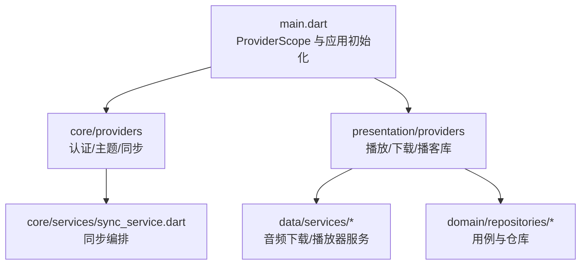
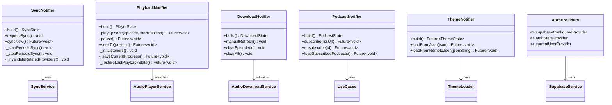
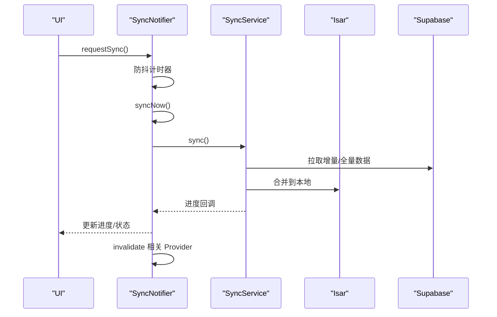
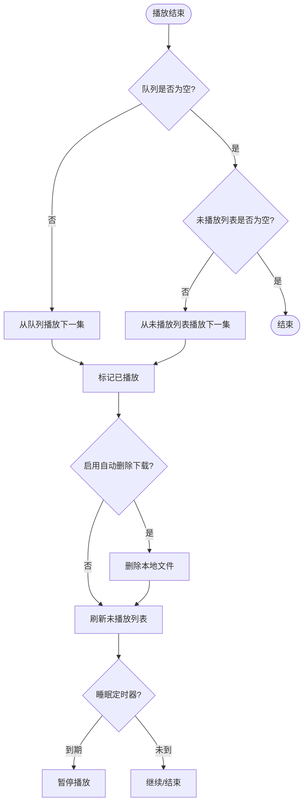
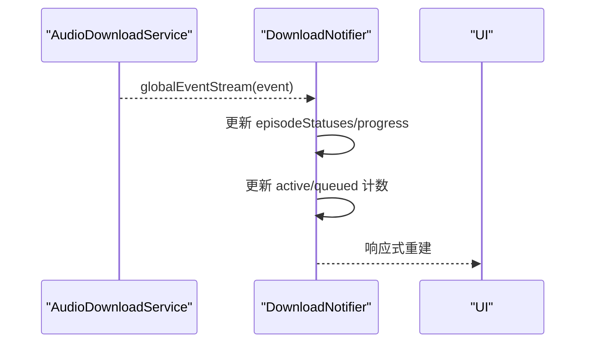
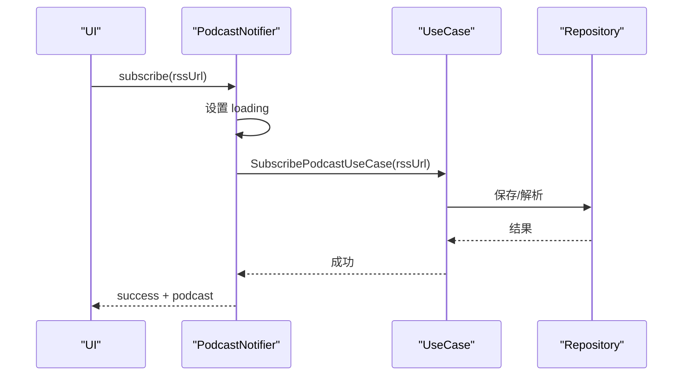
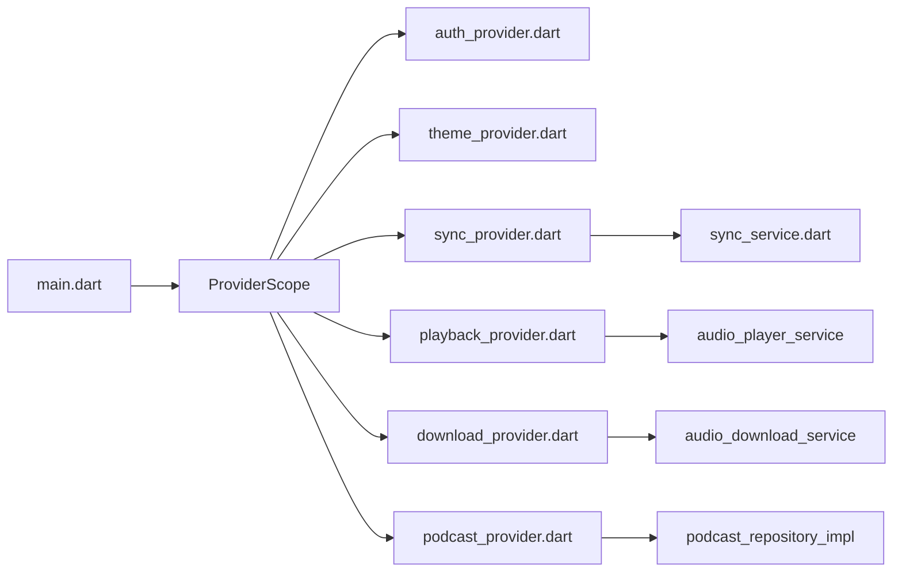

# 状态管理

<cite>
**本文引用的文件**   
- [pubspec.yaml](file://pubspec.yaml)
- [main.dart](file://main.dart)
- [base_provider.dart](file://lib/presentation/providers/base_provider.dart)
- [auth_provider.dart](file://lib/core/providers/auth_provider.dart)
- [theme_provider.dart](file://lib/core/providers/theme_provider.dart)
- [sync_provider.dart](file://lib/core/providers/sync_provider.dart)
- [sync_service.dart](file://lib/core/services/sync_service.dart)
- [download_provider.dart](file://lib/presentation/providers/download_provider.dart)
- [playback_provider.dart](file://lib/presentation/providers/playback_provider.dart)
- [podcast_provider.dart](file://lib/presentation/providers/podcast_provider.dart)
</cite>

## 目录
1. [简介](#简介)
2. [项目结构](#项目结构)
3. [核心组件](#核心组件)
4. [架构总览](#架构总览)
5. [详细组件分析](#详细组件分析)
6. [依赖关系分析](#依赖关系分析)
7. [性能考量](#性能考量)
8. [故障排查指南](#故障排查指南)
9. [结论](#结论)
10. [附录](#附录)

## 简介
本文件为 TinyCast 应用的状态管理文档，聚焦 Riverpod 3.x 的使用方式与 Provider 设计模式实现。内容涵盖：
- 状态定义、更新机制与依赖注入最佳实践
- 异步状态处理、错误处理策略
- 性能优化方法（防抖、节流、缓存、按需重建）
- 完整示例：自定义 Notifier/AsyncNotifier、复杂状态流、跨组件共享

TinyCast 已迁移至 Riverpod 3.x，采用 Notifier/AsyncNotifier 替代旧版 StateNotifier，并通过 ProviderScope 提供全局依赖注入。

## 项目结构
- 入口与生命周期
  - main.dart 负责初始化 ProviderScope、平台窗口、数据库、音频服务、主题加载等，并启动应用。
- 状态管理层
  - core/providers：认证、同步、主题等核心状态
  - presentation/providers：播放、下载、播客库、队列、设置等 UI 层状态
  - base_provider.dart：通用 Provider 构建工具
- 业务服务层
  - core/services/sync_service.dart：云端同步编排与合并策略
  - data/services/*：音频下载、播放器服务等
- 数据层
  - Isar 本地数据库、Supabase 远程数据源

图表来源
- [main.dart:106-176](file://main.dart#L106-L176)
- [sync_service.dart:80-127](file://lib/core/services/sync_service.dart#L80-L127)

章节来源
- [main.dart:106-176](file://main.dart#L106-L176)
- [pubspec.yaml:54-58](file://pubspec.yaml#L54-L58)

## 核心组件
- 基础 Provider 封装
  - BaseProvider 提供 create/createAsync/createStream 等便捷工厂，统一创建 Provider/FutureProvider/StreamProvider。
- 认证状态
  - auth_provider.dart：基于 Supabase 的 StreamProvider 暴露当前用户与配置状态。
- 主题状态
  - theme_provider.dart：使用 AsyncNotifierProvider 加载 HOCON 主题配置，失败回退默认值。
- 同步状态
  - sync_provider.dart：SyncNotifier 管理定时同步、进度、错误；登录态变化自动启停。
- 播放状态
  - playback_provider.dart：PlaybackNotifier 订阅播放器事件流，持久化播放进度，处理连续播放与睡眠定时器。
- 下载状态
  - download_provider.dart：DownloadNotifier 订阅全局下载事件，维护各剧集下载状态与进度。
- 播客库状态
  - podcast_provider.dart：PodcastNotifier 管理订阅/取消订阅、列表加载、最新剧集查询等。

章节来源
- [base_provider.dart:1-28](file://lib/presentation/providers/base_provider.dart#L1-L28)
- [auth_provider.dart:1-22](file://lib/core/providers/auth_provider.dart#L1-L22)
- [theme_provider.dart:1-92](file://lib/core/providers/theme_provider.dart#L1-L92)
- [sync_provider.dart:1-168](file://lib/core/providers/sync_provider.dart#L1-L168)
- [playback_provider.dart:1-766](file://lib/presentation/providers/playback_provider.dart#L1-L766)
- [download_provider.dart:1-156](file://lib/presentation/providers/download_provider.dart#L1-L156)
- [podcast_provider.dart:1-264](file://lib/presentation/providers/podcast_provider.dart#L1-L264)

## 架构总览
Riverpod 3.x 在 TinyCast 中的整体架构：
- 入口通过 ProviderScope 包裹应用，所有 Notifier/Provider 可被任意 Widget 访问
- 状态以 Notifier/AsyncNotifier 为中心，内部监听外部服务或流，将结果写入 state
- UI 通过 ref.watch/ref.read 消费状态，变更时仅重建所需部分
- 跨层依赖通过 Provider 注入（如 UseCase、Repository、Service）

图表来源
- [sync_provider.dart:41-155](file://lib/core/providers/sync_provider.dart#L41-L155)
- [playback_provider.dart:64-101](file://lib/presentation/providers/playback_provider.dart#L64-L101)
- [download_provider.dart:51-94](file://lib/presentation/providers/download_provider.dart#L51-L94)
- [podcast_provider.dart:98-106](file://lib/presentation/providers/podcast_provider.dart#L98-L106)
- [theme_provider.dart:65-77](file://lib/core/providers/theme_provider.dart#L65-L77)
- [auth_provider.dart:5-21](file://lib/core/providers/auth_provider.dart#L5-L21)

## 详细组件分析

### 同步状态（SyncNotifier）
- 状态模型
  - SyncState：status、lastSyncTime、progress、errorMessage
- 关键行为
  - build：监听认证状态，登录后启动周期同步与首次同步
  - requestSync：防抖触发一次同步
  - syncNow：执行同步流程，更新进度与错误，完成后刷新相关 Provider
- 错误处理
  - try/catch 捕获异常，设置 error 状态并记录日志
- 性能优化
  - 周期同步间隔、防抖延迟、ref.invalidate 精准刷新

图表来源
- [sync_provider.dart:103-151](file://lib/core/providers/sync_provider.dart#L103-L151)
- [sync_service.dart:80-127](file://lib/core/services/sync_service.dart#L80-L127)

章节来源
- [sync_provider.dart:1-168](file://lib/core/providers/sync_provider.dart#L1-L168)
- [sync_service.dart:80-127](file://lib/core/services/sync_service.dart#L80-L127)

### 播放状态（PlaybackNotifier）
- 状态模型
  - PlayerState：currentEpisode、isPlaying、currentPosition、duration、speed、volume
- 关键行为
  - build：订阅播放器事件流，恢复上次播放状态与设置
  - playEpisode：创建/更新播放历史，加载音频
  - pause/togglePlayPause：保存进度并请求同步
  - seekTo：跳转并判断是否完成
  - _onEpisodeCompleted：移除队列项、标记已播放、可选删除下载、刷新未播放列表、连续播放
- 错误处理
  - 多处 try/catch 保护，避免崩溃
- 性能优化
  - 周期性自动保存（时间+进度阈值），减少 I/O
  - 仅在必要时刷新相关 Provider

图表来源
- [playback_provider.dart:216-265](file://lib/presentation/providers/playback_provider.dart#L216-L265)
- [playback_provider.dart:361-411](file://lib/presentation/providers/playback_provider.dart#L361-L411)

章节来源
- [playback_provider.dart:1-766](file://lib/presentation/providers/playback_provider.dart#L1-L766)

### 下载状态（DownloadNotifier）
- 状态模型
  - DownloadState：episodeStatuses、episodeProgress、activeDownloads、queuedDownloads、lastUpdateTime
- 关键行为
  - build：订阅全局下载事件流，更新状态与计数
  - manualRefresh/clearEpisode/clearAll：手动刷新与清理
- 错误处理
  - 事件流 onError 记录日志
- 性能优化
  - 按 episodeId 增量更新 Map，避免全量重建

图表来源
- [download_provider.dart:51-94](file://lib/presentation/providers/download_provider.dart#L51-L94)

章节来源
- [download_provider.dart:1-156](file://lib/presentation/providers/download_provider.dart#L1-L156)

### 播客库状态（PodcastNotifier）
- 状态模型
  - PodcastState：status、podcast、podcasts、episodes、errorMessage
- 关键行为
  - subscribe/unsubscribe：调用 UseCase，更新状态
  - loadSubscribedPodcasts：保留现有数据防止闪烁，失败回滚
  - latestEpisodesProvider/podcastByIdProvider：FutureProvider.family 参数化查询
- 错误处理
  - 统一 catch 设置 error 状态与消息
- 性能优化
  - 保留旧数据、排序后返回、Family Provider 缓存

图表来源
- [podcast_provider.dart:119-133](file://lib/presentation/providers/podcast_provider.dart#L119-L133)
- [podcast_provider.dart:248-263](file://lib/presentation/providers/podcast_provider.dart#L248-L263)

章节来源
- [podcast_provider.dart:1-264](file://lib/presentation/providers/podcast_provider.dart#L1-L264)

### 主题状态（ThemeNotifier）
- 状态模型
  - ThemeState：lightConfig、darkConfig，支持按亮度选择
- 关键行为
  - build：异步加载主题配置，失败回退默认
  - loadFromJson/loadFromRemoteJson：动态覆盖主题
- 错误处理
  - 捕获异常并返回默认主题
- 性能优化
  - AsyncNotifier 缓存异步结果，避免重复加载

章节来源
- [theme_provider.dart:1-92](file://lib/core/providers/theme_provider.dart#L1-L92)

### 认证状态（Auth Providers）
- 状态模型
  - supabaseConfiguredProvider：布尔值表示是否已配置
  - authStateProvider：StreamProvider<User?> 监听认证状态变化
  - currentUserProvider：当前用户快照
- 关键行为
  - 未初始化时返回空流，避免 UI 报错
- 错误处理
  - 安全读取 currentUser/onAuthStateChange

章节来源
- [auth_provider.dart:1-22](file://lib/core/providers/auth_provider.dart#L1-L22)

### 基础 Provider 封装（BaseProvider）
- 提供 create/createAsync/createStream/lazy 等工厂方法
- 简化 Provider 创建，统一风格

章节来源
- [base_provider.dart:1-28](file://lib/presentation/providers/base_provider.dart#L1-L28)

## 依赖关系分析
- 入口依赖
  - main.dart 初始化 Isar、AudioPlayerService、Logger、Supabase，并启动 ProviderScope
- 状态依赖
  - SyncNotifier 依赖 SyncService、Auth 状态
  - PlaybackNotifier 依赖 AudioPlayerService、Settings、PlayHistory
  - DownloadNotifier 依赖 AudioDownloadService
  - PodcastNotifier 依赖 UseCase/Repository
  - ThemeNotifier 依赖 ThemeLoader
- 外部依赖
  - pubspec.yaml 声明 riverpod/flutter_riverpod 版本

图表来源
- [main.dart:106-176](file://main.dart#L106-L176)
- [pubspec.yaml:54-58](file://pubspec.yaml#L54-L58)

章节来源
- [main.dart:106-176](file://main.dart#L106-L176)
- [pubspec.yaml:54-58](file://pubspec.yaml#L54-L58)

## 性能考量
- 防抖与节流
  - 同步请求防抖（10s），避免频繁触发
- 增量更新
  - 下载状态按 episodeId 增量更新 Map，避免全量重建
- 缓存与懒加载
  - FutureProvider.family 缓存参数化查询结果
  - AsyncNotifier 缓存异步结果
- 精确刷新
  - ref.invalidate 仅刷新必要 Provider，减少重绘
- 条件渲染
  - 保留旧数据防止 UI 闪烁（如播客列表加载）
- 资源释放
  - ref.onDispose 取消订阅与定时器，避免内存泄漏

[本节为通用指导，不直接分析具体文件]

## 故障排查指南
- 常见问题
  - 同步失败：检查 canSync（是否已登录）、网络、Supabase 配置
  - 播放状态不同步：确认进度保存逻辑与自动保存阈值
  - 下载状态不更新：检查全局事件流是否正常推送
  - 主题加载失败：回退默认主题，检查配置文件格式
- 定位方法
  - 查看 Logger 输出（文件日志）
  - 使用 ref.listen 观察状态变化
  - 断点调试 Notifier 的 build 与关键方法

章节来源
- [sync_service.dart:80-127](file://lib/core/services/sync_service.dart#L80-L127)
- [playback_provider.dart:361-411](file://lib/presentation/providers/playback_provider.dart#L361-L411)
- [download_provider.dart:84-87](file://lib/presentation/providers/download_provider.dart#L84-L87)
- [theme_provider.dart:67-77](file://lib/core/providers/theme_provider.dart#L67-L77)

## 结论
TinyCast 基于 Riverpod 3.x 的 Notifier/AsyncNotifier 实现了清晰、可扩展的状态管理：
- 状态与逻辑解耦，易于测试与维护
- 通过 Provider 注入实现松耦合依赖
- 完善的异步与错误处理保障稳定性
- 多项性能优化提升用户体验

建议在新功能开发中遵循：
- 使用 Notifier/AsyncNotifier 管理复杂状态
- 使用 Family Provider 进行参数化查询
- 合理使用 ref.listen/ref.invalidate 控制刷新范围
- 保持状态不可变更新（copyWith）

[本节为总结性内容，不直接分析具体文件]

## 附录
- Riverpod 3.x 迁移要点
  - StateNotifier → Notifier
  - StateNotifierProvider → NotifierProvider
  - valueOrNull → value
- 推荐实践
  - 状态模型使用 copyWith
  - 异步状态使用 AsyncNotifier/AsyncProvider
  - 流式状态使用 StreamProvider
  - 跨组件共享使用 NotifierProvider + ref.invalidate

[本节为补充信息，不直接分析具体文件]