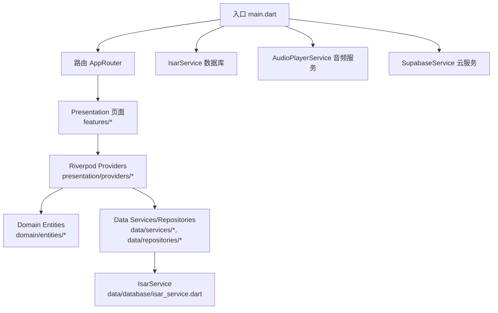
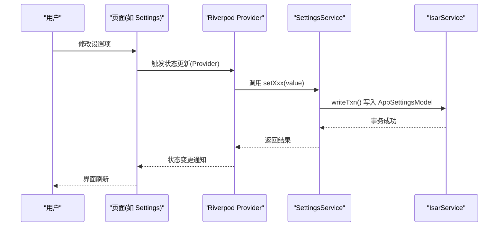
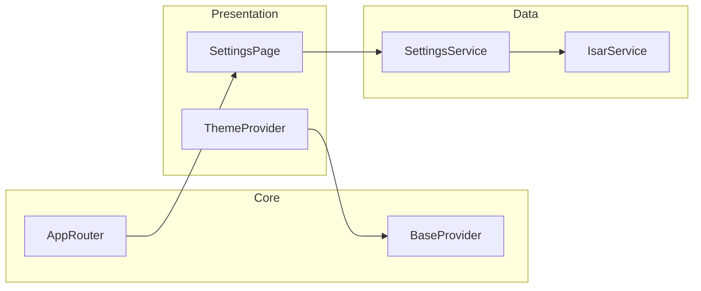

# 自定义功能开发

<cite>
**本文引用的文件**   
- [README.md](file://README.md)
- [pubspec.yaml](file://pubspec.yaml)
- [main.dart](file://lib/main.dart)
- [app_router.dart](file://lib/core/router/app_router.dart)
- [theme_provider.dart](file://lib/core/providers/theme_provider.dart)
- [isar_service.dart](file://lib/data/database/isar_service.dart)
- [settings.dart](file://lib/presentation/features/settings/settings.dart)
- [base_provider.dart](file://lib/presentation/providers/base_provider.dart)
- [settings_service.dart](file://lib/data/services/settings_service.dart)
- [app_settings.dart](file://lib/domain/entities/app_settings.dart)
</cite>

## 目录
1. [简介](#简介)
2. [项目结构](#项目结构)
3. [核心组件](#核心组件)
4. [架构总览](#架构总览)
5. [详细组件分析](#详细组件分析)
6. [依赖分析](#依赖分析)
7. [性能考虑](#性能考虑)
8. [故障排查指南](#故障排查指南)
9. [结论](#结论)
10. [附录：完整开发流程与示例](#附录完整开发流程与示例)

## 简介
本指南面向希望在 TinyCast 应用上扩展自定义功能的开发者。内容覆盖在现有架构基础上新增功能模块的规范与流程，包括页面开发、状态管理、数据持久化、用户交互、命名与代码风格要求，以及从需求到测试部署的端到端步骤。文档同时提供设置页面与进度跟踪服务等典型功能的实现思路与参考路径，帮助开发者快速产出高质量的功能模块。

## 项目结构
TinyCast 采用分层架构（presentation / domain / data）与 Riverpod 状态管理，结合 Isar 本地数据库与多窗口支持。入口 main.dart 负责初始化全局服务、主题、路由与窗口；core 层提供路由、主题、工具与服务；data 层封装数据源、仓库与模型；domain 层定义实体与用例；presentation 层组织页面与 Provider。

图表来源
- [main.dart:106-194](file://lib/main.dart#L106-L194)
- [app_router.dart:20-132](file://lib/core/router/app_router.dart#L20-L132)
- [isar_service.dart:14-59](file://lib/data/database/isar_service.dart#L14-L59)

章节来源
- [README.md:1-6](file://README.md#L1-L6)
- [pubspec.yaml:1-196](file://pubspec.yaml#L1-L196)
- [main.dart:106-194](file://lib/main.dart#L106-L194)

## 核心组件
- 应用入口与生命周期
  - main.dart 中统一初始化 Isar、音频服务、日志、Supabase，并根据参数创建不同窗口（主窗口、设置窗口、订阅窗口、节目详情窗口）。
- 路由系统
  - app_router.dart 集中管理页面路由与跳转方法，支持参数传递与多窗口打开。
- 状态管理
  - Riverpod 作为状态管理核心，BaseProvider 提供便捷工厂方法，ThemeProvider 展示 AsyncNotifier 的使用模式。
- 数据持久化
  - IsarService 单例封装数据库生命周期与常用事务操作，SettingsService 基于 Isar 读写设置并提供 Stream 监听。
- 设置页面
  - settings.dart 以 Tab + 内容区的方式组织通用、播放、云同步、缓存等子页。

章节来源
- [main.dart:106-194](file://lib/main.dart#L106-L194)
- [app_router.dart:20-132](file://lib/core/router/app_router.dart#L20-L132)
- [base_provider.dart:1-28](file://lib/presentation/providers/base_provider.dart#L1-L28)
- [theme_provider.dart:1-92](file://lib/core/providers/theme_provider.dart#L1-L92)
- [isar_service.dart:14-59](file://lib/data/database/isar_service.dart#L14-L59)
- [settings_service.dart:1-63](file://lib/data/services/settings_service.dart#L1-L63)
- [settings.dart:1-60](file://lib/presentation/features/settings/settings.dart#L1-L60)

## 架构总览
下图展示了从 UI 到数据层的调用链与数据流向，体现“页面 → Provider → Service/Repository → Isar”的标准路径。

图表来源
- [settings.dart:1-60](file://lib/presentation/features/settings/settings.dart#L1-L60)
- [base_provider.dart:1-28](file://lib/presentation/providers/base_provider.dart#L1-L28)
- [settings_service.dart:65-82](file://lib/data/services/settings_service.dart#L65-L82)
- [isar_service.dart:38-59](file://lib/data/database/isar_service.dart#L38-L59)

## 详细组件分析

### 入口与多窗口初始化（main.dart）
- 职责
  - 平台分支处理（移动端 vs 桌面端）
  - 窗口参数解析与对应窗口应用启动
  - 全局服务初始化（Isar、AudioPlayer、Logger、Supabase）
  - 生命周期观察者注册（FeedRefreshScheduler）
- 关键点
  - AppConfig.fromEnvironment 通过编译时参数注入 Supabase 配置
  - WindowController.create 用于打开新窗口并传入 JSON 参数
  - WidgetsBindingObserver 监听应用生命周期，调度后台任务

章节来源
- [main.dart:28-39](file://lib/main.dart#L28-L39)
- [main.dart:47-72](file://lib/main.dart#L47-L72)
- [main.dart:106-177](file://lib/main.dart#L106-L177)
- [main.dart:179-194](file://lib/main.dart#L179-L194)

### 路由系统（app_router.dart）
- 职责
  - 集中式路由生成与导航辅助方法
  - 支持参数类型兼容（int/对象/Map）
  - 多窗口打开（设置、订阅）
- 关键点
  - generateRoute 根据名称返回 PageRouteBuilder
  - navigateTo/navigateToAndRemoveUntil/navigateToAndReplace/pop/popUntil 封装 Navigator 行为
  - openSettingsWindow/openSubscribeWindow 使用 WindowController 打开独立窗口

章节来源
- [app_router.dart:20-132](file://lib/core/router/app_router.dart#L20-L132)
- [app_router.dart:171-185](file://lib/core/router/app_router.dart#L171-L185)

### 状态管理与主题（theme_provider.dart、base_provider.dart）
- BaseProvider
  - 提供 create/createAsync/createStream/createLazy 工厂，简化 Provider 声明
- ThemeProvider
  - 使用 AsyncNotifierProvider 加载主题配置，失败回退默认值
  - 支持从 JSON/远程字符串加载主题配置

章节来源
- [base_provider.dart:1-28](file://lib/presentation/providers/base_provider.dart#L1-L28)
- [theme_provider.dart:1-92](file://lib/core/providers/theme_provider.dart#L1-L92)

### 数据持久化（isar_service.dart）
- 职责
  - Isar 单例管理（open/close/clear/deleteDatabase）
  - 版本控制与调试开关（inspector）
  - 常见事务封装（如更新 episode 下载状态）
- 关键点
  - 未初始化访问抛出 StateError
  - 文件系统异常与通用异常统一包装为业务异常

章节来源
- [isar_service.dart:14-59](file://lib/data/database/isar_service.dart#L14-L59)
- [isar_service.dart:106-135](file://lib/data/database/isar_service.dart#L106-L135)

### 设置服务与实体（settings_service.dart、app_settings.dart）
- SettingsService
  - 读取/监听设置（loadSettings/watchSettings），Stream 支持多窗口同步
  - 字段级 setter（setPlaybackSpeed/setVolume/...）
  - 首次启动迁移 SharedPreferences → Isar
  - 枚举映射（AutoDownloadPolicy/SleepTimerOption/FeedRefreshInterval）
- AppSettings
  - 领域实体与默认值
  - copyWith/toJson/fromJson 支持不可变更新与序列化

章节来源
- [settings_service.dart:1-63](file://lib/data/services/settings_service.dart#L1-L63)
- [settings_service.dart:84-152](file://lib/data/services/settings_service.dart#L84-L152)
- [settings_service.dart:154-191](file://lib/data/services/settings_service.dart#L154-L191)
- [app_settings.dart:1-25](file://lib/domain/entities/app_settings.dart#L1-L25)
- [app_settings.dart:64-100](file://lib/domain/entities/app_settings.dart#L64-L100)
- [app_settings.dart:138-174](file://lib/domain/entities/app_settings.dart#L138-L174)

### 设置页面（settings.dart）
- 职责
  - Tab 切换（通用/播放/云同步/缓存）
  - 内容区渲染当前页
- 关键点
  - 内部 _currentPage 状态驱动页面切换
  - 可扩展新的子页并在 switch 中注册

章节来源
- [settings.dart:1-60](file://lib/presentation/features/settings/settings.dart#L1-L60)

## 依赖分析
- 外部依赖（节选）
  - 状态管理：riverpod/flutter_riverpod
  - 数据库：isar_community/isar_community_flutter_libs
  - 网络：dio/dio_http2_adapter/connectivity_plus
  - 音频：just_audio/audio_service
  - 国际化与格式化：intl
  - 安全存储：flutter_secure_storage
  - 云服务：supabase_flutter
- 内部依赖关系
  - presentation → core/providers → data/services → data/database/isar_service
  - main.dart 初始化顺序：Isar → AudioPlayer → Logger → Supabase

图表来源
- [settings.dart:1-60](file://lib/presentation/features/settings/settings.dart#L1-L60)
- [theme_provider.dart:1-92](file://lib/core/providers/theme_provider.dart#L1-L92)
- [base_provider.dart:1-28](file://lib/presentation/providers/base_provider.dart#L1-L28)
- [settings_service.dart:1-63](file://lib/data/services/settings_service.dart#L1-L63)
- [isar_service.dart:14-59](file://lib/data/database/isar_service.dart#L14-L59)
- [app_router.dart:20-132](file://lib/core/router/app_router.dart#L20-L132)

章节来源
- [pubspec.yaml:1-196](file://pubspec.yaml#L1-L196)

## 性能考虑
- 数据库
  - 使用 Isar 的事务批量写入，避免频繁 IO
  - watch 流仅在需要时订阅，减少不必要的重建
- 状态管理
  - 使用 AsyncNotifier/FutureProvider 做异步加载，避免阻塞 UI
  - Provider 粒度尽量细，按需重建
- 网络与缓存
  - 合理使用 dio 拦截器与缓存策略
  - 图片使用 cached_network_image 并设置占位与错误图
- 音频与后台任务
  - audio_service 保持后台播放，注意资源释放
  - FeedRefreshScheduler 遵循应用生命周期，避免后台过度唤醒

[本节为通用指导，不直接分析具体文件]

## 故障排查指南
- 数据库未初始化
  - 现象：访问 isar 抛出 StateError
  - 排查：确认 main 中已调用 IsarService.instance.open()
- 设置未生效
  - 现象：UI 未更新或跨窗口不同步
  - 排查：检查是否通过 SettingsService 的 setter 写入，是否订阅了 watchSettings
- Supabase 未连接
  - 现象：云服务相关功能不可用
  - 排查：确认 --dart-define 传入有效凭据且 AppConfig.isPlaceholder 为 false
- 路由跳转无效
  - 现象：navigateTo 无响应或页面空白
  - 排查：检查 AppRoutes 常量与 generateRoute 分支是否匹配

章节来源
- [isar_service.dart:31-36](file://lib/data/database/isar_service.dart#L31-L36)
- [settings_service.dart:43-63](file://lib/data/services/settings_service.dart#L43-L63)
- [main.dart:47-72](file://lib/main.dart#L47-L72)
- [app_router.dart:20-132](file://lib/core/router/app_router.dart#L20-L132)

## 结论
TinyCast 的分层架构与 Riverpod 状态管理为功能扩展提供了清晰边界与稳定基础。按照本文规范新增页面、Provider、Service 与数据模型，可高效实现设置、下载、播放等能力。建议在开发过程中严格遵循命名与目录约定，完善错误处理与日志记录，并通过单元测试与集成测试保障质量。

[本节为总结性内容，不直接分析具体文件]

## 附录：完整开发流程与示例

### 一、新增功能模块标准流程
1. 需求分析与设计
   - 明确输入输出、状态、持久化与交互
   - 确定是否需要多窗口、后台任务或云服务
2. 领域建模（domain/entities）
   - 新增实体与枚举，提供默认值与序列化方法
3. 数据层（data）
   - 新增 Isar 模型（models/*.g.dart 由生成器生成）
   - 新增 Service/Repository，封装读写逻辑与事务
   - 如需迁移，增加迁移脚本
4. 状态管理（presentation/providers）
   - 使用 BaseProvider 或 AsyncNotifierProvider 管理状态
   - 暴露必要的读/写方法与事件
5. 页面与交互（presentation/features）
   - 新建页面与子组件，接入 Provider
   - 处理用户输入、错误提示与加载态
6. 路由与入口
   - 在 AppRouter 中注册路由与导航方法
   - 如需多窗口，参考 openSettingsWindow 的实现
7. 测试与验证
   - 单元测试：Provider/Service 逻辑
   - Widget 测试：页面交互
   - 集成测试：端到端流程
8. 发布与部署
   - 环境变量注入（如 Supabase 配置）
   - 构建产物校验与回归测试

### 二、示例：新增“设置”子页（播放设置）
- 目标
  - 在设置页新增“播放设置”子页，包含播放速度、音量、前进后退时间、连续播放、睡眠定时器等
- 步骤
  1) 领域实体
     - 在 app_settings.dart 中确认枚举与默认值
  2) 数据服务
     - 在 settings_service.dart 中新增 setter 与映射方法
  3) Provider
     - 新增或复用 SettingsProvider，暴露 watchSettings 与 setXxx 方法
  4) 页面
     - 在 settings.dart 的 switch 中添加新页面分支
     - 新建 PlaySettings 页面，绑定 Provider 与 Service
  5) 路由
     - 若需独立窗口，参考 openSettingsWindow 的模式
  6) 测试
     - 单元测试：setter 写入与映射正确性
     - Widget 测试：控件联动与状态更新
- 参考路径
  - [settings.dart:45-58](file://lib/presentation/features/settings/settings.dart#L45-L58)
  - [settings_service.dart:105-152](file://lib/data/services/settings_service.dart#L105-L152)
  - [app_settings.dart:64-100](file://lib/domain/entities/app_settings.dart#L64-L100)

### 三、示例：新增“进度跟踪服务”
- 目标
  - 记录播放进度（时间戳、百分比、集数 ID），支持查询与增量更新
- 步骤
  1) 领域实体
     - 新增 PlayHistory 实体（id、episodeId、position、duration、updatedAt）
  2) 数据层
     - 新增 Isar 模型与索引（按 episodeId、updatedAt）
     - 新增 service/repository：updateProgress/getProgressByEpisode
  3) Provider
     - 暴露 getProgress、watchProgress、updateProgress
  4) 页面
     - 在播放器或剧集详情页显示进度条与点击跳转
  5) 测试
     - 单元测试：进度计算与去重
     - Widget 测试：进度条拖动与保存
- 参考路径
  - [isar_service.dart:106-135](file://lib/data/database/isar_service.dart#L106-L135)
  - [settings_service.dart:65-82](file://lib/data/services/settings_service.dart#L65-L82)

### 四、命名与代码风格要求
- 目录与命名
  - features 下按功能划分目录，文件名小写下划线分隔
  - providers 以功能名_provider.dart 命名
  - services 以功能名_service.dart 命名
  - entities/models 区分领域实体与数据模型
- 代码风格
  - 使用 const 构造与不可变对象（copyWith）
  - 错误统一抛出自定义异常，并记录日志
  - Provider 粒度细化，避免大范围重建
  - 异步操作使用 try/catch 包裹并返回友好错误

### 五、从需求到测试部署的检查清单
- 需求与设计评审完成
- 领域实体与数据模型定义完备
- Service/Repository 接口清晰，事务与异常处理完善
- Provider 暴露必要状态与事件，订阅合理
- 页面交互流畅，错误提示与加载态完善
- 路由注册与多窗口支持到位
- 单元测试覆盖率达标，Widget 测试覆盖关键交互
- 集成测试验证端到端流程
- 环境变量与构建参数配置正确
- 发布前回归测试与性能评估通过