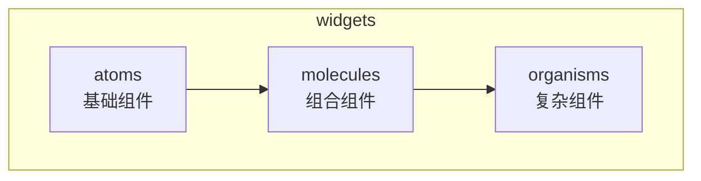
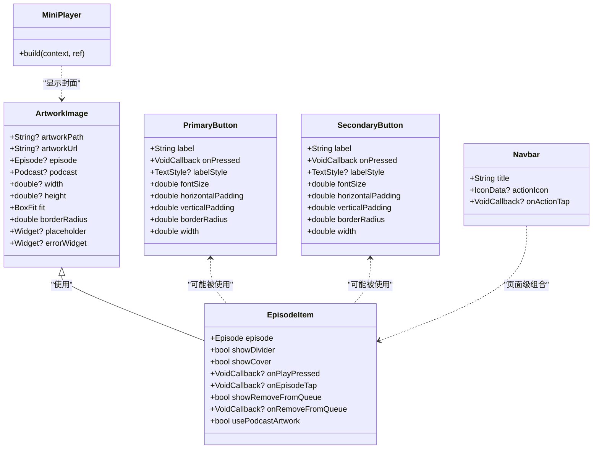
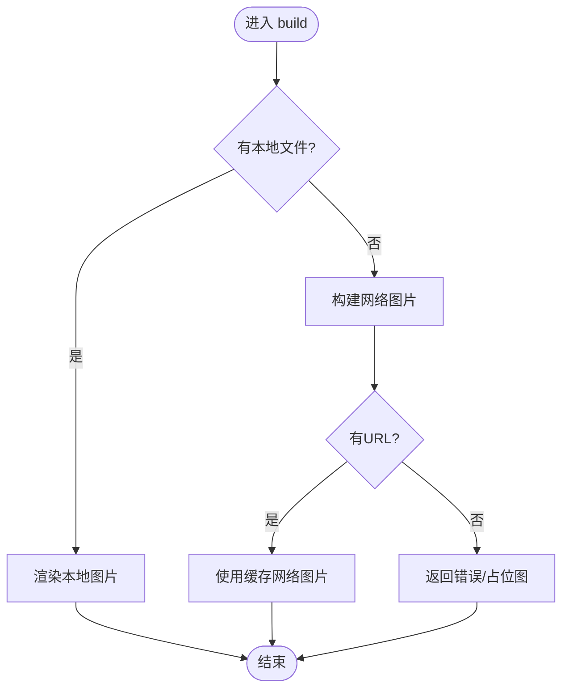
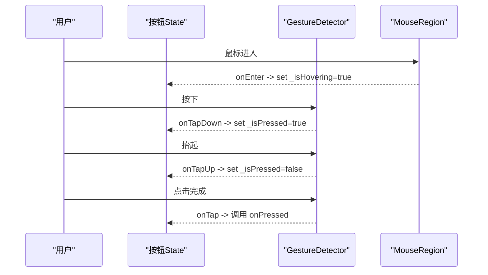
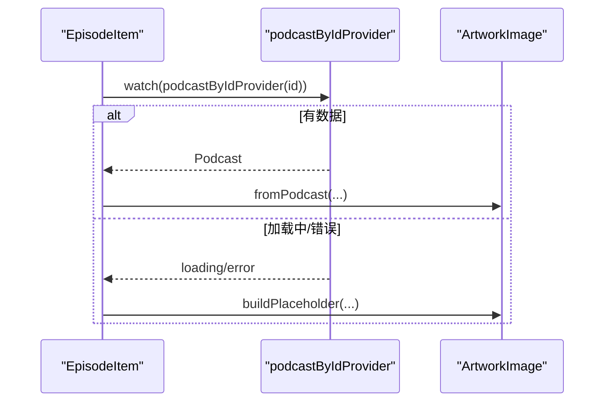
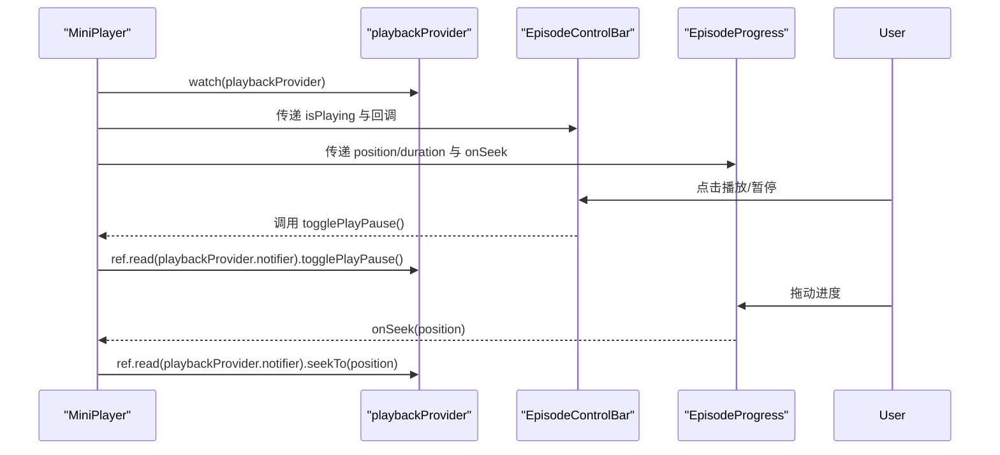
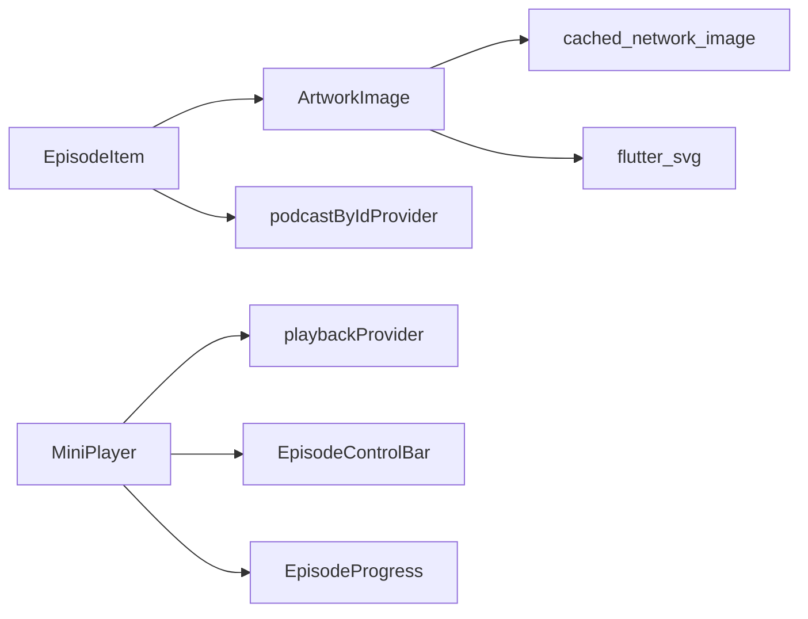

# Widget 组件开发

<cite>
**本文引用的文件**   
- [README.md](file://README.md)
- [pubspec.yaml](file://pubspec.yaml)
- [lib/presentation/widgets/atoms/buttons/primary_button.dart](file://lib/presentation/widgets/atoms/buttons/primary_button.dart)
- [lib/presentation/widgets/atoms/buttons/secondary_button.dart](file://lib/presentation/widgets/atoms/buttons/secondary_button.dart)
- [lib/presentation/widgets/atoms/artwork_image/artwork_image.dart](file://lib/presentation/widgets/atoms/artwork_image/artwork_image.dart)
- [lib/presentation/widgets/molecules/episode_item/episode_item.dart](file://lib/presentation/widgets/molecules/episode_item/episode_item.dart)
- [lib/presentation/widgets/molecules/breadcrumb/breadcrumb.dart](file://lib/presentation/widgets/molecules/breadcrumb/breadcrumb.dart)
- [lib/presentation/widgets/organisms/navbar/navbar.dart](file://lib/presentation/widgets/organisms/navbar/navbar.dart)
- [lib/presentation/widgets/organisms/mini_player/mini_player.dart](file://lib/presentation/widgets/organisms/mini_player/mini_player.dart)
</cite>

## 目录
1. [简介](#简介)
2. [项目结构](#项目结构)
3. [核心组件](#核心组件)
4. [架构总览](#架构总览)
5. [详细组件分析](#详细组件分析)
6. [依赖关系分析](#依赖关系分析)
7. [性能考虑](#性能考虑)
8. [故障排查指南](#故障排查指南)
9. [结论](#结论)
10. [附录](#附录)

## 简介
本文件面向 TinyCast 应用的 Widget 组件开发，系统化阐述原子设计模式在 Flutter 中的落地实践，覆盖 atoms（基础组件）、molecules（组合组件）与 organisms（复杂组件）的层次划分、命名规范、Props 定义、事件处理、样式定制、状态管理与响应式最佳实践。文档同时提供可复用的组件开发示例路径与测试建议，帮助团队构建高质量、可维护且高性能的 UI 组件库。

## 项目结构
TinyCast 的 UI 层位于 lib/presentation/widgets 下，按原子设计模式组织：
- atoms：最小粒度的 UI 单元，如按钮、图片、单选/多选控件等
- molecules：由 atoms 组合而成的业务片段，如剧集条目、面包屑导航等
- organisms：更复杂的页面级或功能块组件，如迷你播放器、导航栏等

**章节来源**
- [README.md:1-6](file://README.md#L1-L6)
- [pubspec.yaml:180-196](file://pubspec.yaml#L180-L196)

## 核心组件
本节聚焦三个关键组件：ArtworkImage（图片加载与缓存）、PrimaryButton/SecondaryButton（交互按钮）、EpisodeItem（剧集条目组合）。它们分别代表 atoms、molecules 的典型实现，并体现状态管理、错误处理与性能优化策略。

- ArtworkImage（atoms）
  - 职责：统一处理本地文件优先、网络图片回退、占位图与错误图；支持圆角、尺寸与填充方式；可选从 Episode/Podcast 对象构造
  - Props：artworkPath、artworkUrl、episode、podcast、width、height、fit、borderRadius、placeholder、errorWidget
  - 事件：无直接回调，内部通过后台下载更新自身状态
  - 状态管理：内部 State 持有 _localFile、_isCheckingLocal、_downloadTriggered
  - 性能：本地优先、异步微任务触发下载、避免重复请求、条件渲染

- PrimaryButton / SecondaryButton（atoms）
  - 职责：提供带悬停与按下反馈的按钮，支持自定义文字样式、尺寸与圆角
  - Props：label、onPressed、labelStyle、fontSize、horizontalPadding、verticalPadding、borderRadius、width
  - 事件：onPressed 回调；MouseRegion + GestureDetector 处理 hover/press
  - 状态管理：State 内 _isHovering、_isPressed；AnimatedContainer 驱动过渡动画

- EpisodeItem（molecules）
  - 职责：组合封面图与信息区，支持播放、跳转、移除队列等动作；可选择使用播客封面或剧集封面
  - Props：episode、showDivider、showCover、onPlayPressed、onEpisodeTap、showRemoveFromQueue、onRemoveFromQueue、usePodcastArtwork
  - 事件：透传 onPlayPressed、onEpisodeTap、onRemoveFromQueue
  - 状态管理：ConsumerWidget 订阅 podcastByIdProvider，按需展示封面与占位

**章节来源**
- [lib/presentation/widgets/atoms/artwork_image/artwork_image.dart:14-91](file://lib/presentation/widgets/atoms/artwork_image/artwork_image.dart#L14-L91)
- [lib/presentation/widgets/atoms/buttons/primary_button.dart:3-42](file://lib/presentation/widgets/atoms/buttons/primary_button.dart#L3-L42)
- [lib/presentation/widgets/atoms/buttons/secondary_button.dart:8-47](file://lib/presentation/widgets/atoms/buttons/secondary_button.dart#L8-L47)
- [lib/presentation/widgets/molecules/episode_item/episode_item.dart:8-28](file://lib/presentation/widgets/molecules/episode_item/episode_item.dart#L8-L28)

## 架构总览
下图展示了从 atoms 到 molecules 再到 organisms 的组合关系，以及 MiniPlayer 对播放状态 Provider 的订阅与事件分发。

**图表来源**
- [lib/presentation/widgets/atoms/buttons/primary_button.dart:3-42](file://lib/presentation/widgets/atoms/buttons/primary_button.dart#L3-L42)
- [lib/presentation/widgets/atoms/buttons/secondary_button.dart:8-47](file://lib/presentation/widgets/atoms/buttons/secondary_button.dart#L8-L47)
- [lib/presentation/widgets/atoms/artwork_image/artwork_image.dart:14-91](file://lib/presentation/widgets/atoms/artwork_image/artwork_image.dart#L14-L91)
- [lib/presentation/widgets/molecules/episode_item/episode_item.dart:8-28](file://lib/presentation/widgets/molecules/episode_item/episode_item.dart#L8-L28)
- [lib/presentation/widgets/organisms/navbar/navbar.dart:5-15](file://lib/presentation/widgets/organisms/navbar/navbar.dart#L5-L15)
- [lib/presentation/widgets/organisms/mini_player/mini_player.dart:9-15](file://lib/presentation/widgets/organisms/mini_player/mini_player.dart#L9-L15)

## 详细组件分析

### ArtworkImage（atoms）
- 设计要点
  - 本地优先：先检查本地文件，存在则直接渲染；不存在则尝试网络加载
  - 后台下载：若缺少本地文件且有 URL，触发后台下载并更新 UI
  - 占位与错误：支持自定义 placeholder 与 errorWidget，默认使用 SVG 占位
  - 圆角与尺寸：统一通过 ClipRRect 与尺寸参数控制
- 数据流
  - initState 中检查本地文件并可能触发下载
  - didUpdateWidget 监听属性变化，重置状态并重新检查
  - build 根据 _localFile 决定渲染本地文件或网络图片
- 复杂度与性能
  - 本地检查 O(1)，网络加载受缓存影响
  - 使用 Future.microtask 避免阻塞主线程
  - 条件渲染减少不必要的重建

**图表来源**
- [lib/presentation/widgets/atoms/artwork_image/artwork_image.dart:237-275](file://lib/presentation/widgets/atoms/artwork_image/artwork_image.dart#L237-L275)

**章节来源**
- [lib/presentation/widgets/atoms/artwork_image/artwork_image.dart:99-113](file://lib/presentation/widgets/atoms/artwork_image/artwork_image.dart#L99-L113)
- [lib/presentation/widgets/atoms/artwork_image/artwork_image.dart:145-178](file://lib/presentation/widgets/atoms/artwork_image/artwork_image.dart#L145-L178)
- [lib/presentation/widgets/atoms/artwork_image/artwork_image.dart:180-234](file://lib/presentation/widgets/atoms/artwork_image/artwork_image.dart#L180-L234)
- [lib/presentation/widgets/atoms/artwork_image/artwork_image.dart:237-275](file://lib/presentation/widgets/atoms/artwork_image/artwork_image.dart#L237-L275)

### PrimaryButton / SecondaryButton（atoms）
- 设计要点
  - 统一的交互模型：MouseRegion 检测悬停，GestureDetector 处理点击
  - 视觉反馈：按下与悬停切换背景色，AnimatedContainer 平滑过渡
  - 可配置性：支持字体大小、内边距、圆角、宽度与自定义文本样式
- 事件处理
  - onTapDown/onTapUp/onTapCancel 管理按下状态
  - onTap 调用外部回调
- 性能
  - 局部 setState 仅更新颜色与边框
  - 悬停动画仅在进入时启用，离开时立即切换避免闪烁

**图表来源**
- [lib/presentation/widgets/atoms/buttons/primary_button.dart:52-72](file://lib/presentation/widgets/atoms/buttons/primary_button.dart#L52-L72)
- [lib/presentation/widgets/atoms/buttons/secondary_button.dart:57-77](file://lib/presentation/widgets/atoms/buttons/secondary_button.dart#L57-L77)

**章节来源**
- [lib/presentation/widgets/atoms/buttons/primary_button.dart:44-106](file://lib/presentation/widgets/atoms/buttons/primary_button.dart#L44-L106)
- [lib/presentation/widgets/atoms/buttons/secondary_button.dart:49-111](file://lib/presentation/widgets/atoms/buttons/secondary_button.dart#L49-L111)

### EpisodeItem（molecules）
- 设计要点
  - 组合封面与信息区，支持是否显示分隔线、封面、移除队列等操作
  - 封面选择：优先使用播客封面（通过 Provider 获取），否则回退到剧集封面
  - 时长格式化：将秒数转换为“X h Y min”或“Y min”
- 状态管理
  - ConsumerWidget 订阅 podcastByIdProvider，处理 data/loading/error 三种状态
- 事件透传
  - onPlayPressed、onEpisodeTap、onRemoveFromQueue 向上冒泡

**图表来源**
- [lib/presentation/widgets/molecules/episode_item/episode_item.dart:67-96](file://lib/presentation/widgets/molecules/episode_item/episode_item.dart#L67-L96)

**章节来源**
- [lib/presentation/widgets/molecules/episode_item/episode_item.dart:31-65](file://lib/presentation/widgets/molecules/episode_item/episode_item.dart#L31-L65)
- [lib/presentation/widgets/molecules/episode_item/episode_item.dart:109-122](file://lib/presentation/widgets/molecules/episode_item/episode_item.dart#L109-L122)

### Breadcrumb（molecules）
- 设计要点
  - 简单容器，横向排列多个 BreadcrumbItem
  - 适合用于页面层级导航展示

**章节来源**
- [lib/presentation/widgets/molecules/breadcrumb/breadcrumb.dart:4-15](file://lib/presentation/widgets/molecules/breadcrumb/breadcrumb.dart#L4-L15)

### Navbar（organisms）
- 设计要点
  - 标题与右侧操作按钮布局
  - 使用 SafeArea 适配安全区域
  - 可扩展为大型标题与更多操作项

**章节来源**
- [lib/presentation/widgets/organisms/navbar/navbar.dart:5-36](file://lib/presentation/widgets/organisms/navbar/navbar.dart#L5-L36)

### MiniPlayer（organisms）
- 设计要点
  - 聚合播放信息、控制条与进度条
  - 通过 playbackProvider 订阅当前播放状态与操作
  - 主题适配：根据系统亮度选择背景与间距
- 事件分发
  - 播放/暂停、前进/后退、拖动进度均通过 Provider.notifier 调用

**图表来源**
- [lib/presentation/widgets/organisms/mini_player/mini_player.dart:13-51](file://lib/presentation/widgets/organisms/mini_player/mini_player.dart#L13-L51)

**章节来源**
- [lib/presentation/widgets/organisms/mini_player/mini_player.dart:9-51](file://lib/presentation/widgets/organisms/mini_player/mini_player.dart#L9-L51)

## 依赖关系分析
- 组件间依赖
  - EpisodeItem 依赖 ArtworkImage 与 Provider（podcastByIdProvider）
  - MiniPlayer 依赖 playbackProvider 及子组件（EpisodeInfo、EpisodeControlBar、EpisodeProgress）
  - Navbar 依赖子组件（NavbarLargeTitle、NavbarButton）
- 外部依赖
  - Riverpod 用于状态管理（flutter_riverpod）
  - cached_network_image 用于网络图片缓存
  - flutter_svg 用于 SVG 资源渲染
  - just_audio/audio_service 用于音频播放与后台服务

**图表来源**
- [lib/presentation/widgets/molecules/episode_item/episode_item.dart:67-96](file://lib/presentation/widgets/molecules/episode_item/episode_item.dart#L67-L96)
- [lib/presentation/widgets/organisms/mini_player/mini_player.dart:13-51](file://lib/presentation/widgets/organisms/mini_player/mini_player.dart#L13-L51)
- [pubspec.yaml:55-66](file://pubspec.yaml#L55-L66)
- [pubspec.yaml:97-99](file://pubspec.yaml#L97-L99)
- [pubspec.yaml:30-33](file://pubspec.yaml#L30-L33)

**章节来源**
- [pubspec.yaml:55-66](file://pubspec.yaml#L55-L66)
- [pubspec.yaml:97-99](file://pubspec.yaml#L97-L99)
- [pubspec.yaml:30-33](file://pubspec.yaml#L30-L33)

## 性能考虑
- 图片加载
  - 本地优先与缓存策略减少网络开销
  - 使用占位图提升感知性能
  - 条件渲染与错误回退避免崩溃
- 状态管理
  - 使用 ConsumerWidget 精确订阅，避免不必要重建
  - Provider.notifier 进行轻量级状态变更
- 交互反馈
  - AnimatedContainer 仅在必要时启用动画
  - 悬停与按下状态局部更新，降低重建范围
- 资源管理
  - 合理设置图片尺寸与 BoxFit，避免过度缩放
  - 使用 SVG 占位图减小体积

[本节为通用指导，不直接分析具体文件]

## 故障排查指南
- 图片无法显示
  - 检查 artworkPath 是否为空或路径无效
  - 确认 artworkUrl 是否存在且可访问
  - 查看日志输出，定位本地文件检查与网络加载失败原因
- 按钮无响应
  - 确认 onPressed 已正确传入
  - 检查手势冲突或父级拦截
- 播放控制无效
  - 确保 playbackProvider 已初始化且当前有剧集
  - 检查回调是否正确转发至 Provider.notifier

**章节来源**
- [lib/presentation/widgets/atoms/artwork_image/artwork_image.dart:145-178](file://lib/presentation/widgets/atoms/artwork_image/artwork_image.dart#L145-L178)
- [lib/presentation/widgets/atoms/artwork_image/artwork_image.dart:180-234](file://lib/presentation/widgets/atoms/artwork_image/artwork_image.dart#L180-L234)
- [lib/presentation/widgets/organisms/mini_player/mini_player.dart:33-47](file://lib/presentation/widgets/organisms/mini_player/mini_player.dart#L33-L47)

## 结论
TinyCast 的 Widget 体系遵循原子设计模式，清晰划分 atoms、molecules 与 organisms，结合 Riverpod 实现响应式状态管理。通过本地优先的图片加载、精细的手势与动画反馈、以及合理的组件拆分，构建了高内聚、低耦合且易于测试的 UI 组件库。建议在后续迭代中继续完善组件文档、补充单元测试与集成测试，持续提升可维护性与用户体验。

[本节为总结性内容，不直接分析具体文件]

## 附录
- 命名规范建议
  - 组件类名采用 PascalCase，文件名使用 snake_case
  - Props 命名语义化，布尔值以 is/show/use 前缀
  - 回调以 on 开头，动词明确表达动作
- Props 定义模板
  - 必填字段使用 required，可选字段提供默认值
  - 对复杂类型提供工厂构造函数（如 fromEpisode/fromPodcast）
- 事件处理最佳实践
  - 使用 ConsumerWidget 订阅最小必要状态
  - 通过 Provider.notifier 执行状态变更，避免全局状态污染
- 样式定制
  - 使用 Theme 统一管理颜色、字体与间距
  - 组件暴露必要的样式参数（如 fontSize、borderRadius）
- 测试建议
  - 对 atoms 进行 widget 测试，验证渲染与交互
  - 对 molecules 与 organisms 进行集成测试，验证状态联动
  - 使用 mock 模拟 Provider 与外部依赖

[本节为通用指导，不直接分析具体文件]