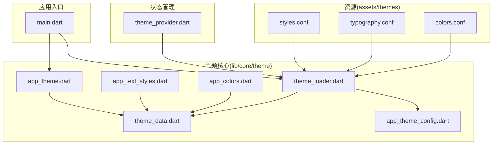
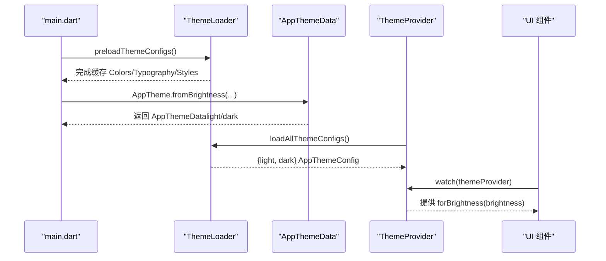
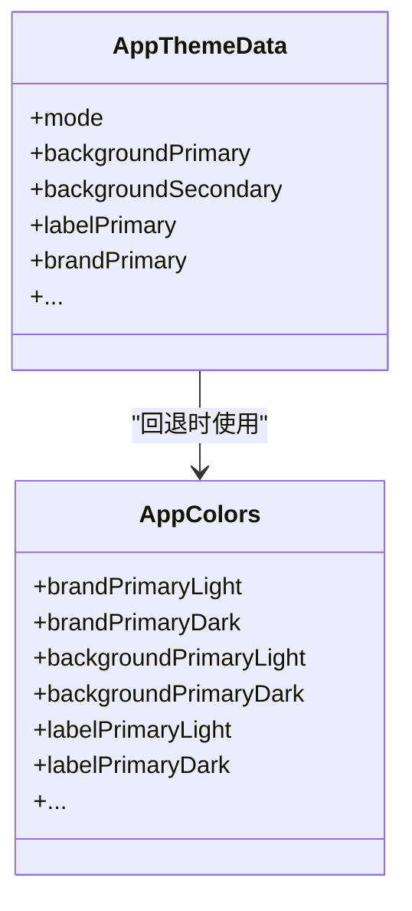
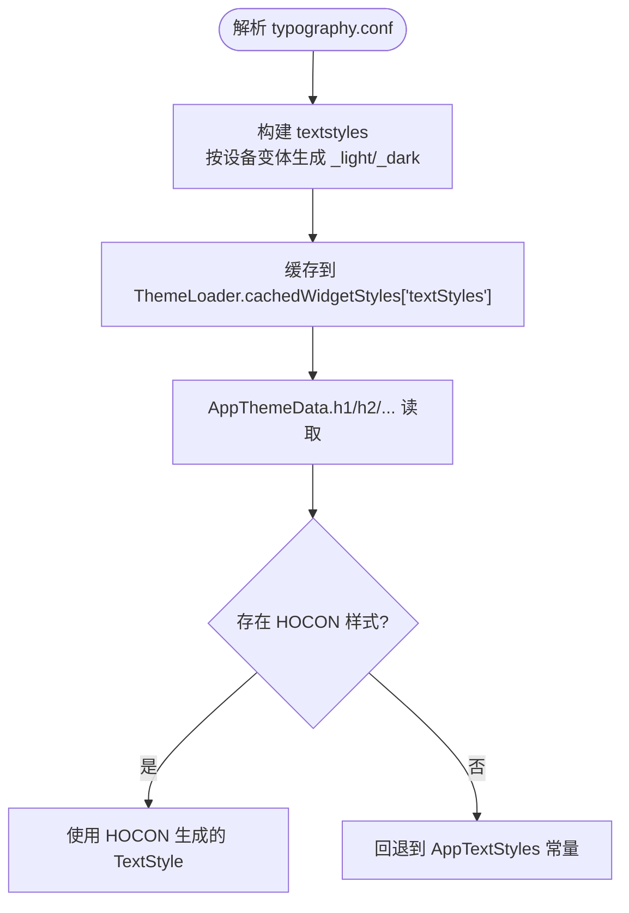
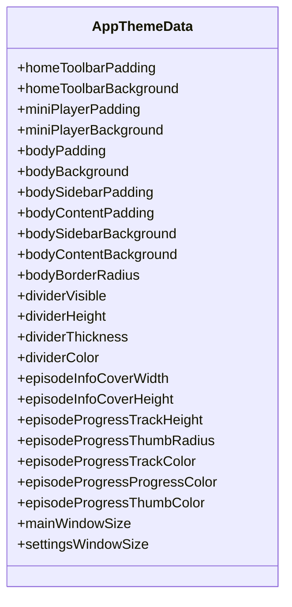
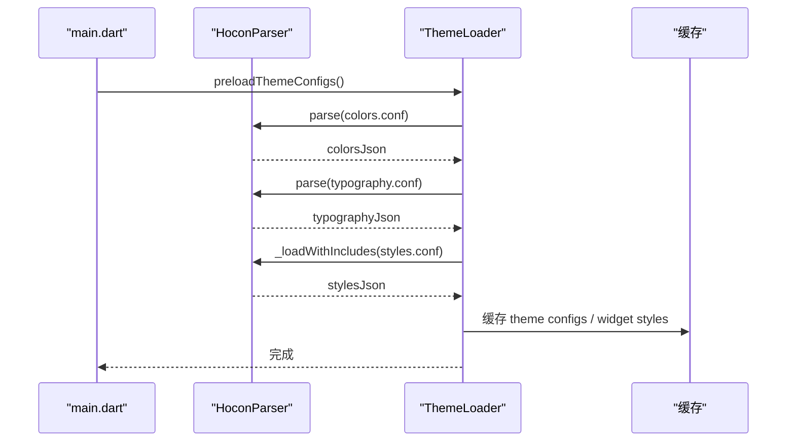
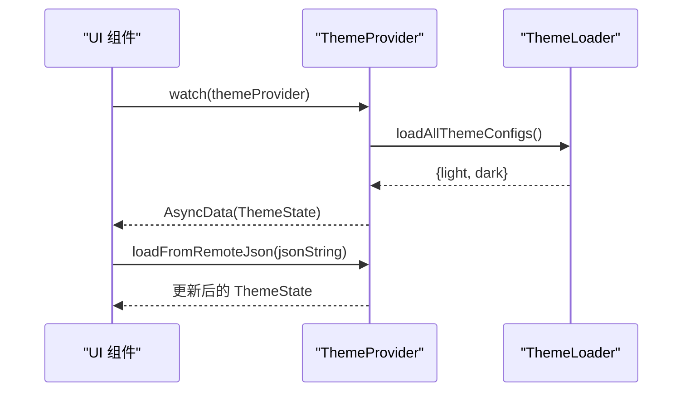
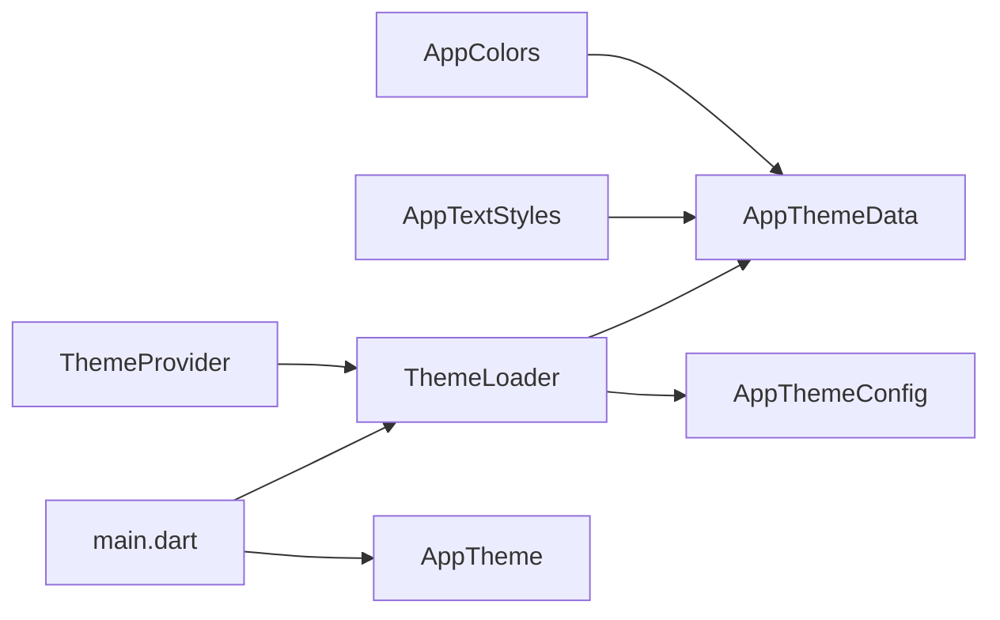

# 主题与样式定制

<cite>
**本文引用的文件**   
- [main.dart](file://lib/main.dart)
- [app_colors.dart](file://lib/core/theme/app_colors.dart)
- [app_text_styles.dart](file://lib/core/theme/app_text_styles.dart)
- [app_theme.dart](file://lib/core/theme/app_theme.dart)
- [theme_data.dart](file://lib/core/theme/theme_data.dart)
- [theme_loader.dart](file://lib/core/theme/theme_loader.dart)
- [theme_source_flag.dart](file://lib/core/theme/theme_source_flag.dart)
- [theme_loader.dart](file://lib/core/theme/theme_loader.dart)
- [colors.conf](file://assets/themes/colors.conf)
- [typography.conf](file://assets/themes/typography.conf)
- [styles.conf](file://assets/themes/styles.conf)
- [overview.md](file://docs/theme/overview.md)
- [colors.md](file://docs/theme/colors.md)
- [typography.md](file://docs/theme/typography.md)
</cite>

## 目录
1. [简介](#简介)
2. [项目结构](#项目结构)
3. [核心组件](#核心组件)
4. [架构总览](#架构总览)
5. [详细组件分析](#详细组件分析)
6. [依赖关系分析](#依赖关系分析)
7. [性能考量](#性能考量)
8. [故障排查指南](#故障排查指南)
9. [结论](#结论)
10. [附录](#附录)

## 简介
本文件为 TinyCast 应用的主题与样式定制系统提供完整文档，涵盖主题架构、颜色系统与字体配置、动态主题切换、深色模式支持、自定义主题实现、样式变量管理、组件样式覆盖、全局样式配置、主题持久化、用户偏好设置与主题预览等。系统采用 HOCON 配置文件驱动，结合 Dart 编译时常量与运行时解析双模式，既保证高性能，又支持灵活扩展与远程配置。

## 项目结构
主题相关资源与代码组织如下：
- 资源层（HOCON）：assets/themes/colors.conf、assets/themes/typography.conf、assets/themes/styles.conf
- 常量与样式定义：lib/core/theme/app_colors.dart、lib/core/theme/app_text_styles.dart
- 主题访问入口与数据模型：lib/core/theme/app_theme.dart、lib/core/theme/theme_data.dart、lib/core/theme/app_theme_config.dart
- 加载器与解析器：lib/core/theme/theme_loader.dart
- 状态管理与 Riverpod：lib/core/theme/theme_loader.dart
- 启动流程集成：lib/main.dart

图表来源
- [main.dart:116-124](file://lib/main.dart#L116-L124)
- [theme_loader.dart:319-372](file://lib/core/theme/theme_loader.dart#L319-L372)
- [theme_data.dart:48-114](file://lib/core/theme/theme_data.dart#L48-L114)
- [app_theme.dart:5-20](file://lib/core/theme/app_theme.dart#L5-L20)
- [app_colors.dart:1-48](file://lib/core/theme/app_colors.dart#L1-L48)
- [app_text_styles.dart:1-175](file://lib/core/theme/app_text_styles.dart#L1-L175)

章节来源
- [overview.md:22-40](file://docs/theme/overview.md#L22-L40)
- [main.dart:116-124](file://lib/main.dart#L116-L124)

## 核心组件
- AppColors：集中定义所有颜色的编译时常量（ARGB），确保零运行时开销与 Widget 树 const 优化。
- AppTextStyles：集中定义文字样式 TextStyle，包含字号、字重、行高、字间距与颜色，区分 Light/Dark。
- AppTheme：统一入口，根据 Brightness 返回对应主题的 AppThemeData。
- AppThemeData：封装颜色、文字样式、间距、圆角、阴影与布局样式；支持从 HOCON 或硬编码常量获取值。
- ThemeLoader：内置轻量 HOCON 解析器，负责加载 colors/typography/styles 并缓存结果，构建文本样式与组件样式映射。
- ThemeProvider：基于 Riverpod 的异步状态管理，提供 light/dark 两套 AppThemeConfig，支持 JSON/远程加载。
- main.dart：在应用启动时根据开关决定是否预加载 HOCON 主题配置。

章节来源
- [app_colors.dart:1-48](file://lib/core/theme/app_colors.dart#L1-L48)
- [app_text_styles.dart:1-175](file://lib/core/theme/app_text_styles.dart#L1-L175)
- [app_theme.dart:5-20](file://lib/core/theme/app_theme.dart#L5-L20)
- [theme_data.dart:48-114](file://lib/core/theme/theme_data.dart#L48-L114)
- [theme_loader.dart:319-372](file://lib/core/theme/theme_loader.dart#L319-L372)
- [theme_loader.dart:1-92](file://lib/core/theme/theme_loader.dart#L1-L92)
- [main.dart:116-124](file://lib/main.dart#L116-L124)

## 架构总览
TinyCast 主题系统采用“配置驱动 + 双模式”的架构：
- 配置层：HOCON 文件定义颜色、排版与组件样式，支持 include 与 ${} 引用。
- 解析层：ThemeLoader 解析 HOCON，生成 AppThemeConfig 与 widget text styles，并缓存。
- 访问层：AppThemeData 暴露统一的 getter，内部根据 useHardcoded 选择常量或 HOCON 值。
- 状态层：ThemeProvider 通过 Riverpod 提供亮/暗两套配置，便于 UI 订阅刷新。
- 入口层：main.dart 在启动时按需预加载主题配置，决定使用 HOCON 还是硬编码常量。

图表来源
- [main.dart:116-124](file://lib/main.dart#L116-L124)
- [theme_loader.dart:471-507](file://lib/core/theme/theme_loader.dart#L471-L507)
- [theme_loader.dart:65-92](file://lib/core/theme/theme_loader.dart#L65-L92)
- [app_theme.dart:5-20](file://lib/core/theme/app_theme.dart#L5-L20)

## 详细组件分析

### 颜色系统（colors.conf 与 AppColors）
- HOCON 定义 palettes：brand、background、gray、label、overlay，每个颜色均含 light/dark 两个变体。
- Dart 侧 AppColors 以 const Color(0x...) 形式暴露，命名遵循 paletteNameLight/Dark。
- AppThemeData 的颜色 getter 会优先从 HOCON 解析的 AppThemeConfig 取值，否则回退到 AppColors 常量。

图表来源
- [app_colors.dart:1-48](file://lib/core/theme/app_colors.dart#L1-L48)
- [theme_data.dart:110-180](file://lib/core/theme/theme_data.dart#L110-L180)

章节来源
- [colors.conf:1-106](file://assets/themes/colors.conf#L1-L106)
- [colors.md:70-105](file://docs/theme/colors.md#L70-L105)
- [theme_data.dart:110-180](file://lib/core/theme/theme_data.dart#L110-L180)

### 字体排版（typography.conf 与 AppTextStyles）
- HOCON 定义 textstyles：h1/h2/h3/bodyLarge/bodyMedium/bodySmall/caption/button 等，支持 desktop/tablet/mobile 响应式变体。
- Dart 侧 AppTextStyles 提供 Light/Dark 两套 TextStyle，颜色自动关联 AppColors。
- AppThemeData 的 h1/h2/h3/bodyLarge/... 等 getter 会优先尝试从 HOCON 生成的 widget text styles 中取样式，否则回退到 AppTextStyles。

图表来源
- [typography.conf:1-136](file://assets/themes/typography.conf#L1-L136)
- [theme_loader.dart:374-460](file://lib/core/theme/theme_loader.dart#L374-L460)
- [theme_data.dart:182-251](file://lib/core/theme/theme_data.dart#L182-L251)

章节来源
- [typography.md:83-130](file://docs/theme/typography.md#L83-L130)
- [theme_loader.dart:374-460](file://lib/core/theme/theme_loader.dart#L374-L460)
- [app_text_styles.dart:1-175](file://lib/core/theme/app_text_styles.dart#L1-L175)

### 组件样式与布局（styles.conf 与 AppThemeData）
- styles.conf 整合 colors.conf 与 typography.conf，定义 widgets/page/window_container/multi_window 等样式。
- 支持按钮背景色（hover/pressed/default）、内容颜色、进度条轨道/进度/手柄颜色、时间标签样式、窗口尺寸等。
- AppThemeData 提供大量布局相关的 getter（如 homeToolbarPadding、miniPlayerBackground、bodyBorderRadius、divider* 等），从 HOCON 路径解析并回退默认值。

图表来源
- [styles.conf:1-262](file://assets/themes/styles.conf#L1-L262)
- [theme_data.dart:403-800](file://lib/core/theme/theme_data.dart#L403-L800)

章节来源
- [styles.conf:1-262](file://assets/themes/styles.conf#L1-L262)
- [theme_data.dart:403-800](file://lib/core/theme/theme_data.dart#L403-L800)

### 主题加载与解析（ThemeLoader）
- HoconParser：轻量解析器，支持注释、嵌套对象、include、${} 引用与点号路径。
- ThemeLoader：负责加载 colors/typography/styles，合并 include，解析引用，构建 theme configs 与 widget text styles，并提供缓存与清理能力。
- 启动流程：main.dart 根据 ThemeSource.useHardcoded 决定是否调用 ThemeLoader.preloadThemeConfigs()。

图表来源
- [theme_loader.dart:12-295](file://lib/core/theme/theme_loader.dart#L12-L295)
- [theme_loader.dart:471-507](file://lib/core/theme/theme_loader.dart#L471-L507)
- [main.dart:116-124](file://lib/main.dart#L116-L124)

章节来源
- [theme_loader.dart:319-372](file://lib/core/theme/theme_loader.dart#L319-L372)
- [theme_loader.dart:598-684](file://lib/core/theme/theme_loader.dart#L598-L684)
- [main.dart:116-124](file://lib/main.dart#L116-L124)

### 状态管理与动态切换（ThemeProvider）
- ThemeState：持有 lightConfig 与 darkConfig，提供 forBrightness(brightness) 便捷方法。
- ThemeNotifier：初始化时通过 ThemeLoader.loadAllThemeConfigs() 加载配置；支持从 JSON 或远程字符串加载新主题。
- UI 通过 ref.watch(themeProvider) 订阅变化，实现无侵入的动态换肤。

图表来源
- [theme_loader.dart:1-92](file://lib/core/theme/theme_loader.dart#L1-L92)
- [theme_loader.dart:668-674](file://lib/core/theme/theme_loader.dart#L668-L674)

章节来源
- [theme_loader.dart:1-92](file://lib/core/theme/theme_loader.dart#L1-L92)

### 入口与启动集成（main.dart）
- 在桌面端启动时，根据 ThemeSource.useHardcoded 决定是否预加载 HOCON 主题配置。
- 若未启用硬编码，则调用 ThemeLoader.preloadThemeConfigs()，并在日志中输出加载完成信息。

章节来源
- [main.dart:116-124](file://lib/main.dart#L116-L124)
- [theme_source_flag.dart:1-20](file://lib/core/theme/theme_source_flag.dart#L1-L20)

## 依赖关系分析
- AppThemeData 依赖 AppColors 与 AppTextStyles 作为常量回退源，同时依赖 ThemeLoader 提供的 HOCON 解析结果。
- ThemeLoader 依赖 Flutter rootBundle 读取 assets/themes/*.conf，并通过 HoconParser 解析。
- ThemeProvider 依赖 ThemeLoader 进行主题配置的加载与更新。
- main.dart 依赖 ThemeSource 标志位控制是否使用 HOCON。

图表来源
- [theme_data.dart:48-114](file://lib/core/theme/theme_data.dart#L48-L114)
- [theme_loader.dart:319-372](file://lib/core/theme/theme_loader.dart#L319-L372)
- [theme_loader.dart:65-92](file://lib/core/theme/theme_loader.dart#L65-L92)
- [app_theme.dart:5-20](file://lib/core/theme/app_theme.dart#L5-L20)
- [main.dart:116-124](file://lib/main.dart#L116-L124)

章节来源
- [theme_data.dart:48-114](file://lib/core/theme/theme_data.dart#L48-L114)
- [theme_loader.dart:319-372](file://lib/core/theme/theme_loader.dart#L319-L372)
- [theme_loader.dart:65-92](file://lib/core/theme/theme_loader.dart#L65-L92)

## 性能考量
- 颜色与文字样式优先使用 const Color(0x...) 与 const TextStyle，避免运行时开销，提升 Widget 树 const 优化效果。
- ThemeLoader 对 colors/typography/styles 进行内存缓存，避免重复解析与 I/O。
- 在不需要动态换肤的场景下，可通过 ThemeSource.useHardcoded 禁用 HOCON 加载，获得最佳性能。
- AppThemeData 的 getter 优先走 HOCON 解析结果，若无则快速回退到常量，减少分支判断成本。

[本节为通用指导，不直接分析具体文件]

## 故障排查指南
- HOCON 解析失败：检查 colors/typography/styles 语法是否正确，包括注释、嵌套对象、include 路径与 ${} 引用。
- 样式未生效：确认 styles.conf 中的路径与 AppThemeData 的 _layoutStyle 路径一致；检查 color 是否为合法的 ARGB 十六进制。
- 动态主题无效：确认 ThemeProvider 已正确调用 loadFromRemoteJson 或 loadFromJson，并确保 UI 通过 ref.watch(themeProvider) 订阅。
- 启动未加载主题：检查 main.dart 中 ThemeSource.useHardcoded 的值，以及是否调用了 ThemeLoader.preloadThemeConfigs()。

章节来源
- [theme_loader.dart:12-295](file://lib/core/theme/theme_loader.dart#L12-L295)
- [theme_loader.dart:598-684](file://lib/core/theme/theme_loader.dart#L598-L684)
- [theme_loader.dart:79-92](file://lib/core/theme/theme_loader.dart#L79-L92)
- [main.dart:116-124](file://lib/main.dart#L116-L124)

## 结论
TinyCast 的主题与样式系统以 HOCON 配置为核心，结合 Dart 编译时常量与运行时解析，实现了高性能与高可定制性的平衡。通过 AppThemeData 的统一访问入口、ThemeLoader 的轻量解析与缓存、ThemeProvider 的状态管理，开发者可以方便地实现动态主题切换、深色模式支持与自定义主题。配合完善的样式变量管理与组件样式覆盖机制，系统能够满足复杂 UI 场景下的主题需求。

[本节为总结性内容，不直接分析具体文件]

## 附录

### 主题持久化与用户偏好设置（建议方案）
- 将用户选择的主题模式（light/dark）与自定义主题标识保存到本地存储（如 SharedPreferences）。
- 应用启动时读取偏好，优先使用自定义主题 JSON（若存在），否则回退到系统亮度或默认主题。
- 在 ThemeProvider 中增加 setThemeMode(mode) 与 setCustomTheme(json) 方法，触发 UI 刷新。

[本节为概念性建议，不直接分析具体文件]

### 主题预览功能（建议方案）
- 在设置页提供主题预览卡片，实时渲染当前 HOCON 配置的效果。
- 使用 ThemeProvider.loadFromRemoteJson(jsonString) 临时加载预览主题，不立即持久化。
- 用户确认后调用持久化逻辑保存主题配置。

[本节为概念性建议，不直接分析具体文件]

### 样式变量管理与组件样式覆盖（实践要点）
- 在 styles.conf 中按组件维度组织样式（widgets.page.*），便于定位与维护。
- 使用 AppThemeData 的布局 getter 统一读取 padding/background/borderRadius 等属性，避免硬编码。
- 对于需要覆盖的组件样式，优先在 styles.conf 中新增键值，而非修改 Dart 常量。

[本节为实践建议，不直接分析具体文件]