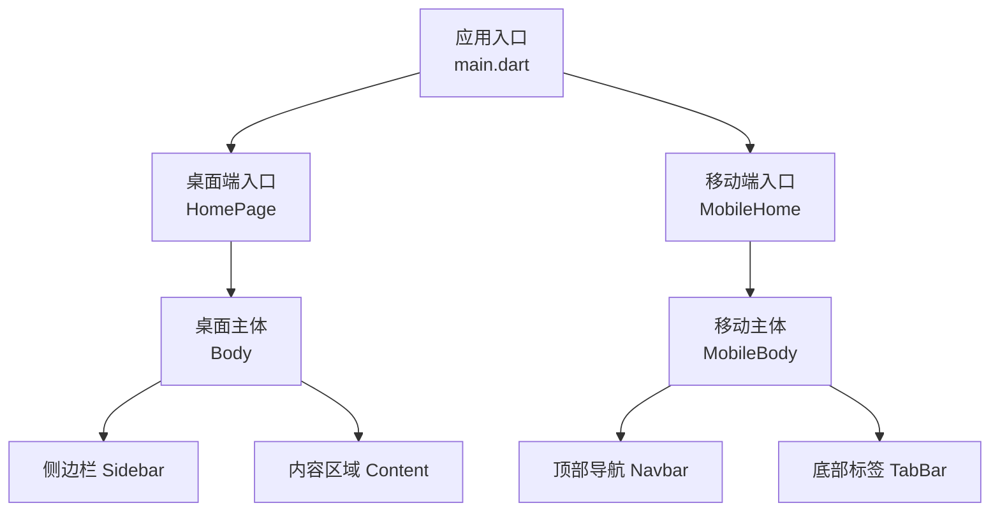
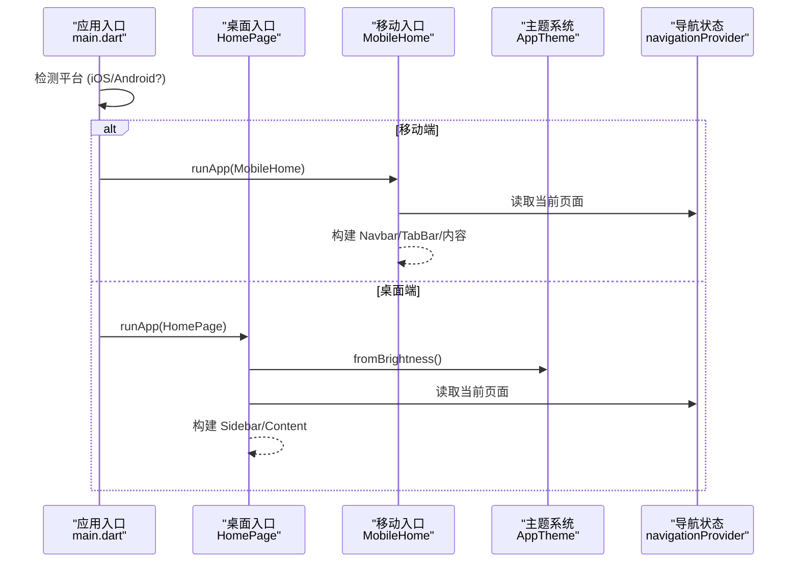
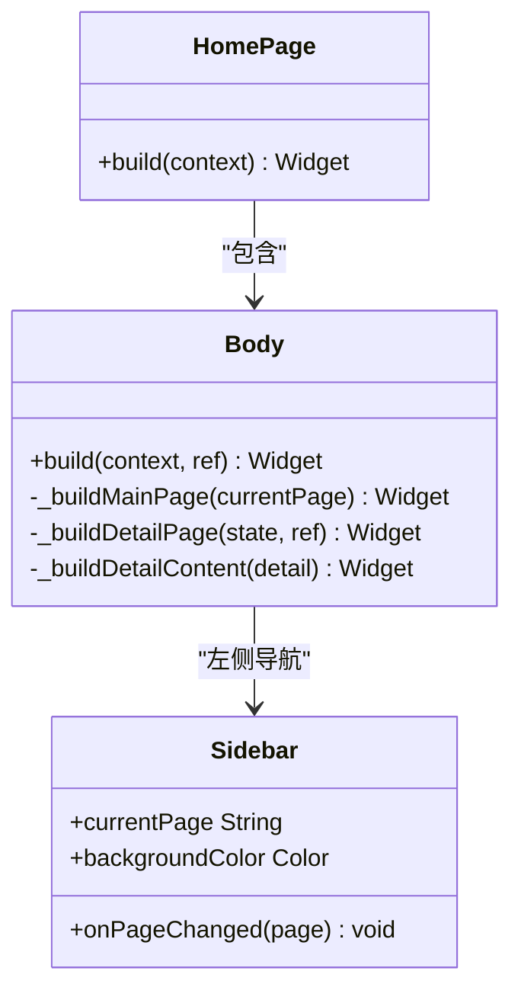
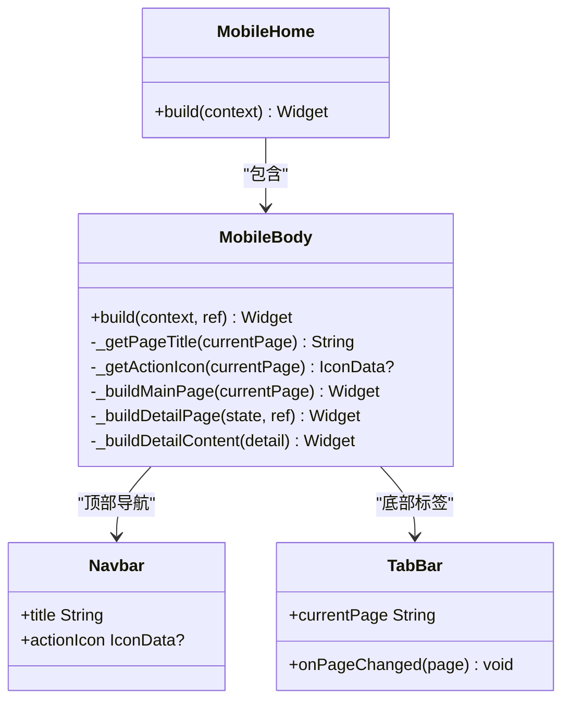
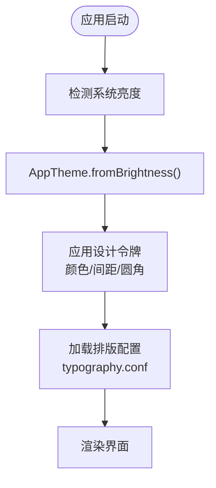
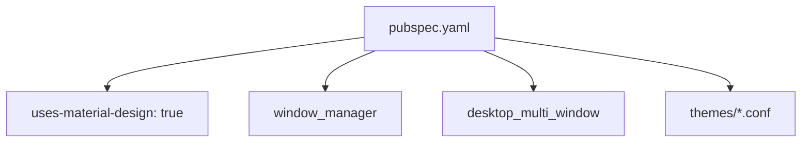

# 响应式布局设计

<cite>
**本文引用的文件**   
- [main.dart](file://lib/main.dart)
- [pubspec.yaml](file://pubspec.yaml)
- [homepage.dart](file://lib/presentation/features/home/homepage.dart)
- [mobile_home.dart](file://lib/presentation/features/home/mobile_home.dart)
- [body.dart](file://lib/presentation/features/home/body.dart)
- [mobile_body.dart](file://lib/presentation/features/home/mobile_body.dart)
- [app_theme.dart](file://lib/core/theme/app_theme.dart)
- [app_window_context.dart](file://lib/core/utils/app_window_context.dart)
- [ai-rules-for-flutter-and-dart.md](file://.agents/rules/ai-rules-for-flutter-and-dart.md)
- [spec.md](file://.trae/specs/mobile-platform-support/spec.md)
- [typography.conf](file://assets/themes/typography.conf)
</cite>

## 目录
1. [简介](#简介)
2. [项目结构](#项目结构)
3. [核心组件](#核心组件)
4. [架构总览](#架构总览)
5. [详细组件分析](#详细组件分析)
6. [依赖分析](#依赖分析)
7. [性能考虑](#性能考虑)
8. [故障排查指南](#故障排查指南)
9. [结论](#结论)
10. [附录](#附录)

## 简介
本文件为 TinyCast 应用的响应式布局设计文档，聚焦跨设备适配（移动端、桌面端、平板）的布局策略与实现。内容涵盖：
- 断点管理与屏幕尺寸检测
- 动态布局调整与主题切换
- Material Design 3 响应式设计指南与最佳实践
- 平台特定 UI 适配、手势处理与触摸优化

TinyCast 在启动时根据平台选择不同入口与首页组件：移动端使用 MobileHome/MobileBody，桌面端使用 HomePage/Body，并通过统一的导航状态驱动页面内容渲染。主题系统通过 AppTheme.fromBrightness 获取明暗模式下的设计令牌，排版配置通过 HOCON 配置文件按设备类型区分字号等属性。

## 项目结构
- 应用入口 main.dart 负责平台判断、窗口初始化（桌面端）、主题预加载、路由与根 Widget 装配。
- 桌面端首页 HomePage 包含顶部工具栏、迷你播放器、分割线与主体 Body；Body 采用侧边栏 + 内容区的 Row 布局。
- 移动端首页 MobileHome 仅承载 MobileBody，MobileBody 采用顶部导航栏 + 内容区 + 底部 TabBar 的布局。
- 主题系统 AppTheme 提供明暗模式的设计令牌访问。
- 排版配置 typography.conf 中针对 desktop/tablet/mobile 分别定义字号、行高等样式参数。

图表来源
- [main.dart:106-176](file://lib/main.dart#L106-L176)
- [homepage.dart:1-37](file://lib/presentation/features/home/homepage.dart#L1-L37)
- [mobile_home.dart:1-12](file://lib/presentation/features/home/mobile_home.dart#L1-L12)
- [body.dart:1-141](file://lib/presentation/features/home/body.dart#L1-L141)
- [mobile_body.dart:1-159](file://lib/presentation/features/home/mobile_body.dart#L1-L159)

章节来源
- [main.dart:106-176](file://lib/main.dart#L106-L176)
- [pubspec.yaml:180-196](file://pubspec.yaml#L180-L196)

## 核心组件
- 平台分支与入口选择：main.dart 在 iOS/Android 上直接运行 MyAppMobile，桌面端执行 WindowUtils 初始化并运行 MyApp。
- 桌面端布局：HomePage 组合 HomeToolbar、MiniPlayer、Divider 与 Body；Body 使用 Row 将 Sidebar 与内容区并列。
- 移动端布局：MobileHome 包裹 MobileBody；MobileBody 使用 Column 组织 Navbar、内容区与 TabBar。
- 主题与排版：AppTheme.fromBrightness 返回对应模式下的 AppThemeData；typography.conf 提供多设备字体配置。

章节来源
- [main.dart:106-176](file://lib/main.dart#L106-L176)
- [homepage.dart:1-37](file://lib/presentation/features/home/homepage.dart#L1-L37)
- [mobile_home.dart:1-12](file://lib/presentation/features/home/mobile_home.dart#L1-L12)
- [body.dart:1-141](file://lib/presentation/features/home/body.dart#L1-L141)
- [mobile_body.dart:1-159](file://lib/presentation/features/home/mobile_body.dart#L1-L159)
- [app_theme.dart:1-21](file://lib/core/theme/app_theme.dart#L1-L21)
- [typography.conf:63-135](file://assets/themes/typography.conf#L63-L135)

## 架构总览
TinyCast 的响应式架构以“平台入口 + 主题令牌 + 布局容器”为核心：
- 平台入口：main.dart 根据 Platform 决定运行桌面或移动端入口。
- 主题令牌：AppTheme 提供明暗模式下的颜色、间距、圆角等设计令牌。
- 布局容器：桌面端 Body 使用 Row 布局（侧边栏+内容），移动端 MobileBody 使用 Column（导航+内容+TabBar）。
- 导航状态：通过 navigationProvider 统一驱动页面与详情视图切换。

图表来源
- [main.dart:106-176](file://lib/main.dart#L106-L176)
- [homepage.dart:1-37](file://lib/presentation/features/home/homepage.dart#L1-L37)
- [mobile_home.dart:1-12](file://lib/presentation/features/home/mobile_home.dart#L1-L12)
- [app_theme.dart:1-21](file://lib/core/theme/app_theme.dart#L1-L21)

## 详细组件分析

### 桌面端布局（HomePage + Body）
- HomePage 组合顶部工具栏、迷你播放器、分割线以及主体 Body。
- Body 使用 Row 将 Sidebar 与内容区并列，支持详情页切换（返回按钮与内容替换）。
- 主题令牌用于控制背景色、内边距、圆角、分割线样式等。

图表来源
- [homepage.dart:1-37](file://lib/presentation/features/home/homepage.dart#L1-L37)
- [body.dart:1-141](file://lib/presentation/features/home/body.dart#L1-L141)

章节来源
- [homepage.dart:1-37](file://lib/presentation/features/home/homepage.dart#L1-L37)
- [body.dart:1-141](file://lib/presentation/features/home/body.dart#L1-L141)

### 移动端布局（MobileHome + MobileBody）
- MobileHome 作为移动端根容器，承载 MobileBody。
- MobileBody 使用 Column 组织顶部导航（Navbar）、内容区与底部标签（TabBar）。
- 详情页同样支持返回操作与内容替换。

图表来源
- [mobile_home.dart:1-12](file://lib/presentation/features/home/mobile_home.dart#L1-L12)
- [mobile_body.dart:1-159](file://lib/presentation/features/home/mobile_body.dart#L1-L159)

章节来源
- [mobile_home.dart:1-12](file://lib/presentation/features/home/mobile_home.dart#L1-L12)
- [mobile_body.dart:1-159](file://lib/presentation/features/home/mobile_body.dart#L1-L159)

### 主题系统与排版（AppTheme + typography.conf）
- AppTheme 提供明暗模式的设计令牌访问，供各页面与组件使用。
- typography.conf 中针对不同设备（desktop/tablet/mobile）定义了 caption1/caption2 等文本样式的字号、行高、字重与颜色。

图表来源
- [app_theme.dart:1-21](file://lib/core/theme/app_theme.dart#L1-L21)
- [typography.conf:63-135](file://assets/themes/typography.conf#L63-L135)

章节来源
- [app_theme.dart:1-21](file://lib/core/theme/app_theme.dart#L1-L21)
- [typography.conf:63-135](file://assets/themes/typography.conf#L63-L135)

### 平台特定 UI 适配与窗口上下文
- main.dart 在 iOS/Android 上跳过桌面窗口系统初始化，直接运行移动端入口。
- AppWindowContext.isMainWindow 标识主窗口，确保后台任务与播放恢复仅在主窗口运行。

章节来源
- [main.dart:106-176](file://lib/main.dart#L106-L176)
- [app_window_context.dart:1-10](file://lib/core/utils/app_window_context.dart#L1-L10)

## 依赖分析
- Flutter SDK 与 Material 资源启用：pubspec.yaml 声明 uses-material-design: true，便于使用基础 Material 组件与图标。
- 桌面端窗口管理：window_manager、desktop_multi_window 等包用于桌面端窗口控制（移动端不启用）。
- 主题与排版：HOCON 配置文件（colors.conf、typography.conf、styles.conf）由主题加载器在桌面端预加载。

图表来源
- [pubspec.yaml:180-196](file://pubspec.yaml#L180-L196)

章节来源
- [pubspec.yaml:180-196](file://pubspec.yaml#L180-L196)

## 性能考虑
- 避免不必要的重建：在 Body/MobileBody 中使用 ConsumerWidget 与 Riverpod 精确订阅导航状态，减少无关重建。
- 主题令牌集中管理：通过 AppTheme 获取设计令牌，避免重复计算与硬编码。
- 图片与媒体资源：结合 cached_network_image 与 SVG 资源，注意按需加载与缓存策略。
- 列表与滚动：长列表使用 ListView.builder，固定高度内容使用 SingleChildScrollView。

[本节为通用指导，无需引用具体文件]

## 故障排查指南
- 移动端无法编译：确认 main.dart 的平台分支逻辑正确，移动端跳过 window_manager 调用。
- 主题未生效：检查 AppTheme.fromBrightness 是否正确传入 MediaQuery.platformBrightnessOf(context)。
- 排版不一致：核对 typography.conf 中 mobile/tablet/desktop 的配置是否覆盖所需样式。
- 窗口上下文错误：确保 AppWindowContext.isMainWindow 在主窗口设置，避免副窗口误启后台任务。

章节来源
- [spec.md:1-38](file://.trae/specs/mobile-platform-support/spec.md#L1-L38)
- [app_theme.dart:1-21](file://lib/core/theme/app_theme.dart#L1-L21)
- [typography.conf:63-135](file://assets/themes/typography.conf#L63-L135)
- [app_window_context.dart:1-10](file://lib/core/utils/app_window_context.dart#L1-L10)

## 结论
TinyCast 的响应式布局通过“平台入口 + 主题令牌 + 布局容器”实现了桌面端与移动端的有效分离与复用。桌面端采用侧边栏+内容区的 Row 布局，移动端采用导航+内容+TabBar 的 Column 布局，配合 AppTheme 与 typography.conf 的多设备排版配置，确保了跨设备的一致性与可维护性。未来可在现有基础上引入 LayoutBuilder 与断点机制，进一步增强平板与大屏设备的自适应能力。

[本节为总结，无需引用具体文件]

## 附录

### Material Design 3 响应式设计指南与最佳实践
- 使用 LayoutBuilder 进行基于可用空间的响应式布局。
- 优先使用 Container、Row、Column、Stack、Positioned、Expanded、Flexible 等核心布局组件。
- 长列表使用 ListView.builder，固定内容使用 SingleChildScrollView。
- 浮层元素使用 Overlay 或 OverlayPortal。
- 交互使用 GestureDetector、MouseRegion 处理点击与悬停。
- 自定义组件优先于 Material 默认组件，保持设计语言一致性。

章节来源
- [ai-rules-for-flutter-and-dart.md:124-144](file://.agents/rules/ai-rules-for-flutter-and-dart.md#L124-L144)

### 断点管理与屏幕尺寸检测建议
- 使用 MediaQuery.sizeOf(context).width 获取屏幕宽度，划分断点（如 <600 移动端、600-1024 平板、>1024 桌面）。
- 在 Body/MobileBody 中根据宽度切换布局策略（例如隐藏侧边栏、折叠导航）。
- 结合 AppTheme 的动态令牌，在不同断点下调整内边距、圆角与分割线样式。

[本节为概念性建议，无需引用具体文件]

### 平台特定 UI 适配与触摸优化
- 移动端：使用 GestureDetector 处理触摸事件，避免依赖鼠标悬停；保证触控目标尺寸不小于 48dp。
- 桌面端：保留 MouseRegion 与 SystemMouseCursors 提升交互体验。
- 窗口管理：桌面端使用 window_manager 与 desktop_multi_window，移动端跳过相关初始化。

章节来源
- [spec.md:1-38](file://.trae/specs/mobile-platform-support/spec.md#L1-L38)
- [ai-rules-for-flutter-and-dart.md:124-144](file://.agents/rules/ai-rules-for-flutter-and-dart.md#L124-L144)