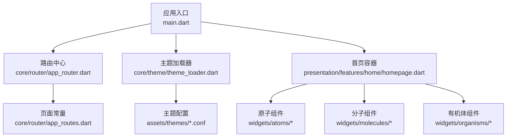
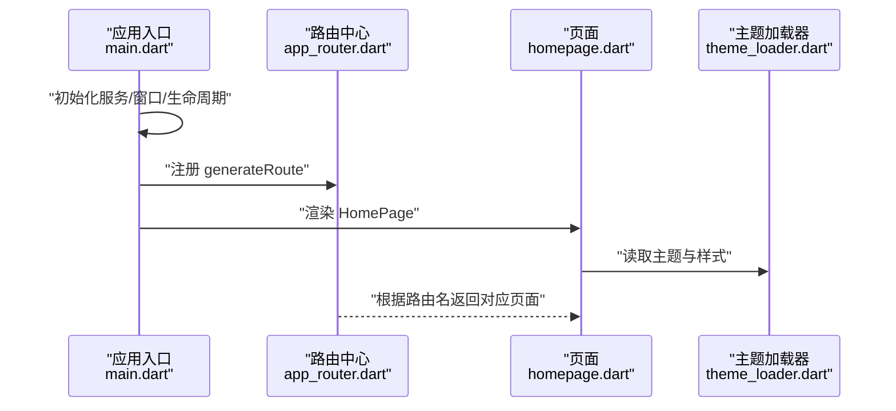
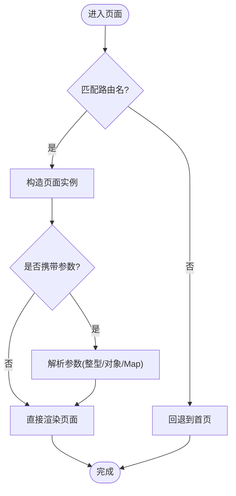
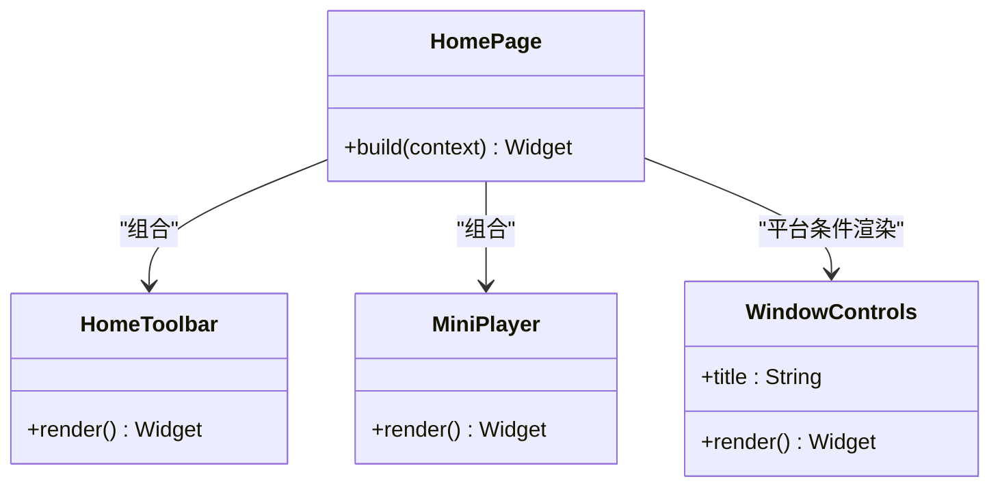
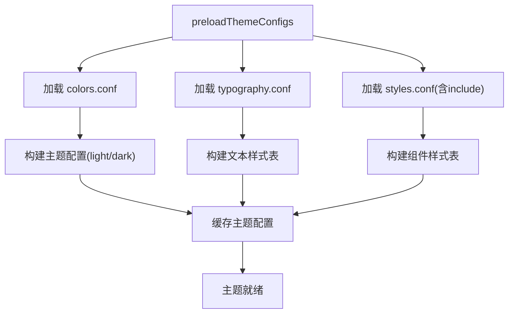
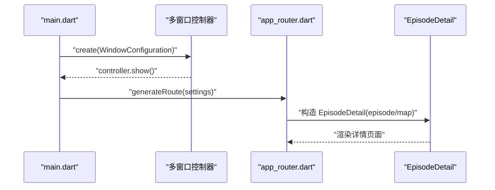
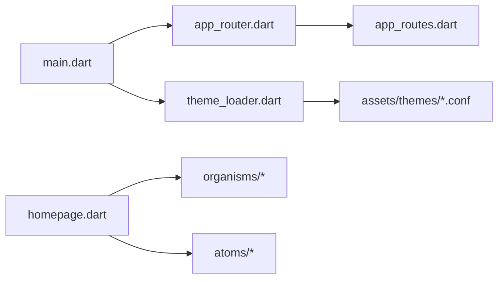

# 页面开发

<cite>
**本文引用的文件**   
- [main.dart](file://lib/main.dart)
- [app_router.dart](file://lib/core/router/app_router.dart)
- [app_routes.dart](file://lib/core/router/app_routes.dart)
- [homepage.dart](file://lib/presentation/features/home/homepage.dart)
- [theme_loader.dart](file://lib/core/theme/theme_loader.dart)
- [colors.conf](file://assets/themes/colors.conf)
- [typography.conf](file://assets/themes/typography.conf)
- [styles.conf](file://assets/themes/styles.conf)
</cite>

## 目录
1. [简介](#简介)
2. [项目结构](#项目结构)
3. [核心组件](#核心组件)
4. [架构总览](#架构总览)
5. [详细组件分析](#详细组件分析)
6. [依赖分析](#依赖分析)
7. [性能考虑](#性能考虑)
8. [故障排查指南](#故障排查指南)
9. [结论](#结论)
10. [附录](#附录)

## 简介
本文件面向 TinyCast 应用的 Flutter 页面开发，系统化说明：
- 页面组织与原子设计模式（atoms/molecules/organisms）在 presentation 层的使用方式
- 路由配置、导航逻辑与页面间数据传递
- 响应式布局、主题适配与平台特定 UI 处理
- 从简单设置页到复杂播客列表页的完整示例与最佳实践

## 项目结构
TinyCast 采用分层与特性混合的组织方式：
- lib/core：基础设施（路由、主题、服务、工具等）
- lib/presentation：UI 层，按功能特性划分 features，并统一使用 widgets/atoms、molecules、organisms 构建原子化组件
- assets/themes：HOCON 格式的主题配置文件（颜色、排版、样式）
- main.dart：应用入口，负责多窗口初始化、生命周期监听、ProviderScope 注入与根 Widget 装配

图表来源
- [main.dart:106-177](file://lib/main.dart#L106-L177)
- [app_router.dart:20-132](file://lib/core/router/app_router.dart#L20-L132)
- [app_routes.dart:1-16](file://lib/core/router/app_routes.dart#L1-L16)
- [homepage.dart:9-36](file://lib/presentation/features/home/homepage.dart#L9-L36)
- [theme_loader.dart:319-507](file://lib/core/theme/theme_loader.dart#L319-L507)

章节来源
- [main.dart:106-177](file://lib/main.dart#L106-L177)
- [app_router.dart:20-132](file://lib/core/router/app_router.dart#L20-L132)
- [app_routes.dart:1-16](file://lib/core/router/app_routes.dart#L1-L16)
- [homepage.dart:9-36](file://lib/presentation/features/home/homepage.dart#L9-L36)
- [theme_loader.dart:319-507](file://lib/core/theme/theme_loader.dart#L319-L507)

## 核心组件
- 应用入口与多窗口管理
  - 根据平台与参数创建主窗口、设置窗口、订阅窗口、节目详情窗口
  - 注册生命周期观察者，启动定时任务
  - 通过 ProviderScope 注入状态管理上下文
- 路由系统
  - 集中定义路由名称与生成策略
  - 提供统一的导航方法（push、replace、pop、popUntil）
  - 支持跨窗口打开设置/订阅窗口
- 主题系统
  - 基于 HOCON 的颜色、排版、样式配置
  - 预加载并缓存主题配置，支持深浅色切换
  - 为文本样式与组件样式提供动态解析

章节来源
- [main.dart:106-177](file://lib/main.dart#L106-L177)
- [app_router.dart:20-186](file://lib/core/router/app_router.dart#L20-L186)
- [theme_loader.dart:319-507](file://lib/core/theme/theme_loader.dart#L319-L507)

## 架构总览
TinyCast 的页面架构围绕“入口装配 + 路由分发 + 原子化组件”展开。入口负责环境初始化与根 Widget 装配；路由负责页面映射与参数解析；页面由 atoms/molecules/organisms 组合而成，并通过主题系统实现跨平台一致的外观。

图表来源
- [main.dart:106-177](file://lib/main.dart#L106-L177)
- [app_router.dart:20-132](file://lib/core/router/app_router.dart#L20-L132)
- [homepage.dart:9-36](file://lib/presentation/features/home/homepage.dart#L9-L36)
- [theme_loader.dart:319-507](file://lib/core/theme/theme_loader.dart#L319-L507)

## 详细组件分析

### 路由与导航
- 路由常量集中在 app_routes.dart，便于统一管理
- app_router.dart 的 generateRoute 将路由名映射到具体页面，并处理参数解析（如 Podcast ID、Episode 对象或 Map）
- 提供 navigateTo/navigateToAndRemoveUntil/navigateToAndReplace/pop/popUntil 等封装方法，简化调用
- 支持跨窗口打开设置与订阅窗口，便于桌面端多窗口体验

图表来源
- [app_router.dart:20-132](file://lib/core/router/app_router.dart#L20-L132)
- [app_routes.dart:1-16](file://lib/core/router/app_routes.dart#L1-L16)

章节来源
- [app_router.dart:20-186](file://lib/core/router/app_router.dart#L20-L186)
- [app_routes.dart:1-16](file://lib/core/router/app_routes.dart#L1-L16)

### 首页与原子化组件
- HomePage 作为桌面端主容器，包含窗口控制条、顶部工具栏、迷你播放器、分割线与主体内容区
- 通过 AppTheme.fromBrightness 获取当前亮度对应的主题，控制分割线可见性与样式
- 组件层次清晰：organisms（HomeToolbar、MiniPlayer）组合 atoms（按钮、图标等），提升复用性

图表来源
- [homepage.dart:9-36](file://lib/presentation/features/home/homepage.dart#L9-L36)

章节来源
- [homepage.dart:9-36](file://lib/presentation/features/home/homepage.dart#L9-L36)

### 主题系统与 HOCON 配置
- theme_loader.dart 实现了轻量 HOCON 解析器，支持 include、引用替换、注释与嵌套对象
- 预加载 colors、typography、styles 三类配置，并缓存结果
- 根据 brightness 生成 light/dark 两套 TextStyle，并支持 desktop/tablet/mobile 设备差异化
- 通过 _processNode 递归解析 styles.conf 中的 widget/page 节点，生成可复用的文本样式键值对

图表来源
- [theme_loader.dart:319-507](file://lib/core/theme/theme_loader.dart#L319-L507)

章节来源
- [theme_loader.dart:319-507](file://lib/core/theme/theme_loader.dart#L319-L507)
- [colors.conf](file://assets/themes/colors.conf)
- [typography.conf](file://assets/themes/typography.conf)
- [styles.conf](file://assets/themes/styles.conf)

### 多窗口与页面间数据传递
- 主入口根据参数类型创建不同窗口（main/settings/subscribe/episode_detail）
- EpisodeDetailWindow 通过 WindowArguments 传递 episode 与 podcast 数据
- 路由层支持 EpisodeDetail 接收 Episode 对象或 Map，兼容多种传参方式

图表来源
- [main.dart:23-39](file://lib/main.dart#L23-L39)
- [main.dart:154-166](file://lib/main.dart#L154-L166)
- [app_router.dart:103-116](file://lib/core/router/app_router.dart#L103-L116)

章节来源
- [main.dart:23-39](file://lib/main.dart#L23-L39)
- [main.dart:154-166](file://lib/main.dart#L154-L166)
- [app_router.dart:103-116](file://lib/core/router/app_router.dart#L103-L116)

### 响应式布局与平台特定 UI
- 桌面端：HomePage 包含 WindowControls，仅在 Windows 平台显示
- 移动端：MyAppMobile 根据系统亮度调整默认文本颜色
- 主题系统支持 device 维度（desktop/tablet/mobile）的样式差异

章节来源
- [homepage.dart:9-36](file://lib/presentation/features/home/homepage.dart#L9-L36)
- [main.dart:240-284](file://lib/main.dart#L240-L284)
- [theme_loader.dart:374-460](file://lib/core/theme/theme_loader.dart#L374-L460)

## 依赖分析
- main.dart 依赖路由、主题、服务与窗口工具，负责应用装配
- app_router.dart 依赖路由常量与各页面模块，承担页面映射职责
- homepage.dart 依赖主题与有机体/原子组件，体现原子化组合
- theme_loader.dart 依赖资源包与 HOCON 解析器，提供主题能力

图表来源
- [main.dart:106-177](file://lib/main.dart#L106-L177)
- [app_router.dart:20-132](file://lib/core/router/app_router.dart#L20-L132)
- [app_routes.dart:1-16](file://lib/core/router/app_routes.dart#L1-L16)
- [homepage.dart:9-36](file://lib/presentation/features/home/homepage.dart#L9-L36)
- [theme_loader.dart:319-507](file://lib/core/theme/theme_loader.dart#L319-L507)

章节来源
- [main.dart:106-177](file://lib/main.dart#L106-L177)
- [app_router.dart:20-132](file://lib/core/router/app_router.dart#L20-L132)
- [app_routes.dart:1-16](file://lib/core/router/app_routes.dart#L1-L16)
- [homepage.dart:9-36](file://lib/presentation/features/home/homepage.dart#L9-L36)
- [theme_loader.dart:319-507](file://lib/core/theme/theme_loader.dart#L319-L507)

## 性能考虑
- 主题配置预加载与缓存：避免重复 IO 与解析开销
- 路由过渡动画设置为零延迟，减少页面切换开销
- 按需加载与懒初始化：服务与窗口按需创建，降低启动时间
- 文本样式按设备与亮度维度生成，避免运行时重复计算

[本节为通用指导，不直接分析具体文件]

## 故障排查指南
- 主题未生效
  - 检查 HOCON 文件路径与 include 引用是否正确
  - 确认 preloadThemeConfigs 已执行且缓存可用
- 路由跳转异常
  - 核对路由名是否与 AppRoutes 常量一致
  - 检查参数类型与解析逻辑（整型/对象/Map）
- 多窗口数据丢失
  - 确认 WindowArguments 序列化与反序列化的字段完整性
  - 确保 EpisodeDetail 接收参数分支覆盖所有可能类型

章节来源
- [theme_loader.dart:319-507](file://lib/core/theme/theme_loader.dart#L319-L507)
- [app_router.dart:20-132](file://lib/core/router/app_router.dart#L20-L132)
- [main.dart:23-39](file://lib/main.dart#L23-L39)

## 结论
TinyCast 的页面开发以清晰的入口装配、集中的路由管理与原子化组件为核心，结合 HOCON 主题系统实现跨平台一致的 UI 表现。通过多窗口支持与灵活的参数传递机制，开发者可以快速构建从简单设置页到复杂播客列表页的各类页面，同时保持代码的可维护性与扩展性。

[本节为总结性内容，不直接分析具体文件]

## 附录
- 页面开发建议
  - 优先使用 atoms/molecules/organisms 组合页面，提高复用性
  - 路由参数尽量使用强类型（对象/整型），必要时提供 Map 兼容
  - 主题与样式通过 theme_loader 集中管理，避免硬编码
- 常见问题与解决方案
  - 主题切换无效：检查亮度变化监听与样式缓存清理
  - 路由跳转后状态丢失：使用全局状态管理或持久化存储
  - 多窗口通信：通过事件总线或共享状态服务进行协调

[本节为补充信息，不直接分析具体文件]