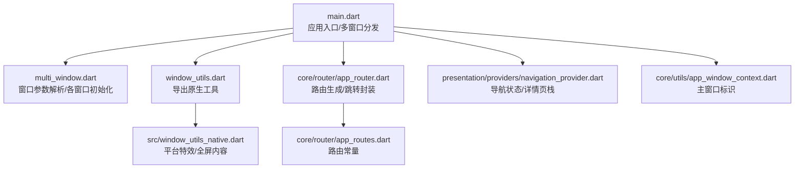
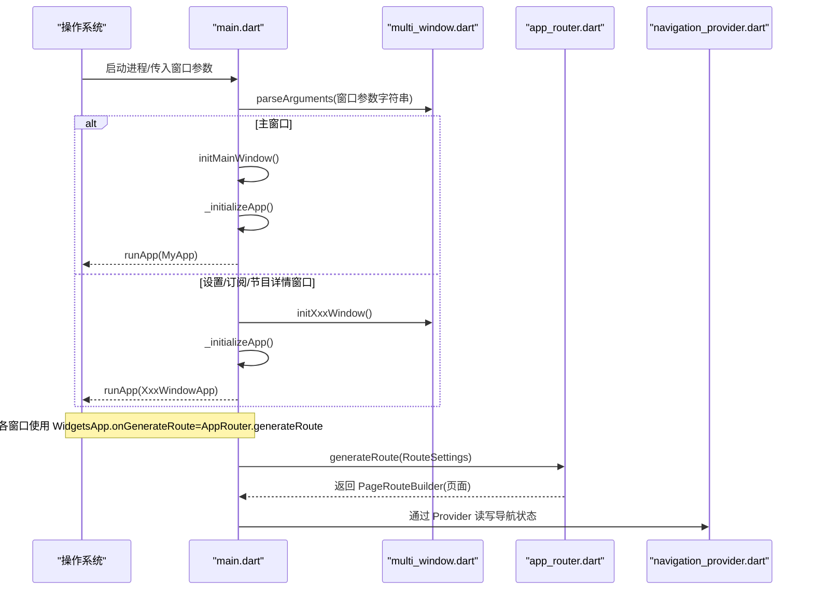
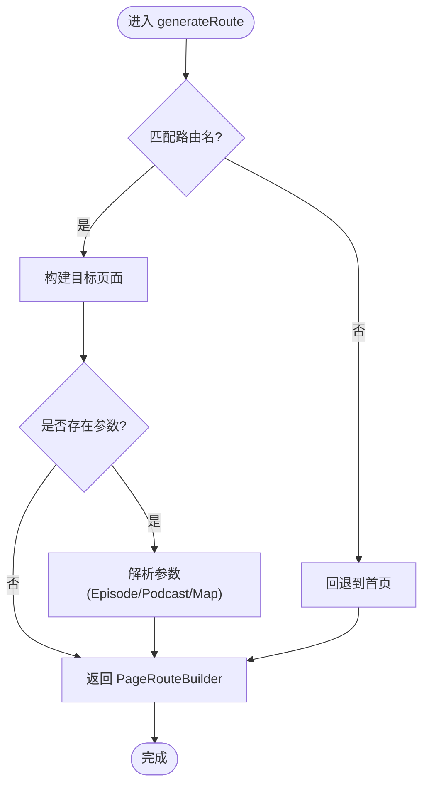
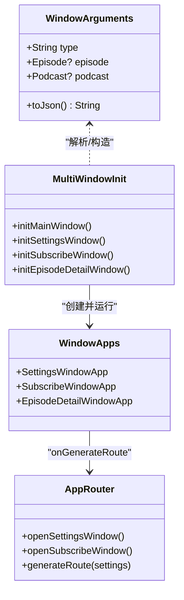
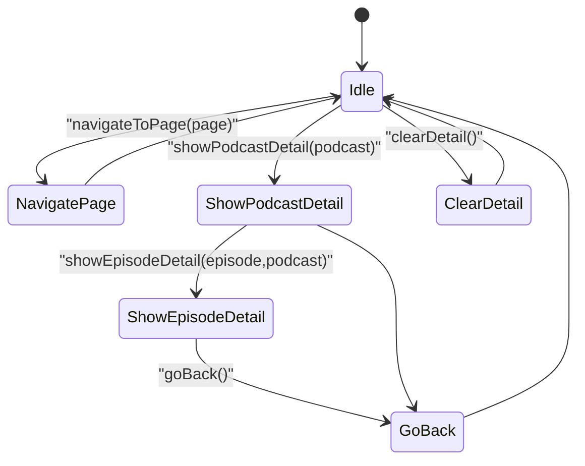
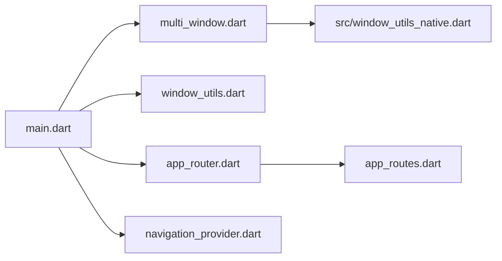

# 页面路由与导航

<cite>
**本文引用的文件**
- [lib/main.dart](file://lib/main.dart)
- [lib/multi_window.dart](file://lib/multi_window.dart)
- [lib/window_utils.dart](file://lib/window_utils.dart)
- [lib/src/window_utils_native.dart](file://lib/src/window_utils_native.dart)
- [lib/core/router/app_router.dart](file://lib/core/router/app_router.dart)
- [lib/core/router/app_routes.dart](file://lib/core/router/app_routes.dart)
- [lib/presentation/providers/navigation_provider.dart](file://lib/presentation/providers/navigation_provider.dart)
- [lib/core/utils/app_window_context.dart](file://lib/core/utils/app_window_context.dart)
</cite>

## 目录
1. [简介](#简介)
2. [项目结构](#项目结构)
3. [核心组件](#核心组件)
4. [架构总览](#架构总览)
5. [详细组件分析](#详细组件分析)
6. [依赖关系分析](#依赖关系分析)
7. [性能考量](#性能考量)
8. [故障排查指南](#故障排查指南)
9. [结论](#结论)
10. [附录](#附录)

## 简介
本文件为 TinyCast 应用的路由与导航系统提供系统化文档，涵盖以下方面：
- Flutter 路由配置与页面跳转逻辑
- 参数传递机制（含跨窗口数据传递）
- 多窗口管理（创建、显示、初始化与通信）
- 页面间数据共享、状态保持与生命周期管理最佳实践
- 深链接处理、路由守卫与权限控制的实现方案建议

## 项目结构
TinyCast 的路由与导航相关代码主要分布在以下位置：
- 入口与多窗口启动：lib/main.dart、lib/multi_window.dart、lib/window_utils.dart、lib/src/window_utils_native.dart
- 路由定义与生成：lib/core/router/app_router.dart、lib/core/router/app_routes.dart
- 导航状态与共享：lib/presentation/providers/navigation_provider.dart
- 窗口上下文标识：lib/core/utils/app_window_context.dart

**图表来源**
- [lib/main.dart:106-177](file://lib/main.dart#L106-L177)
- [lib/multi_window.dart:18-182](file://lib/multi_window.dart#L18-L182)
- [lib/window_utils.dart:1-6](file://lib/window_utils.dart#L1-L6)
- [lib/src/window_utils_native.dart:1-125](file://lib/src/window_utils_native.dart#L1-L125)
- [lib/core/router/app_router.dart:20-186](file://lib/core/router/app_router.dart#L20-L186)
- [lib/core/router/app_routes.dart:1-16](file://lib/core/router/app_routes.dart#L1-L16)
- [lib/presentation/providers/navigation_provider.dart:1-128](file://lib/presentation/providers/navigation_provider.dart#L1-L128)
- [lib/core/utils/app_window_context.dart:1-10](file://lib/core/utils/app_window_context.dart#L1-L10)

**章节来源**
- [lib/main.dart:106-177](file://lib/main.dart#L106-L177)
- [lib/multi_window.dart:18-182](file://lib/multi_window.dart#L18-L182)
- [lib/core/router/app_router.dart:20-186](file://lib/core/router/app_router.dart#L20-L186)
- [lib/core/router/app_routes.dart:1-16](file://lib/core/router/app_routes.dart#L1-L16)

## 核心组件
- 路由常量与生成器
  - AppRoutes：集中定义所有页面路由字符串
  - AppRouter.generateRoute：根据 RouteSettings.name 返回对应页面，支持参数解析
  - AppRouter.navigate*：封装 Navigator.pushNamed 等跳转方法
- 多窗口参数与初始化
  - WindowArguments：窗口类型与跨窗口数据（Episode/Podcast）的序列化/反序列化
  - parseArguments：从 JSON 字符串解析出 WindowArguments
  - initMainWindow/initSettingsWindow/initSubscribeWindow/initEpisodeDetailWindow：各窗口尺寸、标题栏样式与平台特效初始化
  - SettingsWindowApp/SubscribeWindowApp/EpisodeDetailWindowApp：各窗口的 WidgetsApp 根节点，统一 onGenerateRoute 与 pageRouteBuilder
- 导航状态与详情页栈
  - NavigationNotifier：维护当前页与详情页栈（播客详情/节目详情），提供 show/clear/goBack 等操作
  - Provider 暴露 current/detail/hasDetail 等派生状态
- 窗口上下文
  - AppWindowContext.isMainWindow：标记当前 isolate 是否为主窗口，用于控制后台任务与播放恢复等只在主窗口运行的逻辑

**章节来源**
- [lib/core/router/app_routes.dart:1-16](file://lib/core/router/app_routes.dart#L1-L16)
- [lib/core/router/app_router.dart:20-186](file://lib/core/router/app_router.dart#L20-L186)
- [lib/multi_window.dart:18-182](file://lib/multi_window.dart#L18-L182)
- [lib/multi_window.dart:184-303](file://lib/multi_window.dart#L184-L303)
- [lib/multi_window.dart:309-453](file://lib/multi_window.dart#L309-L453)
- [lib/presentation/providers/navigation_provider.dart:1-128](file://lib/presentation/providers/navigation_provider.dart#L1-L128)
- [lib/core/utils/app_window_context.dart:1-10](file://lib/core/utils/app_window_context.dart#L1-L10)

## 架构总览
下图展示了应用启动、多窗口分发、路由生成与导航状态的交互流程。

**图表来源**
- [lib/main.dart:106-177](file://lib/main.dart#L106-L177)
- [lib/multi_window.dart:18-182](file://lib/multi_window.dart#L18-L182)
- [lib/core/router/app_router.dart:20-132](file://lib/core/router/app_router.dart#L20-L132)
- [lib/presentation/providers/navigation_provider.dart:62-115](file://lib/presentation/providers/navigation_provider.dart#L62-L115)

## 详细组件分析

### 路由系统与页面跳转
- 路由常量集中管理，避免硬编码路径
- generateRoute 根据名称返回对应页面，并支持两种参数形式：
  - 直接对象（如 Episode/Podcast）
  - Map<String,dynamic> 中的字段（如 episode 键）
- 提供统一的 navigateTo/navigateToAndRemoveUntil/navigateToAndReplace/pop/popUntil 等方法，便于在业务层调用

**图表来源**
- [lib/core/router/app_router.dart:20-132](file://lib/core/router/app_router.dart#L20-L132)
- [lib/core/router/app_routes.dart:1-16](file://lib/core/router/app_routes.dart#L1-L16)

**章节来源**
- [lib/core/router/app_router.dart:20-186](file://lib/core/router/app_router.dart#L20-L186)
- [lib/core/router/app_routes.dart:1-16](file://lib/core/router/app_routes.dart#L1-L16)

### 多窗口管理与通信
- 窗口参数模型 WindowArguments 支持 type 与 episode/podcast 数据，toJson 序列化后作为窗口 arguments 传递
- parseArguments 负责反序列化为对象，失败时回退到默认主窗口类型
- 各窗口初始化函数统一设置尺寸、居中、隐藏标题栏、平台特效与全屏内容
- 各窗口根组件（SettingsWindowApp/SubscribeWindowApp/EpisodeDetailWindowApp）均注入 AppRouter.generateRoute，保证内部路由一致
- 主窗口通过 openEpisodeDetailWindow 创建新窗口并传入 episode/podcast 数据；其他窗口可通过 AppRouter.openSettingsWindow/openSubscribeWindow 打开子窗口

**图表来源**
- [lib/multi_window.dart:18-182](file://lib/multi_window.dart#L18-L182)
- [lib/multi_window.dart:184-303](file://lib/multi_window.dart#L184-L303)
- [lib/multi_window.dart:309-453](file://lib/multi_window.dart#L309-L453)
- [lib/core/router/app_router.dart:171-186](file://lib/core/router/app_router.dart#L171-L186)

**章节来源**
- [lib/multi_window.dart:18-182](file://lib/multi_window.dart#L18-L182)
- [lib/multi_window.dart:184-303](file://lib/multi_window.dart#L184-L303)
- [lib/multi_window.dart:309-453](file://lib/multi_window.dart#L309-L453)
- [lib/core/router/app_router.dart:171-186](file://lib/core/router/app_router.dart#L171-L186)

### 页面间数据共享、状态保持与生命周期
- 导航状态通过 Riverpod 的 NotifierProvider 管理，包含 currentPage 与 detailStack
- DetailState 支持 podcast/episode 两种详情页类型，并提供便捷工厂方法与属性访问
- 典型操作：navigateToPage（切换主页面并清空详情页栈）、showPodcastDetail/showEpisodeDetail（入栈）、goBack（出栈）、clearDetail（清空）
- 生命周期：
  - 主窗口注册 FeedRefreshLifecycleObserver，监听应用生命周期以调度后台刷新
  - 非主窗口不重复注册观察者，避免重复任务
  - AppWindowContext.isMainWindow 用于区分主/次窗口行为

**图表来源**
- [lib/presentation/providers/navigation_provider.dart:62-115](file://lib/presentation/providers/navigation_provider.dart#L62-L115)

**章节来源**
- [lib/presentation/providers/navigation_provider.dart:1-128](file://lib/presentation/providers/navigation_provider.dart#L1-L128)
- [lib/main.dart:74-104](file://lib/main.dart#L74-L104)
- [lib/core/utils/app_window_context.dart:1-10](file://lib/core/utils/app_window_context.dart#L1-L10)

### 深链接处理、路由守卫与权限控制
- 深链接
  - 当前代码未显式处理 deep link 回调。建议在 main 中监听平台深链接事件，解析 URL 后调用 AppRouter.generateRoute 或 Navigator.pushNamed 进行路由跳转
  - 对于桌面端多窗口场景，可将深链接映射为“打开指定窗口并跳转到某路由”的操作
- 路由守卫
  - 可在 AppRouter.generateRoute 中增加前置校验（如登录态、功能开关），不符合条件则重定向至登录或提示页
  - 也可在页面级使用 Provider 判断状态，结合 UI 层拦截跳转
- 权限控制
  - 针对敏感页面（如设置、数据库清理），在进入前检查用户角色/权限，必要时弹出确认对话框或拒绝跳转

[本节为概念性说明，不直接分析具体文件，故无“章节来源”]

## 依赖关系分析
- main.dart 依赖 multi_window.dart（窗口初始化）、window_utils.dart（平台特效）、core/router/app_router.dart（路由生成）、presentation/providers/navigation_provider.dart（导航状态）
- app_router.dart 依赖 app_routes.dart（路由常量）与各页面模块
- multi_window.dart 依赖 window_utils.dart 与 window_manager 插件
- navigation_provider.dart 独立于 UI，仅依赖实体与日志

**图表来源**
- [lib/main.dart:106-177](file://lib/main.dart#L106-L177)
- [lib/multi_window.dart:1-14](file://lib/multi_window.dart#L1-L14)
- [lib/window_utils.dart:1-6](file://lib/window_utils.dart#L1-L6)
- [lib/src/window_utils_native.dart:1-125](file://lib/src/window_utils_native.dart#L1-L125)
- [lib/core/router/app_router.dart:1-18](file://lib/core/router/app_router.dart#L1-L18)
- [lib/core/router/app_routes.dart:1-16](file://lib/core/router/app_routes.dart#L1-L16)
- [lib/presentation/providers/navigation_provider.dart:1-6](file://lib/presentation/providers/navigation_provider.dart#L1-L6)

**章节来源**
- [lib/main.dart:106-177](file://lib/main.dart#L106-L177)
- [lib/core/router/app_router.dart:1-18](file://lib/core/router/app_router.dart#L1-L18)
- [lib/multi_window.dart:1-14](file://lib/multi_window.dart#L1-L14)
- [lib/window_utils.dart:1-6](file://lib/window_utils.dart#L1-L6)
- [lib/src/window_utils_native.dart:1-125](file://lib/src/window_utils_native.dart#L1-L125)
- [lib/presentation/providers/navigation_provider.dart:1-6](file://lib/presentation/providers/navigation_provider.dart#L1-L6)

## 性能考量
- 路由构建：所有路由使用 PageRouteBuilder 且 transitionDuration 为零，减少动画开销
- 多窗口：每个窗口独立 ProviderScope，避免状态污染；仅在主窗口注册生命周期观察者，降低重复调度成本
- 参数传递：跨窗口使用 JSON 序列化，注意大对象传输时的体积与解析耗时，必要时可只传 ID 并在目标窗口内按需加载数据
- 导航状态：detailStack 采用不可变更新（copyWith），避免不必要的重建

[本节为通用指导，不直接分析具体文件，故无“章节来源”]

## 故障排查指南
- 路由无法匹配
  - 检查 AppRoutes 常量是否与 generateRoute 分支一致
  - 确认传入的 RouteSettings.name 是否正确
- 参数解析失败
  - 检查 WindowArguments.toJson 与 parseArguments 的字段映射是否完整
  - 对 Episode/Podcast 的时间字段确保格式正确（ISO8601）
- 多窗口未显示或样式异常
  - 确认 initXxxWindow 已调用且 Platform 判断正确
  - 检查 windowManager.ensureInitialized 与 waitUntilReadyToShow 顺序
  - 平台特效（毛玻璃/亚克力）在不同系统上的兼容性
- 导航状态异常
  - 检查是否在正确的 ProviderScope 中消费 navigationProvider
  - 确认 goBack/clearDetail 调用时机是否符合预期

**章节来源**
- [lib/core/router/app_router.dart:20-132](file://lib/core/router/app_router.dart#L20-L132)
- [lib/multi_window.dart:18-182](file://lib/multi_window.dart#L18-L182)
- [lib/multi_window.dart:184-303](file://lib/multi_window.dart#L184-L303)
- [lib/src/window_utils_native.dart:1-125](file://lib/src/window_utils_native.dart#L1-L125)
- [lib/presentation/providers/navigation_provider.dart:62-115](file://lib/presentation/providers/navigation_provider.dart#L62-L115)

## 结论
TinyCast 的路由与导航体系以集中式路由常量与生成器为核心，配合 Riverpod 管理的导航状态与多窗口参数模型，实现了清晰的页面跳转、参数传递与跨窗口数据共享。通过统一的窗口初始化与平台特效封装，保证了桌面端的视觉一致性。建议在现有基础上补充深链接处理、路由守卫与权限控制，以进一步提升用户体验与安全性。

[本节为总结性内容，不直接分析具体文件，故无“章节来源”]

## 附录
- 常用跳转方法
  - 同窗口内：AppRouter.navigateTo / navigateToAndRemoveUntil / navigateToAndReplace / pop / popUntil
  - 跨窗口：AppRouter.openSettingsWindow / openSubscribeWindow；主窗口 openEpisodeDetailWindow
- 关键实体
  - WindowArguments：窗口类型与跨窗口数据载体
  - DetailState：详情页类型与数据封装
  - NavigationState：当前页与详情页栈

[本节为参考信息，不直接分析具体文件，故无“章节来源”]