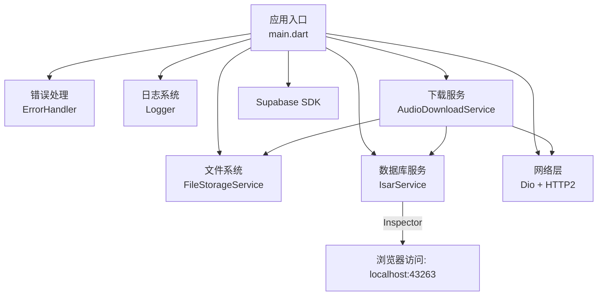
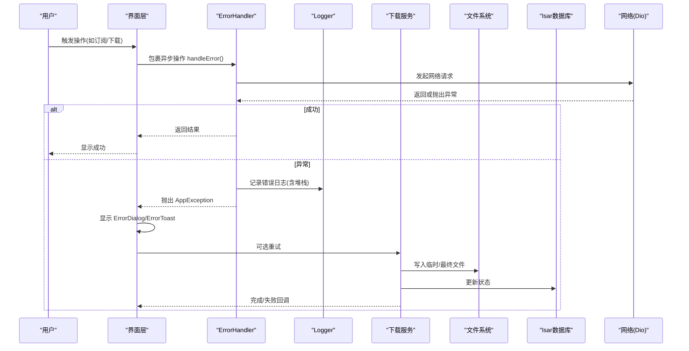
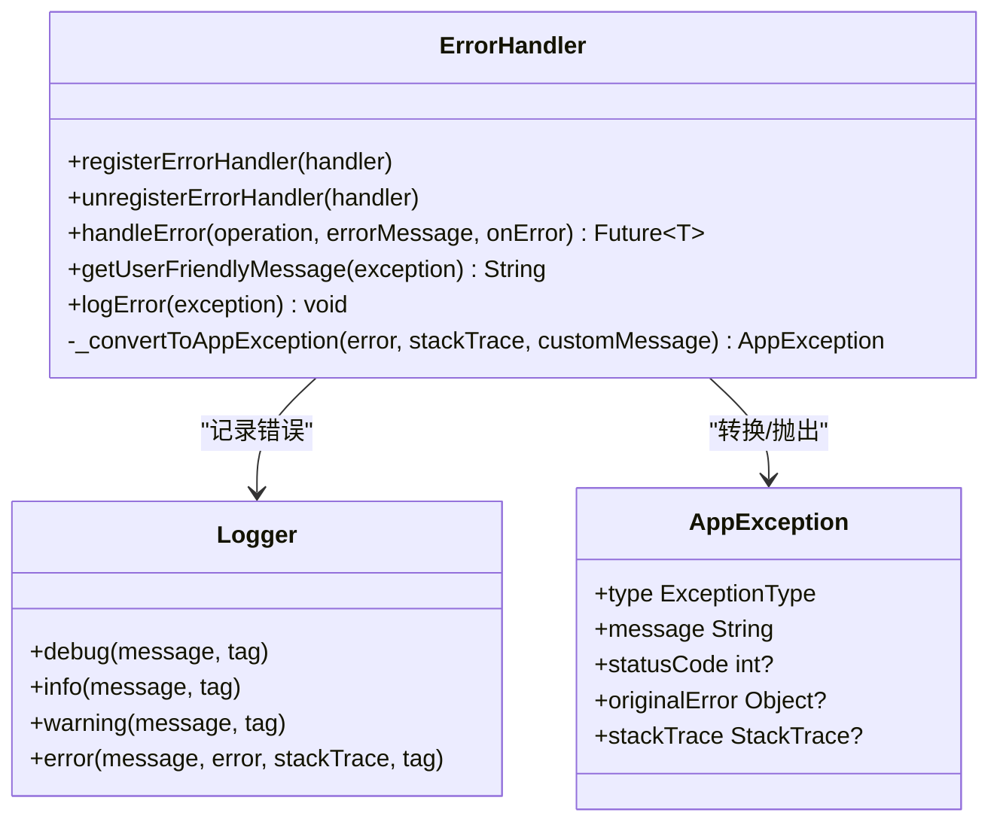
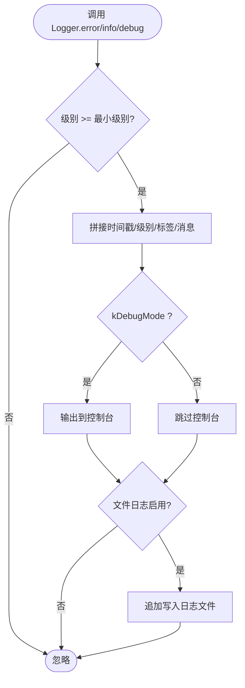
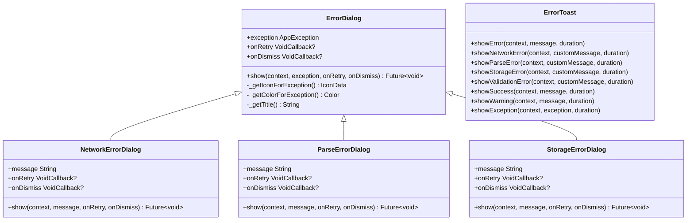
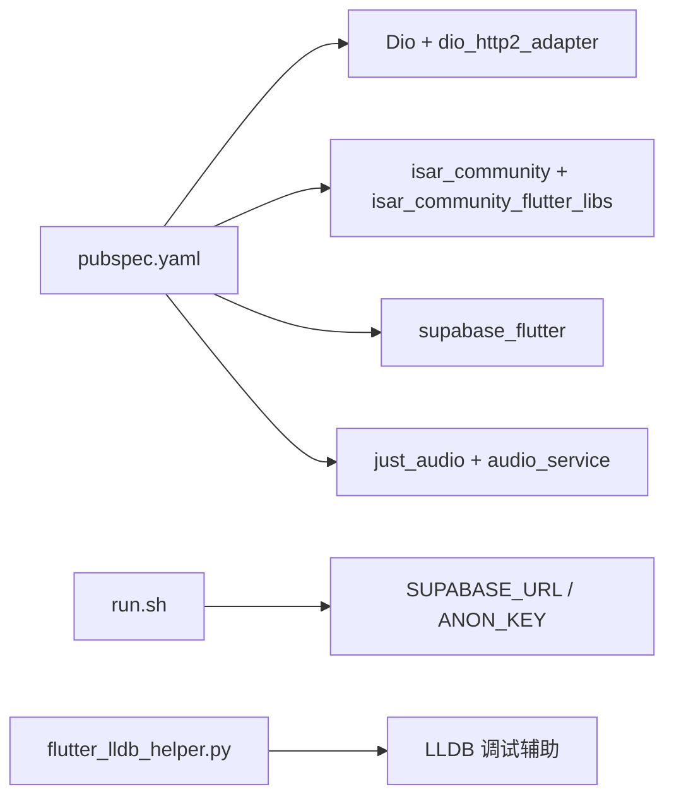

# 故障排除

<cite>
**本文引用的文件**
- [lib/core/utils/error_handler.dart](file://lib/core/utils/error_handler.dart)
- [lib/core/utils/logger.dart](file://lib/core/utils/logger.dart)
- [lib/presentation/widgets/common/error_dialog.dart](file://lib/presentation/widgets/common/error_dialog.dart)
- [lib/presentation/widgets/common/error_toast.dart](file://lib/presentation/widgets/common/error_toast.dart)
- [docs/download_debug_guide.md](file://docs/download_debug_guide.md)
- [docs/database.md](file://docs/database.md)
- [run.sh](file://run.sh)
- [pubspec.yaml](file://pubspec.yaml)
- [ios/Flutter/ephemeral/flutter_lldb_helper.py](file://ios/Flutter/ephemeral/flutter_lldb_helper.py)
</cite>

## 目录
1. [简介](#简介)
2. [项目结构](#项目结构)
3. [核心组件](#核心组件)
4. [架构总览](#架构总览)
5. [详细组件分析](#详细组件分析)
6. [依赖分析](#依赖分析)
7. [性能注意事项](#性能注意事项)
8. [故障排除指南](#故障排除指南)
9. [结论](#结论)
10. [附录](#附录)

## 简介
本指南面向 TinyCast 用户与开发者，聚焦安装、构建、运行期异常与性能问题的定位与解决。文档基于仓库中的错误处理、日志系统、下载调试与数据库技术文档进行系统化整理，提供：
- 常见问题与解决方案（安装、构建、运行时、性能）
- 错误处理机制与日志分析方法
- 调试工具与技巧（日志查看、内存分析、网络请求调试、数据库查询优化）
- 崩溃分析与堆栈跟踪解读方法
- 已知问题临时方案与修复进度提示
- 社区支持与获取帮助渠道

## 项目结构
TinyCast 为跨平台 Flutter 应用，核心能力包括：
- 统一错误处理与日志记录
- 音频下载与文件存储
- Isar 本地数据库
- Supabase 云服务集成
- 多平台启动脚本与环境注入

图表来源
- [lib/core/utils/error_handler.dart:1-129](file://lib/core/utils/error_handler.dart#L1-L129)
- [lib/core/utils/logger.dart:1-139](file://lib/core/utils/logger.dart#L1-L139)
- [docs/download_debug_guide.md:1-269](file://docs/download_debug_guide.md#L1-L269)
- [docs/database.md:1-502](file://docs/database.md#L1-L502)

章节来源
- [pubspec.yaml:1-196](file://pubspec.yaml#L1-L196)
- [run.sh:11-65](file://run.sh#L11-L65)

## 核心组件
- 错误处理：统一的 AppException 分类与 ErrorHandler 拦截器模式，支持注册自定义处理器与用户友好消息生成。
- 日志系统：Logger 支持多级日志、控制台输出与文件落盘；开发/生产级别可配置。
- UI 反馈：ErrorDialog 与 ErrorToast 提供网络、解析、存储等场景的对话框与 Toast 提示。
- 下载调试：download_debug_guide.md 定义了丰富的日志标识与关键场景排查步骤。
- 数据库：Isar 数据库初始化、集合定义、数据源与 Repository 分层，以及 Inspector 使用。

章节来源
- [lib/core/utils/error_handler.dart:1-129](file://lib/core/utils/error_handler.dart#L1-L129)
- [lib/core/utils/logger.dart:1-139](file://lib/core/utils/logger.dart#L1-L139)
- [lib/presentation/widgets/common/error_dialog.dart:1-438](file://lib/presentation/widgets/common/error_dialog.dart#L1-L438)
- [lib/presentation/widgets/common/error_toast.dart:1-212](file://lib/presentation/widgets/common/error_toast.dart#L1-L212)
- [docs/download_debug_guide.md:1-269](file://docs/download_debug_guide.md#L1-L269)
- [docs/database.md:1-502](file://docs/database.md#L1-L502)

## 架构总览
错误处理与日志在应用各层被广泛调用，形成“捕获—转换—记录—展示”的闭环。下载流程贯穿网络、文件与数据库，配合详细日志便于定位瓶颈与失败点。

图表来源
- [lib/core/utils/error_handler.dart:27-57](file://lib/core/utils/error_handler.dart#L27-L57)
- [lib/core/utils/logger.dart:83-117](file://lib/core/utils/logger.dart#L83-L117)
- [docs/download_debug_guide.md:52-119](file://docs/download_debug_guide.md#L52-L119)

## 详细组件分析

### 错误处理组件（ErrorHandler）
- 职责：统一捕获异常、转换为 AppException、记录日志、分发到已注册的处理器、提供用户友好消息。
- 关键点：
  - 支持异步包装 handleError，避免未捕获异常导致崩溃。
  - 内置将 FormatException、TimeoutException、StateError 映射为对应业务异常类型。
  - 提供 getUserFriendlyMessage 用于 UI 展示。

图表来源
- [lib/core/utils/error_handler.dart:10-129](file://lib/core/utils/error_handler.dart#L10-L129)

章节来源
- [lib/core/utils/error_handler.dart:1-129](file://lib/core/utils/error_handler.dart#L1-L129)

### 日志系统（Logger）
- 职责：分级日志输出（debug/info/warning/error），支持控制台与文件双写；开发模式下默认更详细的级别。
- 关键点：
  - initFileLogging 初始化日志目录与按日切分文件。
  - _writeToFile 保证写入失败时降级关闭文件日志。
  - 可通过 setMinLevel 控制最小级别。

图表来源
- [lib/core/utils/logger.dart:36-117](file://lib/core/utils/logger.dart#L36-L117)

章节来源
- [lib/core/utils/logger.dart:1-139](file://lib/core/utils/logger.dart#L1-L139)

### 错误提示组件（ErrorDialog / ErrorToast）
- 职责：根据 AppException 类型展示对话框或 Toast，提供重试与确认操作。
- 关键点：
  - ErrorDialog 支持网络、存储、认证、验证、权限、未知错误等类型化展示。
  - ErrorToast 提供 showNetworkError/showParseError/showStorageError 等便捷方法。
  - 所有弹窗均支持 onRetry/onDismiss 回调，便于上层重试与清理。

图表来源
- [lib/presentation/widgets/common/error_dialog.dart:1-438](file://lib/presentation/widgets/common/error_dialog.dart#L1-L438)
- [lib/presentation/widgets/common/error_toast.dart:1-212](file://lib/presentation/widgets/common/error_toast.dart#L1-L212)

章节来源
- [lib/presentation/widgets/common/error_dialog.dart:1-438](file://lib/presentation/widgets/common/error_dialog.dart#L1-L438)
- [lib/presentation/widgets/common/error_toast.dart:1-212](file://lib/presentation/widgets/common/error_toast.dart#L1-L212)

### 下载调试与日志规范（download_debug_guide）
- 目标：通过 emoji 前缀与结构化日志快速定位下载全流程问题。
- 关键场景：
  - 订阅新播客自动下载触发
  - 单个下载过程（创建任务、HTTP 下载、进度、保存文件、更新数据库）
  - 检查音频目录内容
- 常见问题：找不到文件、下载失败、数据库更新失败、自动下载未触发。
- 建议：使用 DevTools Console 过滤 “[DEBUG]”，或使用 flutter run --verbose 观察终端输出。

章节来源
- [docs/download_debug_guide.md:1-269](file://docs/download_debug_guide.md#L1-L269)

### 数据库技术与维护（database）
- 技术栈：Isar NoSQL 嵌入式数据库，启用 inspector 便于可视化。
- 初始化：IsarService.open 指定集合 Schema、路径与名称。
- 集合与关系：Podcast、Episode、Favorite、Queue、PlayHistory、SearchHistoryModel、AppSettingsModel。
- 维护：关闭、清空、删除数据库文件；Inspector 访问地址。
- 最佳实践：事务写入、统一异常封装、Fallback 关联策略、软删除与快照。

章节来源
- [docs/database.md:1-502](file://docs/database.md#L1-L502)

## 依赖分析
- 外部依赖：Dio（网络）、Isar（数据库）、Supabase（云）、just_audio/audio_service（音频）、path_provider/path（路径）、crypto（加密）、shared_preferences（设置）。
- 平台相关：iOS LLDB 辅助脚本用于调试 RX 页面；run.sh 注入 SUPABASE_URL/ANON_KEY 并选择设备。

图表来源
- [pubspec.yaml:1-196](file://pubspec.yaml#L1-L196)
- [run.sh:11-65](file://run.sh#L11-L65)
- [ios/Flutter/ephemeral/flutter_lldb_helper.py:1-32](file://ios/Flutter/ephemeral/flutter_lldb_helper.py#L1-L32)

章节来源
- [pubspec.yaml:1-196](file://pubspec.yaml#L1-L196)
- [run.sh:11-65](file://run.sh#L11-L65)
- [ios/Flutter/ephemeral/flutter_lldb_helper.py:1-32](file://ios/Flutter/ephemeral/flutter_lldb_helper.py#L1-L32)

## 性能注意事项
- 下载与 IO：
  - 关注下载速度与队列状态，结合 download_debug_guide 的进度与时间统计日志。
  - 合理管理临时文件与最终文件路径，避免重复写入。
- 数据库：
  - 使用 Isar 的事务写入与索引字段（如 pubDate、lastUpdated）提升查询效率。
  - 利用 Inspector 观察慢查询与热点集合。
- 网络：
  - 使用 Dio 的超时与重试策略，避免频繁失败重试造成雪崩。
  - 监控连接状态（connectivity_plus）并在无网时降级。
- 内存与渲染：
  - 图片缓存使用 cached_network_image，避免大图阻塞主线程。
  - 长列表分页加载，减少一次性渲染压力。

[本节为通用指导，不直接分析具体文件]

## 故障排除指南

### 安装与环境问题
- 现象：无法选择设备或运行失败
- 排查：
  - 检查 run.sh 的设备参数与环境变量（Android_Device_ID、SUPABASE_URL、SUPABASE_ANON_KEY）。
  - 确认平台检测逻辑（macOS/Linux/Windows/iOS/Android）与 flutter 环境可用。
- 解决：
  - 在 .env 中配置 Android_Device_ID 后重新执行 run.sh。
  - 确保 Dart SDK 版本满足 pubspec.yaml 约束。

章节来源
- [run.sh:11-65](file://run.sh#L11-L65)
- [pubspec.yaml:12-13](file://pubspec.yaml#L12-L13)

### 构建错误
- 现象：编译失败或代码生成错误
- 排查：
  - 检查 Isar Schema 是否已生成（build_runner 命令）。
  - 核对导入路径与模块迁移后的路径一致性。
- 解决：
  - 执行 dart run build_runner build --delete-conflicting-outputs 重新生成。
  - 修正相对导入路径错误。

章节来源
- [docs/database.md:447-448](file://docs/database.md#L447-L448)

### 运行时异常
- 现象：网络错误、解析错误、存储错误、权限错误、未知错误
- 排查：
  - 使用 ErrorHandler.handleError 包裹异步操作，捕获并转换为 AppException。
  - 通过 Logger 查看错误日志与堆栈；在 UI 层使用 ErrorDialog/ErrorToast 提示。
- 解决：
  - 网络类：检查超时、DNS、代理与证书；必要时增加重试。
  - 解析类：校验 RSS/XML 格式与字段完整性。
  - 存储类：检查磁盘空间与路径权限。
  - 权限类：引导用户开启必要权限。

章节来源
- [lib/core/utils/error_handler.dart:27-57](file://lib/core/utils/error_handler.dart#L27-L57)
- [lib/presentation/widgets/common/error_dialog.dart:98-147](file://lib/presentation/widgets/common/error_dialog.dart#L98-L147)
- [lib/presentation/widgets/common/error_toast.dart:161-210](file://lib/presentation/widgets/common/error_toast.dart#L161-L210)

### 下载相关问题
- 现象：下载失败、文件找不到、自动下载未触发、数据库状态未更新
- 排查：
  - 依据 download_debug_guide 的日志标识与关键节点，定位失败阶段。
  - 检查临时目录与应用支持目录是否正确创建与写入。
  - 确认 Isar 数据库连接与事务提交。
- 解决：
  - 针对网络错误调整 Dio 配置与重试策略。
  - 针对存储错误检查路径权限与磁盘空间。
  - 针对自动下载未触发，检查订阅事件与策略配置。

章节来源
- [docs/download_debug_guide.md:146-193](file://docs/download_debug_guide.md#L146-L193)

### 数据库问题
- 现象：查询缓慢、数据不一致、Schema 变更冲突
- 排查：
  - 使用 Isar Inspector 观察集合与索引使用情况。
  - 检查事务边界与写入顺序，确保原子性。
  - 确认 Schema 变更后已重新生成 .g.dart 文件。
- 解决：
  - 优化查询条件与排序字段，合理使用索引。
  - 对批量写入使用事务包裹。
  - 遵循 Fallback 关联策略，避免 ID 失效导致的数据丢失。

章节来源
- [docs/database.md:468-502](file://docs/database.md#L468-L502)

### 崩溃分析与堆栈跟踪
- 现象：应用崩溃或无响应
- 排查：
  - 查看 Logger 输出的错误与堆栈信息。
  - 在 iOS 上使用 LLDB 辅助脚本定位原生侧问题。
- 解决：
  - 根据堆栈定位异常源头，补充空值检查与异常分支。
  - 对关键路径添加 try/catch 与 ErrorHandler 包裹。

章节来源
- [lib/core/utils/logger.dart:83-117](file://lib/core/utils/logger.dart#L83-L117)
- [ios/Flutter/ephemeral/flutter_lldb_helper.py:1-32](file://ios/Flutter/ephemeral/flutter_lldb_helper.py#L1-L32)

### 性能瓶颈识别与优化
- 下载瓶颈：
  - 监控下载速度、队列长度与文件大小，避免并发过高导致拥塞。
- 数据库瓶颈：
  - 使用 Inspector 定位慢查询，优化索引与查询条件。
- 网络瓶颈：
  - 启用 HTTP/2 适配器，合理设置超时与重试。
- 渲染瓶颈：
  - 使用缓存与懒加载，减少主线程压力。

[本节为通用指导，不直接分析具体文件]

### 调试工具与技巧
- 日志查看：
  - 使用 DevTools Console 过滤 “[DEBUG]” 关键字。
  - 启用 Logger 文件日志，按日查看 tinycast/log/*.log。
- 内存分析：
  - 使用 Flutter DevTools Memory 面板观察对象分配与释放。
- 网络请求调试：
  - 使用 Dio 拦截器打印请求/响应与耗时。
- 数据库查询优化：
  - 使用 Isar Inspector 分析查询计划与热点集合。

章节来源
- [docs/download_debug_guide.md:196-210](file://docs/download_debug_guide.md#L196-L210)
- [lib/core/utils/logger.dart:42-65](file://lib/core/utils/logger.dart#L42-L65)
- [docs/database.md:488-491](file://docs/database.md#L488-L491)

### 已知问题与临时方案
- 自动下载未触发：
  - 临时方案：手动触发下载接口，检查 podcastId 与策略配置。
- 数据库状态未更新：
  - 临时方案：重启应用后重试，确认事务提交与 Isar 连接。
- 网络错误频发：
  - 临时方案：降低并发、增加重试间隔与超时时间。

[本节为通用指导，不直接分析具体文件]

### 社区支持与获取帮助
- 渠道：
  - GitHub Issues 提交问题与复现步骤。
  - 社区论坛与讨论区分享经验与解决方案。
- 建议：
  - 附上完整日志（包含时间戳与堆栈）、设备信息与复现步骤。
  - 提供最小可复现代码片段与依赖版本。

[本节为通用指导，不直接分析具体文件]

## 结论
通过统一的错误处理与日志体系、完善的下载调试规范与数据库技术文档，TinyCast 提供了从安装、构建到运行期的全链路排障能力。建议在日常开发与发布中：
- 始终使用 ErrorHandler 包裹异步操作
- 启用 Logger 文件日志并定期归档
- 借助 DevTools 与 Isar Inspector 进行性能与数据诊断
- 遵循下载与数据库的最佳实践，持续优化用户体验

## 附录
- 常用命令：
  - 构建与生成：dart run build_runner build --delete-conflicting-outputs
  - 运行与调试：flutter run -d macos（或 android/ios）
  - 查看日志：DevTools Console 过滤 “[DEBUG]”；查看 tinycast/log/*.log
- 参考文档：
  - 下载调试指南：docs/download_debug_guide.md
  - 数据库技术文档：docs/database.md

[本节为通用指导，不直接分析具体文件]