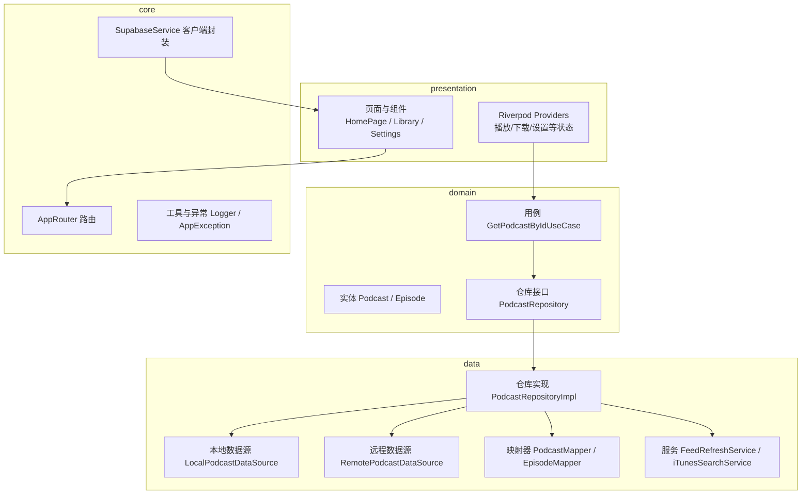
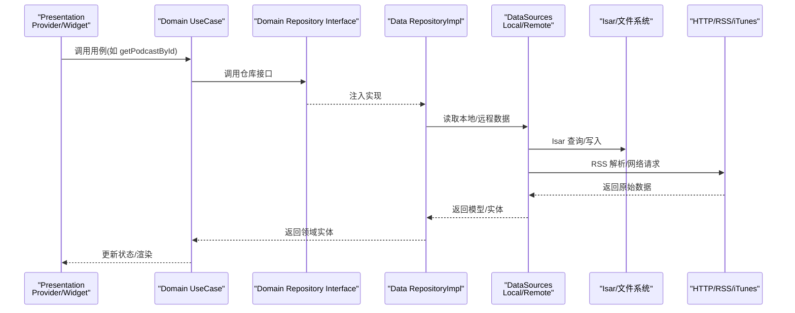
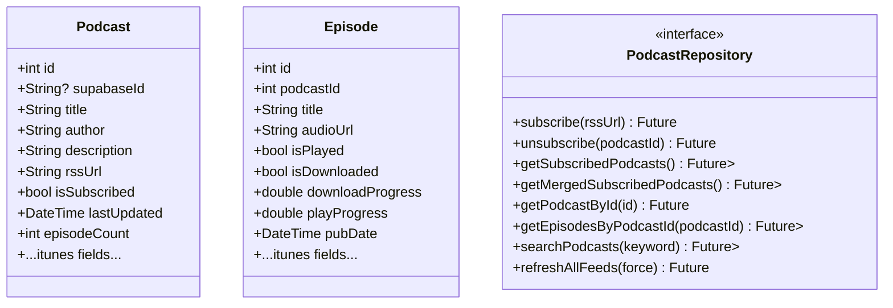
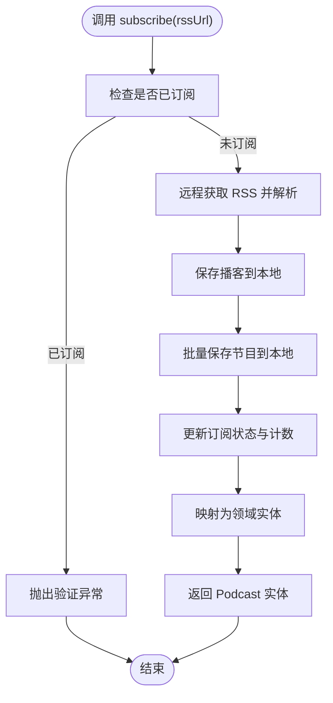
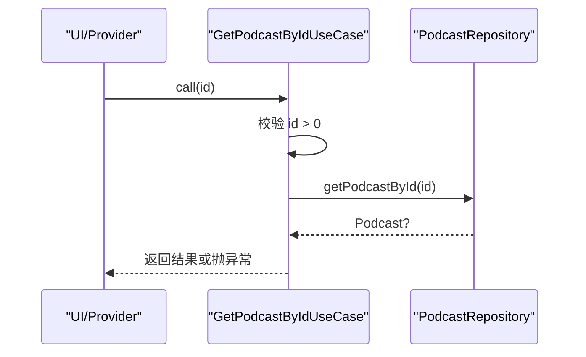
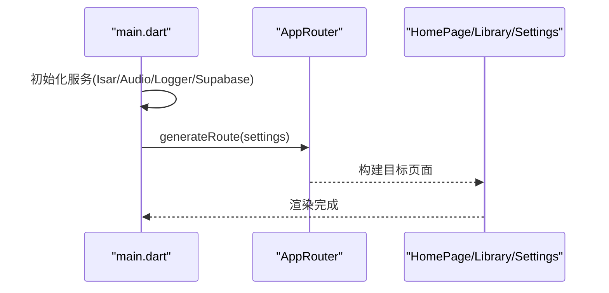
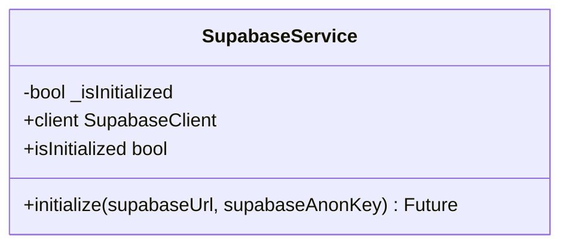
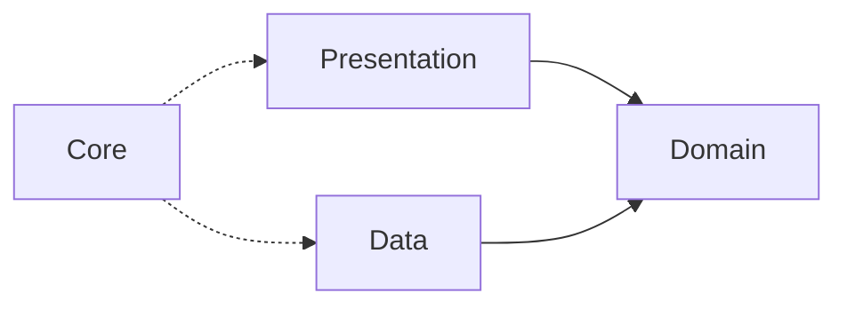

# Clean Architecture 详解

<cite>
**本文引用的文件**   
- [main.dart](file://lib/main.dart)
- [app_router.dart](file://lib/core/router/app_router.dart)
- [podcast_repository.dart](file://lib/domain/repositories/podcast_repository.dart)
- [podcast_repository_impl.dart](file://lib/data/repositories/podcast_repository_impl.dart)
- [get_podcast_by_id_usecase.dart](file://lib/domain/usecases/get_podcast_by_id_usecase.dart)
- [podcast.dart](file://lib/domain/entities/podcast.dart)
- [episode.dart](file://lib/domain/entities/episode.dart)
- [local_podcast_datasource.dart](file://lib/data/datasources/local_podcast_datasource.dart)
- [supabase_service.dart](file://lib/core/services/supabase_service.dart)
- [pubspec.yaml](file://pubspec.yaml)
</cite>

## 目录
1. [简介](#简介)
2. [项目结构](#项目结构)
3. [核心组件](#核心组件)
4. [架构总览](#架构总览)
5. [详细组件分析](#详细组件分析)
6. [依赖关系分析](#依赖关系分析)
7. [性能考量](#性能考量)
8. [故障排查指南](#故障排查指南)
9. [结论](#结论)
10. [附录](#附录)

## 简介
本文件为 TinyCast 应用提供基于 Clean Architecture（整洁架构）的分层设计文档，围绕 presentation（展示层）、domain（领域层）、data（数据层）与 core（核心层）的职责边界、依赖方向、数据流向与接口契约进行系统化说明。重点阐述如何通过依赖倒置原则实现层间解耦，以及该模式在可测试性、可维护性与可扩展性方面的优势。文中包含架构图、类图、时序图与流程图，帮助读者从高层到代码级全面理解系统。

## 项目结构
TinyCast 采用 Flutter 工程组织，核心源码位于 lib 目录下，按 Clean Architecture 分层：
- core：通用能力与基础设施（路由、主题、服务、工具、异常等）
- domain：业务实体、仓库接口与用例（纯业务逻辑，不依赖外部框架）
- data：数据源、仓库实现、模型映射与服务编排（数据库、网络、文件、解析等）
- presentation：UI 页面、状态管理（Riverpod Provider）、组件与交互流程

图表来源 
- [main.dart:106-177](file://lib/main.dart#L106-L177)
- [app_router.dart:20-132](file://lib/core/router/app_router.dart#L20-L132)
- [podcast_repository.dart:6-41](file://lib/domain/repositories/podcast_repository.dart#L6-L41)
- [podcast_repository_impl.dart:15-36](file://lib/data/repositories/podcast_repository_impl.dart#L15-L36)
- [local_podcast_datasource.dart:13-17](file://lib/data/datasources/local_podcast_datasource.dart#L13-L17)
- [supabase_service.dart:8-47](file://lib/core/services/supabase_service.dart#L8-L47)

章节来源
- [main.dart:106-177](file://lib/main.dart#L106-L177)
- [pubspec.yaml:1-196](file://pubspec.yaml#L1-L196)

## 核心组件
- 实体（Domain Entities）
  - Podcast：播客元数据、订阅状态、iTunes 扩展字段等
  - Episode：节目详情、播放/下载状态、时间戳与 iTunes 关联信息
- 仓库接口（Domain Repository）
  - PodcastRepository：定义订阅、取消订阅、查询、搜索、刷新 feed 等业务能力
- 用例（Domain UseCases）
  - GetPodcastByIdUseCase：对仓库接口的简单封装与参数校验
- 数据层（Data Layer）
  - LocalPodcastDataSource：Isar 本地数据库操作（CRUD、过滤、排序、事务）
  - RemotePodcastDataSource：RSS 解析、iTunes 搜索、网络请求
  - PodcastRepositoryImpl：协调本地/远程数据源、映射实体与模型、错误处理与日志
  - Mapper：PodcastMapper / EpisodeMapper 负责 Model ↔ Entity 转换
  - Services：FeedRefreshService、iTunesSearchService、FileStorageService 等
- 核心层（Core Layer）
  - AppRouter：路由集中管理与窗口控制
  - SupabaseService：Supabase 客户端初始化与访问
  - 工具与异常：Logger、AppException、NetworkHelper 等

章节来源
- [podcast.dart:1-74](file://lib/domain/entities/podcast.dart#L1-L74)
- [episode.dart:1-66](file://lib/domain/entities/episode.dart#L1-L66)
- [podcast_repository.dart:6-41](file://lib/domain/repositories/podcast_repository.dart#L6-L41)
- [get_podcast_by_id_usecase.dart:4-20](file://lib/domain/usecases/get_podcast_by_id_usecase.dart#L4-L20)
- [podcast_repository_impl.dart:15-36](file://lib/data/repositories/podcast_repository_impl.dart#L15-L36)
- [local_podcast_datasource.dart:13-17](file://lib/data/datasources/local_podcast_datasource.dart#L13-L17)
- [supabase_service.dart:8-47](file://lib/core/services/supabase_service.dart#L8-L47)

## 架构总览
Clean Architecture 的核心在于“依赖方向由外向内”，外层只依赖内层抽象，内层不依赖外层具体实现。TinyCast 通过以下机制实现：
- 依赖倒置：domain 层仅声明 PodcastRepository 接口；data 层提供 PodcastRepositoryImpl 实现
- 数据流：presentation → usecase → repository interface → repository impl → datasources → storage/network
- 隔离变化：UI 变更不影响业务；存储/网络实现替换不影响上层
- 可测试性：可通过 Mock 仓库接口或数据源快速验证用例与 UI

图表来源 
- [get_podcast_by_id_usecase.dart:4-20](file://lib/domain/usecases/get_podcast_by_id_usecase.dart#L4-L20)
- [podcast_repository.dart:6-41](file://lib/domain/repositories/podcast_repository.dart#L6-L41)
- [podcast_repository_impl.dart:15-36](file://lib/data/repositories/podcast_repository_impl.dart#L15-L36)
- [local_podcast_datasource.dart:13-17](file://lib/data/datasources/local_podcast_datasource.dart#L13-L17)

## 详细组件分析

### 领域层：实体与仓库接口
- Podcast 与 Episode 是领域实体，承载业务语义与不变量（如播放/下载状态、时间戳、iTunes 关联）
- PodcastRepository 定义所有与播客相关的业务能力，屏蔽数据来源差异（本地/远程/合并）

图表来源 
- [podcast.dart:1-74](file://lib/domain/entities/podcast.dart#L1-L74)
- [episode.dart:1-66](file://lib/domain/entities/episode.dart#L1-L66)
- [podcast_repository.dart:6-41](file://lib/domain/repositories/podcast_repository.dart#L6-L41)

章节来源
- [podcast.dart:1-74](file://lib/domain/entities/podcast.dart#L1-L74)
- [episode.dart:1-66](file://lib/domain/entities/episode.dart#L1-L66)
- [podcast_repository.dart:6-41](file://lib/domain/repositories/podcast_repository.dart#L6-L41)

### 数据层：仓库实现与数据源
- PodcastRepositoryImpl 实现 PodcastRepository，协调 LocalPodcastDataSource 与 RemotePodcastDataSource
- 使用 PodcastMapper / EpisodeMapper 将 Model 转换为 Entity，保证领域层不受持久化细节影响
- 统一异常与日志：AppException 与 Logger 贯穿数据层，便于追踪与调试

图表来源 
- [podcast_repository_impl.dart:39-141](file://lib/data/repositories/podcast_repository_impl.dart#L39-L141)
- [local_podcast_datasource.dart:89-127](file://lib/data/datasources/local_podcast_datasource.dart#L89-L127)

章节来源
- [podcast_repository_impl.dart:15-524](file://lib/data/repositories/podcast_repository_impl.dart#L15-L524)
- [local_podcast_datasource.dart:13-800](file://lib/data/datasources/local_podcast_datasource.dart#L13-L800)

### 用例层：用例与参数校验
- GetPodcastByIdUseCase 对仓库接口进行轻量封装，执行参数校验与异常包装
- 用例保持无副作用的纯业务编排，便于单元测试

图表来源 
- [get_podcast_by_id_usecase.dart:4-20](file://lib/domain/usecases/get_podcast_by_id_usecase.dart#L4-L20)
- [podcast_repository.dart:15-15](file://lib/domain/repositories/podcast_repository.dart#L15-L15)

章节来源
- [get_podcast_by_id_usecase.dart:4-20](file://lib/domain/usecases/get_podcast_by_id_usecase.dart#L4-L20)

### 展示层：路由与入口
- main.dart 负责应用初始化（Isar、AudioPlayer、Logger、Supabase），并根据多窗口参数启动不同页面
- AppRouter 集中管理路由跳转与参数解析，支持多窗口场景（设置、订阅、节目详情）

图表来源 
- [main.dart:106-177](file://lib/main.dart#L106-L177)
- [app_router.dart:20-132](file://lib/core/router/app_router.dart#L20-L132)

章节来源
- [main.dart:106-177](file://lib/main.dart#L106-L177)
- [app_router.dart:20-132](file://lib/core/router/app_router.dart#L20-L132)

### 核心层：基础设施与配置
- SupabaseService：单例封装 Supabase 客户端初始化与访问，确保全局一致性
- 工具与异常：Logger、AppException、NetworkHelper 等支撑各层稳定运行

图表来源 
- [supabase_service.dart:8-47](file://lib/core/services/supabase_service.dart#L8-L47)

章节来源
- [supabase_service.dart:8-47](file://lib/core/services/supabase_service.dart#L8-L47)

## 依赖关系分析
- 依赖方向
  - presentation → domain（通过用例与仓库接口）
  - data → domain（实现仓库接口，依赖实体）
  - core → 无业务依赖（仅提供基础设施）
- 耦合与内聚
  - 仓库接口高内聚于业务语义，数据源低耦合于具体实现
  - 映射器隔离 Model 与 Entity，避免持久化细节侵入领域层
- 外部依赖
  - Isar 数据库、Dio HTTP、RSS/XML 解析、Supabase 云服务

图表来源 
- [podcast_repository.dart:6-41](file://lib/domain/repositories/podcast_repository.dart#L6-L41)
- [podcast_repository_impl.dart:15-36](file://lib/data/repositories/podcast_repository_impl.dart#L15-L36)
- [supabase_service.dart:8-47](file://lib/core/services/supabase_service.dart#L8-L47)

章节来源
- [podcast_repository.dart:6-41](file://lib/domain/repositories/podcast_repository.dart#L6-L41)
- [podcast_repository_impl.dart:15-36](file://lib/data/repositories/podcast_repository_impl.dart#L15-L36)

## 性能考量
- 本地优先与缓存策略
  - 优先从 Isar 读取，减少网络开销；仅在必要时触发 RSS 解析与 iTunes 搜索
- 批量写入与事务
  - 使用 writeTxn 批量保存，降低 I/O 次数与锁竞争
- 分页与限制
  - 最新节目查询使用 limit，避免一次性加载过多数据
- 异步与并发
  - 使用 Future 与 unawaited 管理后台任务（如 feed 刷新调度）
- 资源清理
  - 取消订阅时安全删除本地音频文件，释放存储空间

[本节为通用指导，无需特定文件引用]

## 故障排查指南
- 常见异常类型
  - AppException.storage：数据库操作失败（IsarError 捕获）
  - AppException.validation：参数校验失败（如重复订阅）
  - AppException.unknown：未知异常包装，保留原始堆栈
- 日志定位
  - Logger.info/warning/error 记录关键步骤耗时与错误上下文
- 数据一致性
  - 订阅状态、节目计数、最后获取时间等字段需原子更新
- 网络与解析
  - RSS 解析失败、iTunes 搜索超时等应降级处理并记录

章节来源
- [local_podcast_datasource.dart:42-56](file://lib/data/datasources/local_podcast_datasource.dart#L42-L56)
- [podcast_repository_impl.dart:129-141](file://lib/data/repositories/podcast_repository_impl.dart#L129-L141)

## 结论
TinyCast 通过 Clean Architecture 实现了清晰的职责分离与稳定的依赖方向。领域层聚焦业务规则，数据层屏蔽实现细节，展示层专注交互与状态，核心层提供基础设施。该模式显著提升了可测试性（Mock 接口即可）、可维护性（变更局部化）与可扩展性（新增数据源/平台成本低）。建议持续完善用例覆盖、强化异常分类与监控指标，以支撑长期演进。

[本节为总结性内容，无需特定文件引用]

## 附录
- 依赖与版本管理
  - pubspec.yaml 统一管理 Flutter SDK、第三方库与开发依赖
- 多窗口与路由
  - main.dart 根据参数创建不同窗口；AppRouter 集中管理页面跳转与参数解析
- 主题与国际化
  - core/theme 提供主题加载与样式配置；intl 支持国际化与格式化

章节来源
- [pubspec.yaml:1-196](file://pubspec.yaml#L1-L196)
- [main.dart:106-177](file://lib/main.dart#L106-L177)
- [app_router.dart:20-132](file://lib/core/router/app_router.dart#L20-L132)