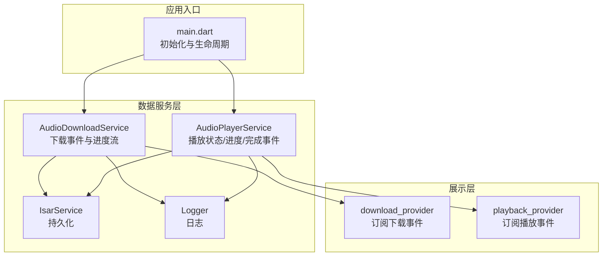
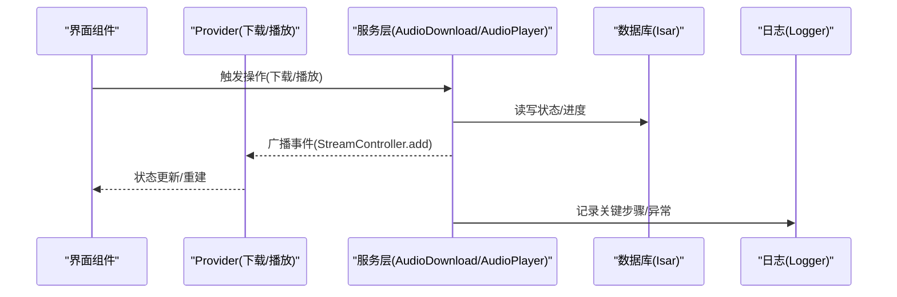
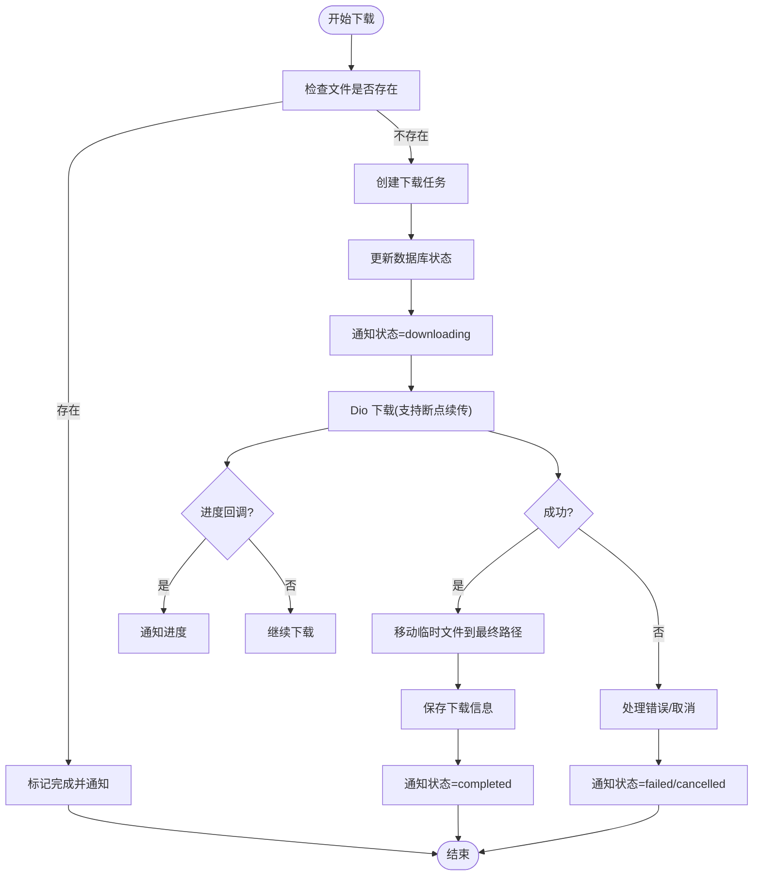
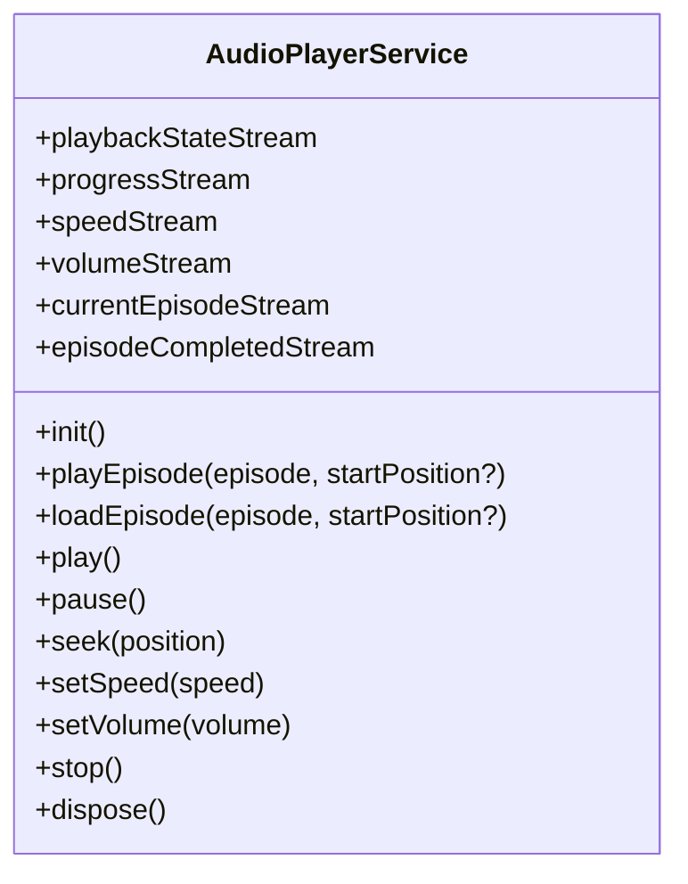
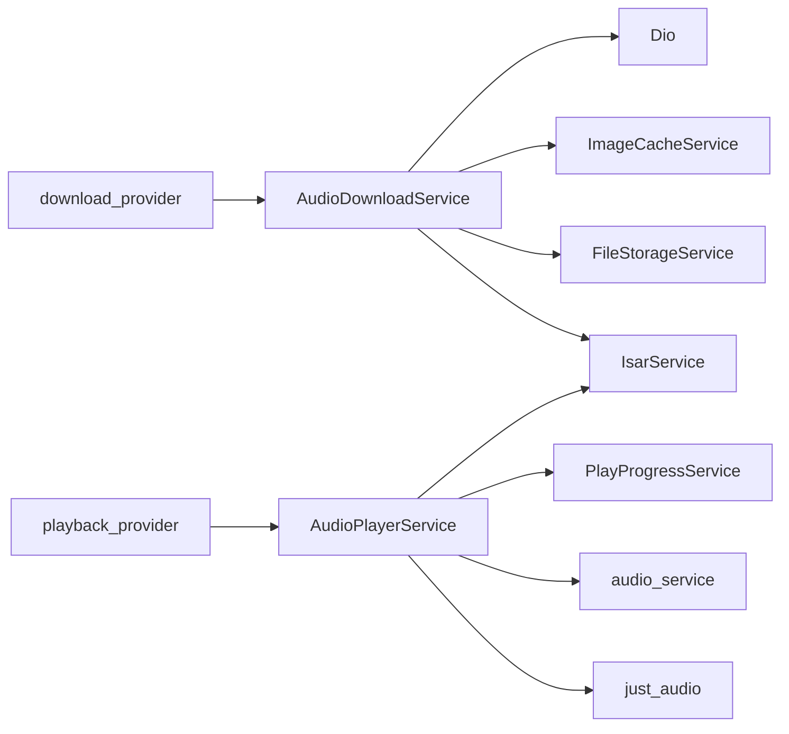

# 事件驱动架构

<cite>
**本文引用的文件**   
- [lib/data/services/audio_download_service.dart](file://lib/data/services/audio_download_service.dart)
- [lib/data/services/audio_player_service.dart](file://lib/data/services/audio_player_service.dart)
- [lib/main.dart](file://lib/main.dart)
- [lib/multi_window.dart](file://lib/multi_window.dart)
- [lib/core/services/network_connectivity_service.dart](file://lib/core/services/network_connectivity_service.dart)
- [lib/core/services/play_progress_service.dart](file://lib/core/services/play_progress_service.dart)
- [lib/data/database/isar_service.dart](file://lib/data/database/isar_service.dart)
- [lib/core/utils/logger.dart](file://lib/core/utils/logger.dart)
- [lib/presentation/providers/download_provider.dart](file://lib/presentation/providers/download_provider.dart)
- [lib/presentation/providers/playback_provider.dart](file://lib/presentation/providers/playback_provider.dart)
</cite>

## 目录
1. [简介](#简介)
2. [项目结构](#项目结构)
3. [核心组件](#核心组件)
4. [架构总览](#架构总览)
5. [详细组件分析](#详细组件分析)
6. [依赖关系分析](#依赖关系分析)
7. [性能考虑](#性能考虑)
8. [故障排查指南](#故障排查指南)
9. [结论](#结论)
10. [附录](#附录)

## 简介
本文件为 TinyCast 应用的事件驱动架构提供系统化文档，重点阐述基于 StreamController 与 EventStream 的发布/订阅模式，以及其在音频播放控制、下载状态更新、用户交互反馈等场景中的落地实践。文档涵盖事件的定义、发布与订阅机制、生命周期管理（创建、传播、消费、清理）、并发与冲突处理、日志与调试方法、性能优化策略，以及与传统回调模式的对比和迁移建议。

## 项目结构
TinyCast 采用分层架构与 Riverpod 状态管理，事件系统主要分布在数据服务层与展示层：
- 数据服务层：AudioDownloadService、AudioPlayerService 通过 StreamController 广播事件；IsarService 负责持久化；Logger 统一记录。
- 展示层：各 Provider（如 download_provider、playback_provider）订阅事件流并驱动 UI 重建。
- 启动与生命周期：main.dart 初始化全局服务与监听器，确保事件源在应用生命周期内可用。

图表来源
- [lib/main.dart:106-177](file://lib/main.dart#L106-L177)
- [lib/data/services/audio_download_service.dart:129-193](file://lib/data/services/audio_download_service.dart#L129-L193)
- [lib/data/services/audio_player_service.dart:31-78](file://lib/data/services/audio_player_service.dart#L31-L78)
- [lib/data/database/isar_service.dart](file://lib/data/database/isar_service.dart)
- [lib/core/utils/logger.dart](file://lib/core/utils/logger.dart)
- [lib/presentation/providers/download_provider.dart](file://lib/presentation/providers/download_provider.dart)
- [lib/presentation/providers/playback_provider.dart](file://lib/presentation/providers/playback_provider.dart)

章节来源
- [lib/main.dart:106-177](file://lib/main.dart#L106-L177)
- [lib/multi_window.dart:184-285](file://lib/multi_window.dart#L184-L285)

## 核心组件
- AudioDownloadService
  - 使用 StreamController<AudioDownloadEvent> 广播全局下载事件；按 episodeId 维护独立的 DownloadStatus 与 progress 流。
  - 提供 downloadEpisode、pauseDownload、resumeDownload、cancelDownload、deleteDownloadedEpisode 等方法，并在关键节点调用 _notifyStatusChange/_notifyProgressChange 推送事件。
- AudioPlayerService
  - 暴露 playbackStateStream、progressStream、speedStream、volumeStream、currentEpisodeStream、episodeCompletedStream 等事件流。
  - 内部通过多个 StreamController.broadcast() 实现多订阅者广播；在播放状态变化、进度更新、播放完成时主动 add 事件。
- 展示层 Provider
  - download_provider 订阅 globalEventStream 或按 episodeId 的进度/状态流，驱动下载列表与图标状态。
  - playback_provider 订阅播放相关流，驱动迷你播放器与页面状态。

章节来源
- [lib/data/services/audio_download_service.dart:115-193](file://lib/data/services/audio_download_service.dart#L115-L193)
- [lib/data/services/audio_download_service.dart:611-624](file://lib/data/services/audio_download_service.dart#L611-L624)
- [lib/data/services/audio_download_service.dart:763-791](file://lib/data/services/audio_download_service.dart#L763-L791)
- [lib/data/services/audio_player_service.dart:31-78](file://lib/data/services/audio_player_service.dart#L31-L78)
- [lib/data/services/audio_player_service.dart:136-190](file://lib/data/services/audio_player_service.dart#L136-L190)
- [lib/presentation/providers/download_provider.dart](file://lib/presentation/providers/download_provider.dart)
- [lib/presentation/providers/playback_provider.dart](file://lib/presentation/providers/playback_provider.dart)

## 架构总览
下图展示了事件驱动的核心路径：服务层通过 StreamController 广播事件，Provider 订阅后更新状态，UI 自动重建。

图表来源
- [lib/data/services/audio_download_service.dart:763-791](file://lib/data/services/audio_download_service.dart#L763-L791)
- [lib/data/services/audio_player_service.dart:136-190](file://lib/data/services/audio_player_service.dart#L136-L190)
- [lib/data/database/isar_service.dart](file://lib/data/database/isar_service.dart)
- [lib/core/utils/logger.dart](file://lib/core/utils/logger.dart)

## 详细组件分析

### 下载事件系统（AudioDownloadService）
- 事件模型
  - AudioDownloadEvent：包含 episodeId、status、progress、timestamp，用于全局事件总线。
- 事件流
  - globalEventStream：全局下载事件流，供任意订阅者消费。
  - getDownloadStatusStream/getDownloadProgressStream：按 episodeId 返回独立的状态/进度流。
- 发布机制
  - _notifyStatusChange/_notifyProgressChange：在任务状态变更与进度回调中向对应控制器与全局控制器 add 事件。
- 生命周期管理
  - 每个 episodeId 的控制器按需创建，删除下载后通过 _disposeControllers 关闭并移除，避免内存泄漏。
- 并发与冲突处理
  - _activeDownloads Set 防止同一 episodeId 重复下载；任务状态机（idle/queued/downloading/paused/completed/failed/cancelled）保证状态一致性。
- 错误处理
  - DioException 分支处理取消/失败，记录日志并通知 UI。

图表来源
- [lib/data/services/audio_download_service.dart:196-408](file://lib/data/services/audio_download_service.dart#L196-L408)
- [lib/data/services/audio_download_service.dart:763-791](file://lib/data/services/audio_download_service.dart#L763-L791)

章节来源
- [lib/data/services/audio_download_service.dart:115-193](file://lib/data/services/audio_download_service.dart#L115-L193)
- [lib/data/services/audio_download_service.dart:611-624](file://lib/data/services/audio_download_service.dart#L611-L624)
- [lib/data/services/audio_download_service.dart:763-791](file://lib/data/services/audio_download_service.dart#L763-L791)

### 播放事件系统（AudioPlayerService）
- 事件流
  - playbackStateStream：播放状态（stopped/playing/paused/buffering）。
  - progressStream：播放进度（position/duration/bufferedPosition）。
  - speedStream/volumeStream：速度与音量变化。
  - currentEpisodeStream：当前节目对象。
  - episodeCompletedStream：播放完成事件（仅事件，业务逻辑由上层处理）。
- 发布机制
  - 监听 just_audio 的 playbackEventStream/playerStateStream/positionStream，内部 _updatePlaybackState/_updateProgress 将新值 add 到对应控制器。
  - 播放完成时发送 episodeCompletedStream 事件，不直接执行业务逻辑，保持解耦。
- 生命周期管理
  - init 时建立订阅与默认音量；dispose 时取消所有订阅并关闭所有控制器。
- 错误处理
  - 加载失败时重置播放器状态并抛出异常，便于上层捕获与提示。

图表来源
- [lib/data/services/audio_player_service.dart:31-78](file://lib/data/services/audio_player_service.dart#L31-L78)
- [lib/data/services/audio_player_service.dart:100-134](file://lib/data/services/audio_player_service.dart#L100-L134)
- [lib/data/services/audio_player_service.dart:136-190](file://lib/data/services/audio_player_service.dart#L136-L190)
- [lib/data/services/audio_player_service.dart:560-583](file://lib/data/services/audio_player_service.dart#L560-L583)

章节来源
- [lib/data/services/audio_player_service.dart:31-78](file://lib/data/services/audio_player_service.dart#L31-L78)
- [lib/data/services/audio_player_service.dart:136-190](file://lib/data/services/audio_player_service.dart#L136-L190)
- [lib/data/services/audio_player_service.dart:560-583](file://lib/data/services/audio_player_service.dart#L560-L583)

### 事件生命周期管理
- 创建
  - 服务单例初始化时创建 StreamController.broadcast()，暴露 stream 给订阅者。
- 传播
  - 在关键业务节点（下载进度回调、播放状态变化、播放完成）调用 controller.add(event)。
- 消费
  - Provider 通过 .listen() 订阅，更新状态并触发 UI 重建。
- 清理
  - 下载完成后按 episodeId 关闭控制器；服务 dispose 时统一关闭所有控制器并取消订阅，避免内存泄漏。

章节来源
- [lib/data/services/audio_download_service.dart:793-798](file://lib/data/services/audio_download_service.dart#L793-L798)
- [lib/data/services/audio_player_service.dart:560-583](file://lib/data/services/audio_player_service.dart#L560-L583)

### 事件在典型场景中的应用
- 音频播放控制
  - 播放/暂停/快进/后退/速度/音量变化均通过各自事件流通知 UI；播放完成事件交由上层 Provider 决定后续行为（如自动下一集）。
- 下载状态更新
  - 订阅 globalEventStream 或按 episodeId 的进度/状态流，实时更新下载图标与进度条。
- 用户交互反馈
  - 网络状态变化可通过 NetworkConnectivityService 获取类型，结合事件流进行提示或限制操作（例如仅在 WiFi 下批量下载）。

章节来源
- [lib/data/services/audio_player_service.dart:345-450](file://lib/data/services/audio_player_service.dart#L345-L450)
- [lib/data/services/audio_download_service.dart:179-193](file://lib/data/services/audio_download_service.dart#L179-L193)
- [lib/core/services/network_connectivity_service.dart:1-42](file://lib/core/services/network_connectivity_service.dart#L1-L42)

### 事件冲突与竞态条件处理
- 重复下载防护
  - 使用 _activeDownloads Set 与任务状态机避免同一 episodeId 并发重复下载。
- 状态一致性
  - 所有状态变更先更新内存任务状态，再写入数据库，最后广播事件，确保 UI 与存储一致。
- 资源释放
  - 删除下载后及时关闭控制器并从映射中移除，避免悬空引用。

章节来源
- [lib/data/services/audio_download_service.dart:483-537](file://lib/data/services/audio_download_service.dart#L483-L537)
- [lib/data/services/audio_download_service.dart:763-791](file://lib/data/services/audio_download_service.dart#L763-L791)

### 事件日志与调试
- Logger 贯穿下载与播放流程，记录关键步骤、异常堆栈与耗时统计。
- 建议在 Provider 层增加调试打印，定位事件消费顺序与 UI 重建时机。

章节来源
- [lib/core/utils/logger.dart](file://lib/core/utils/logger.dart)
- [lib/data/services/audio_download_service.dart:341-407](file://lib/data/services/audio_download_service.dart#L341-L407)
- [lib/data/services/audio_player_service.dart:282-299](file://lib/data/services/audio_player_service.dart#L282-L299)

## 依赖关系分析
- AudioDownloadService 依赖 IsarService（持久化）、FileStorageService（文件操作）、ImageCacheService（封面图缓存）、Dio（HTTP 下载）。
- AudioPlayerService 依赖 just_audio、audio_service、PlayProgressService（播放进度持久化）、IsarService。
- 展示层 Provider 依赖上述服务暴露的 Stream，并通过 Riverpod 管理状态。

图表来源
- [lib/data/services/audio_download_service.dart:129-193](file://lib/data/services/audio_download_service.dart#L129-L193)
- [lib/data/services/audio_player_service.dart:31-78](file://lib/data/services/audio_player_service.dart#L31-L78)
- [lib/data/database/isar_service.dart](file://lib/data/database/isar_service.dart)
- [lib/core/services/play_progress_service.dart](file://lib/core/services/play_progress_service.dart)
- [lib/presentation/providers/download_provider.dart](file://lib/presentation/providers/download_provider.dart)
- [lib/presentation/providers/playback_provider.dart](file://lib/presentation/providers/playback_provider.dart)

章节来源
- [lib/data/services/audio_download_service.dart:129-193](file://lib/data/services/audio_download_service.dart#L129-L193)
- [lib/data/services/audio_player_service.dart:31-78](file://lib/data/services/audio_player_service.dart#L31-L78)

## 性能考虑
- 事件广播
  - 使用 broadcast StreamController 允许多订阅者，避免重复创建控制器；按 episodeId 粒度拆分控制器，减少无关事件传播。
- 下载并发
  - 最大并发数限制（默认 3），队列管理避免过多 IO 竞争。
- 进度更新频率
  - 下载进度回调中适度节流（如每 25% 输出日志），避免频繁 UI 重建。
- 资源释放
  - 服务 dispose 时统一关闭控制器与取消订阅，防止内存泄漏。
- 网络与存储
  - 支持断点续传与临时文件重命名，提升大文件下载稳定性。

[本节为通用指导，不直接分析具体文件]

## 故障排查指南
- 下载失败
  - 检查 Dio 异常类型（超时/取消/网络错误），确认临时文件是否被清理，查看 _notifyStatusChange 是否被调用。
- 播放异常
  - 检查 _loadEpisodeAudio 的本地文件回退逻辑与 setUrl/setFilePath 调用；确认播放器状态重置与错误日志。
- 事件未消费
  - 确认 Provider 是否正确订阅对应 stream；检查控制器是否已关闭；验证 isClosed 判断。
- 内存泄漏
  - 检查 _disposeControllers 与 service.dispose 是否执行；确认订阅是否被 cancel。

章节来源
- [lib/data/services/audio_download_service.dart:390-407](file://lib/data/services/audio_download_service.dart#L390-L407)
- [lib/data/services/audio_player_service.dart:282-299](file://lib/data/services/audio_player_service.dart#L282-L299)
- [lib/data/services/audio_download_service.dart:793-798](file://lib/data/services/audio_download_service.dart#L793-L798)

## 结论
TinyCast 的事件驱动架构以 StreamController 为核心，实现了服务层与展示层的松耦合通信。通过明确的事件模型、严格的生命周期管理与并发控制，系统在音频播放与下载场景中提供了稳定、可观测且易扩展的通信机制。配合 Logger 与 Provider 状态管理，开发者能够快速定位问题并优化性能。相比传统回调模式，事件驱动具备更强的解耦性与可测试性，适合复杂交互与跨模块协作。

[本节为总结，不直接分析具体文件]

## 附录

### 与传统回调模式的对比与迁移指南
- 对比要点
  - 回调：强耦合、难以组合、易产生回调地狱；事件：解耦、可组合、易于测试。
  - 回调：一次性响应；事件：可多订阅、可回溯（若设计为可重放）。
- 迁移建议
  - 识别回调热点（下载进度、播放状态、网络变化）。
  - 用 StreamController 替换回调，暴露 stream 接口。
  - 在 Provider 层订阅事件，集中管理状态。
  - 逐步替换旧回调调用点，保留兼容层直至完全迁移。

[本节为概念性内容，不直接分析具体文件]