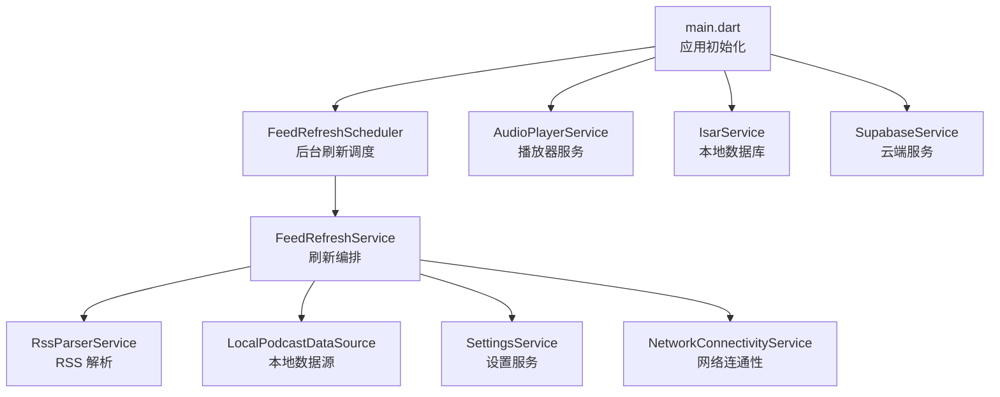
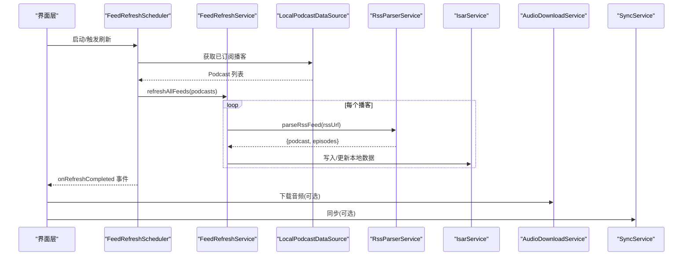
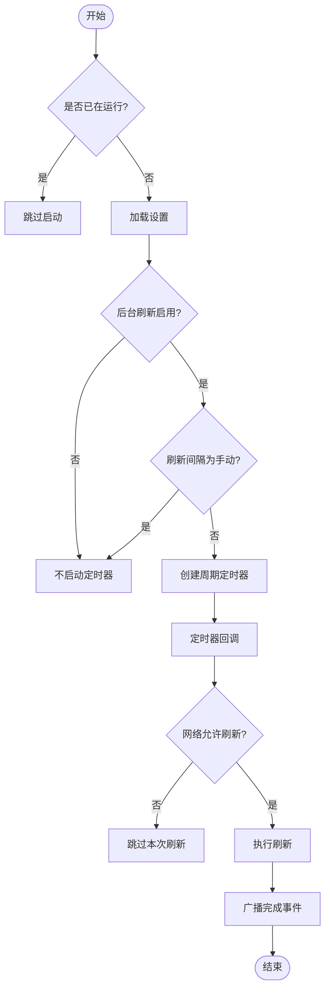
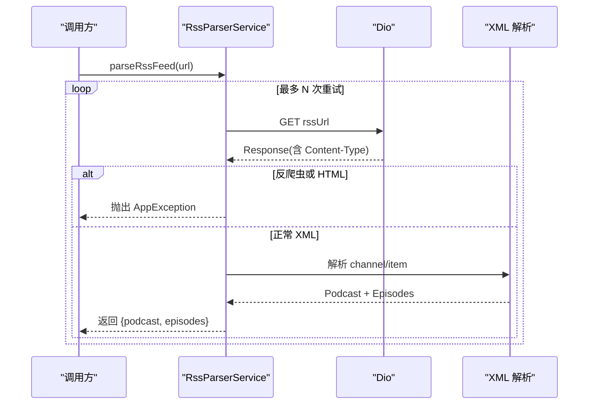
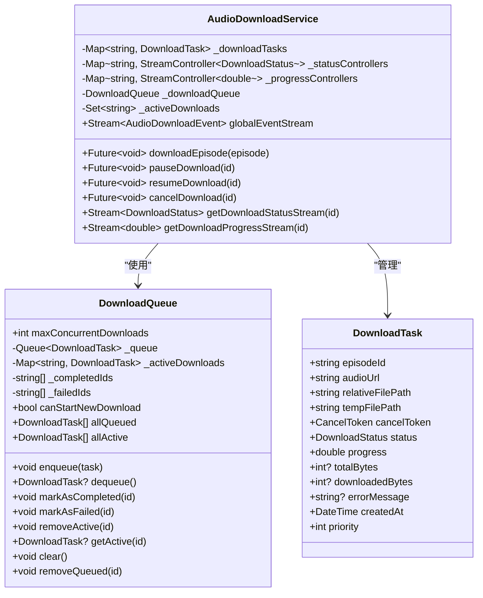
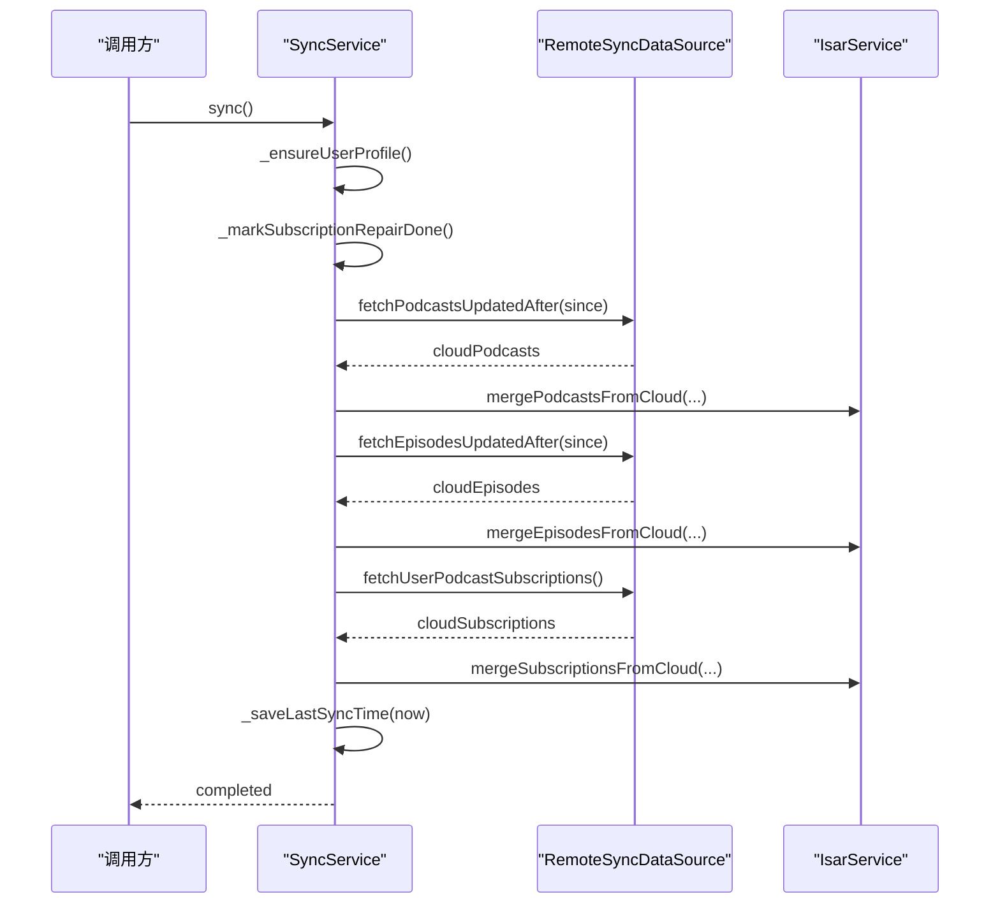
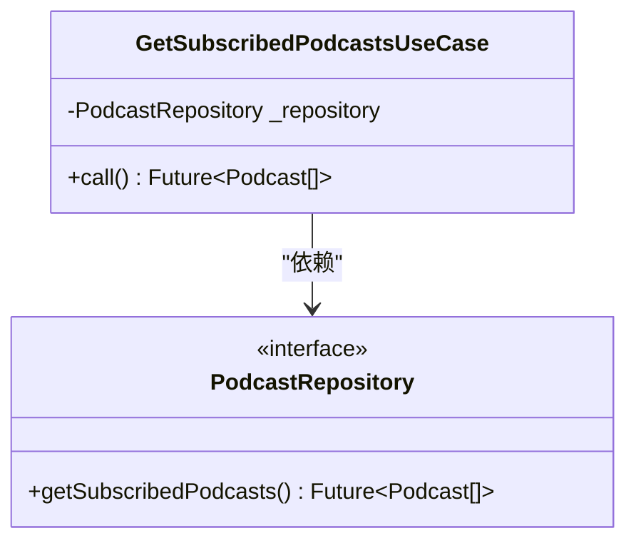
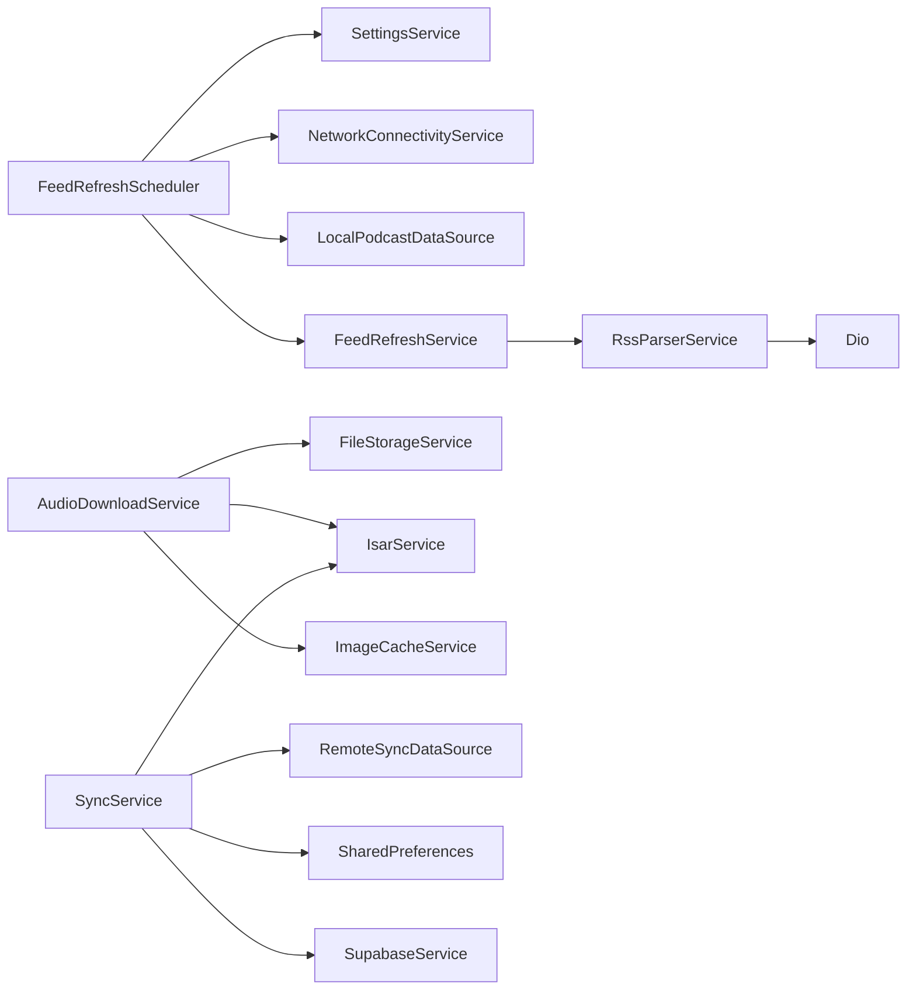

# 异步数据流

<cite>
**本文引用的文件**   
- [lib/main.dart](file://lib/main.dart)
- [lib/core/services/feed_refresh_scheduler.dart](file://lib/core/services/feed_refresh_scheduler.dart)
- [lib/data/services/rss_parser_service.dart](file://lib/data/services/rss_parser_service.dart)
- [lib/data/services/audio_download_service.dart](file://lib/data/services/audio_download_service.dart)
- [lib/core/services/sync_service.dart](file://lib/core/services/sync_service.dart)
- [lib/domain/usecases/get_subscribed_podcasts_usecase.dart](file://lib/domain/usecases/get_subscribed_podcasts_usecase.dart)
</cite>

## 目录
1. [简介](#简介)
2. [项目结构](#项目结构)
3. [核心组件](#核心组件)
4. [架构总览](#架构总览)
5. [详细组件分析](#详细组件分析)
6. [依赖关系分析](#依赖关系分析)
7. [性能考量](#性能考量)
8. [故障排查指南](#故障排查指南)
9. [结论](#结论)
10. [附录](#附录)

## 简介
本文件面向 TinyCast 应用，系统化阐述其异步数据流设计与实现，覆盖网络请求、数据库操作与文件处理的异步模式；解释 Stream 与 Future 的使用场景（数据流处理、错误处理与重试机制）；说明 UseCase 模式在业务逻辑层的封装方式；描述缓存策略（内存/磁盘/失效）；并通过 RSS 订阅解析、音频下载、云同步等具体场景展示设计。同时给出背压处理、并发控制与资源管理的最佳实践，以及异步代码的错误处理模式与调试技巧。

## 项目结构
TinyCast 采用分层架构：
- 表现层（presentation）：UI 与状态管理（Riverpod Provider）
- 领域层（domain）：实体、仓库接口与用例（UseCase）
- 数据层（data）：数据源（本地 Isar、远程 Supabase）、服务（RSS 解析、下载、缓存、设置等）
- 核心层（core）：通用服务（网络连通性、主题、路由、日志、异常等）

启动流程由 main.dart 负责初始化 Isar、播放器、Supabase、主题与定时刷新调度器，随后运行不同平台的 App Shell。

**图表来源** 
- [lib/main.dart:106-194](file://lib/main.dart#L106-L194)
- [lib/core/services/feed_refresh_scheduler.dart:1-165](file://lib/core/services/feed_refresh_scheduler.dart#L1-L165)

**章节来源**
- [lib/main.dart:106-194](file://lib/main.dart#L106-L194)

## 核心组件
- FeedRefreshScheduler：基于 Timer.periodic 的后台刷新调度器，结合网络连通性与设置开关，周期性触发播客刷新任务，完成后通过 Stream 广播完成事件。
- RssParserService：使用 Dio 发起 HTTP 请求并解析 XML/RSS，内置反爬虫检测、HTML 响应识别、重试与退避策略，抛出统一 AppException。
- AudioDownloadService：基于 Dio 的断点续传下载，支持暂停/恢复/取消，内部维护 DownloadQueue 并发队列，通过 StreamController 推送进度与状态事件。
- SyncService：将本地 Isar 数据与云端 Supabase 进行双向同步，按表分步执行，使用事务合并数据，提供进度回调。
- GetSubscribedPodcastsUseCase：领域层用例，封装“获取已订阅播客”的业务调用，向上屏蔽底层仓库细节。

**章节来源**
- [lib/core/services/feed_refresh_scheduler.dart:1-165](file://lib/core/services/feed_refresh_scheduler.dart#L1-L165)
- [lib/data/services/rss_parser_service.dart:1-459](file://lib/data/services/rss_parser_service.dart#L1-L459)
- [lib/data/services/audio_download_service.dart:1-800](file://lib/data/services/audio_download_service.dart#L1-L800)
- [lib/core/services/sync_service.dart:1-800](file://lib/core/services/sync_service.dart#L1-L800)
- [lib/domain/usecases/get_subscribed_podcasts_usecase.dart:1-17](file://lib/domain/usecases/get_subscribed_podcasts_usecase.dart#L1-L17)

## 架构总览
下图展示了从 UI 到数据源的完整异步数据流路径，涵盖网络、解析、存储与事件通知。

**图表来源** 
- [lib/core/services/feed_refresh_scheduler.dart:88-147](file://lib/core/services/feed_refresh_scheduler.dart#L88-L147)
- [lib/data/services/rss_parser_service.dart:40-128](file://lib/data/services/rss_parser_service.dart#L40-L128)
- [lib/data/services/audio_download_service.dart:196-408](file://lib/data/services/audio_download_service.dart#L196-L408)
- [lib/core/services/sync_service.dart:68-113](file://lib/core/services/sync_service.dart#L68-L113)

## 详细组件分析

### 后台刷新调度器（FeedRefreshScheduler）
- 职责：根据设置与网络条件，周期性地触发播客刷新；失败时记录日志；完成后广播事件。
- 关键流程：
  - start()：读取设置，若启用且非手动模式则创建定时器。
  - _onTimerTick()：检查设置与网络条件，满足则执行刷新。
  - _performRefresh()：拉取订阅列表，调用刷新服务，统计结果并广播完成事件。
- 异步模式：Future 用于 IO 与网络，StreamController.broadcast() 用于事件广播。
- 错误处理：捕获异常并记录，避免定时器崩溃。

**图表来源** 
- [lib/core/services/feed_refresh_scheduler.dart:49-86](file://lib/core/services/feed_refresh_scheduler.dart#L49-L86)
- [lib/core/services/feed_refresh_scheduler.dart:88-147](file://lib/core/services/feed_refresh_scheduler.dart#L88-L147)

**章节来源**
- [lib/core/services/feed_refresh_scheduler.dart:1-165](file://lib/core/services/feed_refresh_scheduler.dart#L1-L165)

### RSS 解析服务（RssParserService）
- 职责：拉取 RSS/XML，解析播客元数据与节目列表，处理反爬虫与 HTML 响应，提供重试与退避。
- 关键流程：
  - parseRssFeed()：Dio 请求 -> 校验状态码与类型 -> 反爬虫检测 -> 提取 Podcast/Episode -> 返回 Map。
  - 重试机制：对 Dio 异常进行指数退避重试，最终抛出统一 AppException。
- 错误处理：区分网络异常、验证异常与未知异常，记录详细日志。

**图表来源** 
- [lib/data/services/rss_parser_service.dart:40-128](file://lib/data/services/rss_parser_service.dart#L40-L128)
- [lib/data/services/rss_parser_service.dart:139-267](file://lib/data/services/rss_parser_service.dart#L139-L267)

**章节来源**
- [lib/data/services/rss_parser_service.dart:1-459](file://lib/data/services/rss_parser_service.dart#L1-L459)

### 音频下载服务（AudioDownloadService）
- 职责：音频文件的断点续传下载、暂停/恢复/取消、进度与状态事件推送、封面图缓存。
- 关键数据结构：
  - DownloadTask：单个下载任务的状态、进度、临时/目标路径、CancelToken。
  - DownloadQueue：并发队列，限制最大并发数，维护活跃与已完成/失败集合。
  - AudioDownloadEvent：全局事件，包含 episodeId、status、progress、timestamp。
- 关键流程：
  - downloadEpisode()：检查文件存在 -> 创建任务 -> 设置初始状态 -> Dio 下载（Range 头）-> 重命名 -> 更新数据库 -> 推送事件。
  - pause/resume/cancel：通过 CancelToken 控制下载生命周期。
  - 并发控制：DownloadQueue.maxConcurrentDownloads 限制并行任务数。
- 异步模式：StreamController 推送状态与进度；Future 处理 IO 与网络。

**图表来源** 
- [lib/data/services/audio_download_service.dart:23-113](file://lib/data/services/audio_download_service.dart#L23-L113)
- [lib/data/services/audio_download_service.dart:129-194](file://lib/data/services/audio_download_service.dart#L129-L194)

**章节来源**
- [lib/data/services/audio_download_service.dart:1-800](file://lib/data/services/audio_download_service.dart#L1-L800)

### 云同步服务（SyncService）
- 职责：本地 Isar 与云端 Supabase 的双向同步，按表分步执行，事务合并，进度回调。
- 关键流程：
  - sync()：准备 -> 推送本地变更 -> 拉取云端变更并合并 -> 保存最后同步时间。
  - _pushLocalChanges()：依次推送 podcasts、episodes、subscriptions、playback_history、favorites、queue_items。
  - _pullAndMergeCloudChanges()：依次拉取并合并云端数据，使用 writeTxn 保证一致性。
- 错误处理：每步使用 _safeStep 包裹，记录失败但不中断整体流程；仅在全部成功时推进 last_sync_timestamp。

**图表来源** 
- [lib/core/services/sync_service.dart:68-113](file://lib/core/services/sync_service.dart#L68-L113)
- [lib/core/services/sync_service.dart:150-186](file://lib/core/services/sync_service.dart#L150-L186)
- [lib/core/services/sync_service.dart:190-340](file://lib/core/services/sync_service.dart#L190-L340)

**章节来源**
- [lib/core/services/sync_service.dart:1-800](file://lib/core/services/sync_service.dart#L1-L800)

### UseCase 模式（GetSubscribedPodcastsUseCase）
- 职责：封装“获取已订阅播客”的业务逻辑，向上暴露统一的 Future<List<Podcast>> 接口。
- 优势：解耦 UI 与数据层，便于测试与复用；集中错误处理与转换。

**图表来源** 
- [lib/domain/usecases/get_subscribed_podcasts_usecase.dart:1-17](file://lib/domain/usecases/get_subscribed_podcasts_usecase.dart#L1-L17)

**章节来源**
- [lib/domain/usecases/get_subscribed_podcasts_usecase.dart:1-17](file://lib/domain/usecases/get_subscribed_podcasts_usecase.dart#L1-L17)

## 依赖关系分析
- FeedRefreshScheduler 依赖 SettingsService、NetworkConnectivityService、LocalPodcastDataSource 与 FeedRefreshService。
- RssParserService 依赖 Dio 与 XML 解析库，输出 Podcast/Episode 实体。
- AudioDownloadService 依赖 FileStorageService、IsarService、ImageCacheService 与 Dio。
- SyncService 依赖 RemoteSyncDataSource、IsarService、SharedPreferences 与 SupabaseService。

**图表来源** 
- [lib/core/services/feed_refresh_scheduler.dart:1-165](file://lib/core/services/feed_refresh_scheduler.dart#L1-L165)
- [lib/data/services/rss_parser_service.dart:1-459](file://lib/data/services/rss_parser_service.dart#L1-L459)
- [lib/data/services/audio_download_service.dart:1-800](file://lib/data/services/audio_download_service.dart#L1-L800)
- [lib/core/services/sync_service.dart:1-800](file://lib/core/services/sync_service.dart#L1-L800)

**章节来源**
- [lib/core/services/feed_refresh_scheduler.dart:1-165](file://lib/core/services/feed_refresh_scheduler.dart#L1-L165)
- [lib/data/services/rss_parser_service.dart:1-459](file://lib/data/services/rss_parser_service.dart#L1-L459)
- [lib/data/services/audio_download_service.dart:1-800](file://lib/data/services/audio_download_service.dart#L1-L800)
- [lib/core/services/sync_service.dart:1-800](file://lib/core/services/sync_service.dart#L1-L800)

## 性能考量
- 背压处理
  - 下载队列：DownloadQueue 限制并发数，避免瞬时大量 IO 导致卡顿。
  - 进度推送：仅当进度变化达到阈值（如 25% 步进）才记录日志，减少 I/O 压力。
- 并发控制
  - 下载并发：maxConcurrentDownloads=3，平衡吞吐与资源占用。
  - 刷新任务：单实例调度器，避免重复刷新。
- 资源管理
  - 文件路径：临时文件与目标文件分离，下载完成后原子重命名。
  - Stream 控制器：任务结束时关闭控制器，防止内存泄漏。
- 网络优化
  - Dio 超时配置：连接/发送/接收超时合理设置。
  - Range 头：支持断点续传，提升弱网稳定性。

[本节为通用指导，无需特定文件引用]

## 故障排查指南
- RSS 解析失败
  - 现象：HTTP 状态码非 2xx、Content-Type 为 HTML、检测到反爬虫挑战。
  - 处理：抛出 AppException，提示切换网络或稍后重试。
  - 参考：[lib/data/services/rss_parser_service.dart:59-93](file://lib/data/services/rss_parser_service.dart#L59-L93)
- 下载失败/取消
  - 现象：DioException 类型判断，区分取消与其他错误；临时文件清理。
  - 处理：更新任务状态，推送事件，记录日志。
  - 参考：[lib/data/services/audio_download_service.dart:390-408](file://lib/data/services/audio_download_service.dart#L390-L408)
- 同步步骤失败
  - 现象：某一步骤抛异常，_allStepsSucceeded=false，last_sync_timestamp 不推进。
  - 处理：记录错误，继续后续步骤，确保部分成功可恢复。
  - 参考：[lib/core/services/sync_service.dart:95-113](file://lib/core/services/sync_service.dart#L95-L113)
- 调试技巧
  - 使用 Logger 输出关键节点信息（请求、解析、下载、同步）。
  - 订阅 Stream 事件（下载进度、刷新完成）观察状态流转。
  - 检查 Isar 数据一致性与文件存在性。

**章节来源**
- [lib/data/services/rss_parser_service.dart:59-93](file://lib/data/services/rss_parser_service.dart#L59-L93)
- [lib/data/services/audio_download_service.dart:390-408](file://lib/data/services/audio_download_service.dart#L390-L408)
- [lib/core/services/sync_service.dart:95-113](file://lib/core/services/sync_service.dart#L95-L113)

## 结论
TinyCast 的异步数据流以 Stream/Future 为核心，结合调度器、解析器、下载器与同步服务，形成稳定可扩展的架构。通过 UseCase 封装业务逻辑，借助并发队列与事务合并保障性能与一致性。建议持续优化背压与错误恢复，完善缓存策略与监控指标，以提升用户体验与系统可靠性。

[本节为总结性内容，无需特定文件引用]

## 附录
- 典型场景
  - RSS 订阅解析：RssParserService.parseRssFeed -> 提取 Podcast/Episode -> 写入 Isar。
  - 音频下载：AudioDownloadService.downloadEpisode -> 断点续传 -> 进度事件 -> 封面缓存。
  - 云同步：SyncService.sync -> 推送本地 -> 拉取云端 -> 合并数据 -> 更新时间戳。
- 最佳实践
  - 使用统一异常类型（AppException）与日志标签，便于追踪。
  - 所有 IO 操作使用 Future，所有状态变化使用 Stream 广播。
  - 严格控制并发与资源释放，避免内存泄漏与文件残留。

[本节为补充说明，无需特定文件引用]