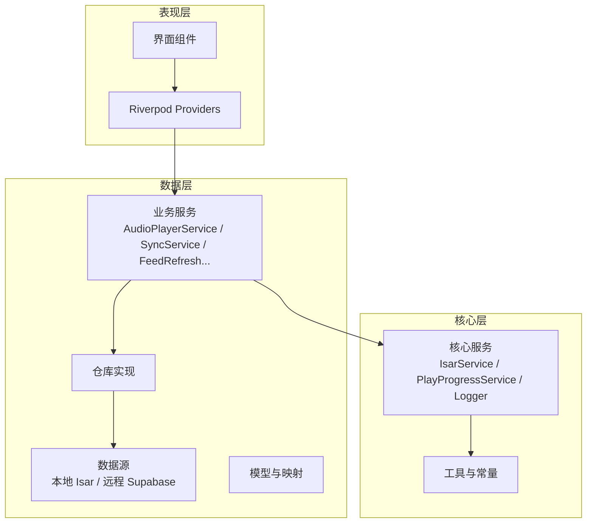
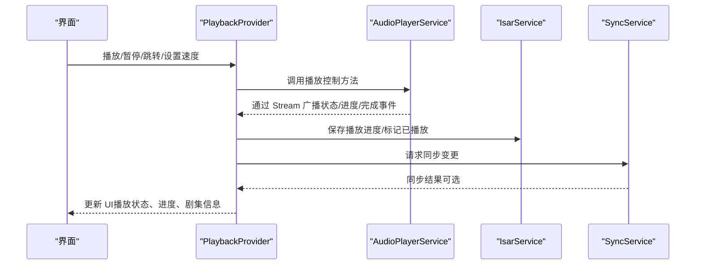
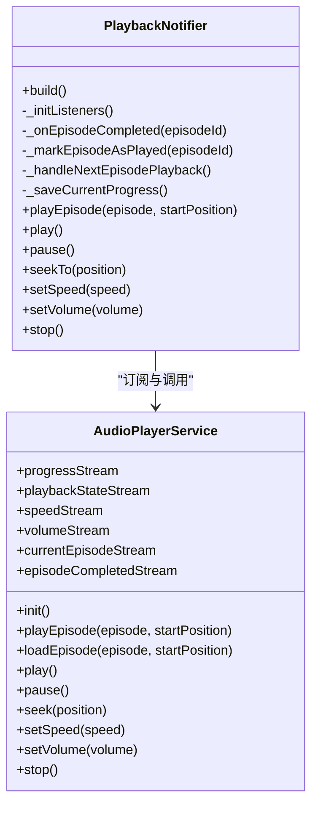
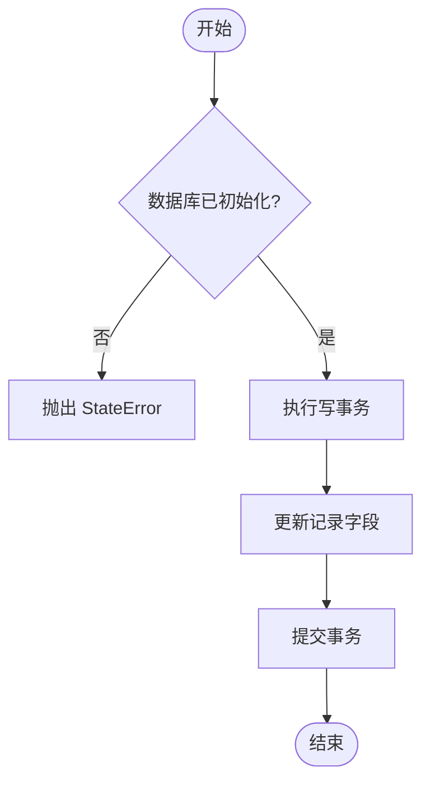
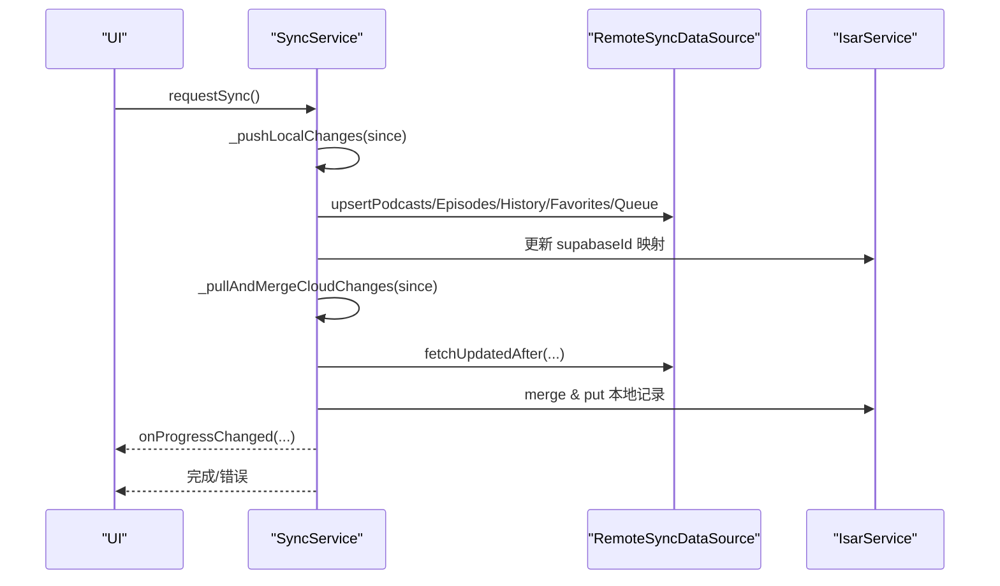
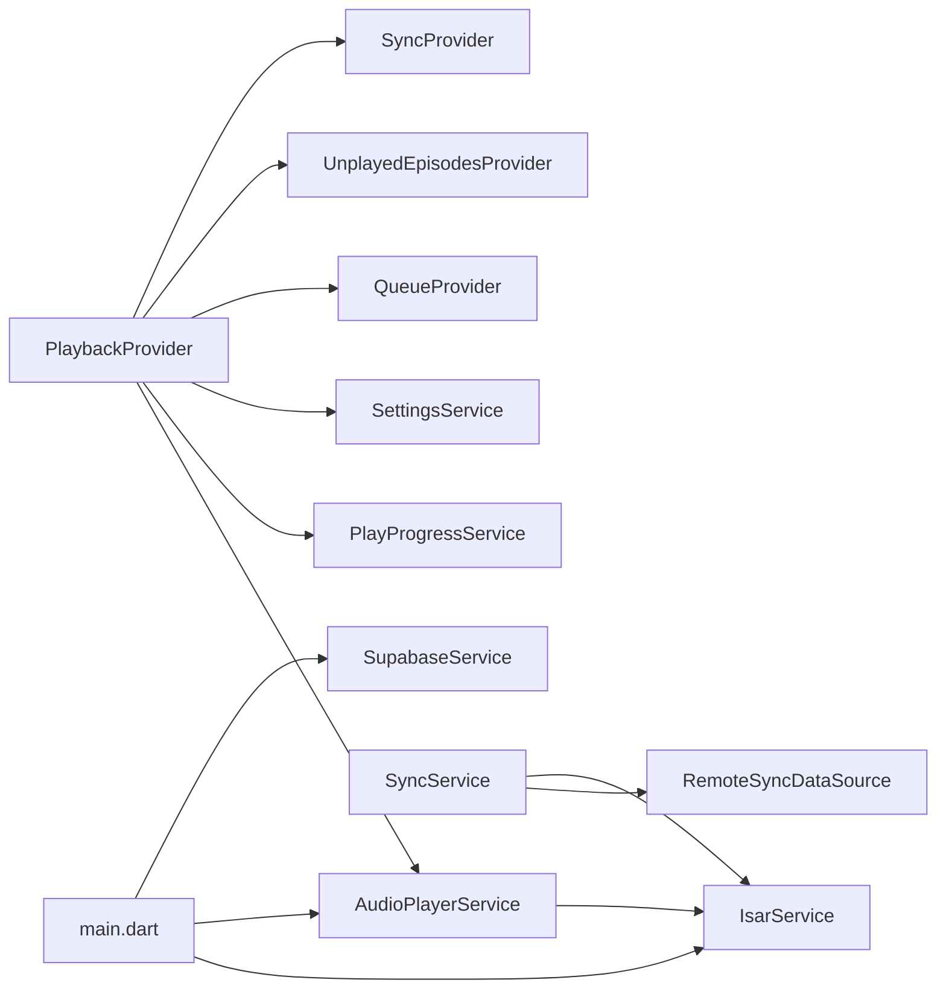

# 数据流设计

<cite>
**本文引用的文件**   
- [main.dart](file://lib/main.dart)
- [pubspec.yaml](file://pubspec.yaml)
- [isar_service.dart](file://lib/data/database/isar_service.dart)
- [audio_player_service.dart](file://lib/data/services/audio_player_service.dart)
- [playback_provider.dart](file://lib/presentation/providers/playback_provider.dart)
- [sync_service.dart](file://lib/core/services/sync_service.dart)
- [auth_provider.dart](file://lib/core/providers/auth_provider.dart)
- [feed_refresh_provider.dart](file://lib/presentation/providers/feed_refresh_provider.dart)
</cite>

## 目录
1. [引言](#引言)
2. [项目结构](#项目结构)
3. [核心组件](#核心组件)
4. [架构总览](#架构总览)
5. [详细组件分析](#详细组件分析)
6. [依赖关系分析](#依赖关系分析)
7. [性能考量](#性能考量)
8. [故障排查指南](#故障排查指南)
9. [结论](#结论)
10. [附录](#附录)

## 引言
本文件面向 TinyCast 应用的数据流设计，聚焦从用户交互到数据存储的完整生命周期，覆盖 Riverpod 状态管理、Provider 依赖与更新机制、异步数据处理（Stream、错误处理与重试）、数据验证/转换/缓存策略，以及事件驱动架构（发布订阅与消息传递）。文档通过播客订阅、音频播放、下载管理等典型场景，配合数据流图与时序图帮助理解复杂交互。

## 项目结构
TinyCast 采用分层组织：presentation（UI 与 Provider）、data（数据源、仓库、模型、服务）、core（通用服务、工具、路由、主题等），入口 main.dart 负责应用初始化、窗口管理与全局服务启动。

图表来源
- [main.dart:106-194](file://lib/main.dart#L106-L194)
- [pubspec.yaml:46-144](file://pubspec.yaml#L46-L144)

章节来源
- [main.dart:106-194](file://lib/main.dart#L106-L194)
- [pubspec.yaml:46-144](file://pubspec.yaml#L46-L144)

## 核心组件
- 应用入口与初始化：main.dart 中完成 Isar、AudioPlayer、Logger、Supabase 初始化，并注册生命周期观察者以调度 RSS 刷新。
- 数据库服务：IsarService 提供单例与事务写入能力，封装集合 Schema 与版本控制。
- 音频播放服务：AudioPlayerService 基于 just_audio 与 audio_service，暴露多路 Stream 用于状态与进度广播。
- 播放状态管理：PlaybackNotifier 监听播放器 Stream，维护 PlayerState，协调队列、未播放列表、历史与同步。
- 云同步服务：SyncService 负责本地与云端的双向同步，包含推送、拉取、合并与进度回调。
- 认证状态：auth_provider 暴露 Supabase 认证状态的 Stream 与当前用户。
- 订阅刷新：FeedRefreshNotifier 触发全量或单个播客刷新，更新 UI 与下游 Provider。

章节来源
- [main.dart:106-194](file://lib/main.dart#L106-L194)
- [isar_service.dart:14-137](file://lib/data/database/isar_service.dart#L14-L137)
- [audio_player_service.dart:31-134](file://lib/data/services/audio_player_service.dart#L31-L134)
- [playback_provider.dart:64-101](file://lib/presentation/providers/playback_provider.dart#L64-L101)
- [sync_service.dart:37-113](file://lib/core/services/sync_service.dart#L37-L113)
- [auth_provider.dart:5-22](file://lib/core/providers/auth_provider.dart#L5-L22)
- [feed_refresh_provider.dart:42-92](file://lib/presentation/providers/feed_refresh_provider.dart#L42-L92)

## 架构总览
整体数据流遵循“UI → Provider → Service → Repository/Datasource → 存储/网络”的分层路径，并通过 Stream 进行跨层事件传播。

图表来源
- [playback_provider.dart:169-205](file://lib/presentation/providers/playback_provider.dart#L169-L205)
- [audio_player_service.dart:100-134](file://lib/data/services/audio_player_service.dart#L100-L134)
- [isar_service.dart:106-135](file://lib/data/database/isar_service.dart#L106-L135)
- [sync_service.dart:68-113](file://lib/core/services/sync_service.dart#L68-L113)

## 详细组件分析

### 播放与状态管理（PlaybackProvider + AudioPlayerService）
- 播放状态由 PlaybackNotifier 维护，内部监听 AudioPlayerService 的多路 Stream（播放状态、进度、速度、音量、当前剧集、完成事件）。
- 播放完成后自动处理队列移除、标记已播放、未播放列表刷新、睡眠定时器检查与连续播放下一集。
- 播放进度周期性保存，结合阈值与时间条件减少 I/O 频率；支持恢复上次播放位置与状态。
- AudioPlayerService 负责底层音频加载（本地优先，回退到远端 URL），统一更新媒体项与广播事件。

图表来源
- [playback_provider.dart:64-101](file://lib/presentation/providers/playback_provider.dart#L64-L101)
- [audio_player_service.dart:31-134](file://lib/data/services/audio_player_service.dart#L31-L134)

章节来源
- [playback_provider.dart:169-205](file://lib/presentation/providers/playback_provider.dart#L169-L205)
- [playback_provider.dart:216-265](file://lib/presentation/providers/playback_provider.dart#L216-L265)
- [playback_provider.dart:361-411](file://lib/presentation/providers/playback_provider.dart#L361-L411)
- [audio_player_service.dart:192-300](file://lib/data/services/audio_player_service.dart#L192-L300)

### 数据持久化（IsarService）
- 单例模式打开/关闭数据库，提供写事务与清理接口。
- 提供便捷方法更新 Episode 下载状态（是否下载、路径、进度、时间戳）。
- 在播放过程中更新 lastPlayedAt，保证最近播放记录准确。

图表来源
- [isar_service.dart:38-59](file://lib/data/database/isar_service.dart#L38-L59)
- [isar_service.dart:106-135](file://lib/data/database/isar_service.dart#L106-L135)

章节来源
- [isar_service.dart:14-137](file://lib/data/database/isar_service.dart#L14-L137)

### 云同步（SyncService）
- 同步流程包括：确保用户资料、推送本地变更、拉取云端变更并合并、保存最后同步时间。
- 分表推进（播客、剧集、订阅、播放历史、收藏、队列），每步可失败但继续其他步骤，最终根据成功与否决定是否更新时间戳。
- 提供进度回调，便于 UI 展示同步状态。

图表来源
- [sync_service.dart:68-113](file://lib/core/services/sync_service.dart#L68-L113)
- [sync_service.dart:150-186](file://lib/core/services/sync_service.dart#L150-L186)
- [sync_service.dart:190-340](file://lib/core/services/sync_service.dart#L190-L340)

章节来源
- [sync_service.dart:37-113](file://lib/core/services/sync_service.dart#L37-L113)
- [sync_service.dart:150-186](file://lib/core/services/sync_service.dart#L150-L186)
- [sync_service.dart:190-340](file://lib/core/services/sync_service.dart#L190-L340)

### 认证状态（auth_provider）
- 暴露 Supabase 配置状态、认证状态 Stream 与当前用户。
- 当未初始化时返回空 Stream，避免 UI 崩溃。

章节来源
- [auth_provider.dart:5-22](file://lib/core/providers/auth_provider.dart#L5-L22)

### 订阅刷新（FeedRefreshProvider）
- 提供全量与单个播客刷新，内部调用 PodcastRepository，更新状态与 UI。
- 使用 requestId 防止竞态导致的状态错乱。

章节来源
- [feed_refresh_provider.dart:42-92](file://lib/presentation/providers/feed_refresh_provider.dart#L42-L92)
- [feed_refresh_provider.dart:94-148](file://lib/presentation/providers/feed_refresh_provider.dart#L94-L148)

## 依赖关系分析
- Presentation 层依赖 core 与 data 层的 Provider/Service，通过 Riverpod 注入。
- PlaybackProvider 依赖 AudioPlayerService、PlayProgressService、SettingsService、QueueProvider、UnplayedEpisodesProvider、SyncProvider。
- AudioPlayerService 依赖 IsarService 与 just_audio/audio_service。
- SyncService 依赖 RemoteSyncDataSource 与 IsarService。
- main.dart 作为入口，初始化 Isar、AudioPlayer、Logger、Supabase，并启动后台任务。

图表来源
- [playback_provider.dart:64-101](file://lib/presentation/providers/playback_provider.dart#L64-L101)
- [audio_player_service.dart:31-134](file://lib/data/services/audio_player_service.dart#L31-L134)
- [sync_service.dart:37-113](file://lib/core/services/sync_service.dart#L37-L113)
- [main.dart:106-194](file://lib/main.dart#L106-L194)

章节来源
- [playback_provider.dart:64-101](file://lib/presentation/providers/playback_provider.dart#L64-L101)
- [audio_player_service.dart:31-134](file://lib/data/services/audio_player_service.dart#L31-L134)
- [sync_service.dart:37-113](file://lib/core/services/sync_service.dart#L37-L113)
- [main.dart:106-194](file://lib/main.dart#L106-L194)

## 性能考量
- 播放进度保存采用时间与进度双阈值节流，降低频繁 I/O。
- 音频加载优先本地文件，不存在则回退远端 URL，提升首开速度与离线可用性。
- 同步过程按表分步推进，失败不中断整体流程，并提供进度回调避免 UI 卡顿。
- Riverpod 的 Notifier/Provider 组合减少不必要的重建，仅依赖相关状态变化。

[本节为通用指导，无需引用具体文件]

## 故障排查指南
- 播放无法恢复或状态异常：检查 AudioPlayerService 的 Stream 订阅是否正确释放与重建；确认 IsarService 已初始化；查看日志中的加载与重置错误。
- 同步失败：关注 SyncService 的各步日志，定位失败表与错误原因；检查 Supabase 配置与用户认证状态。
- 订阅刷新无效果：确认 FeedRefreshNotifier 的请求 ID 未被覆盖；检查 PodcastRepository 的实现与网络状态。

章节来源
- [audio_player_service.dart:192-300](file://lib/data/services/audio_player_service.dart#L192-L300)
- [sync_service.dart:68-113](file://lib/core/services/sync_service.dart#L68-L113)
- [feed_refresh_provider.dart:42-92](file://lib/presentation/providers/feed_refresh_provider.dart#L42-L92)

## 结论
TinyCast 的数据流设计以 Riverpod 为核心，结合 Stream 的事件驱动与分层职责划分，实现了清晰的播放控制、状态同步与持久化策略。通过本地优先的音频加载、节流保存与分步同步，兼顾了性能与可靠性。未来可在错误重试、缓存失效策略与增量同步方面进一步优化。

[本节为总结性内容，无需引用具体文件]

## 附录

### 场景一：播客订阅与刷新
- 用户在订阅页触发刷新，FeedRefreshNotifier 调用 Repository 拉取 RSS，解析后入库并刷新 UI。
- 若启用云同步，后续会触发 SyncService 将订阅状态推送到云端。

章节来源
- [feed_refresh_provider.dart:42-92](file://lib/presentation/providers/feed_refresh_provider.dart#L42-L92)
- [sync_service.dart:190-340](file://lib/core/services/sync_service.dart#L190-L340)

### 场景二：音频播放与进度保存
- 用户点击播放，PlaybackProvider 调用 AudioPlayerService 加载并播放，期间持续广播进度与状态。
- 周期性地保存播放进度，并在达到阈值或停止时标记已播放，必要时触发同步。

章节来源
- [playback_provider.dart:361-411](file://lib/presentation/providers/playback_provider.dart#L361-L411)
- [audio_player_service.dart:469-507](file://lib/data/services/audio_player_service.dart#L469-L507)

### 场景三：下载管理与自动删除
- 播放完成后根据设置自动删除已下载的音频文件，保持存储空间整洁。
- 删除操作通过 AudioDownloadService 执行，并记录日志以便排查。

章节来源
- [playback_provider.dart:293-317](file://lib/presentation/providers/playback_provider.dart#L293-L317)