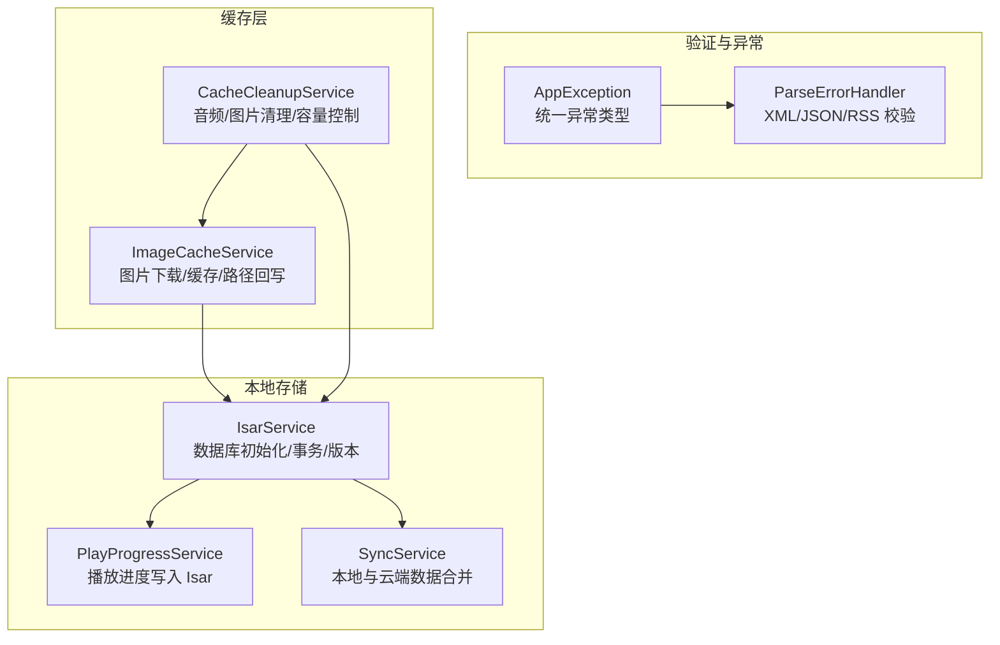
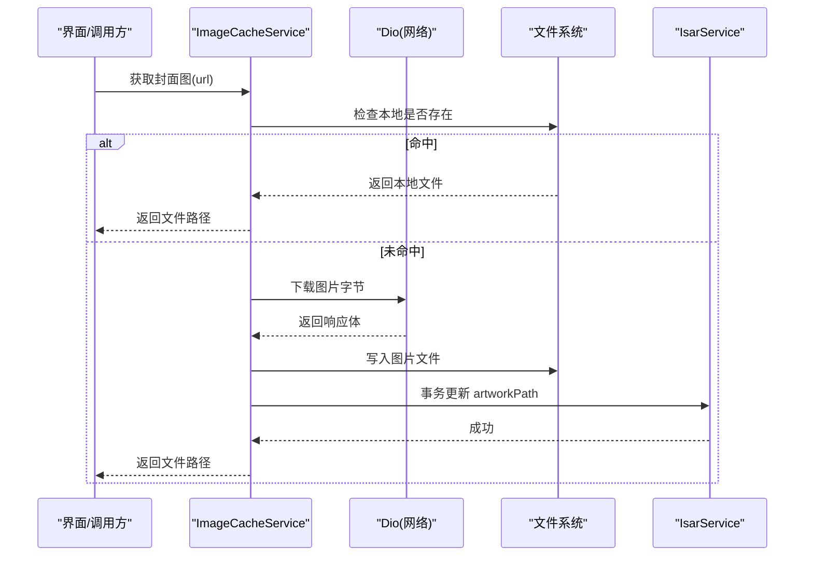
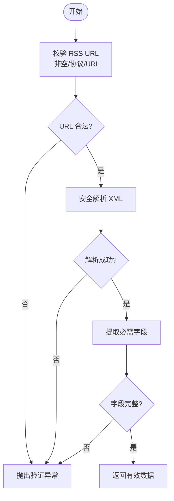
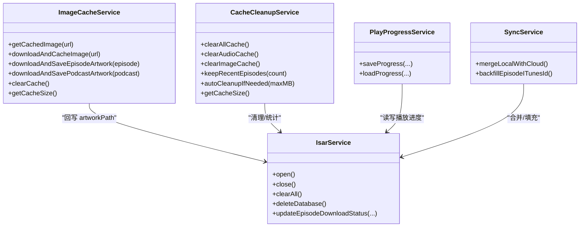
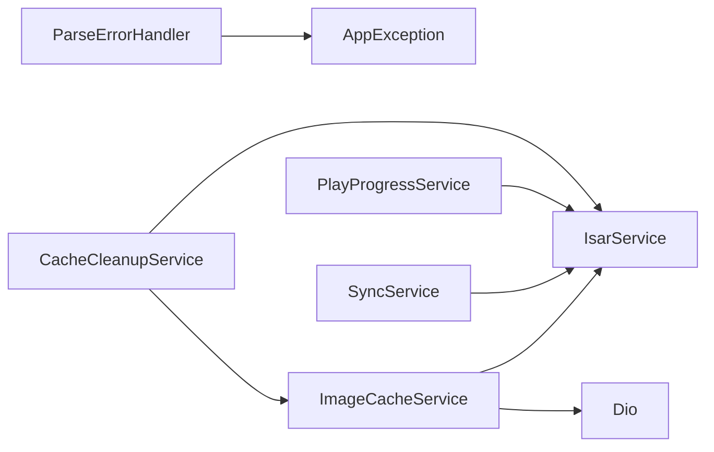

# 数据验证与缓存

<cite>
**本文引用的文件**
- [lib/core/utils/app_exception.dart](file://lib/core/utils/app_exception.dart)
- [lib/core/utils/parse_error_handler.dart](file://lib/core/utils/parse_error_handler.dart)
- [lib/data/database/isar_service.dart](file://lib/data/database/isar_service.dart)
- [lib/data/services/cache_cleanup_service.dart](file://lib/data/services/cache_cleanup_service.dart)
- [lib/data/services/image_cache_service.dart](file://lib/data/services/image_cache_service.dart)
- [lib/core/services/play_progress_service.dart](file://lib/core/services/play_progress_service.dart)
- [lib/core/services/sync_service.dart](file://lib/core/services/sync_service.dart)
</cite>

## 目录
1. [简介](#简介)
2. [项目结构](#项目结构)
3. [核心组件](#核心组件)
4. [架构总览](#架构总览)
5. [详细组件分析](#详细组件分析)
6. [依赖关系分析](#依赖关系分析)
7. [性能考量](#性能考量)
8. [故障排查指南](#故障排查指南)
9. [结论](#结论)
10. [附录](#附录)

## 简介
本文件围绕 TinyCast 的数据验证与多级缓存体系进行系统化说明，覆盖输入校验、格式校验、业务规则校验，以及内存、Isar 数据库与网络三层缓存的协同策略。文档同时给出 TTL、失效与一致性策略，结合播客元数据、剧集列表、用户设置等场景展示实现方式，并提供监控调试、迁移版本管理、损坏恢复与优化实践建议。

## 项目结构
与数据验证和缓存相关的代码主要分布在以下模块：
- 数据验证与异常：统一异常类型与解析错误处理工具
- 本地持久化：Isar 数据库服务与模型集合
- 图片缓存：基于文件系统的图片缓存服务
- 清理与容量控制：音频与图片缓存清理、自动回收
- 播放进度与同步：播放进度落库、云端与本地数据合并

图表来源
- [lib/core/utils/app_exception.dart:1-148](file://lib/core/utils/app_exception.dart#L1-L148)
- [lib/core/utils/parse_error_handler.dart:1-145](file://lib/core/utils/parse_error_handler.dart#L1-L145)
- [lib/data/database/isar_service.dart:1-137](file://lib/data/database/isar_service.dart#L1-L137)
- [lib/core/services/play_progress_service.dart:1-137](file://lib/core/services/play_progress_service.dart#L1-L137)
- [lib/core/services/sync_service.dart:1-422](file://lib/core/services/sync_service.dart#L1-L422)
- [lib/data/services/image_cache_service.dart:1-419](file://lib/data/services/image_cache_service.dart#L1-L419)
- [lib/data/services/cache_cleanup_service.dart:1-479](file://lib/data/services/cache_cleanup_service.dart#L1-L479)

章节来源
- [lib/core/utils/app_exception.dart:1-148](file://lib/core/utils/app_exception.dart#L1-L148)
- [lib/core/utils/parse_error_handler.dart:1-145](file://lib/core/utils/parse_error_handler.dart#L1-L145)
- [lib/data/database/isar_service.dart:1-137](file://lib/data/database/isar_service.dart#L1-L137)
- [lib/data/services/image_cache_service.dart:1-419](file://lib/data/services/image_cache_service.dart#L1-L419)
- [lib/data/services/cache_cleanup_service.dart:1-479](file://lib/data/services/cache_cleanup_service.dart#L1-L479)
- [lib/core/services/play_progress_service.dart:1-137](file://lib/core/services/play_progress_service.dart#L1-L137)
- [lib/core/services/sync_service.dart:1-422](file://lib/core/services/sync_service.dart#L1-L422)

## 核心组件
- 统一异常 AppException：定义网络、存储、认证、权限、验证等异常类型，便于上层统一处理与上报。
- 解析错误处理 ParseErrorHandler：集中处理 XML/JSON 解析异常与 RSS URL、播客/节目数据的必填字段校验。
- Isar 数据库服务 IsarService：封装数据库打开、关闭、清空、删除、版本常量与常用事务操作（如更新下载状态）。
- 图片缓存 ImageCacheService：按 URL 生成文件名，命中则直接返回本地文件；未命中则下载并落盘，同时将路径写回 Isar。
- 缓存清理 CacheCleanupService：提供全量清理、已播放清理、保留最近 N 集、按播客清理、自动阈值清理与大小统计。
- 播放进度 PlayProgressService：将播放进度写入 Isar，保证断点续播与历史可查。
- 同步 SyncService：拉取云端数据并与本地 Isar 合并，回填缺失字段（如 iTunesId），保障一致性。

章节来源
- [lib/core/utils/app_exception.dart:1-148](file://lib/core/utils/app_exception.dart#L1-L148)
- [lib/core/utils/parse_error_handler.dart:1-145](file://lib/core/utils/parse_error_handler.dart#L1-L145)
- [lib/data/database/isar_service.dart:1-137](file://lib/data/database/isar_service.dart#L1-L137)
- [lib/data/services/image_cache_service.dart:1-419](file://lib/data/services/image_cache_service.dart#L1-L419)
- [lib/data/services/cache_cleanup_service.dart:1-479](file://lib/data/services/cache_cleanup_service.dart#L1-L479)
- [lib/core/services/play_progress_service.dart:1-137](file://lib/core/services/play_progress_service.dart#L1-L137)
- [lib/core/services/sync_service.dart:1-422](file://lib/core/services/sync_service.dart#L1-L422)

## 架构总览
TinyCast 的多级缓存以“网络优先、本地兜底”为原则：
- 网络层：通过 Dio 发起请求，失败时降级到本地缓存。
- 本地文件系统：图片与音频文件以磁盘缓存为主，配合文件名哈希避免冲突。
- Isar 数据库：结构化元数据与状态（下载状态、播放进度、收藏、队列、设置）持久化。
- 清理与容量：根据阈值自动清理最旧或已播放内容，保持缓存体积可控。

图表来源
- [lib/data/services/image_cache_service.dart:67-120](file://lib/data/services/image_cache_service.dart#L67-L120)
- [lib/data/services/image_cache_service.dart:122-223](file://lib/data/services/image_cache_service.dart#L122-L223)
- [lib/data/services/image_cache_service.dart:225-326](file://lib/data/services/image_cache_service.dart#L225-L326)
- [lib/data/database/isar_service.dart:106-135](file://lib/data/database/isar_service.dart#L106-L135)

## 详细组件分析

### 数据验证策略与实现
- 输入验证
  - RSS URL 非空、协议白名单（http/https）、URI 合法性校验。
  - 播客/节目标题、音频 URL、关联 ID 等必填字段校验。
- 格式校验
  - XML 解析安全包装，捕获 XmlException 并转为验证异常。
  - JSON 解析安全包装，捕获 FormatException 并转为验证异常。
- 业务规则校验
  - 必需元素存在性校验（XML 节点）。
  - 可选元素提取与空值处理。
- 异常统一
  - 所有校验失败均抛出 AppException.validation，携带原始错误与堆栈，便于上层分类处理与日志记录。

图表来源
- [lib/core/utils/parse_error_handler.dart:34-47](file://lib/core/utils/parse_error_handler.dart#L34-L47)
- [lib/core/utils/parse_error_handler.dart:49-77](file://lib/core/utils/parse_error_handler.dart#L49-L77)
- [lib/core/utils/parse_error_handler.dart:79-96](file://lib/core/utils/parse_error_handler.dart#L79-L96)
- [lib/core/utils/parse_error_handler.dart:120-143](file://lib/core/utils/parse_error_handler.dart#L120-L143)
- [lib/core/utils/app_exception.dart:106-118](file://lib/core/utils/app_exception.dart#L106-L118)

章节来源
- [lib/core/utils/parse_error_handler.dart:1-145](file://lib/core/utils/parse_error_handler.dart#L1-L145)
- [lib/core/utils/app_exception.dart:1-148](file://lib/core/utils/app_exception.dart#L1-L148)

### 多级缓存架构设计
- 内存缓存
  - 主题配置与样式在内存中维护静态缓存，减少重复构建成本。
- 文件系统缓存
  - 图片与音频文件按 URL/标识生成唯一文件名，避免冲突。
  - 图片缓存服务负责命中判断、下载落盘、路径回写。
- Isar 数据库缓存
  - 结构化元数据与状态（下载状态、播放进度、收藏、队列、设置）持久化。
  - 通过事务保证一致性，支持批量更新与查询。
- 网络缓存
  - 首次请求从网络拉取，成功后写入本地；后续优先本地命中。

图表来源
- [lib/data/database/isar_service.dart:1-137](file://lib/data/database/isar_service.dart#L1-L137)
- [lib/data/services/image_cache_service.dart:1-419](file://lib/data/services/image_cache_service.dart#L1-L419)
- [lib/data/services/cache_cleanup_service.dart:1-479](file://lib/data/services/cache_cleanup_service.dart#L1-L479)
- [lib/core/services/play_progress_service.dart:1-137](file://lib/core/services/play_progress_service.dart#L1-L137)
- [lib/core/services/sync_service.dart:1-422](file://lib/core/services/sync_service.dart#L1-L422)

章节来源
- [lib/data/database/isar_service.dart:1-137](file://lib/data/database/isar_service.dart#L1-L137)
- [lib/data/services/image_cache_service.dart:1-419](file://lib/data/services/image_cache_service.dart#L1-L419)
- [lib/data/services/cache_cleanup_service.dart:1-479](file://lib/data/services/cache_cleanup_service.dart#L1-L479)
- [lib/core/services/play_progress_service.dart:1-137](file://lib/core/services/play_progress_service.dart#L1-L137)
- [lib/core/services/sync_service.dart:1-422](file://lib/core/services/sync_service.dart#L1-L422)

### 缓存策略选择原则
- TTL 设置
  - 图片：默认长期缓存，仅在清理或路径失效时重新下载。
  - 音频：按使用频率与空间阈值清理，不依赖固定 TTL。
  - 元数据：以同步周期为准，必要时强制刷新。
- 缓存失效机制
  - 显式清理：全量清理、按播客清理、已播放清理。
  - 自动清理：超过阈值后按发布时间由旧到新清理。
  - 路径失效：artworkPath 存在但文件不存在时触发重下。
- 一致性保证
  - 下载成功后立即回写 Isar 中的路径字段。
  - 清理前更新数据库状态，确保 UI 与文件一致。
  - 同步任务对本地数据进行回填与去重合并。

章节来源
- [lib/data/services/image_cache_service.dart:122-223](file://lib/data/services/image_cache_service.dart#L122-L223)
- [lib/data/services/image_cache_service.dart:225-326](file://lib/data/services/image_cache_service.dart#L225-L326)
- [lib/data/services/cache_cleanup_service.dart:218-262](file://lib/data/services/cache_cleanup_service.dart#L218-L262)
- [lib/data/services/cache_cleanup_service.dart:389-435](file://lib/data/services/cache_cleanup_service.dart#L389-L435)
- [lib/core/services/sync_service.dart:388-422](file://lib/core/services/sync_service.dart#L388-L422)

### 典型场景与实现

#### 场景一：播客元数据缓存
- 流程要点
  - 解析 RSS 后进行字段校验，失败抛出验证异常。
  - 元数据写入 Isar，封面图走图片缓存服务。
  - 同步任务回填缺失字段（如 iTunesId）。
- 关键实现位置
  - RSS 校验与解析：[lib/core/utils/parse_error_handler.dart:34-47](file://lib/core/utils/parse_error_handler.dart#L34-L47)
  - 播客数据校验：[lib/core/utils/parse_error_handler.dart:49-62](file://lib/core/utils/parse_error_handler.dart#L49-L62)
  - 封面图下载与回写：[lib/data/services/image_cache_service.dart:225-326](file://lib/data/services/image_cache_service.dart#L225-L326)
  - 同步回填：[lib/core/services/sync_service.dart:388-422](file://lib/core/services/sync_service.dart#L388-L422)

章节来源
- [lib/core/utils/parse_error_handler.dart:34-62](file://lib/core/utils/parse_error_handler.dart#L34-L62)
- [lib/data/services/image_cache_service.dart:225-326](file://lib/data/services/image_cache_service.dart#L225-L326)
- [lib/core/services/sync_service.dart:388-422](file://lib/core/services/sync_service.dart#L388-L422)

#### 场景二：剧集列表缓存
- 流程要点
  - 剧集列表优先从 Isar 读取，若为空或过期再拉取网络。
  - 下载状态与路径变更通过 IsarService.updateEpisodeDownloadStatus 原子更新。
- 关键实现位置
  - 下载状态更新：[lib/data/database/isar_service.dart:106-135](file://lib/data/database/isar_service.dart#L106-L135)
  - 播放进度落库：[lib/core/services/play_progress_service.dart:108-134](file://lib/core/services/play_progress_service.dart#L108-L134)

章节来源
- [lib/data/database/isar_service.dart:106-135](file://lib/data/database/isar_service.dart#L106-L135)
- [lib/core/services/play_progress_service.dart:108-134](file://lib/core/services/play_progress_service.dart#L108-L134)

#### 场景三：用户设置缓存
- 流程要点
  - 设置项持久化至 Isar，应用启动时加载。
  - 主题样式在内存中缓存，避免重复解析。
- 关键实现位置
  - Isar 模型与集合：[lib/data/database/isar_service.dart:46-51](file://lib/data/database/isar_service.dart#L46-L51)
  - 主题内存缓存访问：[lib/core/theme/theme_loader.dart:324-335](file://lib/core/theme/theme_loader.dart#L324-L335)

章节来源
- [lib/data/database/isar_service.dart:46-51](file://lib/data/database/isar_service.dart#L46-L51)
- [lib/core/theme/theme_loader.dart:324-335](file://lib/core/theme/theme_loader.dart#L324-L335)

### 缓存监控与调试
- 命中率与日志
  - 图片缓存命中/未命中日志，便于定位问题。
  - 下载耗时、文件大小、HTTP 状态码等关键指标输出。
- 容量统计
  - 音频与图片缓存大小统计，格式化显示。
  - 自动清理阈值检查与执行日志。
- 调试建议
  - 开启 Isar inspector（非产品模式）辅助查看数据。
  - 通过清理接口快速复现冷启动与热路径差异。

章节来源
- [lib/data/services/image_cache_service.dart:21-42](file://lib/data/services/image_cache_service.dart#L21-L42)
- [lib/data/services/image_cache_service.dart:361-391](file://lib/data/services/image_cache_service.dart#L361-L391)
- [lib/data/services/cache_cleanup_service.dart:304-359](file://lib/data/services/cache_cleanup_service.dart#L304-L359)
- [lib/data/database/isar_service.dart:46-51](file://lib/data/database/isar_service.dart#L46-L51)

### 缓存迁移与版本管理
- 版本常量
  - IsarService.currentVersion 用于标识当前数据库版本。
- 迁移策略
  - 升级时先关闭连接，再重建或迁移 schema（按需扩展）。
  - 清理旧数据后再写入新结构，避免脏数据。
- 损坏恢复
  - 提供 deleteDatabase 与 clearAll 能力，用于极端情况恢复。
  - 清理音频/图片缓存后，通过同步任务重建必要元数据。

章节来源
- [lib/data/database/isar_service.dart:16-18](file://lib/data/database/isar_service.dart#L16-L18)
- [lib/data/database/isar_service.dart:89-102](file://lib/data/database/isar_service.dart#L89-L102)
- [lib/data/services/cache_cleanup_service.dart:23-39](file://lib/data/services/cache_cleanup_service.dart#L23-L39)

### 最佳实践与常见问题
- 最佳实践
  - 所有 I/O 操作包裹 try/catch，统一抛出自定义异常。
  - 写盘与写库在同一事务内完成，保证一致性。
  - 清理前先更新数据库状态，避免 UI 误判文件存在。
  - 大对象（音频/图片）采用文件缓存，元数据用 Isar。
- 常见问题
  - 路径存在但文件丢失：触发重下逻辑并更新路径。
  - 网络异常：记录原始错误与状态码，便于追踪。
  - 缓存膨胀：设定阈值并定期自动清理。

章节来源
- [lib/core/utils/app_exception.dart:1-148](file://lib/core/utils/app_exception.dart#L1-L148)
- [lib/data/services/image_cache_service.dart:122-223](file://lib/data/services/image_cache_service.dart#L122-L223)
- [lib/data/services/cache_cleanup_service.dart:389-435](file://lib/data/services/cache_cleanup_service.dart#L389-L435)

## 依赖关系分析
- 低耦合高内聚
  - 各缓存服务仅依赖必要的底层服务（IsarService、FileStorageService、Dio）。
  - 异常与日志集中在工具层，便于统一治理。
- 潜在循环依赖
  - 当前未发现循环引用，服务间为单向依赖。
- 外部依赖
  - Isar 用于本地结构化存储。
  - Dio 用于网络请求。
  - path_provider 用于获取应用目录。

图表来源
- [lib/core/utils/parse_error_handler.dart:1-145](file://lib/core/utils/parse_error_handler.dart#L1-L145)
- [lib/core/utils/app_exception.dart:1-148](file://lib/core/utils/app_exception.dart#L1-L148)
- [lib/data/services/image_cache_service.dart:1-419](file://lib/data/services/image_cache_service.dart#L1-L419)
- [lib/data/services/cache_cleanup_service.dart:1-479](file://lib/data/services/cache_cleanup_service.dart#L1-L479)
- [lib/core/services/play_progress_service.dart:1-137](file://lib/core/services/play_progress_service.dart#L1-L137)
- [lib/core/services/sync_service.dart:1-422](file://lib/core/services/sync_service.dart#L1-L422)
- [lib/data/database/isar_service.dart:1-137](file://lib/data/database/isar_service.dart#L1-L137)

章节来源
- [lib/core/utils/parse_error_handler.dart:1-145](file://lib/core/utils/parse_error_handler.dart#L1-L145)
- [lib/core/utils/app_exception.dart:1-148](file://lib/core/utils/app_exception.dart#L1-L148)
- [lib/data/services/image_cache_service.dart:1-419](file://lib/data/services/image_cache_service.dart#L1-L419)
- [lib/data/services/cache_cleanup_service.dart:1-479](file://lib/data/services/cache_cleanup_service.dart#L1-L479)
- [lib/core/services/play_progress_service.dart:1-137](file://lib/core/services/play_progress_service.dart#L1-L137)
- [lib/core/services/sync_service.dart:1-422](file://lib/core/services/sync_service.dart#L1-L422)
- [lib/data/database/isar_service.dart:1-137](file://lib/data/database/isar_service.dart#L1-L137)

## 性能考量
- 读多写少场景优先本地缓存，减少网络开销。
- 图片与音频文件按唯一文件名缓存，避免重复下载。
- 批量更新与事务提交降低 I/O 次数。
- 自动清理阈值避免频繁 GC 与磁盘抖动。
- 主题与样式内存缓存减少重复解析与构建。

## 故障排查指南
- 常见错误定位
  - 解析失败：检查 XML/JSON 内容与字段完整性。
  - 下载失败：核对 HTTP 状态码与网络环境。
  - 路径不一致：确认文件是否存在，必要时触发重下。
- 诊断步骤
  - 查看日志中的命中/未命中与耗时信息。
  - 使用清理接口复现冷启动路径。
  - 通过 Isar inspector 检查数据一致性。
- 恢复手段
  - 清理音频/图片缓存后重试。
  - 删除数据库并重新初始化（谨慎使用）。

章节来源
- [lib/data/services/image_cache_service.dart:21-42](file://lib/data/services/image_cache_service.dart#L21-L42)
- [lib/data/services/image_cache_service.dart:361-391](file://lib/data/services/image_cache_service.dart#L361-L391)
- [lib/data/database/isar_service.dart:89-102](file://lib/data/database/isar_service.dart#L89-L102)
- [lib/data/database/isar_service.dart:46-51](file://lib/data/database/isar_service.dart#L46-L51)

## 结论
TinyCast 的数据验证与缓存体系以统一的异常与校验为基础，结合文件系统与 Isar 的双层本地缓存，辅以自动清理与同步合并，实现了稳定、高效且易维护的数据存取方案。通过完善的日志与监控能力，可在复杂场景下快速定位问题并进行恢复。

## 附录
- 术语
  - TTL：缓存存活时间，决定缓存有效期。
  - 失效：缓存不可用或被主动清除的状态。
  - 一致性：本地与云端数据在合并后的正确性与完整性。
- 参考实现路径
  - 输入与格式校验：[lib/core/utils/parse_error_handler.dart:34-96](file://lib/core/utils/parse_error_handler.dart#L34-L96)
  - 图片缓存流程：[lib/data/services/image_cache_service.dart:67-120](file://lib/data/services/image_cache_service.dart#L67-L120)
  - 播放进度落库：[lib/core/services/play_progress_service.dart:108-134](file://lib/core/services/play_progress_service.dart#L108-L134)
  - 同步合并回填：[lib/core/services/sync_service.dart:388-422](file://lib/core/services/sync_service.dart#L388-L422)