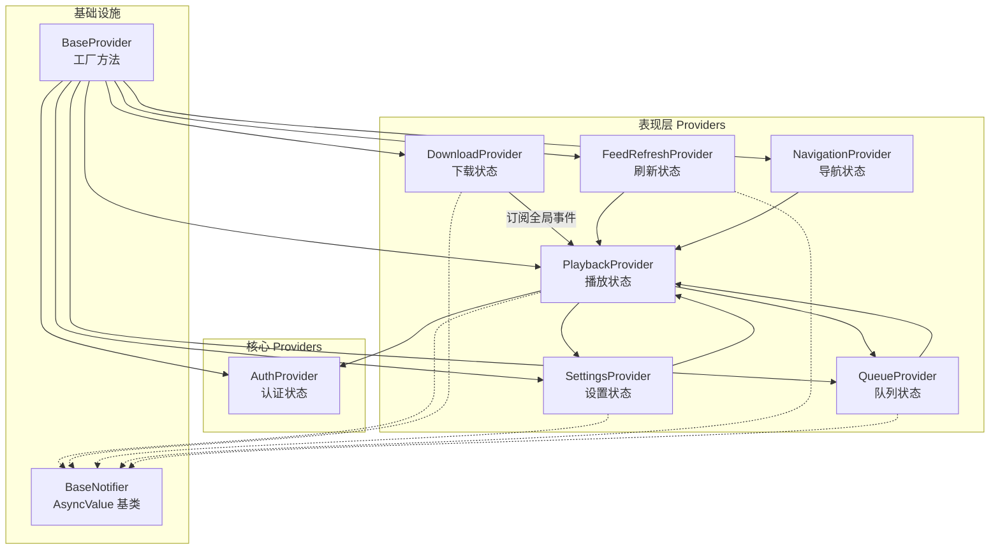
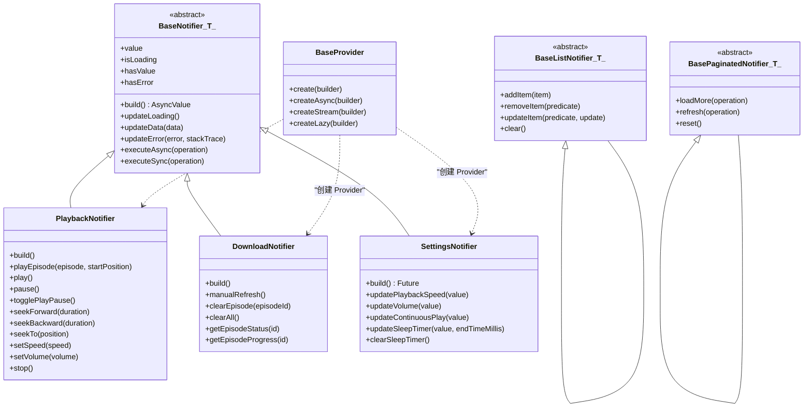
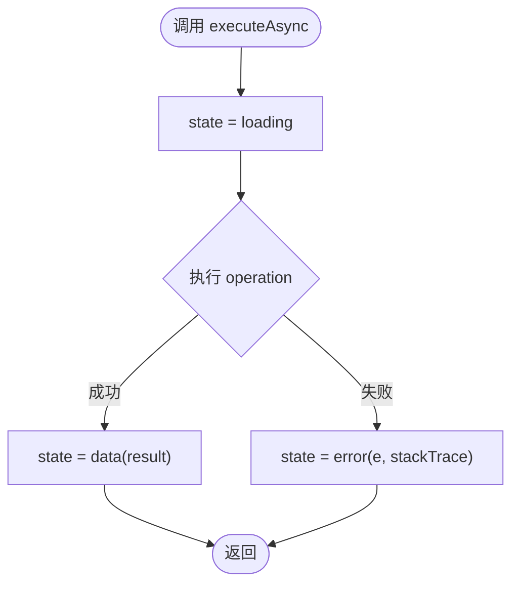
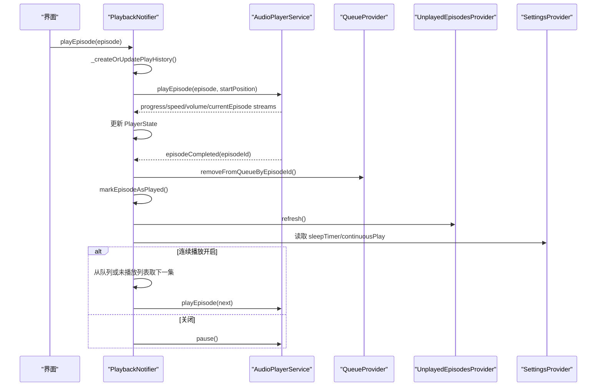
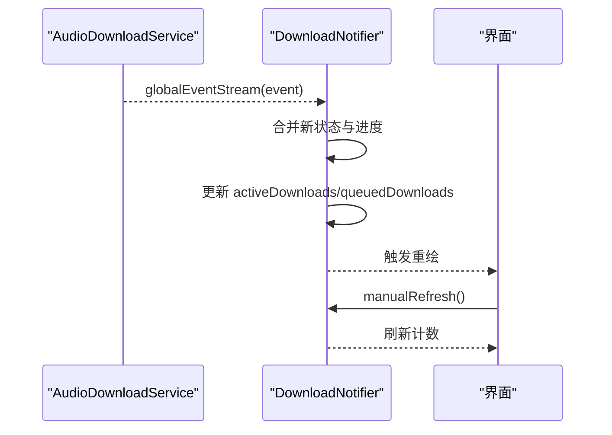
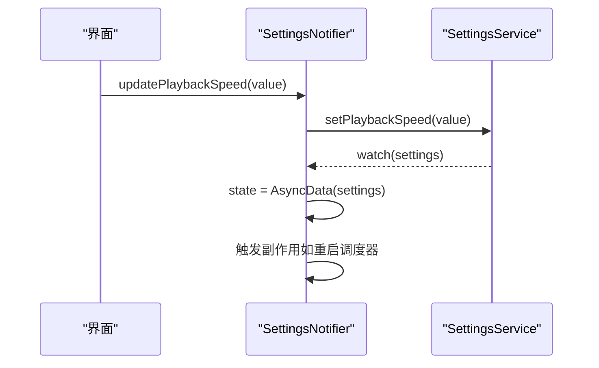
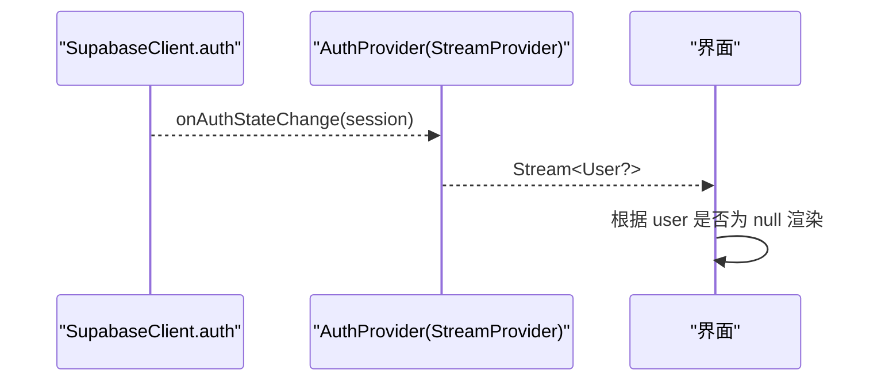
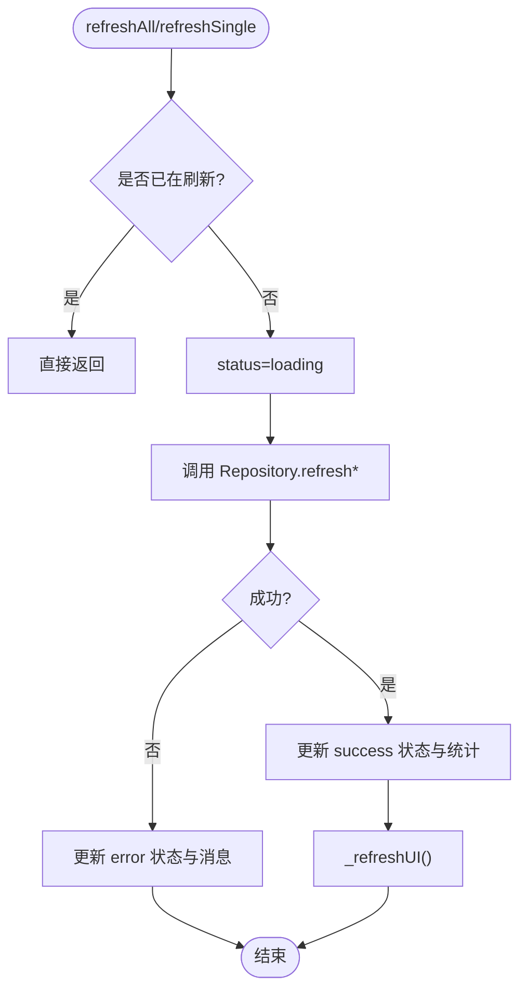
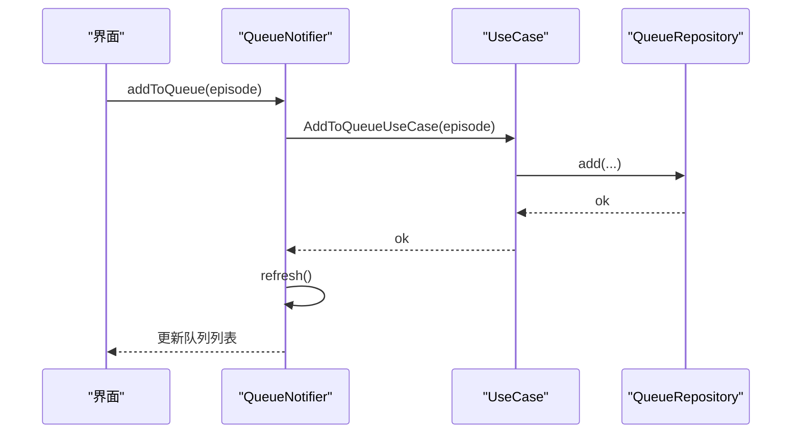
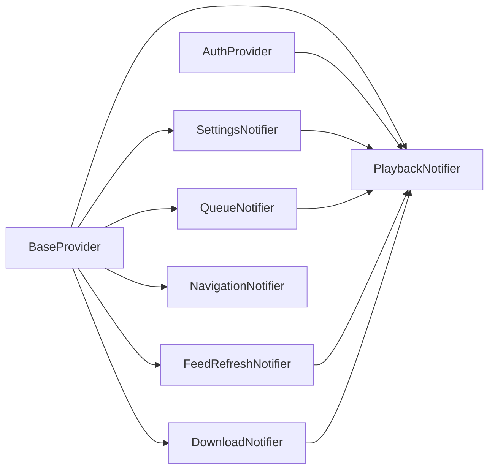

# 状态管理流

<cite>
**本文引用的文件**   
- [base_provider.dart](file://lib/presentation/providers/base_provider.dart)
- [base_state_notifier.dart](file://lib/presentation/providers/base_state_notifier.dart)
- [playback_provider.dart](file://lib/presentation/providers/playback_provider.dart)
- [download_provider.dart](file://lib/presentation/providers/download_provider.dart)
- [settings_provider.dart](file://lib/presentation/providers/settings_provider.dart)
- [auth_provider.dart](file://lib/core/providers/auth_provider.dart)
- [feed_refresh_provider.dart](file://lib/presentation/providers/feed_refresh_provider.dart)
- [queue_provider.dart](file://lib/presentation/providers/queue_provider.dart)
- [navigation_provider.dart](file://lib/presentation/providers/navigation_provider.dart)
</cite>

## 目录
1. [简介](#简介)
2. [项目结构](#项目结构)
3. [核心组件](#核心组件)
4. [架构总览](#架构总览)
5. [详细组件分析](#详细组件分析)
6. [依赖关系分析](#依赖关系分析)
7. [性能考量](#性能考量)
8. [故障排查指南](#故障排查指南)
9. [结论](#结论)
10. [附录](#附录)

## 简介
本文件系统性梳理 TinyCast 在 Riverpod 3.x 下的状态管理流，涵盖 Provider 分层、依赖注入与状态更新机制；详解 BaseProvider、BaseNotifier（原 BaseStateNotifier）的设计模式与扩展方式；解析 PlaybackProvider、DownloadProvider 等关键 Provider 的状态策略（异步处理、错误处理、性能优化）；并通过具体代码路径示例展示如何创建自定义 Provider、处理复杂状态转换以及实现 Provider 间通信与数据共享。同时说明响应式编程在 Flutter 中的应用场景，包括 StreamProvider 与 FutureProvider 的使用。

## 项目结构
- 状态层集中在 lib/presentation/providers 与 lib/core/providers：
  - presentation/providers：业务 UI 状态（播放、下载、队列、导航、设置刷新等）
  - core/providers：系统级状态（认证、同步等）
- 基础能力封装：
  - BaseProvider：统一创建 Provider/FutureProvider/StreamProvider 的工厂
  - BaseNotifier（继承 Notifier）：统一的异步状态包装 AsyncValue<T> 与常用操作
- 典型 Provider：
  - playback_provider：播放器状态与生命周期
  - download_provider：下载事件驱动的状态
  - settings_provider：设置数据的异步加载与监听
  - auth_provider：认证状态的 StreamProvider
  - feed_refresh_provider：播客订阅刷新流程
  - queue_provider：播放队列 CRUD 与状态
  - navigation_provider：页面与详情页栈

图表来源
- [base_provider.dart:1-28](file://lib/presentation/providers/base_provider.dart#L1-L28)
- [base_state_notifier.dart:1-224](file://lib/presentation/providers/base_state_notifier.dart#L1-L224)
- [playback_provider.dart:1-766](file://lib/presentation/providers/playback_provider.dart#L1-L766)
- [download_provider.dart:1-156](file://lib/presentation/providers/download_provider.dart#L1-L156)
- [settings_provider.dart:1-185](file://lib/presentation/providers/settings_provider.dart#L1-L185)
- [auth_provider.dart:1-22](file://lib/core/providers/auth_provider.dart#L1-L22)
- [feed_refresh_provider.dart:1-162](file://lib/presentation/providers/feed_refresh_provider.dart#L1-L162)
- [queue_provider.dart:1-290](file://lib/presentation/providers/queue_provider.dart#L1-L290)

章节来源
- [base_provider.dart:1-28](file://lib/presentation/providers/base_provider.dart#L1-L28)
- [base_state_notifier.dart:1-224](file://lib/presentation/providers/base_state_notifier.dart#L1-L224)

## 核心组件
- BaseProvider：提供 create/createAsync/createStream/lazy 的统一入口，屏蔽 Provider 类型差异，便于集中管理与测试替换。
- BaseNotifier（继承 Notifier<AsyncValue<T>>）：封装 loading/data/error 三态，提供 executeAsync/executeSync、列表与分页基类，减少样板代码。
- 各业务 Notifier：基于 Notifier/AsyncNotifier 实现领域状态，结合 ref.watch/ref.read 完成依赖注入与跨 Provider 通信。

章节来源
- [base_provider.dart:1-28](file://lib/presentation/providers/base_provider.dart#L1-L28)
- [base_state_notifier.dart:1-224](file://lib/presentation/providers/base_state_notifier.dart#L1-L224)

## 架构总览
Riverpod 3.x 在 TinyCast 中的使用要点：
- 所有可变状态通过 Notifier/AsyncNotifier 管理，不可变状态通过 Provider 暴露。
- 异步数据统一用 AsyncValue<T> 包装，避免分散的错误与加载态处理。
- 依赖注入通过 ref.watch/ref.read 获取 Repository/UseCase/Service，保持低耦合。
- 响应式数据源通过 StreamProvider/FutureProvider 接入外部流或一次性任务。

图表来源
- [base_provider.dart:1-28](file://lib/presentation/providers/base_provider.dart#L1-L28)
- [base_state_notifier.dart:1-224](file://lib/presentation/providers/base_state_notifier.dart#L1-L224)
- [playback_provider.dart:1-766](file://lib/presentation/providers/playback_provider.dart#L1-L766)
- [download_provider.dart:1-156](file://lib/presentation/providers/download_provider.dart#L1-L156)
- [settings_provider.dart:1-185](file://lib/presentation/providers/settings_provider.dart#L1-L185)

## 详细组件分析

### BaseProvider 与 BaseNotifier 设计模式
- BaseProvider：
  - 统一创建 Provider/FutureProvider/StreamProvider，简化调用方代码，便于集中配置（如日志、缓存策略）。
- BaseNotifier：
  - 以 AsyncValue<T> 作为 state，天然支持 loading/data/error 三态。
  - 提供 executeAsync/executeSync 模板方法，自动处理异常与状态切换。
  - BaseListNotifier/BasePaginatedNotifier 进一步抽象列表与分页操作，减少重复逻辑。

图表来源
- [base_state_notifier.dart:1-224](file://lib/presentation/providers/base_state_notifier.dart#L1-L224)

章节来源
- [base_provider.dart:1-28](file://lib/presentation/providers/base_provider.dart#L1-L28)
- [base_state_notifier.dart:1-224](file://lib/presentation/providers/base_state_notifier.dart#L1-L224)

### PlaybackProvider（播放状态）
- 职责：维护当前剧集、播放状态、进度、速度、音量；监听音频服务流并同步到 state；自动保存进度、标记已播放、处理连续播放与睡眠定时器。
- 状态模型：PlayerState（不可变，copyWith 更新）。
- 关键流程：
  - build 中初始化监听器、自动保存、恢复上次播放状态。
  - playEpisode 创建/更新播放历史，调用底层播放器。
  - 播放结束自动清理队列、标记已播放、刷新未播放列表、根据设置决定是否继续下一集。
- 错误处理：捕获异常并记录日志，必要时回滚状态。
- 性能优化：节流保存进度（时间+进度阈值）、避免重复恢复（restoreGeneration）、按需读取设置。

图表来源
- [playback_provider.dart:1-766](file://lib/presentation/providers/playback_provider.dart#L1-L766)
- [queue_provider.dart:1-290](file://lib/presentation/providers/queue_provider.dart#L1-L290)
- [settings_provider.dart:1-185](file://lib/presentation/providers/settings_provider.dart#L1-L185)

章节来源
- [playback_provider.dart:1-766](file://lib/presentation/providers/playback_provider.dart#L1-L766)

### DownloadProvider（下载状态）
- 职责：订阅 AudioDownloadService 的全局事件流，维护每个剧集的下载状态与进度，暴露活跃/排队数量与已完成列表。
- 状态模型：DownloadState（Map<episodeId, status/progress>，计数与最后更新时间）。
- 关键点：
  - build 中订阅事件流，增量更新状态，避免全量重建。
  - 提供 clearEpisode/clearAll 用于 UI 清理。
  - 手动刷新接口用于 UI 主动拉取最新计数。

图表来源
- [download_provider.dart:1-156](file://lib/presentation/providers/download_provider.dart#L1-L156)

章节来源
- [download_provider.dart:1-156](file://lib/presentation/providers/download_provider.dart#L1-L156)

### SettingsProvider（设置状态）
- 职责：加载与监听应用设置，暴露 AppSettings；变更设置后触发相关后台任务（如刷新调度器重启）。
- 状态模型：AsyncNotifier<AppSettings>，内部 watch 持久化流，自动更新 state。
- 关键点：
  - build 中迁移旧存储、订阅 watch 流、返回初始值。
  - 提供大量 update* 方法，写入设置并触发副作用（如重启 FeedRefreshScheduler）。

图表来源
- [settings_provider.dart:1-185](file://lib/presentation/providers/settings_provider.dart#L1-L185)

章节来源
- [settings_provider.dart:1-185](file://lib/presentation/providers/settings_provider.dart#L1-L185)

### AuthProvider（认证状态）
- 职责：暴露 Supabase 认证状态流与当前用户。
- 使用 StreamProvider 监听 onAuthStateChange，将 session.user 映射为 User?。
- 适用场景：登录/登出时 UI 自动响应。

图表来源
- [auth_provider.dart:1-22](file://lib/core/providers/auth_provider.dart#L1-L22)

章节来源
- [auth_provider.dart:1-22](file://lib/core/providers/auth_provider.dart#L1-L22)

### FeedRefreshProvider（播客刷新）
- 职责：统一管理“全部刷新”和“单播客刷新”，维护刷新状态与统计信息。
- 关键点：
  - 防抖/去重：通过 requestId 丢弃过期结果。
  - 成功后刷新 UI：调用 podcastProvider 重新加载订阅列表。
  - 错误处理：记录错误并设置 errorMessage。

图表来源
- [feed_refresh_provider.dart:1-162](file://lib/presentation/providers/feed_refresh_provider.dart#L1-L162)

章节来源
- [feed_refresh_provider.dart:1-162](file://lib/presentation/providers/feed_refresh_provider.dart#L1-L162)

### QueueProvider（播放队列）
- 职责：队列的增删改查与状态管理，暴露队列列表与加载状态。
- 关键点：
  - 使用 UseCase 组合 Repository，保持单一职责。
  - loadQueue 使用 requestId 防止竞态。
  - 提供 removeByPodcastId 等本地过滤方法，提升交互体验。

图表来源
- [queue_provider.dart:1-290](file://lib/presentation/providers/queue_provider.dart#L1-L290)

章节来源
- [queue_provider.dart:1-290](file://lib/presentation/providers/queue_provider.dart#L1-L290)

### NavigationProvider（导航状态）
- 职责：维护当前页面与详情页栈，支持 push/pop 与清空。
- 关键点：
  - DetailState 区分 podcast/episode 两种详情类型。
  - 通过 copyWith 更新 detailStack，保证不可变更新。

章节来源
- [navigation_provider.dart:1-128](file://lib/presentation/providers/navigation_provider.dart#L1-L128)

## 依赖关系分析
- Provider 层次：
  - 基础层：BaseProvider、BaseNotifier（通用能力）
  - 领域层：Playback/Download/Settings/FeedRefresh/Queue/Navigation
  - 核心层：Auth（跨领域共享）
- 依赖注入：
  - 通过 ref.watch 获取 Repository/UseCase/Service，避免全局单例耦合。
  - 通过 ref.read 进行命令式读取（如 notifier.notifier 调用方法）。
- 通信模式：
  - 事件驱动：DownloadProvider 订阅全局事件流。
  - 状态联动：PlaybackProvider 读取 Settings/Queue/UnplayedEpisodes 状态并触发刷新。
  - 副作用：SettingsProvider 变更设置后重启调度器。

图表来源
- [base_provider.dart:1-28](file://lib/presentation/providers/base_provider.dart#L1-L28)
- [playback_provider.dart:1-766](file://lib/presentation/providers/playback_provider.dart#L1-L766)
- [download_provider.dart:1-156](file://lib/presentation/providers/download_provider.dart#L1-L156)
- [settings_provider.dart:1-185](file://lib/presentation/providers/settings_provider.dart#L1-L185)
- [feed_refresh_provider.dart:1-162](file://lib/presentation/providers/feed_refresh_provider.dart#L1-L162)
- [queue_provider.dart:1-290](file://lib/presentation/providers/queue_provider.dart#L1-L290)
- [auth_provider.dart:1-22](file://lib/core/providers/auth_provider.dart#L1-L22)

章节来源
- [base_provider.dart:1-28](file://lib/presentation/providers/base_provider.dart#L1-L28)
- [playback_provider.dart:1-766](file://lib/presentation/providers/playback_provider.dart#L1-L766)
- [download_provider.dart:1-156](file://lib/presentation/providers/download_provider.dart#L1-L156)
- [settings_provider.dart:1-185](file://lib/presentation/providers/settings_provider.dart#L1-L185)
- [feed_refresh_provider.dart:1-162](file://lib/presentation/providers/feed_refresh_provider.dart#L1-L162)
- [queue_provider.dart:1-290](file://lib/presentation/providers/queue_provider.dart#L1-L290)
- [auth_provider.dart:1-22](file://lib/core/providers/auth_provider.dart#L1-L22)

## 性能考量
- 状态最小化更新：
  - 使用不可变 copyWith 与 Map/List 局部更新，避免整树重建。
  - DownloadProvider 仅更新受影响条目，不重建整个 Map。
- 节流与去抖：
  - PlaybackProvider 按时间与进度阈值节流保存播放进度。
  - FeedRefreshProvider 使用 requestId 丢弃过期请求结果。
- 懒加载与按需订阅：
  - BaseProvider.createLazy 用于延迟实例化。
  - StreamProvider/FutureProvider 仅在需要时建立订阅。
- 资源释放：
  - 在 ref.onDispose 中取消订阅与定时器，避免内存泄漏。

[本节为通用指导，无需引用具体文件]

## 故障排查指南
- 常见问题定位：
  - 播放状态不同步：检查 PlaybackNotifier 的流订阅是否正确，确认 _disposeListeners 是否被调用。
  - 下载状态不更新：确认 DownloadNotifier 的 globalEventStream 订阅是否存在异常。
  - 设置未生效：查看 SettingsNotifier 的 watch 流是否收到新值，检查副作用是否触发。
  - 刷新冲突：检查 FeedRefreshProvider 的 requestId 是否被覆盖。
- 建议手段：
  - 使用 Logger 输出关键节点（各 Provider 已内置日志）。
  - 通过 ref.listen 观察状态变化，定位更新时机。
  - 单元测试覆盖 executeAsync/executeSync 分支，验证错误处理。

章节来源
- [playback_provider.dart:1-766](file://lib/presentation/providers/playback_provider.dart#L1-L766)
- [download_provider.dart:1-156](file://lib/presentation/providers/download_provider.dart#L1-L156)
- [settings_provider.dart:1-185](file://lib/presentation/providers/settings_provider.dart#L1-L185)
- [feed_refresh_provider.dart:1-162](file://lib/presentation/providers/feed_refresh_provider.dart#L1-L162)

## 结论
TinyCast 在 Riverpod 3.x 下采用清晰的 Provider 分层与统一的 AsyncValue 状态模型，配合 BaseNotifier 的模板方法与 Stream/Future 响应式集成，实现了高内聚、低耦合的状态管理。PlaybackProvider、DownloadProvider、SettingsProvider 等关键组件展示了异步处理、错误处理与性能优化的最佳实践。通过 ref.watch/ref.read 的依赖注入与事件驱动通信，应用具备良好的可测试性与可扩展性。

[本节为总结，无需引用具体文件]

## 附录

### 如何创建自定义 Provider（步骤与示例路径）
- 定义状态模型（不可变，提供 copyWith）。
- 创建 Notifier/AsyncNotifier，实现 build 与业务方法。
- 使用 NotifierProvider/AsyncNotifierProvider 注册 Provider。
- 在 UI 中使用 ref.watch 订阅，ref.read 调用方法。
- 参考路径：
  - [playback_provider.dart:1-766](file://lib/presentation/providers/playback_provider.dart#L1-L766)
  - [download_provider.dart:1-156](file://lib/presentation/providers/download_provider.dart#L1-L156)
  - [settings_provider.dart:1-185](file://lib/presentation/providers/settings_provider.dart#L1-L185)

### 复杂状态转换与 Provider 间通信
- 复杂转换：使用 BaseListNotifier/BasePaginatedNotifier 提供的 addItem/removeItem/updateItem/loadMore/refresh/reset 等方法。
- Provider 通信：
  - 读取其他 Provider 状态：ref.watch(otherProvider)。
  - 触发其他 Provider 动作：ref.read(otherProvider.notifier).method()。
  - 参考路径：
    - [playback_provider.dart:1-766](file://lib/presentation/providers/playback_provider.dart#L1-L766)
    - [queue_provider.dart:1-290](file://lib/presentation/providers/queue_provider.dart#L1-L290)
    - [feed_refresh_provider.dart:1-162](file://lib/presentation/providers/feed_refresh_provider.dart#L1-L162)

### 响应式编程：StreamProvider 与 FutureProvider
- StreamProvider：适用于持续变化的数据源（如认证状态、实时事件）。
  - 参考路径：[auth_provider.dart:1-22](file://lib/core/providers/auth_provider.dart#L1-L22)
- FutureProvider：适用于一次性异步任务（如加载设置、刷新数据）。
  - 参考路径：[base_provider.dart:1-28](file://lib/presentation/providers/base_provider.dart#L1-L28)