# 架构设计

<cite>
**本文引用的文件**   
- [README.md](file://README.md)
- [pubspec.yaml](file://pubspec.yaml)
- [main.dart](file://lib/main.dart)
- [app_router.dart](file://lib/core/router/app_router.dart)
- [supabase_service.dart](file://lib/core/services/supabase_service.dart)
- [logger.dart](file://lib/core/utils/logger.dart)
- [isar_service.dart](file://lib/data/database/isar_service.dart)
- [podcast_repository.dart](file://lib/domain/repositories/podcast_repository.dart)
- [podcast_repository_impl.dart](file://lib/data/repositories/podcast_repository_impl.dart)
- [get_podcast_by_id_usecase.dart](file://lib/domain/usecases/get_podcast_by_id_usecase.dart)
- [podcast.dart](file://lib/domain/entities/podcast.dart)
</cite>

## 目录
1. [简介](#简介)
2. [项目结构](#项目结构)
3. [核心组件](#核心组件)
4. [架构总览](#架构总览)
5. [详细组件分析](#详细组件分析)
6. [依赖关系分析](#依赖关系分析)
7. [性能考量](#性能考量)
8. [故障排查指南](#故障排查指南)
9. [结论](#结论)
10. [附录](#附录)

## 简介
TinyCast 是一款面向桌面与移动端的播客应用，采用 Clean Architecture（整洁架构）组织代码，将系统划分为 presentation（展示层）、domain（领域层）、data（数据层）和 core（核心层）。本设计文档详细说明各层职责、依赖方向、数据流与集成模式，并总结关键设计模式、技术选型与权衡。

## 项目结构
- 展示层（presentation）：负责 UI、路由、状态管理与用户交互。
- 领域层（domain）：定义实体、仓库接口与用例，承载业务规则。
- 数据层（data）：实现仓库接口，封装本地/远程数据源、映射与缓存策略。
- 核心层（core）：提供跨层共享能力，如日志、主题、路由、服务初始化等。

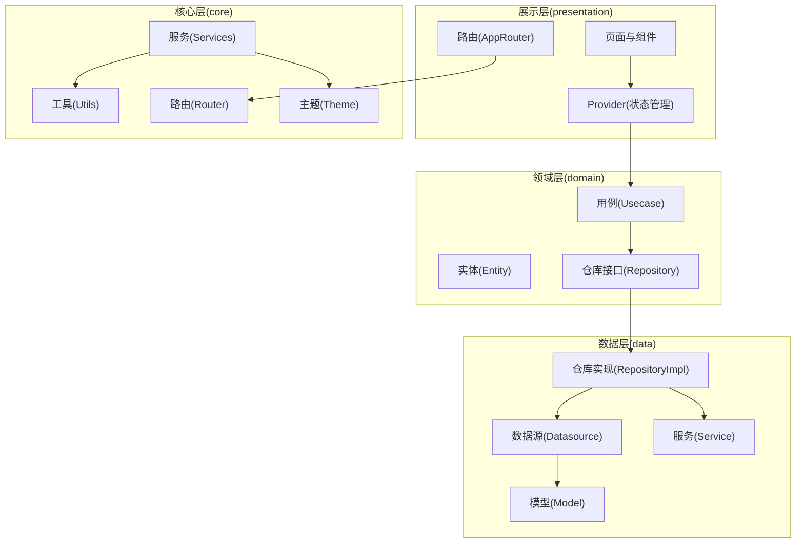

图表来源
- [app_router.dart:1-187](file://lib/core/router/app_router.dart#L1-L187)
- [main.dart:106-177](file://lib/main.dart#L106-L177)

章节来源
- [README.md:1-6](file://README.md#L1-L6)
- [pubspec.yaml:1-196](file://pubspec.yaml#L1-L196)

## 核心组件
- 应用入口与生命周期：在 main() 中完成窗口初始化、主题预加载、数据库与音频服务初始化、Supabase 初始化、Feed 刷新调度器启动，以及 ProviderScope 包裹应用根节点。
- 路由系统：AppRouter 集中管理页面路由与参数解析，支持多窗口场景。
- 数据库服务：IsarService 单例管理 Isar 数据库的打开、关闭、清理与版本控制。
- Supabase 客户端：SupabaseService 单例封装 SDK 初始化与客户端获取，配合 Provider 暴露给 Riverpod。
- 日志系统：Logger 统一输出控制台与文件日志，支持级别过滤与错误堆栈记录。
- 领域仓库：PodcastRepository 抽象播客订阅、查询、搜索与刷新等业务能力；PodcastRepositoryImpl 实现具体逻辑，协调本地/远程数据源与映射。
- 用例：GetPodcastByIdUseCase 封装“按 ID 获取播客”的业务调用，便于测试与复用。

章节来源
- [main.dart:106-177](file://lib/main.dart#L106-L177)
- [app_router.dart:1-187](file://lib/core/router/app_router.dart#L1-L187)
- [isar_service.dart:1-137](file://lib/data/database/isar_service.dart#L1-L137)
- [supabase_service.dart:1-55](file://lib/core/services/supabase_service.dart#L1-L55)
- [logger.dart:1-139](file://lib/core/utils/logger.dart#L1-L139)
- [podcast_repository.dart:1-42](file://lib/domain/repositories/podcast_repository.dart#L1-L42)
- [podcast_repository_impl.dart:1-524](file://lib/data/repositories/podcast_repository_impl.dart#L1-L524)
- [get_podcast_by_id_usecase.dart:1-21](file://lib/domain/usecases/get_podcast_by_id_usecase.dart#L1-L21)

## 架构总览
Clean Architecture 的分层与依赖方向如下：
- 展示层依赖领域层（通过用例与仓库接口），不直接依赖数据层。
- 领域层仅依赖自身实体与接口，不依赖任何外部实现。
- 数据层实现领域层的仓库接口，并依赖核心层提供的工具与服务。
- 核心层为横切关注点（日志、主题、网络、安全存储、路由等），被其他层按需使用。

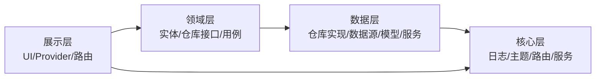

图表来源
- [main.dart:106-177](file://lib/main.dart#L106-L177)
- [podcast_repository.dart:1-42](file://lib/domain/repositories/podcast_repository.dart#L1-L42)
- [podcast_repository_impl.dart:1-524](file://lib/data/repositories/podcast_repository_impl.dart#L1-L524)

## 详细组件分析

### 应用入口与生命周期（main.dart）
- 平台分支：移动端与桌面端分别初始化窗口与主题配置。
- 全局服务初始化：IsarService、AudioPlayerService、Logger、SupabaseService。
- 生命周期观察：监听应用前后台切换，驱动 Feed 刷新调度器启停。
- 多窗口支持：根据 WindowController.arguments 分发不同窗口应用。

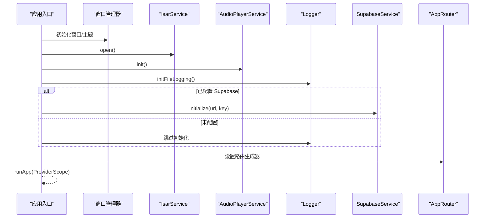

图表来源
- [main.dart:106-177](file://lib/main.dart#L106-L177)
- [main.dart:179-194](file://lib/main.dart#L179-L194)

章节来源
- [main.dart:106-177](file://lib/main.dart#L106-L177)
- [main.dart:179-194](file://lib/main.dart#L179-L194)

### 路由系统（AppRouter）
- 集中式路由表：根据名称返回对应页面，支持参数传递（int、对象、Map）。
- 导航辅助方法：pushNamed、pop、replace 等统一封装。
- 多窗口操作：openSettingsWindow、openSubscribeWindow 等。

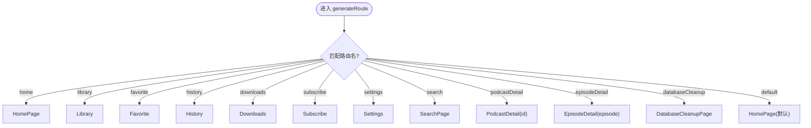

图表来源
- [app_router.dart:21-132](file://lib/core/router/app_router.dart#L21-L132)

章节来源
- [app_router.dart:1-187](file://lib/core/router/app_router.dart#L1-L187)

### 数据库服务（IsarService）
- 单例模式：确保全局唯一实例。
- 生命周期管理：open/close/clear/deleteDatabase。
- 事务与异常：写事务更新下载状态，捕获异常并抛出应用级异常。

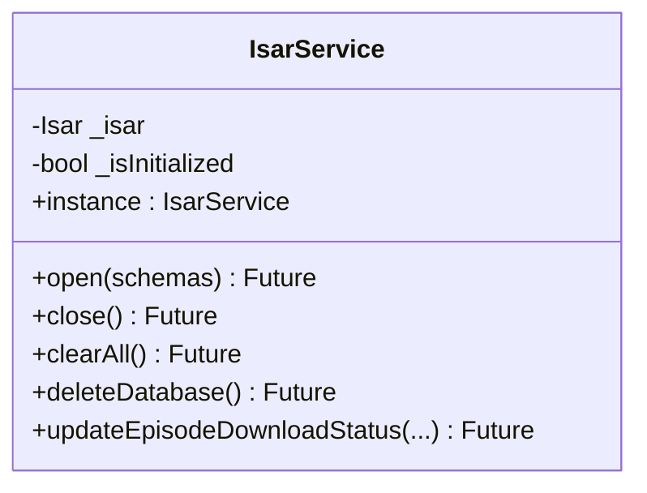

图表来源
- [isar_service.dart:14-136](file://lib/data/database/isar_service.dart#L14-L136)

章节来源
- [isar_service.dart:1-137](file://lib/data/database/isar_service.dart#L1-L137)

### Supabase 客户端（SupabaseService）
- 单例模式：避免重复初始化。
- 初始化保护：防止多次初始化导致状态不一致。
- Provider 暴露：供 Riverpod 消费 SupabaseClient。

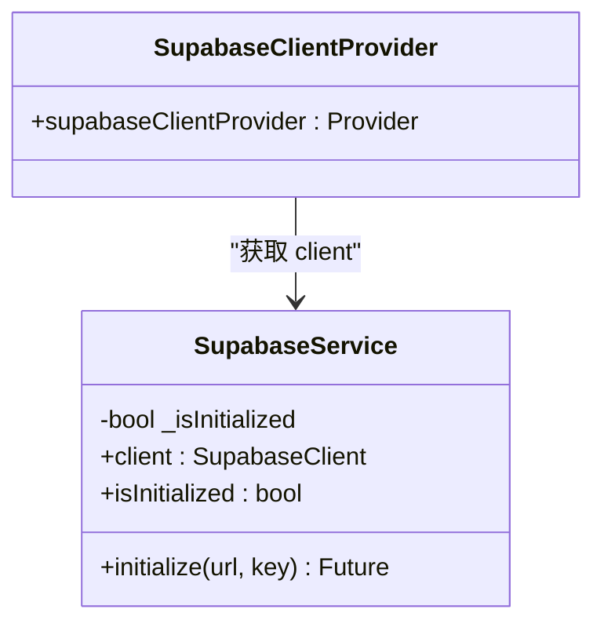

图表来源
- [supabase_service.dart:8-55](file://lib/core/services/supabase_service.dart#L8-L55)

章节来源
- [supabase_service.dart:1-55](file://lib/core/services/supabase_service.dart#L1-L55)

### 日志系统（Logger）
- 级别控制：debug/info/warning/error，支持最小级别过滤。
- 文件日志：按日期分文件写入，失败时降级关闭文件日志。
- 调试信息：在 debug 模式下打印错误与堆栈。

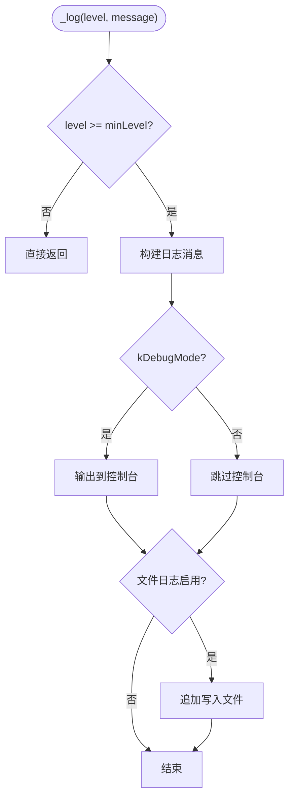

图表来源
- [logger.dart:90-137](file://lib/core/utils/logger.dart#L90-L137)

章节来源
- [logger.dart:1-139](file://lib/core/utils/logger.dart#L1-L139)

### 领域层：播客仓库接口（PodcastRepository）
- 定义订阅、取消订阅、查询、搜索、播放状态更新与 feed 刷新等能力。
- 作为数据层实现的契约，保证领域层不感知数据源细节。

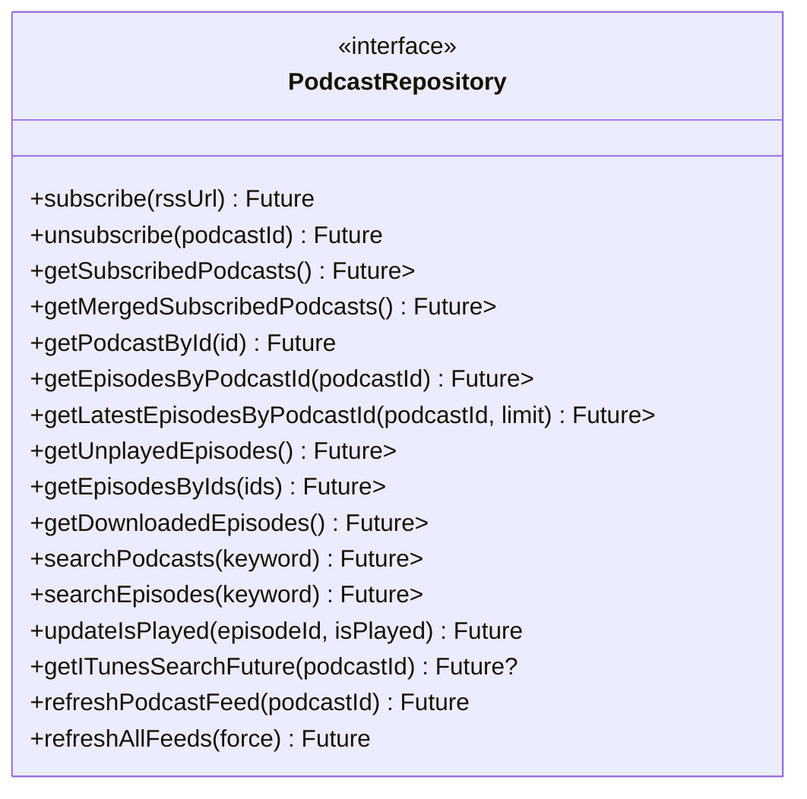

图表来源
- [podcast_repository.dart:6-41](file://lib/domain/repositories/podcast_repository.dart#L6-L41)

章节来源
- [podcast_repository.dart:1-42](file://lib/domain/repositories/podcast_repository.dart#L1-L42)

### 数据层：播客仓库实现（PodcastRepositoryImpl）
- 组合 Remote/Local 数据源，处理 RSS 解析、iTunes 搜索、合并策略与批量刷新。
- 使用 Mapper 在 Model 与 Entity 之间转换。
- 统一异常处理与日志记录。

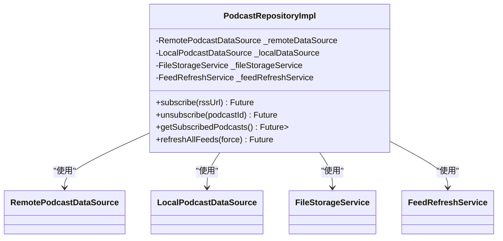

图表来源
- [podcast_repository_impl.dart:15-36](file://lib/data/repositories/podcast_repository_impl.dart#L15-L36)

章节来源
- [podcast_repository_impl.dart:1-524](file://lib/data/repositories/podcast_repository_impl.dart#L1-L524)

### 用例：按 ID 获取播客（GetPodcastByIdUseCase）
- 输入校验：确保 podcast id 为正整数。
- 委托仓库：调用 PodcastRepository.getPodcastById。
- 异常包装：统一抛出异常以便上层处理。

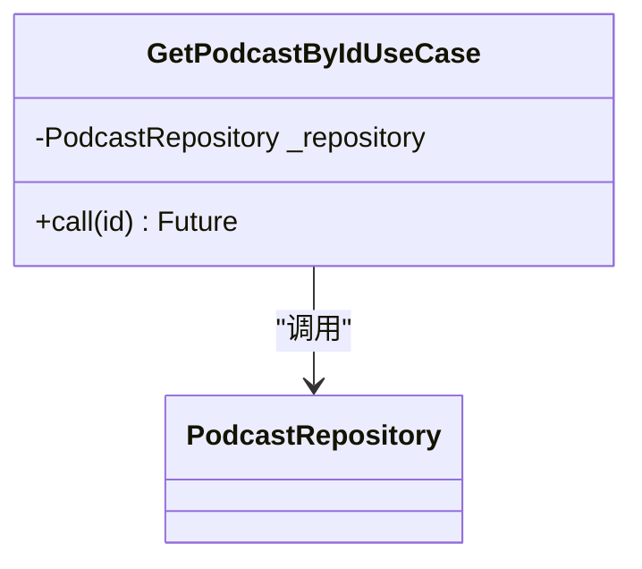

图表来源
- [get_podcast_by_id_usecase.dart:4-20](file://lib/domain/usecases/get_podcast_by_id_usecase.dart#L4-L20)

章节来源
- [get_podcast_by_id_usecase.dart:1-21](file://lib/domain/usecases/get_podcast_by_id_usecase.dart#L1-L21)

### 实体：播客（Podcast）
- 包含基础信息、RSS、iTunes 扩展字段、订阅状态与时间戳等。
- 不可变设计，适合领域层数据传输与持久化映射。

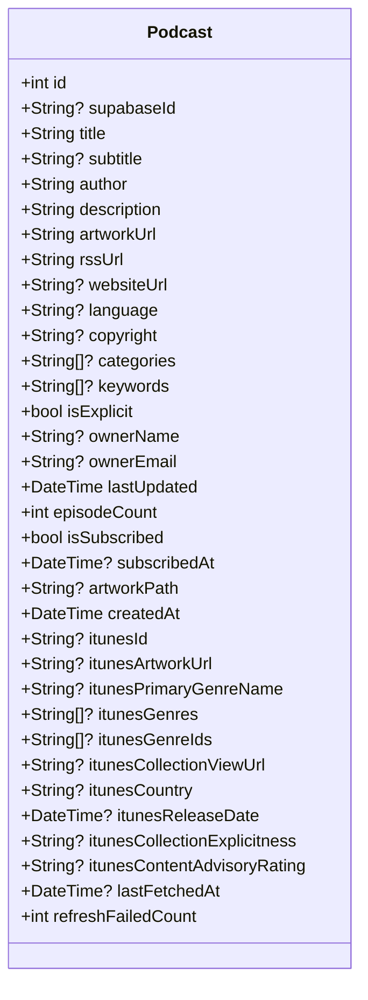

图表来源
- [podcast.dart:1-74](file://lib/domain/entities/podcast.dart#L1-L74)

章节来源
- [podcast.dart:1-74](file://lib/domain/entities/podcast.dart#L1-L74)

## 依赖关系分析
- 展示层依赖领域层（用例与仓库接口），通过 Provider 注入依赖。
- 领域层不依赖数据层或核心层，保持纯业务逻辑。
- 数据层依赖核心层（日志、路径、异常处理等）与第三方库（Isar、Dio、Supabase）。
- 核心层无向上依赖，仅提供横切能力。

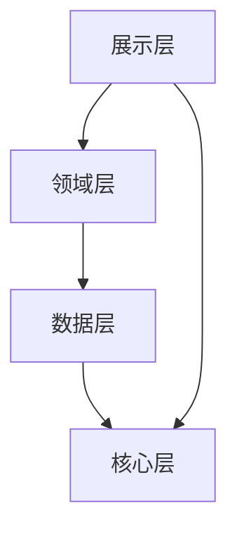

图表来源
- [pubspec.yaml:18-144](file://pubspec.yaml#L18-L144)
- [podcast_repository.dart:1-42](file://lib/domain/repositories/podcast_repository.dart#L1-L42)
- [podcast_repository_impl.dart:1-524](file://lib/data/repositories/podcast_repository_impl.dart#L1-L524)

章节来源
- [pubspec.yaml:18-144](file://pubspec.yaml#L18-L144)

## 性能考量
- 数据库：Isar 轻量高性能，使用事务批量更新，减少 I/O 次数。
- 网络：Dio 支持拦截器与 HTTP/2 适配器，提升并发与吞吐。
- 图片缓存：cached_network_image 降低重复下载与渲染开销。
- 音频播放：just_audio + audio_service 提供后台播放与锁屏控制。
- 刷新策略：FeedRefreshScheduler 基于应用生命周期智能启停，避免无效请求。

[本节为通用指导，无需引用具体文件]

## 故障排查指南
- 日志定位：使用 Logger 的输出级别与文件日志快速定位问题。
- 数据库异常：IsarService 抛出的应用级异常包含原始错误与堆栈，便于诊断。
- Supabase 初始化：检查环境变量与占位符判断，避免未初始化访问。
- 路由跳转：确认 AppRouter 路由名与参数类型匹配。

章节来源
- [logger.dart:90-137](file://lib/core/utils/logger.dart#L90-L137)
- [isar_service.dart:75-136](file://lib/data/database/isar_service.dart#L75-L136)
- [supabase_service.dart:18-47](file://lib/core/services/supabase_service.dart#L18-L47)
- [app_router.dart:21-132](file://lib/core/router/app_router.dart#L21-L132)

## 结论
TinyCast 通过 Clean Architecture 实现了清晰的职责分离与松耦合依赖，结合 Riverpod、Isar、Dio、Supabase 等技术栈，提供了稳定高效的播客订阅、播放与同步能力。未来可进一步引入缓存失效策略、异步任务队列与更细粒度的监控指标，以提升可扩展性与可观测性。

[本节为总结性内容，无需引用具体文件]

## 附录

### 技术栈与依赖
- Flutter SDK：^3.9.2
- 状态管理：riverpod ^3.2.1、flutter_riverpod ^3.3.1
- 数据库：isar_community ^3.3.2
- 网络：dio ^5.9.2、dio_http2_adapter ^2.0.0、connectivity_plus ^6.1.5
- 音频：just_audio ^0.10.5、audio_service ^0.18.18
- RSS/XML：rss_dart ^1.0.12、xml ^6.6.1
- 云服务：supabase_flutter ^2.12.4
- 国际化与格式化：intl ^0.20.2
- 加密与安全：crypto ^3.0.3、flutter_secure_storage ^10.0.0
- 桌面与窗口：window_manager ^0.5.1、desktop_multi_window ^0.3.0

章节来源
- [pubspec.yaml:12-144](file://pubspec.yaml#L12-L144)

### 安全性
- 敏感配置通过编译时环境变量传入，避免硬编码。
- 使用 flutter_secure_storage 存储 token 等敏感信息。
- 日志输出支持级别过滤，生产环境默认关闭 debug 输出。

章节来源
- [main.dart:47-72](file://lib/main.dart#L47-L72)
- [pubspec.yaml:103-106](file://pubspec.yaml#L103-L106)
- [logger.dart:27-28](file://lib/core/utils/logger.dart#L27-L28)

### 监控与灾难恢复
- 日志文件按日滚动，便于回溯问题。
- 数据库提供 clear/delete 能力，用于恢复初始状态。
- Feed 刷新失败计数与错误上报，支持重试与降级。

章节来源
- [logger.dart:42-65](file://lib/core/utils/logger.dart#L42-L65)
- [isar_service.dart:75-102](file://lib/data/database/isar_service.dart#L75-L102)
- [podcast_repository_impl.dart:489-522](file://lib/data/repositories/podcast_repository_impl.dart#L489-L522)