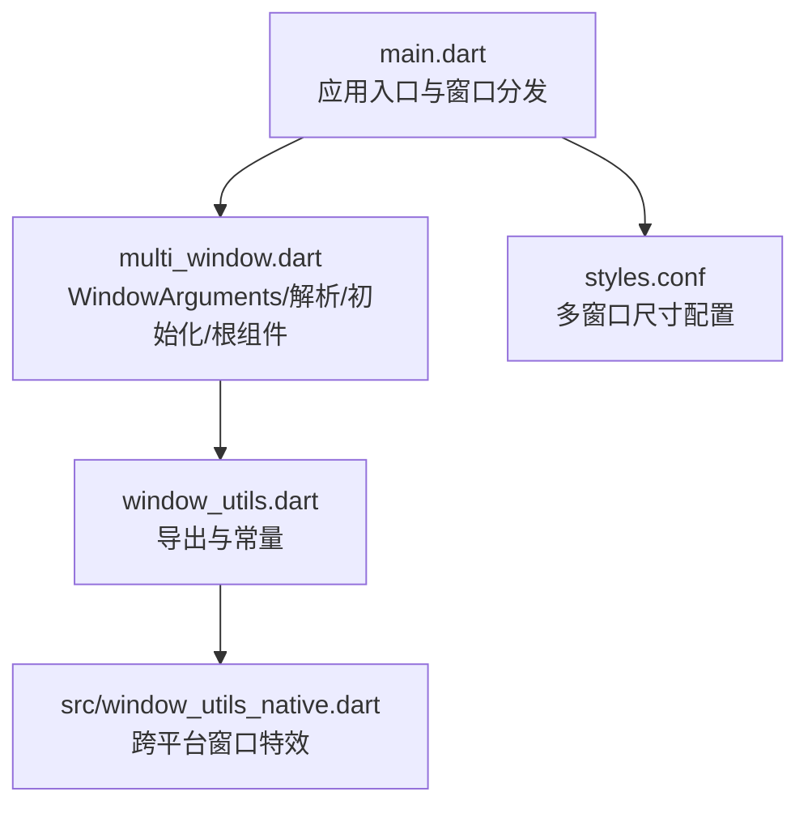
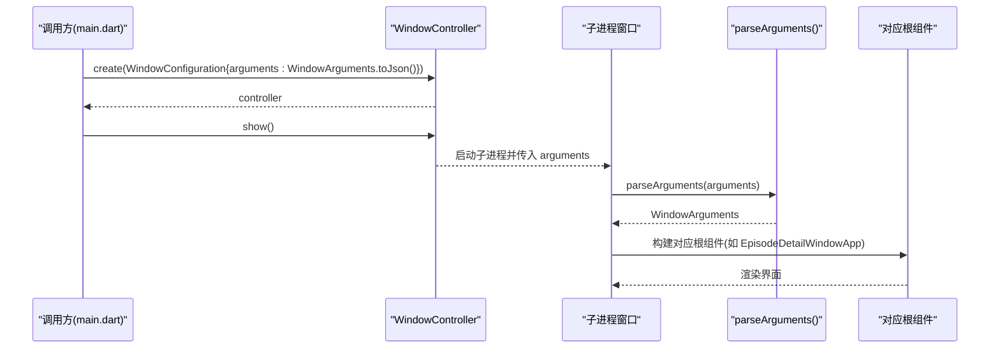
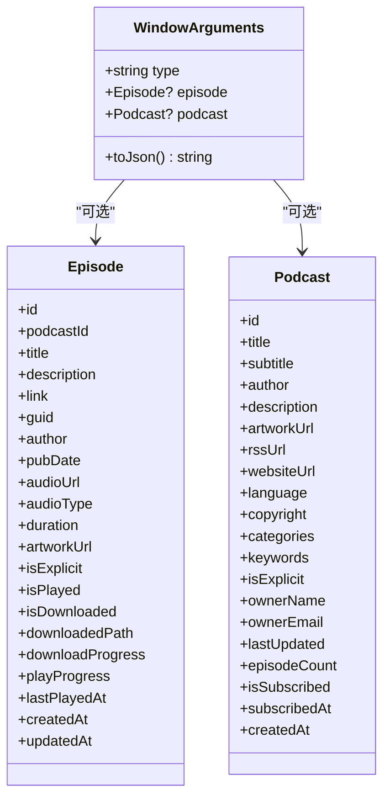
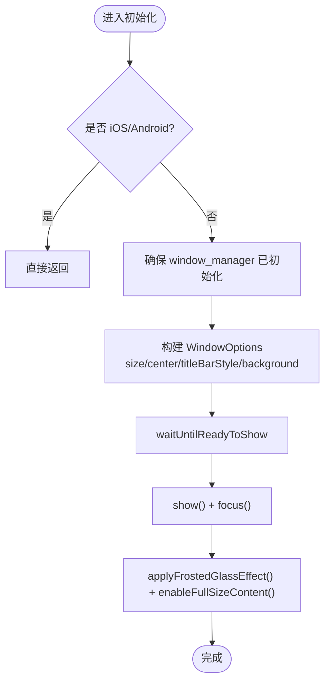
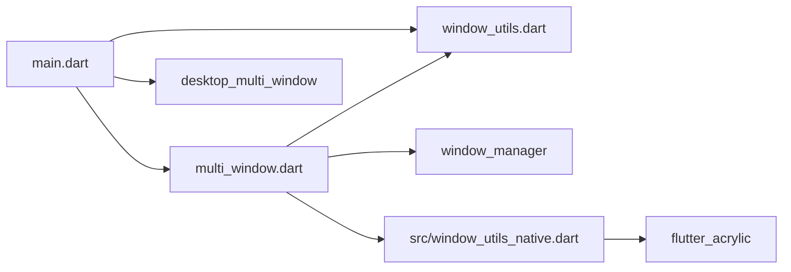

# 多窗口管理

<cite>
**本文引用的文件**   
- [lib/multi_window.dart](file://lib/multi_window.dart)
- [lib/window_utils.dart](file://lib/window_utils.dart)
- [lib/src/window_utils_native.dart](file://lib/src/window_utils_native.dart)
- [lib/main.dart](file://lib/main.dart)
- [assets/themes/styles.conf](file://assets/themes/styles.conf)
</cite>

## 目录
1. [简介](#简介)
2. [项目结构](#项目结构)
3. [核心组件](#核心组件)
4. [架构总览](#架构总览)
5. [详细组件分析](#详细组件分析)
6. [依赖关系分析](#依赖关系分析)
7. [性能考虑](#性能考虑)
8. [故障排查指南](#故障排查指南)
9. [结论](#结论)
10. [附录](#附录)

## 简介
本文件面向 TinyCast 应用的多窗口管理系统，系统性阐述 WindowArguments 类的设计与实现、四种窗口类型的初始化流程、窗口配置选项（大小、位置、标题栏样式、背景色）、跨平台差异处理（iOS/Android 与桌面端）、窗口间通信机制与数据传递方式，并通过具体代码路径示例展示如何创建新窗口、传递参数和处理生命周期。同时给出最佳实践与性能优化建议，帮助开发者在桌面端稳定扩展多窗口能力，并在移动端安全跳过桌面专属逻辑。

## 项目结构
多窗口相关代码主要分布在以下文件：
- lib/multi_window.dart：窗口参数模型、解析函数、各窗口初始化与根组件
- lib/window_utils.dart：窗口工具导出与默认背景色常量
- lib/src/window_utils_native.dart：跨平台窗口特效与全屏内容适配
- lib/main.dart：应用入口、平台分支、窗口控制器创建与路由分发
- assets/themes/styles.conf：主题与多窗口尺寸配置

图表来源 
- [lib/main.dart:106-177](file://lib/main.dart#L106-L177)
- [lib/multi_window.dart:18-182](file://lib/multi_window.dart#L18-L182)
- [lib/window_utils.dart:1-6](file://lib/window_utils.dart#L1-L6)
- [lib/src/window_utils_native.dart:1-125](file://lib/src/window_utils_native.dart#L1-L125)
- [assets/themes/styles.conf:249-261](file://assets/themes/styles.conf#L249-L261)

章节来源
- [lib/main.dart:106-177](file://lib/main.dart#L106-L177)
- [lib/multi_window.dart:18-182](file://lib/multi_window.dart#L18-L182)
- [lib/window_utils.dart:1-6](file://lib/window_utils.dart#L1-L6)
- [lib/src/window_utils_native.dart:1-125](file://lib/src/window_utils_native.dart#L1-L125)
- [assets/themes/styles.conf:249-261](file://assets/themes/styles.conf#L249-L261)

## 核心组件
- WindowArguments：窗口参数模型，承载 type、episode、podcast 等字段，并提供 toJson() 序列化方法。
- parseArguments：将 JSON 字符串反序列化为 WindowArguments，缺失时回退为 'main'。
- 窗口初始化函数：initMainWindow、initSettingsWindow、initSubscribeWindow、initEpisodeDetailWindow，负责窗口管理器初始化、WindowOptions 设置、显示聚焦与毛玻璃效果。
- 窗口根组件：SettingsWindowApp、SubscribeWindowApp、EpisodeDetailWindowApp，分别作为对应窗口的 WidgetsApp 根节点。
- WindowUtils：封装跨平台窗口特效（毛玻璃、透明背景、全屏内容视图）与 TitlebarSafeAreaWrapper。

章节来源
- [lib/multi_window.dart:18-182](file://lib/multi_window.dart#L18-L182)
- [lib/multi_window.dart:184-303](file://lib/multi_window.dart#L184-L303)
- [lib/multi_window.dart:305-453](file://lib/multi_window.dart#L305-L453)
- [lib/src/window_utils_native.dart:5-109](file://lib/src/window_utils_native.dart#L5-L109)

## 架构总览
多窗口系统以 main.dart 为入口，根据运行时参数选择不同窗口类型并初始化相应 UI。窗口参数通过 WindowArguments.toJson() 序列化后传递给子进程窗口；子进程通过 parseArguments() 还原参数并渲染对应根组件。窗口外观由 window_manager 的 WindowOptions 控制，视觉效果由 WindowUtils.applyFrostedGlassEffect() 与 enableFullSizeContent() 统一处理。

图表来源 
- [lib/main.dart:28-39](file://lib/main.dart#L28-L39)
- [lib/multi_window.dart:101-182](file://lib/multi_window.dart#L101-L182)
- [lib/multi_window.dart:305-453](file://lib/multi_window.dart#L305-L453)

章节来源
- [lib/main.dart:28-39](file://lib/main.dart#L28-L39)
- [lib/multi_window.dart:101-182](file://lib/multi_window.dart#L101-L182)
- [lib/multi_window.dart:305-453](file://lib/multi_window.dart#L305-L453)

## 详细组件分析

### WindowArguments 设计与序列化/反序列化
- 字段设计
  - type：窗口类型标识（'main'、'settings'、'subscribe'、'episode_detail'）
  - episode：节目详情窗口所需实体
  - podcast：关联播客实体
- 序列化
  - toJson() 将对象转为 JSON 字符串，包含 type 及可选的 episode/podcast 字段，时间字段使用 ISO8601 字符串表示。
- 反序列化
  - parseArguments() 从 JSON 字符串解析出 type、episode、podcast，缺失时回退为 'main'；日期字段按 ISO8601 解析，数值字段提供默认值保证健壮性。

图表来源 
- [lib/multi_window.dart:18-93](file://lib/multi_window.dart#L18-L93)
- [lib/multi_window.dart:101-182](file://lib/multi_window.dart#L101-L182)

章节来源
- [lib/multi_window.dart:18-93](file://lib/multi_window.dart#L18-L93)
- [lib/multi_window.dart:101-182](file://lib/multi_window.dart#L101-L182)

### 四种窗口类型的初始化过程
- 主窗口 initMainWindow
  - 平台检查：iOS/Android 直接返回
  - 初始化 window_manager，设置 WindowOptions（size、center、skipTaskbar、titleBarStyle、backgroundColor），等待就绪后 show/focus
  - 应用毛玻璃效果与全屏内容视图
- 设置窗口 initSettingsWindow
  - 同上流程，尺寸来自主题配置或默认值
- 订阅窗口 initSubscribeWindow
  - 固定尺寸 500x600，居中隐藏标题栏
- 节目详情窗口 initEpisodeDetailWindow
  - 固定尺寸 600x700，居中隐藏标题栏

图表来源 
- [lib/multi_window.dart:184-212](file://lib/multi_window.dart#L184-L212)
- [lib/multi_window.dart:214-243](file://lib/multi_window.dart#L214-L243)
- [lib/multi_window.dart:245-273](file://lib/multi_window.dart#L245-L273)
- [lib/multi_window.dart:275-303](file://lib/multi_window.dart#L275-L303)

章节来源
- [lib/multi_window.dart:184-212](file://lib/multi_window.dart#L184-L212)
- [lib/multi_window.dart:214-243](file://lib/multi_window.dart#L214-L243)
- [lib/multi_window.dart:245-273](file://lib/multi_window.dart#L245-L273)
- [lib/multi_window.dart:275-303](file://lib/multi_window.dart#L275-L303)

### 窗口配置选项
- 窗口大小
  - 主窗口尺寸来源于主题配置（light 模式下的 mainWindowSize）
  - 设置窗口尺寸来源于主题配置（settingsWindowSize）
  - 订阅窗口固定 500x600
  - 节目详情窗口固定 600x700
- 位置
  - 所有窗口均 center: true 居中显示
- 标题栏样式
  - 全部使用 TitleBarStyle.hidden 隐藏原生标题栏，Windows 平台额外添加自定义 WindowControls
- 背景颜色
  - Windows 平台使用 windowBackgroundColor（浅灰），其他平台使用透明背景 Color(0x00000000)

章节来源
- [lib/multi_window.dart:184-212](file://lib/multi_window.dart#L184-L212)
- [lib/multi_window.dart:214-243](file://lib/multi_window.dart#L214-L243)
- [lib/multi_window.dart:245-273](file://lib/multi_window.dart#L245-L273)
- [lib/multi_window.dart:275-303](file://lib/multi_window.dart#L275-L303)
- [lib/window_utils.dart:5](file://lib/window_utils.dart#L5)
- [assets/themes/styles.conf:249-261](file://assets/themes/styles.conf#L249-L261)

### 跨平台差异处理（iOS/Android vs 桌面端）
- 入口层
  - main.dart 在 iOS/Android 上跳过桌面窗口初始化，直接运行移动端 UI（MyAppMobile）
- 窗口初始化
  - 所有 init*Window() 函数开头进行 Platform.isIOS/Android 检查，移动端直接返回
- 窗口工具
  - WindowUtils.initialize()/applyFrostedGlassEffect()/enableFullSizeContent() 等方法内部对移动端进行守卫，避免调用桌面专属 API
- 标题栏控件
  - SettingsWindowApp/SubscribeWindowApp/EpisodeDetailWindowApp 中仅在 Windows 平台渲染 WindowControls

章节来源
- [lib/main.dart:106-114](file://lib/main.dart#L106-L114)
- [lib/multi_window.dart:184-212](file://lib/multi_window.dart#L184-L212)
- [lib/src/window_utils_native.dart:6-9](file://lib/src/window_utils_native.dart#L6-L9)
- [lib/src/window_utils_native.dart:11-20](file://lib/src/window_utils_native.dart#L11-L20)
- [lib/src/window_utils_native.dart:88-102](file://lib/src/window_utils_native.dart#L88-L102)

### 窗口间通信机制与数据传递
- 数据传递
  - 通过 WindowController.create(WindowConfiguration{arguments: WindowArguments.toJson()}) 将序列化后的参数传递给子进程窗口
  - 子进程通过 parseArguments(windowController.arguments) 解析参数并构造 WindowArguments
- 当前实现
  - 仅支持单向参数传递（父窗口到子窗口）
  - 未实现事件总线或消息通道，如需双向通信可基于 platform_channel 或共享状态服务扩展

章节来源
- [lib/main.dart:28-39](file://lib/main.dart#L28-L39)
- [lib/multi_window.dart:101-182](file://lib/multi_window.dart#L101-L182)

### 窗口生命周期与根组件
- 主窗口
  - main.dart 根据 arguments.type 选择分支，设置 AppWindowContext.isMainWindow，初始化服务后运行 MyApp
- 设置窗口
  - 运行 SettingsWindowApp，作为独立窗口根组件
- 订阅窗口
  - 运行 SubscribeWindowApp
- 节目详情窗口
  - 运行 EpisodeDetailWindowApp，并注入 episode/podcast 参数

章节来源
- [lib/main.dart:128-176](file://lib/main.dart#L128-L176)
- [lib/multi_window.dart:305-453](file://lib/multi_window.dart#L305-L453)

## 依赖关系分析
- main.dart 依赖 multi_window.dart（窗口初始化与参数解析）、window_utils.dart（窗口工具）、desktop_multi_window（窗口控制器）
- multi_window.dart 依赖 window_manager（窗口管理）、window_utils.dart（背景色常量）、src/window_utils_native.dart（跨平台特效）
- src/window_utils_native.dart 依赖 flutter_acrylic（毛玻璃效果）

图表来源 
- [lib/main.dart:1-21](file://lib/main.dart#L1-L21)
- [lib/multi_window.dart:1-13](file://lib/multi_window.dart#L1-L13)
- [lib/window_utils.dart:1-6](file://lib/window_utils.dart#L1-L6)
- [lib/src/window_utils_native.dart:1-4](file://lib/src/window_utils_native.dart#L1-L4)

章节来源
- [lib/main.dart:1-21](file://lib/main.dart#L1-L21)
- [lib/multi_window.dart:1-13](file://lib/multi_window.dart#L1-L13)
- [lib/window_utils.dart:1-6](file://lib/window_utils.dart#L1-L6)
- [lib/src/window_utils_native.dart:1-4](file://lib/src/window_utils_native.dart#L1-L4)

## 性能考虑
- 窗口初始化开销
  - 避免在移动端执行桌面专属初始化，减少不必要的平台调用
- 序列化成本
  - WindowArguments.toJson() 会序列化大量字段，建议在频繁打开窗口场景下缓存必要数据或按需传递最小化参数
- 毛玻璃与透明背景
  - applyFrostedGlassEffect() 与 enableFullSizeContent() 在 macOS/Windows 上可能带来 GPU/CPU 负载，建议在非必要时关闭或降级为纯色背景
- 窗口数量
  - 控制并发窗口数量，避免过多子进程导致内存与资源竞争
- 主题加载
  - 预加载主题配置可减少首次渲染延迟，但需权衡启动时间

[本节为通用指导，不直接分析具体文件]

## 故障排查指南
- 移动端崩溃或无法编译
  - 检查 main.dart 的平台分支是否正确跳过桌面初始化
  - 确认 window_utils_native.dart 的方法内均有 Platform.isIOS/Android 守卫
- 窗口未显示或黑屏
  - 检查 WindowOptions 的 backgroundColor 与 titleBarStyle 设置
  - 确认 waitUntilReadyToShow 回调中正确执行了 show() 和 focus()
- 毛玻璃效果异常
  - 在 Windows 上若 acrylic 失败会自动回退 solid，检查日志与权限
  - macOS 上使用 sidebar 效果，确保系统版本支持
- 参数丢失或解析失败
  - 检查 WindowArguments.toJson() 字段完整性与日期格式
  - parseArguments() 捕获异常时会回退为 'main'，需在上层记录错误信息

章节来源
- [lib/main.dart:106-114](file://lib/main.dart#L106-L114)
- [lib/src/window_utils_native.dart:30-42](file://lib/src/window_utils_native.dart#L30-L42)
- [lib/multi_window.dart:101-182](file://lib/multi_window.dart#L101-L182)

## 结论
TinyCast 的多窗口管理系统以 WindowArguments 为核心，结合 window_manager 与 WindowUtils 实现了跨平台的窗口初始化与视觉统一。通过严格的平台检测与条件导出，系统在桌面端提供完整的多窗口能力，在移动端安全跳过桌面逻辑。当前实现侧重单向参数传递，未来可扩展双向通信机制以提升窗口协作体验。遵循本文的最佳实践与性能建议，可在保持用户体验的同时提升稳定性与可维护性。

[本节为总结性内容，不直接分析具体文件]

## 附录
- 创建新窗口与传递参数的步骤
  - 构造 WindowArguments(type, episode?, podcast?)
  - 调用 WindowController.create(WindowConfiguration{hiddenAtLaunch: true, arguments: arguments.toJson()})
  - controller.show() 显示窗口
  - 子进程通过 parseArguments(windowController.arguments) 解析参数并渲染对应根组件
- 窗口生命周期关键点
  - 主窗口：设置 isMainWindow=true，初始化服务，注册生命周期观察者
  - 子窗口：根据 type 初始化对应窗口并运行相应根组件
- 主题与尺寸配置
  - styles.conf 中的 multi_window.main_window/settings_window 定义默认尺寸与背景

章节来源
- [lib/main.dart:28-39](file://lib/main.dart#L28-L39)
- [lib/multi_window.dart:101-182](file://lib/multi_window.dart#L101-L182)
- [assets/themes/styles.conf:249-261](file://assets/themes/styles.conf#L249-L261)