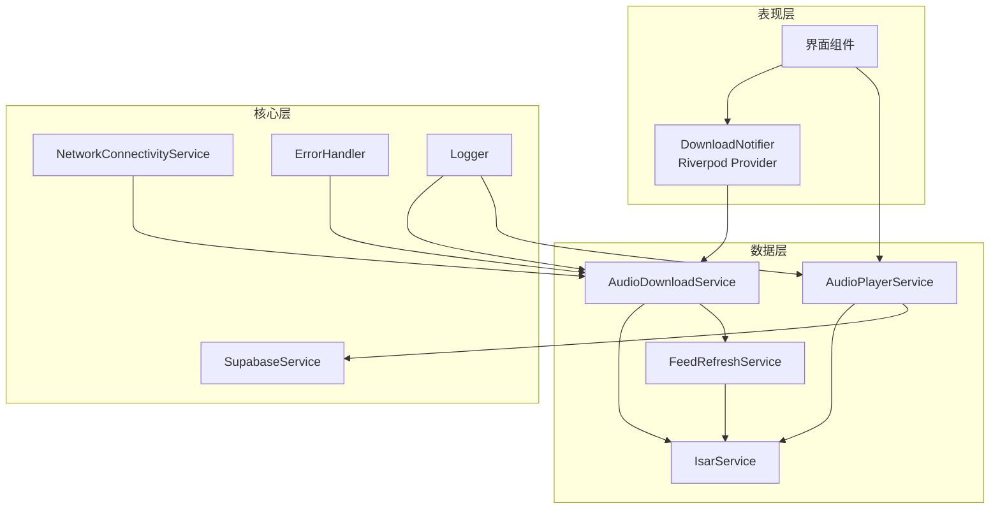
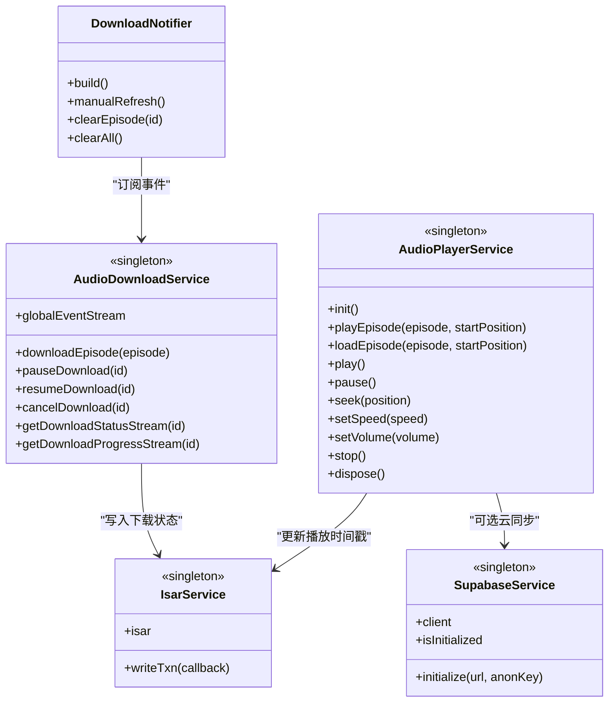
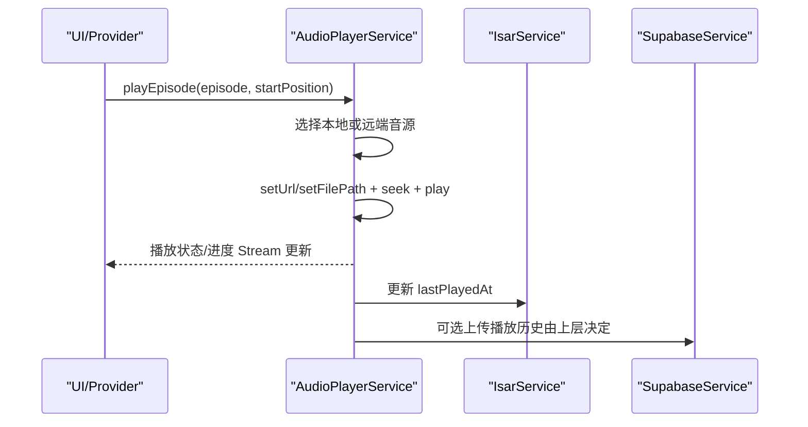
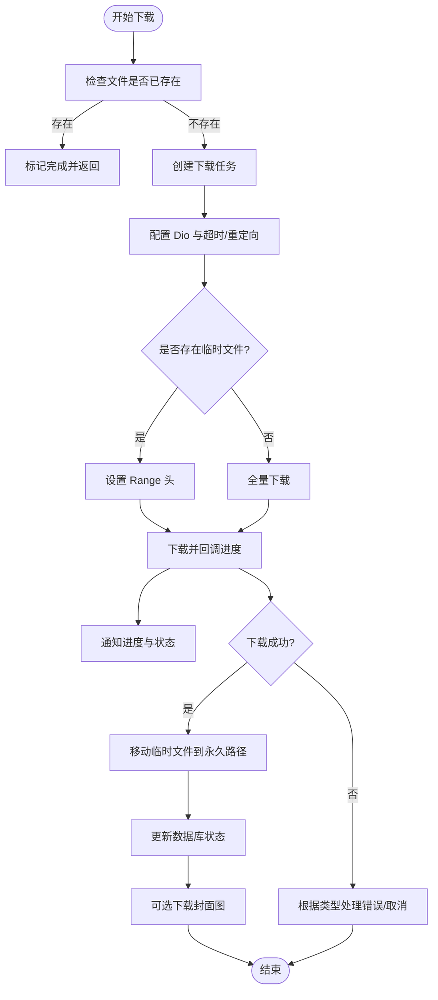
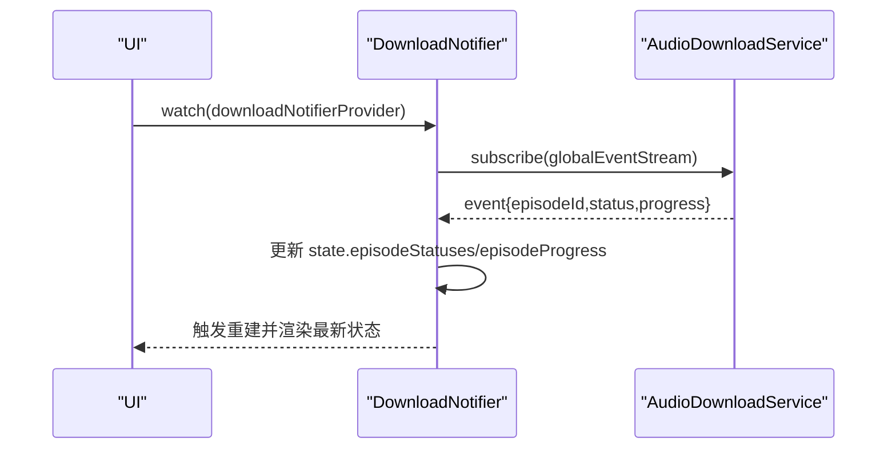
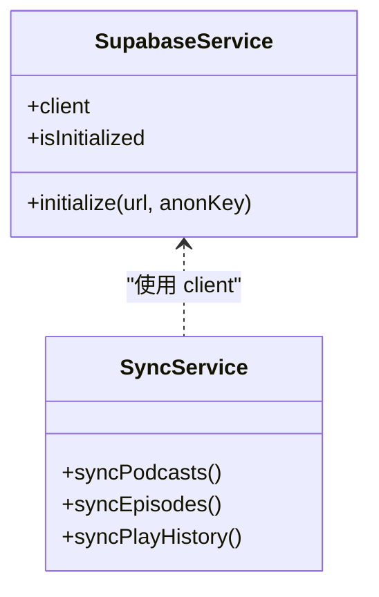
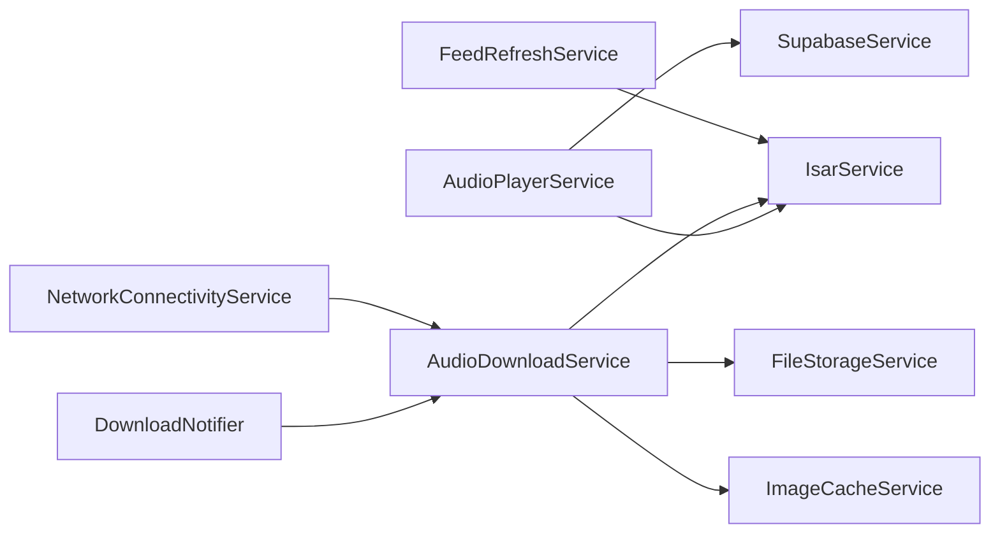

# 服务通信

<cite>
**本文引用的文件**   
- [pubspec.yaml](file://pubspec.yaml)
- [main.dart](file://lib/main.dart)
- [audio_player_service.dart](file://lib/data/services/audio_player_service.dart)
- [audio_download_service.dart](file://lib/data/services/audio_download_service.dart)
- [download_provider.dart](file://lib/presentation/providers/download_provider.dart)
- [supabase_service.dart](file://lib/core/services/supabase_service.dart)
- [sync_service.dart](file://lib/core/services/sync_service.dart)
- [play_progress_service.dart](file://lib/core/services/play_progress_service.dart)
- [isar_service.dart](file://lib/data/database/isar_service.dart)
- [podcast_repository_impl.dart](file://lib/data/repositories/podcast_repository_impl.dart)
- [feed_refresh_service.dart](file://lib/data/services/feed_refresh_service.dart)
- [network_connectivity_service.dart](file://lib/core/services/network_connectivity_service.dart)
- [error_handler.dart](file://lib/core/utils/error_handler.dart)
- [logger.dart](file://lib/core/utils/logger.dart)
</cite>

## 目录
1. [简介](#简介)
2. [项目结构](#项目结构)
3. [核心组件](#核心组件)
4. [架构总览](#架构总览)
5. [详细组件分析](#详细组件分析)
6. [依赖关系分析](#依赖关系分析)
7. [性能考虑](#性能考虑)
8. [故障排查指南](#故障排查指南)
9. [结论](#结论)
10. [附录](#附录)

## 简介
本文件聚焦 TinyCast 应用的服务通信机制，围绕以下目标展开：
- 解释服务层之间的依赖注入与调用模式（单例、Provider 注册）
- 描述 Provider 状态管理在服务通信中的作用（Riverpod 的使用与状态同步）
- 说明异步通信处理方式（Future、Stream、事件驱动）
- 阐述错误处理与重试机制在跨服务通信中的实现
- 通过具体场景展示播放器服务、下载服务、数据库服务等协作模式
- 描述服务间的解耦设计与接口抽象
- 提供性能优化策略与调试技巧
- 给出自定义服务开发的指导原则与最佳实践

## 项目结构
TinyCast 采用分层组织：core（基础设施与服务）、data（数据模型/仓库/数据源/服务）、presentation（UI 与 Riverpod Provider）。关键入口为 main.dart；音频播放与下载位于 data/services；状态管理与 UI 绑定位于 presentation/providers；数据库访问由 IsarService 统一封装。

图表来源 
- [main.dart](file://lib/main.dart)
- [audio_player_service.dart](file://lib/data/services/audio_player_service.dart)
- [audio_download_service.dart](file://lib/data/services/audio_download_service.dart)
- [download_provider.dart](file://lib/presentation/providers/download_provider.dart)
- [supabase_service.dart](file://lib/core/services/supabase_service.dart)
- [sync_service.dart](file://lib/core/services/sync_service.dart)
- [isar_service.dart](file://lib/data/database/isar_service.dart)
- [feed_refresh_service.dart](file://lib/data/services/feed_refresh_service.dart)
- [network_connectivity_service.dart](file://lib/core/services/network_connectivity_service.dart)
- [error_handler.dart](file://lib/core/utils/error_handler.dart)
- [logger.dart](file://lib/core/utils/logger.dart)

章节来源
- [pubspec.yaml:1-196](file://pubspec.yaml#L1-L196)

## 核心组件
- AudioPlayerService：单例音频播放器服务，封装 just_audio 与 audio_service，暴露播放状态、进度、速度、音量等 Stream，并通过 PlayProgressService 持久化播放进度。
- AudioDownloadService：单例下载服务，基于 Dio 实现断点续传、并发队列、取消/暂停/恢复、全局事件广播，并与 IsarService 和 FileStorageService 协作。
- DownloadNotifier（Riverpod Notifier）：订阅下载服务的全局事件流，维护下载状态与进度，供 UI 消费。
- SupabaseService：单例客户端初始化与管理，通过 Provider 暴露 SupabaseClient。
- IsarService：数据库单例，提供读写事务与集合操作。
- FeedRefreshService：RSS 刷新任务调度，触发订阅更新与后续下载。
- NetworkConnectivityService：网络状态检测，辅助下载与网络请求策略。
- ErrorHandler/Logger：统一错误处理与日志输出。

章节来源
- [audio_player_service.dart:1-653](file://lib/data/services/audio_player_service.dart#L1-L653)
- [audio_download_service.dart:1-800](file://lib/data/services/audio_download_service.dart#L1-L800)
- [download_provider.dart:1-156](file://lib/presentation/providers/download_provider.dart#L1-L156)
- [supabase_service.dart:1-54](file://lib/core/services/supabase_service.dart#L1-L54)
- [isar_service.dart](file://lib/data/database/isar_service.dart)
- [feed_refresh_service.dart](file://lib/data/services/feed_refresh_service.dart)
- [network_connectivity_service.dart](file://lib/core/services/network_connectivity_service.dart)
- [error_handler.dart](file://lib/core/utils/error_handler.dart)
- [logger.dart](file://lib/core/utils/logger.dart)

## 架构总览
TinyCast 的服务通信以“单例服务 + Riverpod Provider”为核心：
- 单例服务负责资源生命周期与跨调用共享状态（播放器、下载器、数据库、网络、云服务）
- Riverpod Provider 将服务状态暴露给 UI，并订阅服务发出的 Stream 事件，实现响应式更新
- 服务之间通过明确的接口方法调用与事件广播进行解耦通信

图表来源 
- [audio_player_service.dart:1-653](file://lib/data/services/audio_player_service.dart#L1-L653)
- [audio_download_service.dart:1-800](file://lib/data/services/audio_download_service.dart#L1-L800)
- [download_provider.dart:1-156](file://lib/presentation/providers/download_provider.dart#L1-L156)
- [supabase_service.dart:1-54](file://lib/core/services/supabase_service.dart#L1-L54)
- [isar_service.dart](file://lib/data/database/isar_service.dart)

## 详细组件分析

### 播放器服务（AudioPlayerService）
- 单例模式：静态实例保证全局唯一播放器上下文
- 事件驱动：通过多个 StreamController 广播播放状态、进度、速度、音量、当前剧集、完成事件
- 媒体集成：使用 audio_service 桥接系统通知与锁屏控制
- 数据持久化：通过 PlayProgressService 保存播放进度与标记已播放
- 错误处理：捕获异常并记录日志，必要时重置播放器状态

图表来源 
- [audio_player_service.dart:1-653](file://lib/data/services/audio_player_service.dart#L1-L653)
- [play_progress_service.dart](file://lib/core/services/play_progress_service.dart)
- [supabase_service.dart:1-54](file://lib/core/services/supabase_service.dart#L1-L54)
- [isar_service.dart](file://lib/data/database/isar_service.dart)

章节来源
- [audio_player_service.dart:1-653](file://lib/data/services/audio_player_service.dart#L1-L653)

### 下载服务（AudioDownloadService）
- 单例模式：集中管理下载任务、队列与事件
- 并发控制：默认最多 3 个并发下载，避免带宽拥塞
- 断点续传：支持 Range 头与临时文件恢复
- 事件广播：全局事件流包含 episodeId、status、progress，供 UI 与 Provider 订阅
- 错误处理：区分取消、失败、未知异常，记录日志并更新状态

图表来源 
- [audio_download_service.dart:1-800](file://lib/data/services/audio_download_service.dart#L1-L800)

章节来源
- [audio_download_service.dart:1-800](file://lib/data/services/audio_download_service.dart#L1-L800)

### Riverpod 状态管理（DownloadNotifier）
- 订阅下载服务的全局事件流，维护 episode 的状态与进度映射
- 提供手动刷新与清理能力，暴露 active/queued/completed 等派生状态
- 在 dispose 时取消订阅，避免内存泄漏

图表来源 
- [download_provider.dart:1-156](file://lib/presentation/providers/download_provider.dart#L1-L156)
- [audio_download_service.dart:1-800](file://lib/data/services/audio_download_service.dart#L1-L800)

章节来源
- [download_provider.dart:1-156](file://lib/presentation/providers/download_provider.dart#L1-L156)

### 云服务与同步（SupabaseService & SyncService）
- SupabaseService：单例初始化客户端，暴露 client 属性，供其他服务使用
- SyncService：负责云端与本地的数据同步，包括播客、剧集、播放历史等实体的映射与合并

图表来源 
- [supabase_service.dart:1-54](file://lib/core/services/supabase_service.dart#L1-L54)
- [sync_service.dart:1266-1302](file://lib/core/services/sync_service.dart#L1266-L1302)

章节来源
- [supabase_service.dart:1-54](file://lib/core/services/supabase_service.dart#L1-L54)
- [sync_service.dart:1266-1302](file://lib/core/services/sync_service.dart#L1266-L1302)

### 数据库服务（IsarService）
- 单例封装 Isar 实例与事务操作
- 被播放器与下载服务用于持久化播放时间戳与下载状态

章节来源
- [isar_service.dart](file://lib/data/database/isar_service.dart)

### 刷新与网络（FeedRefreshService & NetworkConnectivityService）
- FeedRefreshService：定时或触发式刷新 RSS，触发订阅更新与自动下载
- NetworkConnectivityService：监听网络变化，影响下载策略与重试行为

章节来源
- [feed_refresh_service.dart](file://lib/data/services/feed_refresh_service.dart)
- [network_connectivity_service.dart](file://lib/core/services/network_connectivity_service.dart)

## 依赖关系分析
- 播放器服务依赖 IsarService（持久化）与 SupabaseService（可选云同步）
- 下载服务依赖 IsarService（状态持久化）、FileStorageService（文件路径与 IO）、ImageCacheService（封面缓存）
- Riverpod Provider 依赖下载服务的事件流，不直接耦合业务逻辑
- 错误处理与日志贯穿各服务，确保一致性与可观测性

图表来源 
- [audio_player_service.dart:1-653](file://lib/data/services/audio_player_service.dart#L1-L653)
- [audio_download_service.dart:1-800](file://lib/data/services/audio_download_service.dart#L1-L800)
- [download_provider.dart:1-156](file://lib/presentation/providers/download_provider.dart#L1-L156)
- [supabase_service.dart:1-54](file://lib/core/services/supabase_service.dart#L1-L54)
- [isar_service.dart](file://lib/data/database/isar_service.dart)
- [feed_refresh_service.dart](file://lib/data/services/feed_refresh_service.dart)
- [network_connectivity_service.dart](file://lib/core/services/network_connectivity_service.dart)

章节来源
- [audio_player_service.dart:1-653](file://lib/data/services/audio_player_service.dart#L1-L653)
- [audio_download_service.dart:1-800](file://lib/data/services/audio_download_service.dart#L1-L800)
- [download_provider.dart:1-156](file://lib/presentation/providers/download_provider.dart#L1-L156)

## 性能考虑
- 并发控制：下载服务限制最大并发数，避免带宽与 I/O 争用
- 断点续传：利用 Range 头与临时文件提升弱网环境下的稳定性
- 事件节流：进度与状态事件仅在关键节点广播，减少 UI 重建频率
- 资源释放：播放器与下载服务的 StreamSubscription 在 dispose 时取消，防止内存泄漏
- 存储路径：使用相对路径与平台适配目录，提高跨设备兼容性与迁移效率

[本节为通用指导，不直接分析具体文件]

## 故障排查指南
- 常见问题定位
  - 播放器无法加载：检查本地文件是否存在、URL 是否有效、播放器状态重置逻辑
  - 下载失败：查看 DioException 类型（连接超时、网络错误、取消），确认临时文件与权限
  - 状态不同步：确认 Riverpod Provider 是否正确订阅全局事件流，并在 dispose 中取消订阅
- 日志与诊断
  - 使用 Logger 输出关键步骤与异常堆栈
  - 使用 ErrorHandler 统一包装错误，便于上层展示与上报
- 重试策略
  - 对网络请求实施指数退避重试（可在 Dio 拦截器或上层 UseCase 中实现）
  - 针对特定错误码（如 429、5xx）进行限流与降级

章节来源
- [error_handler.dart](file://lib/core/utils/error_handler.dart)
- [logger.dart](file://lib/core/utils/logger.dart)

## 结论
TinyCast 的服务通信以单例服务与 Riverpod Provider 为核心，结合 Stream 事件驱动与严格的错误处理，实现了播放器、下载、数据库、云服务之间的解耦协作。通过并发控制、断点续传、资源释放与日志追踪，系统在复杂场景下仍保持高可用与可维护性。遵循本文的架构与最佳实践，可为新增服务提供清晰的扩展路径。

[本节为总结，不直接分析具体文件]

## 附录

### 典型协作场景：订阅新播客后的自动下载
- 用户点击订阅 → UseCase → Repository → LocalDataSource 保存 → 触发下载服务批量下载 → 事件流推送至 UI
- 该流程体现服务间解耦与事件驱动的协作模式

章节来源
- [podcast_repository_impl.dart](file://lib/data/repositories/podcast_repository_impl.dart)
- [audio_download_service.dart:1-800](file://lib/data/services/audio_download_service.dart#L1-L800)

### 自定义服务开发指导原则
- 设计原则
  - 单一职责：每个服务专注一个领域（播放、下载、网络、存储）
  - 接口抽象：对外暴露稳定方法，内部实现可替换
  - 事件优先：通过 Stream 广播状态变更，降低耦合
- 依赖注入
  - 使用单例服务作为共享资源，或通过 Provider 暴露实例
  - 避免在 Widget 中直接 new 服务，统一从 Provider 获取
- 异步与错误
  - 使用 Future 表示一次性操作，Stream 表示持续事件
  - 明确错误分类与重试策略，记录日志并向上抛出
- 性能与安全
  - 控制并发与缓存大小，及时释放资源
  - 敏感信息使用安全存储，避免明文泄露

[本节为通用指导，不直接分析具体文件]