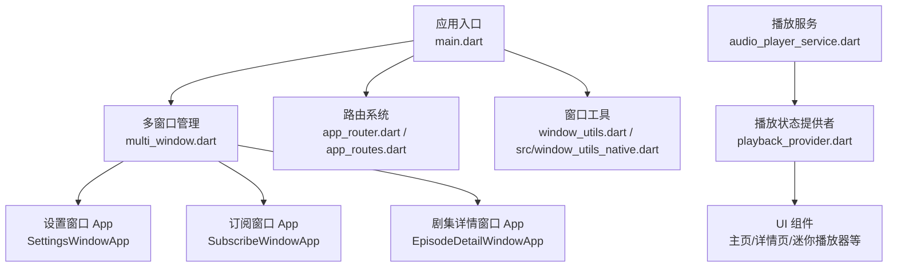
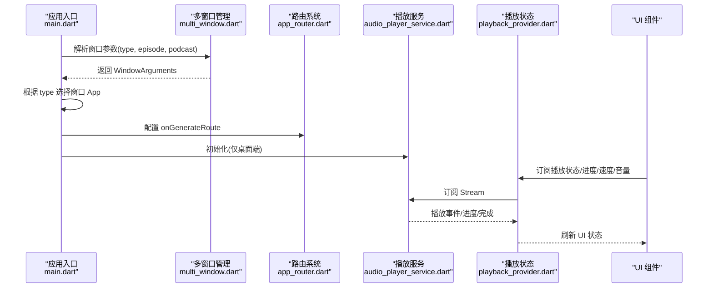
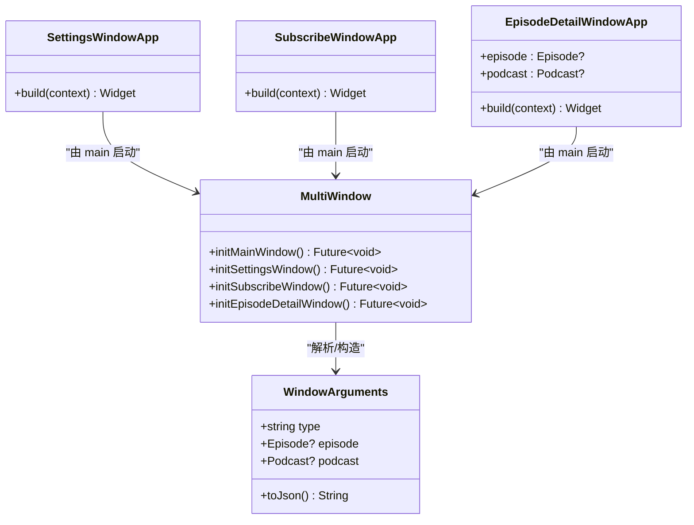
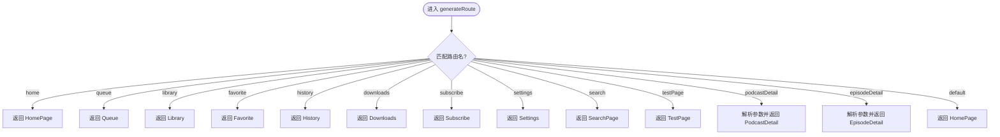
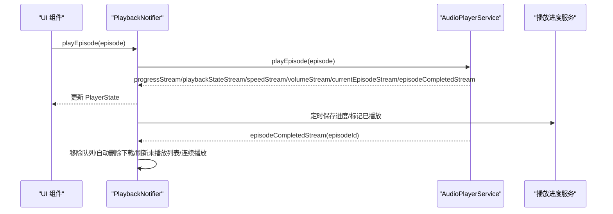
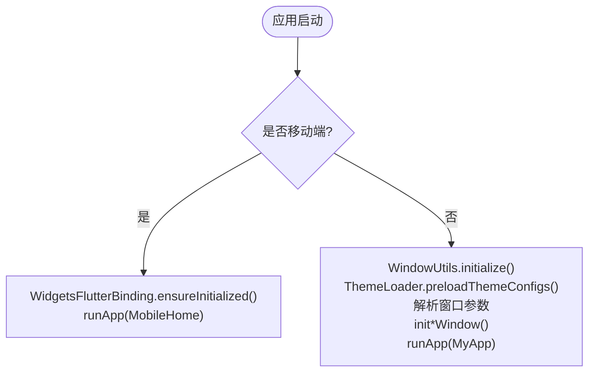
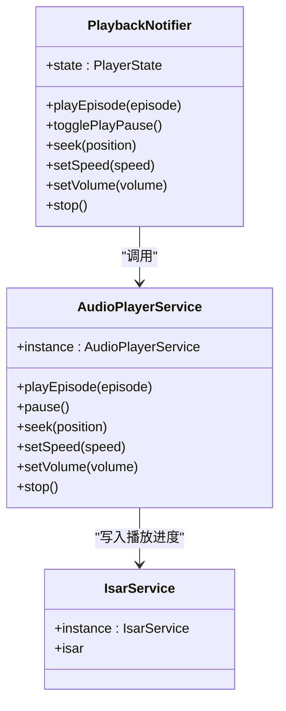
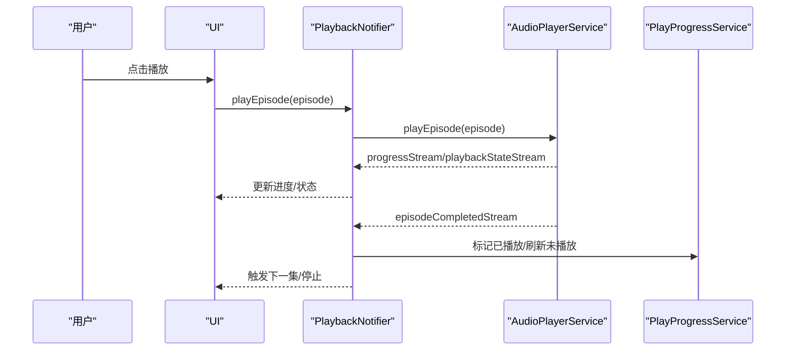
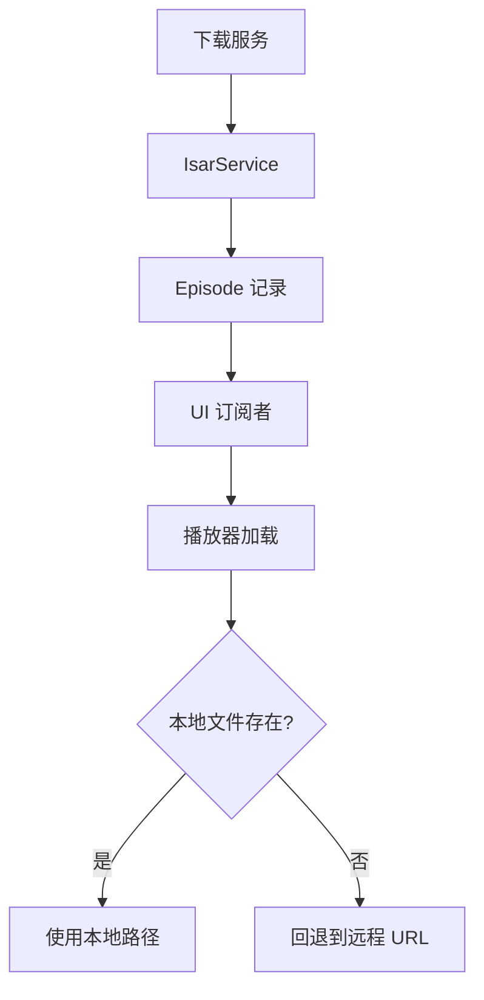
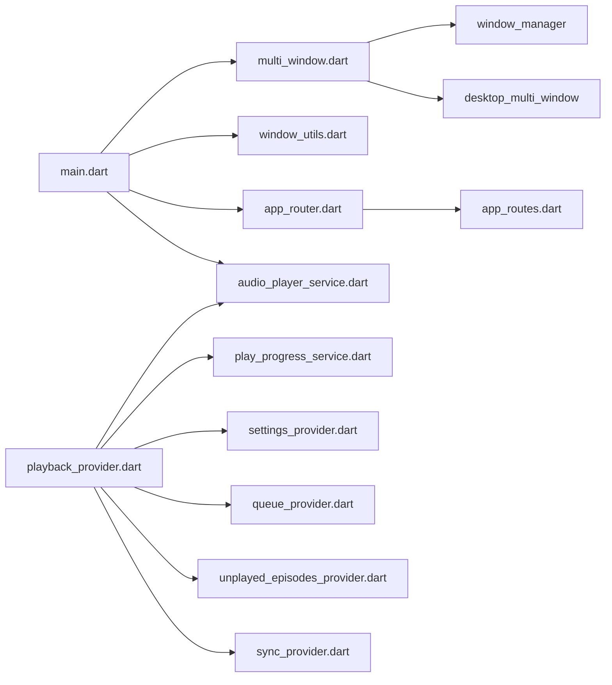

# 组件交互设计

<cite>
**本文引用的文件**   
- [main.dart](file://lib/main.dart)
- [multi_window.dart](file://lib/multi_window.dart)
- [window_utils.dart](file://lib/window_utils.dart)
- [src/window_utils_native.dart](file://lib/src/window_utils_native.dart)
- [core/router/app_router.dart](file://lib/core/router/app_router.dart)
- [core/router/app_routes.dart](file://lib/core/router/app_routes.dart)
- [core/utils/app_window_context.dart](file://lib/core/utils/app_window_context.dart)
- [data/services/audio_player_service.dart](file://lib/data/services/audio_player_service.dart)
- [presentation/providers/playback_provider.dart](file://lib/presentation/providers/playback_provider.dart)
</cite>

## 目录
1. [引言](#引言)
2. [项目结构](#项目结构)
3. [核心组件](#核心组件)
4. [架构总览](#架构总览)
5. [详细组件分析](#详细组件分析)
6. [依赖关系分析](#依赖关系分析)
7. [性能考量](#性能考量)
8. [故障排查指南](#故障排查指南)
9. [结论](#结论)
10. [附录](#附录)

## 引言
本文件面向 TinyCast 应用的“组件交互设计”，聚焦以下目标：
- 描述各组件之间的通信方式与交互模式（事件流、状态共享、服务调用）。
- 解释多窗口管理机制（主窗口、设置窗口、订阅窗口、剧集详情窗口）的创建、管理与跨窗口通信。
- 说明路由系统的设计与实现（页面导航、参数传递、状态保持）。
- 阐述跨平台适配策略（移动端 vs 桌面端差异处理）。
- 解释服务间的依赖注入与调用机制（Riverpod + 单例服务）。
- 通过具体场景展示协作模式（播放器与 UI 同步、下载任务状态更新等），并辅以架构图与流程图。

## 项目结构
TinyCast 采用分层组织：
- core：路由、主题、工具、服务等横切能力
- data：数据模型、数据库、服务（音频播放、下载、设置等）
- domain：领域实体（Episode、Podcast 等）
- presentation：UI 层（页面、提供者、通用组件）
- 入口与多窗口：main.dart、multi_window.dart、window_utils.dart

图表来源
- [main.dart:106-177](file://lib/main.dart#L106-L177)
- [multi_window.dart:184-303](file://lib/multi_window.dart#L184-L303)
- [core/router/app_router.dart:20-132](file://lib/core/router/app_router.dart#L20-L132)
- [core/router/app_routes.dart:1-16](file://lib/core/router/app_routes.dart#L1-L16)
- [window_utils.dart:1-6](file://lib/window_utils.dart#L1-L6)
- [src/window_utils_native.dart:1-125](file://lib/src/window_utils_native.dart#L1-L125)
- [data/services/audio_player_service.dart:31-134](file://lib/data/services/audio_player_service.dart#L31-L134)
- [presentation/providers/playback_provider.dart:64-101](file://lib/presentation/providers/playback_provider.dart#L64-L101)

章节来源
- [main.dart:106-177](file://lib/main.dart#L106-L177)
- [multi_window.dart:184-303](file://lib/multi_window.dart#L184-L303)
- [core/router/app_router.dart:20-132](file://lib/core/router/app_router.dart#L20-L132)
- [core/router/app_routes.dart:1-16](file://lib/core/router/app_routes.dart#L1-L16)
- [window_utils.dart:1-6](file://lib/window_utils.dart#L1-L6)
- [src/window_utils_native.dart:1-125](file://lib/src/window_utils_native.dart#L1-L125)

## 核心组件
- 应用入口与初始化
  - main.dart 负责平台分支、窗口类型解析、ProviderScope 包裹、生命周期观察者注册、后台任务启动。
  - 提供 openEpisodeDetailWindow 用于打开剧集详情子窗口，并通过 WindowController 传递 JSON 参数。
- 多窗口管理
  - multi_window.dart 定义 WindowArguments 序列化/反序列化，以及 initMainWindow/initSettingsWindow/initSubscribeWindow/initEpisodeDetailWindow 等窗口初始化方法。
  - 提供 SettingsWindowApp、SubscribeWindowApp、EpisodeDetailWindowApp 作为独立窗口的根 WidgetsApp。
- 路由系统
  - core/router/app_router.dart 集中生成页面路由，支持命名路由与参数传递；并提供 openSettingsWindow/openSubscribeWindow 快捷方法。
  - core/router/app_routes.dart 维护所有路由常量。
- 播放服务与状态
  - data/services/audio_player_service.dart 封装 just_audio 与 audio_service，暴露 Stream 广播播放状态、进度、速度、音量、当前剧集、完成事件。
  - presentation/providers/playback_provider.dart 基于 Riverpod Notifier 聚合播放状态，订阅服务事件，处理自动保存、连续播放、睡眠定时器、队列联动等。
- 窗口工具
  - window_utils.dart 导出平台无关的 WindowUtils，实际实现在 src/window_utils_native.dart，封装毛玻璃效果、全屏内容、透明背景等。

章节来源
- [main.dart:23-39](file://lib/main.dart#L23-L39)
- [main.dart:106-177](file://lib/main.dart#L106-L177)
- [multi_window.dart:15-93](file://lib/multi_window.dart#L15-L93)
- [multi_window.dart:184-303](file://lib/multi_window.dart#L184-L303)
- [multi_window.dart:309-453](file://lib/multi_window.dart#L309-L453)
- [core/router/app_router.dart:20-132](file://lib/core/router/app_router.dart#L20-L132)
- [core/router/app_routes.dart:1-16](file://lib/core/router/app_routes.dart#L1-L16)
- [data/services/audio_player_service.dart:31-134](file://lib/data/services/audio_player_service.dart#L31-L134)
- [presentation/providers/playback_provider.dart:64-101](file://lib/presentation/providers/playback_provider.dart#L64-L101)
- [src/window_utils_native.dart:1-125](file://lib/src/window_utils_native.dart#L1-L125)

## 架构总览
整体采用“入口 -> 多窗口 -> 路由 -> 服务 -> 状态提供者 -> UI”的分层架构。播放相关通过 Stream 广播与 Riverpod 状态管理解耦 UI 与底层音频引擎。

图表来源
- [main.dart:106-177](file://lib/main.dart#L106-L177)
- [multi_window.dart:15-93](file://lib/multi_window.dart#L15-L93)
- [core/router/app_router.dart:20-132](file://lib/core/router/app_router.dart#L20-L132)
- [data/services/audio_player_service.dart:100-134](file://lib/data/services/audio_player_service.dart#L100-L134)
- [presentation/providers/playback_provider.dart:169-205](file://lib/presentation/providers/playback_provider.dart#L169-L205)

## 详细组件分析

### 多窗口管理机制
- 窗口参数与序列化
  - WindowArguments 支持 type、episode、podcast 字段，toJson/jsonDecode 保证跨进程参数安全传递。
- 窗口初始化
  - initMainWindow/initSettingsWindow/initSubscribeWindow/initEpisodeDetailWindow 分别配置窗口尺寸、标题栏样式、毛玻璃效果、全屏内容等。
- 窗口应用根组件
  - SettingsWindowApp、SubscribeWindowApp、EpisodeDetailWindowApp 各自使用 WidgetsApp 挂载对应页面，并在 Windows 平台附加自定义标题栏控件。
- 跨窗口通信
  - 通过 WindowController.create 与 WindowConfiguration.arguments 传递 JSON；主窗口可通过 AppRouter.openSettingsWindow/openSubscribeWindow 打开子窗口。

图表来源
- [multi_window.dart:15-93](file://lib/multi_window.dart#L15-L93)
- [multi_window.dart:184-303](file://lib/multi_window.dart#L184-L303)
- [multi_window.dart:309-453](file://lib/multi_window.dart#L309-L453)

章节来源
- [multi_window.dart:15-93](file://lib/multi_window.dart#L15-L93)
- [multi_window.dart:184-303](file://lib/multi_window.dart#L184-L303)
- [multi_window.dart:309-453](file://lib/multi_window.dart#L309-L453)

### 路由系统与页面导航
- 路由常量
  - AppRoutes 集中声明所有页面路径。
- 路由生成
  - AppRouter.generateRoute 根据名称返回 PageRouteBuilder，支持参数（如 Podcast.id、Episode 对象或 Map）。
- 导航辅助
  - navigateTo/navigateToAndRemoveUntil/navigateToAndReplace/pop/popUntil 统一封装 Navigator API。
- 子窗口导航
  - openSettingsWindow/openSubscribeWindow 通过 WindowController 创建新窗口并显示。

图表来源
- [core/router/app_router.dart:20-132](file://lib/core/router/app_router.dart#L20-L132)
- [core/router/app_routes.dart:1-16](file://lib/core/router/app_routes.dart#L1-L16)

章节来源
- [core/router/app_router.dart:20-132](file://lib/core/router/app_router.dart#L20-L132)
- [core/router/app_routes.dart:1-16](file://lib/core/router/app_routes.dart#L1-L16)

### 播放服务与 UI 同步
- 播放服务
  - AudioPlayerService 封装 just_audio 与 audio_service，暴露多个 Stream 广播播放状态、进度、速度、音量、当前剧集、播放完成事件。
  - 内部维护 _currentEpisode，加载本地/远程音频，自动恢复上次播放位置，更新媒体项。
- 播放状态提供者
  - PlaybackNotifier 订阅上述 Stream，合并为 PlayerState，提供 play/pause/togglePlayPause/seek/setSpeed/setVolume/stop 等方法。
  - 自动保存播放进度、处理睡眠定时器、连续播放、队列联动、已播放标记与未播放列表刷新。
- UI 同步
  - UI 通过 Riverpod 订阅 playbackProvider 及其派生 Provider（isPlaying、currentPosition、duration、speed、volume、progressRatio），实现响应式更新。

图表来源
- [data/services/audio_player_service.dart:100-134](file://lib/data/services/audio_player_service.dart#L100-L134)
- [data/services/audio_player_service.dart:136-190](file://lib/data/services/audio_player_service.dart#L136-L190)
- [data/services/audio_player_service.dart:192-300](file://lib/data/services/audio_player_service.dart#L192-L300)
- [presentation/providers/playback_provider.dart:169-205](file://lib/presentation/providers/playback_provider.dart#L169-L205)
- [presentation/providers/playback_provider.dart:216-265](file://lib/presentation/providers/playback_provider.dart#L216-L265)

章节来源
- [data/services/audio_player_service.dart:100-134](file://lib/data/services/audio_player_service.dart#L100-L134)
- [data/services/audio_player_service.dart:136-190](file://lib/data/services/audio_player_service.dart#L136-L190)
- [data/services/audio_player_service.dart:192-300](file://lib/data/services/audio_player_service.dart#L192-L300)
- [presentation/providers/playback_provider.dart:169-205](file://lib/presentation/providers/playback_provider.dart#L169-L205)
- [presentation/providers/playback_provider.dart:216-265](file://lib/presentation/providers/playback_provider.dart#L216-L265)

### 跨平台适配策略
- 平台检测
  - main.dart 在 iOS/Android 上跳过桌面窗口系统初始化，直接运行 MobileHome；桌面端执行 WindowUtils.initialize 与多窗口初始化。
- 窗口工具
  - window_utils.dart 导出 WindowUtils，实际实现位于 src/window_utils_native.dart，按平台启用毛玻璃效果、全屏内容、透明背景等。
- 窗口初始化条件化
  - multi_window.dart 中各 init*Window 函数对移动端直接返回，避免调用 window_manager。

图表来源
- [main.dart:106-177](file://lib/main.dart#L106-L177)
- [src/window_utils_native.dart:1-125](file://lib/src/window_utils_native.dart#L1-L125)
- [multi_window.dart:184-303](file://lib/multi_window.dart#L184-L303)

章节来源
- [main.dart:106-177](file://lib/main.dart#L106-L177)
- [src/window_utils_native.dart:1-125](file://lib/src/window_utils_native.dart#L1-L125)
- [multi_window.dart:184-303](file://lib/multi_window.dart#L184-L303)

### 服务依赖注入与调用机制
- Riverpod 状态管理
  - playbackProvider 作为 NotifierProvider，集中管理播放状态，UI 通过 ref.watch 订阅。
- 单例服务
  - AudioPlayerService 以单例形式提供，避免重复初始化；PlayProgressService、IsarService 等通过 instance 访问。
- 调用链
  - UI -> Provider -> Service -> 底层引擎（just_audio/audio_service）-> 持久化（Isar/PlayProgressService）。

图表来源
- [presentation/providers/playback_provider.dart:64-101](file://lib/presentation/providers/playback_provider.dart#L64-L101)
- [data/services/audio_player_service.dart:31-134](file://lib/data/services/audio_player_service.dart#L31-L134)

章节来源
- [presentation/providers/playback_provider.dart:64-101](file://lib/presentation/providers/playback_provider.dart#L64-L101)
- [data/services/audio_player_service.dart:31-134](file://lib/data/services/audio_player_service.dart#L31-L134)

### 典型交互场景

#### 场景一：播放器与 UI 同步
- 用户点击播放后，PlaybackNotifier 调用 AudioPlayerService.playEpisode，服务加载音频并广播进度/状态，Provider 更新 PlayerState，UI 响应式刷新。
- 播放完成后，服务发送 episodeCompletedStream，Provider 处理队列、自动删除下载、刷新未播放列表、连续播放逻辑。

图表来源
- [presentation/providers/playback_provider.dart:169-205](file://lib/presentation/providers/playback_provider.dart#L169-L205)
- [data/services/audio_player_service.dart:136-190](file://lib/data/services/audio_player_service.dart#L136-L190)
- [data/services/audio_player_service.dart:192-300](file://lib/data/services/audio_player_service.dart#L192-L300)

章节来源
- [presentation/providers/playback_provider.dart:169-205](file://lib/presentation/providers/playback_provider.dart#L169-L205)
- [data/services/audio_player_service.dart:136-190](file://lib/data/services/audio_player_service.dart#L136-L190)
- [data/services/audio_player_service.dart:192-300](file://lib/data/services/audio_player_service.dart#L192-L300)

#### 场景二：下载任务的状态更新
- 下载服务（未在本文重点展开）通过 IsarService 更新 Episode.isDownloaded/downloadProgress/downloadedPath。
- UI 通过 Riverpod 订阅相关 Provider（如 downloadedEpisodesProvider）实时反映下载进度与状态。
- 播放时优先使用本地文件路径，若不存在则回退到远程 URL。

图表来源
- [data/services/audio_player_service.dart:192-300](file://lib/data/services/audio_player_service.dart#L192-L300)

章节来源
- [data/services/audio_player_service.dart:192-300](file://lib/data/services/audio_player_service.dart#L192-L300)

## 依赖关系分析
- main.dart 依赖 multi_window.dart、window_utils.dart、app_router.dart、audio_player_service.dart、supabase_service.dart、theme_loader.dart、feed_refresh_scheduler.dart、app_window_context.dart。
- multi_window.dart 依赖 window_manager、desktop_multi_window、window_utils.dart、app_router.dart。
- app_router.dart 依赖 app_routes.dart 与各页面组件。
- playback_provider.dart 依赖 audio_player_service.dart、play_progress_service.dart、settings_provider.dart、queue_provider.dart、unplayed_episodes_provider.dart、sync_provider.dart。

图表来源
- [main.dart:106-177](file://lib/main.dart#L106-L177)
- [multi_window.dart:184-303](file://lib/multi_window.dart#L184-L303)
- [core/router/app_router.dart:20-132](file://lib/core/router/app_router.dart#L20-L132)
- [core/router/app_routes.dart:1-16](file://lib/core/router/app_routes.dart#L1-L16)
- [presentation/providers/playback_provider.dart:64-101](file://lib/presentation/providers/playback_provider.dart#L64-L101)

章节来源
- [main.dart:106-177](file://lib/main.dart#L106-L177)
- [multi_window.dart:184-303](file://lib/multi_window.dart#L184-L303)
- [core/router/app_router.dart:20-132](file://lib/core/router/app_router.dart#L20-L132)
- [core/router/app_routes.dart:1-16](file://lib/core/router/app_routes.dart#L1-L16)
- [presentation/providers/playback_provider.dart:64-101](file://lib/presentation/providers/playback_provider.dart#L64-L101)

## 性能考量
- 播放进度保存采用定时器节流（约 10 秒）与进度阈值（5% 或 5 秒）双重条件，减少频繁 IO。
- 播放状态恢复仅在主窗口进行，避免多窗口重复初始化与资源竞争。
- 音频加载优先本地路径，失败回退远程，提升离线体验与稳定性。
- 窗口特效按需启用（毛玻璃/透明背景），在 macOS/Windows 分别处理，降低兼容成本。

[本节为通用指导，不直接分析具体文件]

## 故障排查指南
- 播放无法恢复
  - 检查 AppWindowContext.isMainWindow 是否为 true，确保恢复逻辑在主窗口执行。
  - 确认 AudioPlayerService.init 成功且 Stream 订阅未被提前释放。
- 播放进度未保存
  - 检查 _saveCurrentProgress 是否被周期性触发，确认 duration > 0 且 position 变化满足阈值。
- 多窗口参数解析失败
  - 检查 WindowArguments.toJson/jsonDecode 的字段完整性，确保 episode/podcast 时间字段格式正确。
- 窗口特效异常
  - 检查 platform 分支与 Window.setEffect 调用，必要时回退到 solid 效果。

章节来源
- [core/utils/app_window_context.dart:1-10](file://lib/core/utils/app_window_context.dart#L1-L10)
- [data/services/audio_player_service.dart:100-134](file://lib/data/services/audio_player_service.dart#L100-L134)
- [presentation/providers/playback_provider.dart:361-411](file://lib/presentation/providers/playback_provider.dart#L361-L411)
- [multi_window.dart:15-93](file://lib/multi_window.dart#L15-L93)
- [src/window_utils_native.dart:11-49](file://lib/src/window_utils_native.dart#L11-L49)

## 结论
TinyCast 通过清晰的层次划分与 Riverpod 状态管理，实现了播放、窗口、路由与服务之间的高效解耦与协作。多窗口机制支持桌面端丰富的窗口形态，路由系统提供统一的导航与参数传递，跨平台适配确保移动端与桌面端的稳定运行。播放服务与 UI 的 Stream 驱动模式保证了实时同步与可扩展性。

[本节为总结，不直接分析具体文件]

## 附录
- 关键类与方法路径参考
  - 窗口参数与序列化：[multi_window.dart:15-93](file://lib/multi_window.dart#L15-L93)
  - 窗口初始化：[multi_window.dart:184-303](file://lib/multi_window.dart#L184-L303)
  - 路由生成与导航：[core/router/app_router.dart:20-132](file://lib/core/router/app_router.dart#L20-L132)
  - 播放服务初始化与事件：[data/services/audio_player_service.dart:100-190](file://lib/data/services/audio_player_service.dart#L100-L190)
  - 播放状态提供者与业务逻辑：[presentation/providers/playback_provider.dart:169-265](file://lib/presentation/providers/playback_provider.dart#L169-L265)
  - 窗口工具与特效：[src/window_utils_native.dart:1-125](file://lib/src/window_utils_native.dart#L1-L125)

[本节为附录，不直接分析具体文件]