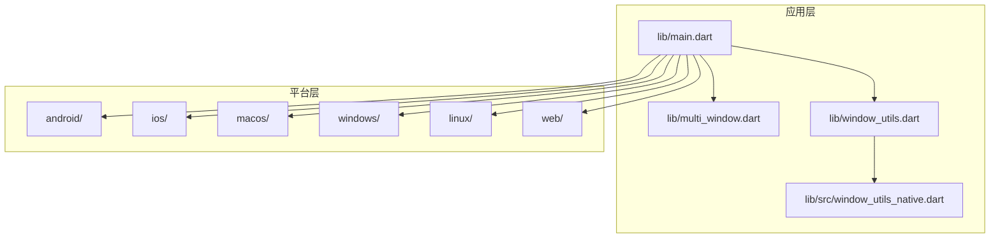
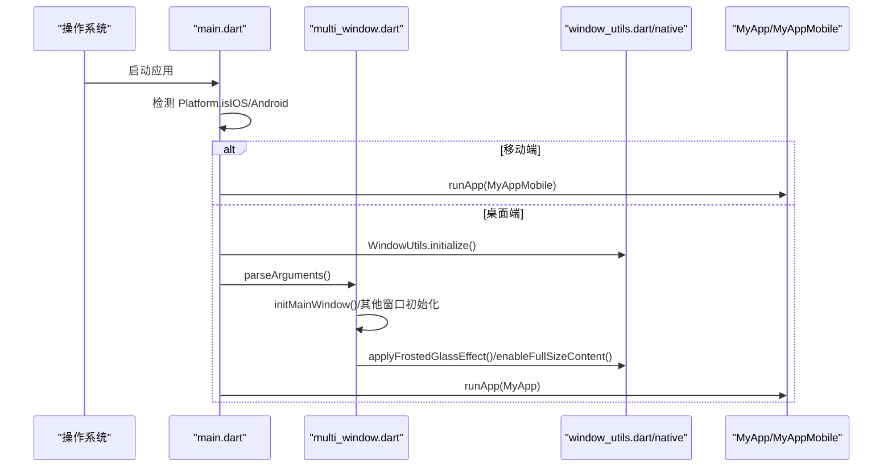
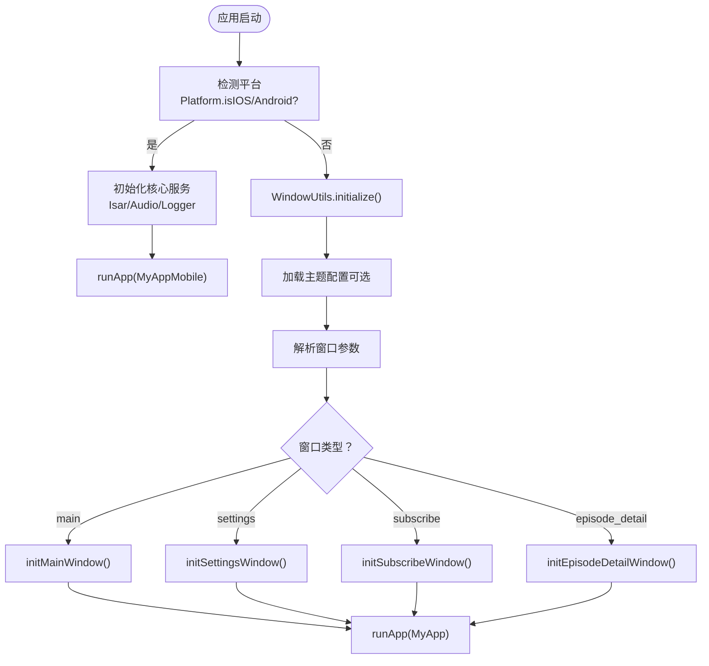
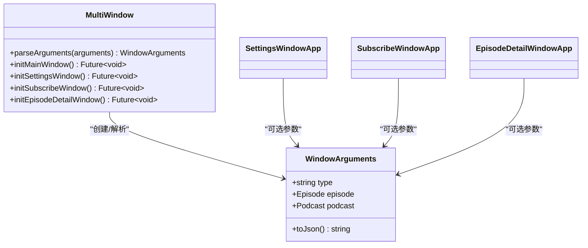
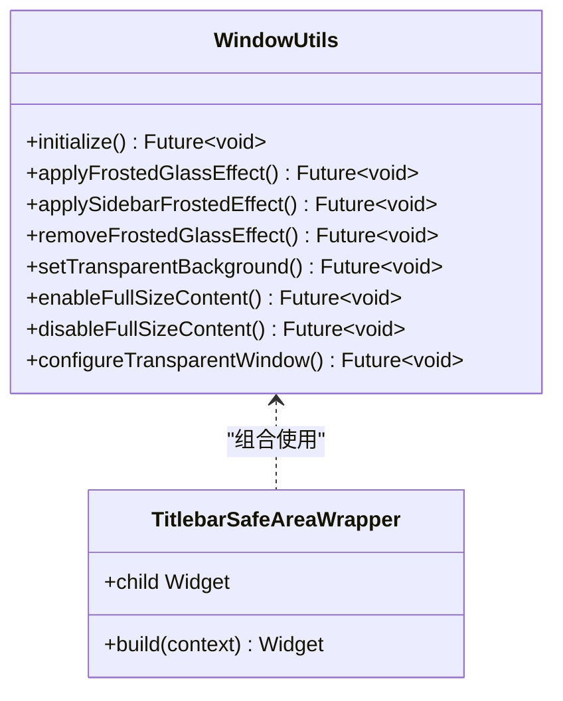
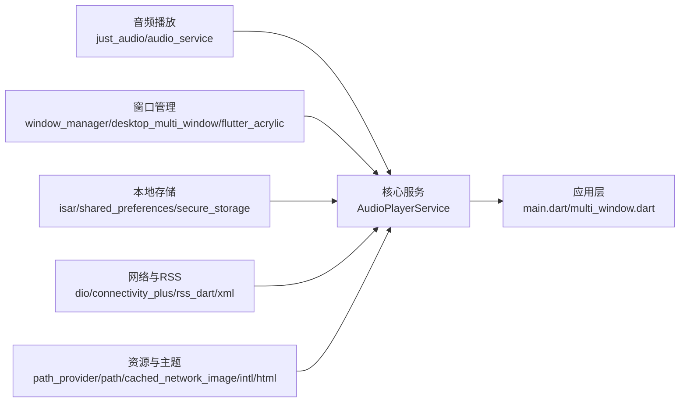

# 跨平台适配

<cite>
**本文引用的文件**   
- [pubspec.yaml](file://pubspec.yaml)
- [main.dart](file://lib/main.dart)
- [multi_window.dart](file://lib/multi_window.dart)
- [window_utils.dart](file://lib/window_utils.dart)
- [window_utils_native.dart](file://lib/src/window_utils_native.dart)
- [PLATFORM_PERMISSIONS.md](file://docs/PLATFORM_PERMISSIONS.md)
- [README.md](file://README.md)
</cite>

## 目录
1. [简介](#简介)
2. [项目结构](#项目结构)
3. [核心组件](#核心组件)
4. [架构总览](#架构总览)
5. [详细组件分析](#详细组件分析)
6. [依赖分析](#依赖分析)
7. [性能考虑](#性能考虑)
8. [故障排查指南](#故障排查指南)
9. [结论](#结论)
10. [附录](#附录)

## 简介
本文件面向 TinyCast 应用的跨平台适配机制，系统性阐述 Flutter 的跨平台架构与平台特定代码组织方式，说明平台检测、移动端与桌面端 UI 适配策略、平台特定功能实现（文件访问、通知、后台服务）、构建配置与资源管理，并通过具体示例展示如何处理音频播放、存储访问、系统集成的差异。同时总结跨平台开发最佳实践与常见问题解决方案，帮助读者快速理解并高效扩展 TinyCast 的跨平台能力。

## 项目结构
TinyCast 采用标准 Flutter 工程结构，按平台划分原生入口与资源：
- lib：Dart 业务逻辑与 UI，包含入口 main.dart、多窗口 multi_window.dart、窗口工具 window_utils.dart 及其平台实现 src/window_utils_native.dart
- android、ios、macos、windows、linux、web：各平台原生工程与资源
- assets：静态资源（图片、图标、主题配置文件）
- docs：文档（含权限说明等）

图表来源 
- [main.dart:106-177](file://lib/main.dart#L106-L177)
- [multi_window.dart:184-303](file://lib/multi_window.dart#L184-L303)
- [window_utils.dart:1-6](file://lib/window_utils.dart#L1-L6)
- [window_utils_native.dart:1-125](file://lib/src/window_utils_native.dart#L1-L125)

章节来源
- [README.md:1-6](file://README.md#L1-L6)
- [pubspec.yaml:1-196](file://pubspec.yaml#L1-L196)

## 核心组件
- 启动与平台分支：main.dart 在应用启动时通过 Platform.isIOS / Platform.isAndroid 判断平台，移动端直接初始化核心服务并运行 MyAppMobile；桌面端执行 WindowUtils.initialize() 和多窗口初始化流程。
- 多窗口与窗口类型：multi_window.dart 定义 WindowArguments、解析参数，并提供 initMainWindow/initSettingsWindow/initSubscribeWindow/initEpisodeDetailWindow 等函数，所有函数均在移动端返回空实现，避免调用 window_manager。
- 窗口工具抽象：window_utils.dart 导出 WindowUtils 和 TitlebarSafeAreaWrapper；src/window_utils_native.dart 提供基于 flutter_acrylic 的具体实现，并在每个方法中增加移动端守卫。

章节来源
- [main.dart:106-177](file://lib/main.dart#L106-L177)
- [multi_window.dart:184-303](file://lib/multi_window.dart#L184-L303)
- [window_utils.dart:1-6](file://lib/window_utils.dart#L1-L6)
- [window_utils_native.dart:1-125](file://lib/src/window_utils_native.dart#L1-L125)

## 架构总览
TinyCast 的跨平台架构遵循“共享 Dart 逻辑 + 平台特定实现”的模式：
- 启动阶段：根据平台选择不同入口（MyApp vs MyAppMobile），并决定是否启用多窗口系统。
- 窗口系统：桌面端使用 window_manager 与 flutter_acrylic 控制窗口外观与行为；移动端跳过相关逻辑。
- 资源与配置：通过 pubspec.yaml 声明依赖与资源，assets/themes/*.conf 支持 HOCON 主题配置。

图表来源 
- [main.dart:106-177](file://lib/main.dart#L106-L177)
- [multi_window.dart:184-303](file://lib/multi_window.dart#L184-L303)
- [window_utils_native.dart:1-125](file://lib/src/window_utils_native.dart#L1-L125)

## 详细组件分析

### 启动与平台检测（main.dart）
- 平台分支：在 main() 中优先判断移动端（Platform.isIOS || Platform.isAndroid），若为移动端则跳过桌面窗口初始化，直接初始化 IsarService、AudioPlayerService、Logger，并启动 FeedRefreshScheduler，然后运行 MyAppMobile。
- 桌面端流程：初始化 WindowUtils，按需加载主题配置，解析 WindowController.arguments，根据 type 分发到主窗口或子窗口应用（设置、订阅、节目详情）。
- 生命周期：注册 FeedRefreshLifecycleObserver，处理应用前后台状态变化，确保后台任务正确启停。

图表来源 
- [main.dart:106-177](file://lib/main.dart#L106-L177)
- [multi_window.dart:184-303](file://lib/multi_window.dart#L184-L303)

章节来源
- [main.dart:106-177](file://lib/main.dart#L106-L177)

### 多窗口与窗口类型（multi_window.dart）
- 窗口参数：WindowArguments 支持序列化 Episode/Podcast 数据，便于跨窗口传递。
- 窗口初始化：所有 init* 函数开头均进行移动端守卫（Platform.isIOS/Android），移动端直接返回，不执行 window_manager 相关逻辑。
- 窗口应用组件：SettingsWindowApp、SubscribeWindowApp、EpisodeDetailWindowApp 使用 WidgetsApp 作为根，仅在 Windows 平台显示 WindowControls，背景色根据平台区分。

图表来源 
- [multi_window.dart:18-93](file://lib/multi_window.dart#L18-L93)
- [multi_window.dart:184-303](file://lib/multi_window.dart#L184-L303)
- [multi_window.dart:305-453](file://lib/multi_window.dart#L305-L453)

章节来源
- [multi_window.dart:184-303](file://lib/multi_window.dart#L184-L303)
- [multi_window.dart:305-453](file://lib/multi_window.dart#L305-L453)

### 窗口工具抽象与平台实现（window_utils.dart / window_utils_native.dart）
- 抽象导出：window_utils.dart 统一导出 WindowUtils 与 TitlebarSafeAreaWrapper，并定义窗口背景色常量。
- 平台实现：window_utils_native.dart 基于 flutter_acrylic 实现毛玻璃效果、透明背景、全屏内容等，并在每个方法中添加移动端守卫，确保移动端安全调用。
- 平台差异化：针对 macOS 与 Windows 分别调用不同的 WindowEffect，Linux 回退为纯色背景。

图表来源 
- [window_utils.dart:1-6](file://lib/window_utils.dart#L1-L6)
- [window_utils_native.dart:1-125](file://lib/src/window_utils_native.dart#L1-L125)

章节来源
- [window_utils.dart:1-6](file://lib/window_utils.dart#L1-L6)
- [window_utils_native.dart:1-125](file://lib/src/window_utils_native.dart#L1-L125)

### 移动端 UI 适配策略（MyAppMobile 与 MobileHome）
- 主题与亮度：MyAppMobile 通过 MediaQuery.platformBrightnessOf 获取系统亮度，动态设置文本颜色以适配深色模式。
- 布局结构：移动端使用 WidgetsApp 包裹 MobileHome，不包含桌面专属组件（如 WindowControls），确保移动端体验一致。
- 路由与样式：复用 AppRouter 生成页面路由，保持与桌面端一致的导航体验。

章节来源
- [main.dart:240-284](file://lib/main.dart#L240-L284)

### 平台特定的功能实现
- 文件访问与路径：通过 path_provider 的 getApplicationSupportDirectory() 获取应用沙盒目录，无需额外权限即可读写应用私有数据。各平台权限说明详见 docs/PLATFORM_PERMISSIONS.md。
- 通知系统与后台服务：依赖 audio_service 与 just_audio 实现后台播放、锁屏控制与媒体通知（见依赖声明与任务规划）。
- 桌面系统集成：使用 window_manager 与 flutter_acrylic 实现自定义标题栏、毛玻璃效果与透明背景。

章节来源
- [pubspec.yaml:60-144](file://pubspec.yaml#L60-L144)
- [docs/PLATFORM_PERMISSIONS.md:1-116](file://docs/PLATFORM_PERMISSIONS.md#L1-L116)

### 构建配置与平台特定资源管理
- 依赖与 SDK 约束：pubspec.yaml 声明 Flutter SDK 版本与各平台依赖（just_audio、audio_service、window_manager、flutter_acrylic 等）。
- 资源清单：assets 目录包含 images、icons、gravity_icons 以及 themes/*.conf 主题配置文件，供运行时加载。
- 环境变量：Supabase 凭据通过 --dart-define 注入，避免硬编码敏感信息。

章节来源
- [pubspec.yaml:1-196](file://pubspec.yaml#L1-L196)

## 依赖分析
TinyCast 的跨平台依赖围绕“音频播放、窗口管理、本地存储、网络请求、国际化与主题”展开：
- 音频播放：just_audio（播放器）、audio_service（后台服务与通知）
- 窗口管理：window_manager（窗口控制）、desktop_multi_window（多窗口）、flutter_acrylic（毛玻璃效果）
- 本地存储：isar_community（数据库）、shared_preferences（简单键值对）、flutter_secure_storage（安全存储）
- 网络与 RSS：dio、connectivity_plus、rss_dart、xml
- 资源与主题：path_provider、path、cached_network_image、intl、html、flutter_widget_from_html

图表来源 
- [pubspec.yaml:18-144](file://pubspec.yaml#L18-L144)

章节来源
- [pubspec.yaml:18-144](file://pubspec.yaml#L18-L144)

## 性能考虑
- 启动优化：移动端跳过桌面窗口初始化，减少不必要的依赖加载与初始化开销。
- 主题加载：按需加载 HOCON 主题配置，避免冷启动阻塞。
- 音频服务：后台播放与通知由 audio_service 管理，避免 UI 线程阻塞。
- 资源缓存：使用 cached_network_image 缓存网络图片，降低重复加载成本。

[本节为通用指导，不直接分析具体文件]

## 故障排查指南
- 移动端无法编译：检查是否误引入桌面专属包（window_manager、flutter_acrylic）且未加平台守卫；确认 window_utils_native.dart 中的移动端守卫生效。
- 窗口异常：桌面端窗口初始化失败时，检查 flutter_acrylic 的 effect 调用是否被捕获并回退至纯色背景。
- 权限问题：如需访问沙盒外文件，参考 docs/PLATFORM_PERMISSIONS.md 添加相应权限描述（iOS Info.plist、Android AndroidManifest.xml、macOS entitlements）。
- Supabase 未配置：当使用占位符时，应用会跳过初始化并记录日志，需通过 --dart-define 传入真实凭据。

章节来源
- [window_utils_native.dart:30-49](file://lib/src/window_utils_native.dart#L30-L49)
- [docs/PLATFORM_PERMISSIONS.md:1-116](file://docs/PLATFORM_PERMISSIONS.md#L1-L116)
- [main.dart:179-194](file://lib/main.dart#L179-L194)

## 结论
TinyCast 通过清晰的平台检测与条件初始化，实现了移动端与桌面端的平滑适配。窗口工具抽象与平台特定实现解耦了 UI 与系统交互，使跨平台开发更加稳健。结合合理的依赖管理与资源组织，应用能够在多平台上保持一致的用户体验。未来可继续完善移动端 UI 细节与平台特性集成，进一步提升跨平台质量。

[本节为总结性内容，不直接分析具体文件]

## 附录
- 跨平台开发最佳实践
  - 使用 Platform.* 进行平台判断，避免在运行时引入平台无关依赖。
  - 将平台特定实现封装在独立文件中，通过条件导出或守卫语句隔离。
  - 对外暴露统一的 API（如 WindowUtils），屏蔽平台差异。
  - 使用环境变量注入敏感配置，避免硬编码。
- 常见问题解决方案
  - 移动端编译失败：移除或守卫桌面专属依赖。
  - 窗口效果异常：捕获异常并回退到兼容方案。
  - 权限不足：按平台文档添加必要权限。

[本节为通用指导，不直接分析具体文件]