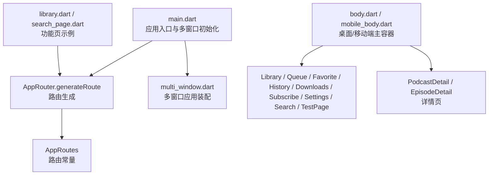
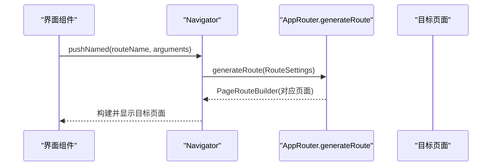
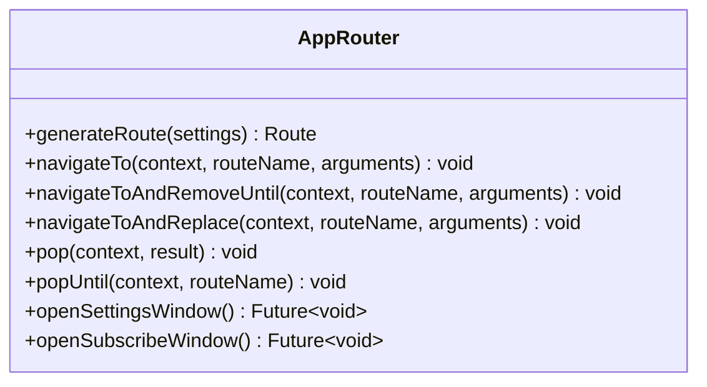
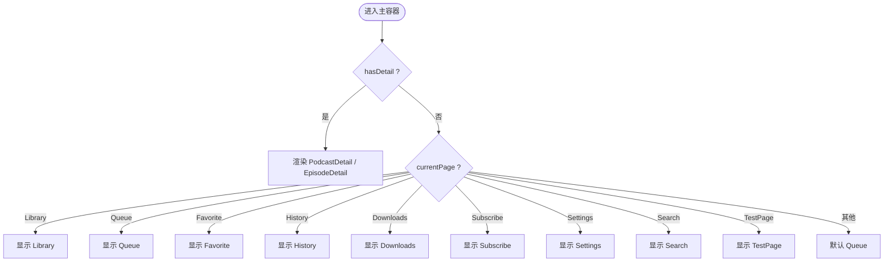
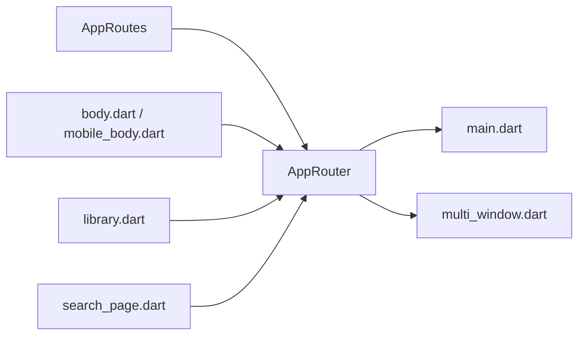

# 路由系统

<cite>
**本文引用的文件**   
- [main.dart](file://lib/main.dart)
- [app_router.dart](file://lib/core/router/app_router.dart)
- [app_routes.dart](file://lib/core/router/app_routes.dart)
- [body.dart](file://lib/presentation/features/home/body.dart)
- [mobile_body.dart](file://lib/presentation/features/home/mobile_body.dart)
- [library.dart](file://lib/presentation/features/library/library.dart)
- [search_page.dart](file://lib/presentation/features/search/search_page.dart)
- [multi_window.dart](file://lib/multi_window.dart)
</cite>

## 目录
1. [简介](#简介)
2. [项目结构](#项目结构)
3. [核心组件](#核心组件)
4. [架构总览](#架构总览)
5. [详细组件分析](#详细组件分析)
6. [依赖关系分析](#依赖关系分析)
7. [性能考虑](#性能考虑)
8. [故障排查指南](#故障排查指南)
9. [结论](#结论)
10. [附录](#附录)

## 简介
本文件为 TinyCast 应用的路由系统提供全面文档，聚焦 AppRouter 的设计与配置策略、页面导航机制（命名路由、参数传递与解析）、功能模块路由组织（首页、搜索、图书馆等）、路由守卫与权限控制现状、跨窗口路由扩展、以及性能优化与调试方法。文档同时给出实际场景的跳转与返回值处理示例，帮助读者快速理解并安全扩展路由能力。

## 项目结构
TinyCast 的路由体系集中在 core/router 下，配合 presentation 层各功能模块页面进行组合：
- 路由常量定义：AppRoutes
- 路由生成与导航封装：AppRouter
- 入口与多窗口初始化：main.dart、multi_window.dart
- 桌面/移动端主容器与内部路由切换：home/body.dart、home/mobile_body.dart
- 功能页示例：library.dart、search_page.dart

图表来源 
- [main.dart:210-237](file://lib/main.dart#L210-L237)
- [app_router.dart:20-132](file://lib/core/router/app_router.dart#L20-L132)
- [app_routes.dart:1-16](file://lib/core/router/app_routes.dart#L1-L16)
- [body.dart:67-86](file://lib/presentation/features/home/body.dart#L67-L86)
- [mobile_body.dart:88-108](file://lib/presentation/features/home/mobile_body.dart#L88-L108)
- [multi_window.dart:410-453](file://lib/multi_window.dart#L410-L453)

章节来源
- [main.dart:210-237](file://lib/main.dart#L210-L237)
- [app_router.dart:20-132](file://lib/core/router/app_router.dart#L20-L132)
- [app_routes.dart:1-16](file://lib/core/router/app_routes.dart#L1-L16)

## 核心组件
- AppRoutes：集中管理所有命名路由字符串，保证路径一致性。
- AppRouter：实现 generateRoute 路由生成器，统一 PageRouteBuilder 构建；提供 navigateTo/navigateToAndRemoveUntil/navigateToAndReplace/pop/popUntil 等导航封装；支持打开设置/订阅子窗口。
- main.dart：通过 WidgetsApp.onGenerateRoute 接入 AppRouter.generateRoute；在移动端与桌面端分别初始化不同根页面。
- multi_window.dart：多窗口应用装配，复用 AppRouter.generateRoute，并在独立窗口中展示特定页面（如 episode_detail）。
- body.dart / mobile_body.dart：桌面与移动端的主容器，基于状态驱动渲染 Library/Queue/Favorite/History/Downloads/Subscribe/Settings/Search/TestPage 等页面，并通过 Provider 驱动的 NavigationState 控制详情视图（PodcastDetail/EpisodeDetail）的显示。

章节来源
- [app_routes.dart:1-16](file://lib/core/router/app_routes.dart#L1-L16)
- [app_router.dart:20-186](file://lib/core/router/app_router.dart#L20-L186)
- [main.dart:210-237](file://lib/main.dart#L210-L237)
- [multi_window.dart:410-453](file://lib/multi_window.dart#L410-L453)
- [body.dart:67-86](file://lib/presentation/features/home/body.dart#L67-L86)
- [mobile_body.dart:88-108](file://lib/presentation/features/home/mobile_body.dart#L88-L108)

## 架构总览
TinyCast 采用“命名路由 + 统一生成器”的模式：
- 入口通过 onGenerateRoute 将路由名交由 AppRouter.generateRoute 解析。
- 路由常量集中定义于 AppRoutes，避免硬编码字符串散落各处。
- 页面以 WidgetsApp.home 或具体页面作为初始页面，后续通过 Navigator.pushNamed 等 API 触发路由。
- 详情页（PodcastDetail/EpisodeDetail）既可通过命名路由进入，也可在主容器内通过状态驱动直接渲染（无栈式跳转），提升交互效率。

图表来源 
- [main.dart:210-237](file://lib/main.dart#L210-L237)
- [app_router.dart:20-132](file://lib/core/router/app_router.dart#L20-L132)

## 详细组件分析

### AppRouter 设计与实现
- 路由生成：根据 settings.name 匹配 AppRoutes 中的常量，返回对应的 PageRouteBuilder；对 podcastDetail 与 episodeDetail 进行参数解析。
- 导航封装：navigateTo、navigateToAndRemoveUntil、navigateToAndReplace、pop、popUntil，简化常见导航操作。
- 多窗口：openSettingsWindow、openSubscribeWindow 使用 WindowController 创建新窗口并传入类型参数。

图表来源 
- [app_router.dart:20-186](file://lib/core/router/app_router.dart#L20-L186)

章节来源
- [app_router.dart:20-186](file://lib/core/router/app_router.dart#L20-L186)

### 路由常量 AppRoutes
- 集中声明所有命名路由，包括首页、队列、图书馆、收藏、历史、下载、订阅、设置、搜索、测试页、播客详情、节目详情、数据库清理等。
- 建议新增页面时同步在此处添加常量，保持命名一致。

章节来源
- [app_routes.dart:1-16](file://lib/core/router/app_routes.dart#L1-L16)

### 入口与路由集成（main.dart）
- 桌面端与移动端均通过 WidgetsApp.onGenerateRoute 接入 AppRouter.generateRoute。
- 移动端默认 home 为 MobileHome，桌面端默认 home 为 HomePage。
- 多窗口模式下，根据不同 type 初始化不同的窗口应用（settings、subscribe、episode_detail）。

章节来源
- [main.dart:210-237](file://lib/main.dart#L210-L237)
- [main.dart:131-177](file://lib/main.dart#L131-L177)

### 桌面/移动端主容器与内部路由切换（body.dart / mobile_body.dart）
- 通过 NavigationState 的 currentPage 决定主页面（Library/Queue/Favorite/History/Downloads/Subscribe/Settings/Search/TestPage）。
- hasDetail 为 true 时，切换到 Detail 模式，渲染 PodcastDetail 或 EpisodeDetail。
- 移动端标题与图标根据 currentPage 动态变化。

图表来源 
- [body.dart:67-86](file://lib/presentation/features/home/body.dart#L67-L86)
- [mobile_body.dart:88-108](file://lib/presentation/features/home/mobile_body.dart#L88-L108)

章节来源
- [body.dart:67-86](file://lib/presentation/features/home/body.dart#L67-L86)
- [mobile_body.dart:88-108](file://lib/presentation/features/home/mobile_body.dart#L88-L108)

### 功能页示例：Library 与 Search
- Library：通过 Provider 加载数据，点击条目触发 showPodcastDetail，进入详情页（无栈式跳转，由主容器渲染）。
- Search：独立的搜索页面，包含输入、历史记录与结果列表，可作为命名路由进入或通过弹窗形式展示。

章节来源
- [library.dart:99-101](file://lib/presentation/features/library/library.dart#L99-L101)
- [search_page.dart:10-26](file://lib/presentation/features/search/search_page.dart#L10-L26)

### 多窗口路由（multi_window.dart）
- 多窗口应用装配复用 AppRouter.generateRoute，确保路由行为一致。
- 针对 episode_detail 窗口，传入 episode 与 podcast 数据，作为 home 直接展示。

章节来源
- [multi_window.dart:410-453](file://lib/multi_window.dart#L410-L453)

## 依赖关系分析
- AppRouter 依赖 AppRoutes 常量与各个页面组件。
- main.dart 通过 onGenerateRoute 注入 AppRouter.generateRoute。
- body.dart / mobile_body.dart 依赖 AppRoutes 常量与 Provider 状态，用于内部页面切换。
- library.dart / search_page.dart 作为功能页，可被命名路由或内部状态渲染。

图表来源 
- [app_routes.dart:1-16](file://lib/core/router/app_routes.dart#L1-L16)
- [app_router.dart:20-186](file://lib/core/router/app_router.dart#L20-L186)
- [main.dart:210-237](file://lib/main.dart#L210-L237)
- [multi_window.dart:410-453](file://lib/multi_window.dart#L410-L453)
- [body.dart:67-86](file://lib/presentation/features/home/body.dart#L67-L86)
- [mobile_body.dart:88-108](file://lib/presentation/features/home/mobile_body.dart#L88-L108)
- [library.dart:99-101](file://lib/presentation/features/library/library.dart#L99-L101)
- [search_page.dart:10-26](file://lib/presentation/features/search/search_page.dart#L10-L26)

章节来源
- [app_routes.dart:1-16](file://lib/core/router/app_routes.dart#L1-L16)
- [app_router.dart:20-186](file://lib/core/router/app_router.dart#L20-L186)
- [main.dart:210-237](file://lib/main.dart#L210-L237)
- [multi_window.dart:410-453](file://lib/multi_window.dart#L410-L453)
- [body.dart:67-86](file://lib/presentation/features/home/body.dart#L67-L86)
- [mobile_body.dart:88-108](file://lib/presentation/features/home/mobile_body.dart#L88-L108)
- [library.dart:99-101](file://lib/presentation/features/library/library.dart#L99-L101)
- [search_page.dart:10-26](file://lib/presentation/features/search/search_page.dart#L10-L26)

## 性能考虑
- 路由过渡动画：当前所有路由 transitionDuration 设置为零，减少不必要的动画开销，适合工具类应用。
- 详情页渲染：主容器内通过状态切换渲染详情页，避免频繁入栈出栈，提高响应速度。
- 路由参数解析：在 generateRoute 中进行轻量类型判断与转换，避免在页面内重复解析。
- 多窗口：将独立功能拆分为窗口，降低主进程压力，但需注意窗口间通信成本。

[本节为通用指导，不直接分析具体文件]

## 故障排查指南
- 路由未命中：检查 AppRoutes 是否包含该名称，并确保 onGenerateRoute 已正确注入。
- 参数解析异常：确认传入的 arguments 类型与 generateRoute 中的解析逻辑一致（如 int、Map、实体对象）。
- 详情页不显示：检查 NavigationState 的 hasDetail 与 currentDetail 是否正确更新。
- 多窗口问题：核对 WindowArguments.type 与 main.dart 中的分支处理是否匹配。

章节来源
- [app_router.dart:93-116](file://lib/core/router/app_router.dart#L93-L116)
- [body.dart:89-125](file://lib/presentation/features/home/body.dart#L89-L125)
- [mobile_body.dart:110-143](file://lib/presentation/features/home/mobile_body.dart#L110-L143)
- [main.dart:131-177](file://lib/main.dart#L131-L177)

## 结论
TinyCast 的路由系统以命名路由为核心，结合统一的生成器与常量管理，实现了清晰、可扩展的导航架构。通过主容器内的状态驱动详情页渲染，兼顾了交互效率与代码简洁性。多窗口能力进一步增强了功能隔离与用户体验。建议在新增功能时遵循现有模式，保持路由常量与生成器的同步更新。

[本节为总结，不直接分析具体文件]

## 附录

### 命名路由与页面映射
- 首页：/ → HomePage
- 队列：/queue → Queue
- 图书馆：/library → Library
- 收藏：/favorite → Favorite
- 历史：/history → History
- 下载：/downloads → Downloads
- 订阅：/subscribe → Subscribe
- 设置：/settings → Settings
- 搜索：/search → SearchPage
- 测试页：/test-page → TestPage
- 播客详情：/podcast-detail → PodcastDetail（参数：int 或 Podcast）
- 节目详情：/episode-detail → EpisodeDetail（参数：Episode 或 Map<String,dynamic>）
- 数据库清理：/database-cleanup → DatabaseCleanupPage

章节来源
- [app_routes.dart:1-16](file://lib/core/router/app_routes.dart#L1-L16)
- [app_router.dart:23-131](file://lib/core/router/app_router.dart#L23-L131)

### 参数传递与解析方式
- 路径参数：当前未使用 URL 路径参数，全部通过命名路由 + arguments 传递。
- 查询参数：未使用 query string，建议使用 arguments 传递结构化数据。
- 状态保持：详情页通过主容器的 NavigationState 保持状态，避免栈式跳转带来的状态丢失。

章节来源
- [app_router.dart:93-116](file://lib/core/router/app_router.dart#L93-L116)
- [body.dart:89-125](file://lib/presentation/features/home/body.dart#L89-L125)
- [mobile_body.dart:110-143](file://lib/presentation/features/home/mobile_body.dart#L110-L143)

### 路由守卫与权限控制
- 当前未实现全局路由守卫。如需权限控制，可在 generateRoute 中增加校验逻辑，或在页面入口处进行鉴权判断。

[本节为概念性说明，不直接分析具体文件]

### 实际场景示例
- 从 Library 进入 PodcastDetail：调用 showPodcastDetail，主容器渲染 PodcastDetail，无需栈式跳转。
- 从任意页面跳转到 Search：使用 AppRouter.navigateTo(context, AppRoutes.search)，可携带搜索关键词作为 arguments。
- 打开设置窗口：调用 AppRouter.openSettingsWindow()，创建独立窗口并运行 SettingsWindowApp。

章节来源
- [library.dart:99-101](file://lib/presentation/features/library/library.dart#L99-L101)
- [app_router.dart:134-186](file://lib/core/router/app_router.dart#L134-L186)

### 扩展指南与自定义路由策略
- 新增页面：在 AppRoutes 中添加常量，在 AppRouter.generateRoute 中增加 case 分支，返回对应页面的 PageRouteBuilder。
- 复杂参数：建议在 generateRoute 中统一解析与校验，确保页面接收到的参数类型稳定。
- 路由守卫：在 generateRoute 中加入前置条件判断，必要时返回默认页或错误页。
- 多窗口：参考 openSettingsWindow/openSubscribeWindow，使用 WindowController 创建新窗口并传入必要参数。

章节来源
- [app_routes.dart:1-16](file://lib/core/router/app_routes.dart#L1-L16)
- [app_router.dart:20-186](file://lib/core/router/app_router.dart#L20-L186)
- [multi_window.dart:410-453](file://lib/multi_window.dart#L410-L453)