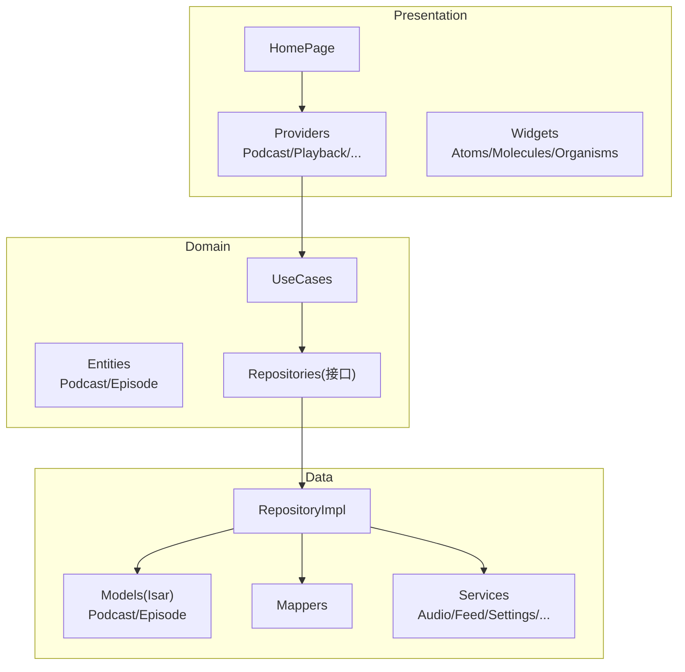
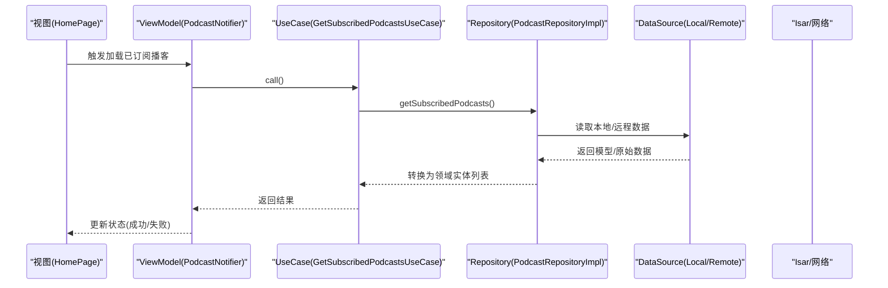
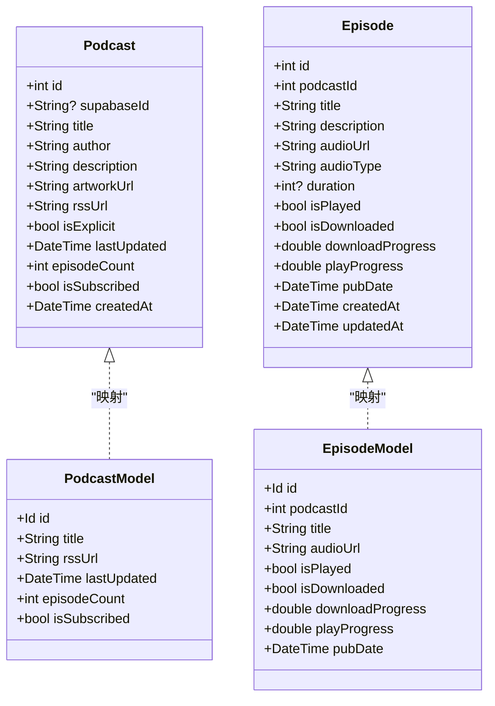
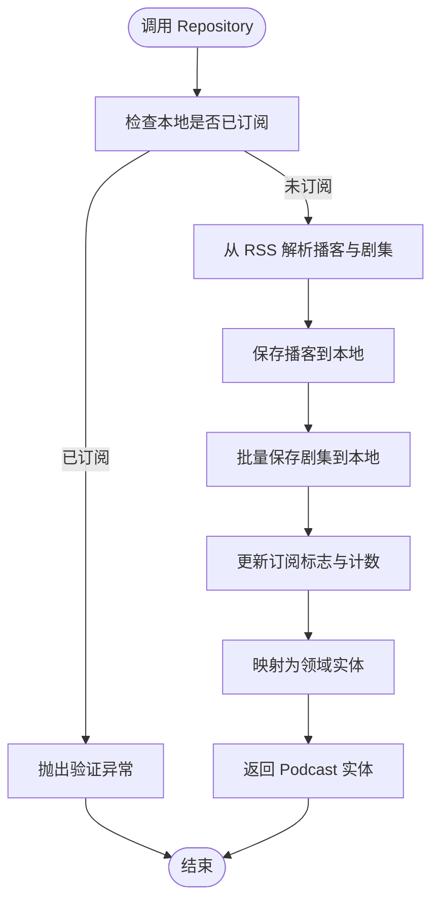
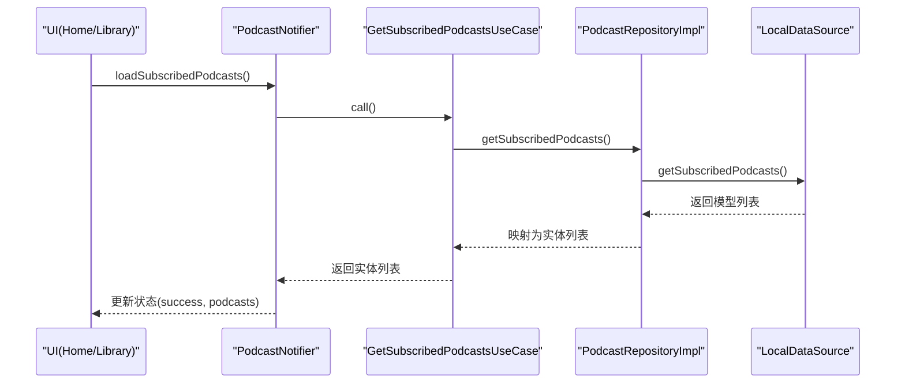
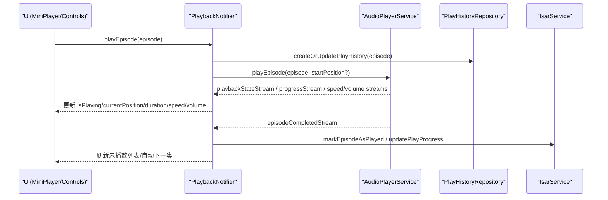
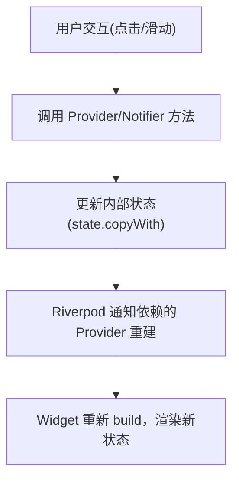
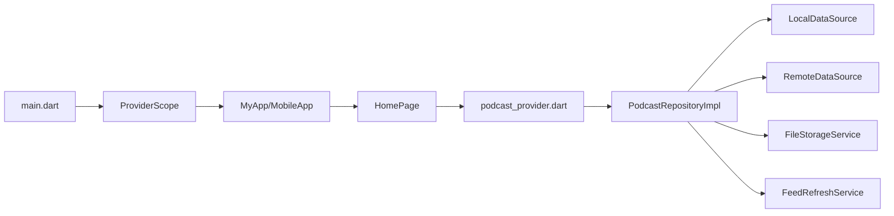

# MVVM 模式

<cite>
**本文引用的文件**   
- [lib/main.dart](file://lib/main.dart)
- [pubspec.yaml](file://pubspec.yaml)
- [lib/domain/entities/podcast.dart](file://lib/domain/entities/podcast.dart)
- [lib/domain/entities/episode.dart](file://lib/domain/entities/episode.dart)
- [lib/data/models/podcast_model.dart](file://lib/data/models/podcast_model.dart)
- [lib/data/models/episode_model.dart](file://lib/data/models/episode_model.dart)
- [lib/domain/repositories/podcast_repository.dart](file://lib/domain/repositories/podcast_repository.dart)
- [lib/data/repositories/podcast_repository_impl.dart](file://lib/data/repositories/podcast_repository_impl.dart)
- [lib/domain/usecases/get_subscribed_podcasts_usecase.dart](file://lib/domain/usecases/get_subscribed_podcasts_usecase.dart)
- [lib/presentation/providers/podcast_provider.dart](file://lib/presentation/providers/podcast_provider.dart)
- [lib/presentation/features/home/homepage.dart](file://lib/presentation/features/home/homepage.dart)
- [lib/presentation/providers/playback_provider.dart](file://lib/presentation/providers/playback_provider.dart)
</cite>

## 目录
1. [简介](#简介)
2. [项目结构](#项目结构)
3. [核心组件](#核心组件)
4. [架构总览](#架构总览)
5. [详细组件分析](#详细组件分析)
6. [依赖关系分析](#依赖关系分析)
7. [性能考量](#性能考量)
8. [故障排查指南](#故障排查指南)
9. [结论](#结论)
10. [附录](#附录)

## 简介
本文件面向 TinyCast 的 MVVM（Model-View-ViewModel）架构，系统阐述在 Flutter 项目中如何通过清晰的层次划分与 Riverpod 状态管理实现关注点分离、可测试性与代码复用。文档覆盖：
- Domain 层实体设计（Podcast、Episode）
- Data 层模型转换（Isar 模型与领域实体映射）
- Presentation 层状态管理（Riverpod Notifier/Provider）
- 数据绑定机制、双向数据流与状态同步
- 以“播客列表”和“播放器界面”为例展示 MVVM 落地实践
- 最佳实践与常见问题解决方案

## 项目结构
TinyCast 采用分层架构：
- Domain：定义业务实体与用例接口（entities、repositories、usecases）
- Data：数据源与仓储实现（datasources、models、mappers、services、repositories）
- Presentation：UI 与状态管理（features、providers、widgets）
- Core：通用能力（路由、主题、日志、服务）

图表来源
- [lib/presentation/features/home/homepage.dart:1-37](file://lib/presentation/features/home/homepage.dart#L1-L37)
- [lib/presentation/providers/podcast_provider.dart:1-264](file://lib/presentation/providers/podcast_provider.dart#L1-L264)
- [lib/domain/entities/podcast.dart:1-74](file://lib/domain/entities/podcast.dart#L1-L74)
- [lib/domain/entities/episode.dart:1-66](file://lib/domain/entities/episode.dart#L1-L66)
- [lib/data/models/podcast_model.dart:1-78](file://lib/data/models/podcast_model.dart#L1-L78)
- [lib/data/models/episode_model.dart:1-67](file://lib/data/models/episode_model.dart#L1-L67)
- [lib/domain/repositories/podcast_repository.dart:1-42](file://lib/domain/repositories/podcast_repository.dart#L1-L42)
- [lib/data/repositories/podcast_repository_impl.dart:1-524](file://lib/data/repositories/podcast_repository_impl.dart#L1-L524)

章节来源
- [lib/main.dart:106-177](file://lib/main.dart#L106-L177)
- [pubspec.yaml:1-196](file://pubspec.yaml#L1-L196)

## 核心组件
- Domain 实体
  - Podcast：播客元数据、订阅信息、iTunes 扩展字段等
  - Episode：剧集元数据、播放进度、下载状态、媒体链接等
- Data 模型
  - Isar 集合 Podcast/Episode：持久化存储，含索引与自动 ID
  - Mappers：领域实体与数据模型的双向转换
- Repository 接口与实现
  - PodcastRepository：订阅、取消订阅、查询、搜索、刷新等
  - PodcastRepositoryImpl：组合本地/远程数据源、文件服务、合并服务、刷新服务等
- UseCase
  - GetSubscribedPodcastsUseCase：封装“获取已订阅播客”的业务入口
- Presentation 状态
  - PodcastNotifier：基于 Riverpod Notifier 的播客列表/详情状态
  - PlaybackNotifier：播放器状态机，监听音频服务事件，维护播放进度、速度、音量等

章节来源
- [lib/domain/entities/podcast.dart:1-74](file://lib/domain/entities/podcast.dart#L1-L74)
- [lib/domain/entities/episode.dart:1-66](file://lib/domain/entities/episode.dart#L1-L66)
- [lib/data/models/podcast_model.dart:1-78](file://lib/data/models/podcast_model.dart#L1-L78)
- [lib/data/models/episode_model.dart:1-67](file://lib/data/models/episode_model.dart#L1-L67)
- [lib/domain/repositories/podcast_repository.dart:1-42](file://lib/domain/repositories/podcast_repository.dart#L1-L42)
- [lib/data/repositories/podcast_repository_impl.dart:1-524](file://lib/data/repositories/podcast_repository_impl.dart#L1-L524)
- [lib/domain/usecases/get_subscribed_podcasts_usecase.dart:1-17](file://lib/domain/usecases/get_subscribed_podcasts_usecase.dart#L1-L17)
- [lib/presentation/providers/podcast_provider.dart:1-264](file://lib/presentation/providers/podcast_provider.dart#L1-L264)
- [lib/presentation/providers/playback_provider.dart:1-766](file://lib/presentation/providers/playback_provider.dart#L1-L766)

## 架构总览
MVVM 在 TinyCast 中的职责边界：
- Model（Domain + Data）
  - Domain 实体描述业务对象
  - Data 模型负责持久化与外部协议适配
  - Repository 抽象数据访问，屏蔽数据来源差异
  - UseCase 聚合多个 Repository 调用，表达单一业务目标
- View（Flutter Widgets）
  - 纯 UI 渲染，不持有业务逻辑
  - 通过 Provider/Notifier 订阅状态并触发操作
- ViewModel（Riverpod Providers/Notifiers）
  - 管理应用状态与副作用
  - 协调 UseCase/Repository/Service，驱动 UI 更新

图表来源
- [lib/presentation/providers/podcast_provider.dart:148-172](file://lib/presentation/providers/podcast_provider.dart#L148-L172)
- [lib/domain/usecases/get_subscribed_podcasts_usecase.dart:1-17](file://lib/domain/usecases/get_subscribed_podcasts_usecase.dart#L1-L17)
- [lib/domain/repositories/podcast_repository.dart:11-11](file://lib/domain/repositories/podcast_repository.dart#L11-L11)
- [lib/data/repositories/podcast_repository_impl.dart:186-207](file://lib/data/repositories/podcast_repository_impl.dart#L186-L207)

## 详细组件分析

### Domain 实体与 Data 模型
- Podcast/Episode 实体包含完整业务属性，如订阅状态、播放进度、iTunes 扩展等
- Isar 模型 Podcast/Episode 用于持久化，具备索引与自动主键
- Mapper 负责实体与模型之间的字段映射与类型转换

图表来源
- [lib/domain/entities/podcast.dart:1-74](file://lib/domain/entities/podcast.dart#L1-L74)
- [lib/domain/entities/episode.dart:1-66](file://lib/domain/entities/episode.dart#L1-L66)
- [lib/data/models/podcast_model.dart:1-78](file://lib/data/models/podcast_model.dart#L1-L78)
- [lib/data/models/episode_model.dart:1-67](file://lib/data/models/episode_model.dart#L1-L67)

章节来源
- [lib/domain/entities/podcast.dart:1-74](file://lib/domain/entities/podcast.dart#L1-L74)
- [lib/domain/entities/episode.dart:1-66](file://lib/domain/entities/episode.dart#L1-L66)
- [lib/data/models/podcast_model.dart:1-78](file://lib/data/models/podcast_model.dart#L1-L78)
- [lib/data/models/episode_model.dart:1-67](file://lib/data/models/episode_model.dart#L1-L67)

### Repository 接口与实现
- PodcastRepository 定义订阅、取消订阅、查询、搜索、刷新等能力
- PodcastRepositoryImpl 组合 Local/Remote DataSource、FileStorage、FeedRefresh、Merge 等服务，统一异常与日志

图表来源
- [lib/domain/repositories/podcast_repository.dart:1-42](file://lib/domain/repositories/podcast_repository.dart#L1-L42)
- [lib/data/repositories/podcast_repository_impl.dart:39-141](file://lib/data/repositories/podcast_repository_impl.dart#L39-L141)

章节来源
- [lib/domain/repositories/podcast_repository.dart:1-42](file://lib/domain/repositories/podcast_repository.dart#L1-L42)
- [lib/data/repositories/podcast_repository_impl.dart:1-524](file://lib/data/repositories/podcast_repository_impl.dart#L1-L524)

### Presentation 状态管理（Podcast 列表）
- PodcastState 承载状态：status、podcast、podcasts、episodes、errorMessage
- PodcastNotifier 提供 subscribe/unsubscribe/loadSubscribedPodcasts/loadPodcastById/loadEpisodesByPodcastId 等方法
- 使用 FutureProvider.family 提供参数化查询（如 latestEpisodesProvider、podcastByIdProvider）

图表来源
- [lib/presentation/providers/podcast_provider.dart:148-172](file://lib/presentation/providers/podcast_provider.dart#L148-L172)
- [lib/domain/usecases/get_subscribed_podcasts_usecase.dart:1-17](file://lib/domain/usecases/get_subscribed_podcasts_usecase.dart#L1-L17)
- [lib/data/repositories/podcast_repository_impl.dart:186-207](file://lib/data/repositories/podcast_repository_impl.dart#L186-L207)

章节来源
- [lib/presentation/providers/podcast_provider.dart:1-264](file://lib/presentation/providers/podcast_provider.dart#L1-L264)

### 播放器状态管理（Playback）
- PlayerState：当前剧集、播放状态、进度、时长、速度、音量
- PlaybackNotifier：监听 AudioPlayerService 的多路 Stream，维护状态；自动保存播放进度；处理“完成一集”后的队列/未播放列表联动；支持睡眠定时器与连续播放策略

图表来源
- [lib/presentation/providers/playback_provider.dart:583-607](file://lib/presentation/providers/playback_provider.dart#L583-L607)
- [lib/presentation/providers/playback_provider.dart:169-205](file://lib/presentation/providers/playback_provider.dart#L169-L205)
- [lib/presentation/providers/playback_provider.dart:216-265](file://lib/presentation/providers/playback_provider.dart#L216-L265)

章节来源
- [lib/presentation/providers/playback_provider.dart:1-766](file://lib/presentation/providers/playback_provider.dart#L1-L766)

### View 层与数据绑定
- HomePage 作为桌面端首页容器，组合工具栏、迷你播放器与主体 Body
- 通过 ProviderScope 注入全局状态，Widget 仅消费状态并触发 Notifier 方法
- 双向数据流：UI 变更 -> Notifier 修改状态 -> 依赖该状态的 Widget 重建

章节来源
- [lib/presentation/features/home/homepage.dart:1-37](file://lib/presentation/features/home/homepage.dart#L1-L37)
- [lib/main.dart:106-177](file://lib/main.dart#L106-L177)

## 依赖关系分析
- 依赖注入与装配
  - main.dart 中通过 ProviderScope 包裹应用根节点，初始化 Isar、AudioPlayer、Supabase、Logger、主题等
  - podcast_provider.dart 中通过 Provider 装配 ITunesSearchService、PodcastRepositoryImpl 与各 UseCase
- 模块耦合
  - Presentation 仅依赖 Domain 接口与 UseCase，避免直接感知 Data 细节
  - Data 层通过 Service 解耦网络、文件、数据库等具体实现

图表来源
- [lib/main.dart:106-177](file://lib/main.dart#L106-L177)
- [lib/presentation/providers/podcast_provider.dart:50-96](file://lib/presentation/providers/podcast_provider.dart#L50-L96)
- [lib/data/repositories/podcast_repository_impl.dart:23-36](file://lib/data/repositories/podcast_repository_impl.dart#L23-L36)

章节来源
- [lib/main.dart:106-177](file://lib/main.dart#L106-L177)
- [lib/presentation/providers/podcast_provider.dart:1-264](file://lib/presentation/providers/podcast_provider.dart#L1-L264)
- [lib/data/repositories/podcast_repository_impl.dart:1-524](file://lib/data/repositories/podcast_repository_impl.dart#L1-L524)

## 性能考量
- 列表加载优化
  - 立即设置 loading 状态并保留现有数据，避免空屏闪烁
  - 使用 Stopwatch 记录关键路径耗时，便于定位瓶颈
- 播放进度保存
  - 定时+阈值双条件触发保存，减少 I/O 频率
  - 播放历史与 Episode 缓存同步，保证一致性
- 资源与并发
  - 使用 FutureProvider.family 进行参数化异步查询，避免重复请求
  - 合理拆分 Provider，按需重建，降低无用重建开销

[本节为通用指导，无需特定文件引用]

## 故障排查指南
- 订阅失败
  - 检查是否已订阅（重复订阅会抛验证异常）
  - 查看网络解析与本地保存流程的日志
- 播放状态不同步
  - 确认 AudioPlayerService 的 Streams 是否正常回调
  - 检查 PlayHistory 与 Episode 缓存同步逻辑
- 刷新失败
  - 检查 FeedRefreshService 与网络/本地数据源可用性
  - 关注错误堆栈与重试策略

章节来源
- [lib/data/repositories/podcast_repository_impl.dart:39-141](file://lib/data/repositories/podcast_repository_impl.dart#L39-L141)
- [lib/presentation/providers/playback_provider.dart:216-265](file://lib/presentation/providers/playback_provider.dart#L216-L265)

## 结论
TinyCast 通过清晰的 MVVM 分层与 Riverpod 状态管理，实现了：
- 关注点分离：UI 只负责渲染与交互，业务逻辑集中在 ViewModel 与 UseCase
- 可测试性提升：Repository 接口隔离数据源，UseCase 独立于 UI
- 代码复用：实体与 Mapper 在多场景复用，Provider 可被多处消费
- 数据一致：播放进度、历史记录与缓存同步，确保跨窗口/进程的一致性

## 附录
- 启动与多窗口
  - main.dart 根据平台与参数初始化不同窗口与应用根节点
- 依赖清单
  - pubspec.yaml 定义了 Riverpod、Isar、just_audio、audio_service、dio、supabase_flutter 等关键依赖

章节来源
- [lib/main.dart:106-177](file://lib/main.dart#L106-L177)
- [pubspec.yaml:1-196](file://pubspec.yaml#L1-L196)