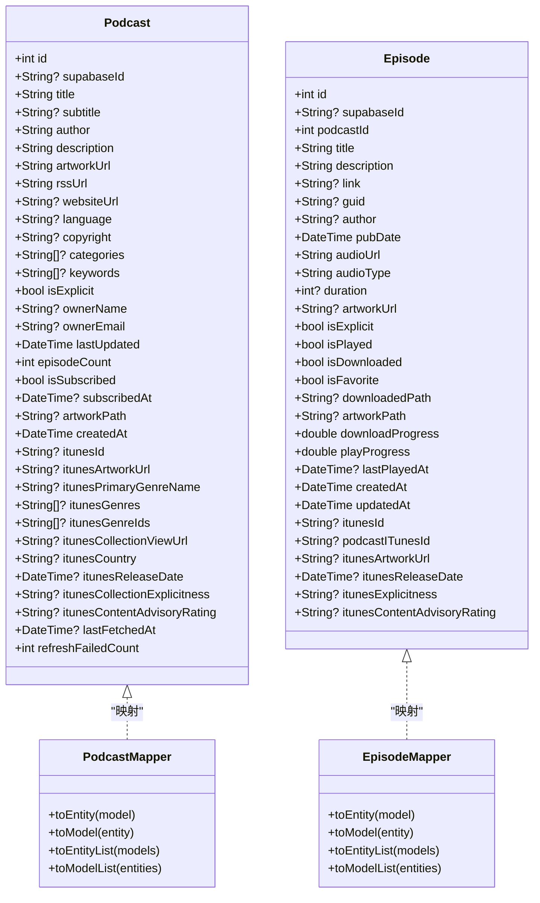
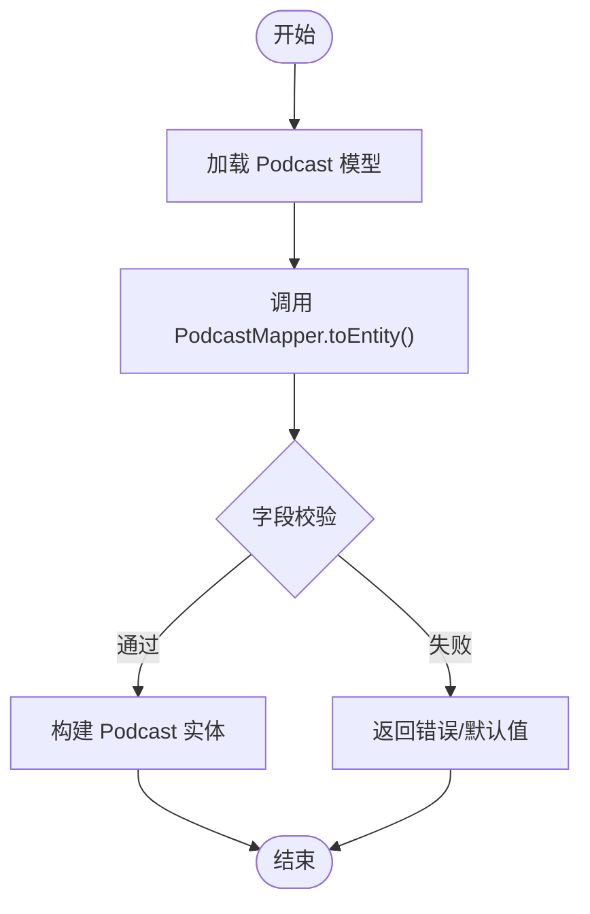
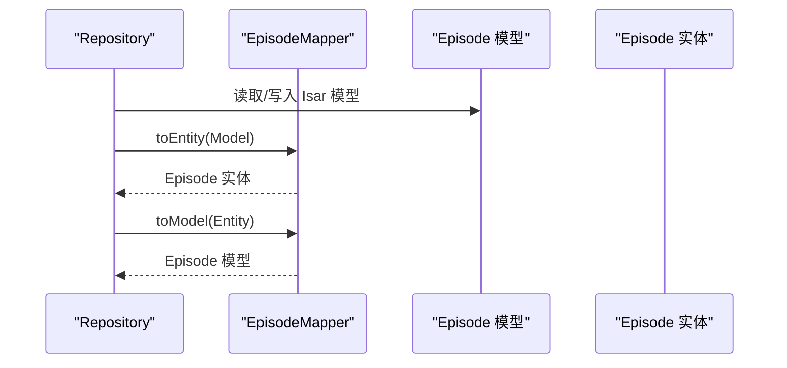
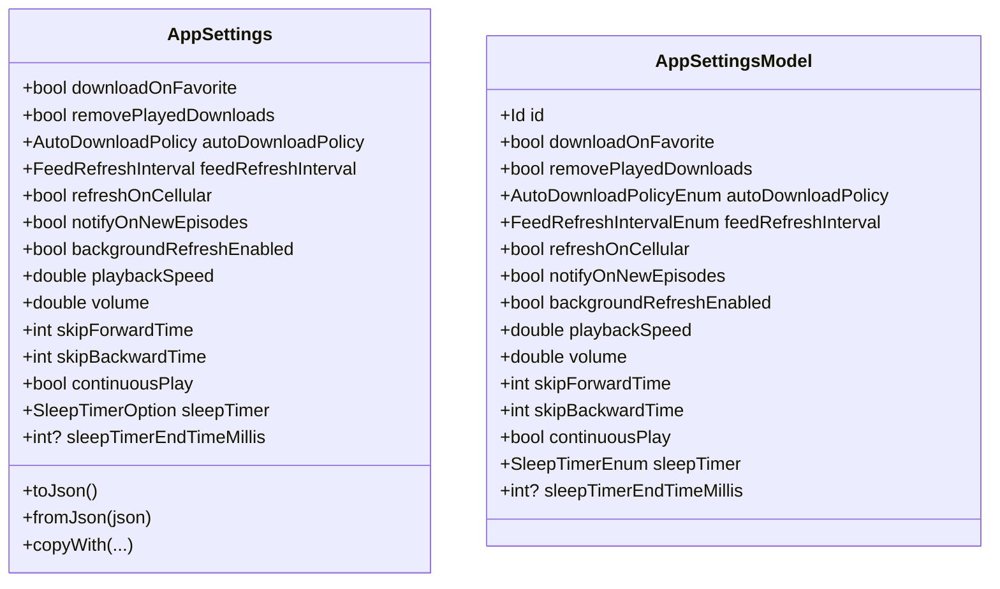
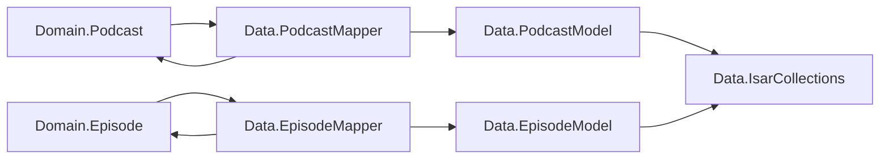

# Model 层设计

<cite>
**本文引用的文件**   
- [podcast.dart](file://lib/domain/entities/podcast.dart)
- [episode.dart](file://lib/domain/entities/episode.dart)
- [search_history.dart](file://lib/domain/entities/search_history.dart)
- [search_result.dart](file://lib/domain/entities/search_result.dart)
- [app_settings.dart](file://lib/domain/entities/app_settings.dart)
- [podcast_model.dart](file://lib/data/models/podcast_model.dart)
- [episode_model.dart](file://lib/data/models/episode_model.dart)
- [play_history_model.dart](file://lib/data/models/play_history_model.dart)
- [app_settings_model.dart](file://lib/data/models/app_settings_model.dart)
- [podcast_mapper.dart](file://lib/data/mappers/podcast_mapper.dart)
- [episode_mapper.dart](file://lib/data/mappers/episode_mapper.dart)
- [isar_collections.dart](file://lib/data/database/isar_collections.dart)
- [database.md](file://docs/database.md)
</cite>

## 目录
1. [简介](#简介)
2. [项目结构](#项目结构)
3. [核心组件](#核心组件)
4. [架构总览](#架构总览)
5. [详细组件分析](#详细组件分析)
6. [依赖分析](#依赖分析)
7. [性能考虑](#性能考虑)
8. [故障排查指南](#故障排查指南)
9. [结论](#结论)
10. [附录](#附录)

## 简介
本文件聚焦 TinyCast 应用的 Model 层设计，系统性阐述 Domain 层的实体定义（Podcast、Episode、PlayHistory 等）、Data 层的模型与数据库映射、以及网络数据到本地模型的转换机制。文档同时覆盖字段约束、数据类型、验证规则、序列化策略，并通过图示展示继承关系、接口约定与跨平台一致性保障思路。

## 项目结构
Model 层采用分层组织：
- Domain 层：纯业务实体与枚举，不依赖持久化或网络细节
- Data 层：Isar 数据库模型、Mapper 映射器、集合常量与相关服务
- 文档与规范：数据库 ER 图与字段说明

```mermaid
graph TB
subgraph "Domain 层"
D_Podcast["Podcast 实体"]
D_Episode["Episode 实体"]
D_SearchHistory["SearchHistory 实体"]
D_SearchResult["SearchResult 聚合"]
D_AppSettings["AppSettings 配置实体"]
end
subgraph "Data 层"
M_Podcast["Podcast 模型(Isar)"]
M_Episode["Episode 模型(Isar)"]
M_PlayHistory["PlayHistory 模型(Isar)"]
M_AppSettings["AppSettings 模型(Isar)"]
Mapper_Podcast["PodcastMapper"]
Mapper_Episode["EpisodeMapper"]
IsarCollections["IsarCollections 集合名"]
end
D_Podcast < --> Mapper_Podcast < --> M_Podcast
D_Episode < --> Mapper_Episode < --> M_Episode
D_AppSettings --> M_AppSettings
M_PlayHistory --> IsarCollections
```

图表来源
- [podcast.dart:1-74](file://lib/domain/entities/podcast.dart#L1-L74)
- [episode.dart:1-66](file://lib/domain/entities/episode.dart#L1-L66)
- [play_history_model.dart:1-51](file://lib/data/models/play_history_model.dart#L1-L51)
- [podcast_model.dart:1-78](file://lib/data/models/podcast_model.dart#L1-L78)
- [episode_model.dart:1-67](file://lib/data/models/episode_model.dart#L1-L67)
- [podcast_mapper.dart:1-94](file://lib/data/mappers/podcast_mapper.dart#L1-L94)
- [episode_mapper.dart:1-86](file://lib/data/mappers/episode_mapper.dart#L1-L86)
- [isar_collections.dart:1-22](file://lib/data/database/isar_collections.dart#L1-L22)

章节来源
- [podcast.dart:1-74](file://lib/domain/entities/podcast.dart#L1-L74)
- [episode.dart:1-66](file://lib/domain/entities/episode.dart#L1-L66)
- [play_history_model.dart:1-51](file://lib/data/models/play_history_model.dart#L1-L51)
- [podcast_model.dart:1-78](file://lib/data/models/podcast_model.dart#L1-L78)
- [episode_model.dart:1-67](file://lib/data/models/episode_model.dart#L1-L67)
- [podcast_mapper.dart:1-94](file://lib/data/mappers/podcast_mapper.dart#L1-L94)
- [episode_mapper.dart:1-86](file://lib/data/mappers/episode_mapper.dart#L1-L86)
- [isar_collections.dart:1-22](file://lib/data/database/isar_collections.dart#L1-L22)

## 核心组件
- Podcast 实体：播客元信息、订阅状态、iTunes 扩展字段、刷新统计
- Episode 实体：剧集元信息、播放与下载进度、iTunes 扩展字段
- PlayHistory 模型：播放历史快照，包含状态枚举、索引与时间戳
- AppSettings/AppSettingsModel：应用设置与持久化枚举映射
- SearchHistory/SearchResult：搜索历史与搜索结果聚合

章节来源
- [podcast.dart:1-74](file://lib/domain/entities/podcast.dart#L1-L74)
- [episode.dart:1-66](file://lib/domain/entities/episode.dart#L1-L66)
- [play_history_model.dart:1-51](file://lib/data/models/play_history_model.dart#L1-L51)
- [app_settings.dart:1-211](file://lib/domain/entities/app_settings.dart#L1-L211)
- [search_history.dart:1-12](file://lib/domain/entities/search_history.dart#L1-L12)
- [search_result.dart:1-17](file://lib/domain/entities/search_result.dart#L1-L17)

## 架构总览
Model 层通过“实体-模型-映射器”的解耦模式实现：
- Domain 实体仅承载业务语义与不变式
- Data 模型负责持久化结构与索引
- Mapper 统一负责双向转换与批量处理
- IsarCollections 集中管理集合名称，避免硬编码



图表来源
- [podcast.dart:1-74](file://lib/domain/entities/podcast.dart#L1-L74)
- [episode.dart:1-66](file://lib/domain/entities/episode.dart#L1-L66)
- [podcast_mapper.dart:1-94](file://lib/data/mappers/podcast_mapper.dart#L1-L94)
- [episode_mapper.dart:1-86](file://lib/data/mappers/episode_mapper.dart#L1-L86)

## 详细组件分析

### Podcast 实体与模型
- 实体职责：描述播客基础信息与 iTunes 扩展字段，维护订阅与刷新统计
- 模型职责：Isar 集合定义，包含主键、唯一索引（rssUrl）与常用查询索引
- 映射机制：PodcastMapper 提供双向转换与批量转换方法



图表来源
- [podcast_model.dart:1-78](file://lib/data/models/podcast_model.dart#L1-L78)
- [podcast_mapper.dart:1-94](file://lib/data/mappers/podcast_mapper.dart#L1-L94)
- [podcast.dart:1-74](file://lib/domain/entities/podcast.dart#L1-L74)

章节来源
- [podcast.dart:1-74](file://lib/domain/entities/podcast.dart#L1-L74)
- [podcast_model.dart:1-78](file://lib/data/models/podcast_model.dart#L1-L78)
- [podcast_mapper.dart:1-94](file://lib/data/mappers/podcast_mapper.dart#L1-L94)

### Episode 实体与模型
- 实体职责：描述单集元信息、播放与下载状态、iTunes 扩展字段
- 模型职责：Isar 集合定义，包含 podcastId、pubDate 等索引以支持排序与关联查询
- 映射机制：EpisodeMapper 提供双向转换与批量转换方法



图表来源
- [episode_model.dart:1-67](file://lib/data/models/episode_model.dart#L1-L67)
- [episode_mapper.dart:1-86](file://lib/data/mappers/episode_mapper.dart#L1-L86)
- [episode.dart:1-66](file://lib/domain/entities/episode.dart#L1-L66)

章节来源
- [episode.dart:1-66](file://lib/domain/entities/episode.dart#L1-L66)
- [episode_model.dart:1-67](file://lib/data/models/episode_model.dart#L1-L67)
- [episode_mapper.dart:1-86](file://lib/data/mappers/episode_mapper.dart#L1-L86)

### PlayHistory 模型
- 用途：记录播放历史快照，包含标题、封面、播放进度、状态与更新时间
- 索引策略：对 episodeId、podcastId、lastUpdateTime 建立索引以提升查询性能
- 状态枚举：playing/completed/skipped，使用序数存储

```mermaid
erDiagram
PLAY_HISTORY {
int id PK
string? supabaseId
int episodeId
string? episodeGuid
string? episodeITunesId
int podcastId
string? podcastGuid
string? podcastITunesId
string title
string? description
string? artworkUrl
int lastPlayedPositionMs
double playProgress
bool isPlayed
int playedDuration
enum status
datetime lastUpdateTime
datetime createdAt
bool isDeleted
}
```

图表来源
- [play_history_model.dart:1-51](file://lib/data/models/play_history_model.dart#L1-L51)

章节来源
- [play_history_model.dart:1-51](file://lib/data/models/play_history_model.dart#L1-L51)

### AppSettings 与 AppSettingsModel
- 领域枚举：FeedRefreshInterval、AutoDownloadPolicy、SleepTimerOption
- 配置实体：提供默认值、copyWith、toJson/fromJson 等能力
- 持久化模型：Isar 集合，使用 @Enumerated(EnumType.ordinal) 存储枚举



图表来源
- [app_settings.dart:1-211](file://lib/domain/entities/app_settings.dart#L1-L211)
- [app_settings_model.dart:1-79](file://lib/data/models/app_settings_model.dart#L1-L79)

章节来源
- [app_settings.dart:1-211](file://lib/domain/entities/app_settings.dart#L1-L211)
- [app_settings_model.dart:1-79](file://lib/data/models/app_settings_model.dart#L1-L79)

### 搜索历史与搜索结果
- SearchHistory：记录关键词与搜索时间
- SearchResult：聚合 Podcast 与 Episode 列表，并提供 isEmpty/isNotEmpty 便捷属性

章节来源
- [search_history.dart:1-12](file://lib/domain/entities/search_history.dart#L1-L12)
- [search_result.dart:1-17](file://lib/domain/entities/search_result.dart#L1-L17)

## 依赖分析
- Domain 实体不依赖 Data 层，保持业务逻辑纯净
- Data 模型通过 Isar 注解声明集合与索引
- Mapper 单向依赖 Domain 与 Data，承担转换职责
- IsarCollections 集中管理集合名，降低耦合



图表来源
- [podcast_mapper.dart:1-94](file://lib/data/mappers/podcast_mapper.dart#L1-L94)
- [episode_mapper.dart:1-86](file://lib/data/mappers/episode_mapper.dart#L1-L86)
- [podcast_model.dart:1-78](file://lib/data/models/podcast_model.dart#L1-L78)
- [episode_model.dart:1-67](file://lib/data/models/episode_model.dart#L1-L67)
- [isar_collections.dart:1-22](file://lib/data/database/isar_collections.dart#L1-L22)

章节来源
- [podcast_mapper.dart:1-94](file://lib/data/mappers/podcast_mapper.dart#L1-L94)
- [episode_mapper.dart:1-86](file://lib/data/mappers/episode_mapper.dart#L1-L86)
- [podcast_model.dart:1-78](file://lib/data/models/podcast_model.dart#L1-L78)
- [episode_model.dart:1-67](file://lib/data/models/episode_model.dart#L1-L67)
- [isar_collections.dart:1-22](file://lib/data/database/isar_collections.dart#L1-L22)

## 性能考虑
- 索引优化：Episode.podcastId、Episode.pubDate、PlayHistory.episodeId/podcastId/lastUpdateTime 均建立索引，提升查询与排序效率
- 批量转换：Mapper 提供 toEntityList/toModelList，减少循环开销
- 枚举序数存储：@Enumerated(EnumType.ordinal) 降低存储空间与序列化成本
- 唯一约束：Podcast.rssUrl 唯一索引避免重复入库

章节来源
- [episode_model.dart:1-67](file://lib/data/models/episode_model.dart#L1-L67)
- [play_history_model.dart:1-51](file://lib/data/models/play_history_model.dart#L1-L51)
- [podcast_model.dart:1-78](file://lib/data/models/podcast_model.dart#L1-L78)
- [podcast_mapper.dart:1-94](file://lib/data/mappers/podcast_mapper.dart#L1-L94)
- [episode_mapper.dart:1-86](file://lib/data/mappers/episode_mapper.dart#L1-L86)

## 故障排查指南
- 字段缺失或类型不匹配：检查 Mapper 映射顺序与默认值；确保 fromJson 解析时提供合理默认值
- 索引未生效：确认 Isar 模型注解与集合名一致，且已运行代码生成
- 同步 ID 冲突：supabaseId 为空时避免作为唯一键；优先使用本地 id 或 rssUrl/guid
- 播放历史状态异常：核对 PlayHistoryStatus 枚举值与 UI 显示映射

章节来源
- [play_history_model.dart:1-51](file://lib/data/models/play_history_model.dart#L1-L51)
- [app_settings.dart:1-211](file://lib/domain/entities/app_settings.dart#L1-L211)
- [database.md:103-372](file://docs/database.md#L103-L372)

## 结论
TinyCast 的 Model 层通过清晰的 Domain/Data/Mapper 分层实现了高内聚低耦合：
- Domain 实体专注业务语义与不变式
- Data 模型专注持久化与索引策略
- Mapper 统一转换与批量处理，屏蔽底层差异
该设计有效支撑跨平台数据一致性，并为后续扩展（如新增字段、新平台适配）提供了稳定契约。

## 附录
- 数据库 ER 图与字段说明可参考数据库文档

章节来源
- [database.md:103-372](file://docs/database.md#L103-L372)