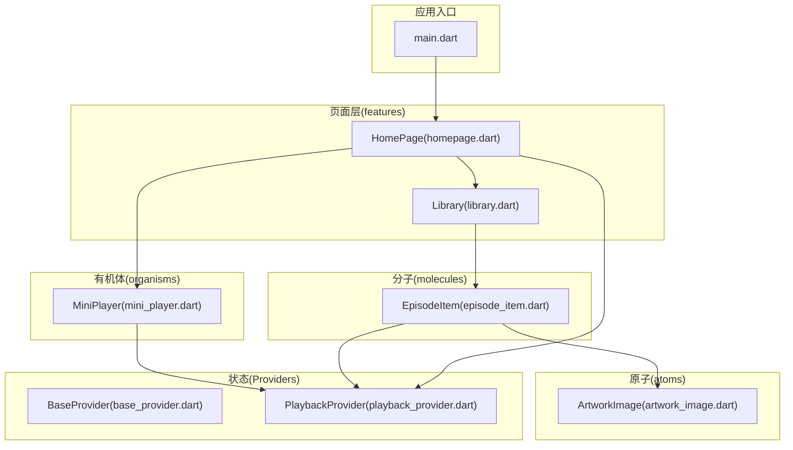
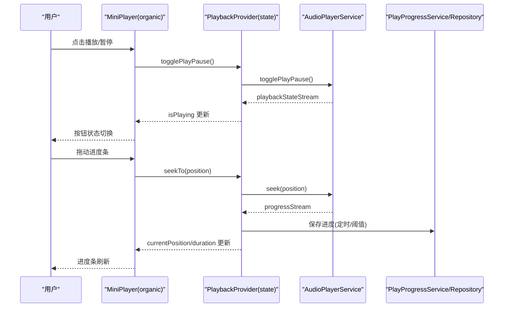
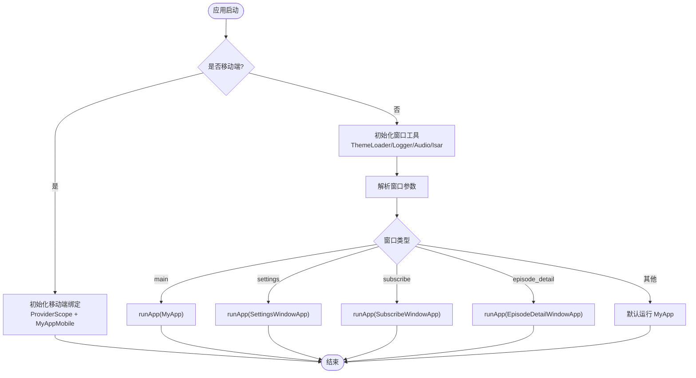
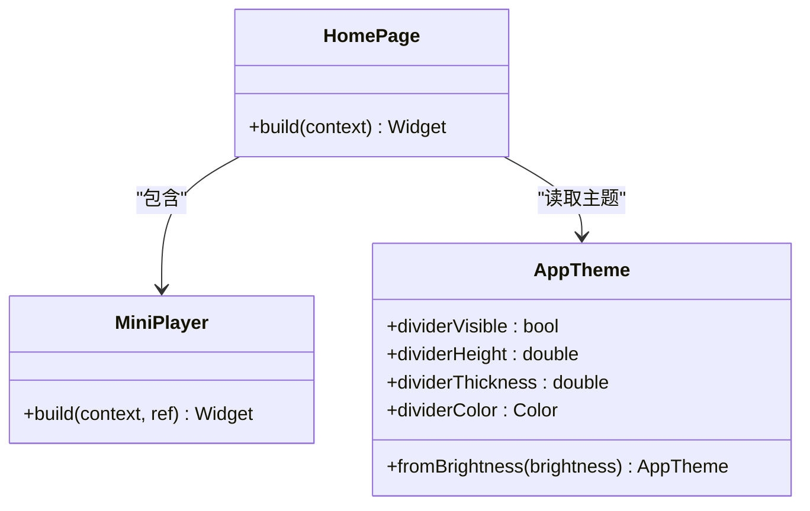
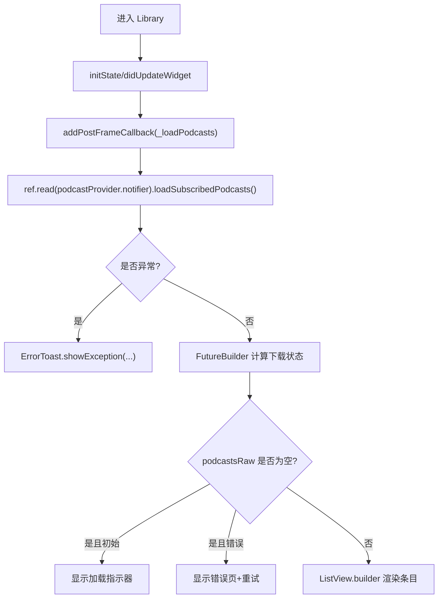
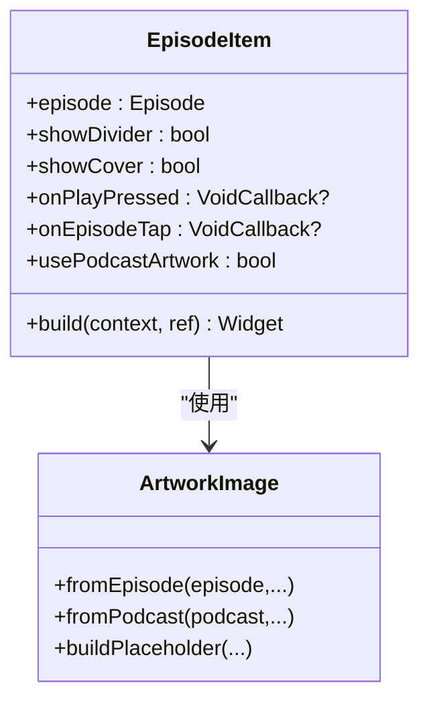
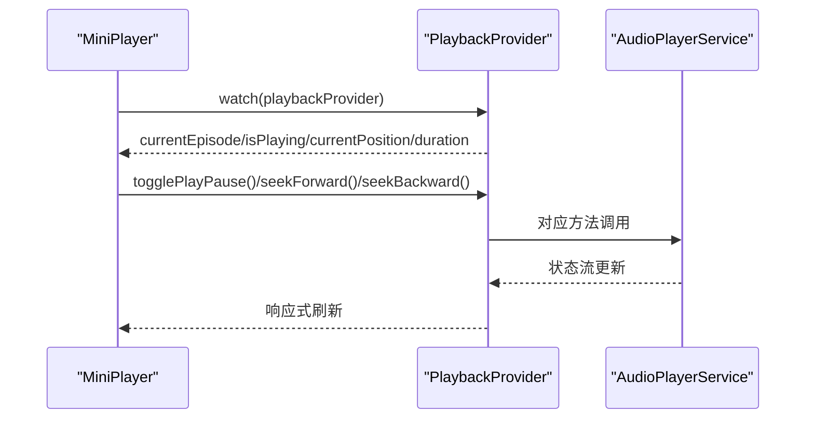
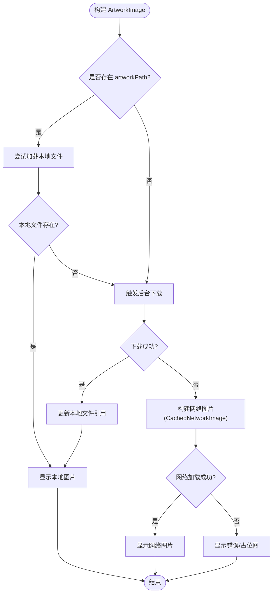
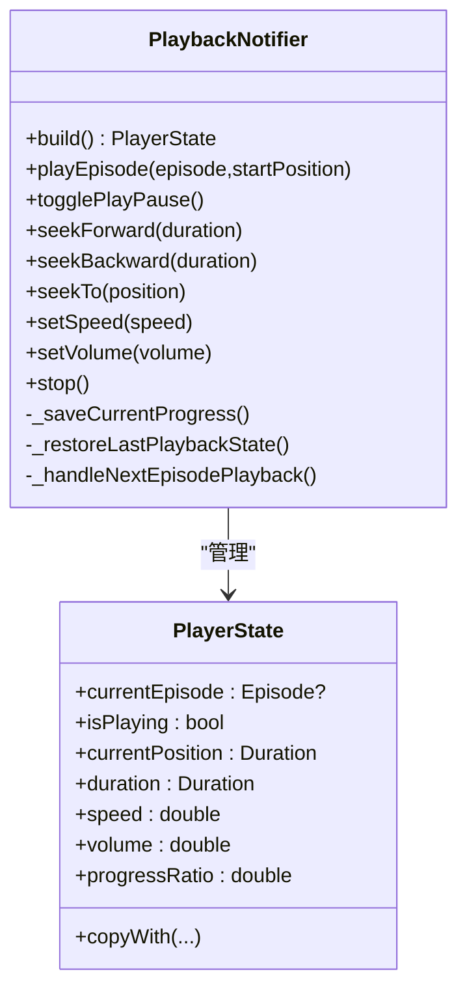
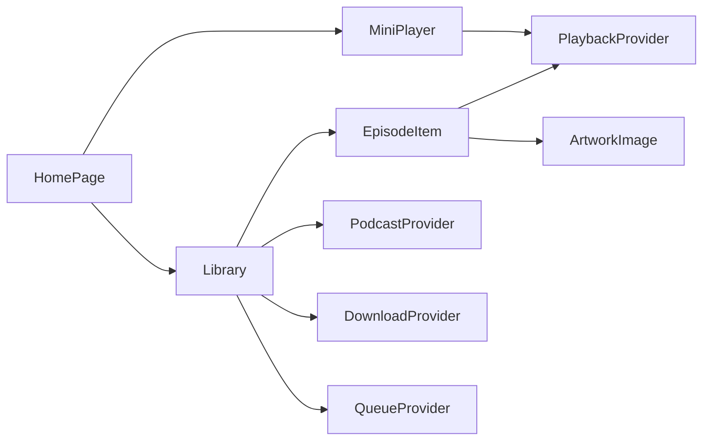

# View 层实现

<cite>
**本文引用的文件**   
- [main.dart](file://lib/main.dart)
- [homepage.dart](file://lib/presentation/features/home/homepage.dart)
- [library.dart](file://lib/presentation/features/library/library.dart)
- [mini_player.dart](file://lib/presentation/widgets/organisms/mini_player/mini_player.dart)
- [artwork_image.dart](file://lib/presentation/widgets/atoms/artwork_image/artwork_image.dart)
- [episode_item.dart](file://lib/presentation/widgets/molecules/episode_item/episode_item.dart)
- [base_provider.dart](file://lib/presentation/providers/base_provider.dart)
- [playback_provider.dart](file://lib/presentation/providers/playback_provider.dart)
</cite>

## 目录
1. [简介](#简介)
2. [项目结构](#项目结构)
3. [核心组件](#核心组件)
4. [架构总览](#架构总览)
5. [详细组件分析](#详细组件分析)
6. [依赖关系分析](#依赖关系分析)
7. [性能考量](#性能考量)
8. [故障排查指南](#故障排查指南)
9. [结论](#结论)
10. [附录](#附录)

## 简介
本文件聚焦 TinyCast 的 View 层实现，围绕 Flutter Widget 的组织方式（原子、分子、有机体）、Riverpod Provider 与 ViewModel 层的交互、响应式 UI 更新机制、Widget 生命周期管理、性能优化策略展开。文档通过播客列表页面、播放器界面等具体模块，展示组件复用模式、主题系统集成与多平台适配的关键技术点，并提供最佳实践与常见问题解决方案。

## 项目结构
View 层采用分层组织：
- 原子组件（atoms）：最小可复用 UI 单元，如图片、按钮、单选/复选控件等
- 分子组件（molecules）：由原子组合而成，具备一定业务语义，如剧集条目
- 有机体组件（organisms）：复杂功能块，组合多个分子/原子，如迷你播放器、导航栏、侧边栏等
- 页面级（features）：按功能域划分，如首页、库、搜索、设置等
- Providers：基于 Riverpod 的状态管理与数据流桥接

**图表来源** 
- [main.dart:106-176](file://lib/main.dart#L106-L176)
- [homepage.dart:1-37](file://lib/presentation/features/home/homepage.dart#L1-L37)
- [library.dart:1-417](file://lib/presentation/features/library/library.dart#L1-L417)
- [mini_player.dart:1-54](file://lib/presentation/widgets/organisms/mini_player/mini_player.dart#L1-L54)
- [episode_item.dart:1-128](file://lib/presentation/widgets/molecules/episode_item/episode_item.dart#L1-L128)
- [artwork_image.dart:1-291](file://lib/presentation/widgets/atoms/artwork_image/artwork_image.dart#L1-L291)
- [base_provider.dart:1-28](file://lib/presentation/providers/base_provider.dart#L1-L28)
- [playback_provider.dart:1-766](file://lib/presentation/providers/playback_provider.dart#L1-L766)

**章节来源**
- [main.dart:106-176](file://lib/main.dart#L106-L176)
- [homepage.dart:1-37](file://lib/presentation/features/home/homepage.dart#L1-L37)

## 核心组件
- 应用入口与窗口初始化：根据平台与窗口类型选择不同根 Widget，并统一注入 ProviderScope、路由、主题与系统服务初始化
- 播放状态管理：PlaybackNotifier 集中管理播放进度、速度、音量、当前剧集、自动保存、睡眠定时器、连续播放等
- 图片资源加载：ArtworkImage 支持本地优先、网络回退、后台下载缓存与占位图
- 剧集条目：EpisodeItem 组合封面与信息区，按需使用节目或剧集封面
- 迷你播放器：MiniPlayer 聚合控制条、信息、进度条，订阅播放状态进行响应式更新

**章节来源**
- [playback_provider.dart:64-101](file://lib/presentation/providers/playback_provider.dart#L64-L101)
- [artwork_image.dart:93-113](file://lib/presentation/widgets/atoms/artwork_image/artwork_image.dart#L93-L113)
- [episode_item.dart:31-65](file://lib/presentation/widgets/molecules/episode_item/episode_item.dart#L31-L65)
- [mini_player.dart:13-52](file://lib/presentation/widgets/organisms/mini_player/mini_player.dart#L13-L52)

## 架构总览
View 层通过 Riverpod Provider 暴露状态，Widget 以 Consumer/ConsumerWidget 形式订阅状态变化，驱动 UI 响应式更新。播放相关逻辑集中在 PlaybackProvider，UI 仅负责展示与触发操作；图片加载在 ArtworkImage 内完成本地/网络/缓存策略；页面级组件负责数据加载与错误处理。

**图表来源** 
- [mini_player.dart:13-52](file://lib/presentation/widgets/organisms/mini_player/mini_player.dart#L13-L52)
- [playback_provider.dart:619-653](file://lib/presentation/providers/playback_provider.dart#L619-L653)
- [playback_provider.dart:361-411](file://lib/presentation/providers/playback_provider.dart#L361-L411)

## 详细组件分析

### 应用入口与多窗口启动
- 根据平台与窗口参数选择运行入口（桌面主窗口、设置窗口、订阅窗口、剧集详情窗口、移动端）
- 统一初始化 Isar、音频服务、日志、Supabase（可选），并注册应用生命周期观察者用于后台任务调度
- 使用 WidgetsApp 配置路由与文本样式，确保跨平台一致性与方向性

**图表来源** 
- [main.dart:106-176](file://lib/main.dart#L106-L176)
- [main.dart:179-194](file://lib/main.dart#L179-L194)

**章节来源**
- [main.dart:106-176](file://lib/main.dart#L106-L176)
- [main.dart:179-194](file://lib/main.dart#L179-L194)

### 首页布局与主题集成
- HomePage 组合顶部工具栏、迷你播放器、内容区域，并根据主题配置显示分隔线
- 使用 AppTheme.fromBrightness 获取亮度感知的主题色值，保证明暗主题一致性

**图表来源** 
- [homepage.dart:13-35](file://lib/presentation/features/home/homepage.dart#L13-L35)
- [mini_player.dart:13-52](file://lib/presentation/widgets/organisms/mini_player/mini_player.dart#L13-L52)

**章节来源**
- [homepage.dart:13-35](file://lib/presentation/features/home/homepage.dart#L13-L35)

### 播客列表页（Library）
- 使用 ConsumerStatefulWidget 管理页面状态，首次加载与更新时调用 Provider 加载订阅播客
- 通过 FutureBuilder 计算各播客的下载状态，结合 RefreshIndicator 支持下拉刷新
- 空态、加载中、错误态与数据态分支清晰，提供重试与提示反馈

**图表来源** 
- [library.dart:34-77](file://lib/presentation/features/library/library.dart#L34-L77)
- [library.dart:206-244](file://lib/presentation/features/library/library.dart#L206-L244)
- [library.dart:246-254](file://lib/presentation/features/library/library.dart#L246-L254)
- [library.dart:256-340](file://lib/presentation/features/library/library.dart#L256-L340)

**章节来源**
- [library.dart:34-77](file://lib/presentation/features/library/library.dart#L34-L77)
- [library.dart:206-244](file://lib/presentation/features/library/library.dart#L206-L244)
- [library.dart:246-254](file://lib/presentation/features/library/library.dart#L246-L254)
- [library.dart:256-340](file://lib/presentation/features/library/library.dart#L256-L340)

### 剧集条目（EpisodeItem）
- 组合封面与信息区，封面可选择节目或剧集来源
- 通过 ref.watch(podcastByIdProvider(...)) 获取节目信息，失败时回退到剧集封面
- 格式化时长显示，支持分割线与点击事件回调

**图表来源** 
- [episode_item.dart:8-28](file://lib/presentation/widgets/molecules/episode_item/episode_item.dart#L8-L28)
- [episode_item.dart:67-107](file://lib/presentation/widgets/molecules/episode_item/episode_item.dart#L67-L107)
- [artwork_image.dart:42-66](file://lib/presentation/widgets/atoms/artwork_image/artwork_image.dart#L42-L66)

**章节来源**
- [episode_item.dart:31-65](file://lib/presentation/widgets/molecules/episode_item/episode_item.dart#L31-L65)
- [episode_item.dart:67-107](file://lib/presentation/widgets/molecules/episode_item/episode_item.dart#L67-L107)

### 迷你播放器（MiniPlayer）
- 订阅 playbackProvider 获取当前剧集、播放状态、进度、时长
- 控制条与进度条通过 ref.read(playbackProvider.notifier) 触发播放动作
- 主题背景与间距由 AppTheme 提供

**图表来源** 
- [mini_player.dart:13-52](file://lib/presentation/widgets/organisms/mini_player/mini_player.dart#L13-L52)
- [playback_provider.dart:619-653](file://lib/presentation/providers/playback_provider.dart#L619-L653)

**章节来源**
- [mini_player.dart:13-52](file://lib/presentation/widgets/organisms/mini_player/mini_player.dart#L13-L52)

### 图片组件（ArtworkImage）
- 优先检查本地文件路径，存在则直接显示；否则触发后台下载并缓存
- 网络图片使用缓存组件，支持占位与错误回退
- 支持圆角包裹与尺寸控制

**图表来源** 
- [artwork_image.dart:145-178](file://lib/presentation/widgets/atoms/artwork_image/artwork_image.dart#L145-L178)
- [artwork_image.dart:180-234](file://lib/presentation/widgets/atoms/artwork_image/artwork_image.dart#L180-L234)
- [artwork_image.dart:237-275](file://lib/presentation/widgets/atoms/artwork_image/artwork_image.dart#L237-L275)

**章节来源**
- [artwork_image.dart:93-113](file://lib/presentation/widgets/atoms/artwork_image/artwork_image.dart#L93-L113)
- [artwork_image.dart:145-178](file://lib/presentation/widgets/atoms/artwork_image/artwork_image.dart#L145-L178)
- [artwork_image.dart:180-234](file://lib/presentation/widgets/atoms/artwork_image/artwork_image.dart#L180-L234)
- [artwork_image.dart:237-275](file://lib/presentation/widgets/atoms/artwork_image/artwork_image.dart#L237-L275)

### 播放状态管理（PlaybackProvider）
- Notifier 管理 PlayerState，监听音频服务流更新播放状态、进度、速度、音量、当前剧集
- 自动保存播放进度（时间/阈值双条件），支持恢复上次播放状态
- 剧集完成后标记已播放、清理队列、刷新未播放列表、处理睡眠定时器与连续播放
- 暴露便捷 Provider 供 UI 订阅

**图表来源** 
- [playback_provider.dart:23-62](file://lib/presentation/providers/playback_provider.dart#L23-L62)
- [playback_provider.dart:64-101](file://lib/presentation/providers/playback_provider.dart#L64-L101)
- [playback_provider.dart:361-411](file://lib/presentation/providers/playback_provider.dart#L361-L411)
- [playback_provider.dart:438-577](file://lib/presentation/providers/playback_provider.dart#L438-L577)
- [playback_provider.dart:583-607](file://lib/presentation/providers/playback_provider.dart#L583-L607)
- [playback_provider.dart:619-671](file://lib/presentation/providers/playback_provider.dart#L619-L671)
- [playback_provider.dart:735-766](file://lib/presentation/providers/playback_provider.dart#L735-L766)

**章节来源**
- [playback_provider.dart:64-101](file://lib/presentation/providers/playback_provider.dart#L64-L101)
- [playback_provider.dart:361-411](file://lib/presentation/providers/playback_provider.dart#L361-L411)
- [playback_provider.dart:438-577](file://lib/presentation/providers/playback_provider.dart#L438-L577)
- [playback_provider.dart:583-607](file://lib/presentation/providers/playback_provider.dart#L583-L607)
- [playback_provider.dart:619-671](file://lib/presentation/providers/playback_provider.dart#L619-L671)
- [playback_provider.dart:735-766](file://lib/presentation/providers/playback_provider.dart#L735-L766)

### BaseProvider 辅助
- 提供统一的 Provider/FutureProvider/StreamProvider 创建方法，简化状态声明

**章节来源**
- [base_provider.dart:1-28](file://lib/presentation/providers/base_provider.dart#L1-L28)

## 依赖关系分析
- 页面与组件依赖 Providers 暴露的状态，避免在 Widget 中直接持有业务逻辑
- 播放相关 UI（MiniPlayer、EpisodeItem）依赖 PlaybackProvider
- 图片组件依赖本地存储与网络缓存服务
- 页面级组件（Library）依赖 PodcastProvider、DownloadProvider、QueueProvider 等

**图表来源** 
- [homepage.dart:13-35](file://lib/presentation/features/home/homepage.dart#L13-L35)
- [library.dart:206-244](file://lib/presentation/features/library/library.dart#L206-L244)
- [episode_item.dart:31-65](file://lib/presentation/widgets/molecules/episode_item/episode_item.dart#L31-L65)
- [mini_player.dart:13-52](file://lib/presentation/widgets/organisms/mini_player/mini_player.dart#L13-L52)

**章节来源**
- [homepage.dart:13-35](file://lib/presentation/features/home/homepage.dart#L13-L35)
- [library.dart:206-244](file://lib/presentation/features/library/library.dart#L206-L244)
- [episode_item.dart:31-65](file://lib/presentation/widgets/molecules/episode_item/episode_item.dart#L31-L65)
- [mini_player.dart:13-52](file://lib/presentation/widgets/organisms/mini_player/mini_player.dart#L13-L52)

## 性能考量
- 响应式更新：使用 Consumer/ConsumerWidget 精确订阅所需 Provider，减少不必要的重建
- 图片加载：本地优先+网络回退+缓存，避免重复下载；占位图提升首屏体验
- 进度保存：定时与阈值双重条件降低频繁 IO；仅在必要时持久化
- 列表渲染：使用 ListView.builder 与 ValueKey 稳定项标识，避免全量重建
- 主题与样式：集中从 AppTheme 读取，避免重复计算与硬编码

[本节为通用指导，不直接分析具体文件]

## 故障排查指南
- 播放状态不一致：检查 PlaybackProvider 的流订阅是否正确释放与恢复；确认 _disposeListeners 与 _disposeAutoSave 调用
- 进度未保存：确认自动保存定时器是否运行，以及时间/阈值条件是否满足
- 图片无法显示：检查本地文件路径有效性、网络 URL 可用性、占位与错误回退逻辑
- 列表加载失败：查看 Library 的错误分支与重试逻辑，确认 Provider 状态与异常捕获

**章节来源**
- [playback_provider.dart:207-214](file://lib/presentation/providers/playback_provider.dart#L207-L214)
- [playback_provider.dart:361-411](file://lib/presentation/providers/playback_provider.dart#L361-L411)
- [artwork_image.dart:237-275](file://lib/presentation/widgets/atoms/artwork_image/artwork_image.dart#L237-L275)
- [library.dart:60-77](file://lib/presentation/features/library/library.dart#L60-L77)

## 结论
TinyCast 的 View 层通过清晰的原子/分子/有机体组织与 Riverpod 状态管理，实现了高内聚、低耦合的 UI 架构。播放与图片等关键路径均具备完善的错误处理与性能优化策略。遵循本文的最佳实践，可进一步提升开发效率与用户体验。

[本节为总结，不直接分析具体文件]

## 附录
- 多平台适配要点：
  - 移动端与桌面端分别初始化不同的根 Widget 与窗口上下文
  - 使用 Directionality 与字体回退确保文本显示一致
- 主题系统集成：
  - 通过 AppTheme.fromBrightness 获取明暗主题色值
  - 组件内部统一读取主题属性，避免硬编码
- 组件复用模式：
  - 原子组件保持无状态或轻量状态，分子/有机体组合业务语义
  - 通过 Provider 暴露状态，Widget 仅消费状态与触发行为

[本节为概念性内容，不直接分析具体文件]