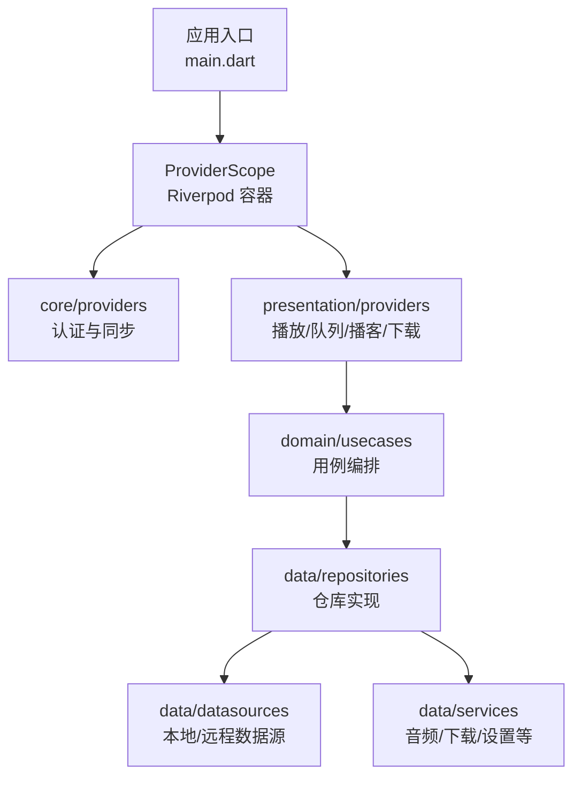
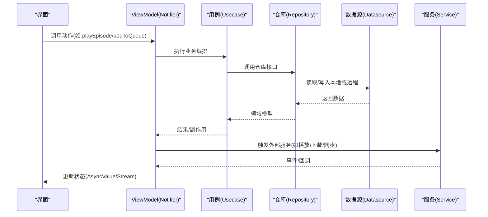
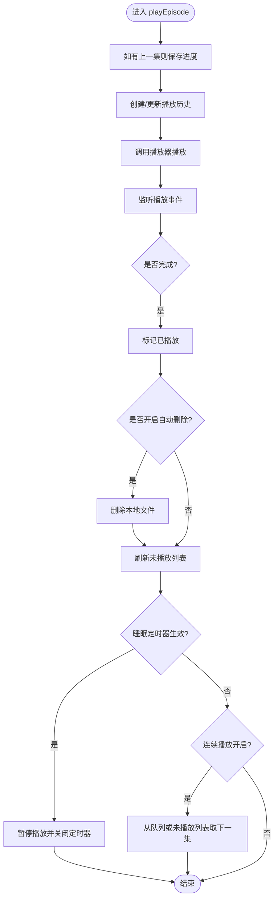
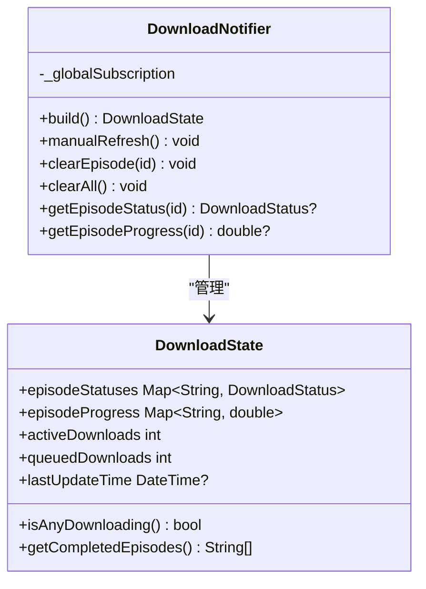
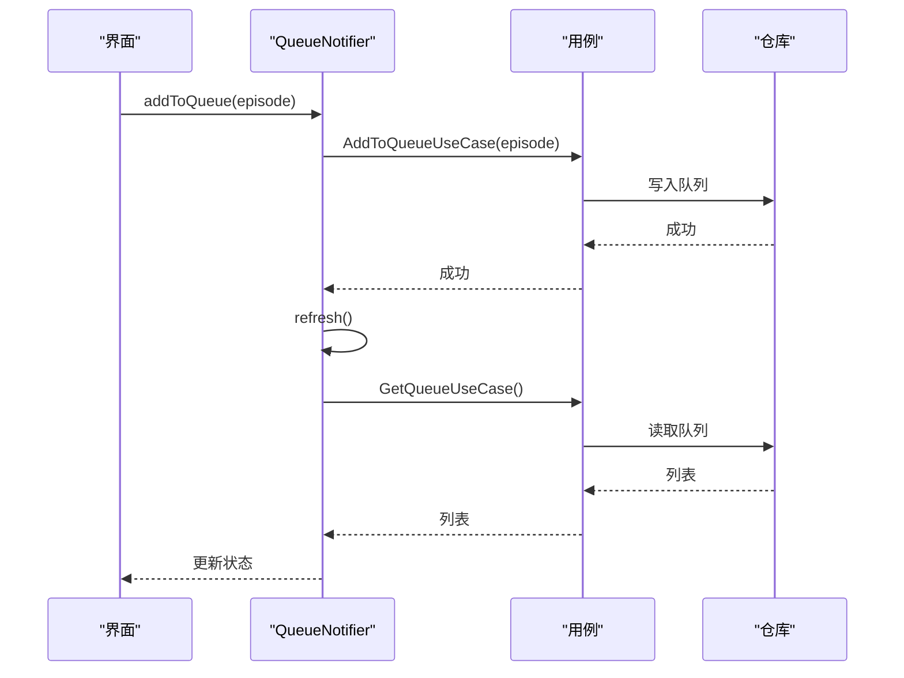
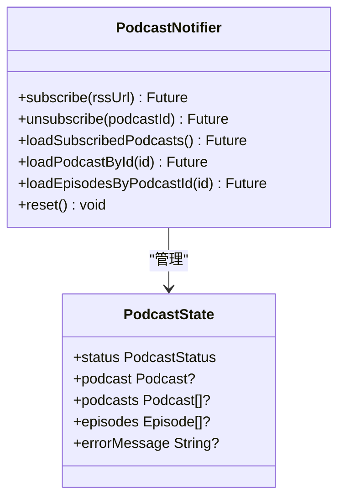
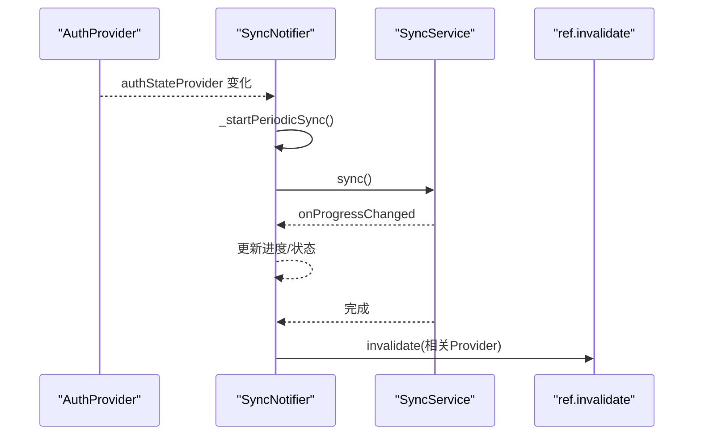
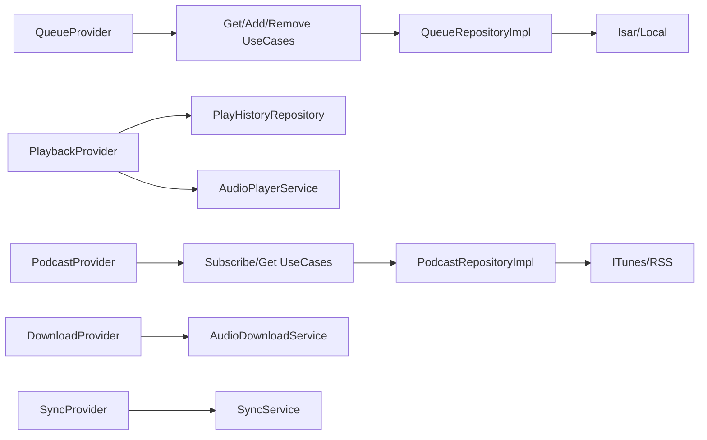

# ViewModel 层架构

<cite>
**本文引用的文件**   
- [main.dart](file://lib/main.dart)
- [auth_provider.dart](file://lib/core/providers/auth_provider.dart)
- [sync_provider.dart](file://lib/presentation/providers/sync_provider.dart)
- [base_provider.dart](file://lib/presentation/providers/base_provider.dart)
- [base_state_notifier.dart](file://lib/presentation/providers/base_state_notifier.dart)
- [playback_provider.dart](file://lib/presentation/providers/playback_provider.dart)
- [download_provider.dart](file://lib/presentation/providers/download_provider.dart)
- [queue_provider.dart](file://lib/presentation/providers/queue_provider.dart)
- [podcast_provider.dart](file://lib/presentation/providers/podcast_provider.dart)
</cite>

## 目录
1. [简介](#简介)
2. [项目结构](#项目结构)
3. [核心组件](#核心组件)
4. [架构总览](#架构总览)
5. [详细组件分析](#详细组件分析)
6. [依赖分析](#依赖分析)
7. [性能考虑](#性能考虑)
8. [故障排查指南](#故障排查指南)
9. [结论](#结论)
10. [附录](#附录)

## 简介
本文件面向 TinyCast 应用的 ViewModel 层，系统化阐述基于 Riverpod 的状态管理模式与 Provider 设计原则。文档覆盖状态流管理、异步操作处理、业务逻辑与数据访问的解耦、状态同步机制、错误处理策略与缓存方案，并通过播放控制、下载管理与搜索等场景展示实际用法。同时总结依赖注入、服务抽象、接口设计与最佳实践、性能优化与调试方法。

## 项目结构
TinyCast 采用分层组织：
- core：跨领域能力（路由、主题、工具、全局服务如 Supabase、网络、定时刷新）
- data：数据层（数据库 Isar、本地/远程数据源、仓库实现、服务如音频播放/下载/设置）
- domain：领域层（实体、仓库接口、用例）
- presentation：表现层（UI 与 Riverpod Providers/ViewModels）

应用启动时通过 ProviderScope 提供全局状态容器，各功能模块以 NotifierProvider/FutureProvider/StreamProvider 暴露状态与行为。

图表来源 
- [main.dart:106-177](file://lib/main.dart#L106-L177)

章节来源
- [main.dart:106-177](file://lib/main.dart#L106-L177)

## 核心组件
- BaseProvider：统一创建 Provider/FutureProvider/StreamProvider 的工厂，简化声明式写法
- BaseStateNotifier：封装 AsyncValue<T>/List/PaginatedData 的通用状态机，提供加载/成功/错误与分页能力
- PlaybackProvider：播放器状态与流程编排（播放/暂停/进度/自动保存/连续播放/睡眠定时器）
- DownloadProvider：下载事件订阅与 UI 状态映射（进行中/排队/完成/失败）
- QueueProvider：播放队列的增删改查与用例编排
- PodcastProvider：订阅/取消订阅、节目详情与剧集列表、最新剧集查询
- SyncProvider：登录态驱动的周期性同步与进度/错误状态管理
- AuthProvider：Supabase 认证状态流与当前用户

章节来源
- [base_provider.dart:1-28](file://lib/presentation/providers/base_provider.dart#L1-L28)
- [base_state_notifier.dart:1-224](file://lib/presentation/providers/base_state_notifier.dart#L1-L224)
- [playback_provider.dart:64-733](file://lib/presentation/providers/playback_provider.dart#L64-L733)
- [download_provider.dart:51-156](file://lib/presentation/providers/download_provider.dart#L51-L156)
- [queue_provider.dart:78-290](file://lib/presentation/providers/queue_provider.dart#L78-L290)
- [podcast_provider.dart:98-264](file://lib/presentation/providers/podcast_provider.dart#L98-L264)
- [sync_provider.dart:41-168](file://lib/presentation/providers/sync_provider.dart#L41-L168)
- [auth_provider.dart:1-22](file://lib/core/providers/auth_provider.dart#L1-L22)

## 架构总览
Riverpod 作为状态容器，Presentation 层的 NotifierProvider 充当 ViewModel，协调 Domain 用例与 Data 层服务/仓库。核心交互如下：

图表来源 
- [playback_provider.dart:583-607](file://lib/presentation/providers/playback_provider.dart#L583-L607)
- [queue_provider.dart:139-160](file://lib/presentation/providers/queue_provider.dart#L139-L160)
- [podcast_provider.dart:119-146](file://lib/presentation/providers/podcast_provider.dart#L119-L146)

## 详细组件分析

### 播放控制（PlaybackProvider）
职责
- 维护播放器状态（当前剧集、播放中、进度、时长、速度、音量）
- 监听 AudioPlayerService 的播放状态、进度、速度、音量、当前剧集、剧集完成事件
- 自动保存播放进度、标记已播放、自动删除已播放下载、未播放列表刷新、连续播放与睡眠定时器
- 恢复上次播放状态（主窗口）

关键流程
- 播放一集：创建/更新播放历史 → 调用播放器播放 → 监听完成事件 → 清理队列项并标记已播放 → 自动删除（可选）→ 刷新未播放列表 → 根据设置自动下一集
- 进度保存：周期任务 + 阈值判断（时间/进度差）→ 调用 PlayProgressService 持久化
- 完成判定：短时长与长时长不同阈值 → 标记为已完成 → 刷新历史列表 → 请求同步

图表来源 
- [playback_provider.dart:583-607](file://lib/presentation/providers/playback_provider.dart#L583-L607)
- [playback_provider.dart:216-265](file://lib/presentation/providers/playback_provider.dart#L216-L265)
- [playback_provider.dart:361-411](file://lib/presentation/providers/playback_provider.dart#L361-L411)
- [playback_provider.dart:673-724](file://lib/presentation/providers/playback_provider.dart#L673-L724)

章节来源
- [playback_provider.dart:64-733](file://lib/presentation/providers/playback_provider.dart#L64-L733)

### 下载管理（DownloadProvider）
职责
- 订阅 AudioDownloadService 的全局事件流，映射到 UI 状态（每个 episode 的状态与进度）
- 维护活跃下载数、排队数、最后更新时间
- 支持手动刷新、按 episodeId 清理、清空全部

关键点
- 事件驱动：status 与 progress 变化即时反映到 UI
- 生命周期：build 中订阅，onDispose 取消订阅
- 状态不可变更新：copyWith 生成新状态，避免共享可变对象

图表来源 
- [download_provider.dart:51-156](file://lib/presentation/providers/download_provider.dart#L51-L156)

章节来源
- [download_provider.dart:51-156](file://lib/presentation/providers/download_provider.dart#L51-L156)

### 播放队列（QueueProvider）
职责
- 使用用例编排队列操作：添加、插入队首、移除、按 episodeId 移除、清空
- 维护队列状态（loading/success/error）与错误信息
- 在每次变更后刷新队列，保证 UI 一致性

要点
- 依赖注入：通过 Provider 注入仓库与用例，便于测试替换
- 并发安全：loadQueue 使用 requestId 丢弃过期响应
- 日志追踪：关键路径输出结构化日志，便于定位问题

图表来源 
- [queue_provider.dart:139-160](file://lib/presentation/providers/queue_provider.dart#L139-L160)
- [queue_provider.dart:104-137](file://lib/presentation/providers/queue_provider.dart#L104-L137)

章节来源
- [queue_provider.dart:78-290](file://lib/presentation/providers/queue_provider.dart#L78-L290)

### 播客与剧集（PodcastProvider）
职责
- 订阅/取消订阅、获取订阅列表、按 ID 获取播客、按 ID 获取剧集、获取最新 N 集
- 监听 FeedRefreshScheduler 的刷新完成事件，自动刷新订阅列表
- 提供 FutureProvider.family 的参数化查询（latestEpisodes、podcastById）

要点
- 状态保持：加载时保留已有数据，避免闪烁
- 排序：按 createdAt 倒序展示订阅列表
- 缓存：FutureProvider.family 天然缓存参数化查询结果

图表来源 
- [podcast_provider.dart:98-203](file://lib/presentation/providers/podcast_provider.dart#L98-L203)

章节来源
- [podcast_provider.dart:98-264](file://lib/presentation/providers/podcast_provider.dart#L98-L264)

### 同步与认证（SyncProvider & AuthProvider）
职责
- AuthProvider：暴露 Supabase 认证状态流与当前用户
- SyncProvider：登录后启动周期性同步，跟踪进度与错误，完成后失效相关 Provider 以刷新 UI

要点
- 鉴权前置：未初始化或无登录态时不执行同步
- 防抖：requestSync 使用定时器合并频繁请求
- 失效范围：同步完成后 invalidate 队列、收藏、未播放、订阅、历史等

图表来源 
- [auth_provider.dart:9-21](file://lib/core/providers/auth_provider.dart#L9-L21)
- [sync_provider.dart:41-151](file://lib/presentation/providers/sync_provider.dart#L41-L151)

章节来源
- [auth_provider.dart:1-22](file://lib/core/providers/auth_provider.dart#L1-L22)
- [sync_provider.dart:41-168](file://lib/presentation/providers/sync_provider.dart#L41-L168)

### 基础抽象（BaseProvider & BaseStateNotifier）
- BaseProvider：统一创建 Provider/FutureProvider/StreamProvider/Lazy 的便捷方法
- BaseStateNotifier：封装 AsyncValue<T>、List、PaginatedData 的通用状态机，减少样板代码

用途
- 快速构建带加载/错误状态的 ViewModel
- 统一的分页加载与增量更新模式

章节来源
- [base_provider.dart:1-28](file://lib/presentation/providers/base_provider.dart#L1-L28)
- [base_state_notifier.dart:1-224](file://lib/presentation/providers/base_state_notifier.dart#L1-L224)

## 依赖分析
- 低耦合高内聚：ViewModel 仅依赖用例与必要服务；用例依赖仓库接口；仓库实现依赖数据源与服务
- 依赖注入：所有用例与仓库通过 Provider 注入，便于替换与测试
- 潜在循环依赖：注意 Provider 之间不要互相直接引用，必要时通过 ref.read 延迟读取
- 外部集成点：Supabase（认证/云同步）、Isar（本地存储）、AudioPlayerService/AudioDownloadService（媒体与下载）

图表来源 
- [queue_provider.dart:14-50](file://lib/presentation/providers/queue_provider.dart#L14-L50)
- [podcast_provider.dart:50-96](file://lib/presentation/providers/podcast_provider.dart#L50-L96)

章节来源
- [queue_provider.dart:14-50](file://lib/presentation/providers/queue_provider.dart#L14-L50)
- [podcast_provider.dart:50-96](file://lib/presentation/providers/podcast_provider.dart#L50-L96)

## 性能考虑
- 状态最小化更新：使用 copyWith 生成新状态，避免深层嵌套重建
- 懒加载与缓存：FutureProvider.family 对参数化查询进行缓存；PodcastProvider 的 cachedSubscribedPodcastsProvider 避免重复查询
- 节流与防抖：SyncProvider 的 requestSync 使用定时器合并频繁请求；PlaybackProvider 的进度保存采用时间与进度双阈值
- 事件驱动：DownloadProvider 通过 Stream 订阅减少轮询；PlaybackProvider 监听播放器事件而非主动轮询
- 列表渲染优化：PodcastProvider 对订阅列表排序一次后复用；分页加载按需追加
- 资源释放：所有 StreamSubscription 在 onDispose 中取消，防止内存泄漏

[本节为通用指导，不直接分析具体文件]

## 故障排查指南
- 播放无法恢复：检查主窗口上下文与上次历史记录是否存在；确认本地文件路径校验逻辑；查看播放器加载异常分支
- 进度未保存：确认自动保存定时器是否运行；检查进度阈值条件；查看 PlayProgressService 调用是否抛错
- 下载状态不更新：确认全局事件流订阅是否建立；检查 event.status 与 progress 字段是否正确映射
- 队列不一致：检查 loadQueue 的 requestId 是否被覆盖；确认用例执行后是否调用 refresh
- 同步失败：查看 SyncProvider 的错误消息与堆栈；确认 canSync 条件与登录态；检查 invalidate 的范围是否覆盖受影响 Provider

章节来源
- [playback_provider.dart:438-577](file://lib/presentation/providers/playback_provider.dart#L438-L577)
- [playback_provider.dart:361-411](file://lib/presentation/providers/playback_provider.dart#L361-L411)
- [download_provider.dart:55-94](file://lib/presentation/providers/download_provider.dart#L55-L94)
- [queue_provider.dart:104-137](file://lib/presentation/providers/queue_provider.dart#L104-L137)
- [sync_provider.dart:110-151](file://lib/presentation/providers/sync_provider.dart#L110-L151)

## 结论
TinyCast 的 ViewModel 层以 Riverpod 为核心，结合用例与仓库抽象，实现了清晰的分层与关注点分离。通过事件驱动与状态不可变更新，保证了 UI 的一致性与可预测性。播放、下载、队列、播客与同步等场景均围绕 NotifierProvider 展开，配合 BaseStateNotifier 的通用状态机，显著降低了样板代码与出错概率。建议继续强化单元测试与集成测试，完善错误边界与降级策略，进一步提升稳定性与可维护性。

[本节为总结，不直接分析具体文件]

## 附录
- 状态管理最佳实践
  - 单一事实来源：每个功能域一个 Notifier，状态只由自身变更
  - 明确状态枚举：initial/loading/success/error 统一表达
  - 副作用外置：将 I/O 与外部服务调用放入用例或服务层
  - 可观测性：关键路径打点日志，便于定位问题
- 调试技巧
  - 使用 ref.listen 观察 Provider 变化
  - 打印 AsyncValue 的 loading/data/error 分支
  - 针对 StreamProvider 订阅生命周期进行断点
- 常见陷阱
  - 忘记在 onDispose 中取消订阅
  - 在 build 中执行耗时操作
  - 直接修改共享可变状态导致 UI 不同步

[本节为通用指导，不直接分析具体文件]