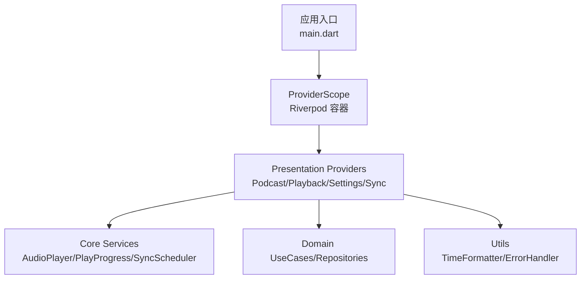
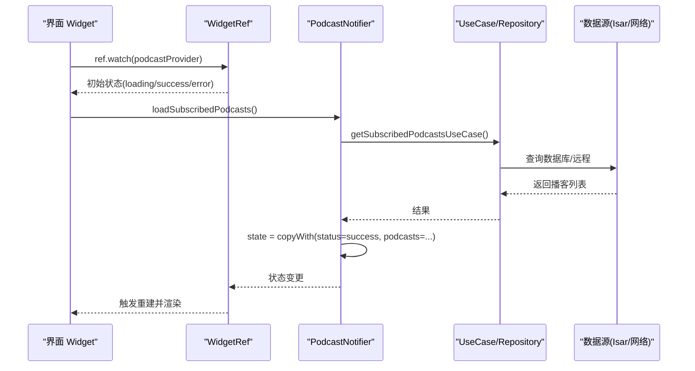
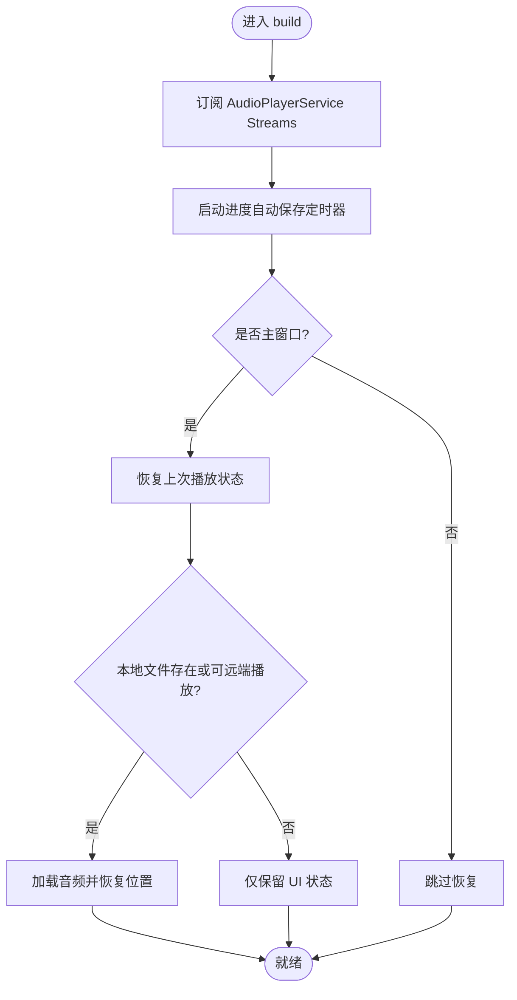
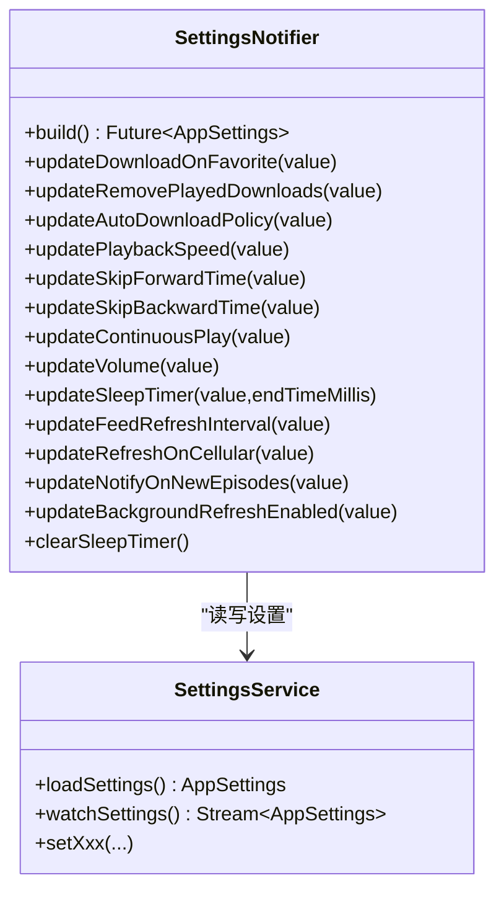
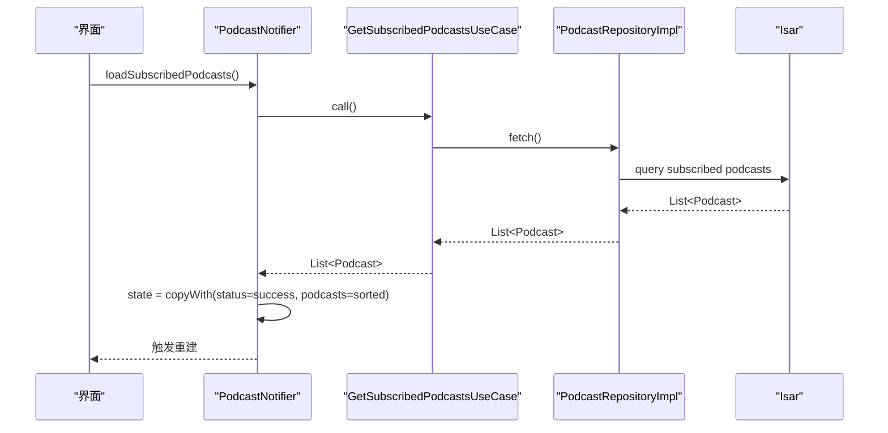
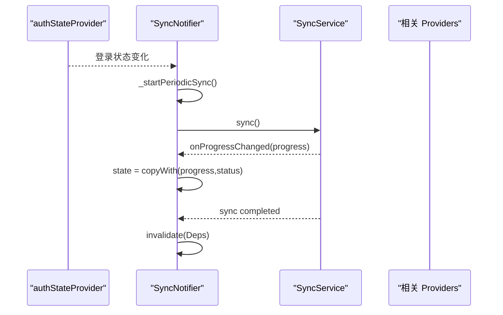
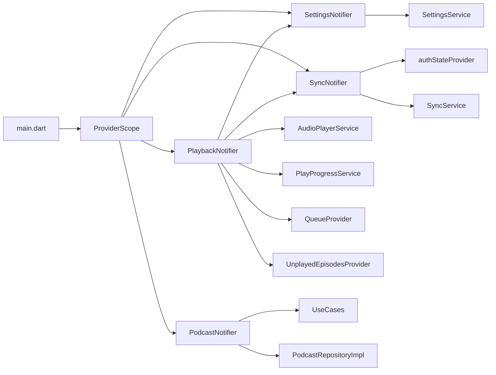

# 数据绑定机制

<cite>
**本文引用的文件**   
- [main.dart](file://lib/main.dart)
- [base_provider.dart](file://lib/presentation/providers/base_provider.dart)
- [sync_provider.dart](file://lib/presentation/providers/sync_provider.dart)
- [podcast_provider.dart](file://lib/presentation/providers/podcast_provider.dart)
- [playback_provider.dart](file://lib/presentation/providers/playback_provider.dart)
- [settings_provider.dart](file://lib/presentation/providers/settings_provider.dart)
- [time_formatter.dart](file://lib/core/utils/time_formatter.dart)
- [error_handler.dart](file://lib/core/utils/error_handler.dart)
</cite>

## 目录
1. [简介](#简介)
2. [项目结构](#项目结构)
3. [核心组件](#核心组件)
4. [架构总览](#架构总览)
5. [详细组件分析](#详细组件分析)
6. [依赖分析](#依赖分析)
7. [性能考虑](#性能考虑)
8. [故障排查指南](#故障排查指南)
9. [结论](#结论)
10. [附录](#附录)

## 简介
本文件面向 TinyCast 应用的数据绑定机制，围绕 MVVM 模式与 Riverpod（Notifier/AsyncNotifier）实现，系统阐述单向数据流、事件驱动更新、响应式状态管理、以及 Provider 如何驱动 UI 重建。文档还覆盖复杂状态管理（StateNotifier/Notifier）、数据验证、格式化与转换流程，并结合播放、设置、同步等真实场景给出代码级示例路径、性能优化技巧与最佳实践。

## 项目结构
TinyCast 在 lib 下按 core/data/domain/presentation 分层组织，其中：
- presentation/providers：基于 Riverpod 的 Notifier/AsyncNotifier 提供状态与业务逻辑
- core/services：跨层服务（如音频播放、进度、网络、同步调度）
- core/utils：工具类（时间格式化、错误处理、日志等）
- main.dart：应用入口，初始化 ProviderScope 与各服务

图表来源 
- [main.dart:106-176](file://lib/main.dart#L106-L176)

章节来源
- [main.dart:106-176](file://lib/main.dart#L106-L176)

## 核心组件
- BaseProvider：封装通用 Provider 创建方式（同步/异步/Stream），简化声明
- SyncNotifier：基于 Notifier 的同步状态管理，监听认证状态变化，周期性/防抖触发同步，并失效相关 Provider
- PodcastNotifier：播客订阅/列表/剧集加载的状态机，结合 UseCase 与 Repository，支持排序与缓存
- PlaybackNotifier：播放器状态与事件总线，订阅 AudioPlayerService 的 Stream，自动保存进度、标记已播放、连续播放、睡眠定时器等
- SettingsNotifier：AsyncNotifier 管理 AppSettings，持久化变更并通过 Stream 推送给 UI
- TimeFormatter：时间展示格式化（相对时间）
- ErrorHandler：统一异常分类与用户友好消息

章节来源
- [base_provider.dart:1-28](file://lib/presentation/providers/base_provider.dart#L1-L28)
- [sync_provider.dart:1-168](file://lib/presentation/providers/sync_provider.dart#L1-L168)
- [podcast_provider.dart:1-264](file://lib/presentation/providers/podcast_provider.dart#L1-L264)
- [playback_provider.dart:1-766](file://lib/presentation/providers/playback_provider.dart#L1-L766)
- [settings_provider.dart:1-185](file://lib/presentation/providers/settings_provider.dart#L1-L185)
- [time_formatter.dart:1-48](file://lib/core/utils/time_formatter.dart#L1-L48)
- [error_handler.dart:1-129](file://lib/core/utils/error_handler.dart#L1-L129)

## 架构总览
TinyCast 采用 MVVM + Riverpod：
- View（Widget）通过 ref.watch 订阅 Provider 状态
- ViewModel（Notifier/AsyncNotifier）持有状态与业务逻辑，通过 state = ... 触发下游依赖重建
- Model/Service（UseCase/Repository/Service）负责数据获取与持久化
- 事件驱动：通过 Stream 订阅（播放进度、播放状态、设置变更）驱动状态更新
- 单向数据流：UI -> Provider -> Service -> Data Source -> State -> UI

图表来源 
- [podcast_provider.dart:148-172](file://lib/presentation/providers/podcast_provider.dart#L148-L172)

章节来源
- [podcast_provider.dart:148-172](file://lib/presentation/providers/podcast_provider.dart#L148-L172)

## 详细组件分析

### 播放状态管理（PlaybackNotifier）
- 职责：维护当前剧集、播放状态、进度、速度、音量；订阅 AudioPlayerService 的多个 Stream；自动保存进度；完成剧集后标记已播放、刷新未播放列表、处理连续播放与睡眠定时器
- 数据流：AudioPlayerService.Stream -> PlaybackNotifier.state -> 各细粒度 Provider（currentEpisode/isPlaying/currentPosition/duration/speed/volume/progressRatio）
- 关键流程：
  - 构建时订阅播放状态、进度、速度、音量、当前剧集、剧集完成事件
  - 周期性地根据时间与进度阈值保存播放进度
  - 剧集完成后：从队列移除、标记已播放、可选删除本地下载、刷新未播放列表、检查睡眠定时器、自动播放下一集
  - 恢复上次播放状态：读取历史、校验本地文件存在性、加载音频或仅恢复 UI

图表来源 
- [playback_provider.dart:84-101](file://lib/presentation/providers/playback_provider.dart#L84-L101)
- [playback_provider.dart:169-214](file://lib/presentation/providers/playback_provider.dart#L169-L214)
- [playback_provider.dart:361-411](file://lib/presentation/providers/playback_provider.dart#L361-L411)
- [playback_provider.dart:438-577](file://lib/presentation/providers/playback_provider.dart#L438-L577)

章节来源
- [playback_provider.dart:84-101](file://lib/presentation/providers/playback_provider.dart#L84-L101)
- [playback_provider.dart:169-214](file://lib/presentation/providers/playback_provider.dart#L169-L214)
- [playback_provider.dart:361-411](file://lib/presentation/providers/playback_provider.dart#L361-L411)
- [playback_provider.dart:438-577](file://lib/presentation/providers/playback_provider.dart#L438-L577)

### 设置状态管理（SettingsNotifier）
- 职责：加载/监听 AppSettings，持久化各项设置，变更后重启后台刷新调度器
- 数据流：SettingsService.watchSettings() -> AsyncData(settings) -> UI 实时响应
- 关键点：使用 AsyncNotifierProvider，build 中订阅设置流并在 dispose 取消订阅；每个 updateXxx 方法调用 SettingsService 并记录日志

图表来源 
- [settings_provider.dart:35-61](file://lib/presentation/providers/settings_provider.dart#L35-L61)
- [settings_provider.dart:69-184](file://lib/presentation/providers/settings_provider.dart#L69-L184)

章节来源
- [settings_provider.dart:35-61](file://lib/presentation/providers/settings_provider.dart#L35-L61)
- [settings_provider.dart:69-184](file://lib/presentation/providers/settings_provider.dart#L69-L184)

### 播客状态管理（PodcastNotifier）
- 职责：订阅 FeedRefreshScheduler 刷新完成事件，加载订阅列表、按 createdAt 倒序排序；提供按 ID 查询播客与剧集；暴露派生 Provider（subscribed/cached/latest episodes/byId）
- 数据流：UI -> PodcastNotifier.loadXxx() -> UseCase -> Repository -> Isar/网络 -> state.copyWith(...) -> UI 重建

图表来源 
- [podcast_provider.dart:148-172](file://lib/presentation/providers/podcast_provider.dart#L148-L172)
- [podcast_provider.dart:213-234](file://lib/presentation/providers/podcast_provider.dart#L213-L234)

章节来源
- [podcast_provider.dart:148-172](file://lib/presentation/providers/podcast_provider.dart#L148-L172)
- [podcast_provider.dart:213-234](file://lib/presentation/providers/podcast_provider.dart#L213-L234)

### 同步状态管理（SyncNotifier）
- 职责：监听认证状态，登录时启动周期性同步与立即同步；防抖请求；更新进度与最后同步时间；失败时记录错误；完成后失效相关 Provider（队列、收藏、未播放、订阅、播放历史）
- 数据流：AuthState -> SyncNotifier.build -> Timer.periodic -> SyncService.sync() -> state.progress/status -> 失效其他 Provider

图表来源 
- [sync_provider.dart:47-74](file://lib/presentation/providers/sync_provider.dart#L47-L74)
- [sync_provider.dart:110-151](file://lib/presentation/providers/sync_provider.dart#L110-L151)

章节来源
- [sync_provider.dart:47-74](file://lib/presentation/providers/sync_provider.dart#L47-L74)
- [sync_provider.dart:110-151](file://lib/presentation/providers/sync_provider.dart#L110-L151)

### 基础 Provider 封装（BaseProvider）
- 作用：统一创建 Provider/FutureProvider/StreamProvider/LazyProvider，减少样板代码
- 适用场景：简单值、异步一次性任务、流式数据、延迟初始化

章节来源
- [base_provider.dart:1-28](file://lib/presentation/providers/base_provider.dart#L1-L28)

### 数据验证、格式化与转换
- 时间格式化：TimeFormatter.formatTimeAgo 将发布时间转换为“xx秒前/分前/小时前/天前/具体日期”
- 错误处理：ErrorHandler.handleError 捕获异常并转换为 AppException，提供用户友好消息；适用于网络、存储、权限、验证等类型

章节来源
- [time_formatter.dart:20-46](file://lib/core/utils/time_formatter.dart#L20-L46)
- [error_handler.dart:27-57](file://lib/core/utils/error_handler.dart#L27-L57)
- [error_handler.dart:103-118](file://lib/core/utils/error_handler.dart#L103-L118)

## 依赖分析
- 应用入口 main.dart 通过 ProviderScope 包裹整个应用，确保所有 Provider 可用
- PlaybackNotifier 依赖 AudioPlayerService、PlayProgressService、SettingsProvider、QueueProvider、UnplayedEpisodesProvider、SyncProvider
- PodcastNotifier 依赖 UseCase/Repository，最终依赖 Isar 与 ITunesSearchService
- SettingsNotifier 依赖 SettingsService，影响 FeedRefreshScheduler
- SyncNotifier 依赖 AuthState、SyncService，并失效多个 Presentation Providers

图表来源 
- [main.dart:106-176](file://lib/main.dart#L106-L176)
- [playback_provider.dart:64-101](file://lib/presentation/providers/playback_provider.dart#L64-L101)
- [podcast_provider.dart:98-106](file://lib/presentation/providers/podcast_provider.dart#L98-L106)
- [settings_provider.dart:35-61](file://lib/presentation/providers/settings_provider.dart#L35-L61)
- [sync_provider.dart:47-74](file://lib/presentation/providers/sync_provider.dart#L47-L74)

章节来源
- [main.dart:106-176](file://lib/main.dart#L106-L176)
- [playback_provider.dart:64-101](file://lib/presentation/providers/playback_provider.dart#L64-L101)
- [podcast_provider.dart:98-106](file://lib/presentation/providers/podcast_provider.dart#L98-L106)
- [settings_provider.dart:35-61](file://lib/presentation/providers/settings_provider.dart#L35-L61)
- [sync_provider.dart:47-74](file://lib/presentation/providers/sync_provider.dart#L47-L74)

## 性能考虑
- 避免在 build 中进行昂贵操作：网络请求、解析 JSON、I/O 应放在 Provider 的 build 或异步方法中
- 使用 const 构造与不可变状态：copyWith 生成新对象，配合 Riverpod 精确重建
- 合理拆分 Provider：细粒度 Provider（如 currentEpisode/isPlaying 等）减少无关重建
- 使用 FutureProvider.family 参数化查询：如 latestEpisodesProvider、podcastByIdProvider
- 缓存与排序：cachedSubscribedPodcastsProvider 缓存并按 createdAt 排序，减少重复计算
- 节流与防抖：SyncNotifier.requestSync 使用防抖，避免频繁触发
- 流式订阅生命周期：在 onDispose 中取消订阅，防止内存泄漏
- 批量失效：SyncNotifier 完成后一次性 invalidate 多个相关 Provider，降低抖动

[本节为通用指导，不直接分析具体文件]

## 故障排查指南
- 播放状态不一致：检查 PlaybackNotifier 的 Stream 订阅是否正确取消；确认 _restoreLastPlaybackState 是否被中断（_isRestoreCancelled）
- 设置未生效：确认 SettingsNotifier 的 watchSettings 流是否正常推送；检查对应 updateXxx 方法是否调用成功并记录日志
- 同步失败：查看 SyncNotifier 的 errorMessage 与日志；检查 canSync 条件与网络环境
- 错误提示：使用 ErrorHandler.getUserFriendlyMessage 获取用户友好消息；结合 Toast/Dialog 展示
- 时间显示异常：检查 TimeFormatter 的 now 参数与本地时区

章节来源
- [playback_provider.dart:579-581](file://lib/presentation/providers/playback_provider.dart#L579-L581)
- [settings_provider.dart:47-61](file://lib/presentation/providers/settings_provider.dart#L47-L61)
- [sync_provider.dart:110-151](file://lib/presentation/providers/sync_provider.dart#L110-L151)
- [error_handler.dart:103-118](file://lib/core/utils/error_handler.dart#L103-L118)
- [time_formatter.dart:20-46](file://lib/core/utils/time_formatter.dart#L20-L46)

## 结论
TinyCast 的数据绑定以 Riverpod 为核心，通过 Notifier/AsyncNotifier 管理复杂状态，结合 Stream 实现事件驱动的响应式更新。MVVM 模式下，UI 只负责展示与交互，状态与业务逻辑集中在 Provider，数据源与服务位于更底层。通过合理的 Provider 拆分、不可变状态、缓存与失效策略，实现了高效、可维护且可扩展的数据绑定体系。

[本节为总结，不直接分析具体文件]

## 附录
- 最佳实践
  - 始终使用 ProviderScope 包裹应用
  - 在 Provider 的 build 中只做轻量初始化与订阅
  - 使用 copyWith 保持状态不可变
  - 对耗时操作使用 FutureProvider 或 compute
  - 在 onDispose 中清理资源（Timer、StreamSubscription）
- 常见陷阱
  - 在 build 中执行网络/I/O 导致卡顿
  - 忘记取消订阅造成内存泄漏
  - 过度共享状态导致不必要重建
  - 忽略错误分支导致 UI 卡死
- 参考示例路径
  - 播放状态与事件驱动：[playback_provider.dart:169-214](file://lib/presentation/providers/playback_provider.dart#L169-L214)
  - 设置流式更新：[settings_provider.dart:47-61](file://lib/presentation/providers/settings_provider.dart#L47-L61)
  - 播客列表加载与排序：[podcast_provider.dart:148-172](file://lib/presentation/providers/podcast_provider.dart#L148-L172)
  - 同步状态与失效策略：[sync_provider.dart:110-151](file://lib/presentation/providers/sync_provider.dart#L110-L151)
  - 时间格式化：[time_formatter.dart:20-46](file://lib/core/utils/time_formatter.dart#L20-L46)
  - 错误处理与用户消息：[error_handler.dart:27-57](file://lib/core/utils/error_handler.dart#L27-L57)

[本节为补充信息，不直接分析具体文件]