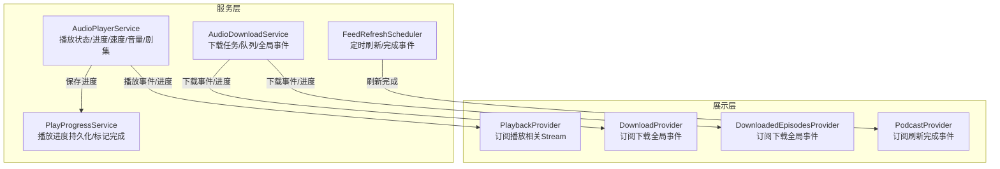
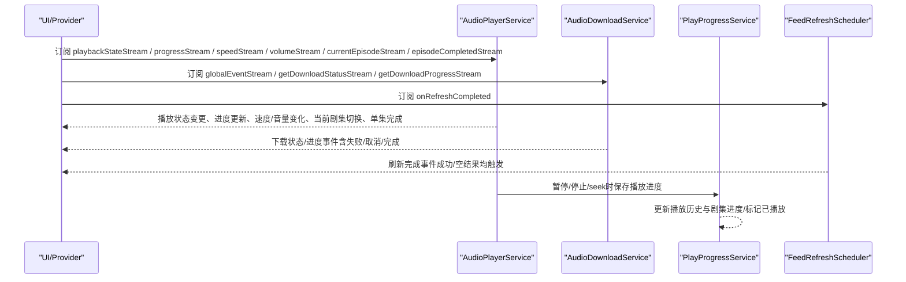
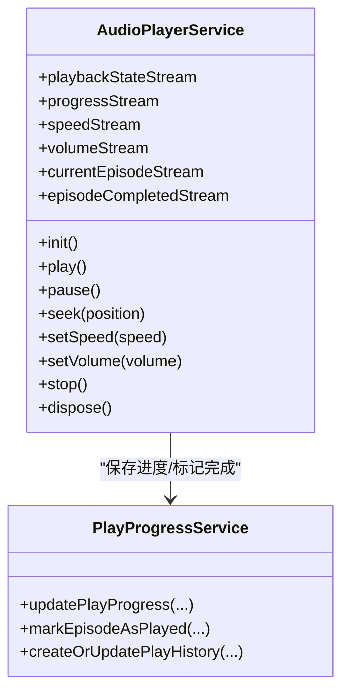
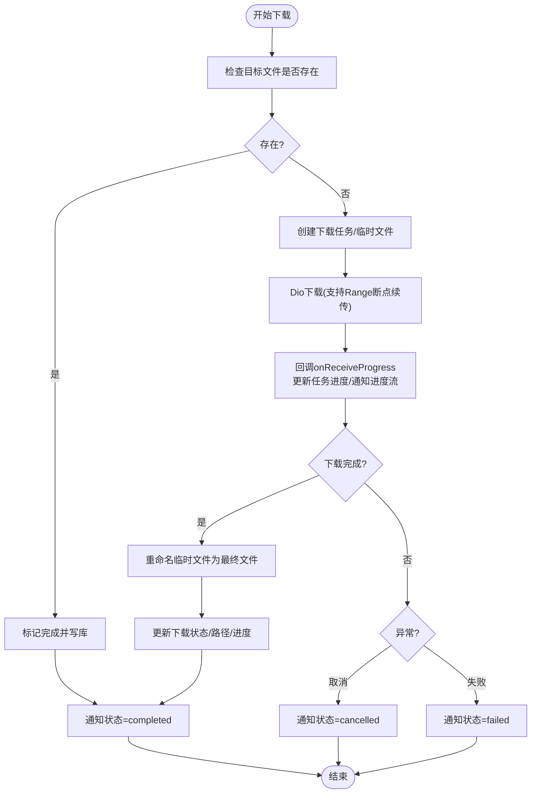
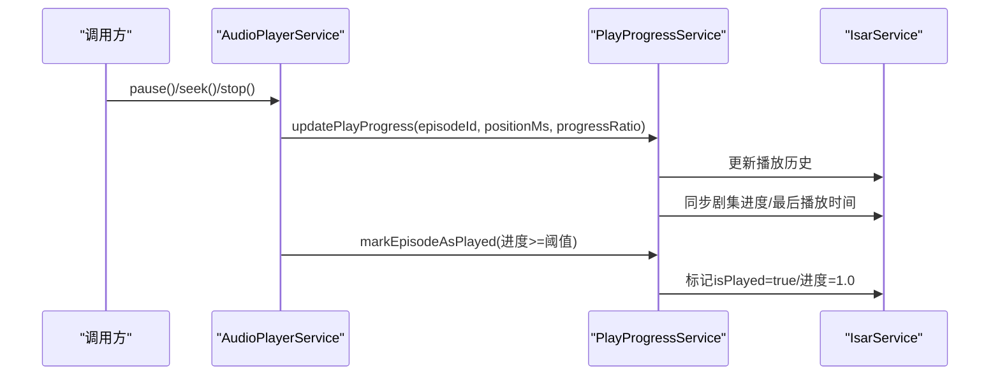
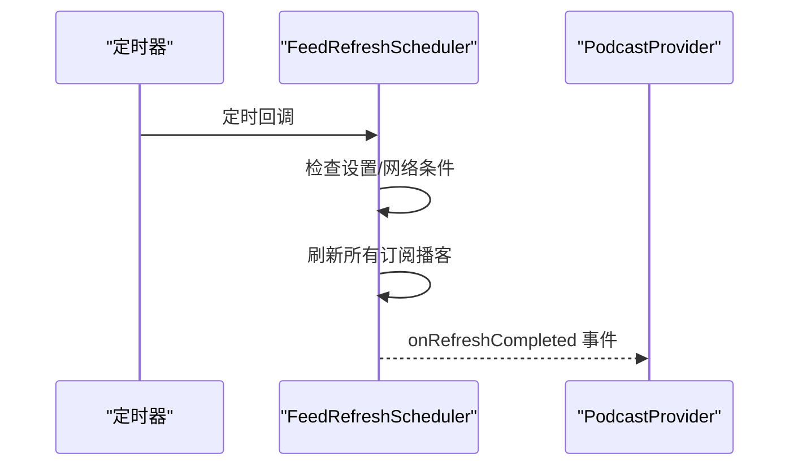
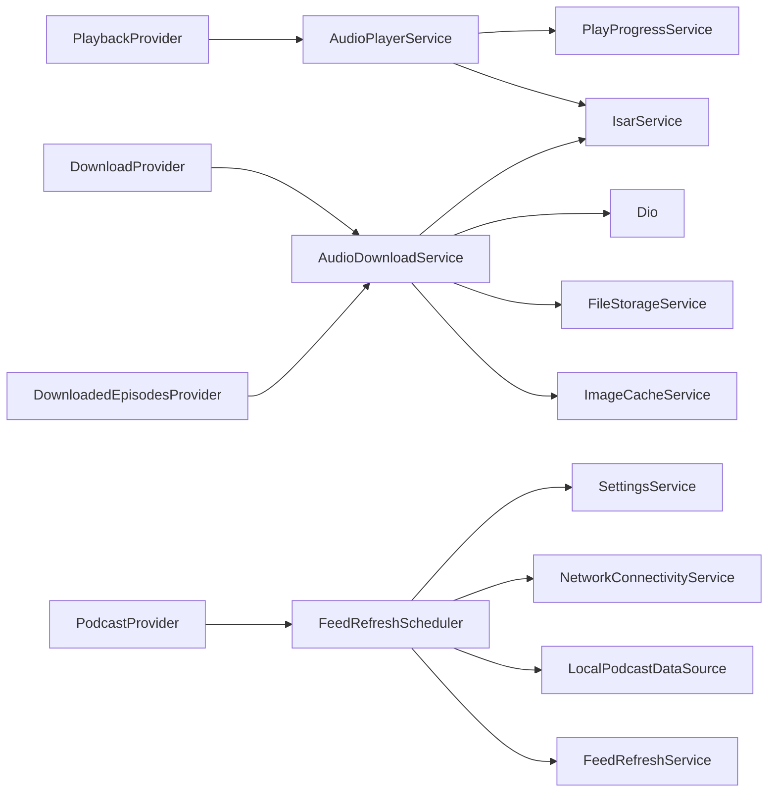

# 观察者模式（Observer Pattern）

<cite>
**本文引用的文件**   
- [lib/data/services/audio_player_service.dart](file://lib/data/services/audio_player_service.dart)
- [lib/data/services/audio_download_service.dart](file://lib/data/services/audio_download_service.dart)
- [lib/core/services/play_progress_service.dart](file://lib/core/services/play_progress_service.dart)
- [lib/core/services/feed_refresh_scheduler.dart](file://lib/core/services/feed_refresh_scheduler.dart)
- [lib/presentation/providers/playback_provider.dart](file://lib/presentation/providers/playback_provider.dart)
- [lib/presentation/providers/download_provider.dart](file://lib/presentation/providers/download_provider.dart)
- [lib/presentation/features/downloads/downloaded_episodes_provider.dart](file://lib/presentation/features/downloads/downloaded_episodes_provider.dart)
- [lib/presentation/providers/podcast_provider.dart](file://lib/presentation/providers/podcast_provider.dart)
</cite>

## 目录
1. [简介](#简介)
2. [项目结构](#项目结构)
3. [核心组件](#核心组件)
4. [架构总览](#架构总览)
5. [详细组件分析](#详细组件分析)
6. [依赖关系分析](#依赖关系分析)
7. [性能考虑](#性能考虑)
8. [故障排查指南](#故障排查指南)
9. [结论](#结论)
10. [附录](#附录)

## 简介
本文件围绕 TinyCast 应用中的观察者模式展开，聚焦事件驱动架构在播放进度监听、下载状态通知、用户交互响应等场景中的应用。重点解析 PlayProgressService 的职责边界与数据同步机制，并系统说明 AudioPlayerService 与 AudioDownloadService 如何通过 Stream 和 StreamController 实现响应式编程。文档同时对比订阅者模式与发布-订阅模式的差异与应用场景，给出注册/注销、事件触发与数据传递的实操要点，以及松耦合通信、实时数据同步、状态自动更新的实现思路与最佳实践。

## 项目结构
TinyCast 采用分层架构：服务层（音频播放、下载、进度同步）、调度器（后台刷新）、展示层（Riverpod Provider）。观察者模式贯穿各层之间，通过广播流实现解耦的事件分发。

图表来源 
- [lib/data/services/audio_player_service.dart:47-77](file://lib/data/services/audio_player_service.dart#L47-L77)
- [lib/data/services/audio_download_service.dart:147-180](file://lib/data/services/audio_download_service.dart#L147-L180)
- [lib/core/services/play_progress_service.dart:17-42](file://lib/core/services/play_progress_service.dart#L17-L42)
- [lib/core/services/feed_refresh_scheduler.dart:32-36](file://lib/core/services/feed_refresh_scheduler.dart#L32-L36)
- [lib/presentation/providers/playback_provider.dart:65-70](file://lib/presentation/providers/playback_provider.dart#L65-L70)
- [lib/presentation/providers/download_provider.dart:52-58](file://lib/presentation/providers/download_provider.dart#L52-L58)
- [lib/presentation/features/downloads/downloaded_episodes_provider.dart:41-47](file://lib/presentation/features/downloads/downloaded_episodes_provider.dart#L41-L47)
- [lib/presentation/providers/podcast_provider.dart:101-104](file://lib/presentation/providers/podcast_provider.dart#L101-L104)

章节来源
- [lib/data/services/audio_player_service.dart:47-77](file://lib/data/services/audio_player_service.dart#L47-L77)
- [lib/data/services/audio_download_service.dart:147-180](file://lib/data/services/audio_download_service.dart#L147-L180)
- [lib/core/services/play_progress_service.dart:17-42](file://lib/core/services/play_progress_service.dart#L17-L42)
- [lib/core/services/feed_refresh_scheduler.dart:32-36](file://lib/core/services/feed_refresh_scheduler.dart#L32-L36)
- [lib/presentation/providers/playback_provider.dart:65-70](file://lib/presentation/providers/playback_provider.dart#L65-L70)
- [lib/presentation/providers/download_provider.dart:52-58](file://lib/presentation/providers/download_provider.dart#L52-L58)
- [lib/presentation/features/downloads/downloaded_episodes_provider.dart:41-47](file://lib/presentation/features/downloads/downloaded_episodes_provider.dart#L41-L47)
- [lib/presentation/providers/podcast_provider.dart:101-104](file://lib/presentation/providers/podcast_provider.dart#L101-L104)

## 核心组件
- AudioPlayerService：封装播放器生命周期，暴露多个广播流（播放状态、播放进度、速度、音量、当前剧集、单集完成），并在关键节点触发事件。
- AudioDownloadService：管理下载任务与并发队列，按剧集维度提供状态/进度流，并提供全局事件流用于跨模块通知。
- PlayProgressService：统一更新播放历史与剧集进度，必要时标记“已播放”，并与数据库同步。
- FeedRefreshScheduler：定时或手动触发播客刷新，完成后通过广播流通知订阅者。
- Presentation Providers：PlaybackProvider、DownloadProvider、DownloadedEpisodesProvider、PodcastProvider 等订阅上述流，驱动 UI 重建与状态更新。

章节来源
- [lib/data/services/audio_player_service.dart:47-77](file://lib/data/services/audio_player_service.dart#L47-L77)
- [lib/data/services/audio_download_service.dart:147-180](file://lib/data/services/audio_download_service.dart#L147-L180)
- [lib/core/services/play_progress_service.dart:17-42](file://lib/core/services/play_progress_service.dart#L17-L42)
- [lib/core/services/feed_refresh_scheduler.dart:32-36](file://lib/core/services/feed_refresh_scheduler.dart#L32-L36)
- [lib/presentation/providers/playback_provider.dart:65-70](file://lib/presentation/providers/playback_provider.dart#L65-L70)
- [lib/presentation/providers/download_provider.dart:52-58](file://lib/presentation/providers/download_provider.dart#L52-L58)
- [lib/presentation/features/downloads/downloaded_episodes_provider.dart:41-47](file://lib/presentation/features/downloads/downloaded_episodes_provider.dart#L41-L47)
- [lib/presentation/providers/podcast_provider.dart:101-104](file://lib/presentation/providers/podcast_provider.dart#L101-L104)

## 架构总览
下图展示了从底层服务到上层 Provider 的观察者事件流路径，体现松耦合与实时同步。

图表来源 
- [lib/data/services/audio_player_service.dart:47-77](file://lib/data/services/audio_player_service.dart#L47-L77)
- [lib/data/services/audio_download_service.dart:147-180](file://lib/data/services/audio_download_service.dart#L147-L180)
- [lib/core/services/play_progress_service.dart:17-42](file://lib/core/services/play_progress_service.dart#L17-L42)
- [lib/core/services/feed_refresh_scheduler.dart:32-36](file://lib/core/services/feed_refresh_scheduler.dart#L32-L36)
- [lib/presentation/providers/playback_provider.dart:65-70](file://lib/presentation/providers/playback_provider.dart#L65-L70)
- [lib/presentation/providers/download_provider.dart:52-58](file://lib/presentation/providers/download_provider.dart#L52-L58)
- [lib/presentation/features/downloads/downloaded_episodes_provider.dart:41-47](file://lib/presentation/features/downloads/downloaded_episodes_provider.dart#L41-L47)
- [lib/presentation/providers/podcast_provider.dart:101-104](file://lib/presentation/providers/podcast_provider.dart#L101-L104)

## 详细组件分析

### AudioPlayerService 观察者实现
- 使用多个 broadcast StreamController 暴露播放状态、进度、速度、音量、当前剧集、单集完成等事件。
- 初始化时订阅底层播放器事件，内部统一转换为领域事件并通过控制器发出。
- 在暂停、停止、seek 等操作中调用 PlayProgressService 保存进度；播放完成时发出单集完成事件。
- dispose 阶段统一取消所有订阅并关闭控制器，防止内存泄漏。

图表来源 
- [lib/data/services/audio_player_service.dart:47-77](file://lib/data/services/audio_player_service.dart#L47-L77)
- [lib/core/services/play_progress_service.dart:17-42](file://lib/core/services/play_progress_service.dart#L17-L42)

章节来源
- [lib/data/services/audio_player_service.dart:47-77](file://lib/data/services/audio_player_service.dart#L47-L77)
- [lib/data/services/audio_player_service.dart:117-123](file://lib/data/services/audio_player_service.dart#L117-L123)
- [lib/data/services/audio_player_service.dart:151-161](file://lib/data/services/audio_player_service.dart#L151-L161)
- [lib/data/services/audio_player_service.dart:469-507](file://lib/data/services/audio_player_service.dart#L469-L507)
- [lib/data/services/audio_player_service.dart:560-583](file://lib/data/services/audio_player_service.dart#L560-L583)

### AudioDownloadService 观察者实现
- 为每个下载任务维护状态与进度 StreamController，并提供全局事件流（AudioDownloadEvent）供多订阅者消费。
- 下载过程中周期性上报进度，结束时发送完成/失败/取消事件；支持断点续传与并发控制。
- 删除已下载内容后清理控制器并广播事件，确保下游状态一致。

图表来源 
- [lib/data/services/audio_download_service.dart:196-408](file://lib/data/services/audio_download_service.dart#L196-L408)
- [lib/data/services/audio_download_service.dart:763-791](file://lib/data/services/audio_download_service.dart#L763-L791)
- [lib/data/services/audio_download_service.dart:611-624](file://lib/data/services/audio_download_service.dart#L611-L624)

章节来源
- [lib/data/services/audio_download_service.dart:147-180](file://lib/data/services/audio_download_service.dart#L147-L180)
- [lib/data/services/audio_download_service.dart:196-408](file://lib/data/services/audio_download_service.dart#L196-L408)
- [lib/data/services/audio_download_service.dart:611-624](file://lib/data/services/audio_download_service.dart#L611-L624)
- [lib/data/services/audio_download_service.dart:763-791](file://lib/data/services/audio_download_service.dart#L763-L791)

### PlayProgressService 职责与数据同步
- 提供统一的播放进度更新接口，写入播放历史并同步剧集进度字段。
- 当进度达到阈值时标记“已播放”，并同步至剧集实体。
- 错误处理集中记录日志并抛出，便于上层捕获与重试。

图表来源 
- [lib/data/services/audio_player_service.dart:469-507](file://lib/data/services/audio_player_service.dart#L469-L507)
- [lib/core/services/play_progress_service.dart:17-42](file://lib/core/services/play_progress_service.dart#L17-L42)
- [lib/core/services/play_progress_service.dart:106-144](file://lib/core/services/play_progress_service.dart#L106-L144)

章节来源
- [lib/core/services/play_progress_service.dart:17-42](file://lib/core/services/play_progress_service.dart#L17-L42)
- [lib/core/services/play_progress_service.dart:106-144](file://lib/core/services/play_progress_service.dart#L106-L144)

### FeedRefreshScheduler 刷新完成事件
- 定时器周期触发刷新，条件满足时执行批量刷新，完成后通过广播流通知订阅者。
- 支持应用前后台生命周期联动，保证资源合理使用。

图表来源 
- [lib/core/services/feed_refresh_scheduler.dart:88-147](file://lib/core/services/feed_refresh_scheduler.dart#L88-L147)
- [lib/presentation/providers/podcast_provider.dart:101-104](file://lib/presentation/providers/podcast_provider.dart#L101-L104)

章节来源
- [lib/core/services/feed_refresh_scheduler.dart:88-147](file://lib/core/services/feed_refresh_scheduler.dart#L88-L147)
- [lib/presentation/providers/podcast_provider.dart:101-104](file://lib/presentation/providers/podcast_provider.dart#L101-L104)

### 订阅者模式 vs 发布-订阅模式
- 订阅者模式（直接引用）：发布者持有订阅者列表，直接调用其方法。适用于简单、紧耦合的场景。
- 发布-订阅模式（事件总线）：发布者仅向通道/控制器发送事件，不关心订阅者数量与类型；通过广播流实现解耦。
- TinyCast 采用发布-订阅模式：服务层通过 StreamController.broadcast 暴露事件流，Provider 层订阅流进行状态更新，降低耦合度，提升可测试性与扩展性。

[本节为概念性说明，不直接分析具体文件]

## 依赖关系分析
- AudioPlayerService 依赖 IsarService 与 PlayProgressService，负责播放事件与进度持久化。
- AudioDownloadService 依赖 Dio、FileStorageService、IsarService、ImageCacheService，负责下载与状态广播。
- FeedRefreshScheduler 依赖 SettingsService、NetworkConnectivityService、LocalPodcastDataSource、FeedRefreshService，负责刷新调度与事件广播。
- Presentation Providers 订阅服务层流，驱动 UI 重建与业务逻辑。

图表来源 
- [lib/data/services/audio_player_service.dart:47-77](file://lib/data/services/audio_player_service.dart#L47-L77)
- [lib/data/services/audio_download_service.dart:147-180](file://lib/data/services/audio_download_service.dart#L147-L180)
- [lib/core/services/feed_refresh_scheduler.dart:32-36](file://lib/core/services/feed_refresh_scheduler.dart#L32-L36)
- [lib/presentation/providers/playback_provider.dart:65-70](file://lib/presentation/providers/playback_provider.dart#L65-L70)
- [lib/presentation/providers/download_provider.dart:52-58](file://lib/presentation/providers/download_provider.dart#L52-L58)
- [lib/presentation/features/downloads/downloaded_episodes_provider.dart:41-47](file://lib/presentation/features/downloads/downloaded_episodes_provider.dart#L41-L47)
- [lib/presentation/providers/podcast_provider.dart:101-104](file://lib/presentation/providers/podcast_provider.dart#L101-L104)

章节来源
- [lib/data/services/audio_player_service.dart:47-77](file://lib/data/services/audio_player_service.dart#L47-L77)
- [lib/data/services/audio_download_service.dart:147-180](file://lib/data/services/audio_download_service.dart#L147-L180)
- [lib/core/services/feed_refresh_scheduler.dart:32-36](file://lib/core/services/feed_refresh_scheduler.dart#L32-L36)
- [lib/presentation/providers/playback_provider.dart:65-70](file://lib/presentation/providers/playback_provider.dart#L65-L70)
- [lib/presentation/providers/download_provider.dart:52-58](file://lib/presentation/providers/download_provider.dart#L52-L58)
- [lib/presentation/features/downloads/downloaded_episodes_provider.dart:41-47](file://lib/presentation/features/downloads/downloaded_episodes_provider.dart#L41-L47)
- [lib/presentation/providers/podcast_provider.dart:101-104](file://lib/presentation/providers/podcast_provider.dart#L101-L104)

## 性能考虑
- 使用广播流避免重复订阅与不必要的对象创建；仅在需要时按需订阅。
- 合理节流与防抖：如下载进度上报可按百分比阈值过滤，避免高频事件导致 UI 频繁重建。
- 并发控制：下载队列限制最大并发数，避免资源争用与内存峰值。
- 及时释放资源：在 Provider 或 Widget 销毁时取消订阅，关闭控制器，防止内存泄漏。
- 数据库事务：进度同步使用写事务，减少 I/O 开销与不一致风险。

[本节为通用指导，不直接分析具体文件]

## 故障排查指南
- 播放进度未保存：检查暂停/停止/seek 是否调用保存逻辑；确认 PlayProgressService 是否被正确调用；查看日志输出。
- 下载状态不同步：确认全局事件流是否正常发出；检查对应 episodeId 的控制器是否被关闭；核对数据库状态。
- 刷新事件未触发：检查后台刷新开关与网络条件；确认定时器是否启动；查看刷新完成事件是否发出。
- 内存泄漏：确保所有 StreamSubscription 在 dispose 时取消；确认 StreamController 已关闭。

章节来源
- [lib/data/services/audio_player_service.dart:560-583](file://lib/data/services/audio_player_service.dart#L560-L583)
- [lib/data/services/audio_download_service.dart:793-798](file://lib/data/services/audio_download_service.dart#L793-L798)
- [lib/core/services/feed_refresh_scheduler.dart:74-79](file://lib/core/services/feed_refresh_scheduler.dart#L74-L79)

## 结论
TinyCast 通过 Stream 与 StreamController 构建了一套完善的观察者体系，实现了播放进度监听、下载状态通知、用户交互响应等场景的松耦合通信与实时数据同步。PlayProgressService 作为进度持久化的统一入口，保证了数据一致性；AudioPlayerService 与 AudioDownloadService 分别以广播流暴露事件，Presentation Providers 订阅这些流驱动 UI 更新。遵循合理的订阅/注销策略与并发控制，可有效提升性能并避免内存泄漏。

[本节为总结性内容，不直接分析具体文件]

## 附录
- 订阅与注销最佳实践
  - 在 Provider/Widget 初始化时订阅，销毁时立即取消订阅。
  - 对高频事件进行节流/防抖，减少 UI 重建频率。
  - 使用广播流避免重复订阅与强引用导致的循环依赖。
- 常见事件模型
  - 播放状态：stopped/playing/paused/buffering
  - 播放进度：position/duration/bufferedPosition
  - 下载状态：idle/queued/downloading/paused/completed/failed/cancelled
  - 刷新完成：无负载事件，表示一次刷新周期结束

[本节为补充信息，不直接分析具体文件]