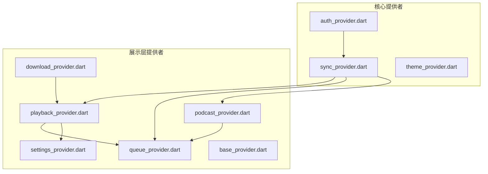
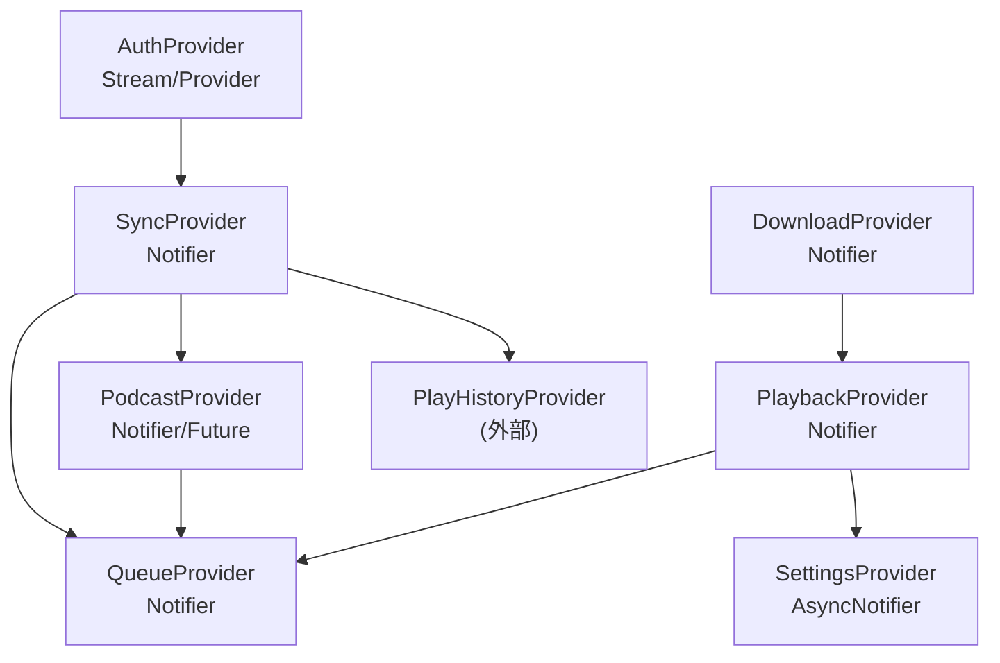
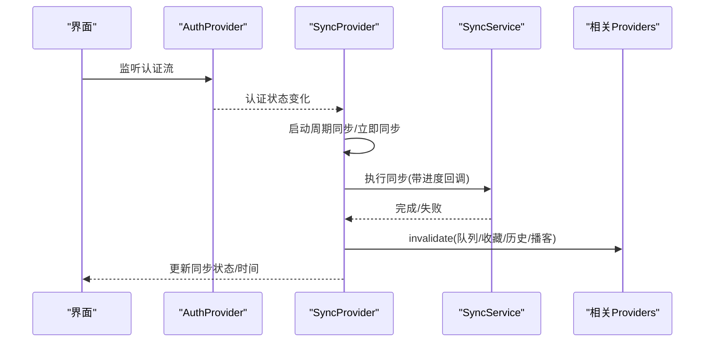
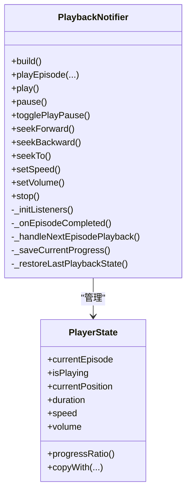
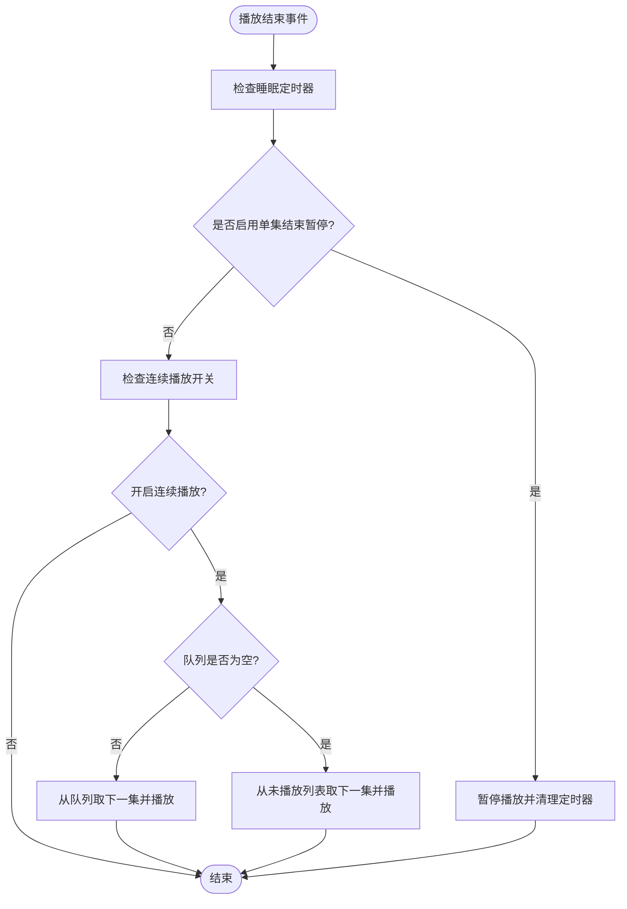
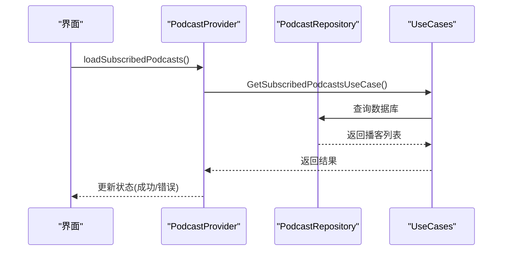
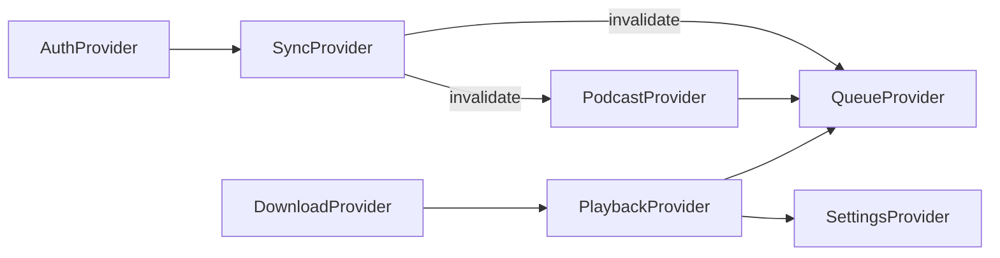

# Provider Pattern（提供者模式）

<cite>
**本文引用的文件**   
- [lib/core/providers/auth_provider.dart](file://lib/core/providers/auth_provider.dart)
- [lib/core/providers/sync_provider.dart](file://lib/core/providers/sync_provider.dart)
- [lib/presentation/providers/playback_provider.dart](file://lib/presentation/providers/playback_provider.dart)
- [lib/presentation/providers/podcast_provider.dart](file://lib/presentation/providers/podcast_provider.dart)
- [lib/presentation/providers/download_provider.dart](file://lib/presentation/providers/download_provider.dart)
- [lib/presentation/providers/queue_provider.dart](file://lib/presentation/providers/queue_provider.dart)
- [lib/presentation/providers/settings_provider.dart](file://lib/presentation/providers/settings_provider.dart)
- [lib/presentation/providers/base_provider.dart](file://lib/presentation/providers/base_provider.dart)
</cite>

## 目录
1. [简介](#简介)
2. [项目结构](#项目结构)
3. [核心组件](#核心组件)
4. [架构总览](#架构总览)
5. [详细组件分析](#详细组件分析)
6. [依赖关系分析](#依赖关系分析)
7. [性能考量](#性能考量)
8. [故障排查指南](#故障排查指南)
9. [结论](#结论)
10. [附录](#附录)

## 简介
本文件面向 TinyCast 应用，系统化阐述基于 Riverpod 的 Provider 模式实践。内容覆盖：
- StateProvider、NotifierProvider、FutureProvider、StreamProvider、AsyncNotifierProvider 等类型的使用场景与最佳实践
- 核心提供者的实现与协作：PlaybackProvider、PodcastProvider、DownloadProvider、AuthProvider、SyncProvider、QueueProvider、SettingsProvider
- 状态管理流程、依赖注入机制、生命周期管理
- 响应式更新、跨组件共享、异步处理的设计要点
- 组合与测试方法、性能优化技巧与调试手段

## 项目结构
本项目采用分层组织方式，Provider 主要分布在 core/providers 与 presentation/providers 两个目录：
- core/providers：基础设施级能力，如认证、同步、主题等
- presentation/providers：业务层状态与交互，如播放、播客、下载、队列、设置等

图表来源
- [lib/core/providers/auth_provider.dart](file://lib/core/providers/auth_provider.dart)
- [lib/core/providers/sync_provider.dart](file://lib/core/providers/sync_provider.dart)
- [lib/presentation/providers/playback_provider.dart](file://lib/presentation/providers/playback_provider.dart)
- [lib/presentation/providers/podcast_provider.dart](file://lib/presentation/providers/podcast_provider.dart)
- [lib/presentation/providers/download_provider.dart](file://lib/presentation/providers/download_provider.dart)
- [lib/presentation/providers/queue_provider.dart](file://lib/presentation/providers/queue_provider.dart)
- [lib/presentation/providers/settings_provider.dart](file://lib/presentation/providers/settings_provider.dart)

章节来源
- [lib/core/providers/auth_provider.dart](file://lib/core/providers/auth_provider.dart)
- [lib/core/providers/sync_provider.dart](file://lib/core/providers/sync_provider.dart)
- [lib/presentation/providers/playback_provider.dart](file://lib/presentation/providers/playback_provider.dart)
- [lib/presentation/providers/podcast_provider.dart](file://lib/presentation/providers/podcast_provider.dart)
- [lib/presentation/providers/download_provider.dart](file://lib/presentation/providers/download_provider.dart)
- [lib/presentation/providers/queue_provider.dart](file://lib/presentation/providers/queue_provider.dart)
- [lib/presentation/providers/settings_provider.dart](file://lib/presentation/providers/settings_provider.dart)
- [lib/presentation/providers/base_provider.dart](file://lib/presentation/providers/base_provider.dart)

## 核心组件
本节概述各 Provider 的职责与关键设计点：
- AuthProvider：封装 Supabase 认证状态流与当前用户快照，提供 StreamProvider 与 Provider 两种形态
- PlaybackProvider：基于 Notifier 维护播放器状态，订阅音频服务事件流，自动保存进度、处理连续播放、睡眠定时器等
- PodcastProvider：管理订阅/取消订阅、按 ID 查询、最新剧集列表；使用 FutureProvider.family 参数化查询
- DownloadProvider：监听全局下载事件流，维护每个剧集的下载状态与进度
- QueueProvider：队列增删改查、刷新、前端插入等，内部通过 UseCase 调用 Repository
- SettingsProvider：基于 AsyncNotifier 持久化并监听设置变更，影响播放行为与后台刷新策略
- SyncProvider：根据认证状态启动/停止周期同步，协调多个相关 Provider 失效与刷新

章节来源
- [lib/core/providers/auth_provider.dart](file://lib/core/providers/auth_provider.dart)
- [lib/presentation/providers/playback_provider.dart](file://lib/presentation/providers/playback_provider.dart)
- [lib/presentation/providers/podcast_provider.dart](file://lib/presentation/providers/podcast_provider.dart)
- [lib/presentation/providers/download_provider.dart](file://lib/presentation/providers/download_provider.dart)
- [lib/presentation/providers/queue_provider.dart](file://lib/presentation/providers/queue_provider.dart)
- [lib/presentation/providers/settings_provider.dart](file://lib/presentation/providers/settings_provider.dart)
- [lib/core/providers/sync_provider.dart](file://lib/core/providers/sync_provider.dart)

## 架构总览
下图展示了核心 Provider 之间的依赖与数据流向，体现“认证驱动同步”、“播放驱动队列与设置”、“下载事件驱动 UI”等关键路径。

图表来源
- [lib/core/providers/auth_provider.dart](file://lib/core/providers/auth_provider.dart)
- [lib/core/providers/sync_provider.dart](file://lib/core/providers/sync_provider.dart)
- [lib/presentation/providers/playback_provider.dart](file://lib/presentation/providers/playback_provider.dart)
- [lib/presentation/providers/podcast_provider.dart](file://lib/presentation/providers/podcast_provider.dart)
- [lib/presentation/providers/download_provider.dart](file://lib/presentation/providers/download_provider.dart)
- [lib/presentation/providers/queue_provider.dart](file://lib/presentation/providers/queue_provider.dart)
- [lib/presentation/providers/settings_provider.dart](file://lib/presentation/providers/settings_provider.dart)

## 详细组件分析

### 认证提供者（AuthProvider）
- 职责
  - 暴露 Supabase 初始化标志
  - 暴露认证状态流（登录/登出）
  - 暴露当前用户快照
- 关键点
  - 使用 StreamProvider 将认证事件转换为可观察流
  - 使用 Provider 提供轻量快照，避免不必要的重建
- 适用场景
  - 需要实时感知登录态变化的页面或逻辑
  - 仅读取当前用户的只读场景

章节来源
- [lib/core/providers/auth_provider.dart](file://lib/core/providers/auth_provider.dart)

### 同步提供者（SyncProvider）
- 职责
  - 监听认证状态变化，自动启停周期同步
  - 提供手动触发与防抖合并
  - 同步完成后使相关 Provider 失效，保证数据一致性
- 关键点
  - 使用 Timer.periodic 实现周期性任务
  - 使用 ref.invalidate 精准失效下游依赖
  - 记录最后同步时间，便于 UI 展示
- 适用场景
  - 多模块数据一致性要求高的场景
  - 需要与云端保持最终一致的状态

图表来源
- [lib/core/providers/sync_provider.dart](file://lib/core/providers/sync_provider.dart)
- [lib/core/providers/auth_provider.dart](file://lib/core/providers/auth_provider.dart)

章节来源
- [lib/core/providers/sync_provider.dart](file://lib/core/providers/sync_provider.dart)

### 播放提供者（PlaybackProvider）
- 职责
  - 维护播放器状态（当前剧集、播放中、进度、速度、音量）
  - 订阅音频服务事件流，驱动状态更新
  - 自动保存播放进度、处理下一集、睡眠定时器、已播放标记与自动删除下载
- 关键点
  - Notifier + copyWith 不可变更新
  - 多处 Timer 与 StreamSubscription 的生命周期管理
  - 与 QueueProvider、SettingsProvider、PlayProgressService 等多方协作
- 适用场景
  - 播放器控制、进度恢复、连续播放、定时关闭等复杂交互

图表来源
- [lib/presentation/providers/playback_provider.dart](file://lib/presentation/providers/playback_provider.dart)

图表来源
- [lib/presentation/providers/playback_provider.dart](file://lib/presentation/providers/playback_provider.dart)

章节来源
- [lib/presentation/providers/playback_provider.dart](file://lib/presentation/providers/playback_provider.dart)

### 播客提供者（PodcastProvider）
- 职责
  - 订阅/取消订阅播客
  - 加载订阅列表、按 ID 获取播客、按播客 ID 获取剧集、最新 N 集
  - 提供缓存化的 FutureProvider.family 用于参数化查询
- 关键点
  - Notifier 负责操作与状态，FutureProvider.family 负责只读查询
  - 排序与缓存策略提升 UI 渲染性能
- 适用场景
  - 播客库浏览、详情页、剧集列表等

图表来源
- [lib/presentation/providers/podcast_provider.dart](file://lib/presentation/providers/podcast_provider.dart)

章节来源
- [lib/presentation/providers/podcast_provider.dart](file://lib/presentation/providers/podcast_provider.dart)

### 下载提供者（DownloadProvider）
- 职责
  - 监听全局下载事件流，维护每个剧集的下载状态与进度
  - 提供便捷查询接口（进行中、已完成、计数等）
- 关键点
  - 基于 StreamSubscription 聚合事件到本地状态
  - 使用 copyWith 进行不可变更新，确保响应式更新
- 适用场景
  - 下载中心、剧集详情页下载按钮、批量下载等

章节来源
- [lib/presentation/providers/download_provider.dart](file://lib/presentation/providers/download_provider.dart)

### 队列提供者（QueueProvider）
- 职责
  - 队列的增删改查、清空、前端插入
  - 统一通过 UseCase 调用 Repository，保证领域逻辑清晰
- 关键点
  - 使用 requestId 防止竞态导致的状态覆盖
  - 提供 refresh 与多种移除策略
- 适用场景
  - 播放队列、下一集选择、批量管理

章节来源
- [lib/presentation/providers/queue_provider.dart](file://lib/presentation/providers/queue_provider.dart)

### 设置提供者（SettingsProvider）
- 职责
  - 持久化与监听应用设置（播放速度、音量、跳过时长、连续播放、睡眠定时器、刷新间隔等）
  - 在设置变更后触发相关系统重启（如后台刷新调度器）
- 关键点
  - 使用 AsyncNotifierProvider 管理异步初始值与流式更新
  - 提供细粒度的 updateXxx 方法，降低耦合
- 适用场景
  - 设置页、播放控制、后台策略调整

章节来源
- [lib/presentation/providers/settings_provider.dart](file://lib/presentation/providers/settings_provider.dart)

### 基础提供者（BaseProvider）
- 职责
  - 提供通用工厂方法，快速创建 Provider、FutureProvider、StreamProvider
- 关键点
  - 简化样板代码，提高复用性
- 适用场景
  - 需要统一创建风格的简单状态或异步数据

章节来源
- [lib/presentation/providers/base_provider.dart](file://lib/presentation/providers/base_provider.dart)

## 依赖关系分析
- 认证驱动同步：SyncProvider 监听 authStateProvider，登录后启动周期同步，并在完成后 invalidate 多个下游 Provider
- 播放驱动队列与设置：PlaybackProvider 在播放结束时根据设置决定是否自动播放下一集，必要时修改队列与未播放列表
- 下载事件驱动 UI：DownloadProvider 订阅全局事件流，实时更新 UI 状态
- 播客与队列：PodcastProvider 与 QueueProvider 协同，支持从播客详情加入队列等操作

图表来源
- [lib/core/providers/auth_provider.dart](file://lib/core/providers/auth_provider.dart)
- [lib/core/providers/sync_provider.dart](file://lib/core/providers/sync_provider.dart)
- [lib/presentation/providers/playback_provider.dart](file://lib/presentation/providers/playback_provider.dart)
- [lib/presentation/providers/podcast_provider.dart](file://lib/presentation/providers/podcast_provider.dart)
- [lib/presentation/providers/download_provider.dart](file://lib/presentation/providers/download_provider.dart)
- [lib/presentation/providers/queue_provider.dart](file://lib/presentation/providers/queue_provider.dart)
- [lib/presentation/providers/settings_provider.dart](file://lib/presentation/providers/settings_provider.dart)

章节来源
- [lib/core/providers/auth_provider.dart](file://lib/core/providers/auth_provider.dart)
- [lib/core/providers/sync_provider.dart](file://lib/core/providers/sync_provider.dart)
- [lib/presentation/providers/playback_provider.dart](file://lib/presentation/providers/playback_provider.dart)
- [lib/presentation/providers/podcast_provider.dart](file://lib/presentation/providers/podcast_provider.dart)
- [lib/presentation/providers/download_provider.dart](file://lib/presentation/providers/download_provider.dart)
- [lib/presentation/providers/queue_provider.dart](file://lib/presentation/providers/queue_provider.dart)
- [lib/presentation/providers/settings_provider.dart](file://lib/presentation/providers/settings_provider.dart)

## 性能考量
- 最小化重建
  - 使用细粒度 Provider（如 currentEpisodeProvider、isPlayingProvider）避免整块状态变化导致的大范围重建
  - 使用 FutureProvider.family 对参数化查询进行缓存与去重
- 合理刷新
  - 使用 ref.invalidate 仅在必要时机失效依赖，避免全量刷新
  - 使用防抖与节流（如 SyncProvider 的 requestSync）减少频繁触发
- 资源管理
  - 及时取消 StreamSubscription 与 Timer，避免内存泄漏
  - 在 build/onDispose 中集中管理生命周期
- 计算与 IO
  - 将耗时计算放入 Notifier 或独立 Provider，避免阻塞 UI
  - 对网络请求与数据库查询进行缓存与幂等处理

[本节为通用指导，不直接分析具体文件]

## 故障排查指南
- 常见问题定位
  - 认证状态异常：检查 authStateProvider 的流是否被正确订阅与释放
  - 同步失败：查看 SyncProvider 的错误日志与 lastSyncTime 是否更新
  - 播放状态不同步：确认 PlaybackProvider 的事件订阅是否生效，以及进度保存是否触发
  - 下载状态不更新：检查 DownloadProvider 的全局事件流是否正常推送
  - 队列不一致：核对 QueueProvider 的 refresh 与 invalidate 调用链
- 调试建议
  - 使用 Logger 输出关键节点（如播放开始/结束、下载事件、同步进度）
  - 使用 ref.listen 观察 Provider 状态变化，定位触发源
  - 在单元测试中使用 ProviderContainer 模拟依赖，验证状态流转

章节来源
- [lib/core/providers/auth_provider.dart](file://lib/core/providers/auth_provider.dart)
- [lib/core/providers/sync_provider.dart](file://lib/core/providers/sync_provider.dart)
- [lib/presentation/providers/playback_provider.dart](file://lib/presentation/providers/playback_provider.dart)
- [lib/presentation/providers/download_provider.dart](file://lib/presentation/providers/download_provider.dart)
- [lib/presentation/providers/queue_provider.dart](file://lib/presentation/providers/queue_provider.dart)

## 结论
TinyCast 的 Provider 模式以 Riverpod 为核心，围绕 NotifierProvider、FutureProvider、StreamProvider、AsyncNotifierProvider 构建清晰的层次化状态管理。通过认证驱动同步、播放驱动队列与设置、下载事件驱动 UI 等设计，实现了高内聚、低耦合、强响应的应用架构。配合合理的生命周期管理与性能优化策略，可在复杂交互场景下保持稳定与高效。

[本节为总结性内容，不直接分析具体文件]

## 附录

### Provider 类型与使用场景速览
- StateProvider：简单只读状态，适合常量或配置快照
- NotifierProvider：可变状态与业务逻辑，适合播放器、队列、下载等
- FutureProvider：一次性异步数据，适合按需加载与缓存
- StreamProvider：持续事件流，适合认证、下载事件、网络状态
- AsyncNotifierProvider：异步初始值+流式更新，适合设置、用户信息等

章节来源
- [lib/presentation/providers/base_provider.dart](file://lib/presentation/providers/base_provider.dart)
- [lib/core/providers/auth_provider.dart](file://lib/core/providers/auth_provider.dart)
- [lib/presentation/providers/playback_provider.dart](file://lib/presentation/providers/playback_provider.dart)
- [lib/presentation/providers/podcast_provider.dart](file://lib/presentation/providers/podcast_provider.dart)
- [lib/presentation/providers/download_provider.dart](file://lib/presentation/providers/download_provider.dart)
- [lib/presentation/providers/settings_provider.dart](file://lib/presentation/providers/settings_provider.dart)