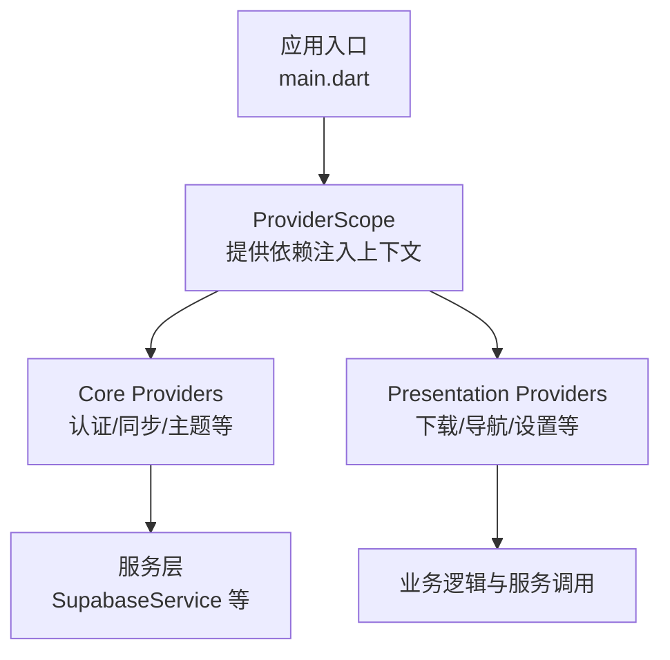
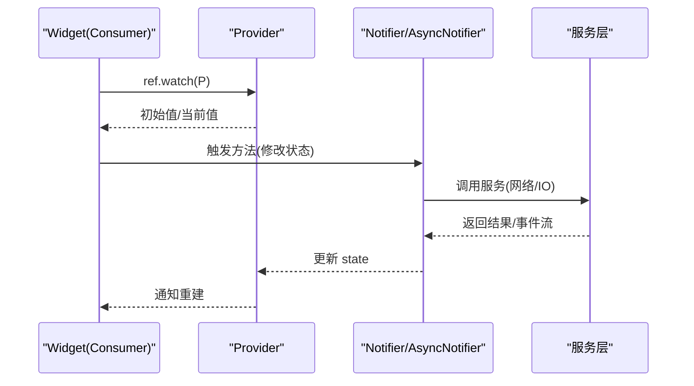
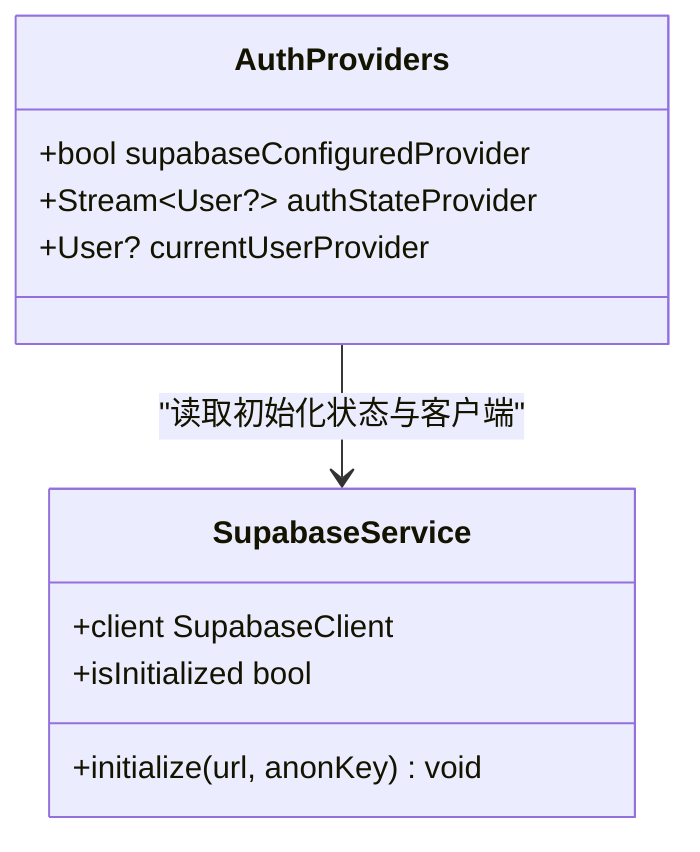
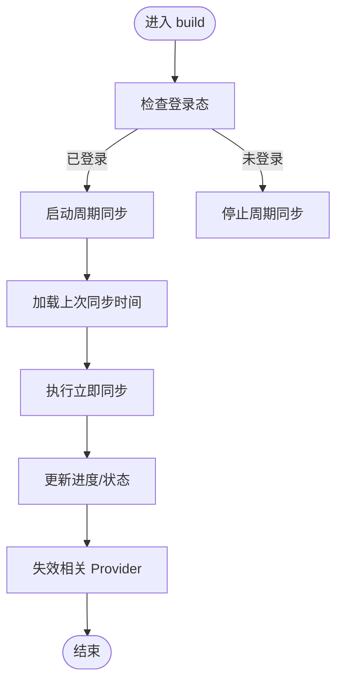
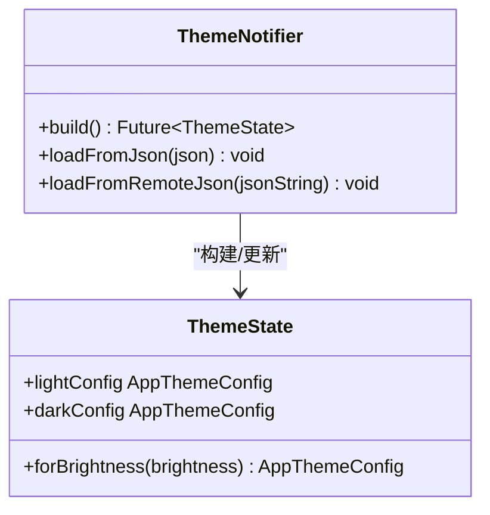
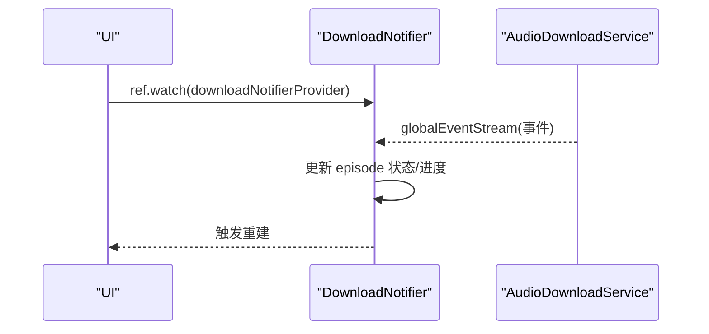
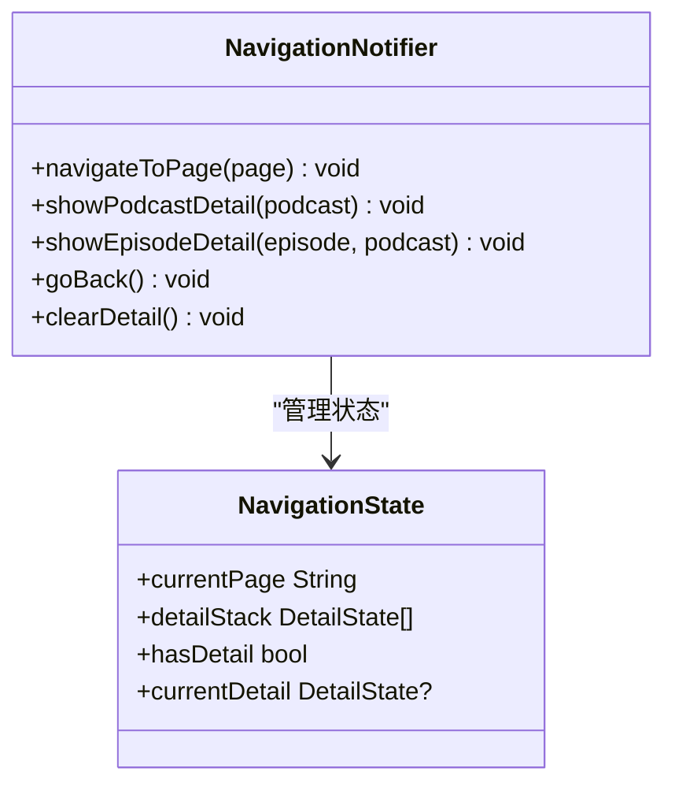
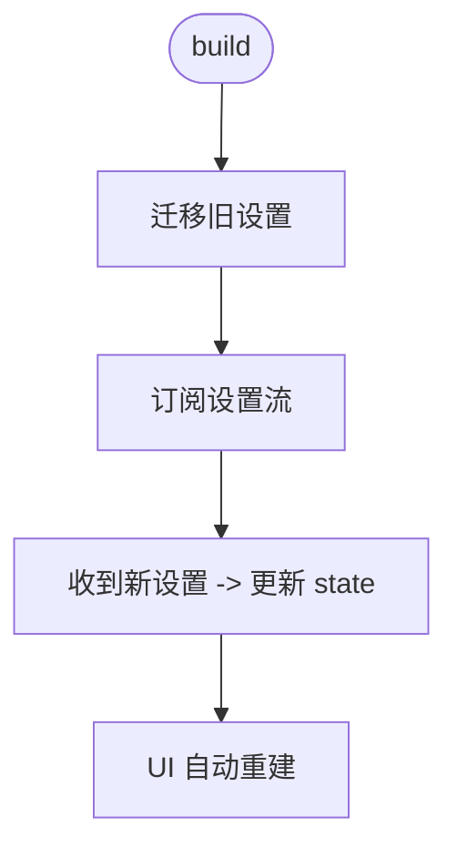
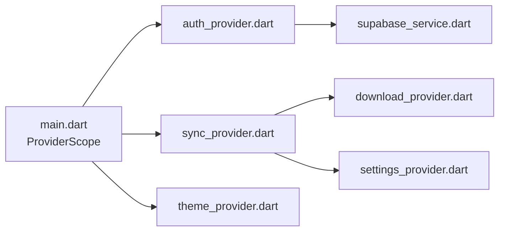

# Provider 基础概念

<cite>
**本文引用的文件**
- [pubspec.yaml](file://pubspec.yaml)
- [main.dart](file://lib/main.dart)
- [ai-rules-for-flutter-and-dart.md](file://.agents/rules/ai-rules-for-flutter-and-dart.md)
- [upgrade-dependencies/summary.md](file://.trae/specs/upgrade-dependencies/summary.md)
- [supabase_service.dart](file://lib/core/services/supabase_service.dart)
- [auth_provider.dart](file://lib/core/providers/auth_provider.dart)
- [sync_provider.dart](file://lib/presentation/providers/sync_provider.dart)
- [theme_loader.dart](file://lib/core/theme/theme_loader.dart)
- [base_provider.dart](file://lib/presentation/providers/base_provider.dart)
- [download_provider.dart](file://lib/presentation/providers/download_provider.dart)
- [navigation_provider.dart](file://lib/presentation/providers/navigation_provider.dart)
- [settings_provider.dart](file://lib/presentation/providers/settings_provider.dart)
</cite>

## 目录
1. [简介](#简介)
2. [项目结构](#项目结构)
3. [核心组件](#核心组件)
4. [架构总览](#架构总览)
5. [详细组件分析](#详细组件分析)
6. [依赖关系分析](#依赖关系分析)
7. [性能考量](#性能考量)
8. [故障排查指南](#故障排查指南)
9. [结论](#结论)
10. [附录](#附录)

## 简介
本章节面向 TinyCast 应用中的 Riverpod 使用，系统梳理 Provider 的基础概念与最佳实践。内容涵盖：
- Provider、Consumer、StateProvider、NotifierProvider、AsyncNotifierProvider、StreamProvider、FutureProvider 等核心类型的使用场景与差异
- Provider 的创建方式、依赖注入机制、生命周期管理
- 状态管理、异步处理、数据共享的典型用法
- Provider 与 Widget 的关系，以及 ref.watch、ref.listen、ref.read 的正确使用
- 常见陷阱与优化建议

## 项目结构
TinyCast 在 pubspec.yaml 中声明了 riverpod 与 flutter_riverpod 依赖，并在应用入口 main.dart 中使用 ProviderScope 包裹整个应用树，使所有子树都能访问 Provider。

图表来源
- [main.dart:106-176](file://lib/main.dart#L106-L176)
- [pubspec.yaml:56-58](file://pubspec.yaml#L56-L58)

章节来源
- [pubspec.yaml:56-58](file://pubspec.yaml#L56-L58)
- [main.dart:106-176](file://lib/main.dart#L106-L176)

## 核心组件
- Provider：用于不可变值或单例服务的依赖注入（如 SupabaseClient）
- StateProvider：轻量级只读状态（例如计数器）
- NotifierProvider：可变的响应式状态，适合复杂业务逻辑
- AsyncNotifierProvider：异步状态，支持加载/成功/错误状态
- StreamProvider：基于 Stream 的响应式数据流（如认证状态流）
- FutureProvider：一次性异步任务结果

这些类型在 TinyCast 中均有实际使用，覆盖从简单配置到复杂状态管理的多种场景。

章节来源
- [ai-rules-for-flutter-and-dart.md:87-99](file://.agents/rules/ai-rules-for-flutter-and-dart.md#L87-L99)
- [auth_provider.dart:9-16](file://lib/core/providers/auth_provider.dart#L9-L16)
- [theme_loader.dart:7-9](file://lib/core/theme/theme_loader.dart#L7-L9)
- [sync_provider.dart:153-155](file://lib/presentation/providers/sync_provider.dart#L153-L155)
- [download_provider.dart:132-135](file://lib/presentation/providers/download_provider.dart#L132-L135)
- [settings_provider.dart:35-37](file://lib/presentation/providers/settings_provider.dart#L35-L37)

## 架构总览
Riverpod 在 TinyCast 中的整体交互如下：Widget 通过 ConsumerWidget 或 Consumer 获取 ref，使用 ref.watch 订阅 Provider 变化；Notifier/AsyncNotifier 负责状态变更与副作用；底层服务（如 SupabaseService、Isar、AudioDownloadService）通过 Provider 暴露给 UI。

图表来源
- [auth_provider.dart:9-16](file://lib/core/providers/auth_provider.dart#L9-L16)
- [sync_provider.dart:110-141](file://lib/presentation/providers/sync_provider.dart#L110-L141)
- [download_provider.dart:55-94](file://lib/presentation/providers/download_provider.dart#L55-L94)
- [settings_provider.dart:44-61](file://lib/presentation/providers/settings_provider.dart#L44-L61)

## 详细组件分析

### 认证相关 Provider（StreamProvider 与 Provider）
- supabaseConfiguredProvider：布尔值，表示 Supabase 是否已初始化
- authStateProvider：StreamProvider，监听 Supabase 认证状态流，输出当前用户
- currentUserProvider：Provider，直接读取当前用户对象

这些 Provider 展示了如何结合外部 SDK 的流与即时状态，为 UI 提供响应式认证信息。

图表来源
- [auth_provider.dart:5-21](file://lib/core/providers/auth_provider.dart#L5-L21)
- [supabase_service.dart:8-47](file://lib/core/services/supabase_service.dart#L8-L47)

章节来源
- [auth_provider.dart:5-21](file://lib/core/providers/auth_provider.dart#L5-L21)
- [supabase_service.dart:8-47](file://lib/core/services/supabase_service.dart#L8-L47)

### 同步状态管理（NotifierProvider）
SyncNotifier 管理同步状态（空闲/进行中/错误），包含：
- 周期性同步与防抖请求
- 登录态监听并启动/停止定时任务
- 进度回调与错误处理
- 完成后失效相关 Provider 以刷新 UI

图表来源
- [sync_provider.dart:47-74](file://lib/presentation/providers/sync_provider.dart#L47-L74)
- [sync_provider.dart:110-150](file://lib/presentation/providers/sync_provider.dart#L110-L150)

章节来源
- [sync_provider.dart:41-155](file://lib/presentation/providers/sync_provider.dart#L41-L155)

### 主题状态（AsyncNotifierProvider）
ThemeNotifier 异步加载主题配置，失败时回退到默认配置。UI 可通过 AsyncNotifierProvider 获取 ThemeState，并根据亮度选择对应主题配置。

图表来源
- [theme_loader.dart:65-91](file://lib/core/theme/theme_loader.dart#L65-L91)
- [theme_loader.dart:11-26](file://lib/core/theme/theme_loader.dart#L11-L26)

章节来源
- [theme_loader.dart:7-91](file://lib/core/theme/theme_loader.dart#L7-L91)

### 下载状态（NotifierProvider + 全局事件流）
DownloadNotifier 订阅 AudioDownloadService 的全局事件流，维护每个 episode 的状态与进度，并提供清理与查询接口。

图表来源
- [download_provider.dart:55-94](file://lib/presentation/providers/download_provider.dart#L55-L94)
- [download_provider.dart:132-155](file://lib/presentation/providers/download_provider.dart#L132-L155)

章节来源
- [download_provider.dart:51-155](file://lib/presentation/providers/download_provider.dart#L51-L155)

### 导航状态（NotifierProvider）
NavigationNotifier 维护当前页面与详情页栈，支持跳转、返回与清空详情栈。UI 通过 Provider 组合出 currentPage、currentDetail、hasDetail 等派生值。

图表来源
- [navigation_provider.dart:62-111](file://lib/presentation/providers/navigation_provider.dart#L62-L111)
- [navigation_provider.dart:113-127](file://lib/presentation/providers/navigation_provider.dart#L113-L127)

章节来源
- [navigation_provider.dart:1-128](file://lib/presentation/providers/navigation_provider.dart#L1-L128)

### 设置状态（AsyncNotifierProvider + Stream 订阅）
SettingsNotifier 通过 SettingsService 的 watchSettings() 流实时同步设置，并提供各类设置的更新方法。首次启动进行迁移，确保多窗口一致性。

图表来源
- [settings_provider.dart:44-61](file://lib/presentation/providers/settings_provider.dart#L44-L61)
- [settings_provider.dart:69-184](file://lib/presentation/providers/settings_provider.dart#L69-L184)

章节来源
- [settings_provider.dart:35-184](file://lib/presentation/providers/settings_provider.dart#L35-L184)

### 通用 Provider 工具（BaseProvider）
BaseProvider 提供便捷工厂方法，快速创建 Provider、FutureProvider、StreamProvider，简化样板代码。

章节来源
- [base_provider.dart:9-27](file://lib/presentation/providers/base_provider.dart#L9-L27)

## 依赖关系分析
- 应用入口 main.dart 使用 ProviderScope 提供依赖注入上下文
- Core 层 Provider 依赖服务类（如 SupabaseService）
- Presentation 层 Provider 依赖业务服务与跨模块 Provider（如 sync 失效其他 Provider）
- 各 Provider 之间通过 ref.invalidate 实现解耦的数据刷新

图表来源
- [main.dart:106-176](file://lib/main.dart#L106-L176)
- [auth_provider.dart:5-21](file://lib/core/providers/auth_provider.dart#L5-L21)
- [sync_provider.dart:143-150](file://lib/presentation/providers/sync_provider.dart#L143-L150)
- [supabase_service.dart:52-54](file://lib/core/services/supabase_service.dart#L52-L54)

章节来源
- [main.dart:106-176](file://lib/main.dart#L106-L176)
- [sync_provider.dart:143-150](file://lib/presentation/providers/sync_provider.dart#L143-L150)

## 性能考量
- 使用 ref.watch 精确订阅，避免不必要的重建
- 将计算型派生值拆分为独立 Provider，减少重复计算
- 对频繁更新的流（如下载事件）进行节流/去抖
- 合理拆分 Provider，避免大对象频繁复制
- 使用 ref.onDispose 释放资源（定时器、订阅）

[本节为通用指导，不直接分析具体文件]

## 故障排查指南
- 认证流为空或未更新：检查 SupabaseService 是否已初始化，确认 authStateProvider 的流是否正确返回
- 同步状态卡住：查看 _startPeriodicSync/_stopPeriodicSync 与 requestSync 的调用路径，确认 canSync 条件
- 主题加载失败：检查 ThemeLoader 是否能正确加载 HOCON 配置，必要时回退到默认配置
- 下载状态不同步：确认 globalEventStream 是否正常推送事件，检查 DownloadNotifier 的事件处理逻辑
- 设置未生效：检查 SettingsService 的持久化与 watch 流是否正常，确认多窗口间的一致性

章节来源
- [auth_provider.dart:9-16](file://lib/core/providers/auth_provider.dart#L9-L16)
- [sync_provider.dart:88-101](file://lib/presentation/providers/sync_provider.dart#L88-L101)
- [theme_loader.dart:67-77](file://lib/core/theme/theme_loader.dart#L67-L77)
- [download_provider.dart:55-94](file://lib/presentation/providers/download_provider.dart#L55-L94)
- [settings_provider.dart:44-61](file://lib/presentation/providers/settings_provider.dart#L44-L61)

## 结论
TinyCast 通过 Riverpod 实现了清晰的状态管理与依赖注入体系：
- 使用 Provider 类型区分静态配置、可变状态、异步与流式数据
- 借助 Notifier/AsyncNotifier 封装复杂业务逻辑与副作用
- 通过 ref.watch/ref.listen/ref.read 精准控制 UI 重建与副作用触发
- 利用 Provider 间的解耦与失效机制保证数据一致性与性能

遵循本文的最佳实践与注意事项，可在保持代码可读性的同时提升应用的稳定性与性能。

[本节为总结性内容，不直接分析具体文件]

## 附录
- Riverpod 版本与迁移要点：Riverpod 3.x 移除了 StateNotifier，统一迁移至 Notifier 模式；示例见升级文档
- 推荐 Widget 模式：使用 ConsumerWidget 配合 ref.watch 获取 Provider 值，避免手动订阅与销毁

章节来源
- [upgrade-dependencies/summary.md:18-65](file://.trae/specs/upgrade-dependencies/summary.md#L18-L65)
- [ai-rules-for-flutter-and-dart.md:87-99](file://.agents/rules/ai-rules-for-flutter-and-dart.md#L87-L99)