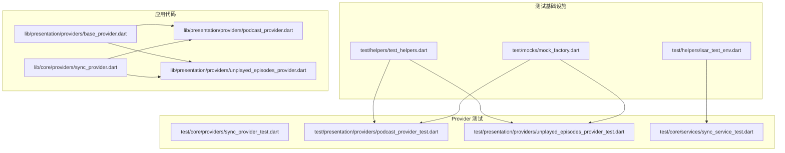
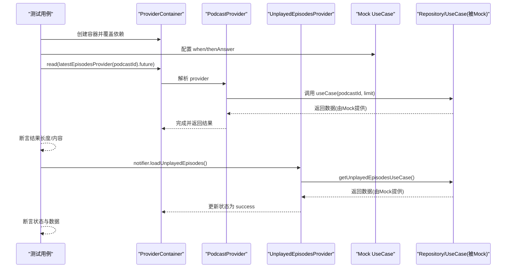
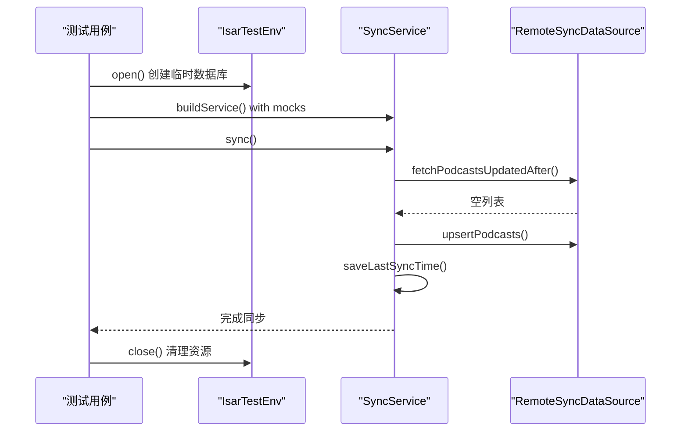
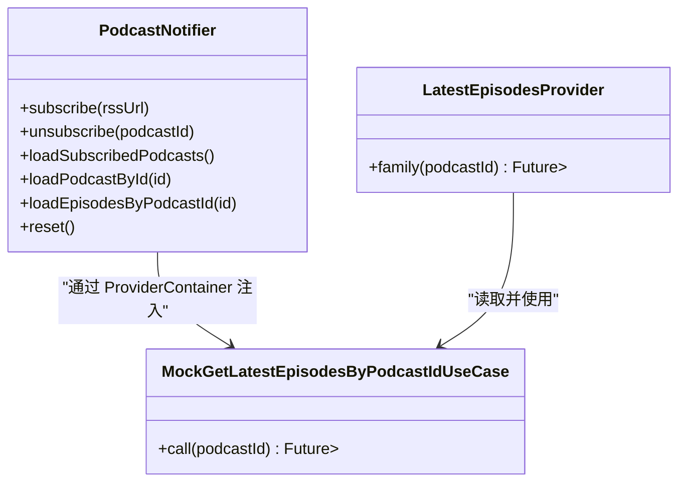
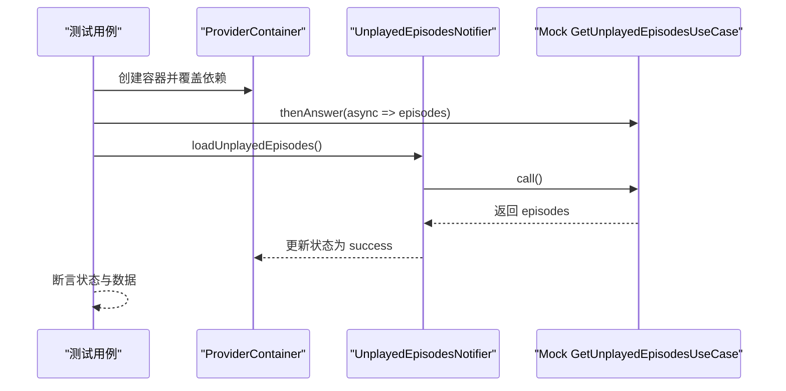
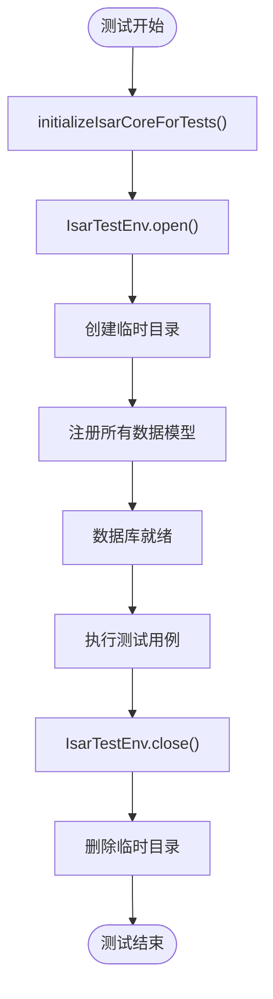
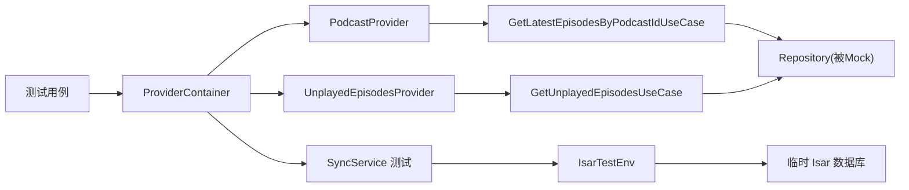

# Provider 测试策略

<cite>
**本文引用的文件**   
- [test/helpers/test_helpers.dart](file://test/helpers/test_helpers.dart)
- [test/helpers/isar_test_env.dart](file://test/helpers/isar_test_env.dart)
- [test/mocks/mock_factory.dart](file://test/mocks/mock_factory.dart)
- [test/core/providers/sync_provider_test.dart](file://test/core/providers/sync_provider_test.dart)
- [test/core/services/sync_service_test.dart](file://test/core/services/sync_service_test.dart)
- [test/presentation/providers/podcast_provider_test.dart](file://test/presentation/providers/podcast_provider_test.dart)
- [test/presentation/providers/unplayed_episodes_provider_test.dart](file://test/presentation/providers/unplayed_episodes_provider_test.dart)
- [lib/presentation/providers/base_provider.dart](file://lib/presentation/providers/base_provider.dart)
- [lib/core/providers/sync_provider.dart](file://lib/core/providers/sync_provider.dart)
- [lib/presentation/providers/podcast_provider.dart](file://lib/presentation/providers/podcast_provider.dart)
- [lib/presentation/providers/unplayed_episodes_provider.dart](file://lib/presentation/providers/unplayed_episodes_provider.dart)
- [pubspec.yaml](file://pubspec.yaml)
</cite>

## 更新摘要
**所做更改**
- 新增 IsarTestEnv 临时数据库环境支持章节
- 更新同步服务测试策略，包含已启用的集成测试用例
- 增强 Riverpod ProviderContainer 使用示例
- 添加新的测试基础设施最佳实践
- 更新故障排查指南以包含新的测试环境问题

## 目录
1. [简介](#简介)
2. [项目结构](#项目结构)
3. [核心组件](#核心组件)
4. [架构总览](#架构总览)
5. [详细组件分析](#详细组件分析)
6. [依赖分析](#依赖分析)
7. [性能考虑](#性能考虑)
8. [故障排查指南](#故障排查指南)
9. [结论](#结论)
10. [附录](#附录)

## 简介
本文件面向 TinyCast 应用中的 Provider（基于 Riverpod）测试，提供一套完整的单元测试与集成测试策略。内容涵盖：
- 如何使用 ProviderContainer 搭建测试环境
- 如何借助 Mock 对象模拟异步操作、网络请求与外部依赖
- 如何使用 IsarTestEnv 创建临时数据库环境进行集成测试
- 如何验证状态变更、错误处理、依赖注入等关键场景
- 测试数据准备、断言编写、并发与时间相关测试的最佳实践
- 常见问题定位与调试技巧

## 项目结构
本项目采用分层架构（presentation/domain/data），Provider 位于 presentation 层，使用 Riverpod 进行状态管理；测试集中在 test 目录下，按功能域组织。

**图表来源**
- [test/helpers/test_helpers.dart:1-202](file://test/helpers/test_helpers.dart#L1-L202)
- [test/helpers/isar_test_env.dart:1-102](file://test/helpers/isar_test_env.dart#L1-L102)
- [test/mocks/mock_factory.dart:1-397](file://test/mocks/mock_factory.dart#L1-L397)
- [test/core/providers/sync_provider_test.dart:1-367](file://test/core/providers/sync_provider_test.dart#L1-L367)
- [test/core/services/sync_service_test.dart:470-585](file://test/core/services/sync_service_test.dart#L470-L585)
- [test/presentation/providers/podcast_provider_test.dart:1-207](file://test/presentation/providers/podcast_provider_test.dart#L1-L207)
- [test/presentation/providers/unplayed_episodes_provider_test.dart:1-307](file://test/presentation/providers/unplayed_episodes_provider_test.dart#L1-L307)
- [lib/presentation/providers/base_provider.dart:1-27](file://lib/presentation/providers/base_provider.dart#L1-L27)
- [lib/core/providers/sync_provider.dart:1-168](file://lib/core/providers/sync_provider.dart#L1-L168)
- [lib/presentation/providers/podcast_provider.dart:1-264](file://lib/presentation/providers/podcast_provider.dart#L1-L264)
- [lib/presentation/providers/unplayed_episodes_provider.dart:1-107](file://lib/presentation/providers/unplayed_episodes_provider.dart#L1-L107)

**章节来源**
- [pubspec.yaml:1-196](file://pubspec.yaml#L1-L196)

## 核心组件
- BaseProvider：封装 Provider/FutureProvider/StreamProvider 的创建方式，便于统一构建与测试。
- SyncProvider：同步状态与定时同步逻辑，监听认证状态变化并触发同步。
- PodcastProvider：播客订阅、剧集加载、最新剧集查询等能力，包含多个 FutureProvider.family。
- UnplayedEpisodesProvider：未播放剧集列表的状态管理与刷新逻辑。
- IsarTestEnv：临时数据库环境管理器，为集成测试提供真实的 Isar 数据库实例。

**章节来源**
- [lib/presentation/providers/base_provider.dart:1-27](file://lib/presentation/providers/base_provider.dart#L1-L27)
- [lib/core/providers/sync_provider.dart:1-168](file://lib/core/providers/sync_provider.dart#L1-L168)
- [lib/presentation/providers/podcast_provider.dart:1-264](file://lib/presentation/providers/podcast_provider.dart#L1-L264)
- [lib/presentation/providers/unplayed_episodes_provider.dart:1-107](file://lib/presentation/providers/unplayed_episodes_provider.dart#L1-L107)
- [test/helpers/isar_test_env.dart:71-102](file://test/helpers/isar_test_env.dart#L71-L102)

## 架构总览
下图展示了 Provider 在测试中的调用链与依赖关系，重点体现 ProviderContainer 的使用、Mock 注入以及异步流程。

**图表来源**
- [test/presentation/providers/podcast_provider_test.dart:1-207](file://test/presentation/providers/podcast_provider_test.dart#L1-L207)
- [test/presentation/providers/unplayed_episodes_provider_test.dart:1-307](file://test/presentation/providers/unplayed_episodes_provider_test.dart#L1-L307)
- [lib/presentation/providers/podcast_provider.dart:246-254](file://lib/presentation/providers/podcast_provider.dart#L246-L254)
- [lib/presentation/providers/unplayed_episodes_provider.dart:60-81](file://lib/presentation/providers/unplayed_episodes_provider.dart#L60-L81)

## 详细组件分析

### 同步 Provider（SyncProvider）测试策略
- 目标：验证初始状态、状态转换、防抖与周期性同步、错误处理。
- 方法：
  - 直接构造 SyncState 验证默认值与 copyWith 行为。
  - 通过 Notifier 调用 syncNow()，观察 status 从 idle → syncing → idle/error 的变化。
  - 使用 fake SyncService 实现来模拟同步行为，避免真实网络请求。
- 关键点：
  - 使用 Timer 与微任务调度，测试中可通过等待或跳过复杂时序。
  - 错误路径需断言 errorMessage 与 status。
  - 通过 ProviderContainer 覆盖 authStateProvider 和 syncServiceProvider 依赖。

**图表来源**
- [lib/core/providers/sync_provider.dart:110-141](file://lib/core/providers/sync_provider.dart#L110-L141)
- [test/core/providers/sync_provider_test.dart:232-259](file://test/core/providers/sync_provider_test.dart#L232-L259)

**章节来源**
- [test/core/providers/sync_provider_test.dart:1-367](file://test/core/providers/sync_provider_test.dart#L1-L367)
- [lib/core/providers/sync_provider.dart:1-168](file://lib/core/providers/sync_provider.dart#L1-L168)

### 同步服务集成测试（SyncService）
- 目标：验证完整同步流程，包括认证检查、拉取推送顺序、时间戳保存和进度回调。
- 方法：
  - 使用 IsarTestEnv 创建临时数据库环境。
  - 通过构造函数注入 mock RemoteSyncDataSource。
  - 验证 SS-001 到 SS-012 的所有集成测试用例。
- 关键点：
  - 用户未认证时跳过同步（SS-001）。
  - 先拉取后推送的顺序保证（SS-002）。
  - 同步完成后保存时间戳（SS-003）。
  - 同步过程中触发进度回调（SS-012）。

**图表来源**
- [test/core/services/sync_service_test.dart:486-582](file://test/core/services/sync_service_test.dart#L486-L582)
- [test/helpers/isar_test_env.dart:78-95](file://test/helpers/isar_test_env.dart#L78-L95)

**章节来源**
- [test/core/services/sync_service_test.dart:470-585](file://test/core/services/sync_service_test.dart#L470-L585)

### 播客 Provider（PodcastProvider）测试策略
- 目标：验证 latestEpisodesProvider 的参数化查询、加载状态、错误处理与不同 podcastId 的数据隔离。
- 方法：
  - 使用 ProviderContainer 覆盖依赖，注入 Mock GetLatestEpisodesByPodcastIdUseCase。
  - 通过 container.read(provider.future) 获取异步结果，断言长度与顺序。
  - 验证 loading → success/error 的状态流转。
- 关键点：
  - 使用 @GenerateMocks 生成 Mock 类，配合 when/verify 进行行为校验。
  - 针对不同 podcastId 分别 stub 返回值，确保隔离性。

**图表来源**
- [lib/presentation/providers/podcast_provider.dart:98-203](file://lib/presentation/providers/podcast_provider.dart#L98-L203)
- [lib/presentation/providers/podcast_provider.dart:246-254](file://lib/presentation/providers/podcast_provider.dart#L246-L254)
- [test/presentation/providers/podcast_provider_test.dart:19-25](file://test/presentation/providers/podcast_provider_test.dart#L19-L25)

**章节来源**
- [test/presentation/providers/podcast_provider_test.dart:1-207](file://test/presentation/providers/podcast_provider_test.dart#L1-L207)
- [lib/presentation/providers/podcast_provider.dart:1-264](file://lib/presentation/providers/podcast_provider.dart#L1-L264)

### 未播放剧集 Provider（UnplayedEpisodesProvider）测试策略
- 目标：验证 loadUnplayedEpisodes、refresh、reset 及状态变化序列。
- 方法：
  - 使用 ProviderContainer 覆盖依赖，注入 Mock GetUnplayedEpisodesUseCase 和 PlayHistoryRepository。
  - 通过 notifier.loadUnplayedEpisodes() 触发加载，断言 status 与 episodes。
  - 使用 container.listen 捕获状态变化序列，验证 loading → success/error。
- 关键点：
  - 空列表与异常路径均需覆盖。
  - refresh 多次调用应重新拉取数据，验证调用次数。

**图表来源**
- [test/presentation/providers/unplayed_episodes_provider_test.dart:60-85](file://test/presentation/providers/unplayed_episodes_provider_test.dart#L60-L85)
- [lib/presentation/providers/unplayed_episodes_provider.dart:60-81](file://lib/presentation/providers/unplayed_episodes_provider.dart#L60-L81)

**章节来源**
- [test/presentation/providers/unplayed_episodes_provider_test.dart:1-307](file://test/presentation/providers/unplayed_episodes_provider_test.dart#L1-L307)
- [lib/presentation/providers/unplayed_episodes_provider.dart:1-107](file://lib/presentation/providers/unplayed_episodes_provider.dart#L1-L107)

### 基础 Provider 工具（BaseProvider）
- 作用：统一创建 Provider/FutureProvider/StreamProvider/LazyProvider，简化测试中的依赖注入与构建。
- 使用建议：
  - 在测试中优先使用 BaseProvider.createAsync 构建可异步的 Provider，便于断言 future。
  - 结合 ProviderContainer.overrideWithValue 替换真实实现为 Mock。

**章节来源**
- [lib/presentation/providers/base_provider.dart:1-27](file://lib/presentation/providers/base_provider.dart#L1-L27)

### Isar 临时数据库环境（IsarTestEnv）
- 作用：为集成测试提供真实的 Isar 数据库实例，支持完整的数据库操作测试。
- 特点：
  - 自动创建临时目录存储数据库文件。
  - 注册所有 TinyCast 数据模型 schema。
  - 提供统一的 open/close 生命周期管理。
  - 支持多平台 ABI 自动检测。
- 使用场景：
  - 同步服务的完整流程测试。
  - 需要真实数据库操作的集成测试。
  - 验证数据库迁移和 schema 兼容性。

**图表来源**
- [test/helpers/isar_test_env.dart:18-49](file://test/helpers/isar_test_env.dart#L18-L49)
- [test/helpers/isar_test_env.dart:78-101](file://test/helpers/isar_test_env.dart#L78-L101)

**章节来源**
- [test/helpers/isar_test_env.dart:1-102](file://test/helpers/isar_test_env.dart#L1-L102)

## 依赖分析
- 测试依赖：
  - flutter_riverpod：用于 ProviderContainer、read/watch/future 访问。
  - mockito：用于生成 Mock 类与行为桩。
  - matcher：用于更丰富的断言匹配器。
  - isar_community：用于临时数据库环境支持。
- 运行时依赖：
  - Riverpod 核心库与 Flutter 集成。
  - Dio、Isar、Supabase 等外部依赖通过 UseCase/Repository 抽象，便于 Mock。

**图表来源**
- [pubspec.yaml:148-176](file://pubspec.yaml#L148-L176)
- [test/presentation/providers/podcast_provider_test.dart:19-25](file://test/presentation/providers/podcast_provider_test.dart#L19-L25)
- [test/presentation/providers/unplayed_episodes_provider_test.dart:19-31](file://test/presentation/providers/unplayed_episodes_provider_test.dart#L19-L31)
- [test/core/services/sync_service_test.dart:486-523](file://test/core/services/sync_service_test.dart#L486-L523)

**章节来源**
- [pubspec.yaml:148-176](file://pubspec.yaml#L148-L176)

## 性能考虑
- 避免在测试中进行真实网络请求与数据库 I/O，全部通过 Mock 替代。
- 使用 Future.delayed 与 pumpAndSettle 控制异步时序，减少不必要的等待。
- 对频繁刷新的 Provider（如未播放列表）在测试中限制刷新频率或仅验证一次调用。
- 合理拆分测试组，避免共享状态导致测试间干扰。
- 使用 IsarTestEnv 时注意及时关闭数据库连接，避免资源泄漏。
- 对于复杂的集成测试，使用 setUpAll 和 tearDownAll 优化测试执行效率。

## 故障排查指南
- 常见错误：
  - 未正确 dispose ProviderContainer，导致内存泄漏或状态污染。
  - Mock 未配置 when/thenAnswer，导致 noSuchMethod 异常。
  - 异步未完成即断言，导致不稳定测试。
  - IsarTestEnv 未正确初始化或关闭，导致数据库文件锁定。
  - 缺少必要的环境变量（如 PUB_CACHE）导致 Isar 核心库加载失败。
- 调试技巧：
  - 使用 Logger 输出关键步骤，确认调用链与状态变化。
  - 使用 verify/captured 检查参数与调用次数。
  - 将复杂时序测试拆分为多步断言，逐步定位问题。
  - 对于 Isar 相关问题，检查临时目录权限和磁盘空间。
  - 使用 addTearDown 确保测试资源清理。

**章节来源**
- [test/helpers/test_helpers.dart:1-202](file://test/helpers/test_helpers.dart#L1-L202)
- [test/mocks/mock_factory.dart:1-397](file://test/mocks/mock_factory.dart#L1-L397)
- [test/helpers/isar_test_env.dart:18-49](file://test/helpers/isar_test_env.dart#L18-L49)

## 结论
通过 ProviderContainer、Mock 和 IsarTestEnv 的组合，可以为 TinyCast 的 Provider 建立稳定、快速且可维护的测试套件。新增的 IsarTestEnv 使得原本跳过的集成测试（SS-001, SS-002, SS-003, SS-012）得以执行，大幅提升了测试覆盖率。遵循本文的策略，可有效覆盖状态变更、错误处理、依赖注入、数据库操作等关键场景，提升代码质量与迭代效率。

## 附录
- 最佳实践清单：
  - 每个 Provider 至少覆盖：初始状态、成功路径、错误路径、边界条件（空列表、单元素）。
  - 使用 @GenerateMocks 生成 Mock，集中管理桩行为。
  - 对于需要数据库操作的测试，使用 IsarTestEnv 而非 Mock 数据库。
  - 使用 helper 方法统一 UI 与异步操作，提高可读性与复用性。
  - 合理使用 setUpAll/tearDownAll 优化测试执行效率。
  - 为复杂的集成测试添加适当的注释和文档。
- 参考示例路径：
  - 播客 Provider 测试：[test/presentation/providers/podcast_provider_test.dart](file://test/presentation/providers/podcast_provider_test.dart)
  - 未播放剧集 Provider 测试：[test/presentation/providers/unplayed_episodes_provider_test.dart](file://test/presentation/providers/unplayed_episodes_provider_test.dart)
  - 同步 Provider 测试：[test/core/providers/sync_provider_test.dart](file://test/core/providers/sync_provider_test.dart)
  - 同步服务集成测试：[test/core/services/sync_service_test.dart](file://test/core/services/sync_service_test.dart)
  - Isar 测试环境：[test/helpers/isar_test_env.dart](file://test/helpers/isar_test_env.dart)
  - 测试辅助工具：[test/helpers/test_helpers.dart](file://test/helpers/test_helpers.dart)
  - Mock 工厂：[test/mocks/mock_factory.dart](file://test/mocks/mock_factory.dart)