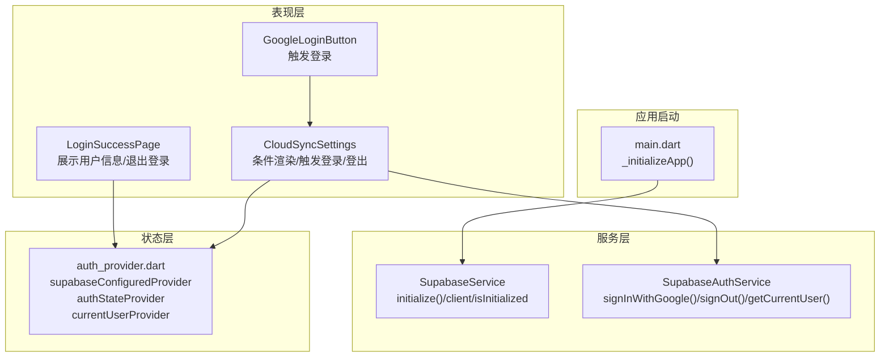
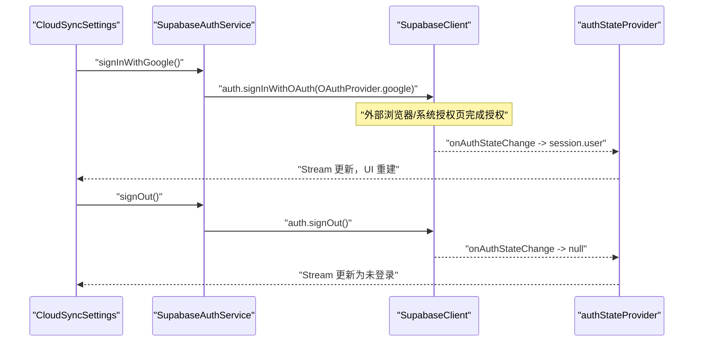
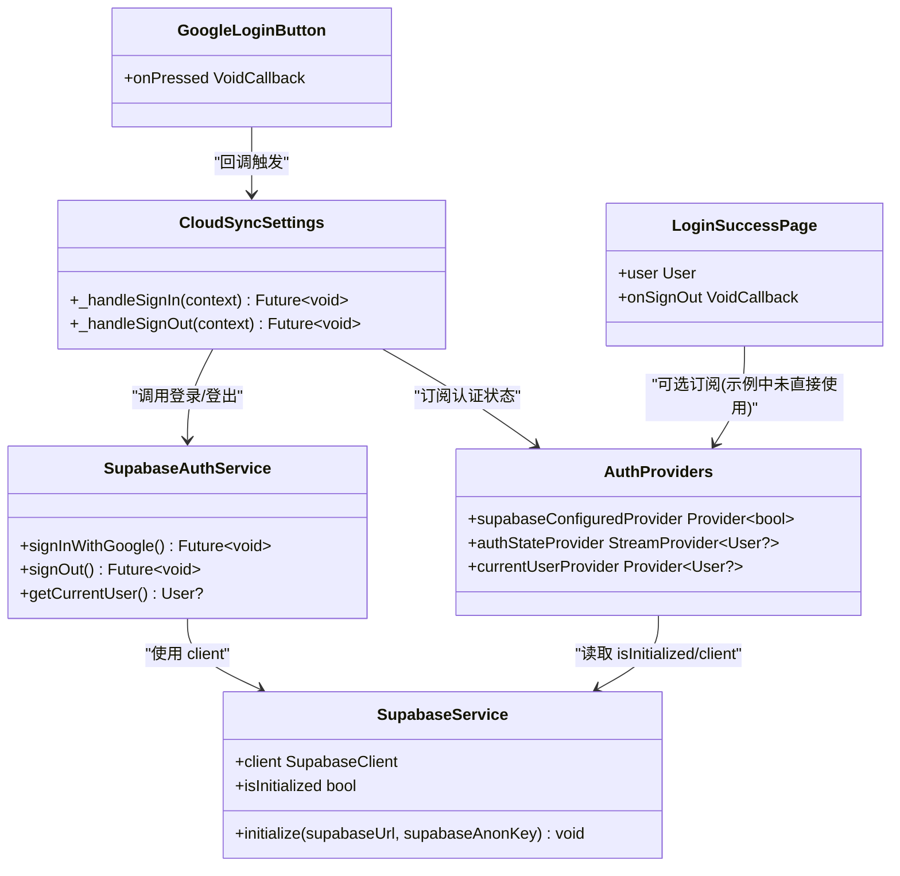

# AuthProvider 用户认证管理

<cite>
**本文引用的文件**
- [lib/core/providers/auth_provider.dart](file://lib/core/providers/auth_provider.dart)
- [lib/core/services/supabase_auth_service.dart](file://lib/core/services/supabase_auth_service.dart)
- [lib/core/services/supabase_service.dart](file://lib/core/services/supabase_service.dart)
- [lib/presentation/features/settings/cloud_sync_settings/cloud_sync_settings.dart](file://lib/presentation/features/settings/cloud_sync_settings/cloud_sync_settings.dart)
- [lib/presentation/features/settings/cloud_sync_settings/login_widgets/login_success_page.dart](file://lib/presentation/features/settings/cloud_sync_settings/login_widgets/login_success_page.dart)
- [lib/presentation/features/settings/cloud_sync_settings/login_widgets/login_button/google_login_button.dart](file://lib/presentation/features/settings/cloud_sync_settings/login_widgets/login_button/google_login_button.dart)
- [lib/main.dart](file://lib/main.dart)
- [docs/supabase_setup.md](file://docs/supabase_setup.md)
</cite>

## 目录
1. [简介](#简介)
2. [项目结构](#项目结构)
3. [核心组件](#核心组件)
4. [架构总览](#架构总览)
5. [详细组件分析](#详细组件分析)
6. [依赖关系分析](#依赖关系分析)
7. [性能与可靠性考量](#性能与可靠性考量)
8. [故障排查指南](#故障排查指南)
9. [结论](#结论)
10. [附录：API 与用法参考](#附录api-与用法参考)

## 简介
本文件围绕 AuthProvider 的用户认证管理进行系统化文档化，重点覆盖 Supabase 认证集成、会话状态管理、权限控制机制以及登录/登出流程。当前实现聚焦于 Google OAuth 登录与登出，并通过 Riverpod Provider 提供认证状态的响应式管理。同时说明应用启动时的初始化流程、配置注入方式，以及 UI 层如何根据认证状态进行条件渲染。

## 项目结构
认证相关代码采用分层组织：
- 服务层：SupabaseService（客户端初始化与访问）、SupabaseAuthService（认证操作封装）
- 状态层：auth_provider（Riverpod Provider 暴露认证状态）
- 表现层：CloudSyncSettings、LoginSuccessPage、GoogleLoginButton（UI 交互与展示）
- 启动入口：main.dart（应用初始化时调用 SupabaseService.initialize）

图表来源
- [lib/main.dart:179-194](file://lib/main.dart#L179-L194)
- [lib/core/services/supabase_service.dart:18-46](file://lib/core/services/supabase_service.dart#L18-L46)
- [lib/core/services/supabase_auth_service.dart:13-37](file://lib/core/services/supabase_auth_service.dart#L13-L37)
- [lib/core/providers/auth_provider.dart:5-21](file://lib/core/providers/auth_provider.dart#L5-L21)
- [lib/presentation/features/settings/cloud_sync_settings/cloud_sync_settings.dart:13-34](file://lib/presentation/features/settings/cloud_sync_settings/cloud_sync_settings.dart#L13-L34)
- [lib/presentation/features/settings/cloud_sync_settings/login_widgets/login_success_page.dart:22-149](file://lib/presentation/features/settings/cloud_sync_settings/login_widgets/login_success_page.dart#L22-L149)
- [lib/presentation/features/settings/cloud_sync_settings/login_widgets/login_button/google_login_button.dart:10-16](file://lib/presentation/features/settings/cloud_sync_settings/login_widgets/login_button/google_login_button.dart#L10-L16)

章节来源
- [lib/main.dart:179-194](file://lib/main.dart#L179-L194)
- [lib/core/services/supabase_service.dart:1-55](file://lib/core/services/supabase_service.dart#L1-L55)
- [lib/core/services/supabase_auth_service.dart:1-39](file://lib/core/services/supabase_auth_service.dart#L1-L39)
- [lib/core/providers/auth_provider.dart:1-22](file://lib/core/providers/auth_provider.dart#L1-L22)
- [lib/presentation/features/settings/cloud_sync_settings/cloud_sync_settings.dart:1-101](file://lib/presentation/features/settings/cloud_sync_settings/cloud_sync_settings.dart#L1-L101)
- [lib/presentation/features/settings/cloud_sync_settings/login_widgets/login_success_page.dart:1-171](file://lib/presentation/features/settings/cloud_sync_settings/login_widgets/login_success_page.dart#L1-L171)
- [lib/presentation/features/settings/cloud_sync_settings/login_widgets/login_button/google_login_button.dart:1-18](file://lib/presentation/features/settings/cloud_sync_settings/login_widgets/login_button/google_login_button.dart#L1-L18)

## 核心组件
- SupabaseService：单例服务，负责 Supabase 客户端的初始化与获取，提供 isInitialized 标志位，确保在应用启动阶段完成初始化后再使用客户端。
- SupabaseAuthService：封装认证操作，包括 Google OAuth 登录、登出、获取当前用户；内部通过 SupabaseService.client 访问 SupabaseClient。
- auth_provider：基于 Riverpod 的 Provider，暴露 supabaseConfiguredProvider（是否已配置）、authStateProvider（监听 onAuthStateChange 流）、currentUserProvider（读取当前用户）。
- CloudSyncSettings：设置页组件，根据 supabaseConfiguredProvider 和 authStateProvider 的值决定显示登录区域或登录成功页面，并处理登录/登出回调。
- LoginSuccessPage：展示当前用户信息与同步状态，并提供退出登录按钮。
- GoogleLoginButton：通用登录按钮样式，点击后触发上层登录逻辑。

章节来源
- [lib/core/services/supabase_service.dart:1-55](file://lib/core/services/supabase_service.dart#L1-L55)
- [lib/core/services/supabase_auth_service.dart:1-39](file://lib/core/services/supabase_auth_service.dart#L1-L39)
- [lib/core/providers/auth_provider.dart:1-22](file://lib/core/providers/auth_provider.dart#L1-L22)
- [lib/presentation/features/settings/cloud_sync_settings/cloud_sync_settings.dart:1-101](file://lib/presentation/features/settings/cloud_sync_settings/cloud_sync_settings.dart#L1-L101)
- [lib/presentation/features/settings/cloud_sync_settings/login_widgets/login_success_page.dart:1-171](file://lib/presentation/features/settings/cloud_sync_settings/login_widgets/login_success_page.dart#L1-L171)
- [lib/presentation/features/settings/cloud_sync_settings/login_widgets/login_button/google_login_button.dart:1-18](file://lib/presentation/features/settings/cloud_sync_settings/login_widgets/login_button/google_login_button.dart#L1-L18)

## 架构总览
整体认证架构遵循“服务层 + 状态层 + 表现层”的分层模式：
- 服务层统一封装 Supabase 客户端与认证方法，避免 UI 直接耦合 SDK。
- 状态层通过 Riverpod 将 Supabase 的 onAuthStateChange 转换为可订阅的 Stream，供 UI 响应式消费。
- 表现层仅关注用户交互与状态展示，不直接操作 SDK。

图表来源
- [lib/presentation/features/settings/cloud_sync_settings/cloud_sync_settings.dart:13-34](file://lib/presentation/features/settings/cloud_sync_settings/cloud_sync_settings.dart#L13-L34)
- [lib/core/services/supabase_auth_service.dart:13-37](file://lib/core/services/supabase_auth_service.dart#L13-L37)
- [lib/core/providers/auth_provider.dart:9-16](file://lib/core/providers/auth_provider.dart#L9-L16)

## 详细组件分析

### SupabaseService（客户端初始化与管理）
- 职责：
  - 单例模式保证全局唯一实例。
  - initialize(url, anonKey) 完成 Supabase 初始化，并标记 _isInitialized。
  - client 属性在未初始化时抛出 StateError，防止误用。
  - isInitialized 用于上游判断是否可用。
- 关键点：
  - 应用启动时在 main.dart 中调用 initialize，确保后续所有组件安全访问 client。
  - 提供 supabaseClientProvider，便于在 Riverpod 中注入客户端。

章节来源
- [lib/core/services/supabase_service.dart:18-46](file://lib/core/services/supabase_service.dart#L18-L46)
- [lib/main.dart:179-194](file://lib/main.dart#L179-L194)

### SupabaseAuthService（认证操作封装）
- 职责：
  - signInWithGoogle()：调用 SupabaseClient.auth.signInWithOAuth，使用外部应用模式打开授权页，并指定桌面端回调 URL。
  - signOut()：调用 SupabaseClient.auth.signOut()。
  - getCurrentUser()：返回当前用户对象。
- 错误处理：
  - 捕获异常并记录日志，然后重新抛出，由调用方（UI）统一处理提示。
- 设计要点：
  - 通过 SupabaseService().client 获取客户端，避免重复初始化。
  - 回调 URL 需与 Supabase Dashboard 中的 URL Configuration 一致。

章节来源
- [lib/core/services/supabase_auth_service.dart:13-37](file://lib/core/services/supabase_auth_service.dart#L13-L37)

### auth_provider（认证状态管理）
- 职责：
  - supabaseConfiguredProvider：返回 SupabaseService.isInitialized，用于 UI 判断是否已配置。
  - authStateProvider：监听 SupabaseClient.auth.onAuthStateChange，映射为 User? 流，供 UI 响应式消费。
  - currentUserProvider：直接读取 SupabaseClient.auth.currentUser。
- 生命周期：
  - 当 Supabase 未初始化时，authStateProvider 返回空流，避免异常。
  - 当 onAuthStateChange 事件触发时，自动更新下游订阅者。

章节来源
- [lib/core/providers/auth_provider.dart:5-21](file://lib/core/providers/auth_provider.dart#L5-L21)

### CloudSyncSettings（设置页与条件渲染）
- 职责：
  - 根据 supabaseConfiguredProvider 与 authStateProvider 的值，动态渲染登录区域或登录成功页面。
  - 处理登录与登出回调，调用 SupabaseAuthService 的方法，并通过 ToastUtils 反馈结果。
- 交互流程：
  - 未登录：显示 CloudLoginInfo 与 SocialLoginButtonGroup（包含 GoogleLoginButton）。
  - 已登录：显示 LoginSuccessPage，包含用户信息与退出登录按钮。

章节来源
- [lib/presentation/features/settings/cloud_sync_settings/cloud_sync_settings.dart:13-34](file://lib/presentation/features/settings/cloud_sync_settings/cloud_sync_settings.dart#L13-L34)
- [lib/presentation/features/settings/cloud_sync_settings/cloud_sync_settings.dart:36-88](file://lib/presentation/features/settings/cloud_sync_settings/cloud_sync_settings.dart#L36-L88)

### LoginSuccessPage（登录成功展示）
- 职责：
  - 展示用户邮箱与显示名称（从 userMetadata.name 或 email 回退）。
  - 展示同步状态与上次同步时间。
  - 提供“手动同步”与“退出登录”按钮。
- 交互：
  - 退出登录按钮触发父级传入的 onSignOut 回调，最终调用 SupabaseAuthService.signOut()。

章节来源
- [lib/presentation/features/settings/cloud_sync_settings/login_widgets/login_success_page.dart:22-149](file://lib/presentation/features/settings/cloud_sync_settings/login_widgets/login_success_page.dart#L22-L149)

### GoogleLoginButton（登录按钮）
- 职责：
  - 提供统一的登录按钮样式，文本为“Google 登录”，图标来自资源文件。
  - 点击后触发上层传入的 onPressed 回调，由 CloudSyncSettings 处理实际登录逻辑。

章节来源
- [lib/presentation/features/settings/cloud_sync_settings/login_widgets/login_button/google_login_button.dart:10-16](file://lib/presentation/features/settings/cloud_sync_settings/login_widgets/login_button/google_login_button.dart#L10-L16)

## 依赖关系分析
- 服务层依赖：
  - SupabaseAuthService 依赖 SupabaseService.client。
- 状态层依赖：
  - auth_provider 依赖 SupabaseService.isInitialized 与 Supabase.instance.client。
- 表现层依赖：
  - CloudSyncSettings 依赖 auth_provider 与 SupabaseAuthService。
  - LoginSuccessPage 依赖 syncProvider（非认证核心，但影响 UI 展示）。
  - GoogleLoginButton 依赖上层回调。

图表来源
- [lib/core/services/supabase_service.dart:18-46](file://lib/core/services/supabase_service.dart#L18-L46)
- [lib/core/services/supabase_auth_service.dart:13-37](file://lib/core/services/supabase_auth_service.dart#L13-L37)
- [lib/core/providers/auth_provider.dart:5-21](file://lib/core/providers/auth_provider.dart#L5-L21)
- [lib/presentation/features/settings/cloud_sync_settings/cloud_sync_settings.dart:13-34](file://lib/presentation/features/settings/cloud_sync_settings/cloud_sync_settings.dart#L13-L34)
- [lib/presentation/features/settings/cloud_sync_settings/login_widgets/login_success_page.dart:22-149](file://lib/presentation/features/settings/cloud_sync_settings/login_widgets/login_success_page.dart#L22-L149)
- [lib/presentation/features/settings/cloud_sync_settings/login_widgets/login_button/google_login_button.dart:10-16](file://lib/presentation/features/settings/cloud_sync_settings/login_widgets/login_button/google_login_button.dart#L10-L16)

章节来源
- [lib/core/services/supabase_service.dart:1-55](file://lib/core/services/supabase_service.dart#L1-L55)
- [lib/core/services/supabase_auth_service.dart:1-39](file://lib/core/services/supabase_auth_service.dart#L1-L39)
- [lib/core/providers/auth_provider.dart:1-22](file://lib/core/providers/auth_provider.dart#L1-L22)
- [lib/presentation/features/settings/cloud_sync_settings/cloud_sync_settings.dart:1-101](file://lib/presentation/features/settings/cloud_sync_settings/cloud_sync_settings.dart#L1-L101)

## 性能与可靠性考量
- 初始化保护：SupabaseService 的单例与 isInitialized 标志避免重复初始化与未初始化访问。
- 流式状态：authStateProvider 使用 StreamProvider 监听 onAuthStateChange，减少轮询开销，提升响应性。
- 错误处理：SupabaseAuthService 捕获异常并记录日志，再由 UI 层统一提示，避免崩溃。
- 外部授权模式：使用 LaunchMode.externalApplication 打开系统浏览器，提高安全性与兼容性。
- 配置优先级：通过 docs/supabase_setup.md 说明 .env 与 --dart-define 的优先级，便于多环境切换。

[本节为通用指导，不直接分析具体文件]

## 故障排查指南
- 常见问题：
  - 应用启动提示“Supabase 未配置，跳过初始化”：检查 .env 或 --dart-define 参数是否正确。
  - 登录失败：确认 Supabase Dashboard 的 URL Configuration 中已注册回调地址（io.supabase.tinycast://login-callback/）。
  - 登录后 UI 未更新：确认 authStateProvider 正确订阅 onAuthStateChange，且 UI 使用 ref.watch 订阅。
- 建议步骤：
  - 查看日志输出（Logger.error），定位异常原因。
  - 验证 SupabaseService.isInitialized 是否为 true。
  - 检查网络与第三方授权配置（如 Google OAuth 客户端 ID、重定向 URL）。

章节来源
- [docs/supabase_setup.md:68-121](file://docs/supabase_setup.md#L68-L121)
- [lib/core/services/supabase_auth_service.dart:20-33](file://lib/core/services/supabase_auth_service.dart#L20-L33)
- [lib/core/providers/auth_provider.dart:9-16](file://lib/core/providers/auth_provider.dart#L9-L16)

## 结论
当前 AuthProvider 的实现以 SupabaseService 与 SupabaseAuthService 为核心，结合 Riverpod 的 authStateProvider 实现了响应式的认证状态管理。UI 层通过 CloudSyncSettings 与 LoginSuccessPage 完成条件渲染与用户交互。该方案具备良好的可维护性与扩展性，适合在多平台环境下运行。未来可扩展更多认证方式（如邮箱密码、手机号等），并增强令牌刷新与会话过期处理的自动化能力。

[本节为总结性内容，不直接分析具体文件]

## 附录：API 与用法参考
- 初始化 Supabase：
  - 在应用启动时调用 SupabaseService().initialize(supabaseUrl, supabaseAnonKey)。
  - 参考路径：[lib/main.dart:179-194](file://lib/main.dart#L179-L194)
- 登录（Google OAuth）：
  - 调用 SupabaseAuthService().signInWithGoogle()。
  - 参考路径：[lib/core/services/supabase_auth_service.dart:13-24](file://lib/core/services/supabase_auth_service.dart#L13-L24)
- 登出：
  - 调用 SupabaseAuthService().signOut()。
  - 参考路径：[lib/core/services/supabase_auth_service.dart:26-33](file://lib/core/services/supabase_auth_service.dart#L26-L33)
- 获取当前用户：
  - 使用 currentUserProvider 或 SupabaseAuthService.getCurrentUser()。
  - 参考路径：[lib/core/providers/auth_provider.dart:18-21](file://lib/core/providers/auth_provider.dart#L18-L21)、[lib/core/services/supabase_auth_service.dart:35-37](file://lib/core/services/supabase_auth_service.dart#L35-L37)
- 订阅认证状态：
  - 使用 ref.watch(authStateProvider) 获取 User? 流。
  - 参考路径：[lib/core/providers/auth_provider.dart:9-16](file://lib/core/providers/auth_provider.dart#L9-L16)
- 配置与环境：
  - 通过 .env 或 --dart-define 注入 SUPABASE_URL 与 SUPABASE_ANON_KEY。
  - 参考路径：[docs/supabase_setup.md:68-121](file://docs/supabase_setup.md#L68-L121)

章节来源
- [lib/main.dart:179-194](file://lib/main.dart#L179-L194)
- [lib/core/services/supabase_auth_service.dart:13-37](file://lib/core/services/supabase_auth_service.dart#L13-L37)
- [lib/core/providers/auth_provider.dart:9-21](file://lib/core/providers/auth_provider.dart#L9-L21)
- [docs/supabase_setup.md:68-121](file://docs/supabase_setup.md#L68-L121)