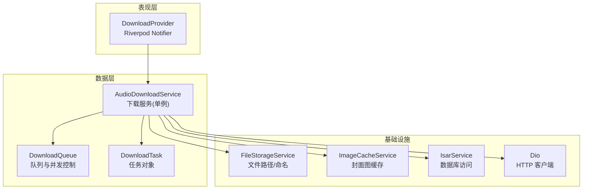
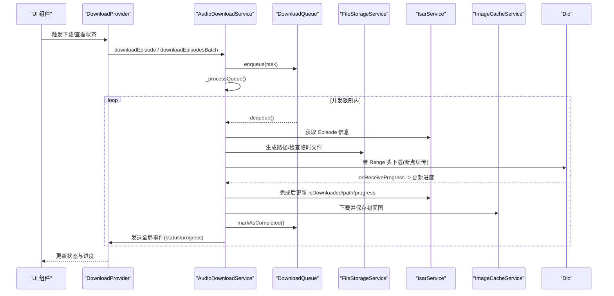
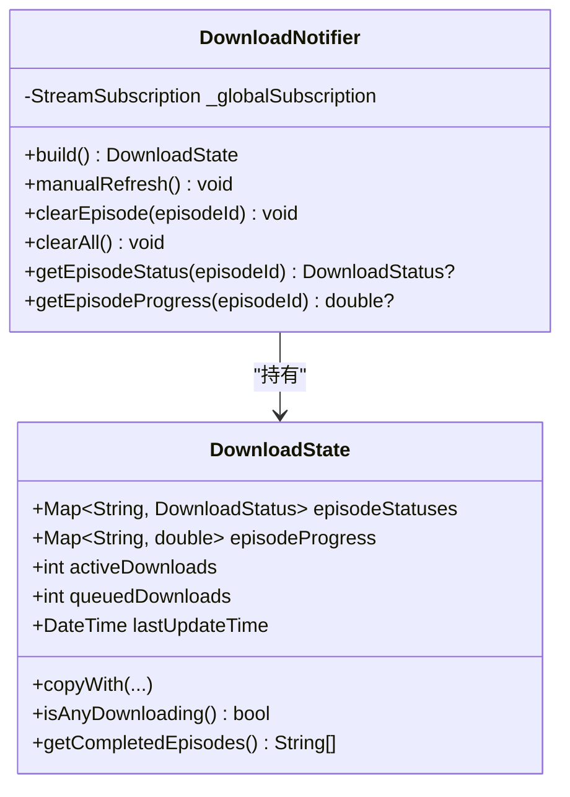
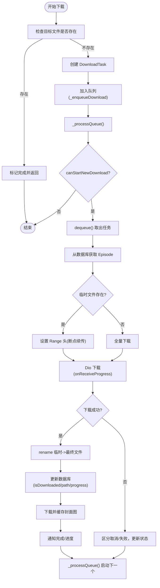
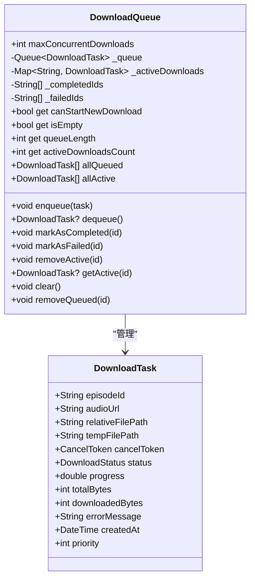
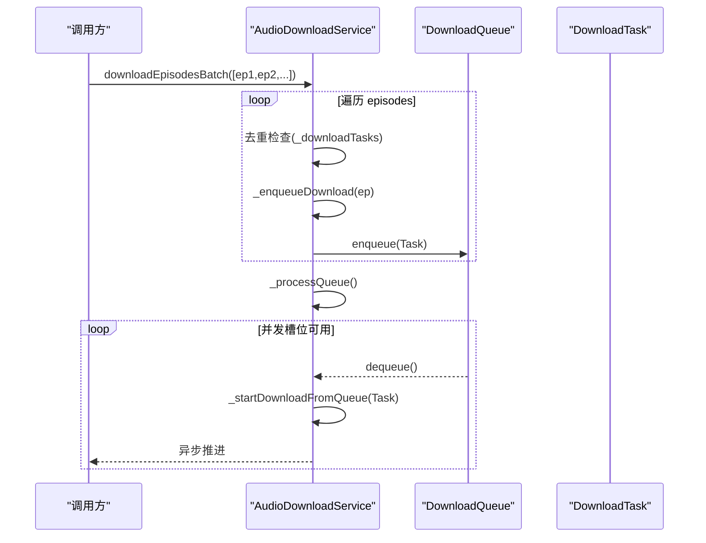
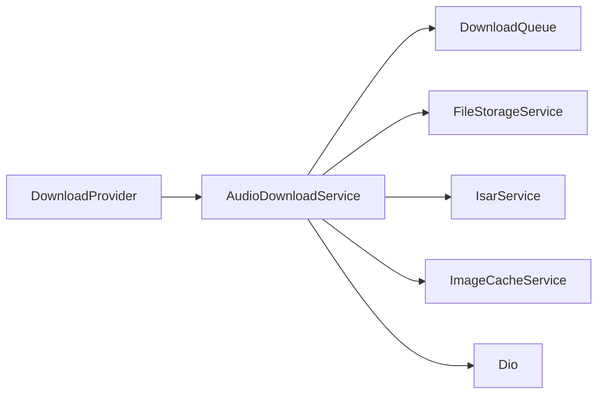

# DownloadProvider 下载任务管理

<cite>
**本文引用的文件**
- [lib/presentation/providers/download_provider.dart](file://lib/presentation/providers/download_provider.dart)
- [lib/data/services/audio_download_service.dart](file://lib/data/services/audio_download_service.dart)
- [lib/data/services/file_storage_service.dart](file://lib/data/services/file_storage_service.dart)
- [lib/data/services/image_cache_service.dart](file://lib/data/services/image_cache_service.dart)
- [lib/data/database/isar_service.dart](file://lib/data/database/isar_service.dart)
- [docs/audio_download_usage.md](file://docs/audio_download_usage.md)
- [docs/download_queue_debug.md](file://docs/download_queue_debug.md)
</cite>

## 目录
1. [简介](#简介)
2. [项目结构](#项目结构)
3. [核心组件](#核心组件)
4. [架构总览](#架构总览)
5. [详细组件分析](#详细组件分析)
6. [依赖关系分析](#依赖关系分析)
7. [性能考量](#性能考量)
8. [故障排查指南](#故障排查指南)
9. [结论](#结论)
10. [附录](#附录)

## 简介
本文件为 DownloadProvider 与音频下载系统的权威文档，聚焦于下载任务管理的核心实现：下载队列调度、断点续传机制、存储空间管理；并详细说明批量下载的并发控制、进度跟踪、错误重试策略；解释下载优先级管理、完成后的自动处理逻辑、存储空间不足时的清理策略。同时给出创建、暂停、恢复、取消等操作的实践方式，以及与文件系统服务、图片缓存服务的集成方式。最后提供网络请求优化、I/O 操作优化、内存使用优化的策略建议。

## 项目结构
围绕下载功能的关键代码分布在以下模块：
- Presentation 层：DownloadProvider（基于 Riverpod Notifier）负责 UI 状态与全局事件订阅
- Data 层：AudioDownloadService（单例服务）负责下载队列、任务生命周期、网络 I/O、持久化更新
- 存储与缓存：FileStorageService（文件路径/命名）、ImageCacheService（封面图缓存）、IsarService（数据库读写）
- 文档与调试：audio_download_usage.md（API 使用示例）、download_queue_debug.md（队列问题定位）

图表来源
- [lib/presentation/providers/download_provider.dart:1-156](file://lib/presentation/providers/download_provider.dart#L1-L156)
- [lib/data/services/audio_download_service.dart:13-1135](file://lib/data/services/audio_download_service.dart#L13-L1135)
- [lib/data/services/file_storage_service.dart](file://lib/data/services/file_storage_service.dart)
- [lib/data/services/image_cache_service.dart](file://lib/data/services/image_cache_service.dart)
- [lib/data/database/isar_service.dart](file://lib/data/database/isar_service.dart)

章节来源
- [lib/presentation/providers/download_provider.dart:1-156](file://lib/presentation/providers/download_provider.dart#L1-L156)
- [lib/data/services/audio_download_service.dart:13-1135](file://lib/data/services/audio_download_service.dart#L13-L1135)

## 核心组件
- DownloadState 与 DownloadNotifier
  - 维护 episode 的状态映射、进度映射、活跃/排队数量、更新时间
  - 订阅 AudioDownloadService 的全局事件流，增量更新状态
  - 提供手动刷新、清理单个/全部条目、查询状态与进度的方法
- AudioDownloadService
  - 单例服务，封装下载任务生命周期、队列调度、断点续传、失败处理、封面图下载
  - 暴露批量下载、按播客下载、暂停/恢复/取消、删除已下载、查询状态等方法
  - 通过 StreamController 广播全局事件，供 UI 消费
- DownloadQueue 与 DownloadTask
  - DownloadQueue：维护入队/出队、活跃下载集合、完成/失败记录，支持并发上限
  - DownloadTask：承载 episodeId、URL、相对/临时路径、CancelToken、状态、进度、字节统计、优先级等

章节来源
- [lib/presentation/providers/download_provider.dart:6-156](file://lib/presentation/providers/download_provider.dart#L6-L156)
- [lib/data/services/audio_download_service.dart:13-1135](file://lib/data/services/audio_download_service.dart#L13-L1135)

## 架构总览
DownloadProvider 作为 UI 状态提供者，订阅全局事件流，将下载状态与进度同步到 UI。AudioDownloadService 是下载核心，协调网络、文件、数据库与图片缓存，并通过 DownloadQueue 进行并发控制与任务调度。

图表来源
- [lib/presentation/providers/download_provider.dart:52-94](file://lib/presentation/providers/download_provider.dart#L52-L94)
- [lib/data/services/audio_download_service.dart:196-408](file://lib/data/services/audio_download_service.dart#L196-L408)
- [lib/data/services/audio_download_service.dart:801-1135](file://lib/data/services/audio_download_service.dart#L801-L1135)

## 详细组件分析

### DownloadProvider 分析
- 职责
  - 订阅全局事件流，合并状态与进度，保持 activeDownloads/queuedDownloads 最新
  - 提供便捷查询接口：isAnyDownloading、getCompletedEpisodes、getEpisodeStatus/Progress
  - 支持手动刷新与清理
- 关键流程
  - build 中订阅 globalEventStream，收到事件后深拷贝 Map 并更新 state
  - 当 status 为 completed/failed 时输出日志，便于追踪 UI 自动刷新时机

图表来源
- [lib/presentation/providers/download_provider.dart:6-156](file://lib/presentation/providers/download_provider.dart#L6-L156)

章节来源
- [lib/presentation/providers/download_provider.dart:52-156](file://lib/presentation/providers/download_provider.dart#L52-L156)

### AudioDownloadService 分析
- 职责
  - 单例下载服务，管理任务、队列、并发、断点续传、失败处理、封面图下载
  - 暴露批量下载、按播客下载、暂停/恢复/取消、删除已下载、查询状态等 API
  - 通过 StreamController 广播全局事件，供 Provider 消费
- 关键实现要点
  - 并发控制：DownloadQueue.maxConcurrentDownloads=3，_activeDownloads 防重入
  - 断点续传：检测临时文件大小，设置 Range 头从断点继续
  - 文件落盘：先写入临时目录，成功后 rename 到最终目录
  - 数据库更新：仅在完成或失败时写库，减少频繁写锁竞争
  - 封面图：下载完成后异步拉取并缓存，失败不影响音频
  - 错误处理：区分取消与异常，统一通知状态变化

图表来源
- [lib/data/services/audio_download_service.dart:196-408](file://lib/data/services/audio_download_service.dart#L196-L408)
- [lib/data/services/audio_download_service.dart:801-1135](file://lib/data/services/audio_download_service.dart#L801-L1135)

章节来源
- [lib/data/services/audio_download_service.dart:13-1135](file://lib/data/services/audio_download_service.dart#L13-L1135)

### DownloadQueue 与 DownloadTask
- DownloadQueue
  - 维护入队队列、活跃下载映射、完成/失败 ID 列表
  - 提供 canStartNewDownload、enqueue/dequeue、markAsCompleted/Failed、removeActive/removeQueued 等方法
- DownloadTask
  - 包含 episodeId、audioUrl、relativeFilePath、tempFilePath、CancelToken、status、progress、totalBytes/downloadedBytes、errorMessage、createdAt、priority

图表来源
- [lib/data/services/audio_download_service.dart:23-113](file://lib/data/services/audio_download_service.dart#L23-L113)

章节来源
- [lib/data/services/audio_download_service.dart:23-113](file://lib/data/services/audio_download_service.dart#L23-L113)

### 批量下载与并发控制
- 批量入口
  - downloadEpisodesBatch(episodes)：去重后逐个入队，最后调用 _processQueue()
  - downloadPodcastEpisodes(podcastId, limit?)：按发布时间倒序查询 episodes，再走批量流程
- 并发控制
  - DownloadQueue.maxConcurrentDownloads=3，循环 while(canStartNewDownload) 出队并启动
  - _startDownloadFromQueue 在成功/失败/取消后再次调用 _processQueue() 推进队列

图表来源
- [lib/data/services/audio_download_service.dart:801-960](file://lib/data/services/audio_download_service.dart#L801-L960)

章节来源
- [lib/data/services/audio_download_service.dart:801-960](file://lib/data/services/audio_download_service.dart#L801-L960)

### 断点续传机制
- 临时文件检测：若临时文件存在，读取长度作为断点偏移
- Range 头设置：下载选项 headers.Range = bytes={offset}-
- 进度计算：totalProgress = downloadedBytes + received，progress = totalProgress / total
- 完成落盘：成功后删除可能存在的最终文件，再将临时文件 rename 到最终路径

章节来源
- [lib/data/services/audio_download_service.dart:296-340](file://lib/data/services/audio_download_service.dart#L296-L340)
- [lib/data/services/audio_download_service.dart:991-1033](file://lib/data/services/audio_download_service.dart#L991-L1033)

### 存储空间管理与清理策略
- 存储位置
  - 临时目录：用于未完成下载（temporaryDirectory）
  - 永久目录：applicationSupportDirectory，音频存放子目录 audio/{episodeId}.mp3
- 清理能力
  - deleteDownloadedEpisode(episodeId)：删除单个已下载文件并更新数据库
  - removeAllDownloadsForPodcast(podcastId)：批量删除某播客的所有已下载文件
  - unfollowPodcast(podcastId)：取消关注时清理音频与封面图文件
  - 外部清理服务：CacheCleanupService（见 usage 文档）支持自动/手动清理、保留最近 N 集、按大小阈值清理

章节来源
- [lib/data/services/audio_download_service.dart:630-761](file://lib/data/services/audio_download_service.dart#L630-L761)
- [docs/audio_download_usage.md:123-204](file://docs/audio_download_usage.md#L123-L204)

### 下载优先级管理
- DownloadTask.priority 字段预留，当前未参与排序与调度逻辑
- 如需优先级调度，可在 _processQueue 的出队前对 _queue 按 priority 降序排序，或在 enqueue 时插入合适位置

章节来源
- [lib/data/services/audio_download_service.dart:23-51](file://lib/data/services/audio_download_service.dart#L23-L51)

### 下载完成后的自动处理逻辑
- 完成流程
  - 更新数据库 isDownloaded=true、downloadedPath、downloadProgress=1.0
  - 尝试下载并缓存封面图（失败不影响音频）
  - 标记队列完成并触发 _processQueue() 启动下一个任务
- UI 自动刷新
  - 通过全局事件流推送 status/progress，DownloadProvider 监听并更新状态

章节来源
- [lib/data/services/audio_download_service.dart:370-389](file://lib/data/services/audio_download_service.dart#L370-L389)
- [lib/data/services/audio_download_service.dart:1035-1047](file://lib/data/services/audio_download_service.dart#L1035-L1047)
- [lib/presentation/providers/download_provider.dart:58-87](file://lib/presentation/providers/download_provider.dart#L58-L87)

### 与文件系统服务的集成
- FileStorageService
  - 提供音频目录、临时目录、文件名生成、文件存在性检查、安全删除等方法
  - 数据库仅存储相对路径（如 audio/{episodeId}.mp3），确保跨设备兼容
- ImageCacheService
  - 下载并缓存封面图，失败不影响主流程

章节来源
- [lib/data/services/file_storage_service.dart](file://lib/data/services/file_storage_service.dart)
- [lib/data/services/image_cache_service.dart](file://lib/data/services/image_cache_service.dart)
- [docs/audio_download_usage.md:182-204](file://docs/audio_download_usage.md#L182-L204)

### 与数据库服务的集成
- IsarService
  - 更新 episode 的 isDownloaded、downloadedPath、downloadProgress
  - 查询 episode 信息以构建下载任务
- 写入策略
  - 入队阶段不写库，避免阻塞 Library 页面查询
  - 完成/失败时写库，保证一致性

章节来源
- [lib/data/services/audio_download_service.dart:899-914](file://lib/data/services/audio_download_service.dart#L899-L914)
- [lib/data/services/audio_download_service.dart:1035-1040](file://lib/data/services/audio_download_service.dart#L1035-L1040)
- [lib/data/database/isar_service.dart](file://lib/data/database/isar_service.dart)

## 依赖关系分析
- DownloadProvider 依赖 AudioDownloadService 的全局事件流
- AudioDownloadService 依赖：
  - DownloadQueue（并发与队列）
  - FileStorageService（路径与文件操作）
  - IsarService（数据库读写）
  - ImageCacheService（封面图缓存）
  - Dio（网络请求）

图表来源
- [lib/presentation/providers/download_provider.dart:52-94](file://lib/presentation/providers/download_provider.dart#L52-L94)
- [lib/data/services/audio_download_service.dart:129-177](file://lib/data/services/audio_download_service.dart#L129-L177)

章节来源
- [lib/presentation/providers/download_provider.dart:52-94](file://lib/presentation/providers/download_provider.dart#L52-L94)
- [lib/data/services/audio_download_service.dart:129-177](file://lib/data/services/audio_download_service.dart#L129-L177)

## 性能考量
- 网络请求优化
  - 使用 Dio 配置连接/接收超时、最大重定向数
  - 启用 Range 头实现断点续传，减少重复传输
  - 合理设置 receiveDataWhenStatusError，便于错误诊断
- I/O 操作优化
  - 先写入临时目录，成功后原子 rename 到最终目录，避免部分文件污染
  - 完成/失败时才写库，降低写锁竞争
  - 封面图下载异步执行，失败不影响主流程
- 内存使用优化
  - 使用 StreamController.broadcast 共享事件，避免重复订阅
  - 及时关闭控制器与取消订阅，防止内存泄漏
  - 控制并发下载数量（默认 3），避免带宽与内存峰值过高

[本节为通用指导，不直接分析具体文件]

## 故障排查指南
- 常见问题
  - 队列中的任务未被执行：检查 _processQueue() 是否被调用、canStartNewDownload 条件、activeDownloads 是否已满
  - Episode not found in database：确认 episode ID 格式与数据库记录
  - 下载立即失败：检查 URL 有效性、文件权限、网络连接
- 调试建议
  - 搜索日志关键词：“Processing download queue”、“Dequeued task”、“Starting queued download”
  - 使用 usage 文档中的测试方法手动触发下载与队列检查

章节来源
- [docs/download_queue_debug.md:1-192](file://docs/download_queue_debug.md#L1-L192)
- [docs/audio_download_usage.md:194-241](file://docs/audio_download_usage.md#L194-L241)

## 结论
DownloadProvider 与 AudioDownloadService 共同构建了稳定高效的下载系统：通过 DownloadQueue 实现并发控制与任务调度，借助断点续传提升可靠性，结合 FileStorageService 与 IsarService 实现可靠的文件与数据管理，并通过 ImageCacheService 完善媒体体验。批量下载、暂停/恢复/取消、自动清理等功能覆盖典型使用场景。建议在需要时扩展优先级调度与更细粒度的重试策略，以进一步提升用户体验与系统健壮性。

[本节为总结，不直接分析具体文件]

## 附录
- API 使用示例与最佳实践请参考：
  - [docs/audio_download_usage.md](file://docs/audio_download_usage.md)
- 队列调试与问题定位请参考：
  - [docs/download_queue_debug.md](file://docs/download_queue_debug.md)