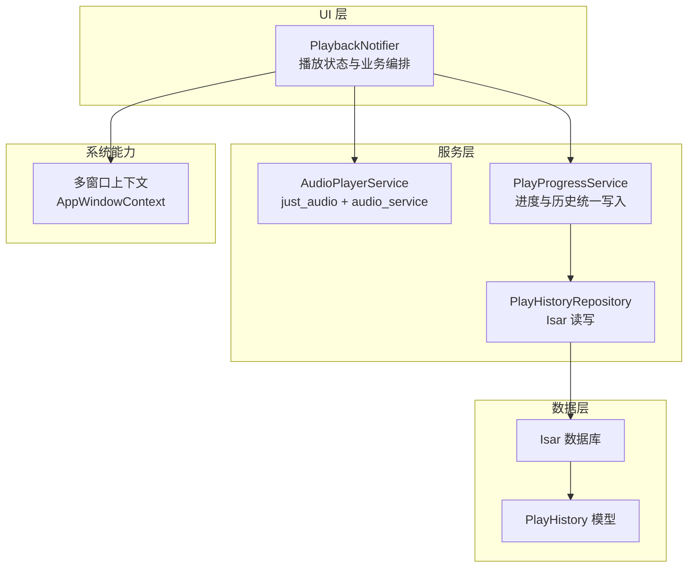
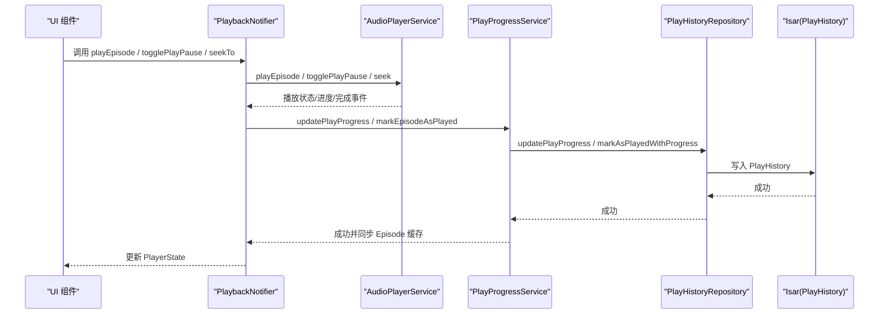
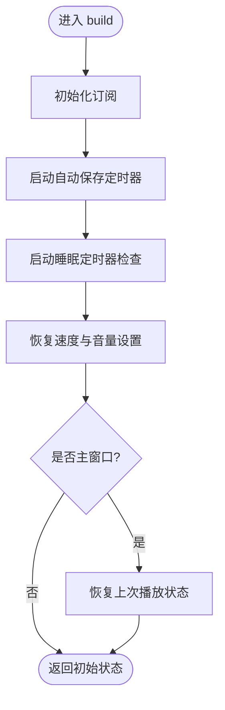
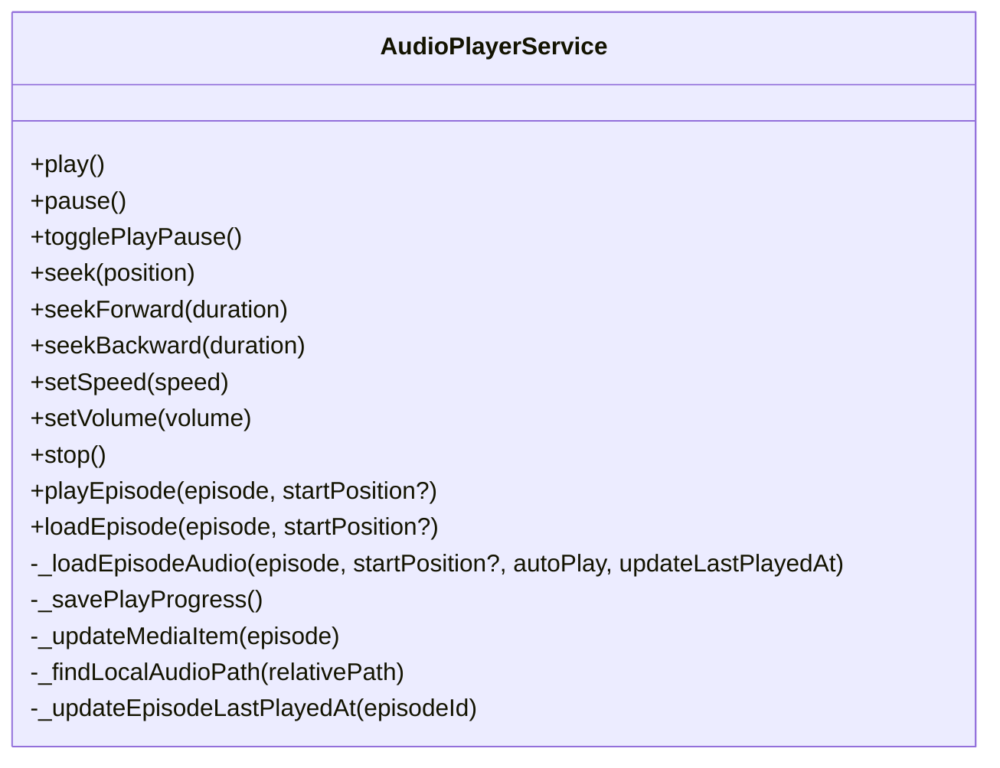
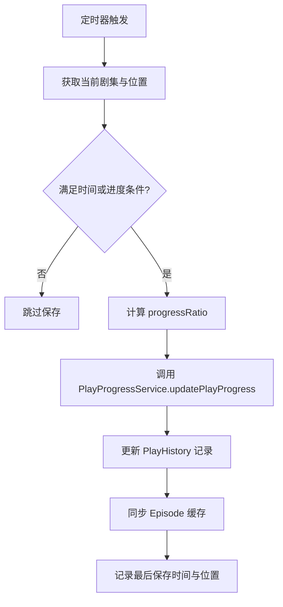
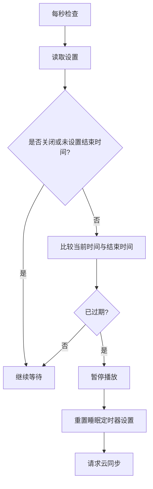
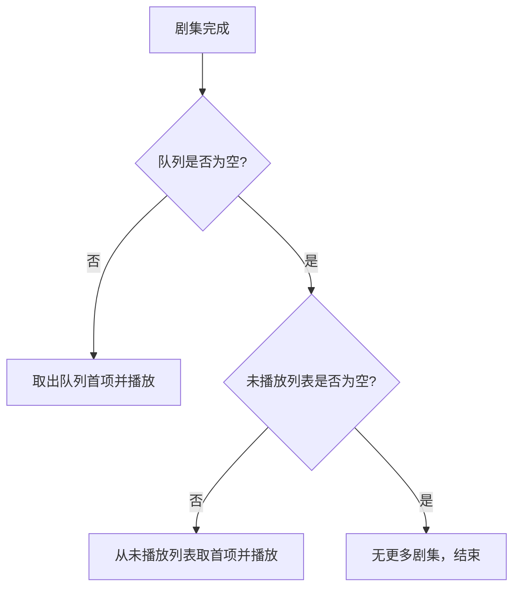
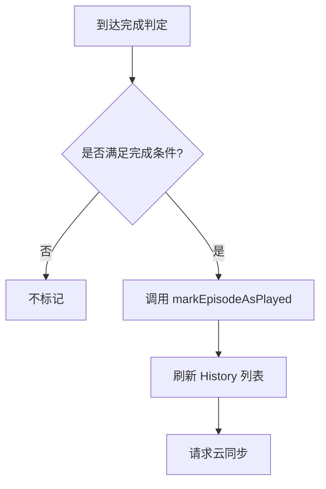
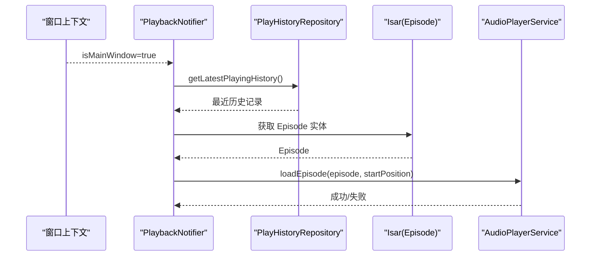
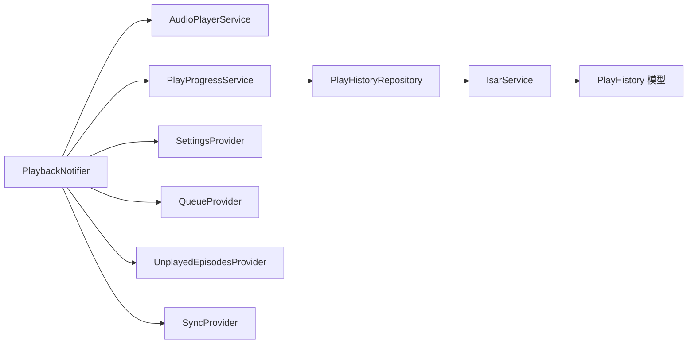

# PlaybackProvider 播放状态管理

<cite>
**本文引用的文件**   
- [lib/presentation/providers/playback_provider.dart](file://lib/presentation/providers/playback_provider.dart)
- [lib/data/services/audio_player_service.dart](file://lib/data/services/audio_player_service.dart)
- [lib/core/services/play_progress_service.dart](file://lib/core/services/play_progress_service.dart)
- [lib/data/repositories/play_history_repository.dart](file://lib/data/repositories/play_history_repository.dart)
- [lib/data/models/play_history_model.dart](file://lib/data/models/play_history_model.dart)
- [lib/main.dart](file://lib/main.dart)
- [lib/multi_window.dart](file://lib/multi_window.dart)
</cite>

## 目录
1. [简介](#简介)
2. [项目结构](#项目结构)
3. [核心组件](#核心组件)
4. [架构总览](#架构总览)
5. [详细组件分析](#详细组件分析)
6. [依赖关系分析](#依赖关系分析)
7. [性能考量](#性能考量)
8. [故障排查指南](#故障排查指南)
9. [结论](#结论)
10. [附录](#附录)

## 简介
本文件围绕 PlaybackProvider 的播放状态管理进行系统化文档化，覆盖 PlayerState 数据模型、PlaybackNotifier 的状态更新机制、音频播放生命周期管理、播放进度自动保存策略、睡眠定时器、连续播放逻辑、剧集完成标记机制、跨窗口恢复、与 AudioPlayerService 的集成方式、错误处理与异常恢复、与其他 Provider 的交互模式，以及性能优化策略（流订阅管理、内存泄漏防护、异步操作优化）。

## 项目结构
- 播放状态与 UI 层：PlaybackNotifier 通过 Riverpod 暴露 PlayerState，并提供 play/pause/seek/togglePlayPause 等控制方法。
- 音频服务层：AudioPlayerService 封装 just_audio 与 audio_service，负责播放器实例、媒体项、后台通知、播放事件广播。
- 播放历史与进度：PlayProgressService 统一协调 PlayHistoryRepository 与 Isar 数据库，确保 PlayHistory 为唯一数据源并同步 Episode 缓存。
- 多窗口支持：AppWindowContext.isMainWindow 用于区分主窗口与非主窗口，避免非主窗口重复恢复播放状态。

**图表来源** 
- [lib/presentation/providers/playback_provider.dart:1-120](file://lib/presentation/providers/playback_provider.dart#L1-L120)
- [lib/data/services/audio_player_service.dart:1-120](file://lib/data/services/audio_player_service.dart#L1-L120)
- [lib/core/services/play_progress_service.dart:1-60](file://lib/core/services/play_progress_service.dart#L1-L60)
- [lib/data/repositories/play_history_repository.dart:1-60](file://lib/data/repositories/play_history_repository.dart#L1-L60)
- [lib/data/models/play_history_model.dart:1-51](file://lib/data/models/play_history_model.dart#L1-L51)
- [lib/main.dart:131-177](file://lib/main.dart#L131-L177)
- [lib/multi_window.dart:241-408](file://lib/multi_window.dart#L241-L408)

**章节来源**
- [lib/presentation/providers/playback_provider.dart:1-120](file://lib/presentation/providers/playback_provider.dart#L1-L120)
- [lib/data/services/audio_player_service.dart:1-120](file://lib/data/services/audio_player_service.dart#L1-L120)
- [lib/core/services/play_progress_service.dart:1-60](file://lib/core/services/play_progress_service.dart#L1-L60)
- [lib/data/repositories/play_history_repository.dart:1-60](file://lib/data/repositories/play_history_repository.dart#L1-L60)
- [lib/data/models/play_history_model.dart:1-51](file://lib/data/models/play_history_model.dart#L1-L51)
- [lib/main.dart:131-177](file://lib/main.dart#L131-L177)
- [lib/multi_window.dart:241-408](file://lib/multi_window.dart#L241-L408)

## 核心组件
- PlayerState：不可变状态对象，包含当前剧集、播放状态、当前位置、总时长、速度与音量，并提供 progressRatio 计算。
- PlaybackNotifier：基于 Notifier<PlayerState> 的状态管理器，订阅 AudioPlayerService 的多路 Stream，维护播放进度自动保存、睡眠定时器、连续播放、完成标记与跨窗口恢复。
- AudioPlayerService：封装 just_audio 播放器与 audio_service 后台任务，提供播放控制、进度与状态广播、媒体项更新、本地/远程音频加载与回退。
- PlayProgressService：统一入口，将播放进度与完成状态写入 PlayHistory，并同步 Episode 缓存字段。
- PlayHistoryRepository：以 PlayHistory 为唯一数据源的 CRUD 与查询接口，支持按 episodeId/guid/itunesId 定位记录。
- PlayHistory 模型：持久化播放历史，包括位置、进度、是否已播放、状态枚举、更新时间戳等。

**章节来源**
- [lib/presentation/providers/playback_provider.dart:23-62](file://lib/presentation/providers/playback_provider.dart#L23-L62)
- [lib/presentation/providers/playback_provider.dart:64-120](file://lib/presentation/providers/playback_provider.dart#L64-L120)
- [lib/data/services/audio_player_service.dart:12-98](file://lib/data/services/audio_player_service.dart#L12-L98)
- [lib/core/services/play_progress_service.dart:8-42](file://lib/core/services/play_progress_service.dart#L8-L42)
- [lib/data/repositories/play_history_repository.dart:7-35](file://lib/data/repositories/play_history_repository.dart#L7-L35)
- [lib/data/models/play_history_model.dart:5-51](file://lib/data/models/play_history_model.dart#L5-L51)

## 架构总览
PlaybackProvider 作为状态编排中心，向上暴露 PlayerState 供 UI 消费，向下协调 AudioPlayerService 与 PlayProgressService，并通过 PlayHistoryRepository 与 Isar 交互。AudioPlayerService 负责底层音频播放与事件广播，PlayProgressService 保证 PlayHistory 与 Episode 缓存的一致性。

**图表来源** 
- [lib/presentation/providers/playback_provider.dart:583-653](file://lib/presentation/providers/playback_provider.dart#L583-L653)
- [lib/data/services/audio_player_service.dart:302-324](file://lib/data/services/audio_player_service.dart#L302-L324)
- [lib/core/services/play_progress_service.dart:17-42](file://lib/core/services/play_progress_service.dart#L17-L42)
- [lib/data/repositories/play_history_repository.dart:104-117](file://lib/data/repositories/play_history_repository.dart#L104-L117)

## 详细组件分析

### PlayerState 数据模型设计
- 字段：currentEpisode、isPlaying、currentPosition、duration、speed、volume。
- 行为：copyWith 构造新状态；progressRatio 安全计算避免除零。
- 复杂度：O(1) 读取与复制；适合高频 UI 刷新。

**章节来源**
- [lib/presentation/providers/playback_provider.dart:23-62](file://lib/presentation/providers/playback_provider.dart#L23-L62)

### PlaybackNotifier 状态更新机制
- 订阅源：
  - playbackStateStream：映射 isPlaying（playing/buffering 视为播放中）。
  - progressStream：更新 currentPosition/duration。
  - speedStream/volumeStream：更新速度/音量。
  - currentEpisodeStream：更新当前剧集。
  - episodeCompletedStream：触发 _onEpisodeCompleted。
- 生命周期：
  - build() 初始化监听器、自动保存定时器、睡眠定时器检查、设置恢复、主窗口恢复上次播放状态。
  - onDispose() 取消所有订阅与定时器，并在销毁前保存一次进度。
- 关键流程：
  - 自动保存：Timer.periodic 每 10s 触发，结合时间条件与进度变化阈值（≥5% 或 ≥5s）减少 I/O。
  - 睡眠定时器：每秒评估，到期后暂停并重置设置；单集结束时若设置为 episodeEnd 则优先暂停。
  - 连续播放：完成后优先从队列取下一集，否则从未播放列表取。
  - 完成标记：调用 PlayProgressService.markEpisodeAsPlayed，并刷新未播放列表与历史记录。

**图表来源** 
- [lib/presentation/providers/playback_provider.dart:83-101](file://lib/presentation/providers/playback_provider.dart#L83-L101)
- [lib/presentation/providers/playback_provider.dart:103-149](file://lib/presentation/providers/playback_provider.dart#L103-L149)
- [lib/presentation/providers/playback_provider.dart:361-411](file://lib/presentation/providers/playback_provider.dart#L361-L411)

**章节来源**
- [lib/presentation/providers/playback_provider.dart:64-120](file://lib/presentation/providers/playback_provider.dart#L64-L120)
- [lib/presentation/providers/playback_provider.dart:169-214](file://lib/presentation/providers/playback_provider.dart#L169-L214)
- [lib/presentation/providers/playback_provider.dart:361-411](file://lib/presentation/providers/playback_provider.dart#L361-L411)
- [lib/presentation/providers/playback_provider.dart:438-577](file://lib/presentation/providers/playback_provider.dart#L438-L577)

### 音频播放生命周期管理（AudioPlayerService）
- 初始化：注册 AudioService，订阅 just_audio 的事件流，设置默认音量。
- 播放/暂停/停止：封装底层播放器 API，并在暂停/停止时保存进度。
- 加载音频：_loadEpisodeAudio 支持本地优先（支持目录与文档目录回退），失败回退到远程 URL；可选 autoPlay 与 updateLastPlayedAt。
- 完成事件：当 ProcessingState.completed 时仅广播 episodeCompleted，业务逻辑由 PlaybackNotifier 处理。
- 媒体项：updateMediaItem 同步至系统通知与锁屏控件。

**图表来源** 
- [lib/data/services/audio_player_service.dart:302-324](file://lib/data/services/audio_player_service.dart#L302-L324)
- [lib/data/services/audio_player_service.dart:192-300](file://lib/data/services/audio_player_service.dart#L192-L300)
- [lib/data/services/audio_player_service.dart:469-507](file://lib/data/services/audio_player_service.dart#L469-L507)

**章节来源**
- [lib/data/services/audio_player_service.dart:100-134](file://lib/data/services/audio_player_service.dart#L100-L134)
- [lib/data/services/audio_player_service.dart:192-300](file://lib/data/services/audio_player_service.dart#L192-L300)
- [lib/data/services/audio_player_service.dart:302-324](file://lib/data/services/audio_player_service.dart#L302-L324)
- [lib/data/services/audio_player_service.dart:469-507](file://lib/data/services/audio_player_service.dart#L469-L507)

### 播放进度自动保存策略
- 触发条件：
  - 时间条件：距上次保存 ≥10s。
  - 进度条件：绝对差值 ≥5% 时长或 ≥5s。
- 存储路径：PlayProgressService.updatePlayProgress → PlayHistoryRepository.updatePlayProgress → Isar。
- 副作用：同步 Episode.playProgress 与 lastPlayedAt，保持缓存一致。

**图表来源** 
- [lib/presentation/providers/playback_provider.dart:361-411](file://lib/presentation/providers/playback_provider.dart#L361-L411)
- [lib/core/services/play_progress_service.dart:17-42](file://lib/core/services/play_progress_service.dart#L17-L42)
- [lib/data/repositories/play_history_repository.dart:104-117](file://lib/data/repositories/play_history_repository.dart#L104-L117)

**章节来源**
- [lib/presentation/providers/playback_provider.dart:361-411](file://lib/presentation/providers/playback_provider.dart#L361-L411)
- [lib/core/services/play_progress_service.dart:17-42](file://lib/core/services/play_progress_service.dart#L17-L42)
- [lib/data/repositories/play_history_repository.dart:104-117](file://lib/data/repositories/play_history_repository.dart#L104-L117)

### 睡眠定时器功能
- 配置：AppSettings.sleepTimer 与 sleepTimerEndTimeMillis。
- 执行：每秒评估，到期后暂停播放并重置设置；单集结束时若为 episodeEnd 则优先暂停。
- 优先级：高于连续播放。

**图表来源** 
- [lib/presentation/providers/playback_provider.dart:103-149](file://lib/presentation/providers/playback_provider.dart#L103-L149)
- [lib/presentation/providers/playback_provider.dart:251-265](file://lib/presentation/providers/playback_provider.dart#L251-L265)

**章节来源**
- [lib/presentation/providers/playback_provider.dart:103-149](file://lib/presentation/providers/playback_provider.dart#L103-L149)
- [lib/presentation/providers/playback_provider.dart:251-265](file://lib/presentation/providers/playback_provider.dart#L251-L265)

### 连续播放逻辑
- 触发点：剧集完成事件。
- 策略：优先从队列取下一集；队列为空则从未播放列表取；若无可播内容则停止。
- 与睡眠定时器的冲突：episodeEnd 优先于连续播放。

**图表来源** 
- [lib/presentation/providers/playback_provider.dart:216-265](file://lib/presentation/providers/playback_provider.dart#L216-L265)
- [lib/presentation/providers/playback_provider.dart:319-359](file://lib/presentation/providers/playback_provider.dart#L319-L359)

**章节来源**
- [lib/presentation/providers/playback_provider.dart:216-265](file://lib/presentation/providers/playback_provider.dart#L216-L265)
- [lib/presentation/providers/playback_provider.dart:319-359](file://lib/presentation/providers/playback_provider.dart#L319-L359)

### 剧集完成标记机制
- 触发点：播放完成或接近结尾（短集阈值 95%，长集剩余 ≤60s）。
- 动作：调用 PlayProgressService.markEpisodeAsPlayed，刷新已完成历史列表，请求云同步。
- 副作用：同步 Episode.isPlayed 与 playProgress=1.0。

**图表来源** 
- [lib/presentation/providers/playback_provider.dart:673-724](file://lib/presentation/providers/playback_provider.dart#L673-L724)
- [lib/core/services/play_progress_service.dart:44-70](file://lib/core/services/play_progress_service.dart#L44-L70)

**章节来源**
- [lib/presentation/providers/playback_provider.dart:673-724](file://lib/presentation/providers/playback_provider.dart#L673-L724)
- [lib/core/services/play_progress_service.dart:44-70](file://lib/core/services/play_progress_service.dart#L44-L70)

### 播放状态的跨窗口恢复
- 主窗口判断：AppWindowContext.isMainWindow 仅在主窗口执行恢复。
- 恢复流程：读取最近播放历史 → 构建 Domain Episode → 检查本地文件存在性 → 使用 loadEpisode 加载（可带起始位置）→ 失败时清理状态。
- 防重入：restoreGeneration 与 _userInitiatedPlayback 防止用户主动播放中断恢复。

**图表来源** 
- [lib/presentation/providers/playback_provider.dart:438-577](file://lib/presentation/providers/playback_provider.dart#L438-L577)
- [lib/main.dart:131-177](file://lib/main.dart#L131-L177)
- [lib/multi_window.dart:241-408](file://lib/multi_window.dart#L241-L408)

**章节来源**
- [lib/presentation/providers/playback_provider.dart:438-577](file://lib/presentation/providers/playback_provider.dart#L438-L577)
- [lib/main.dart:131-177](file://lib/main.dart#L131-L177)
- [lib/multi_window.dart:241-408](file://lib/multi_window.dart#L241-L408)

### 与 AudioPlayerService 的集成方式
- 控制方法：play/pause/togglePlayPause/seek/seekForward/seekBackward/setSpeed/setVolume/stop。
- 事件订阅：播放状态、进度、速度、音量、当前剧集、完成事件。
- 媒体项：每次加载剧集后更新系统通知与锁屏控件。

**章节来源**
- [lib/presentation/providers/playback_provider.dart:609-661](file://lib/presentation/providers/playback_provider.dart#L609-L661)
- [lib/data/services/audio_player_service.dart:345-450](file://lib/data/services/audio_player_service.dart#L345-L450)
- [lib/data/services/audio_player_service.dart:326-343](file://lib/data/services/audio_player_service.dart#L326-L343)

### 错误处理和异常恢复机制
- 播放加载失败：AudioPlayerService 捕获异常，重置播放器状态并清空当前剧集，抛出异常供上层处理。
- 进度保存失败：PlayProgressService 捕获异常并记录日志，必要时 rethrow。
- 恢复失败：PlaybackNotifier 在恢复失败时清理状态，避免 UI 显示不一致。
- 同步请求失败：_requestSync 捕获异常并记录警告，不影响主流程。

**章节来源**
- [lib/data/services/audio_player_service.dart:282-300](file://lib/data/services/audio_player_service.dart#L282-L300)
- [lib/core/services/play_progress_service.dart:34-42](file://lib/core/services/play_progress_service.dart#L34-L42)
- [lib/presentation/providers/playback_provider.dart:568-577](file://lib/presentation/providers/playback_provider.dart#L568-L577)
- [lib/presentation/providers/playback_provider.dart:726-732](file://lib/presentation/providers/playback_provider.dart#L726-L732)

### 播放控制方法实现细节（示例路径）
- play：直接转发至 AudioPlayerService.play。
- pause：转发至 AudioPlayerService.pause，随后保存进度并请求同步。
- seekTo：转发至 AudioPlayerService.seek，保存进度，并检查是否需要标记完成。
- togglePlayPause：根据当前状态切换，暂停时保存进度并请求同步。

**章节来源**
- [lib/presentation/providers/playback_provider.dart:609-653](file://lib/presentation/providers/playback_provider.dart#L609-L653)
- [lib/data/services/audio_player_service.dart:345-391](file://lib/data/services/audio_player_service.dart#L345-L391)

### 与其他 Provider 的交互模式
- QueueProvider：完成时移除队列中的已播剧集，或从队列取下一集。
- UnplayedEpisodesProvider：完成时刷新未播放列表。
- SettingsProvider：恢复速度与音量设置；睡眠定时器选项变更触发重新评估。
- SyncProvider：完成标记与暂停后请求云同步。

**章节来源**
- [lib/presentation/providers/playback_provider.dart:216-265](file://lib/presentation/providers/playback_provider.dart#L216-L265)
- [lib/presentation/providers/playback_provider.dart:319-359](file://lib/presentation/providers/playback_provider.dart#L319-L359)
- [lib/presentation/providers/playback_provider.dart:151-167](file://lib/presentation/providers/playback_provider.dart#L151-L167)
- [lib/presentation/providers/playback_provider.dart:726-732](file://lib/presentation/providers/playback_provider.dart#L726-L732)

## 依赖关系分析
- PlaybackNotifier 依赖 AudioPlayerService、PlayProgressService、PlayHistoryRepository、SettingsProvider、QueueProvider、UnplayedEpisodesProvider、SyncProvider。
- AudioPlayerService 依赖 just_audio、audio_service、IsarService。
- PlayProgressService 依赖 PlayHistoryRepository、IsarService。
- PlayHistoryRepository 依赖 IsarService 与 PlayHistory 模型。

**图表来源** 
- [lib/presentation/providers/playback_provider.dart:1-22](file://lib/presentation/providers/playback_provider.dart#L1-L22)
- [lib/data/services/audio_player_service.dart:1-11](file://lib/data/services/audio_player_service.dart#L1-L11)
- [lib/core/services/play_progress_service.dart:1-7](file://lib/core/services/play_progress_service.dart#L1-L7)
- [lib/data/repositories/play_history_repository.dart:1-5](file://lib/data/repositories/play_history_repository.dart#L1-L5)
- [lib/data/models/play_history_model.dart:1-5](file://lib/data/models/play_history_model.dart#L1-L5)

**章节来源**
- [lib/presentation/providers/playback_provider.dart:1-22](file://lib/presentation/providers/playback_provider.dart#L1-L22)
- [lib/data/services/audio_player_service.dart:1-11](file://lib/data/services/audio_player_service.dart#L1-L11)
- [lib/core/services/play_progress_service.dart:1-7](file://lib/core/services/play_progress_service.dart#L1-L7)
- [lib/data/repositories/play_history_repository.dart:1-5](file://lib/data/repositories/play_history_repository.dart#L1-L5)
- [lib/data/models/play_history_model.dart:1-5](file://lib/data/models/play_history_model.dart#L1-L5)

## 性能考量
- 流订阅管理：PlaybackNotifier 在 build() 中订阅，onDispose() 中统一取消，避免内存泄漏。
- 自动保存节流：Timer.periodic 10s 与进度阈值双重条件，降低 I/O 频率。
- 本地文件查找优化：优先应用支持目录，回退文档目录，失败快速回退远程 URL。
- 异步操作优化：恢复流程使用 restoreGeneration 与 _userInitiatedPlayback 避免竞态；错误分支快速清理状态。
- 资源释放：AudioPlayerService.dispose() 释放播放器与控制器，关闭所有 StreamController。

[本节为通用指导，无需具体文件引用]

## 故障排查指南
- 无法恢复播放状态：
  - 检查 AppWindowContext.isMainWindow 是否正确设置。
  - 查看最近播放历史是否存在且 Episode 未被删除。
  - 确认本地文件路径是否存在或远程 URL 可用。
- 播放进度未保存：
  - 检查自动保存定时器是否运行。
  - 查看 PlayProgressService 与 PlayHistoryRepository 的日志。
- 睡眠定时器无效：
  - 确认设置中 sleepTimerEndTimeMillis 是否正确设置。
  - 检查每秒评估逻辑是否被异常中断。
- 连续播放不生效：
  - 检查队列与未播放列表是否为空。
  - 确认睡眠定时器未优先触发 episodeEnd。

**章节来源**
- [lib/presentation/providers/playback_provider.dart:438-577](file://lib/presentation/providers/playback_provider.dart#L438-L577)
- [lib/core/services/play_progress_service.dart:17-42](file://lib/core/services/play_progress_service.dart#L17-L42)
- [lib/presentation/providers/playback_provider.dart:103-149](file://lib/presentation/providers/playback_provider.dart#L103-L149)
- [lib/presentation/providers/playback_provider.dart:319-359](file://lib/presentation/providers/playback_provider.dart#L319-L359)

## 结论
PlaybackProvider 通过清晰的职责划分与稳健的状态管理机制，实现了播放控制的完整生命周期管理。借助 PlayHistory 作为唯一数据源，确保了播放进度与完成状态的一致性与可恢复性。配合 AudioPlayerService 的健壮性与多窗口上下文，系统在复杂场景下仍能提供稳定体验。未来可进一步优化 I/O 合并与错误重试策略，提升用户体验与可靠性。

[本节为总结，无需具体文件引用]

## 附录
- 相关 Spec 与任务清单参考：
  - 播放历史功能 Spec
  - 睡眠定时器 Spec 与任务清单
  - 移动端平台支持 Spec
  - macOS 毛玻璃效果 Spec

[本节为概念性内容，无需具体文件引用]