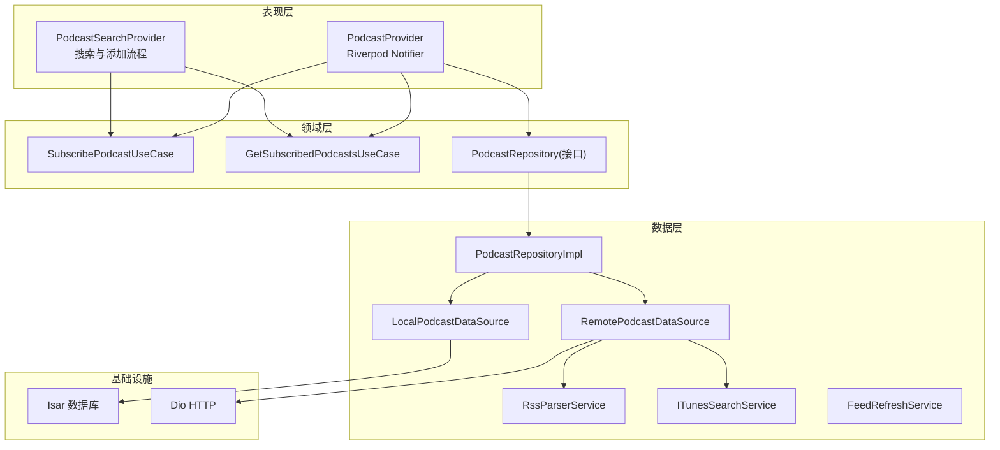
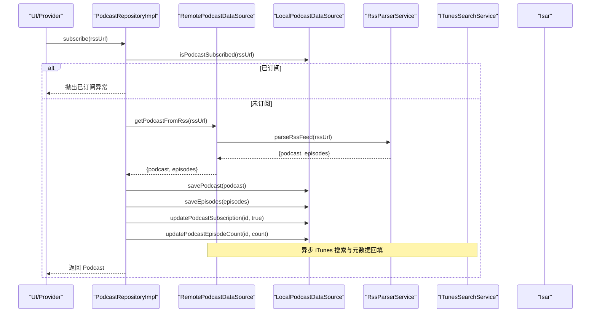
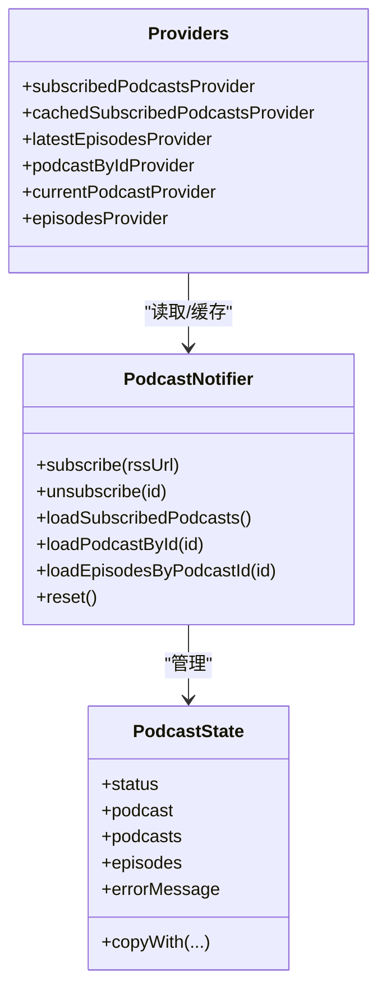
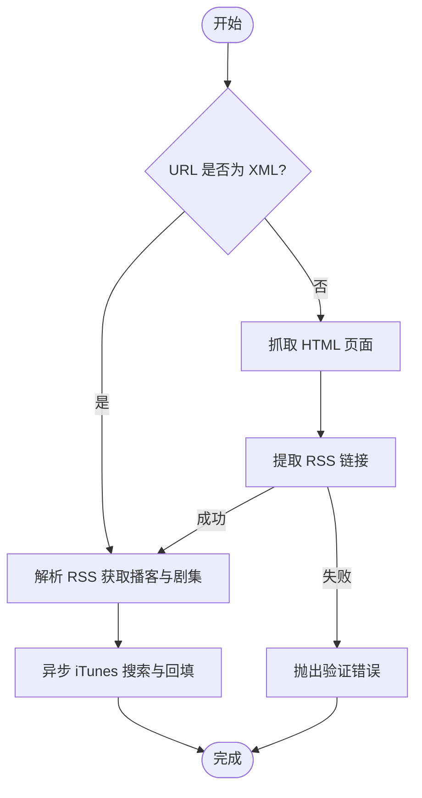
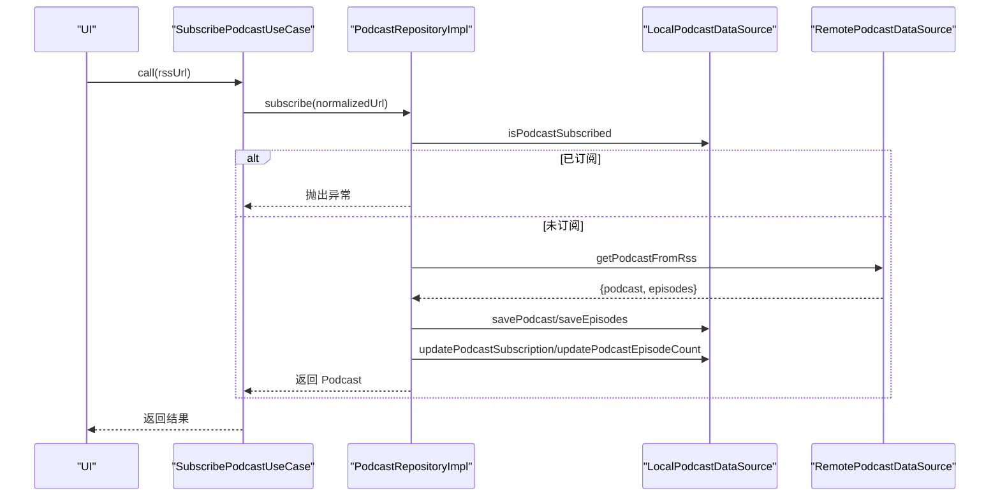
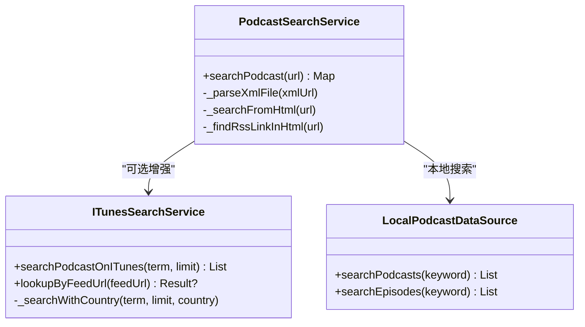
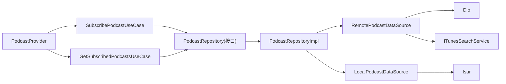
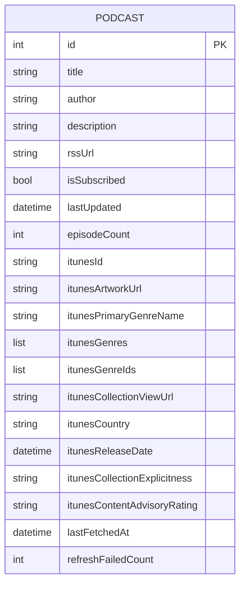

# PodcastProvider 播客数据管理

<cite>
**本文引用的文件**   
- [lib/presentation/providers/podcast_provider.dart](file://lib/presentation/providers/podcast_provider.dart)
- [lib/data/datasources/local_podcast_datasource.dart](file://lib/data/datasources/local_podcast_datasource.dart)
- [lib/data/datasources/remote_podcast_datasource.dart](file://lib/data/datasources/remote_podcast_datasource.dart)
- [lib/domain/entities/podcast.dart](file://lib/domain/entities/podcast.dart)
- [lib/presentation/features/search/podcast_search_provider.dart](file://lib/presentation/features/search/podcast_search_provider.dart)
- [lib/data/repositories/podcast_repository_impl.dart](file://lib/data/repositories/podcast_repository_impl.dart)
- [lib/domain/usecases/subscribe_podcast_usecase.dart](file://lib/domain/usecases/subscribe_podcast_usecase.dart)
- [lib/domain/usecases/get_subscribed_podcasts_usecase.dart](file://lib/domain/usecases/get_subscribed_podcasts_usecase.dart)
- [lib/data/services/podcast_search_service.dart](file://lib/data/services/podcast_search_service.dart)
- [lib/data/services/itunes_search_service.dart](file://lib/data/services/itunes_search_service.dart)
- [lib/domain/repositories/podcast_repository.dart](file://lib/domain/repositories/podcast_repository.dart)
- [lib/core/services/feed_refresh_scheduler.dart](file://lib/core/services/feed_refresh_scheduler.dart)
</cite>

## 目录
1. [简介](#简介)
2. [项目结构](#项目结构)
3. [核心组件](#核心组件)
4. [架构总览](#架构总览)
5. [详细组件分析](#详细组件分析)
6. [依赖关系分析](#依赖关系分析)
7. [性能考量](#性能考量)
8. [故障排查指南](#故障排查指南)
9. [结论](#结论)
10. [附录](#附录)

## 简介
本文件围绕 PodcastProvider 及其相关的数据层、服务与用例，系统化阐述播客数据管理的核心实现。内容涵盖：
- 播客列表缓存策略与状态管理
- RSS feed 解析与刷新机制（含后台定时刷新）
- 订阅状态管理与增删改查操作
- 本地搜索与 iTunes 搜索集成
- 播客详情页面数据加载策略与剧集分页加载思路
- 收藏/播放状态同步机制
- 网络请求缓存策略、离线数据支持与数据一致性保证
- 错误处理与性能优化建议

## 项目结构
PodcastProvider 位于 presentation 层的 Riverpod Notifier，负责 UI 状态与用户交互；数据访问通过 domain 层的 UseCase 与 Repository 抽象，具体实现由 data 层的 DataSource（本地 Isar + 远程 Dio）与 Services（RSS 解析、iTunes 搜索、Feed 刷新）完成。整体遵循 Clean Architecture 分层思想，职责清晰、耦合度低。

图表来源 
- [lib/presentation/providers/podcast_provider.dart](file://lib/presentation/providers/podcast_provider.dart)
- [lib/presentation/features/search/podcast_search_provider.dart](file://lib/presentation/features/search/podcast_search_provider.dart)
- [lib/domain/usecases/subscribe_podcast_usecase.dart](file://lib/domain/usecases/subscribe_podcast_usecase.dart)
- [lib/domain/usecases/get_subscribed_podcasts_usecase.dart](file://lib/domain/usecases/get_subscribed_podcasts_usecase.dart)
- [lib/domain/repositories/podcast_repository.dart](file://lib/domain/repositories/podcast_repository.dart)
- [lib/data/repositories/podcast_repository_impl.dart](file://lib/data/repositories/podcast_repository_impl.dart)
- [lib/data/datasources/remote_podcast_datasource.dart](file://lib/data/datasources/remote_podcast_datasource.dart)
- [lib/data/datasources/local_podcast_datasource.dart](file://lib/data/datasources/local_podcast_datasource.dart)
- [lib/data/services/itunes_search_service.dart](file://lib/data/services/itunes_search_service.dart)
- [lib/data/services/podcast_search_service.dart](file://lib/data/services/podcast_search_service.dart)

章节来源
- [lib/presentation/providers/podcast_provider.dart](file://lib/presentation/providers/podcast_provider.dart)
- [lib/data/repositories/podcast_repository_impl.dart](file://lib/data/repositories/podcast_repository_impl.dart)

## 核心组件
- PodcastProvider（Riverpod Notifier）
  - 维护 PodcastState（状态：initial/loading/success/error），包含当前播客、已订阅列表、剧集列表与错误信息
  - 提供 subscribe/unsubscribe/loadSubscribedPodcasts/loadPodcastById/loadEpisodesByPodcastId/reset 等方法
  - 监听 FeedRefreshScheduler.onRefreshCompleted 事件以刷新订阅列表
  - 暴露多个 Provider/FutureProvider.family 用于缓存与参数化查询（如 latestEpisodesProvider、podcastByIdProvider）

- PodcastRepositoryImpl（仓库实现）
  - 统一封装本地与远程数据源，协调订阅、取消订阅、获取列表、搜索、刷新等操作
  - 在订阅流程中触发异步 iTunes 信息补全，并记录 Future 以便上层等待

- LocalPodcastDataSource（本地数据源）
  - 基于 Isar 的 CRUD 与复杂查询（按时间排序、去重 GUID、批量更新等）
  - 支持订阅状态、节目数量、最后获取时间、刷新失败次数等元数据维护
  - 提供本地搜索（标题/描述模糊匹配）

- RemotePodcastDataSource（远程数据源）
  - 从 RSS 解析播客与剧集，自动回退 HTML 页面提取真实 RSS 链接
  - 异步执行 iTunes 搜索与完整元数据回填（封面、流派、国家、分级等）
  - 提供 RSS URL 校验能力

- PodcastSearchService（搜索服务）
  - 支持直接 XML 解析或从 HTML 页面查找 RSS 链接，具备重试与超时控制

- ITunesSearchService（iTunes 搜索服务）
  - 多区域轮询搜索与精确 feedUrl 查找，返回结构化结果

- FeedRefreshScheduler（刷新调度器）
  - 根据设置与网络条件周期性触发批量刷新，完成后广播 onRefreshCompleted

章节来源
- [lib/presentation/providers/podcast_provider.dart](file://lib/presentation/providers/podcast_provider.dart)
- [lib/data/repositories/podcast_repository_impl.dart](file://lib/data/repositories/podcast_repository_impl.dart)
- [lib/data/datasources/local_podcast_datasource.dart](file://lib/data/datasources/local_podcast_datasource.dart)
- [lib/data/datasources/remote_podcast_datasource.dart](file://lib/data/datasources/remote_podcast_datasource.dart)
- [lib/data/services/podcast_search_service.dart](file://lib/data/services/podcast_search_service.dart)
- [lib/data/services/itunes_search_service.dart](file://lib/data/services/itunes_search_service.dart)
- [lib/core/services/feed_refresh_scheduler.dart](file://lib/core/services/feed_refresh_scheduler.dart)

## 架构总览
下图展示从 UI 到数据源的调用链路与关键交互点。

图表来源 
- [lib/data/repositories/podcast_repository_impl.dart](file://lib/data/repositories/podcast_repository_impl.dart)
- [lib/data/datasources/remote_podcast_datasource.dart](file://lib/data/datasources/remote_podcast_datasource.dart)
- [lib/data/datasources/local_podcast_datasource.dart](file://lib/data/datasources/local_podcast_datasource.dart)

章节来源
- [lib/data/repositories/podcast_repository_impl.dart](file://lib/data/repositories/podcast_repository_impl.dart)
- [lib/data/datasources/remote_podcast_datasource.dart](file://lib/data/datasources/remote_podcast_datasource.dart)

## 详细组件分析

### PodcastProvider 状态与缓存策略
- 状态模型
  - PodcastStatus：initial/loading/success/error
  - PodcastState：status、podcast、podcasts、episodes、errorMessage
  - copyWith 不可变更新，避免 UI 抖动

- 缓存与 Provider 设计
  - subscribedPodcastsProvider：对 state.podcasts 排序后输出，避免重复重建
  - cachedSubscribedPodcastsProvider：FutureProvider 缓存一次查询并按 createdAt 倒序
  - latestEpisodesProvider：FutureProvider.family 按 podcastId 参数化缓存最新 N 集
  - podcastByIdProvider：FutureProvider.family 按 ID 缓存单个播客

- 刷新联动
  - build() 中订阅 FeedRefreshScheduler.onRefreshCompleted，刷新完成后重新加载订阅列表
  - loadSubscribedPodcasts 先保留现有数据再 loading，失败时回滚到旧数据，保障 UI 稳定性

图表来源 
- [lib/presentation/providers/podcast_provider.dart](file://lib/presentation/providers/podcast_provider.dart)

章节来源
- [lib/presentation/providers/podcast_provider.dart](file://lib/presentation/providers/podcast_provider.dart)

### RSS 解析与刷新机制
- RSS 解析
  - RemotePodcastDataSource.getPodcastFromRss 优先解析 XML，若返回 HTML 则尝试从页面提取真实 RSS 链接
  - 使用 HtmlRssExtractor 提取 <link rel="alternate"> 等常见 RSS 入口

- iTunes 元数据回填
  - 异步 _asyncITunesSearch：先关键词搜索，再 fallback 到 feedUrl 精确查找
  - 匹配优先级：feedUrl 完全相同 > websiteUrl 域名相同 > 标题完全相同 > 首条兜底
  - 成功后批量更新播客与所属剧集的 iTunes 关联字段

- 刷新调度
  - FeedRefreshScheduler 依据设置与网络条件周期触发 refreshAllFeeds
  - 完成后广播 onRefreshCompleted，PodcastProvider 监听并刷新列表

图表来源 
- [lib/data/datasources/remote_podcast_datasource.dart](file://lib/data/datasources/remote_podcast_datasource.dart)
- [lib/data/services/podcast_search_service.dart](file://lib/data/services/podcast_search_service.dart)
- [lib/core/services/feed_refresh_scheduler.dart](file://lib/core/services/feed_refresh_scheduler.dart)

章节来源
- [lib/data/datasources/remote_podcast_datasource.dart](file://lib/data/datasources/remote_podcast_datasource.dart)
- [lib/data/services/podcast_search_service.dart](file://lib/data/services/podcast_search_service.dart)
- [lib/core/services/feed_refresh_scheduler.dart](file://lib/core/services/feed_refresh_scheduler.dart)

### 订阅状态管理与增删改查
- 订阅
  - SubscribePodcastUseCase 校验 URL 格式并标准化
  - PodcastRepositoryImpl.subscribe 检查是否已订阅、拉取 RSS、保存播客与剧集、更新订阅状态与计数、触发 iTunes 回填

- 取消订阅
  - 删除本地剧集与播客，清理已下载音频文件

- 查询
  - 已订阅列表、按 ID 查询、最新 N 集、未播放/已下载剧集、ID 批量查询

- 搜索
  - 本地搜索：标题/描述模糊匹配（区分大小写可选）
  - iTunes 搜索：多区域轮询与 feedUrl 精确查找

图表来源 
- [lib/domain/usecases/subscribe_podcast_usecase.dart](file://lib/domain/usecases/subscribe_podcast_usecase.dart)
- [lib/data/repositories/podcast_repository_impl.dart](file://lib/data/repositories/podcast_repository_impl.dart)
- [lib/data/datasources/local_podcast_datasource.dart](file://lib/data/datasources/local_podcast_datasource.dart)
- [lib/data/datasources/remote_podcast_datasource.dart](file://lib/data/datasources/remote_podcast_datasource.dart)

章节来源
- [lib/domain/usecases/subscribe_podcast_usecase.dart](file://lib/domain/usecases/subscribe_podcast_usecase.dart)
- [lib/data/repositories/podcast_repository_impl.dart](file://lib/data/repositories/podcast_repository_impl.dart)
- [lib/data/datasources/local_podcast_datasource.dart](file://lib/data/datasources/local_podcast_datasource.dart)

### 播客搜索功能（本地与 iTunes）
- 本地搜索
  - LocalPodcastDataSource.searchPodcasts：仅搜索已订阅且标题/描述包含关键字
  - LocalPodcastDataSource.searchEpisodes：搜索所有剧集标题/描述

- iTunes 搜索
  - ITunesSearchService.searchPodcastOnITunes：多区域轮询，返回结构化结果
  - ITunesSearchService.lookupByFeedUrl：通过 feedUrl 精确查找

- 搜索服务
  - PodcastSearchService.searchPodcast：自动判断 XML 或 HTML 路径，必要时回退 HTML 提取

图表来源 
- [lib/data/services/podcast_search_service.dart](file://lib/data/services/podcast_search_service.dart)
- [lib/data/services/itunes_search_service.dart](file://lib/data/services/itunes_search_service.dart)
- [lib/data/datasources/local_podcast_datasource.dart](file://lib/data/datasources/local_podcast_datasource.dart)

章节来源
- [lib/data/services/podcast_search_service.dart](file://lib/data/services/podcast_search_service.dart)
- [lib/data/services/itunes_search_service.dart](file://lib/data/services/itunes_search_service.dart)
- [lib/data/datasources/local_podcast_datasource.dart](file://lib/data/datasources/local_podcast_datasource.dart)

### 播客详情页数据加载与剧集分页
- 数据加载策略
  - podcastByIdProvider 与 latestEpisodesProvider 使用 FutureProvider.family 进行参数化缓存，减少重复请求
  - PodcastProvider.loadPodcastById/loadEpisodesByPodcastId 负责即时刷新与错误处理

- 分页加载思路
  - 当前实现为一次性加载全部剧集（按发布时间倒序）。如需分页，可在 LocalPodcastDataSource 增加 offset/limit 查询，并在 Provider 层维护页码与合并逻辑
  - 建议在 UI 层结合滚动位置触发下一页加载，同时保持已加载数据的增量追加

章节来源
- [lib/presentation/providers/podcast_provider.dart](file://lib/presentation/providers/podcast_provider.dart)
- [lib/data/datasources/local_podcast_datasource.dart](file://lib/data/datasources/local_podcast_datasource.dart)

### 收藏/播放状态同步机制
- 播放状态
  - LocalPodcastDataSource.updateIsPlayed 原子更新 episode.isPlayed 与 updatedAt
  - PodcastRepositoryImpl.updateIsPlayed 透传至数据源

- 收藏/订阅状态
  - LocalPodcastDataSource.updatePodcastSubscription 更新 isSubscribed 与 subscribedAt
  - PodcastProvider.unsubscribe 调用 UseCase 完成取消订阅并刷新 UI

章节来源
- [lib/data/datasources/local_podcast_datasource.dart](file://lib/data/datasources/local_podcast_datasource.dart)
- [lib/data/repositories/podcast_repository_impl.dart](file://lib/data/repositories/podcast_repository_impl.dart)
- [lib/presentation/providers/podcast_provider.dart](file://lib/presentation/providers/podcast_provider.dart)

## 依赖关系分析
- 模块耦合
  - Presentation 层通过 Riverpod Provider/Notifier 解耦 UI 与业务逻辑
  - Domain 层定义 UseCase 与 Repository 接口，屏蔽数据细节
  - Data 层集中实现数据访问与外部服务调用

- 外部依赖
  - Isar：本地持久化
  - Dio：HTTP 请求与超时控制
  - iTunes API：元数据增强

图表来源 
- [lib/presentation/providers/podcast_provider.dart](file://lib/presentation/providers/podcast_provider.dart)
- [lib/domain/usecases/subscribe_podcast_usecase.dart](file://lib/domain/usecases/subscribe_podcast_usecase.dart)
- [lib/domain/usecases/get_subscribed_podcasts_usecase.dart](file://lib/domain/usecases/get_subscribed_podcasts_usecase.dart)
- [lib/domain/repositories/podcast_repository.dart](file://lib/domain/repositories/podcast_repository.dart)
- [lib/data/repositories/podcast_repository_impl.dart](file://lib/data/repositories/podcast_repository_impl.dart)
- [lib/data/datasources/remote_podcast_datasource.dart](file://lib/data/datasources/remote_podcast_datasource.dart)
- [lib/data/datasources/local_podcast_datasource.dart](file://lib/data/datasources/local_podcast_datasource.dart)
- [lib/data/services/itunes_search_service.dart](file://lib/data/services/itunes_search_service.dart)

章节来源
- [lib/domain/repositories/podcast_repository.dart](file://lib/domain/repositories/podcast_repository.dart)
- [lib/data/repositories/podcast_repository_impl.dart](file://lib/data/repositories/podcast_repository_impl.dart)

## 性能考量
- 缓存策略
  - FutureProvider.family 对常用查询（最新 N 集、按 ID 查询）进行结果缓存，避免重复计算
  - cachedSubscribedPodcastsProvider 对订阅列表做一次缓存并按 createdAt 排序

- 并发与异步
  - iTunes 元数据回填采用异步任务，不阻塞主流程
  - 自动下载策略在订阅完成后异步触发，避免影响用户体验

- I/O 优化
  - Isar 批量写入与事务提交减少磁盘开销
  - RSS 解析失败自动回退 HTML 提取，降低失败率

- 刷新策略
  - FeedRefreshScheduler 依据设置与网络条件控制刷新频率，避免频繁请求

[本节为通用指导，无需引用具体文件]

## 故障排查指南
- 常见问题
  - RSS 返回 HTML：检查 RemotePodcastDataSource 的回退逻辑与 HtmlRssExtractor 提取规则
  - iTunes 搜索无结果：确认多区域轮询配置与关键词准确性
  - 订阅失败：查看 AppException 类型（网络/验证/存储）与日志上下文

- 定位方法
  - 启用 Logger 输出，关注各层日志标签（REMOTE/DATASOURCE/TIMING/REFRESH）
  - 检查 Isar 事务与索引，确保查询效率
  - 使用 NetworkErrorHandler 统一处理 Dio 异常

章节来源
- [lib/data/datasources/remote_podcast_datasource.dart](file://lib/data/datasources/remote_podcast_datasource.dart)
- [lib/data/datasources/local_podcast_datasource.dart](file://lib/data/datasources/local_podcast_datasource.dart)
- [lib/data/repositories/podcast_repository_impl.dart](file://lib/data/repositories/podcast_repository_impl.dart)

## 结论
PodcastProvider 通过清晰的分层与 Riverpod 状态管理，实现了高效的播客数据管理。RSS 解析与 iTunes 元数据回填增强了数据质量，后台刷新调度保障了数据时效性。本地搜索与缓存策略提升了用户体验。未来可在此基础上扩展剧集分页加载、更细粒度的缓存失效策略以及更完善的冲突解决机制。

[本节为总结，无需引用具体文件]

## 附录
- 数据模型
  - Podcast：包含基础信息、iTunes 元数据、订阅与刷新统计等字段

图表来源 
- [lib/domain/entities/podcast.dart](file://lib/domain/entities/podcast.dart)

章节来源
- [lib/domain/entities/podcast.dart](file://lib/domain/entities/podcast.dart)