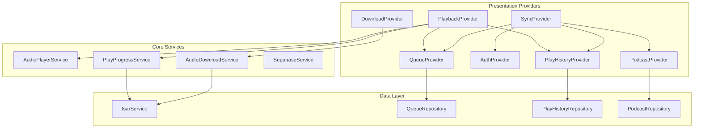
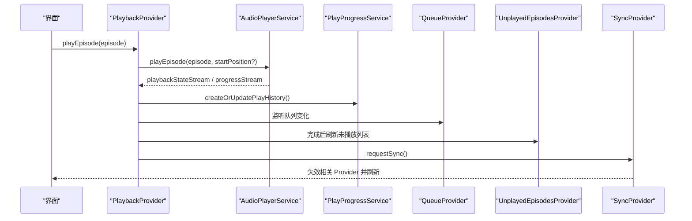
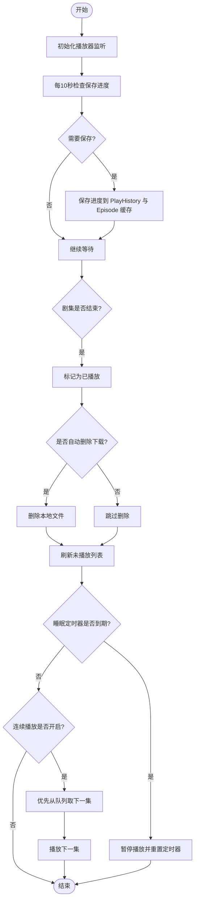
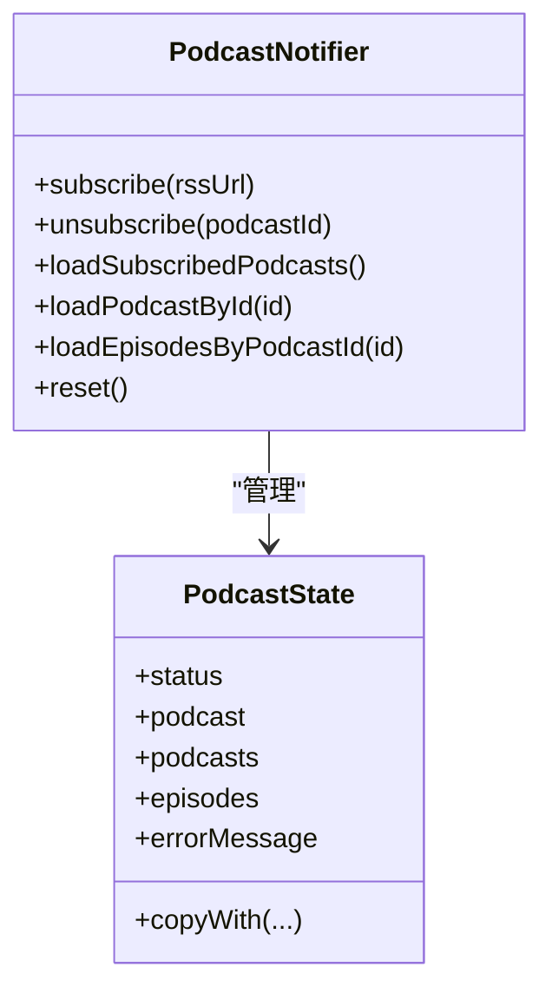
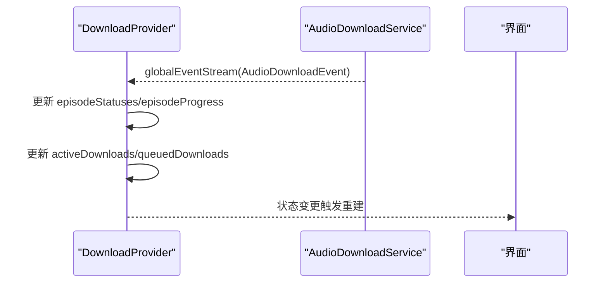
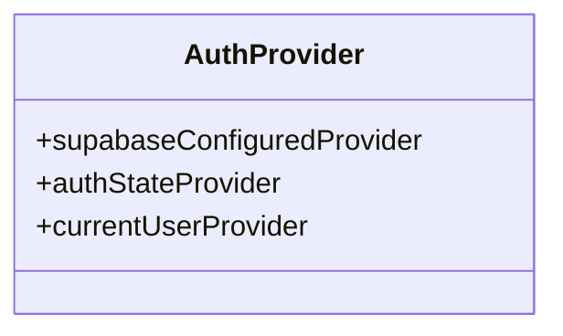
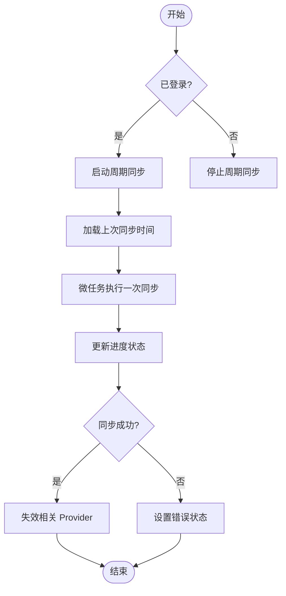
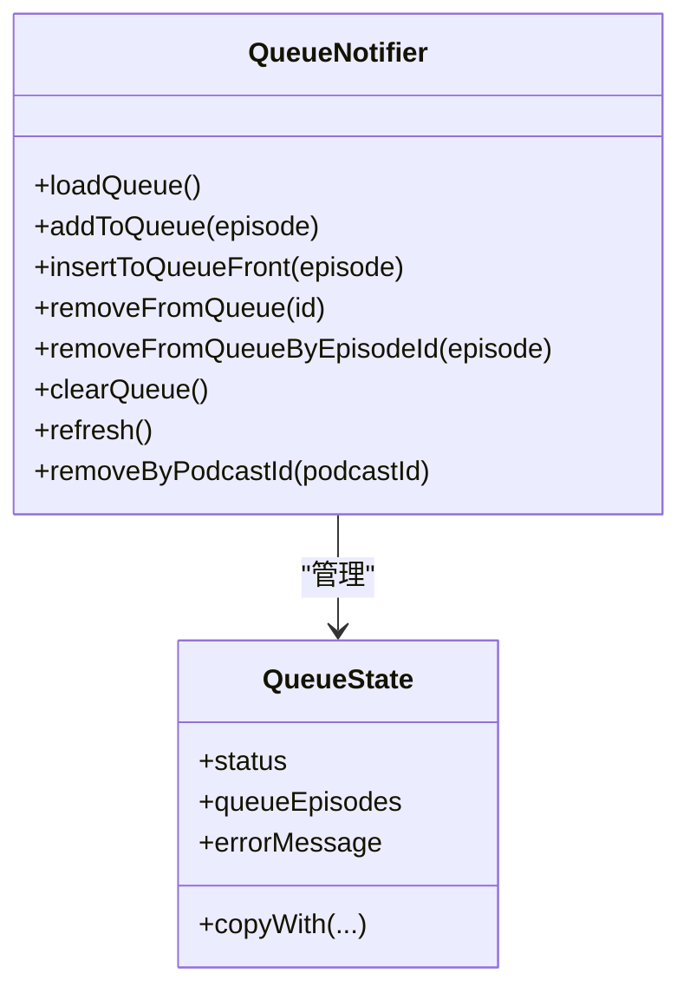
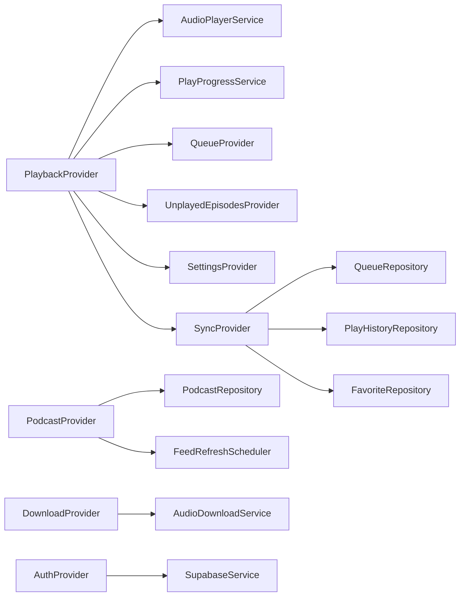

# 核心 Provider 实现

<cite>
**本文引用的文件**   
- [lib/core/providers/auth_provider.dart](file://lib/core/providers/auth_provider.dart)
- [lib/presentation/providers/playback_provider.dart](file://lib/presentation/providers/playback_provider.dart)
- [lib/presentation/providers/podcast_provider.dart](file://lib/presentation/providers/podcast_provider.dart)
- [lib/presentation/providers/download_provider.dart](file://lib/presentation/providers/download_provider.dart)
- [lib/presentation/providers/queue_provider.dart](file://lib/presentation/providers/queue_provider.dart)
- [lib/presentation/providers/play_history_provider.dart](file://lib/presentation/providers/play_history_provider.dart)
- [lib/core/providers/sync_provider.dart](file://lib/core/providers/sync_provider.dart)
- [lib/data/services/audio_download_service.dart](file://lib/data/services/audio_download_service.dart)
- [lib/core/services/play_progress_service.dart](file://lib/core/services/play_progress_service.dart)
</cite>

## 目录
1. [简介](#简介)
2. [项目结构](#项目结构)
3. [核心组件](#核心组件)
4. [架构总览](#架构总览)
5. [详细组件分析](#详细组件分析)
6. [依赖关系分析](#依赖关系分析)
7. [性能考量](#性能考量)
8. [故障排查指南](#故障排查指南)
9. [结论](#结论)

## 简介
本文件聚焦 TinyCast 应用的核心 Provider 实现，围绕播放、播客、下载与认证四大关键提供者进行深度解析。文档涵盖：
- 各 Provider 的职责边界与状态结构设计
- 业务逻辑封装与数据流向
- 播放状态管理、播客数据缓存、下载任务调度、用户认证状态同步的实现细节
- Provider 之间的依赖关系、错误处理机制
- 性能优化策略（状态更新频率控制、内存管理、异步操作优化）

## 项目结构
本项目采用 Riverpod 作为状态管理方案，Provider 分布在 presentation 与 core 层，服务与仓储位于 data 与 domain 层。核心 Provider 包括：
- PlaybackProvider：负责音频播放状态、进度保存、自动续播、睡眠定时器等
- PodcastProvider：订阅/取消订阅播客、获取剧集列表、最新剧集等
- DownloadProvider：监听下载事件、维护下载状态与进度
- AuthProvider：Supabase 认证状态流与当前用户
- SyncProvider：周期性同步与手动触发，失效相关 Provider 以刷新 UI
- QueueProvider：播放队列的增删改查
- PlayHistoryProvider：播放历史与完成态本地缓存

图表来源 
- [lib/presentation/providers/playback_provider.dart](file://lib/presentation/providers/playback_provider.dart)
- [lib/presentation/providers/podcast_provider.dart](file://lib/presentation/providers/podcast_provider.dart)
- [lib/presentation/providers/download_provider.dart](file://lib/presentation/providers/download_provider.dart)
- [lib/core/providers/auth_provider.dart](file://lib/core/providers/auth_provider.dart)
- [lib/core/providers/sync_provider.dart](file://lib/core/providers/sync_provider.dart)
- [lib/presentation/providers/queue_provider.dart](file://lib/presentation/providers/queue_provider.dart)
- [lib/presentation/providers/play_history_provider.dart](file://lib/presentation/providers/play_history_provider.dart)
- [lib/data/services/audio_download_service.dart](file://lib/data/services/audio_download_service.dart)
- [lib/core/services/play_progress_service.dart](file://lib/core/services/play_progress_service.dart)

章节来源
- [lib/presentation/providers/playback_provider.dart](file://lib/presentation/providers/playback_provider.dart)
- [lib/presentation/providers/podcast_provider.dart](file://lib/presentation/providers/podcast_provider.dart)
- [lib/presentation/providers/download_provider.dart](file://lib/presentation/providers/download_provider.dart)
- [lib/core/providers/auth_provider.dart](file://lib/core/providers/auth_provider.dart)
- [lib/core/providers/sync_provider.dart](file://lib/core/providers/sync_provider.dart)
- [lib/presentation/providers/queue_provider.dart](file://lib/presentation/providers/queue_provider.dart)
- [lib/presentation/providers/play_history_provider.dart](file://lib/presentation/providers/play_history_provider.dart)
- [lib/data/services/audio_download_service.dart](file://lib/data/services/audio_download_service.dart)
- [lib/core/services/play_progress_service.dart](file://lib/core/services/play_progress_service.dart)

## 核心组件
- PlaybackProvider
  - 职责：管理播放器状态（当前剧集、播放中、进度、速度、音量）、自动保存播放进度、自动续播、睡眠定时器、完成后清理与未播放列表刷新
  - 状态：PlayerState（currentEpisode、isPlaying、currentPosition、duration、speed、volume）
  - 关键交互：AudioPlayerService、PlayProgressService、QueueProvider、UnplayedEpisodesProvider、SettingsProvider、SyncProvider
- PodcastProvider
  - 职责：订阅/取消订阅、加载已订阅列表、按 ID 查询播客与剧集、提供最新 N 集
  - 状态：PodcastState（status、podcast、podcasts、episodes、errorMessage）
  - 关键交互：ITunesSearchService、PodcastRepositoryImpl、FeedRefreshScheduler
- DownloadProvider
  - 职责：监听 AudioDownloadService 的全局事件，维护每个 episode 的下载状态与进度、活跃/排队数量
  - 状态：DownloadState（episodeStatuses、episodeProgress、activeDownloads、queuedDownloads、lastUpdateTime）
  - 关键交互：AudioDownloadService.globalEventStream、DownloadQueue
- AuthProvider
  - 职责：暴露 Supabase 初始化状态、认证状态流、当前用户
  - 状态：User?（通过 StreamProvider 暴露）
  - 关键交互：SupabaseService.client.auth.onAuthStateChange
- SyncProvider
  - 职责：登录时启动周期同步、手动触发同步、失败重试、完成后失效相关 Provider
  - 状态：SyncState（status、lastSyncTime、progress、errorMessage）
  - 关键交互：SyncService、多个 Provider 失效
- QueueProvider
  - 职责：队列的加载、添加、插入前端、移除、清空；按 podcastId 过滤
  - 状态：QueueState（status、queueEpisodes、errorMessage）
  - 关键交互：QueueRepository、多个 UseCase
- PlayHistoryProvider
  - 职责：加载已完成历史、刷新、本地标记完成、按 podcastId 过滤
  - 状态：List<PlayHistory>
  - 关键交互：PlayHistoryRepository

章节来源
- [lib/presentation/providers/playback_provider.dart](file://lib/presentation/providers/playback_provider.dart)
- [lib/presentation/providers/podcast_provider.dart](file://lib/presentation/providers/podcast_provider.dart)
- [lib/presentation/providers/download_provider.dart](file://lib/presentation/providers/download_provider.dart)
- [lib/core/providers/auth_provider.dart](file://lib/core/providers/auth_provider.dart)
- [lib/core/providers/sync_provider.dart](file://lib/core/providers/sync_provider.dart)
- [lib/presentation/providers/queue_provider.dart](file://lib/presentation/providers/queue_provider.dart)
- [lib/presentation/providers/play_history_provider.dart](file://lib/presentation/providers/play_history_provider.dart)

## 架构总览
整体采用“Provider + Service + Repository”的分层架构：
- Presentation 层通过 NotifierProvider/FutureProvider/StreamProvider 暴露状态
- Core 层提供跨功能能力（如认证、同步、播放进度）
- Data 层通过 Isar 数据库与网络服务支撑持久化与远程数据

图表来源 
- [lib/presentation/providers/playback_provider.dart](file://lib/presentation/providers/playback_provider.dart)
- [lib/core/services/play_progress_service.dart](file://lib/core/services/play_progress_service.dart)
- [lib/core/providers/sync_provider.dart](file://lib/core/providers/sync_provider.dart)

## 详细组件分析

### PlaybackProvider（播放状态与流程）
- 状态结构
  - PlayerState：包含当前剧集、播放状态、进度、时长、速度与音量，并提供 copyWith 与 progressRatio 计算
- 生命周期与监听
  - build 中初始化播放器监听（播放状态、进度、速度、音量、当前剧集、剧集完成事件）
  - 每 10 秒自动保存进度，基于时间与进度阈值避免频繁写入
  - 主窗口恢复上次播放状态（从历史记录恢复并尝试加载本地文件或远端 URL）
- 业务逻辑
  - 播放结束：从队列或未完成列表自动续播；若开启“单集结束暂停”，则暂停并关闭睡眠定时器
  - 自动删除已播放下载：根据设置决定是否删除本地文件
  - 标记为已播放：统一通过 PlayProgressService 同步到 PlayHistory 与 Episode 缓存
  - 进度保存：节流策略（时间间隔与进度差值），确保不丢失且不过度 IO
- 错误处理
  - 所有关键路径使用 try/catch 与 Logger.error 记录异常
  - 恢复播放失败时清理状态，保留 UI 显示但不加载音频

图表来源 
- [lib/presentation/providers/playback_provider.dart](file://lib/presentation/providers/playback_provider.dart)
- [lib/core/services/play_progress_service.dart](file://lib/core/services/play_progress_service.dart)

章节来源
- [lib/presentation/providers/playback_provider.dart](file://lib/presentation/providers/playback_provider.dart)
- [lib/core/services/play_progress_service.dart](file://lib/core/services/play_progress_service.dart)

### PodcastProvider（播客数据与缓存）
- 状态结构
  - PodcastState：status（initial/loading/success/error）、podcast、podcasts、episodes、errorMessage
- 主要能力
  - 订阅/取消订阅：调用 UseCase 并通过状态反馈结果
  - 加载已订阅列表：立即设置 loading 并保留现有数据，防止 UI 空页；成功后排序（createdAt 倒序）
  - 按 ID 查询播客与剧集：分别返回单个 Podcast 与 Episode 列表
  - 最新 N 集：FutureProvider.family(podcastId) 支持参数化查询
- 错误处理
  - 失败时保留已有数据，设置 errorMessage 与 status=error
- 集成点
  - FeedRefreshScheduler：刷新完成后触发 loadSubscribedPodcasts

图表来源 
- [lib/presentation/providers/podcast_provider.dart](file://lib/presentation/providers/podcast_provider.dart)

章节来源
- [lib/presentation/providers/podcast_provider.dart](file://lib/presentation/providers/podcast_provider.dart)

### DownloadProvider（下载任务调度）
- 状态结构
  - DownloadState：episodeStatuses（Map<episodeId, DownloadStatus>）、episodeProgress（Map<episodeId, double>）、activeDownloads、queuedDownloads、lastUpdateTime
- 事件驱动
  - 订阅 AudioDownloadService.globalEventStream，实时更新状态与进度
  - 完成或失败时输出日志，便于 UI 自动刷新
- 工具方法
  - isAnyDownloading()：判断是否有正在下载的任务
  - getCompletedEpisodes()：获取已完成 episode 列表
  - clearEpisode()/clearAll()：清理指定或全部条目
- 与队列联动
  - activeDownloads 与 queuedDownloads 来自 AudioDownloadService.downloadQueue

图表来源 
- [lib/presentation/providers/download_provider.dart](file://lib/presentation/providers/download_provider.dart)
- [lib/data/services/audio_download_service.dart](file://lib/data/services/audio_download_service.dart)

章节来源
- [lib/presentation/providers/download_provider.dart](file://lib/presentation/providers/download_provider.dart)
- [lib/data/services/audio_download_service.dart](file://lib/data/services/audio_download_service.dart)

### AuthProvider（认证状态同步）
- 暴露能力
  - supabaseConfiguredProvider：Supabase 是否已初始化
  - authStateProvider：StreamProvider<User?> 监听 onAuthStateChange
  - currentUserProvider：当前用户快照
- 与 SyncProvider 联动
  - 登录成功时启动周期同步并立即执行一次同步

图表来源 
- [lib/core/providers/auth_provider.dart](file://lib/core/providers/auth_provider.dart)

章节来源
- [lib/core/providers/auth_provider.dart](file://lib/core/providers/auth_provider.dart)

### SyncProvider（同步与失效）
- 状态结构
  - SyncState：status（idle/syncing/error）、lastSyncTime、progress、errorMessage
- 行为
  - 监听认证状态：登录后启动周期同步（每 5 分钟），立即执行一次
  - requestSync：防抖 10 秒后触发 syncNow
  - syncNow：设置进度回调、执行同步、更新 lastSyncTime、失效相关 Provider
- 失效范围
  - queueNotifierProvider、favoriteProvider、favoriteEpisodesNotifierProvider、unplayedEpisodesNotifierProvider、subscribedPodcastsProvider、latestPlayingHistoryProvider

图表来源 
- [lib/core/providers/sync_provider.dart](file://lib/core/providers/sync_provider.dart)

章节来源
- [lib/core/providers/sync_provider.dart](file://lib/core/providers/sync_provider.dart)

### QueueProvider（播放队列）
- 状态结构
  - QueueState：status（initial/loading/success/error）、queueEpisodes、errorMessage
- 能力
  - loadQueue：异步加载，带请求 ID 去重
  - addToQueue/insertToQueueFront/removeFromQueue/removeFromQueueByEpisodeId/clearQueue：操作后 refresh
  - removeByPodcastId：按 podcastId 过滤并更新状态
- 依赖
  - QueueRepository 与多个 UseCase

图表来源 
- [lib/presentation/providers/queue_provider.dart](file://lib/presentation/providers/queue_provider.dart)

章节来源
- [lib/presentation/providers/queue_provider.dart](file://lib/presentation/providers/queue_provider.dart)

### PlayHistoryProvider（播放历史）
- 状态结构
  - List<PlayHistory>
- 能力
  - 加载已完成历史、刷新、本地标记完成、按 podcastId 过滤
- 依赖
  - PlayHistoryRepository

章节来源
- [lib/presentation/providers/play_history_provider.dart](file://lib/presentation/providers/play_history_provider.dart)

## 依赖关系分析
- PlaybackProvider
  - 依赖 AudioPlayerService（播放控制与事件）、PlayProgressService（进度与完成态同步）、QueueProvider（续播）、UnplayedEpisodesProvider（未播放列表刷新）、SettingsProvider（速度与音量、连续播放、睡眠定时器）、SyncProvider（触发同步）
- PodcastProvider
  - 依赖 ITunesSearchService、PodcastRepositoryImpl、FeedRefreshScheduler
- DownloadProvider
  - 依赖 AudioDownloadService.globalEventStream、DownloadQueue
- AuthProvider
  - 依赖 SupabaseService.client.auth
- SyncProvider
  - 依赖 SyncService、多个 Provider 失效
- QueueProvider
  - 依赖 QueueRepository 与多个 UseCase
- PlayHistoryProvider
  - 依赖 PlayHistoryRepository

图表来源 
- [lib/presentation/providers/playback_provider.dart](file://lib/presentation/providers/playback_provider.dart)
- [lib/presentation/providers/podcast_provider.dart](file://lib/presentation/providers/podcast_provider.dart)
- [lib/presentation/providers/download_provider.dart](file://lib/presentation/providers/download_provider.dart)
- [lib/core/providers/auth_provider.dart](file://lib/core/providers/auth_provider.dart)
- [lib/core/providers/sync_provider.dart](file://lib/core/providers/sync_provider.dart)

章节来源
- [lib/presentation/providers/playback_provider.dart](file://lib/presentation/providers/playback_provider.dart)
- [lib/presentation/providers/podcast_provider.dart](file://lib/presentation/providers/podcast_provider.dart)
- [lib/presentation/providers/download_provider.dart](file://lib/presentation/providers/download_provider.dart)
- [lib/core/providers/auth_provider.dart](file://lib/core/providers/auth_provider.dart)
- [lib/core/providers/sync_provider.dart](file://lib/core/providers/sync_provider.dart)

## 性能考量
- 状态更新频率控制
  - PlaybackProvider：进度保存采用时间间隔（10 秒）与进度差值（≥5% 或 ≥5 秒）双重条件，避免频繁 IO
  - SyncProvider：周期同步 5 分钟，手动触发防抖 10 秒
- 内存管理
  - DownloadProvider：仅维护 Map 状态，完成后及时清理；DownloadQueue 限制并发数（默认 3）
  - PlaybackProvider：在 dispose 中取消所有监听与定时器，释放资源
- 异步操作优化
  - QueueProvider：loadQueue 使用 requestId 去重，丢弃过期结果
  - PodcastProvider：loading 阶段保留现有数据，避免 UI 闪烁
- 缓存与一致性
  - PlayProgressService：将进度与完成态同步至 Episode 缓存，保证多源一致
  - SyncProvider：同步完成后失效相关 Provider，确保 UI 与后端一致

[本节为通用指导，无需引用具体文件]

## 故障排查指南
- 播放状态异常
  - 检查 PlaybackProvider 的监听是否正确初始化与销毁
  - 确认 PlayProgressService 的进度保存是否被触发（时间与进度条件）
  - 查看 _restoreLastPlaybackState 是否因文件不存在而跳过加载
- 下载状态不同步
  - 确认 DownloadProvider 订阅了 globalEventStream
  - 检查 AudioDownloadService 的事件发送与 DownloadQueue 的状态
- 认证与同步问题
  - 验证 SupabaseService.isInitialized 与 authStateProvider 的流是否正常
  - 检查 SyncProvider 的周期同步与防抖逻辑
- 队列与历史不一致
  - 检查 QueueProvider 的 refresh 是否在操作后调用
  - 确认 PlayHistoryProvider 的刷新与本地标记逻辑

章节来源
- [lib/presentation/providers/playback_provider.dart](file://lib/presentation/providers/playback_provider.dart)
- [lib/presentation/providers/download_provider.dart](file://lib/presentation/providers/download_provider.dart)
- [lib/core/providers/auth_provider.dart](file://lib/core/providers/auth_provider.dart)
- [lib/core/providers/sync_provider.dart](file://lib/core/providers/sync_provider.dart)
- [lib/presentation/providers/queue_provider.dart](file://lib/presentation/providers/queue_provider.dart)
- [lib/presentation/providers/play_history_provider.dart](file://lib/presentation/providers/play_history_provider.dart)

## 结论
TinyCast 的核心 Provider 通过清晰的职责划分与稳健的状态管理，实现了播放、播客、下载与认证的完整闭环。PlaybackProvider 负责播放状态与流程编排，PodcastProvider 管理播客数据与缓存，DownloadProvider 驱动下载任务调度，AuthProvider 提供认证状态流，SyncProvider 保障数据一致性。结合节流、并发控制与缓存同步，系统在性能与用户体验上取得平衡。建议在实际使用中关注日志与错误处理，确保问题可追踪与快速修复。