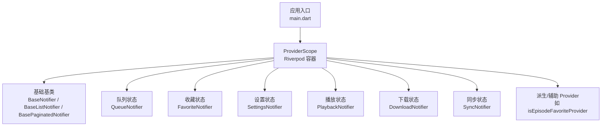
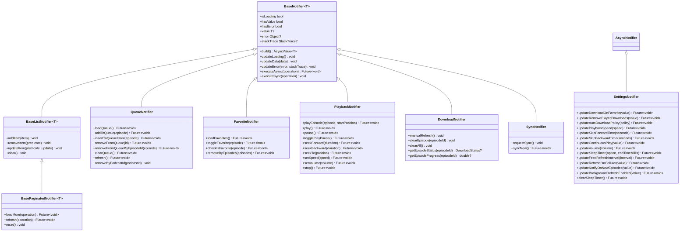
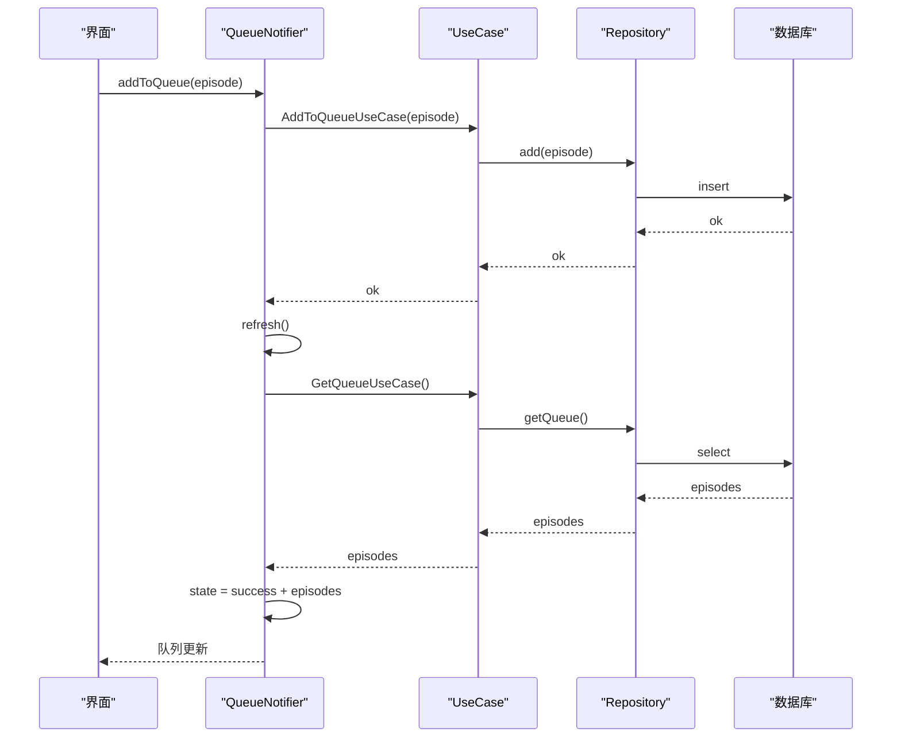
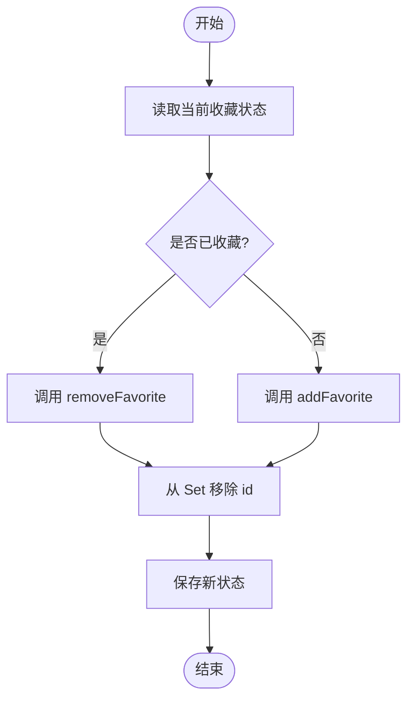
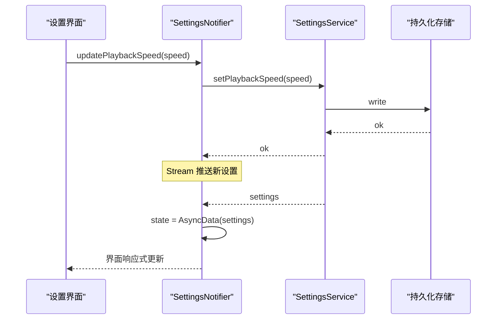
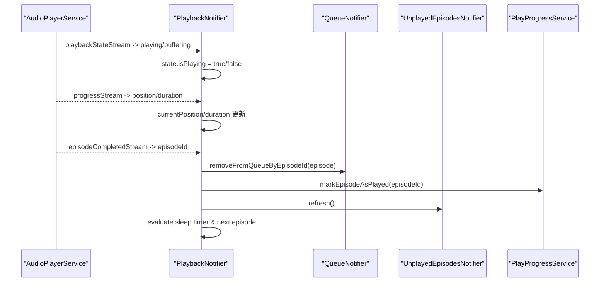
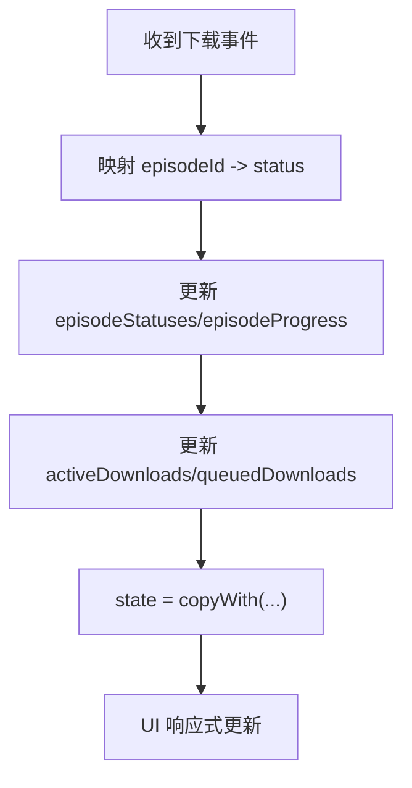
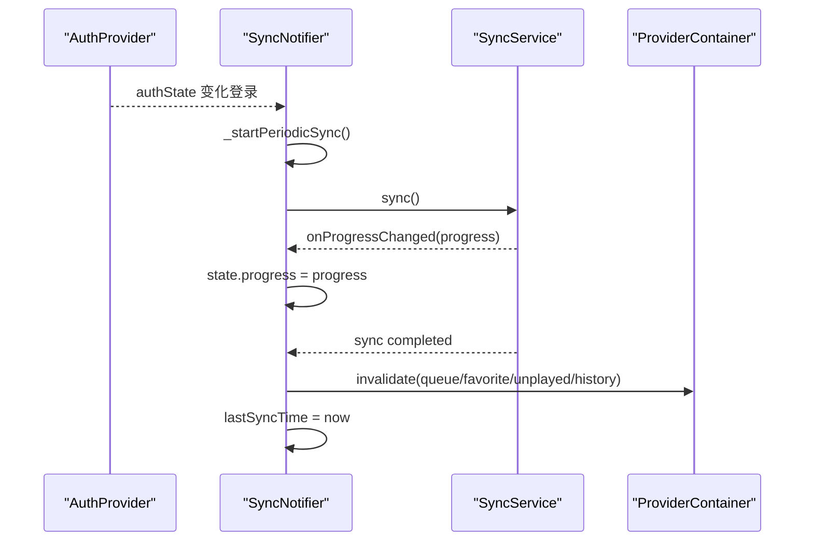
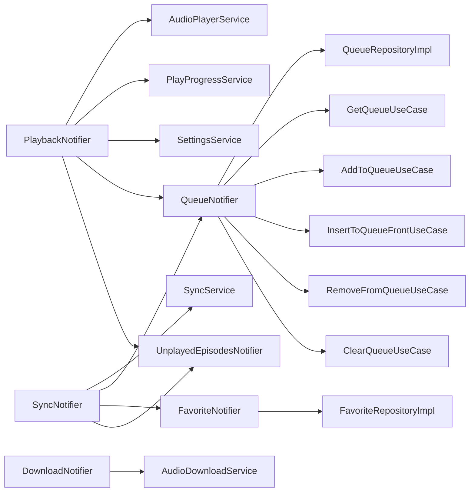

# 状态管理模式

<cite>
**本文引用的文件**   
- [main.dart](file://lib/main.dart)
- [base_state_notifier.dart](file://lib/presentation/providers/base_state_notifier.dart)
- [queue_provider.dart](file://lib/presentation/providers/queue_provider.dart)
- [favorite_provider.dart](file://lib/presentation/providers/favorite_provider.dart)
- [settings_provider.dart](file://lib/presentation/providers/settings_provider.dart)
- [playback_provider.dart](file://lib/presentation/providers/playback_provider.dart)
- [download_provider.dart](file://lib/presentation/providers/download_provider.dart)
- [favorite_episodes_provider.dart](file://lib/presentation/providers/favorite_episodes_provider.dart)
- [sync_provider.dart](file://lib/core/providers/sync_provider.dart)
- [podcast_provider_test.dart](file://test/presentation/providers/podcast_provider_test.dart)
</cite>

## 目录
1. [简介](#简介)
2. [项目结构](#项目结构)
3. [核心组件](#核心组件)
4. [架构总览](#架构总览)
5. [详细组件分析](#详细组件分析)
6. [依赖分析](#依赖分析)
7. [性能考虑](#性能考虑)
8. [故障排查指南](#故障排查指南)
9. [结论](#结论)
10. [附录](#附录)

## 简介
本文件系统性梳理 TinyCast 应用中的状态管理模式，重点覆盖：
- 使用 Riverpod 的 NotifierProvider/AsyncNotifierProvider 管理复杂状态
- 队列管理、收藏管理、设置管理等场景的状态设计与实现
- 状态变更通知机制与响应式更新
- 状态的持久化与恢复（播放进度、设置项）
- 组合与派生状态、状态验证等高级用法
- 性能优化策略（避免不必要重渲染、状态分割、内存泄漏防护）
- 调试与测试最佳实践

## 项目结构
TinyCast 在 Flutter 中采用 Riverpod 作为状态管理方案，通过 Provider/NotifierProvider/AsyncNotifierProvider 组织各业务域的状态。入口 main.dart 负责初始化全局服务与 ProviderScope，随后由各个 feature 模块提供各自的状态提供者。

图表来源
- [main.dart:106-176](file://lib/main.dart#L106-L176)
- [base_state_notifier.dart:1-224](file://lib/presentation/providers/base_state_notifier.dart#L1-L224)

章节来源
- [main.dart:106-176](file://lib/main.dart#L106-L176)

## 核心组件
- 基础基类
  - BaseNotifier<T>：封装通用异步加载、错误处理与数据更新
  - BaseListNotifier<T>：列表型状态基类，支持增删改与分页
  - BasePaginatedNotifier<T>：分页状态基类，封装加载更多、刷新、重置
  - PaginatedData<T>：分页数据结构，包含 items、hasMore、page、isLoading

- 领域状态提供者
  - QueueNotifier：播客播放队列状态，维护队列条目与操作（添加、插入头部、移除、清空）
  - FavoriteNotifier：收藏状态，维护已收藏 episode id 集合，支持切换收藏、批量清理
  - SettingsNotifier：应用设置状态，基于 Stream 订阅持久化设置，暴露各类 setter
  - PlaybackNotifier：播放器状态，监听音频服务事件，自动保存进度、睡眠定时器、连续播放
  - DownloadNotifier：下载状态，订阅全局下载事件流，维护每个 episode 的状态与进度
  - SyncNotifier：云同步状态，周期性或手动触发同步，并失效相关 Provider

- 派生与辅助 Provider
  - favoriteEpisodesProvider：对收藏剧集进行排序后的派生列表
  - isEpisodeFavoriteProvider：根据 episodeId 派生的布尔值
  - queueEpisodesProvider、queueLoadingProvider：从队列状态派生的列表与加载标志

章节来源
- [base_state_notifier.dart:1-224](file://lib/presentation/providers/base_state_notifier.dart#L1-L224)
- [queue_provider.dart:1-290](file://lib/presentation/providers/queue_provider.dart#L1-L290)
- [favorite_provider.dart:1-157](file://lib/presentation/providers/favorite_provider.dart#L1-L157)
- [settings_provider.dart:1-185](file://lib/presentation/providers/settings_provider.dart#L1-L185)
- [playback_provider.dart:1-766](file://lib/presentation/providers/playback_provider.dart#L1-L766)
- [download_provider.dart:1-156](file://lib/presentation/providers/download_provider.dart#L1-L156)
- [favorite_episodes_provider.dart:1-87](file://lib/presentation/providers/favorite_episodes_provider.dart#L1-L87)
- [sync_provider.dart:1-168](file://lib/core/providers/sync_provider.dart#L1-L168)

## 架构总览
整体采用“领域状态 + 派生 Provider”的分层设计：
- 领域状态（Queue/Favorite/Settings/Playback/Download/Sync）负责业务逻辑与数据源交互
- 派生 Provider 仅做计算与过滤，避免重复逻辑
- 通过 ref.listen/ref.watch 建立响应式链路，保证 UI 最小化更新

图表来源
- [base_state_notifier.dart:1-224](file://lib/presentation/providers/base_state_notifier.dart#L1-L224)
- [queue_provider.dart:1-290](file://lib/presentation/providers/queue_provider.dart#L1-L290)
- [favorite_provider.dart:1-157](file://lib/presentation/providers/favorite_provider.dart#L1-L157)
- [settings_provider.dart:1-185](file://lib/presentation/providers/settings_provider.dart#L1-L185)
- [playback_provider.dart:1-766](file://lib/presentation/providers/playback_provider.dart#L1-L766)
- [download_provider.dart:1-156](file://lib/presentation/providers/download_provider.dart#L1-L156)
- [sync_provider.dart:1-168](file://lib/core/providers/sync_provider.dart#L1-L168)

## 详细组件分析

### 队列管理（QueueNotifier）
- 状态模型：QueueState（status、queueEpisodes、errorMessage）
- 关键方法：
  - loadQueue：异步加载队列，使用 requestId 防止竞态
  - addToQueue/insertToQueueFront/removeFromQueue/clearQueue：调用 UseCase 后刷新
  - removeByPodcastId：按 podcastId 过滤并更新本地状态
- 派生 Provider：
  - queueEpisodesProvider：返回当前队列列表
  - queueLoadingProvider：是否加载中

图表来源
- [queue_provider.dart:139-160](file://lib/presentation/providers/queue_provider.dart#L139-L160)
- [queue_provider.dart:104-137](file://lib/presentation/providers/queue_provider.dart#L104-L137)

章节来源
- [queue_provider.dart:1-290](file://lib/presentation/providers/queue_provider.dart#L1-L290)

### 收藏管理（FavoriteNotifier）
- 状态模型：FavoriteState（status、favoriteEpisodeIds、errorMessage）
- 关键方法：
  - loadFavorites：加载所有收藏 episode id
  - toggleFavorite：以数据库为准切换收藏，并即时更新本地 Set
  - checkIsFavorite：只读检查
  - removeByEpisodes：批量取消关注时清理收藏
- 派生 Provider：
  - isEpisodeFavoriteProvider：根据 episodeId 派生布尔值

图表来源
- [favorite_provider.dart:76-106](file://lib/presentation/providers/favorite_provider.dart#L76-L106)

章节来源
- [favorite_provider.dart:1-157](file://lib/presentation/providers/favorite_provider.dart#L1-L157)

### 设置管理（SettingsNotifier）
- 状态模型：SettingsState（status、settings、errorMessage），使用 AsyncNotifier<AppSettings>
- 关键特性：
  - build 中订阅 SettingsService 的 Stream，实时更新 AppSettings
  - 暴露大量 setter 方法，写入持久化存储
  - 部分设置变更会重启后台任务（如 FeedRefreshScheduler）
- 注意事项：
  - 在 onDispose 中取消订阅，避免内存泄漏

图表来源
- [settings_provider.dart:35-61](file://lib/presentation/providers/settings_provider.dart#L35-L61)
- [settings_provider.dart:93-99](file://lib/presentation/providers/settings_provider.dart#L93-L99)

章节来源
- [settings_provider.dart:1-185](file://lib/presentation/providers/settings_provider.dart#L1-L185)

### 播放状态（PlaybackNotifier）
- 状态模型：PlayerState（currentEpisode、isPlaying、currentPosition、duration、speed、volume）
- 关键特性：
  - 监听 AudioPlayerService 的多路 Stream，统一更新状态
  - 自动保存播放进度（定时+阈值触发）
  - 睡眠定时器检查与自动暂停
  - 播放完成后的队列清理、未播放列表刷新、自动删除下载文件（可选）
  - 主窗口启动时恢复上次播放状态（含位置与 Episode）
- 派生 Provider：currentEpisodeProvider、isPlayingProvider、progressRatioProvider 等

图表来源
- [playback_provider.dart:169-205](file://lib/presentation/providers/playback_provider.dart#L169-L205)
- [playback_provider.dart:216-265](file://lib/presentation/providers/playback_provider.dart#L216-L265)

章节来源
- [playback_provider.dart:1-766](file://lib/presentation/providers/playback_provider.dart#L1-L766)

### 下载状态（DownloadNotifier）
- 状态模型：DownloadState（episodeStatuses、episodeProgress、activeDownloads、queuedDownloads、lastUpdateTime）
- 关键特性：
  - 订阅 AudioDownloadService.globalEventStream，实时映射到状态
  - 提供 clearEpisode/clearAll 等清理方法
  - 派生 Provider 暴露 active/queued/completed 等常用视图

图表来源
- [download_provider.dart:55-94](file://lib/presentation/providers/download_provider.dart#L55-L94)

章节来源
- [download_provider.dart:1-156](file://lib/presentation/providers/download_provider.dart#L1-L156)

### 同步状态（SyncNotifier）
- 状态模型：SyncState（status、lastSyncTime、progress、errorMessage）
- 关键特性：
  - 监听认证状态，登录后启动周期同步与立即同步
  - requestSync 防抖触发
  - 完成后失效相关 Provider（队列、收藏、未播放、历史等）

图表来源
- [sync_provider.dart:48-74](file://lib/core/providers/sync_provider.dart#L48-L74)
- [sync_provider.dart:110-151](file://lib/core/providers/sync_provider.dart#L110-L151)

章节来源
- [sync_provider.dart:1-168](file://lib/core/providers/sync_provider.dart#L1-L168)

### 派生状态与组合示例
- 收藏剧集排序：favoriteEpisodesProvider 对 episodes 按 pubDate 降序排序
- 收藏判断：isEpisodeFavoriteProvider 根据 favoriteEpisodeIds.contains(episodeId) 派生布尔值
- 队列列表与加载标志：queueEpisodesProvider、queueLoadingProvider

章节来源
- [favorite_episodes_provider.dart:76-81](file://lib/presentation/providers/favorite_episodes_provider.dart#L76-L81)
- [favorite_provider.dart:153-156](file://lib/presentation/providers/favorite_provider.dart#L153-L156)
- [queue_provider.dart:281-289](file://lib/presentation/providers/queue_provider.dart#L281-L289)

## 依赖分析
- 领域依赖
  - QueueNotifier 依赖 QueueRepositoryImpl 与多个 UseCase
  - FavoriteNotifier 依赖 FavoriteRepositoryImpl
  - PlaybackNotifier 依赖 AudioPlayerService、PlayProgressService、SettingsService、QueueNotifier、UnplayedEpisodesNotifier
  - DownloadNotifier 依赖 AudioDownloadService
  - SyncNotifier 依赖 SyncService 与多个领域 Provider
- 外部集成
  - IsarService（数据库）、SupabaseService（云端）、AudioPlayerService（音频）、AudioDownloadService（下载）

图表来源
- [queue_provider.dart:14-50](file://lib/presentation/providers/queue_provider.dart#L14-L50)
- [favorite_provider.dart:1-10](file://lib/presentation/providers/favorite_provider.dart#L1-L10)
- [playback_provider.dart:1-22](file://lib/presentation/providers/playback_provider.dart#L1-L22)
- [download_provider.dart:1-10](file://lib/presentation/providers/download_provider.dart#L1-L10)
- [sync_provider.dart:1-12](file://lib/core/providers/sync_provider.dart#L1-L12)

章节来源
- [queue_provider.dart:1-50](file://lib/presentation/providers/queue_provider.dart#L1-L50)
- [favorite_provider.dart:1-10](file://lib/presentation/providers/favorite_provider.dart#L1-L10)
- [playback_provider.dart:1-22](file://lib/presentation/providers/playback_provider.dart#L1-L22)
- [download_provider.dart:1-10](file://lib/presentation/providers/download_provider.dart#L1-L10)
- [sync_provider.dart:1-12](file://lib/core/providers/sync_provider.dart#L1-L12)

## 性能考虑
- 避免不必要的重渲染
  - 使用派生 Provider 仅暴露所需字段（如 isEpisodeFavoriteProvider、queueLoadingProvider）
  - 使用 whenData/when 访问不可变状态，减少无效重建
- 状态分割策略
  - 将不同职责的状态拆分到独立 Notifier（队列、收藏、设置、播放、下载、同步）
  - 使用 BaseListNotifier/BasePaginatedNotifier 复用通用逻辑
- 内存泄漏防护
  - 在 Notifier 的 build/onDispose 中正确订阅与取消订阅（SettingsNotifier、PlaybackNotifier、DownloadNotifier）
  - 使用 Timer.periodic 时确保在 dispose 中 cancel
- 异步竞态控制
  - QueueNotifier 使用 requestId 丢弃过期结果
  - PlaybackNotifier 使用 restoreGeneration 与 _userInitiatedPlayback 避免恢复冲突
- 增量更新
  - DownloadNotifier 通过 Map.from(state.xxx) 浅拷贝更新，避免全量重建
  - FavoriteNotifier 使用 Set 的 from/new 创建新集合，保持不可变性

[本节为通用指导，不直接分析具体文件]

## 故障排查指南
- 常见问题定位
  - 队列加载失败：检查 LoadQueue 的错误分支与日志输出
  - 收藏切换异常：确认数据库操作与本地 Set 一致性
  - 设置未生效：检查 SettingsService 写入与 Stream 推送
  - 播放进度未保存：检查自动保存定时器与阈值条件
  - 下载状态不同步：确认 globalEventStream 订阅与事件映射
- 调试建议
  - 使用 Logger 输出关键路径（已在多处注入）
  - 使用 ProviderContainer 与 overrides 进行单元测试（参考 podcast_provider_test.dart）
  - 在 UI 层打印派生 Provider 的值变化，定位更新链路

章节来源
- [podcast_provider_test.dart:18-25](file://test/presentation/providers/podcast_provider_test.dart#L18-L25)
- [podcast_provider_test.dart:116-141](file://test/presentation/providers/podcast_provider_test.dart#L116-L141)

## 结论
TinyCast 的状态管理以 Riverpod 为核心，结合 Notifier/AsyncNotifier 与派生 Provider，实现了清晰、可测试、可扩展的状态架构。通过基础基类抽象通用行为，领域状态专注业务逻辑，派生 Provider 负责视图适配，有效降低耦合与复杂度。配合完善的日志、测试与生命周期管理，保障了性能与稳定性。

[本节为总结性内容，不直接分析具体文件]

## 附录
- 最佳实践清单
  - 使用不可变状态与 copyWith 更新
  - 在 build 中订阅资源，在 onDispose 中释放
  - 使用派生 Provider 分离计算与展示
  - 对异步操作进行错误处理与状态标记
  - 通过 ProviderContainer 与 Mock 进行单元测试
- 参考文件路径
  - 基础基类：[base_state_notifier.dart](file://lib/presentation/providers/base_state_notifier.dart)
  - 队列：[queue_provider.dart](file://lib/presentation/providers/queue_provider.dart)
  - 收藏：[favorite_provider.dart](file://lib/presentation/providers/favorite_provider.dart)
  - 设置：[settings_provider.dart](file://lib/presentation/providers/settings_provider.dart)
  - 播放：[playback_provider.dart](file://lib/presentation/providers/playback_provider.dart)
  - 下载：[download_provider.dart](file://lib/presentation/providers/download_provider.dart)
  - 同步：[sync_provider.dart](file://lib/core/providers/sync_provider.dart)
  - 测试示例：[podcast_provider_test.dart](file://test/presentation/providers/podcast_provider_test.dart)

[本节为附录信息，不直接分析具体文件]