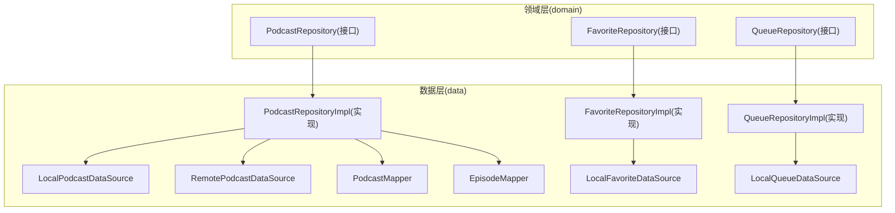
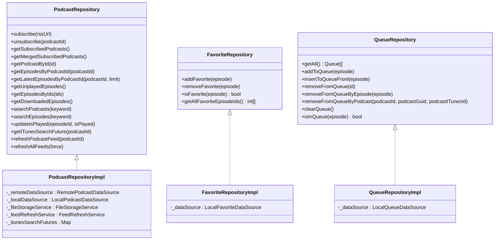
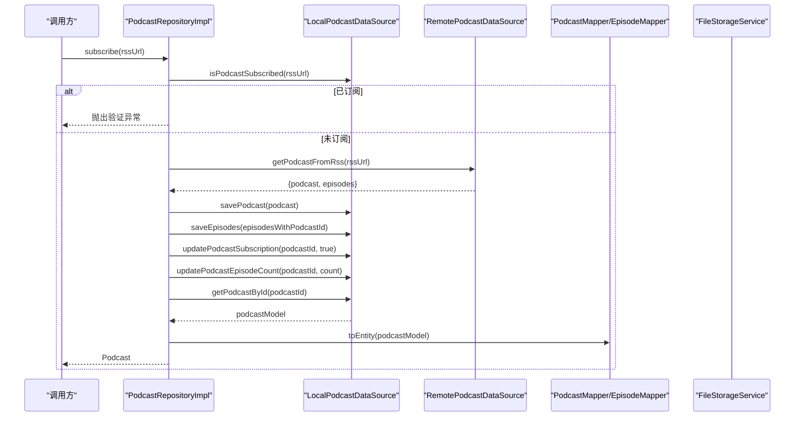
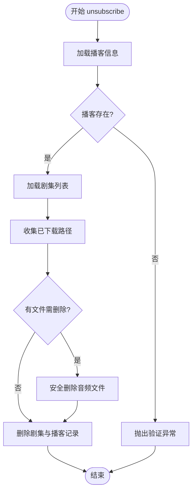
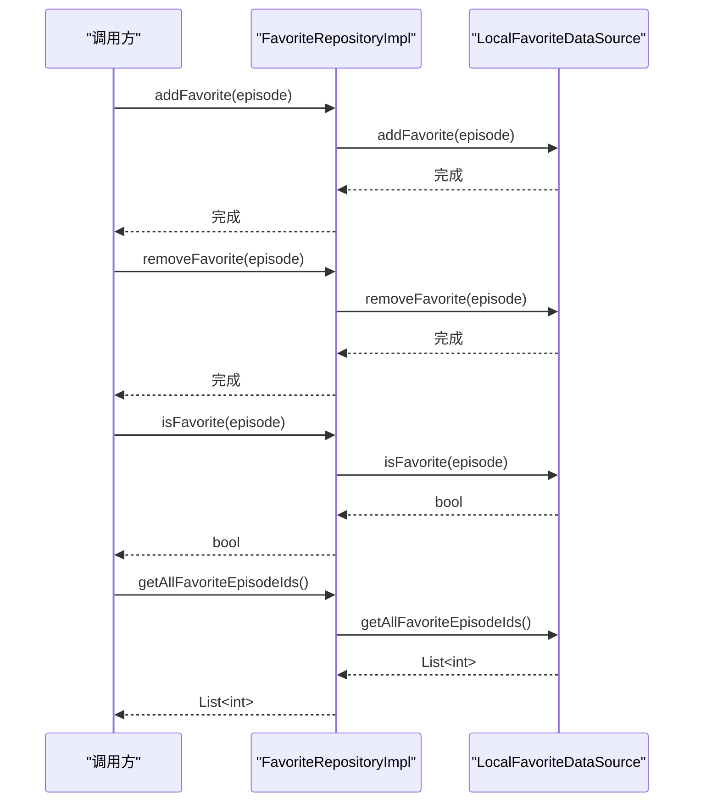
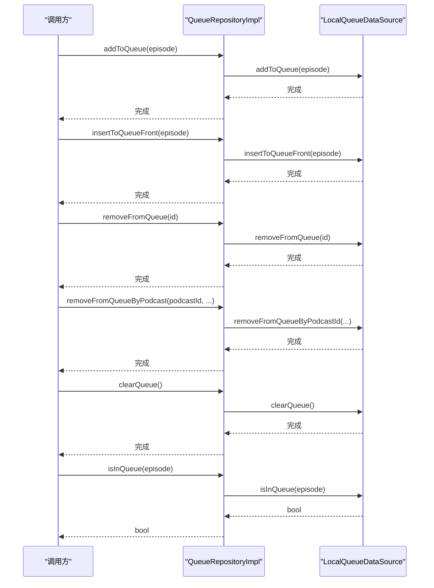
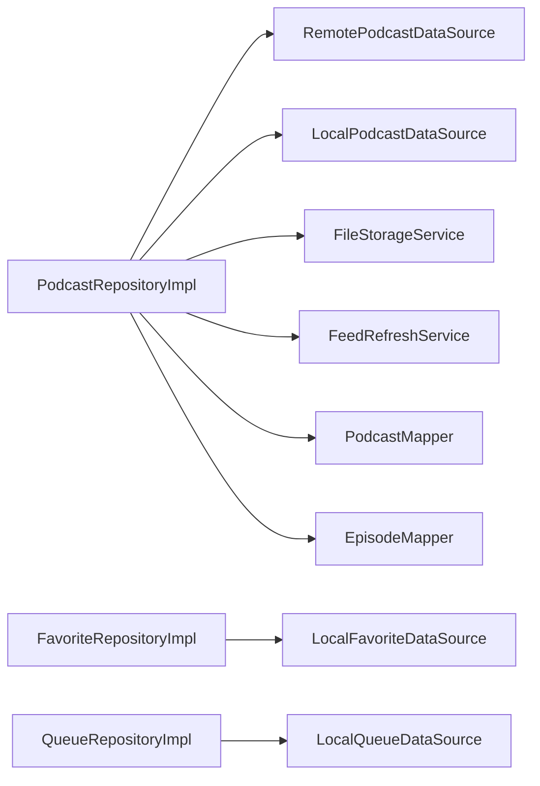

# 仓库模式（Repository Pattern）

<cite>
**本文引用的文件**   
- [lib/domain/repositories/podcast_repository.dart](file://lib/domain/repositories/podcast_repository.dart)
- [lib/domain/repositories/favorite_repository.dart](file://lib/domain/repositories/favorite_repository.dart)
- [lib/domain/repositories/queue_repository.dart](file://lib/domain/repositories/queue_repository.dart)
- [lib/data/repositories/podcast_repository_impl.dart](file://lib/data/repositories/podcast_repository_impl.dart)
- [lib/data/repositories/favorite_repository_impl.dart](file://lib/data/repositories/favorite_repository_impl.dart)
- [lib/data/repositories/queue_repository_impl.dart](file://lib/data/repositories/queue_repository_impl.dart)
- [lib/data/datasources/local_podcast_datasource.dart](file://lib/data/datasources/local_podcast_datasource.dart)
- [lib/data/datasources/remote_podcast_datasource.dart](file://lib/data/datasources/remote_podcast_datasource.dart)
- [lib/data/datasources/local_favorite_datasource.dart](file://lib/data/datasources/local_favorite_datasource.dart)
- [lib/data/datasources/local_queue_datasource.dart](file://lib/data/datasources/local_queue_datasource.dart)
- [lib/data/mappers/podcast_mapper.dart](file://lib/data/mappers/podcast_mapper.dart)
- [lib/data/mappers/episode_mapper.dart](file://lib/data/mappers/episode_mapper.dart)
- [lib/core/utils/app_exception.dart](file://lib/core/utils/app_exception.dart)
- [lib/core/utils/logger.dart](file://lib/core/utils/logger.dart)
</cite>

## 目录
1. [简介](#简介)
2. [项目结构](#项目结构)
3. [核心组件](#核心组件)
4. [架构总览](#架构总览)
5. [详细组件分析](#详细组件分析)
6. [依赖关系分析](#依赖关系分析)
7. [性能考量](#性能考量)
8. [故障排查指南](#故障排查指南)
9. [结论](#结论)
10. [附录](#附录)

## 简介
本文件围绕 TinyCast 应用中的仓库模式（Repository Pattern）进行系统化文档化，重点阐述其在 Clean Architecture 中的作用：通过接口抽象数据访问逻辑，实现数据源解耦、多数据源切换与测试友好性。文档聚焦以下核心仓库接口与实现：
- PodcastRepository、FavoriteRepository、QueueRepository 的接口定义
- PodcastRepositoryImpl、FavoriteRepositoryImpl、QueueRepositoryImpl 的实现细节
- LocalPodcastDataSource、RemotePodcastDataSource、LocalFavoriteDataSource、LocalQueueDataSource 等数据源的角色与协作方式
同时提供类图、时序图与流程图，帮助读者快速理解数据流与控制流，并给出最佳实践与常见陷阱建议。

## 项目结构
TinyCast 采用分层架构，仓库位于 data 层，接口定义在 domain 层，数据源位于 data/datasources，映射器位于 data/mappers，通用工具与异常处理位于 core/utils。仓库作为领域与数据层的桥梁，屏蔽底层存储与网络细节，向上暴露稳定的业务接口。

图表来源 
- [lib/domain/repositories/podcast_repository.dart:1-42](file://lib/domain/repositories/podcast_repository.dart#L1-L42)
- [lib/domain/repositories/favorite_repository.dart:1-9](file://lib/domain/repositories/favorite_repository.dart#L1-L9)
- [lib/domain/repositories/queue_repository.dart:1-14](file://lib/domain/repositories/queue_repository.dart#L1-L14)
- [lib/data/repositories/podcast_repository_impl.dart:1-524](file://lib/data/repositories/podcast_repository_impl.dart#L1-L524)
- [lib/data/repositories/favorite_repository_impl.dart:1-36](file://lib/data/repositories/favorite_repository_impl.dart#L1-L36)
- [lib/data/repositories/queue_repository_impl.dart:1-61](file://lib/data/repositories/queue_repository_impl.dart#L1-L61)
- [lib/data/datasources/local_podcast_datasource.dart](file://lib/data/datasources/local_podcast_datasource.dart)
- [lib/data/datasources/remote_podcast_datasource.dart](file://lib/data/datasources/remote_podcast_datasource.dart)
- [lib/data/datasources/local_favorite_datasource.dart](file://lib/data/datasources/local_favorite_datasource.dart)
- [lib/data/datasources/local_queue_datasource.dart](file://lib/data/datasources/local_queue_datasource.dart)
- [lib/data/mappers/podcast_mapper.dart](file://lib/data/mappers/podcast_mapper.dart)
- [lib/data/mappers/episode_mapper.dart](file://lib/data/mappers/episode_mapper.dart)

章节来源
- [lib/domain/repositories/podcast_repository.dart:1-42](file://lib/domain/repositories/podcast_repository.dart#L1-L42)
- [lib/domain/repositories/favorite_repository.dart:1-9](file://lib/domain/repositories/favorite_repository.dart#L1-L9)
- [lib/domain/repositories/queue_repository.dart:1-14](file://lib/domain/repositories/queue_repository.dart#L1-L14)

## 核心组件
- 仓库接口（domain/repositories）
  - PodcastRepository：订阅、取消订阅、获取播客与剧集、搜索、播放状态更新、Feed 刷新等
  - FavoriteRepository：收藏/取消收藏、查询是否收藏、批量获取收藏 ID
  - QueueRepository：队列增删改查、按节目或播客移除、清空队列、判断是否在队列中
- 仓库实现（data/repositories）
  - PodcastRepositoryImpl：协调本地/远程数据源、映射实体、错误处理与日志记录
  - FavoriteRepositoryImpl：封装本地收藏数据源操作
  - QueueRepositoryImpl：封装本地队列数据源操作
- 数据源（data/datasources）
  - LocalPodcastDataSource：本地数据库读写（Isar/SQLite 等）
  - RemotePodcastDataSource：网络请求与第三方服务（如 iTunes 搜索）
  - LocalFavoriteDataSource：本地收藏表操作
  - LocalQueueDataSource：本地队列表操作
- 映射器（data/mappers）
  - PodcastMapper、EpisodeMapper：Model 与 Entity 之间的转换

章节来源
- [lib/domain/repositories/podcast_repository.dart:1-42](file://lib/domain/repositories/podcast_repository.dart#L1-L42)
- [lib/domain/repositories/favorite_repository.dart:1-9](file://lib/domain/repositories/favorite_repository.dart#L1-L9)
- [lib/domain/repositories/queue_repository.dart:1-14](file://lib/domain/repositories/queue_repository.dart#L1-L14)
- [lib/data/repositories/podcast_repository_impl.dart:1-524](file://lib/data/repositories/podcast_repository_impl.dart#L1-L524)
- [lib/data/repositories/favorite_repository_impl.dart:1-36](file://lib/data/repositories/favorite_repository_impl.dart#L1-L36)
- [lib/data/repositories/queue_repository_impl.dart:1-61](file://lib/data/repositories/queue_repository_impl.dart#L1-L61)

## 架构总览
仓库模式在 Clean Architecture 中承担“领域与基础设施解耦”的职责：
- 领域层只依赖接口（稳定契约），不关心具体数据源实现
- 数据层实现接口，组合多个数据源（本地/远程），对外暴露统一能力
- 上层（Use Cases/Presentation）仅依赖领域接口，便于替换实现与单元测试

图表来源 
- [lib/domain/repositories/podcast_repository.dart:1-42](file://lib/domain/repositories/podcast_repository.dart#L1-L42)
- [lib/domain/repositories/favorite_repository.dart:1-9](file://lib/domain/repositories/favorite_repository.dart#L1-L9)
- [lib/domain/repositories/queue_repository.dart:1-14](file://lib/domain/repositories/queue_repository.dart#L1-L14)
- [lib/data/repositories/podcast_repository_impl.dart:1-524](file://lib/data/repositories/podcast_repository_impl.dart#L1-L524)
- [lib/data/repositories/favorite_repository_impl.dart:1-36](file://lib/data/repositories/favorite_repository_impl.dart#L1-L36)
- [lib/data/repositories/queue_repository_impl.dart:1-61](file://lib/data/repositories/queue_repository_impl.dart#L1-L61)

## 详细组件分析

### PodcastRepository 与 PodcastRepositoryImpl
职责与流程要点：
- 订阅流程：检查本地是否已订阅 → 调用远程解析 RSS → 保存播客与剧集到本地 → 更新订阅状态与计数 → 可选异步 iTunes 信息补充 → 返回实体
- 取消订阅：删除本地剧集与播客 → 清理已下载音频文件
- 查询与搜索：从本地数据源读取并映射为领域实体
- 播放状态更新：直接委托本地数据源
- Feed 刷新：委托 FeedRefreshService 执行单条或批量刷新，捕获异常并返回结果

图表来源 
- [lib/data/repositories/podcast_repository_impl.dart:1-524](file://lib/data/repositories/podcast_repository_impl.dart#L1-L524)
- [lib/data/mappers/podcast_mapper.dart](file://lib/data/mappers/podcast_mapper.dart)
- [lib/data/mappers/episode_mapper.dart](file://lib/data/mappers/episode_mapper.dart)

图表来源 
- [lib/data/repositories/podcast_repository_impl.dart:1-524](file://lib/data/repositories/podcast_repository_impl.dart#L1-L524)

章节来源
- [lib/domain/repositories/podcast_repository.dart:1-42](file://lib/domain/repositories/podcast_repository.dart#L1-L42)
- [lib/data/repositories/podcast_repository_impl.dart:1-524](file://lib/data/repositories/podcast_repository_impl.dart#L1-L524)

### FavoriteRepository 与 FavoriteRepositoryImpl
职责与流程要点：
- 添加/移除收藏：直接委托 LocalFavoriteDataSource
- 查询是否收藏：返回布尔值
- 批量获取收藏 ID：返回整数 ID 列表
- 日志记录：关键方法入口打印日志，便于追踪

图表来源 
- [lib/data/repositories/favorite_repository_impl.dart:1-36](file://lib/data/repositories/favorite_repository_impl.dart#L1-L36)
- [lib/data/datasources/local_favorite_datasource.dart](file://lib/data/datasources/local_favorite_datasource.dart)

章节来源
- [lib/domain/repositories/favorite_repository.dart:1-9](file://lib/domain/repositories/favorite_repository.dart#L1-L9)
- [lib/data/repositories/favorite_repository_impl.dart:1-36](file://lib/data/repositories/favorite_repository_impl.dart#L1-L36)

### QueueRepository 与 QueueRepositoryImpl
职责与流程要点：
- 队列管理：增删改查、插入队首、按节目或播客移除、清空队列
- 判断是否在队列：返回布尔值
- 日志记录：所有关键方法入口打印日志

图表来源 
- [lib/data/repositories/queue_repository_impl.dart:1-61](file://lib/data/repositories/queue_repository_impl.dart#L1-L61)
- [lib/data/datasources/local_queue_datasource.dart](file://lib/data/datasources/local_queue_datasource.dart)

章节来源
- [lib/domain/repositories/queue_repository.dart:1-14](file://lib/domain/repositories/queue_repository.dart#L1-L14)
- [lib/data/repositories/queue_repository_impl.dart:1-61](file://lib/data/repositories/queue_repository_impl.dart#L1-L61)

### 数据源角色与协作
- LocalPodcastDataSource：负责播客与剧集的本地持久化（CRUD、搜索、状态更新）
- RemotePodcastDataSource：负责网络侧能力（RSS 解析、iTunes 搜索等）
- LocalFavoriteDataSource / LocalQueueDataSource：分别负责收藏与队列的本地持久化
- 映射器（PodcastMapper/EpisodeMapper）：将 Model 转换为领域 Entity，保证领域层不受数据模型变更影响

章节来源
- [lib/data/datasources/local_podcast_datasource.dart](file://lib/data/datasources/local_podcast_datasource.dart)
- [lib/data/datasources/remote_podcast_datasource.dart](file://lib/data/datasources/remote_podcast_datasource.dart)
- [lib/data/datasources/local_favorite_datasource.dart](file://lib/data/datasources/local_favorite_datasource.dart)
- [lib/data/datasources/local_queue_datasource.dart](file://lib/data/datasources/local_queue_datasource.dart)
- [lib/data/mappers/podcast_mapper.dart](file://lib/data/mappers/podcast_mapper.dart)
- [lib/data/mappers/episode_mapper.dart](file://lib/data/mappers/episode_mapper.dart)

## 依赖关系分析
仓库实现与数据源的依赖关系清晰且低耦合：
- PodcastRepositoryImpl 依赖 RemotePodcastDataSource、LocalPodcastDataSource、FileStorageService、FeedRefreshService
- FavoriteRepositoryImpl 依赖 LocalFavoriteDataSource
- QueueRepositoryImpl 依赖 LocalQueueDataSource
- 映射器用于数据模型与领域实体的转换

图表来源 
- [lib/data/repositories/podcast_repository_impl.dart:1-524](file://lib/data/repositories/podcast_repository_impl.dart#L1-L524)
- [lib/data/repositories/favorite_repository_impl.dart:1-36](file://lib/data/repositories/favorite_repository_impl.dart#L1-L36)
- [lib/data/repositories/queue_repository_impl.dart:1-61](file://lib/data/repositories/queue_repository_impl.dart#L1-L61)

章节来源
- [lib/data/repositories/podcast_repository_impl.dart:1-524](file://lib/data/repositories/podcast_repository_impl.dart#L1-L524)
- [lib/data/repositories/favorite_repository_impl.dart:1-36](file://lib/data/repositories/favorite_repository_impl.dart#L1-L36)
- [lib/data/repositories/queue_repository_impl.dart:1-61](file://lib/data/repositories/queue_repository_impl.dart#L1-L61)

## 性能考量
- 避免重复网络请求：订阅时先检查本地是否已订阅，减少冗余请求
- 批量操作优化：批量保存剧集、批量删除文件，降低 I/O 次数
- 异步任务分离：iTunes 信息补充使用 Future 缓存，避免阻塞主流程
- 日志与计时：关键路径加入计时与日志，便于定位瓶颈
- 错误快速失败：校验失败立即抛出异常，避免无效后续操作

[本节为通用指导，无需特定文件引用]

## 故障排查指南
常见问题与定位建议：
- 订阅失败：检查 isPodcastSubscribed 与 getPodcastFromRss 的结果；查看 AppException 类型与堆栈
- 取消订阅后文件残留：确认 deleteFilesSafely 上下文与路径集合是否正确
- 播放状态未更新：核对 updateIsPlayed 参数与方法调用链
- 队列操作无效果：检查 episode 唯一标识与数据源匹配逻辑
- 日志缺失：确认 Logger 初始化与级别设置

章节来源
- [lib/core/utils/app_exception.dart](file://lib/core/utils/app_exception.dart)
- [lib/core/utils/logger.dart](file://lib/core/utils/logger.dart)
- [lib/data/repositories/podcast_repository_impl.dart:1-524](file://lib/data/repositories/podcast_repository_impl.dart#L1-L524)

## 结论
仓库模式在 TinyCast 中有效实现了数据访问抽象与解耦：
- 领域层仅依赖接口，提升可维护性与可测试性
- 数据层通过组合多数据源，支持本地/远程切换与扩展
- 统一的错误处理与日志记录，增强可观测性与可诊断性
建议在新增数据源或复杂业务流程时，继续遵循“接口优先、实现解耦、映射隔离”的原则，保持架构清晰与演进灵活。

[本节为总结性内容，无需特定文件引用]

## 附录
- 最佳实践
  - 接口设计以用例为中心，避免泄露底层实现细节
  - 实现类只做编排与适配，不承载复杂业务逻辑
  - 使用映射器隔离 Model 与 Entity，降低耦合
  - 对耗时操作进行异步拆分与缓存，避免阻塞
  - 统一异常与日志策略，便于问题定位
- 常见陷阱
  - 在仓库中直接持有 UI 状态或跨层依赖
  - 忽略空值与边界条件导致运行时异常
  - 过度聚合导致单一仓库职责不清
  - 未对网络与磁盘 I/O 做超时与重试策略

[本节为通用指导，无需特定文件引用]