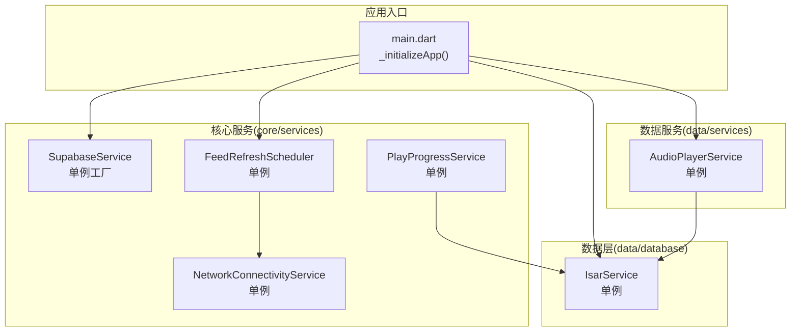
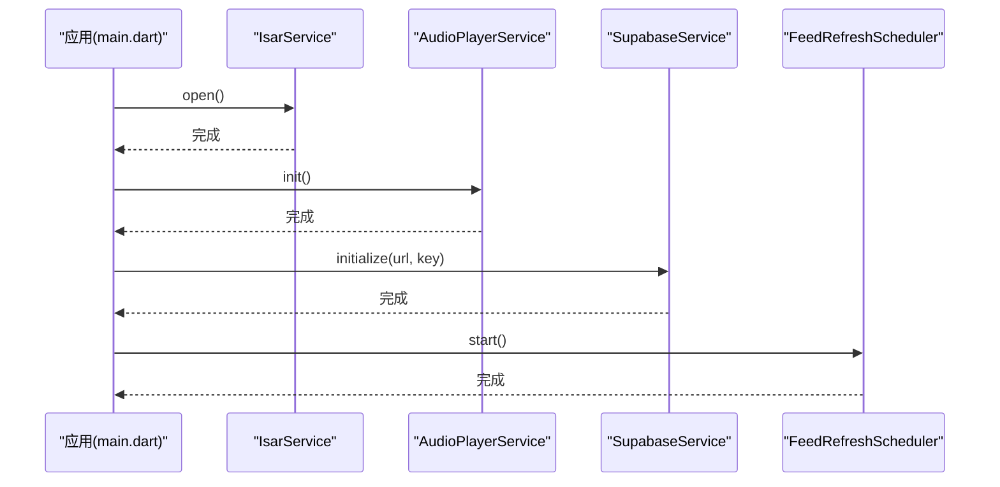
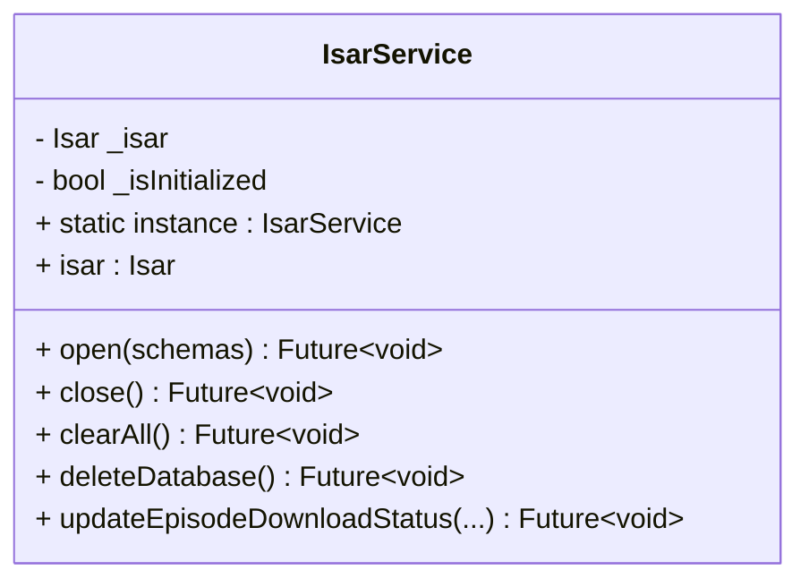
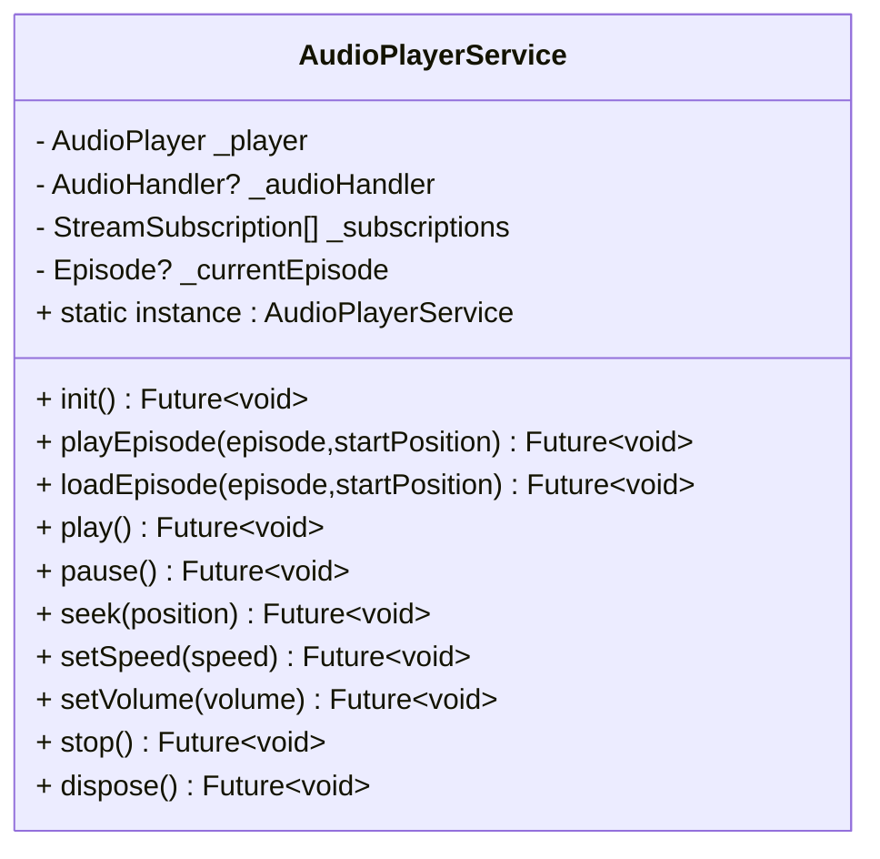
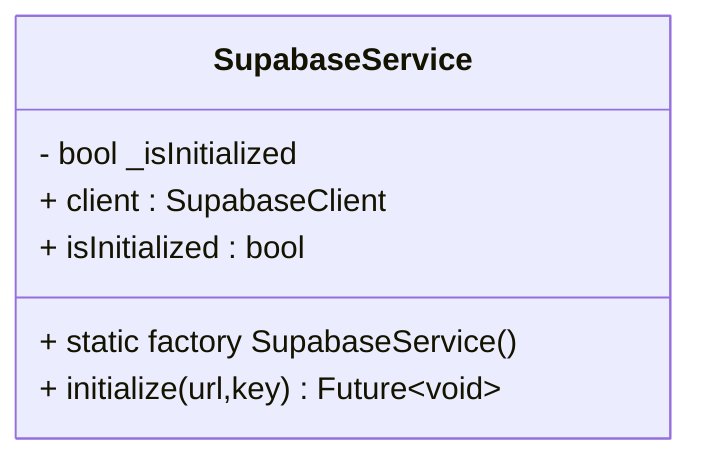
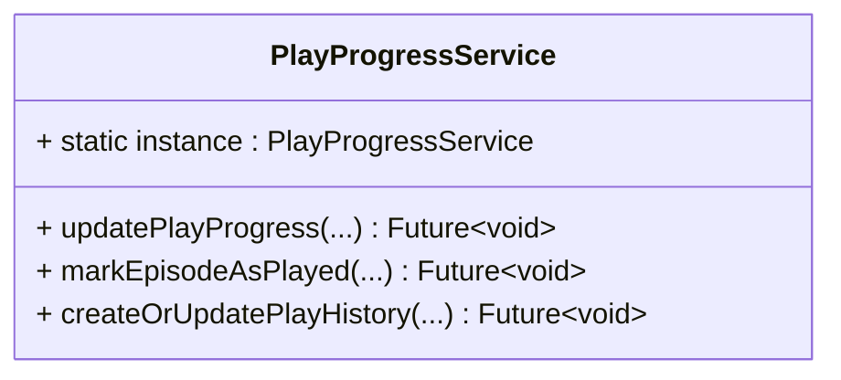
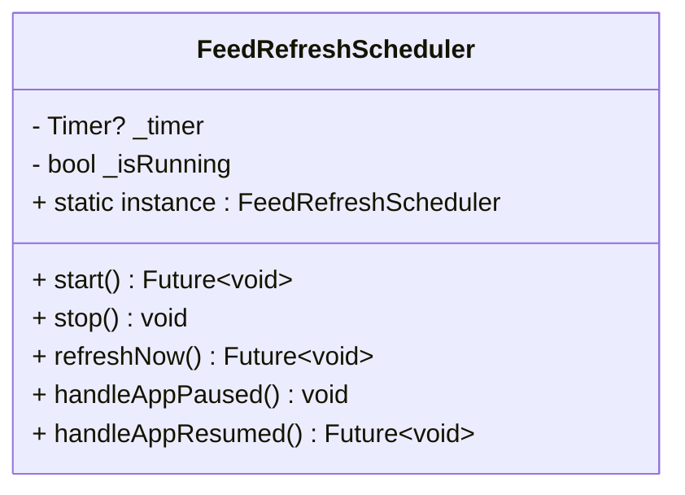
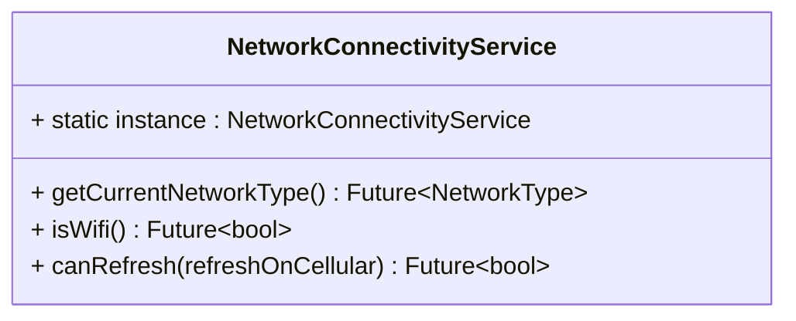
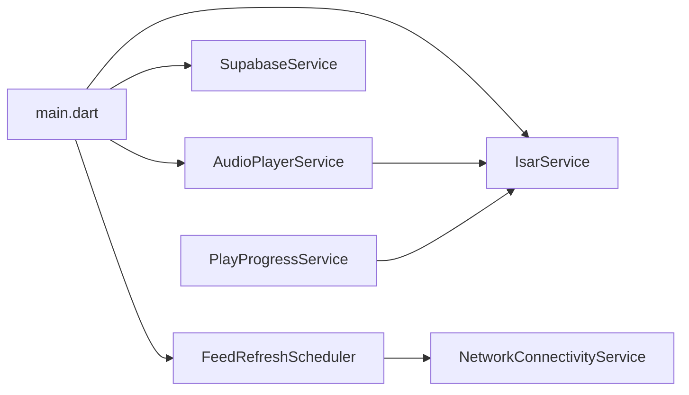

# 单例模式（Singleton Pattern）

<cite>
**本文引用的文件**
- [lib/data/database/isar_service.dart](file://lib/data/database/isar_service.dart)
- [lib/data/services/audio_player_service.dart](file://lib/data/services/audio_player_service.dart)
- [lib/core/services/supabase_service.dart](file://lib/core/services/supabase_service.dart)
- [lib/core/services/play_progress_service.dart](file://lib/core/services/play_progress_service.dart)
- [lib/core/services/feed_refresh_scheduler.dart](file://lib/core/services/feed_refresh_scheduler.dart)
- [lib/core/services/network_connectivity_service.dart](file://lib/core/services/network_connectivity_service.dart)
- [lib/main.dart](file://lib/main.dart)
</cite>

## 目录
1. [简介](#简介)
2. [项目结构](#项目结构)
3. [核心组件](#核心组件)
4. [架构总览](#架构总览)
5. [详细组件分析](#详细组件分析)
6. [依赖关系分析](#依赖关系分析)
7. [性能与线程安全](#性能与线程安全)
8. [故障排查指南](#故障排查指南)
9. [结论](#结论)
10. [附录：最佳实践与常见问题](#附录最佳实践与常见问题)

## 简介
本文件围绕 TinyCast 应用中的单例模式展开，重点解析 IsarService、AudioPlayerService、SupabaseService 等核心服务的单例实现方式，并扩展到 PlayProgressService、FeedRefreshScheduler、NetworkConnectivityService 等相关服务。文档涵盖以下关键主题：
- 单例模式的线程安全性与延迟初始化
- 资源管理与生命周期控制
- Dart/Flutter 中单例的常见实现方式（静态实例、私有构造函数、getter 访问器）
- 在服务发现、配置管理、全局状态共享中的应用场景
- 最佳实践与潜在问题解决方案

## 项目结构
TinyCast 采用分层架构，服务类主要分布在 core/services 与 data/services 目录，数据库相关服务位于 data/database。应用启动流程在 main.dart 中统一编排，负责初始化各单例服务。

图表来源
- [lib/main.dart:179-194](file://lib/main.dart#L179-L194)
- [lib/data/database/isar_service.dart:14-27](file://lib/data/database/isar_service.dart#L14-L27)
- [lib/data/services/audio_player_service.dart:31-36](file://lib/data/services/audio_player_service.dart#L31-L36)
- [lib/core/services/supabase_service.dart:8-11](file://lib/core/services/supabase_service.dart#L8-L11)
- [lib/core/services/play_progress_service.dart:8-12](file://lib/core/services/play_progress_service.dart#L8-L12)
- [lib/core/services/feed_refresh_scheduler.dart:12-23](file://lib/core/services/feed_refresh_scheduler.dart#L12-L23)
- [lib/core/services/network_connectivity_service.dart:6-11](file://lib/core/services/network_connectivity_service.dart#L6-L11)

章节来源
- [lib/main.dart:179-194](file://lib/main.dart#L179-L194)

## 核心组件
- IsarService：本地数据库的单例封装，提供 open/close/clear/delete 等生命周期方法，并通过静态 instance 暴露唯一实例。
- AudioPlayerService：音频播放器的单例封装，封装 just_audio 与 audio_service，提供播放控制、进度保存、媒体项更新等功能。
- SupabaseService：云端客户端的单例封装，使用工厂方法与内部标志位确保仅初始化一次，并提供 client 访问器。
- PlayProgressService：播放进度的单例服务，封装播放历史与剧集进度同步逻辑。
- FeedRefreshScheduler：播客订阅刷新调度器的单例，基于定时器与网络条件触发后台刷新。
- NetworkConnectivityService：网络类型检测与刷新策略判断的单例服务。

章节来源
- [lib/data/database/isar_service.dart:14-27](file://lib/data/database/isar_service.dart#L14-L27)
- [lib/data/services/audio_player_service.dart:31-36](file://lib/data/services/audio_player_service.dart#L31-L36)
- [lib/core/services/supabase_service.dart:8-11](file://lib/core/services/supabase_service.dart#L8-L11)
- [lib/core/services/play_progress_service.dart:8-12](file://lib/core/services/play_progress_service.dart#L8-L12)
- [lib/core/services/feed_refresh_scheduler.dart:12-23](file://lib/core/services/feed_refresh_scheduler.dart#L12-L23)
- [lib/core/services/network_connectivity_service.dart:6-11](file://lib/core/services/network_connectivity_service.dart#L6-L11)

## 架构总览
下图展示了应用启动时各单例服务的初始化顺序与依赖关系，以及运行时调用链。

图表来源
- [lib/main.dart:179-194](file://lib/main.dart#L179-L194)
- [lib/data/database/isar_service.dart:38-59](file://lib/data/database/isar_service.dart#L38-L59)
- [lib/data/services/audio_player_service.dart:100-134](file://lib/data/services/audio_player_service.dart#L100-L134)
- [lib/core/services/supabase_service.dart:18-32](file://lib/core/services/supabase_service.dart#L18-L32)
- [lib/core/services/feed_refresh_scheduler.dart:49-72](file://lib/core/services/feed_refresh_scheduler.dart#L49-L72)

## 详细组件分析

### IsarService（数据库单例）
- 单例实现：私有构造函数 + 静态 instance getter，首次访问时创建实例。
- 延迟初始化：open() 方法检查 _isInitialized，避免重复打开；isar 访问器在未初始化时抛出 StateError。
- 资源管理：close() 关闭数据库并重置状态；clearAll()/deleteDatabase() 提供清理能力。
- 扩展功能：updateEpisodeDownloadStatus() 封装下载状态更新事务。

图表来源
- [lib/data/database/isar_service.dart:14-36](file://lib/data/database/isar_service.dart#L14-L36)
- [lib/data/database/isar_service.dart:38-102](file://lib/data/database/isar_service.dart#L38-L102)
- [lib/data/database/isar_service.dart:106-135](file://lib/data/database/isar_service.dart#L106-L135)

章节来源
- [lib/data/database/isar_service.dart:14-36](file://lib/data/database/isar_service.dart#L14-L36)
- [lib/data/database/isar_service.dart:38-102](file://lib/data/database/isar_service.dart#L38-L102)
- [lib/data/database/isar_service.dart:106-135](file://lib/data/database/isar_service.dart#L106-L135)

### AudioPlayerService（播放器单例）
- 单例实现：私有构造函数 + 静态 instance getter，保证全局唯一播放器实例。
- 生命周期：init() 初始化 audio_service 与 just_audio，设置默认音量，订阅事件流；dispose() 释放资源。
- 播放控制：play/pause/seek/togglePlayPause/setSpeed/setVolume/stop 等方法封装底层播放器操作。
- 进度持久化：_savePlayProgress() 通过 PlayProgressService 更新播放历史与剧集进度。
- 媒体项更新：_updateMediaItem() 同步系统媒体控件信息。

图表来源
- [lib/data/services/audio_player_service.dart:31-36](file://lib/data/services/audio_player_service.dart#L31-L36)
- [lib/data/services/audio_player_service.dart:100-134](file://lib/data/services/audio_player_service.dart#L100-L134)
- [lib/data/services/audio_player_service.dart:302-324](file://lib/data/services/audio_player_service.dart#L302-L324)
- [lib/data/services/audio_player_service.dart:345-467](file://lib/data/services/audio_player_service.dart#L345-L467)
- [lib/data/services/audio_player_service.dart:469-507](file://lib/data/services/audio_player_service.dart#L469-L507)
- [lib/data/services/audio_player_service.dart:560-583](file://lib/data/services/audio_player_service.dart#L560-L583)

章节来源
- [lib/data/services/audio_player_service.dart:31-36](file://lib/data/services/audio_player_service.dart#L31-L36)
- [lib/data/services/audio_player_service.dart:100-134](file://lib/data/services/audio_player_service.dart#L100-L134)
- [lib/data/services/audio_player_service.dart:302-324](file://lib/data/services/audio_player_service.dart#L302-L324)
- [lib/data/services/audio_player_service.dart:345-467](file://lib/data/services/audio_player_service.dart#L345-L467)
- [lib/data/services/audio_player_service.dart:469-507](file://lib/data/services/audio_player_service.dart#L469-L507)
- [lib/data/services/audio_player_service.dart:560-583](file://lib/data/services/audio_player_service.dart#L560-L583)

### SupabaseService（云端客户端单例）
- 单例实现：工厂方法与私有构造函数组合，确保全局唯一实例。
- 延迟初始化：initialize() 检查 _isInitialized，避免重复初始化；client 访问器在未初始化时抛出 StateError。
- Provider 集成：supabaseClientProvider 用于 Riverpod 中获取客户端实例。

图表来源
- [lib/core/services/supabase_service.dart:8-11](file://lib/core/services/supabase_service.dart#L8-L11)
- [lib/core/services/supabase_service.dart:18-32](file://lib/core/services/supabase_service.dart#L18-L32)
- [lib/core/services/supabase_service.dart:35-46](file://lib/core/services/supabase_service.dart#L35-L46)
- [lib/core/services/supabase_service.dart:52-54](file://lib/core/services/supabase_service.dart#L52-L54)

章节来源
- [lib/core/services/supabase_service.dart:8-11](file://lib/core/services/supabase_service.dart#L8-L11)
- [lib/core/services/supabase_service.dart:18-32](file://lib/core/services/supabase_service.dart#L18-L32)
- [lib/core/services/supabase_service.dart:35-46](file://lib/core/services/supabase_service.dart#L35-L46)
- [lib/core/services/supabase_service.dart:52-54](file://lib/core/services/supabase_service.dart#L52-L54)

### PlayProgressService（播放进度单例）
- 单例实现：私有构造函数 + 静态 instance getter。
- 职责：封装播放历史更新与剧集进度同步，调用 IsarService 进行事务写入。

图表来源
- [lib/core/services/play_progress_service.dart:8-12](file://lib/core/services/play_progress_service.dart#L8-L12)
- [lib/core/services/play_progress_service.dart:17-42](file://lib/core/services/play_progress_service.dart#L17-L42)
- [lib/core/services/play_progress_service.dart:44-70](file://lib/core/services/play_progress_service.dart#L44-L70)
- [lib/core/services/play_progress_service.dart:72-104](file://lib/core/services/play_progress_service.dart#L72-L104)
- [lib/core/services/play_progress_service.dart:106-144](file://lib/core/services/play_progress_service.dart#L106-L144)

章节来源
- [lib/core/services/play_progress_service.dart:8-12](file://lib/core/services/play_progress_service.dart#L8-L12)
- [lib/core/services/play_progress_service.dart:17-42](file://lib/core/services/play_progress_service.dart#L17-L42)
- [lib/core/services/play_progress_service.dart:44-70](file://lib/core/services/play_progress_service.dart#L44-L70)
- [lib/core/services/play_progress_service.dart:72-104](file://lib/core/services/play_progress_service.dart#L72-L104)
- [lib/core/services/play_progress_service.dart:106-144](file://lib/core/services/play_progress_service.dart#L106-L144)

### FeedRefreshScheduler（刷新调度单例）
- 单例实现：私有构造函数 + 静态 instance getter。
- 职责：根据设置与网络条件定时触发播客刷新，支持立即刷新与应用生命周期回调。

图表来源
- [lib/core/services/feed_refresh_scheduler.dart:12-23](file://lib/core/services/feed_refresh_scheduler.dart#L12-L23)
- [lib/core/services/feed_refresh_scheduler.dart:49-72](file://lib/core/services/feed_refresh_scheduler.dart#L49-L72)
- [lib/core/services/feed_refresh_scheduler.dart:81-84](file://lib/core/services/feed_refresh_scheduler.dart#L81-L84)
- [lib/core/services/feed_refresh_scheduler.dart:154-163](file://lib/core/services/feed_refresh_scheduler.dart#L154-L163)

章节来源
- [lib/core/services/feed_refresh_scheduler.dart:12-23](file://lib/core/services/feed_refresh_scheduler.dart#L12-L23)
- [lib/core/services/feed_refresh_scheduler.dart:49-72](file://lib/core/services/feed_refresh_scheduler.dart#L49-L72)
- [lib/core/services/feed_refresh_scheduler.dart:81-84](file://lib/core/services/feed_refresh_scheduler.dart#L81-L84)
- [lib/core/services/feed_refresh_scheduler.dart:154-163](file://lib/core/services/feed_refresh_scheduler.dart#L154-L163)

### NetworkConnectivityService（网络检测单例）
- 单例实现：私有构造函数 + 静态 instance getter。
- 职责：检测当前网络类型，判断是否允许刷新（Wi-Fi/以太网/蜂窝）。

图表来源
- [lib/core/services/network_connectivity_service.dart:6-11](file://lib/core/services/network_connectivity_service.dart#L6-L11)
- [lib/core/services/network_connectivity_service.dart:15-42](file://lib/core/services/network_connectivity_service.dart#L15-L42)
- [lib/core/services/network_connectivity_service.dart:49-61](file://lib/core/services/network_connectivity_service.dart#L49-L61)

章节来源
- [lib/core/services/network_connectivity_service.dart:6-11](file://lib/core/services/network_connectivity_service.dart#L6-L11)
- [lib/core/services/network_connectivity_service.dart:15-42](file://lib/core/services/network_connectivity_service.dart#L15-L42)
- [lib/core/services/network_connectivity_service.dart:49-61](file://lib/core/services/network_connectivity_service.dart#L49-L61)

## 依赖关系分析
- 启动阶段：main.dart 按序初始化 IsarService、AudioPlayerService、SupabaseService，并启动 FeedRefreshScheduler。
- 运行时依赖：AudioPlayerService 依赖 IsarService 进行播放进度持久化；PlayProgressService 依赖 IsarService 更新剧集进度；FeedRefreshScheduler 依赖 NetworkConnectivityService 进行网络条件判断。

图表来源
- [lib/main.dart:179-194](file://lib/main.dart#L179-L194)
- [lib/data/services/audio_player_service.dart:42](file://lib/data/services/audio_player_service.dart#L42)
- [lib/core/services/play_progress_service.dart:15](file://lib/core/services/play_progress_service.dart#L15)
- [lib/core/services/feed_refresh_scheduler.dart:18](file://lib/core/services/feed_refresh_scheduler.dart#L18)

章节来源
- [lib/main.dart:179-194](file://lib/main.dart#L179-L194)
- [lib/data/services/audio_player_service.dart:42](file://lib/data/services/audio_player_service.dart#L42)
- [lib/core/services/play_progress_service.dart:15](file://lib/core/services/play_progress_service.dart#L15)
- [lib/core/services/feed_refresh_scheduler.dart:18](file://lib/core/services/feed_refresh_scheduler.dart#L18)

## 性能与线程安全
- 延迟初始化：所有单例均采用“首次访问才创建”的策略，减少启动开销。
- 幂等初始化：IsarService.open()、SupabaseService.initialize()、AudioPlayerService.init() 均检查已初始化状态，避免重复执行。
- 线程安全：Dart 单线程事件循环模型下，静态字段赋值与布尔标志位读写是安全的；但异步初始化需确保调用顺序正确（如先 open Isar，再访问 isar）。
- 资源管理：AudioPlayerService.dispose() 主动释放订阅与播放器资源；IsarService.close() 关闭数据库连接，防止句柄泄漏。
- 错误处理：访问未初始化资源时抛出 StateError，便于快速定位问题；业务异常通过 Logger 记录并向上抛出。

章节来源
- [lib/data/database/isar_service.dart:31-36](file://lib/data/database/isar_service.dart#L31-L36)
- [lib/core/services/supabase_service.dart:35-46](file://lib/core/services/supabase_service.dart#L35-L46)
- [lib/data/services/audio_player_service.dart:100-134](file://lib/data/services/audio_player_service.dart#L100-L134)
- [lib/data/services/audio_player_service.dart:560-583](file://lib/data/services/audio_player_service.dart#L560-L583)

## 故障排查指南
- 数据库未初始化：访问 IsarService.isar 前必须调用 open()，否则抛出 StateError。
- Supabase 未初始化：访问 SupabaseService.client 前必须调用 initialize()，否则抛出 StateError。
- 播放器未初始化：调用 AudioPlayerService 播放方法前需调用 init()，否则可能失败或崩溃。
- 资源未释放：应用退出时应调用 AudioPlayerService.dispose() 与 IsarService.close()，避免内存与句柄泄漏。
- 日志定位：使用 Logger 输出关键路径与异常堆栈，结合 Isar Inspector 查看数据库状态。

章节来源
- [lib/data/database/isar_service.dart:31-36](file://lib/data/database/isar_service.dart#L31-L36)
- [lib/core/services/supabase_service.dart:35-46](file://lib/core/services/supabase_service.dart#L35-L46)
- [lib/data/services/audio_player_service.dart:100-134](file://lib/data/services/audio_player_service.dart#L100-L134)
- [lib/data/services/audio_player_service.dart:560-583](file://lib/data/services/audio_player_service.dart#L560-L583)

## 结论
TinyCast 在各核心服务中广泛采用单例模式，实现了统一的资源管理与全局状态共享。通过私有构造函数、静态实例与 getter 访问器，配合延迟初始化与幂等检查，确保了线程安全与性能。同时，完善的错误处理与资源释放机制提升了应用的稳定性与可维护性。

## 附录：最佳实践与常见问题
- 单例实现建议
  - 使用私有构造函数 + 静态实例 + getter 访问器，避免外部直接 new。
  - 对异步初始化提供明确的 initialize() 方法，并在访问器中检查状态。
  - 为需要释放的资源提供 dispose()/close() 方法，并在应用退出时调用。
- 常见问题与解决
  - 重复初始化：通过布尔标志位或空值检查避免重复执行。
  - 未初始化访问：在访问器中抛出明确异常，便于调试。
  - 资源泄漏：确保在合适的生命周期点释放订阅、播放器、数据库等资源。
  - 线程安全：在 Dart 单线程模型下，注意异步操作的顺序与状态一致性。