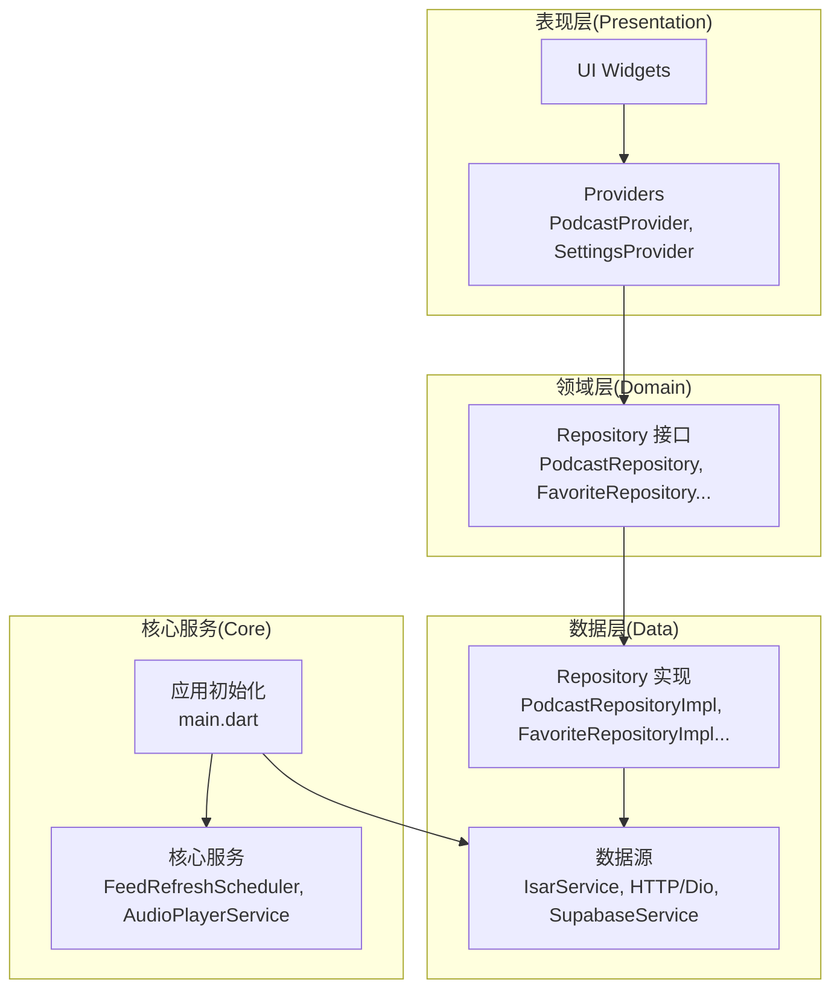
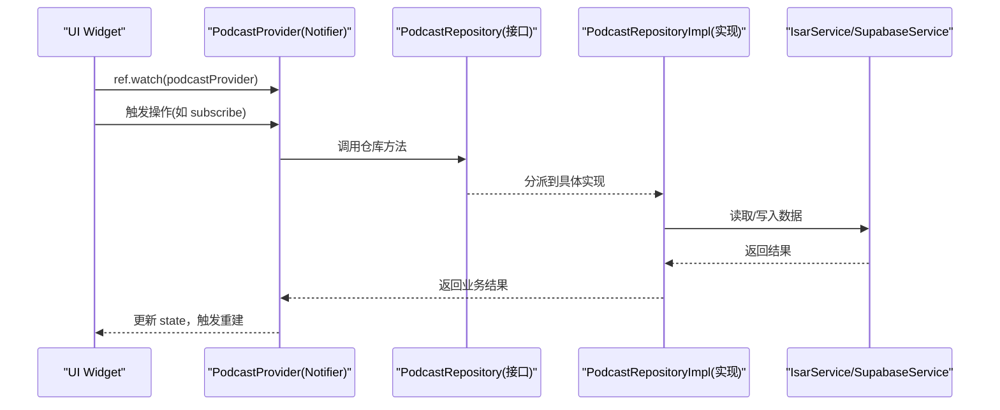
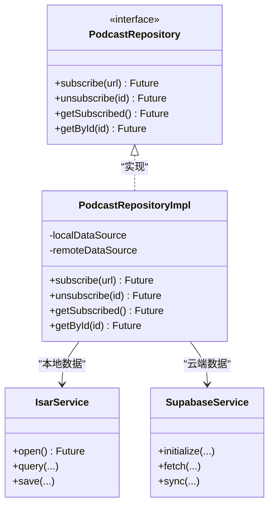
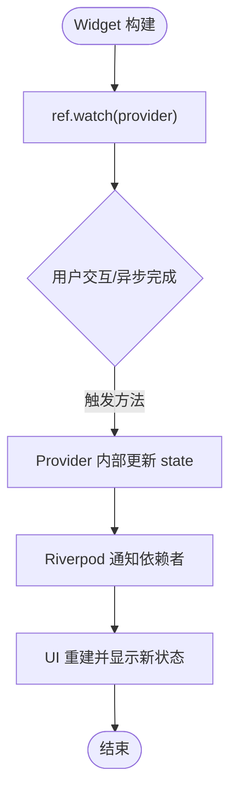
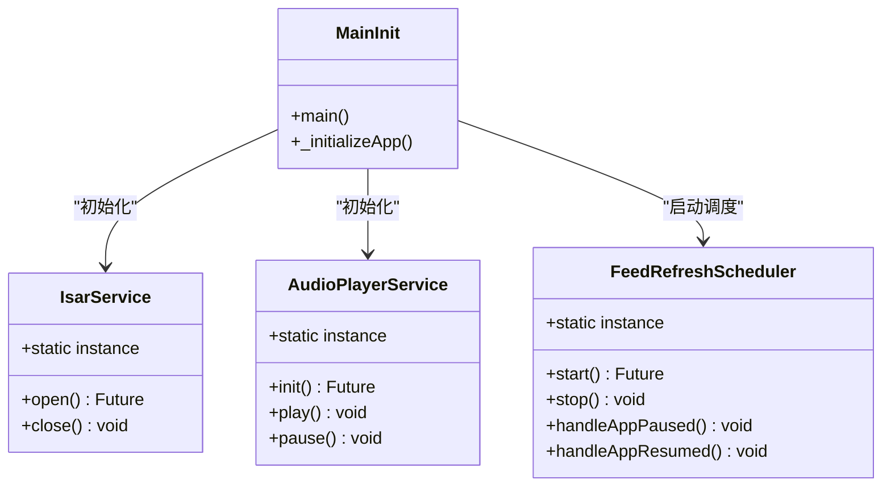
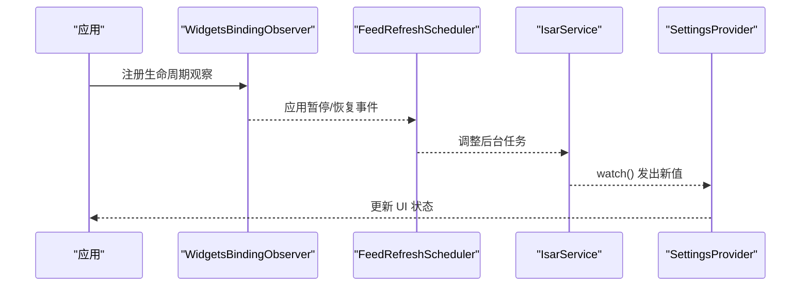
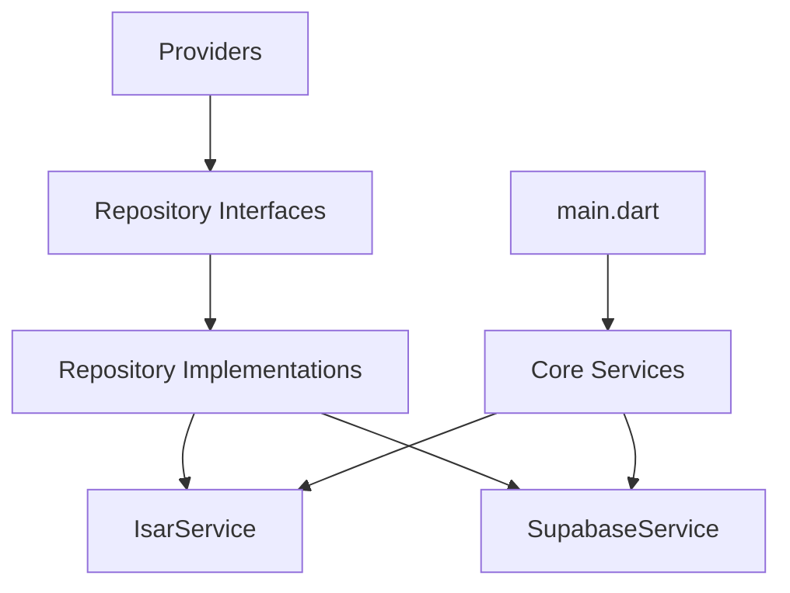

# 设计模式应用

<cite>
**本文档引用的文件**
- [main.dart](file://lib/main.dart)
- [podcast_repository_impl.dart](file://lib/data/repositories/podcast_repository_impl.dart)
- [favorite_repository_impl.dart](file://lib/data/repositories/favorite_repository_impl.dart)
- [queue_repository_impl.dart](file://lib/data/repositories/queue_repository_impl.dart)
- [play_history_repository.dart](file://lib/data/repositories/play_history_repository.dart)
- [search_history_repository_impl.dart](file://lib/data/repositories/search_history_repository_impl.dart)
- [podcast_repository.dart](file://lib/domain/repositories/podcast_repository.dart)
- [favorite_repository.dart](file://lib/domain/repositories/favorite_repository.dart)
- [queue_repository.dart](file://lib/domain/repositories/queue_repository.dart)
- [search_history_repository.dart](file://lib/domain/repositories/search_history_repository.dart)
- [base_provider.dart](file://lib/presentation/providers/base_provider.dart)
- [base_state_notifier.dart](file://lib/presentation/providers/base_state_notifier.dart)
- [podcast_provider.dart](file://lib/presentation/providers/podcast_provider.dart)
- [settings_provider.dart](file://lib/presentation/providers/settings_provider.dart)
- [feed_refresh_scheduler.dart](file://lib/core/services/feed_refresh_scheduler.dart)
- [supabase_service.dart](file://lib/core/services/supabase_service.dart)
- [isar_service.dart](file://lib/data/database/isar_service.dart)
- [audio_player_service.dart](file://lib/data/services/audio_player_service.dart)
</cite>

## 目录
1. [简介](#简介)
2. [项目结构](#项目结构)
3. [核心组件](#核心组件)
4. [架构总览](#架构总览)
5. [详细组件分析](#详细组件分析)
6. [依赖关系分析](#依赖关系分析)
7. [性能考量](#性能考量)
8. [故障排查指南](#故障排查指南)
9. [结论](#结论)
10. [附录](#附录)

## 简介
本文件聚焦于 TinyCast 应用中关键设计模式的落地实践，包括仓库模式、提供者模式、单例模式、观察者模式和 MVVM 模式。文档将解释每种模式的实现方式与使用场景，通过具体代码路径展示类结构、接口定义和调用关系，并说明这些模式如何协同解决数据访问抽象、状态管理、服务实例管理等设计问题。同时提供最佳实践建议与常见陷阱避免方法，帮助读者在 Flutter/Riverpod 生态中高效复用这些模式。

## 项目结构
TinyCast 采用清晰的三层架构（Data、Domain、Presentation），配合 Riverpod 进行状态管理与依赖注入，结合 Isar 本地数据库与 Supabase 云服务。入口 main.dart 负责应用初始化、多窗口路由、主题加载与服务启动；数据层通过 Repository 统一封装数据源；表现层通过 Provider 暴露状态给 UI。

图表来源
- [main.dart:106-194](file://lib/main.dart#L106-L194)
- [podcast_repository_impl.dart:1-200](file://lib/data/repositories/podcast_repository_impl.dart#L1-L200)
- [podcast_repository.dart:1-200](file://lib/domain/repositories/podcast_repository.dart#L1-L200)

章节来源
- [main.dart:106-194](file://lib/main.dart#L106-L194)

## 核心组件
- 仓库模式：在 Domain 层定义 Repository 接口，Data 层提供具体实现，屏蔽 Isar、网络等数据源差异。
- 提供者模式：使用 Riverpod 的 Notifier/NotifierProvider 暴露状态，UI 通过 ref.watch 订阅更新。
- 单例模式：全局服务如 IsarService、AudioPlayerService、FeedRefreshScheduler 以单例形式管理生命周期。
- 观察者模式：Riverpod 的 watch/stream 机制以及 Isar 的 watch() Stream 实现状态变更通知。
- MVVM 模式：View(UI) 通过 ViewModel(Provider) 与 Model(Repository/Entity) 解耦，职责清晰。

章节来源
- [podcast_repository_impl.dart:1-200](file://lib/data/repositories/podcast_repository_impl.dart#L1-L200)
- [podcast_repository.dart:1-200](file://lib/domain/repositories/podcast_repository.dart#L1-L200)
- [base_provider.dart:1-200](file://lib/presentation/providers/base_provider.dart#L1-L200)
- [base_state_notifier.dart:1-200](file://lib/presentation/providers/base_state_notifier.dart#L1-L200)
- [podcast_provider.dart:1-200](file://lib/presentation/providers/podcast_provider.dart#L1-L200)
- [settings_provider.dart:1-200](file://lib/presentation/providers/settings_provider.dart#L1-L200)
- [is ar_service.dart:1-200](file://lib/data/database/isar_service.dart#L1-L200)
- [audio_player_service.dart:1-200](file://lib/data/services/audio_player_service.dart#L1-L200)
- [feed_refresh_scheduler.dart:1-200](file://lib/core/services/feed_refresh_scheduler.dart#L1-L200)

## 架构总览
下图展示了从 UI 到数据源的完整调用链，体现 MVVM + Repository + Provider 的组合协作。

图表来源
- [podcast_provider.dart:1-200](file://lib/presentation/providers/podcast_provider.dart#L1-L200)
- [podcast_repository.dart:1-200](file://lib/domain/repositories/podcast_repository.dart#L1-L200)
- [podcast_repository_impl.dart:1-200](file://lib/data/repositories/podcast_repository_impl.dart#L1-L200)
- [is ar_service.dart:1-200](file://lib/data/database/isar_service.dart#L1-L200)
- [supabase_service.dart:1-200](file://lib/core/services/supabase_service.dart#L1-L200)

## 详细组件分析

### 仓库模式（Repository Pattern）
- 目标：抽象数据访问逻辑，屏蔽 Isar、HTTP、Supabase 等数据源差异，便于测试与替换。
- 实现要点：
  - Domain 层定义接口（如 PodcastRepository、FavoriteRepository）。
  - Data 层提供实现（如 PodcastRepositoryImpl、FavoriteRepositoryImpl），组合多个数据源。
  - Provider 仅依赖接口，不感知具体数据源。
- 典型流程：Provider 调用仓库方法 -> 仓库选择合适的数据源 -> 返回统一模型。

图表来源
- [podcast_repository.dart:1-200](file://lib/domain/repositories/podcast_repository.dart#L1-L200)
- [podcast_repository_impl.dart:1-200](file://lib/data/repositories/podcast_repository_impl.dart#L1-L200)
- [is ar_service.dart:1-200](file://lib/data/database/isar_service.dart#L1-L200)
- [supabase_service.dart:1-200](file://lib/core/services/supabase_service.dart#L1-L200)

章节来源
- [podcast_repository.dart:1-200](file://lib/domain/repositories/podcast_repository.dart#L1-L200)
- [podcast_repository_impl.dart:1-200](file://lib/data/repositories/podcast_repository_impl.dart#L1-L200)
- [favorite_repository.dart:1-200](file://lib/domain/repositories/favorite_repository.dart#L1-L200)
- [favorite_repository_impl.dart:1-200](file://lib/data/repositories/favorite_repository_impl.dart#L1-L200)
- [queue_repository.dart:1-200](file://lib/domain/repositories/queue_repository.dart#L1-L200)
- [queue_repository_impl.dart:1-200](file://lib/data/repositories/queue_repository_impl.dart#L1-L200)
- [search_history_repository.dart:1-200](file://lib/domain/repositories/search_history_repository.dart#L1-L200)
- [search_history_repository_impl.dart:1-200](file://lib/data/repositories/search_history_repository_impl.dart#L1-L200)
- [play_history_repository.dart:1-200](file://lib/data/repositories/play_history_repository.dart#L1-L200)

### 提供者模式（Provider Pattern with Riverpod）
- 目标：集中管理应用状态，提供声明式订阅与更新机制，简化 UI 与业务逻辑耦合。
- 实现要点：
  - 使用 Notifier 替代旧版 StateNotifier（Riverpod 3.x）。
  - 通过 NotifierProvider 暴露状态，UI 使用 ref.watch 订阅。
  - BaseProvider/BaseStateNotifier 提供通用能力（错误处理、加载状态等）。
- 典型流程：UI 触发事件 -> Provider 执行业务逻辑 -> 更新 state -> UI 自动重建。

图表来源
- [base_provider.dart:1-200](file://lib/presentation/providers/base_provider.dart#L1-L200)
- [base_state_notifier.dart:1-200](file://lib/presentation/providers/base_state_notifier.dart#L1-L200)
- [podcast_provider.dart:1-200](file://lib/presentation/providers/podcast_provider.dart#L1-L200)
- [settings_provider.dart:1-200](file://lib/presentation/providers/settings_provider.dart#L1-L200)

章节来源
- [base_provider.dart:1-200](file://lib/presentation/providers/base_provider.dart#L1-L200)
- [base_state_notifier.dart:1-200](file://lib/presentation/providers/base_state_notifier.dart#L1-L200)
- [podcast_provider.dart:1-200](file://lib/presentation/providers/podcast_provider.dart#L1-L200)
- [settings_provider.dart:1-200](file://lib/presentation/providers/settings_provider.dart#L1-L200)

### 单例模式（Singleton Pattern）
- 目标：确保全局资源唯一实例，统一管理生命周期与配置。
- 实现要点：
  - 服务类提供静态 instance 与私有构造函数。
  - 在应用启动时初始化（如 IsarService、AudioPlayerService、FeedRefreshScheduler）。
  - 通过单例获取服务，避免重复创建与资源泄漏。
- 典型场景：数据库连接、音频播放器、后台任务调度器。

图表来源
- [is ar_service.dart:1-200](file://lib/data/database/isar_service.dart#L1-L200)
- [audio_player_service.dart:1-200](file://lib/data/services/audio_player_service.dart#L1-L200)
- [feed_refresh_scheduler.dart:1-200](file://lib/core/services/feed_refresh_scheduler.dart#L1-L200)
- [main.dart:106-194](file://lib/main.dart#L106-L194)

章节来源
- [main.dart:106-194](file://lib/main.dart#L106-L194)
- [is ar_service.dart:1-200](file://lib/data/database/isar_service.dart#L1-L200)
- [audio_player_service.dart:1-200](file://lib/data/services/audio_player_service.dart#L1-L200)
- [feed_refresh_scheduler.dart:1-200](file://lib/core/services/feed_refresh_scheduler.dart#L1-L200)

### 观察者模式（Observer Pattern）
- 目标：实现松耦合的状态通知与响应，支持多订阅者。
- 实现要点：
  - Riverpod 的 watch/stream 机制作为观察者框架。
  - Isar 的 watch() 监听数据变更，自动推送新值。
  - 应用生命周期变化通过 WidgetsBindingObserver 观察并调度后台任务。
- 典型场景：设置变更同步、播放进度更新、RSS 刷新调度。

图表来源
- [main.dart:74-104](file://lib/main.dart#L74-L104)
- [feed_refresh_scheduler.dart:1-200](file://lib/core/services/feed_refresh_scheduler.dart#L1-L200)
- [is ar_service.dart:1-200](file://lib/data/database/isar_service.dart#L1-L200)
- [settings_provider.dart:1-200](file://lib/presentation/providers/settings_provider.dart#L1-L200)

章节来源
- [main.dart:74-104](file://lib/main.dart#L74-L104)
- [feed_refresh_scheduler.dart:1-200](file://lib/core/services/feed_refresh_scheduler.dart#L1-L200)
- [is ar_service.dart:1-200](file://lib/data/database/isar_service.dart#L1-L200)
- [settings_provider.dart:1-200](file://lib/presentation/providers/settings_provider.dart#L1-L200)

### MVVM 模式（Model-View-ViewModel）
- 目标：分离视图、业务逻辑与数据模型，提升可测试性与可维护性。
- 实现要点：
  - View：Flutter Widgets，仅负责渲染与用户交互。
  - ViewModel：Riverpod Provider，封装状态与业务逻辑。
  - Model：Domain Entities 与 Repository 接口，定义数据结构与数据访问契约。
- 典型流程：UI 调用 Provider 方法 -> Provider 调用 Repository -> Repository 访问数据源 -> 返回结果更新状态。

图表来源
- [podcast_provider.dart:1-200](file://lib/presentation/providers/podcast_provider.dart#L1-L200)
- [podcast_repository.dart:1-200](file://lib/domain/repositories/podcast_repository.dart#L1-L200)
- [is ar_service.dart:1-200](file://lib/data/database/isar_service.dart#L1-L200)
- [supabase_service.dart:1-200](file://lib/core/services/supabase_service.dart#L1-L200)

章节来源
- [podcast_provider.dart:1-200](file://lib/presentation/providers/podcast_provider.dart#L1-L200)
- [podcast_repository.dart:1-200](file://lib/domain/repositories/podcast_repository.dart#L1-L200)
- [is ar_service.dart:1-200](file://lib/data/database/isar_service.dart#L1-L200)
- [supabase_service.dart:1-200](file://lib/core/services/supabase_service.dart#L1-L200)

## 依赖关系分析
- Provider 依赖 Repository 接口，不直接依赖数据源实现。
- Repository 实现依赖 IsarService、SupabaseService 等数据源。
- 单例服务在应用启动时初始化，被多处共享。
- 观察者模式贯穿状态更新与生命周期管理。

图表来源
- [podcast_provider.dart:1-200](file://lib/presentation/providers/podcast_provider.dart#L1-L200)
- [podcast_repository.dart:1-200](file://lib/domain/repositories/podcast_repository.dart#L1-L200)
- [podcast_repository_impl.dart:1-200](file://lib/data/repositories/podcast_repository_impl.dart#L1-L200)
- [is ar_service.dart:1-200](file://lib/data/database/isar_service.dart#L1-L200)
- [supabase_service.dart:1-200](file://lib/core/services/supabase_service.dart#L1-L200)
- [main.dart:106-194](file://lib/main.dart#L106-L194)

章节来源
- [podcast_provider.dart:1-200](file://lib/presentation/providers/podcast_provider.dart#L1-L200)
- [podcast_repository_impl.dart:1-200](file://lib/data/repositories/podcast_repository_impl.dart#L1-L200)
- [main.dart:106-194](file://lib/main.dart#L106-L194)

## 性能考量
- 使用 Riverpod 的精确订阅（ref.watch）减少不必要的重建。
- Isar 的 watch() Stream 提供高效的增量更新，避免全量查询。
- 单例服务避免重复初始化开销，合理管理生命周期。
- 批量操作与缓存策略可降低频繁 I/O 带来的性能损耗。

[本节为通用指导，无需特定文件引用]

## 故障排查指南
- 常见问题：
  - Provider 未正确更新：检查 ref.watch 是否绑定到正确的 provider。
  - 数据不同步：确认 Isar watch() 是否正确订阅，或 Provider 是否触发了 state 更新。
  - 单例服务未初始化：确保在 _initializeApp 中正确调用 open/init。
  - 生命周期事件未处理：检查 WidgetsBindingObserver 的注册与移除。
- 调试建议：
  - 使用 Logger 记录关键步骤。
  - 在 Provider 中添加日志输出状态变化。
  - 验证 Repository 方法的返回值与异常处理。

章节来源
- [main.dart:106-194](file://lib/main.dart#L106-L194)
- [podcast_provider.dart:1-200](file://lib/presentation/providers/podcast_provider.dart#L1-L200)
- [is ar_service.dart:1-200](file://lib/data/database/isar_service.dart#L1-L200)
- [feed_refresh_scheduler.dart:1-200](file://lib/core/services/feed_refresh_scheduler.dart#L1-L200)

## 结论
TinyCast 通过仓库模式、提供者模式、单例模式、观察者模式与 MVVM 模式的组合，构建了清晰、可维护且高性能的应用架构。各模式分工明确、协作紧密，有效解决了数据访问抽象、状态管理、服务实例管理等核心问题。遵循本文的最佳实践与注意事项，可进一步提升代码质量与开发效率。

[本节为总结性内容，无需特定文件引用]

## 附录
- 最佳实践建议：
  - 始终在 Domain 层定义 Repository 接口，保持高层模块稳定。
  - 使用 Riverpod 的 Notifier 管理复杂状态，避免手动管理 ChangeNotifier。
  - 单例服务应显式管理生命周期，避免内存泄漏。
  - 利用 Isar 的 watch() 实现实时数据同步，减少轮询开销。
- 常见陷阱避免：
  - 避免在 Provider 中直接访问数据源，应通过 Repository 抽象。
  - 不要在单例中持有 UI 引用，防止循环依赖与内存泄漏。
  - 谨慎使用全局状态，优先使用局部 Provider 作用域。

[本节为通用指导，无需特定文件引用]