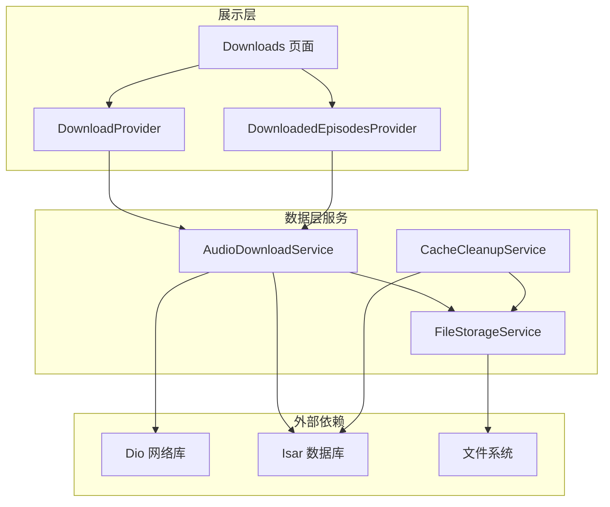
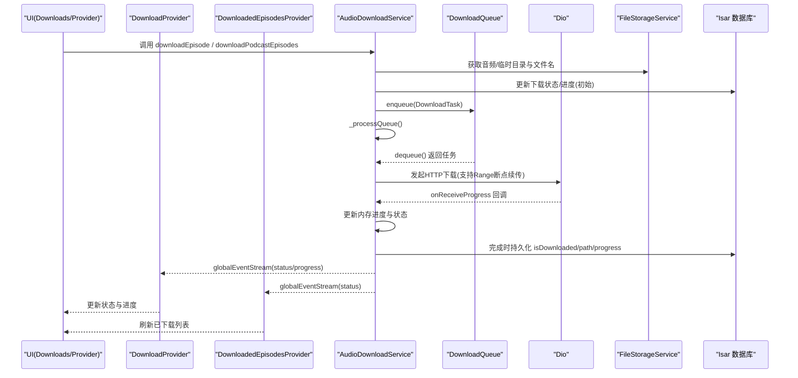
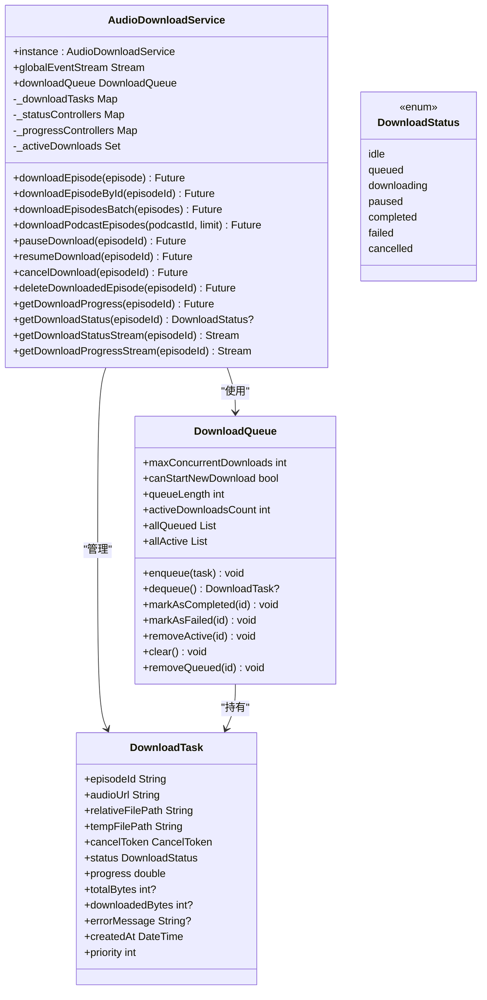
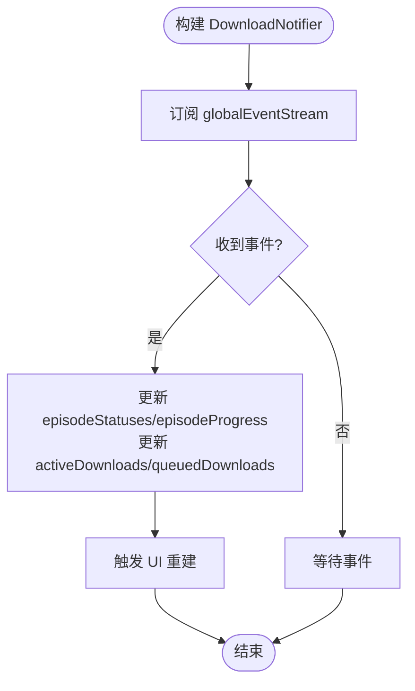
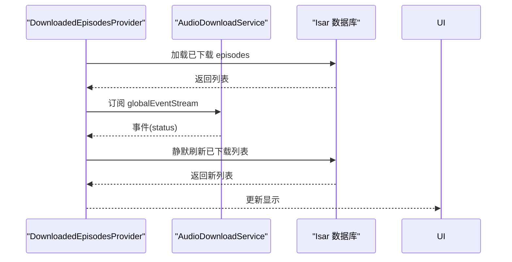
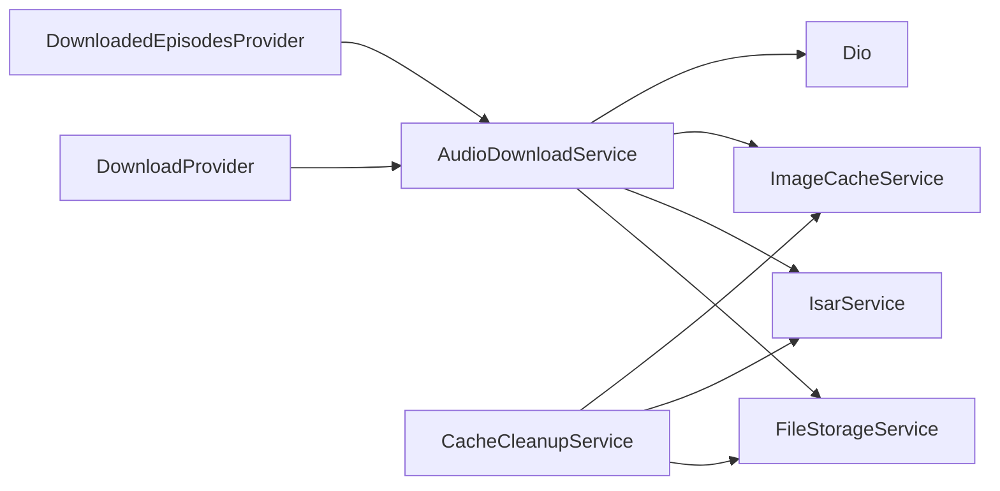

# 下载管理系统

<cite>
**本文引用的文件**   
- [audio_download_service.dart](file://lib/data/services/audio_download_service.dart)
- [download_provider.dart](file://lib/presentation/providers/download_provider.dart)
- [downloads.dart](file://lib/presentation/features/downloads/downloads.dart)
- [downloaded_episodes_provider.dart](file://lib/presentation/features/downloads/downloaded_episodes_provider.dart)
- [file_storage_service.dart](file://lib/data/services/file_storage_service.dart)
- [cache_cleanup_service.dart](file://lib/data/services/cache_cleanup_service.dart)
- [audio_download_usage.md](file://docs/audio_download_usage.md)
- [download_debug_guide.md](file://docs/download_debug_guide.md)
- [download_queue_debug.md](file://docs/download_queue_debug.md)
</cite>

## 目录
1. [简介](#简介)
2. [项目结构](#项目结构)
3. [核心组件](#核心组件)
4. [架构总览](#架构总览)
5. [详细组件分析](#详细组件分析)
6. [依赖关系分析](#依赖关系分析)
7. [性能考量](#性能考量)
8. [故障排查指南](#故障排查指南)
9. [结论](#结论)
10. [附录](#附录)

## 简介
本文件为 TinyCast 的下载管理系统提供系统化、可操作的文档。内容覆盖下载队列设计、断点续传实现、存储空间管理、并发控制、进度跟踪、错误重试与清理策略，并结合实际代码路径给出调用示例与最佳实践。面向初学者友好说明，同时为有经验的开发者提供足够的技术深度。

## 项目结构
下载相关能力分布在数据层服务、展示层 Provider 与页面、以及存储与清理服务中：
- 数据层服务
  - 音频下载服务：负责下载任务生命周期、队列调度、网络请求、断点续传、状态事件广播
  - 文件存储服务：跨平台路径获取、文件名生成、安全删除、大小计算
  - 缓存清理服务：音频/图片缓存清理、按策略保留最近 N 集、自动阈值清理
- 展示层
  - 下载状态 Provider：订阅全局事件，维护 UI 所需的状态与进度
  - 已下载列表 Provider：监听下载事件并刷新已下载列表
  - Downloads 页面：渲染已下载节目列表，支持播放与详情跳转

图表来源
- [audio_download_service.dart:129-194](file://lib/data/services/audio_download_service.dart#L129-L194)
- [download_provider.dart:51-94](file://lib/presentation/providers/download_provider.dart#L51-L94)
- [downloaded_episodes_provider.dart:40-62](file://lib/presentation/features/downloads/downloaded_episodes_provider.dart#L40-L62)
- [file_storage_service.dart:11-52](file://lib/data/services/file_storage_service.dart#L11-L52)
- [cache_cleanup_service.dart:12-39](file://lib/data/services/cache_cleanup_service.dart#L12-L39)

章节来源
- [audio_download_service.dart:129-194](file://lib/data/services/audio_download_service.dart#L129-L194)
- [download_provider.dart:51-94](file://lib/presentation/providers/download_provider.dart#L51-L94)
- [downloaded_episodes_provider.dart:40-62](file://lib/presentation/features/downloads/downloaded_episodes_provider.dart#L40-L62)
- [file_storage_service.dart:11-52](file://lib/data/services/file_storage_service.dart#L11-L52)
- [cache_cleanup_service.dart:12-39](file://lib/data/services/cache_cleanup_service.dart#L12-L39)

## 核心组件
- AudioDownloadService（单例）
  - 职责：下载任务创建、入队与出队、并发控制、断点续传、暂停/恢复/取消、进度与状态事件广播、封面图缓存联动
  - 关键数据结构：DownloadTask、DownloadQueue、DownloadStatus、AudioDownloadEvent
  - 并发限制：默认最大并发 3
  - 事件通道：全局 StreamController<AudioDownloadEvent> 供 UI 订阅
- DownloadProvider（Riverpod Notifier）
  - 职责：订阅全局事件，维护 episode 状态与进度映射、活跃/排队计数
- DownloadedEpisodesProvider（Riverpod Notifier）
  - 职责：监听下载事件，按需刷新已下载列表并按发布时间排序
- FileStorageService（单例）
  - 职责：临时与应用支持目录获取、音频/图片目录管理、相对路径到绝对路径转换、安全删除、文件大小统计、UUID 命名
- CacheCleanupService（单例）
  - 职责：全量/分类缓存清理、保留最近 N 集、按播客清理、自动阈值清理、缓存大小查询

章节来源
- [audio_download_service.dart:129-194](file://lib/data/services/audio_download_service.dart#L129-L194)
- [download_provider.dart:51-94](file://lib/presentation/providers/download_provider.dart#L51-L94)
- [downloaded_episodes_provider.dart:40-62](file://lib/presentation/features/downloads/downloaded_episodes_provider.dart#L40-L62)
- [file_storage_service.dart:11-52](file://lib/data/services/file_storage_service.dart#L11-L52)
- [cache_cleanup_service.dart:12-39](file://lib/data/services/cache_cleanup_service.dart#L12-L39)

## 架构总览
下图展示了从 UI 触发到下载执行、再到状态回传的完整流程，以及各组件间的依赖关系。

图表来源
- [audio_download_service.dart:196-408](file://lib/data/services/audio_download_service.dart#L196-L408)
- [audio_download_service.dart:863-914](file://lib/data/services/audio_download_service.dart#L863-L914)
- [audio_download_service.dart:916-960](file://lib/data/services/audio_download_service.dart#L916-L960)
- [audio_download_service.dart:962-1070](file://lib/data/services/audio_download_service.dart#L962-L1070)
- [download_provider.dart:51-94](file://lib/presentation/providers/download_provider.dart#L51-L94)
- [downloaded_episodes_provider.dart:40-62](file://lib/presentation/features/downloads/downloaded_episodes_provider.dart#L40-L62)

## 详细组件分析

### AudioDownloadService：下载控制与队列调度
- 下载入口
  - downloadEpisode(Episode)：单个下载；若目标文件已存在则直接标记完成并补拉封面图
  - downloadEpisodeById(int)：按 ID 下载，避免重复并发
  - downloadEpisodesBatch(List<Episode>)：批量入队后统一处理队列
  - downloadPodcastEpisodes(int, {int? limit})：按播客 ID 查询最新 N 集并批量入队
- 队列与并发
  - DownloadQueue：内部维护排队与活跃集合，限制 maxConcurrentDownloads（默认 3）
  - _enqueueDownload：构造 DownloadTask，设置相对路径与临时路径，入队并通知 queued
  - _processQueue：循环出队并启动下载，完成后递归处理下一个
- 断点续传
  - 检测临时文件长度，设置 Range 头从断点继续下载
  - 成功后将临时文件重命名为最终路径，并持久化状态
- 暂停/恢复/取消
  - pauseDownload：通过 CancelToken 中断当前下载，状态置 paused
  - resumeDownload：校验状态后重新走下载流程
  - cancelDownload：中断下载并清理临时文件，状态置 cancelled
- 进度与状态
  - getDownloadProgress/getDownloadStatus：优先读内存任务，否则回退数据库
  - getDownloadStatusStream/getDownloadProgressStream：按 episodeId 分发流
  - globalEventStream：全局事件广播，供所有 UI 订阅
- 清理与卸载
  - deleteDownloadedEpisode：删除文件并重置状态
  - removeAllDownloadsForPodcast/unfollowPodcast：按播客维度批量清理
  - dispose：释放资源与关闭控制器

图表来源
- [audio_download_service.dart:129-194](file://lib/data/services/audio_download_service.dart#L129-L194)
- [audio_download_service.dart:23-51](file://lib/data/services/audio_download_service.dart#L23-L51)
- [audio_download_service.dart:53-113](file://lib/data/services/audio_download_service.dart#L53-L113)
- [audio_download_service.dart:13-21](file://lib/data/services/audio_download_service.dart#L13-L21)

章节来源
- [audio_download_service.dart:196-408](file://lib/data/services/audio_download_service.dart#L196-L408)
- [audio_download_service.dart:863-914](file://lib/data/services/audio_download_service.dart#L863-L914)
- [audio_download_service.dart:916-960](file://lib/data/services/audio_download_service.dart#L916-L960)
- [audio_download_service.dart:962-1070](file://lib/data/services/audio_download_service.dart#L962-L1070)
- [audio_download_service.dart:1135-1135](file://lib/data/services/audio_download_service.dart#L1135-L1135)

### DownloadProvider：下载状态与进度聚合
- 订阅全局事件，维护 episode 状态与进度映射
- 同步下载队列的活跃数与排队数
- 提供便捷 Provider 用于 UI 消费：活跃数、排队数、是否正在下载、已完成列表

图表来源
- [download_provider.dart:51-94](file://lib/presentation/providers/download_provider.dart#L51-L94)
- [download_provider.dart:132-156](file://lib/presentation/providers/download_provider.dart#L132-L156)

章节来源
- [download_provider.dart:51-94](file://lib/presentation/providers/download_provider.dart#L51-L94)
- [download_provider.dart:132-156](file://lib/presentation/providers/download_provider.dart#L132-L156)

### DownloadedEpisodesProvider：已下载列表刷新
- 初始化时加载已下载列表
- 监听全局事件，当状态变化为 completed/failed/cancelled/idle 时静默刷新
- 对外暴露排序后的列表与加载状态

图表来源
- [downloaded_episodes_provider.dart:40-62](file://lib/presentation/features/downloads/downloaded_episodes_provider.dart#L40-L62)
- [downloaded_episodes_provider.dart:67-87](file://lib/presentation/features/downloads/downloaded_episodes_provider.dart#L67-L87)

章节来源
- [downloaded_episodes_provider.dart:40-62](file://lib/presentation/features/downloads/downloaded_episodes_provider.dart#L40-L62)
- [downloaded_episodes_provider.dart:67-87](file://lib/presentation/features/downloads/downloaded_episodes_provider.dart#L67-L87)

### FileStorageService：跨平台文件与路径管理
- 目录管理：临时目录、应用支持目录、音频目录、图片目录，懒加载与缓存
- 路径与命名：相对路径转绝对路径；音频文件名由 SHA-256(episodeId) 生成 UUID 形状名称，封面图使用随机 UUID
- 安全删除：统一异常封装与日志记录，支持批量删除
- 大小统计：按目录统计文件大小，便于缓存管理

章节来源
- [file_storage_service.dart:11-52](file://lib/data/services/file_storage_service.dart#L11-L52)
- [file_storage_service.dart:126-178](file://lib/data/services/file_storage_service.dart#L126-L178)
- [file_storage_service.dart:180-250](file://lib/data/services/file_storage_service.dart#L180-L250)
- [file_storage_service.dart:280-320](file://lib/data/services/file_storage_service.dart#L280-L320)
- [file_storage_service.dart:322-342](file://lib/data/services/file_storage_service.dart#L322-L342)

### CacheCleanupService：缓存清理与容量治理
- 清理策略：全量清理、仅音频/图片、已播放节目、按播客清理、保留最近 N 集
- 自动阈值：超过指定 MB 自动清理最旧文件直至达标
- 数据一致性：先更新数据库状态再删文件，保证播放端不会误判文件存在
- 容量统计：音频/图片/总缓存大小与格式化输出

章节来源
- [cache_cleanup_service.dart:23-39](file://lib/data/services/cache_cleanup_service.dart#L23-L39)
- [cache_cleanup_service.dart:41-99](file://lib/data/services/cache_cleanup_service.dart#L41-L99)
- [cache_cleanup_service.dart:101-119](file://lib/data/services/cache_cleanup_service.dart#L101-L119)
- [cache_cleanup_service.dart:163-216](file://lib/data/services/cache_cleanup_service.dart#L163-L216)
- [cache_cleanup_service.dart:218-262](file://lib/data/services/cache_cleanup_service.dart#L218-L262)
- [cache_cleanup_service.dart:264-302](file://lib/data/services/cache_cleanup_service.dart#L264-L302)
- [cache_cleanup_service.dart:304-318](file://lib/data/services/cache_cleanup_service.dart#L304-L318)
- [cache_cleanup_service.dart:361-387](file://lib/data/services/cache_cleanup_service.dart#L361-L387)

## 依赖关系分析
- 组件耦合
  - AudioDownloadService 强依赖 FileStorageService、IsarService、ImageCacheService、Dio
  - DownloadProvider 与 DownloadedEpisodesProvider 弱依赖 AudioDownloadService（通过事件）
  - CacheCleanupService 依赖 FileStorageService、ImageCacheService、IsarService
- 外部依赖
  - Dio：网络下载与断点续传（Range）
  - Isar：本地数据库读写与事务
  - path_provider：跨平台目录获取
  - crypto：音频文件名 SHA-256（封面图为随机 UUID）
- 潜在循环依赖
  - 无直接循环；服务间通过单例实例访问，职责清晰

图表来源
- [audio_download_service.dart:129-194](file://lib/data/services/audio_download_service.dart#L129-L194)
- [download_provider.dart:51-94](file://lib/presentation/providers/download_provider.dart#L51-L94)
- [downloaded_episodes_provider.dart:40-62](file://lib/presentation/features/downloads/downloaded_episodes_provider.dart#L40-L62)
- [cache_cleanup_service.dart:12-39](file://lib/data/services/cache_cleanup_service.dart#L12-L39)

章节来源
- [audio_download_service.dart:129-194](file://lib/data/services/audio_download_service.dart#L129-L194)
- [download_provider.dart:51-94](file://lib/presentation/providers/download_provider.dart#L51-L94)
- [downloaded_episodes_provider.dart:40-62](file://lib/presentation/features/downloads/downloaded_episodes_provider.dart#L40-L62)
- [cache_cleanup_service.dart:12-39](file://lib/data/services/cache_cleanup_service.dart#L12-L39)

## 性能考量
- 并发控制
  - 默认最多 3 个并发下载，避免带宽与 I/O 争用
  - 通过 DownloadQueue.canStartNewDownload 判断是否允许出队
- 进度上报频率
  - 仅在百分比步进达到一定阈值时打印日志，降低 IO 开销
- 数据库写入时机
  - 入队阶段不写库，减少锁竞争；完成或失败时再持久化
- 文件操作
  - 临时文件落盘，成功后原子重命名，避免部分文件污染
- 缓存清理
  - 自动阈值清理，优先删除最旧文件，保持可用空间

[本节为通用指导，不直接分析具体文件]

## 故障排查指南
- 常见问题定位
  - 队列未执行：检查 _processQueue 是否被调用、队列长度与并发上限
  - 下载立即失败：检查 URL 有效性、网络权限、目录写权限
  - 数据库状态不同步：确认完成分支是否执行了 updateEpisodeDownloadStatus
  - 自动下载未触发：查看订阅流程是否调用 downloadPodcastEpisodes
- 调试建议
  - 启用详细日志，关注 emoji 标识的关键节点
  - 使用 DevTools 控制台过滤 [DEBUG] 日志
  - 手动触发测试用例验证流程

章节来源
- [download_queue_debug.md:1-192](file://docs/download_queue_debug.md#L1-L192)
- [download_debug_guide.md:1-269](file://docs/download_debug_guide.md#L1-L269)

## 结论
TinyCast 的下载管理系统以 AudioDownloadService 为核心，结合 DownloadQueue 实现可控并发与稳定调度；通过 FileStorageService 与 CacheCleanupService 保障跨平台一致的文件管理与容量治理；借助 Riverpod Provider 将下载状态与进度高效传递至 UI。整体设计兼顾可靠性与可扩展性，适合在复杂场景下稳定运行。

[本节为总结性内容，不直接分析具体文件]

## 附录

### API 参考与用法要点
- 下载控制
  - 单个下载：downloadEpisode(episode)
  - 按 ID 下载：downloadEpisodeById(episodeId)
  - 批量下载：downloadEpisodesBatch(episodes)
  - 按播客下载：downloadPodcastEpisodes(podcastId, {limit})
- 队列管理
  - 获取队列长度/活跃数/队列 ID 列表/活跃 ID 列表
  - 取消排队中的下载：cancelQueuedDownload(episodeId)
- 下载控制
  - 暂停/恢复/取消：pauseDownload/resumeDownload/cancelDownload
  - 删除已下载：deleteDownloadedEpisode(episodeId)
- 状态与进度
  - 状态流：getDownloadStatusStream(episodeId)
  - 进度流：getDownloadProgressStream(episodeId)
  - 查询进度/状态：getDownloadProgress/getDownloadStatus
- 缓存清理
  - 全量/分类清理、保留最近 N 集、按播客清理、自动阈值清理
  - 查询缓存大小与格式化输出

章节来源
- [audio_download_usage.md:1-254](file://docs/audio_download_usage.md#L1-L254)

### 配置选项与参数
- 并发限制
  - DownloadQueue.maxConcurrentDownloads：默认 3
- Dio 超时
  - connectTimeout/receiveTimeout/sendTimeout/maxRedirects
- 清理阈值
  - autoCleanupIfNeeded.maxCacheSizeMB：默认 500MB

章节来源
- [audio_download_service.dart:155-177](file://lib/data/services/audio_download_service.dart#L155-L177)
- [audio_download_service.dart:53-60](file://lib/data/services/audio_download_service.dart#L53-L60)
- [cache_cleanup_service.dart:361-387](file://lib/data/services/cache_cleanup_service.dart#L361-L387)

### 与文件系统、网络服务的关系
- 文件系统
  - 临时目录：未完成下载暂存
  - 应用支持目录：永久存储 audio/images
  - 相对路径：数据库仅保存相对路径，确保跨设备兼容
- 网络服务
  - Dio 发起 HTTP 下载，支持 Range 断点续传
  - 错误类型区分：取消/网络/未知错误，分别处理状态与提示

章节来源
- [file_storage_service.dart:126-178](file://lib/data/services/file_storage_service.dart#L126-L178)
- [file_storage_service.dart:322-342](file://lib/data/services/file_storage_service.dart#L322-L342)
- [audio_download_service.dart:155-177](file://lib/data/services/audio_download_service.dart#L155-L177)
- [audio_download_service.dart:962-1070](file://lib/data/services/audio_download_service.dart#L962-L1070)

### 常见下载问题及解决方案
- 队列任务未执行
  - 检查 _processQueue 是否被调用、并发上限是否已满
- 下载失败
  - 检查 URL、网络权限、目录写权限；查看 DioException 类型
- 数据库状态不一致
  - 确认完成分支是否更新 isDownloaded/path/progress
- 自动下载未触发
  - 检查 subscribe 流程是否调用 downloadPodcastEpisodes

章节来源
- [download_queue_debug.md:1-192](file://docs/download_queue_debug.md#L1-L192)
- [download_debug_guide.md:1-269](file://docs/download_debug_guide.md#L1-L269)