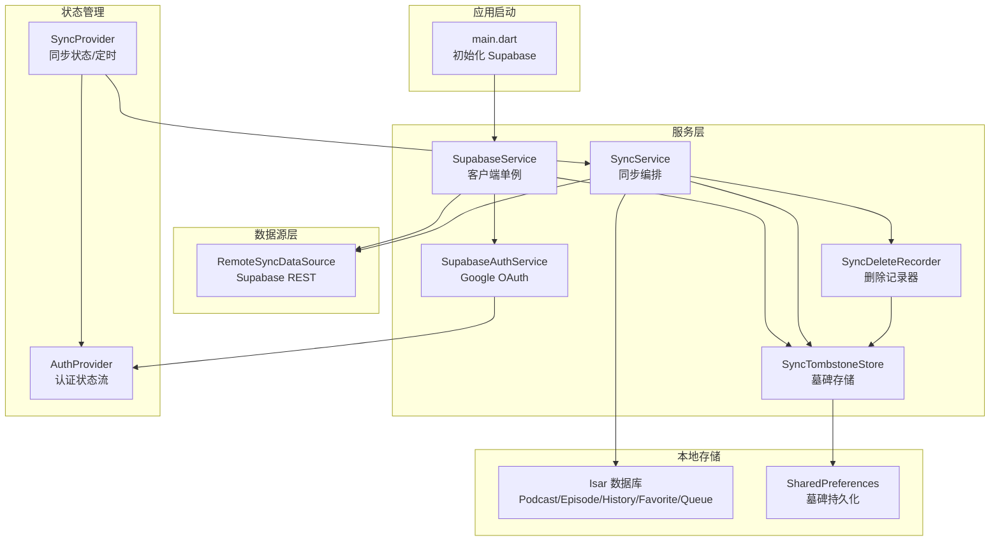
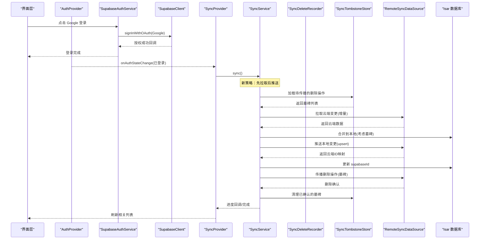
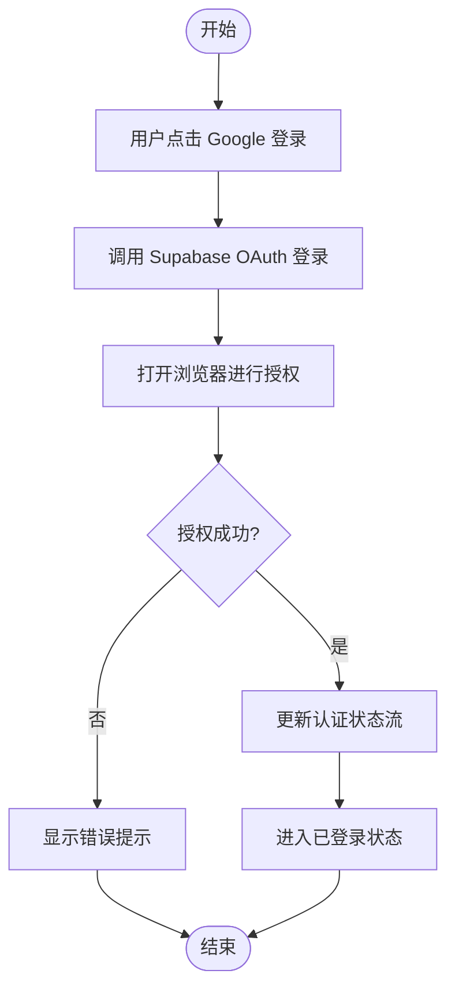
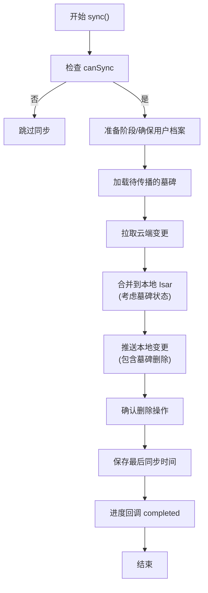
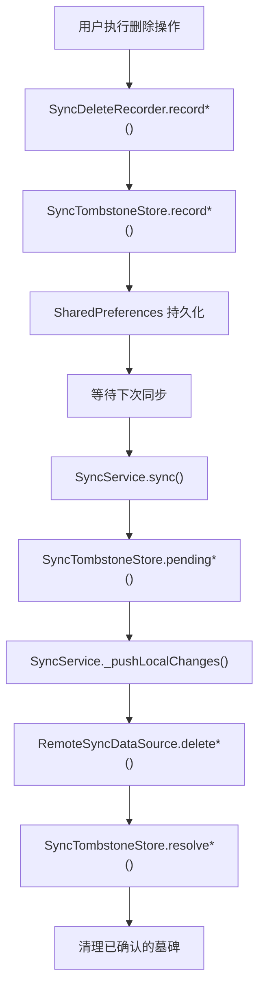
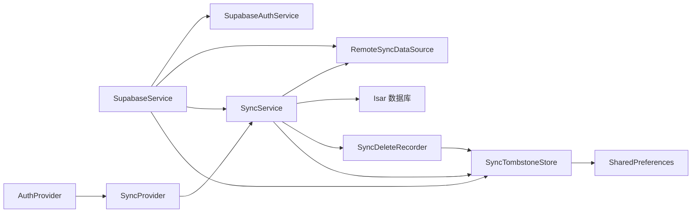

# 云同步功能

<cite>
**本文引用的文件**
- [supabase_service.dart](file://lib/core/services/supabase_service.dart)
- [supabase_auth_service.dart](file://lib/core/services/supabase_auth_service.dart)
- [auth_provider.dart](file://lib/core/providers/auth_provider.dart)
- [remote_sync_datasource.dart](file://lib/data/datasources/remote_sync_datasource.dart)
- [sync_service.dart](file://lib/core/services/sync_service.dart)
- [sync_delete_recorder.dart](file://lib/core/services/sync_delete_recorder.dart)
- [sync_tombstone_store.dart](file://lib/core/services/sync_tombstone_store.dart)
- [sync_provider.dart](file://lib/core/providers/sync_provider.dart)
- [supabase_setup.md](file://docs/supabase_setup.md)
- [database.md](file://docs/database.md)
</cite>

## 更新摘要
**所做更改**
- 新增墓碑删除传播机制章节，详细说明 SyncDeleteRecorder 和 SyncTombstoneStore 的实现
- 更新同步策略为"先拉取后推送"模式，防止竞态条件和数据丢失
- 增强冲突解决机制，支持跨设备删除操作的可靠传播
- 添加增量同步的墓碑状态管理，确保删除操作的一致性

## 目录
1. [简介](#简介)
2. [项目结构](#项目结构)
3. [核心组件](#核心组件)
4. [架构总览](#架构总览)
5. [详细组件分析](#详细组件分析)
6. [墓碑删除传播机制](#墓碑删除传播机制)
7. [依赖关系分析](#依赖关系分析)
8. [性能考量](#性能考量)
9. [故障排查指南](#故障排查指南)
10. [结论](#结论)
11. [附录](#附录)

## 简介
本文件为 TinyCast 的云同步功能提供系统化、可操作的技术文档。内容覆盖 Supabase 集成、认证流程、数据映射与增量同步策略、**革命性的墓碑删除传播机制**、冲突解决机制、离线处理与定时同步，以及常见问题的定位与解决方案。文档面向初学者友好说明，同时为有经验的开发者提供足够的实现细节与代码级参考。

**最新更新**：同步基础设施进行了革命性重构，引入了基于墓碑的删除传播机制。同步服务现在采用"先拉取后推送"策略，配合 SyncDeleteRecorder 和 SyncTombstoneStore 防止多设备间的竞态条件和意外数据丢失。

## 项目结构
云同步相关代码主要分布在以下模块：
- 服务层：Supabase 客户端初始化与访问、认证服务、同步服务、墓碑记录器
- 数据源层：远程数据源封装 Supabase REST API
- 状态管理：Riverpod Provider 暴露认证与同步状态
- 本地存储：Isar 模型与同步字段映射（supabaseId）、墓碑持久化存储
- 配置与文档：环境变量、初始化流程、数据库说明

**图表来源**
- [supabase_service.dart:1-55](file://lib/core/services/supabase_service.dart#L1-L55)
- [supabase_auth_service.dart:1-39](file://lib/core/services/supabase_auth_service.dart#L1-L39)
- [remote_sync_datasource.dart:1-392](file://lib/data/datasources/remote_sync_datasource.dart#L1-L392)
- [sync_service.dart:1-1569](file://lib/core/services/sync_service.dart#L1-L1569)
- [sync_delete_recorder.dart:1-85](file://lib/core/services/sync_delete_recorder.dart#L1-L85)
- [sync_tombstone_store.dart:1-108](file://lib/core/services/sync_tombstone_store.dart#L1-L108)
- [sync_provider.dart:1-168](file://lib/core/providers/sync_provider.dart#L1-L168)
- [auth_provider.dart:1-22](file://lib/core/providers/auth_provider.dart#L1-L22)

## 核心组件
- **SupabaseService**：单例化 Supabase 客户端，负责初始化与获取 client 实例，提供 isInitialized 标志位。
- **SupabaseAuthService**：封装 Google OAuth 登录、登出与当前用户查询，使用外部回调 URL。
- **RemoteSyncDataSource**：统一封装 Supabase 表的 upsert、select、增量查询与删除操作，自动注入 user_id。
- **SyncService**：编排"拉取云端变更 → 合并到本地 → 推送本地变更"的完整同步流程，含进度回调与最后同步时间持久化。
- **SyncDeleteRecorder**：记录本地删除操作，生成墓碑以便在下次同步时传播到云端。
- **SyncTombstoneStore**：持久化存储待传播的删除操作，使用 SharedPreferences 进行跨会话保存。
- **SyncProvider**：基于 Riverpod 的同步状态管理，支持手动触发、定时同步、错误状态与 UI 刷新。
- **AuthProvider**：暴露认证状态流与当前用户，驱动登录态变化时的同步启停。

**章节来源**
- [supabase_service.dart:1-55](file://lib/core/services/supabase_service.dart#L1-L55)
- [supabase_auth_service.dart:1-39](file://lib/core/services/supabase_auth_service.dart#L1-L39)
- [remote_sync_datasource.dart:1-392](file://lib/data/datasources/remote_sync_datasource.dart#L1-L392)
- [sync_service.dart:1-1569](file://lib/core/services/sync_service.dart#L1-L1569)
- [sync_delete_recorder.dart:1-85](file://lib/core/services/sync_delete_recorder.dart#L1-L85)
- [sync_tombstone_store.dart:1-108](file://lib/core/services/sync_tombstone_store.dart#L1-L108)
- [sync_provider.dart:1-168](file://lib/core/providers/sync_provider.dart#L1-L168)
- [auth_provider.dart:1-22](file://lib/core/providers/auth_provider.dart#L1-L22)

## 架构总览
下图展示从认证到数据同步的整体调用链与数据流向，包括新的墓碑删除传播机制。

**图表来源**
- [supabase_auth_service.dart:1-39](file://lib/core/services/supabase_auth_service.dart#L1-L39)
- [auth_provider.dart:1-22](file://lib/core/providers/auth_provider.dart#L1-L22)
- [sync_provider.dart:1-168](file://lib/core/providers/sync_provider.dart#L1-L168)
- [sync_service.dart:1-1569](file://lib/core/services/sync_service.dart#L1-L1569)
- [sync_delete_recorder.dart:1-85](file://lib/core/services/sync_delete_recorder.dart#L1-L85)
- [sync_tombstone_store.dart:1-108](file://lib/core/services/sync_tombstone_store.dart#L1-L108)
- [remote_sync_datasource.dart:1-392](file://lib/data/datasources/remote_sync_datasource.dart#L1-L392)

## 详细组件分析

### Supabase 客户端与服务
- 职责：集中初始化 Supabase，提供全局 client；未初始化时抛出明确异常。
- 关键点：isInitialized 用于安全访问；通过 Riverpod Provider 暴露 client。
- 配置：通过环境变量或编译参数注入 SUPABASE_URL 与 SUPABASE_ANON_KEY。

**章节来源**
- [supabase_service.dart:1-55](file://lib/core/services/supabase_service.dart#L1-L55)
- [supabase_setup.md:1-131](file://docs/supabase_setup.md#L1-L131)

### 认证流程（Google OAuth）
- 入口：SupabaseAuthService.signInWithGoogle() 调用 Supabase OAuth 并指定桌面端回调 URL。
- 状态：AuthProvider.authStateProvider 监听 onAuthStateChange，currentUserProvider 提供当前用户。
- 登出：signOut() 清除会话，UI 根据登录态条件渲染。

**图表来源**
- [supabase_auth_service.dart:1-39](file://lib/core/services/supabase_auth_service.dart#L1-L39)
- [auth_provider.dart:1-22](file://lib/core/providers/auth_provider.dart#L1-L22)

**章节来源**
- [supabase_auth_service.dart:1-39](file://lib/core/services/supabase_auth_service.dart#L1-L39)
- [auth_provider.dart:1-22](file://lib/core/providers/auth_provider.dart#L1-L22)

### 远程数据源（RemoteSyncDataSource）
- 能力：对 podcasts、episodes、user_podcast_subscriptions、playback_history、favorites、queue_items 等表提供 upsert、select、增量查询与删除。
- 安全：所有需要用户上下文的操作自动注入 user_id，并在未登录时抛出异常。
- 增量：通过 updated_at 或 last_update_time 字段过滤变更。

**章节来源**
- [remote_sync_datasource.dart:1-392](file://lib/data/datasources/remote_sync_datasource.dart#L1-L392)

### 同步服务（SyncService）- 革命性更新
- **新策略**：采用"先拉取后推送"模式，防止竞态条件和数据丢失。
- **流程更新**：
  - 前置检查：确保已初始化且已登录。
  - 首次/增量：读取上次同步时间戳决定全量或增量。
  - **拉取阶段**：先从云端拉取变更并合并到本地，确保本地状态与云端一致。
  - **推送阶段**：然后推送本地变更，避免删除其他设备刚上传的数据。
  - **墓碑处理**：加载待传播的删除操作，在推送阶段执行删除。
  - 冲突解决：采用"最后写入胜出"（Last Write Wins），以更新时间戳为准。
  - 进度回调：每 N 条记录通知一次 UI。
  - 持久化：成功完成后保存 last_sync_timestamp。
- **关键方法更新**：
  - sync()：主入口，编排步骤并处理异常，现在是 pull-first-push 策略。
  - _pullAndMergeCloudChanges()：拉取并合并云端数据，考虑墓碑状态。
  - _pushLocalChanges()：推送各表变更，包含墓碑删除操作。
  - 各类 _merge*FromCloud()：按表合并逻辑，跳过本地已删除的记录。
  - _update*SupabaseIds()：回写 supabaseId 建立本地-云端关联。

**图表来源**
- [sync_service.dart:1-1569](file://lib/core/services/sync_service.dart#L1-L1569)

**章节来源**
- [sync_service.dart:1-1569](file://lib/core/services/sync_service.dart#L1-L1569)

### 同步状态与定时任务（SyncProvider）
- 状态：idle/syncing/error，包含 lastSyncTime 与 progress。
- 行为：
  - 监听认证状态变化：登录后启动定时同步并立即执行一次。
  - 定时周期：每 5 分钟执行一次增量同步。
  - 手动触发：防抖后执行一次同步。
  - 失败处理：设置 error 状态并保留错误信息。
  - 刷新下游：同步完成后失效相关 Provider（队列、收藏、历史、订阅等）。

**章节来源**
- [sync_provider.dart:1-168](file://lib/core/providers/sync_provider.dart#L1-L168)

### 数据映射与增量同步规则
- Podcast：以 itunes_id 作为唯一键；无 itunes_id 视为新记录。
- Episode：以 guid 作为唯一键；与 Podcast 通过 podcast_itunes_id 关联。
- 播放历史：以 user_id + episode_id 为冲突键；last_update_time 控制增量。
- 收藏/队列：以 user_id + episode_id 为冲突键；队列采用全量替换策略。
- 字段类型：与 Isar 保持一致，数组在 Supabase 中使用 text[]。
- artworkUrl 为空时不同步该字段，避免覆盖云端已有值。

**章节来源**
- [sync_service.dart:1-1569](file://lib/core/services/sync_service.dart#L1-L1569)
- [remote_sync_datasource.dart:1-392](file://lib/data/datasources/remote_sync_datasource.dart#L1-L392)

### 本地数据库与同步字段
- Isar 模型新增 supabaseId 字段用于关联云端记录。
- PlayHistory 新增 playProgress 字段，作为播放状态的权威来源。
- 生成 Schema：通过 build_runner 重新生成。

**章节来源**
- [database.md:1-493](file://docs/database.md#L1-L493)

## 墓碑删除传播机制

### 概述
墓碑删除传播机制是本次同步基础设施重构的核心特性。它解决了多设备同步中的竞态条件和数据丢失问题，确保用户的删除操作能够可靠地传播到所有设备和云端。

### 核心组件

#### SyncDeleteRecorder（删除记录器）
- **职责**：记录本地删除操作，生成墓碑以便在下次同步时传播到云端。
- **特点**：最佳努力记录，失败不会破坏本地操作。
- **方法**：
  - `recordFavoriteRemoval(int episodeId)`：记录收藏删除
  - `recordQueueRemoval(int episodeId)`：记录队列删除
  - `recordQueueRemovalsByPodcast(int podcastId)`：批量记录播客队列删除
  - `recordUnsubscribe(String? podcastCloudId)`：记录订阅取消

#### SyncTombstoneStore（墓碑存储）
- **职责**：持久化存储待传播的删除操作，使用 SharedPreferences 进行跨会话保存。
- **存储策略**：将删除操作记录为云端 ID 的集合，而非推断本地快照差异。
- **方法**：
  - 读取待处理删除：`pendingSubscriptionDeletes()`、`pendingFavoriteDeletes()`、`pendingQueueDeletes()`
  - 记录删除：`recordSubscriptionDelete()`、`recordFavoriteDelete()`、`recordQueueDelete()`
  - 解析删除：`resolveSubscriptionDeletes()`、`resolveFavoriteDeletes()`、`resolveQueueDeletes()`
  - 订阅快照：`lastPushedSubscriptionIds()`、`saveLastPushedSubscriptionIds()`

### 工作流程

**图表来源**
- [sync_delete_recorder.dart:1-85](file://lib/core/services/sync_delete_recorder.dart#L1-L85)
- [sync_tombstone_store.dart:1-108](file://lib/core/services/sync_tombstone_store.dart#L1-L108)
- [sync_service.dart:1-1569](file://lib/core/services/sync_service.dart#L1-L1569)

### 竞态条件防护机制

#### 1. 先拉取后推送策略
- **问题**：传统 push-first 策略可能导致设备删除其他设备刚上传的数据。
- **解决方案**：先拉取云端变更，确保本地状态与云端一致，然后再推送本地变更。

#### 2. 墓碑状态保护
- **问题**：本地删除操作可能因网络问题未能及时传播。
- **解决方案**：使用墓碑记录待传播的删除操作，直到确认云端已成功删除。

#### 3. 订阅快照保护
- **问题**：如果订阅推送失败，拉取端的未订阅操作不应影响本地数据。
- **解决方案**：维护已成功推送的订阅快照，仅对快照内的订阅应用云端未订阅操作。

### 冲突解决策略

#### 订阅冲突
- 本地重新订阅优先于待处理的删除操作
- 云端未订阅操作仅应用于已成功推送的订阅
- 删除确认后才清理墓碑记录

#### 收藏冲突
- 本地重新添加优先于待处理的删除操作
- 云端删除操作会移除本地对应的收藏记录
- 删除确认后才清理墓碑记录

#### 队列冲突
- 本地重新添加优先于待处理的删除操作
- 云端删除操作会移除本地对应的队列项
- 删除确认后才清理墓碑记录

**章节来源**
- [sync_delete_recorder.dart:1-85](file://lib/core/services/sync_delete_recorder.dart#L1-L85)
- [sync_tombstone_store.dart:1-108](file://lib/core/services/sync_tombstone_store.dart#L1-L108)
- [sync_service.dart:1-1569](file://lib/core/services/sync_service.dart#L1-L1569)

## 依赖关系分析
- SupabaseService 被认证服务、远程数据源与同步服务共同依赖。
- AuthProvider 驱动 SyncProvider 的生命周期。
- SyncProvider 依赖 SyncService 与多个 Presentation Provider 以刷新 UI。
- SyncService 依赖 RemoteSyncDataSource、Isar 数据库、SyncDeleteRecorder 和 SyncTombstoneStore。
- SyncDeleteRecorder 依赖 SyncTombstoneStore 进行墓碑持久化。
- SyncTombstoneStore 依赖 SharedPreferences 进行跨会话数据持久化。

**图表来源**
- [supabase_service.dart:1-55](file://lib/core/services/supabase_service.dart#L1-L55)
- [auth_provider.dart:1-22](file://lib/core/providers/auth_provider.dart#L1-L22)
- [sync_provider.dart:1-168](file://lib/core/providers/sync_provider.dart#L1-L168)
- [sync_service.dart:1-1569](file://lib/core/services/sync_service.dart#L1-L1569)
- [sync_delete_recorder.dart:1-85](file://lib/core/services/sync_delete_recorder.dart#L1-L85)
- [sync_tombstone_store.dart:1-108](file://lib/core/services/sync_tombstone_store.dart#L1-L108)
- [remote_sync_datasource.dart:1-392](file://lib/data/datasources/remote_sync_datasource.dart#L1-L392)

## 性能考量
- **增量同步**：通过 updated_at/last_update_time 减少网络与写入开销。
- **批量 upsert**：RemoteSyncDataSource 对多表支持批量 upsert，降低请求次数。
- **事务写入**：合并云端数据时使用 writeTxn，保证一致性。
- **进度回调间隔**：每 5 条记录通知一次 UI，平衡性能与体验。
- **后台定时**：5 分钟周期，避免频繁同步影响前台交互。
- **墓碑优化**：使用 Set 数据结构存储墓碑 ID，提高查找效率。
- **懒加载墓碑**：仅在同步开始时加载待处理的墓碑，减少内存占用。

## 故障排查指南
- **未配置 Supabase**：
  - 现象：启动日志提示未配置，跳过初始化。
  - 处理：检查 .env 或 --dart-define 是否包含 SUPABASE_URL 与 SUPABASE_ANON_KEY。
- **未登录导致同步跳过**：
  - 现象：canSync 为 false，同步被跳过。
  - 处理：先完成 Google 登录，确认 authStateProvider 输出非空。
- **云端 RLS 拒绝访问**：
  - 现象：upsert/select 返回权限错误。
  - 处理：检查 Supabase 表的 RLS 策略是否正确启用。
- **增量字段缺失**：
  - 现象：fetchUpdatedAfter 无法过滤。
  - 处理：确认云端表存在 updated_at 或 last_update_time 字段。
- **队列不同步**：
  - 现象：队列未更新。
  - 处理：队列采用全量替换，需确保 deleteAllQueueItems 与 upsertQueueItems 均成功。
- **墓碑堆积问题**：
  - 现象：待传播的删除操作越来越多。
  - 处理：检查网络连接，确保删除操作能成功传播到云端。
- **竞态条件导致的重复数据**：
  - 现象：同一数据在不同设备上出现重复。
  - 处理：确认使用了正确的唯一键（itunes_id、guid 等）进行去重。

**章节来源**
- [supabase_setup.md:1-131](file://docs/supabase_setup.md#L1-L131)
- [remote_sync_datasource.dart:1-392](file://lib/data/datasources/remote_sync_datasource.dart#L1-L392)
- [sync_service.dart:1-1569](file://lib/core/services/sync_service.dart#L1-L1569)

## 结论
TinyCast 的云同步方案经过革命性重构，以 Supabase 为核心，结合 Isar 本地数据库、Riverpod 状态管理和**创新的墓碑删除传播机制**，实现了可靠的认证、增量同步、冲突解决与定时后台同步。新的"先拉取后推送"策略配合 SyncDeleteRecorder 和 SyncTombstoneStore，有效防止了多设备间的竞态条件和数据丢失问题。通过明确的映射规则与 supabaseId 关联，保证了跨设备数据的一致性与用户体验。建议在生产环境关注 RLS 策略、网络重试与错误上报，进一步提升稳定性。

## 附录

### 配置与环境变量
- 必需变量：SUPABASE_URL、SUPABASE_ANON_KEY
- 加载优先级：.env 文件优先，其次 --dart-define
- 初始化：在应用启动时调用 SupabaseService.initialize()

**章节来源**
- [supabase_setup.md:1-131](file://docs/supabase_setup.md#L1-L131)

### 数据模型与同步字段
- Podcast：itunes_id 唯一键；支持 rss_urls、genres、keywords 等数组字段。
- Episode：guid 唯一键；artworkUrl 为空时不同步。
- PlayHistory：user_id + episode_id 唯一键；last_update_time 增量。
- Favorite/Queue：user_id + episode_id 唯一键；队列全量替换。

**章节来源**
- [database.md:1-493](file://docs/database.md#L1-L493)
- [sync_service.dart:1-1569](file://lib/core/services/sync_service.dart#L1-L1569)

### API 定义（RemoteSyncDataSource）
- Podcasts
  - upsertPodcasts(podcasts): List<Map>
  - fetchPodcastsUpdatedAfter(since): List<Map>
  - fetchPodcastByItunesId(itunesId): Map?
- Episodes
  - upsertEpisodes(episodes): List<Map>
  - fetchEpisodesUpdatedAfter(since): List<Map>
- Subscriptions
  - upsertUserPodcastSubscriptions(subscriptions): List<Map>
  - fetchUserPodcastSubscriptions(): List<Map>
  - deleteUserPodcastSubscription(podcastId): void
- Playback History
  - upsertPlaybackHistory(records): List<Map>
  - fetchPlaybackHistoryUpdatedAfter(since): List<Map>
  - deletePlaybackHistory(episodeId): void
- Favorites
  - upsertFavorites(favorites): List<Map>
  - fetchFavorites(): List<Map>
  - deleteFavorite(episodeId): void
- Queue Items
  - upsertQueueItems(items): List<Map>
  - fetchQueueItems(): List<Map>
  - deleteQueueItem(episodeId): void
  - deleteAllQueueItems(): void

**章节来源**
- [remote_sync_datasource.dart:1-392](file://lib/data/datasources/remote_sync_datasource.dart#L1-L392)

### 墓碑存储键名
- 订阅删除：`sync_tombstone_subscriptions`
- 收藏删除：`sync_tombstone_favorites`
- 队列删除：`sync_tombstone_queue`
- 已推送订阅快照：`sync_pushed_subscription_ids`

**章节来源**
- [sync_tombstone_store.dart:1-108](file://lib/core/services/sync_tombstone_store.dart#L1-L108)