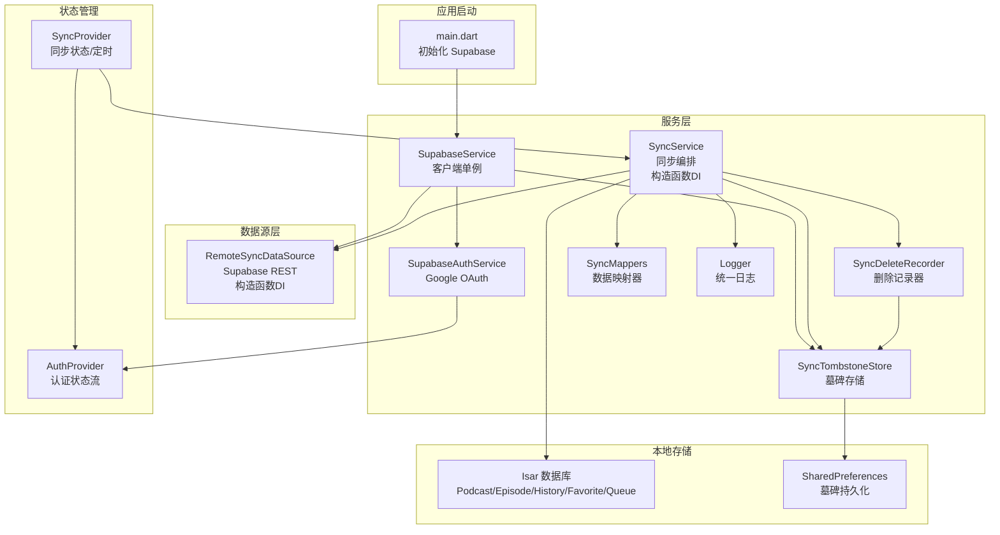
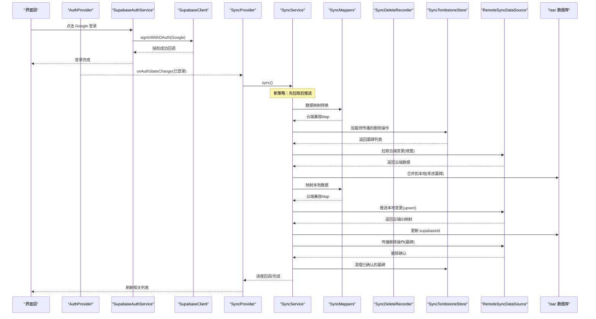
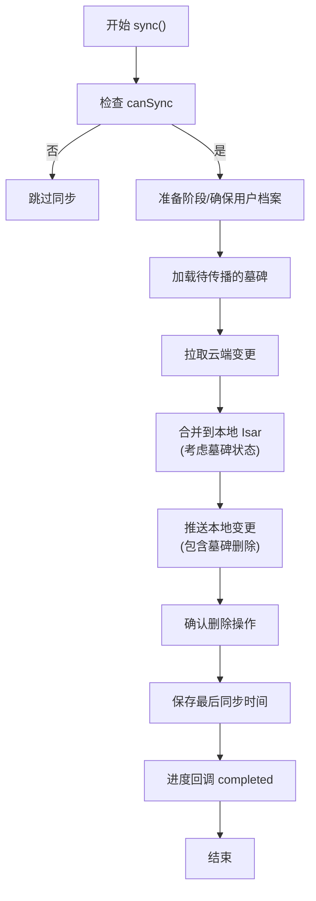
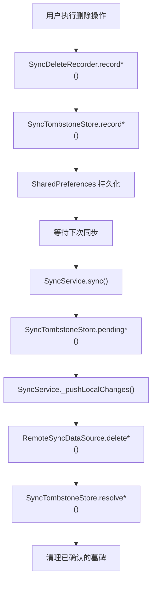
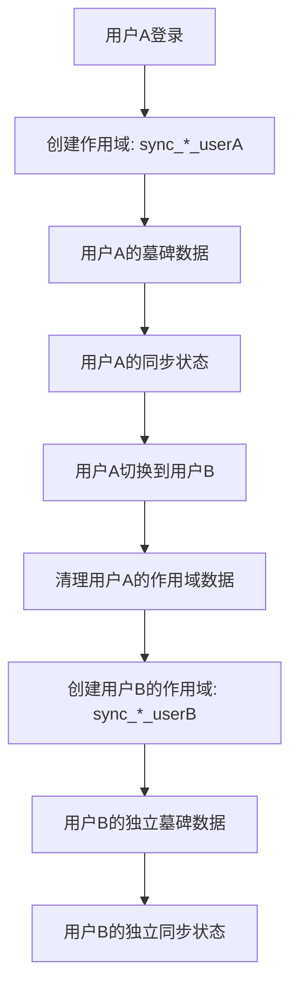
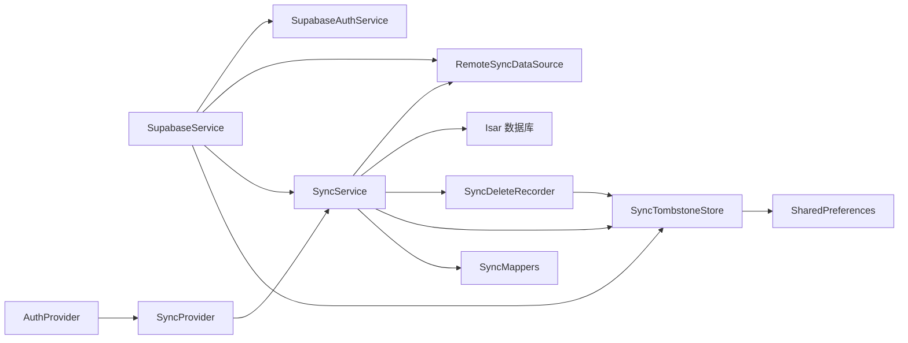

# 云同步功能

<cite>
**本文引用的文件**
- [supabase_service.dart](file://lib/core/services/supabase_service.dart)
- [supabase_auth_service.dart](file://lib/core/services/supabase_auth_service.dart)
- [auth_provider.dart](file://lib/core/providers/auth_provider.dart)
- [remote_sync_datasource.dart](file://lib/data/datasources/remote_sync_datasource.dart)
- [sync_service.dart](file://lib/core/services/sync_service.dart)
- [sync_delete_recorder.dart](file://lib/core/services/sync_delete_recorder.dart)
- [sync_tombstone_store.dart](file://lib/core/services/sync_tombstone_store.dart)
- [sync_mappers.dart](file://lib/core/services/sync_mappers.dart)
- [sync_provider.dart](file://lib/presentation/providers/sync_provider.dart)
- [logger.dart](file://lib/core/utils/logger.dart)
- [sync_debug_guide.md](file://docs/sync_debug_guide.md)
- [supabase_setup.md](file://docs/supabase_setup.md)
- [database.md](file://docs/database.md)
</cite>

## 更新摘要
**所做更改**
- 新增详细的云同步调试指南章节，包含完整的同步触发机制、日志分析、常见问题排查等143行详细内容
- 增强了日志系统的使用说明，包括 `[SYNC]` 标记和 emoji 状态标识
- 完善了同步触发时机和防抖机制的说明
- 添加了具体的错误排查步骤和解决方案
- 更新了故障排查指南，整合了新的调试手册内容

## 目录
1. [简介](#简介)
2. [项目结构](#项目结构)
3. [核心组件](#核心组件)
4. [架构总览](#架构总览)
5. [详细组件分析](#详细组件分析)
6. [墓碑删除传播机制](#墓碑删除传播机制)
7. [用户作用域与多账户支持](#用户作用域与多账户支持)
8. [数据映射模块](#数据映射模块)
9. [依赖注入与可测试性](#依赖注入与可测试性)
10. [依赖关系分析](#依赖关系分析)
11. [性能考量](#性能考量)
12. [调试指南](#调试指南)
13. [故障排查指南](#故障排查指南)
14. [结论](#结论)
15. [附录](#附录)

## 简介
本文件为 TinyCast 的云同步功能提供系统化、可操作的技术文档。内容覆盖 Supabase 集成、认证流程、数据映射与增量同步策略、**革命性的墓碑删除传播机制**、冲突解决机制、离线处理与定时同步，以及常见问题的定位与解决方案。文档面向初学者友好说明，同时为有经验的开发者提供足够的实现细节与代码级参考。

**最新更新**：同步基础设施进行了重大升级，新增了可复用的数据映射模块（sync_mappers.dart），增强了用户作用域的墓碑存储机制以支持多账户隔离，改进了 SyncProvider 的生命周期管理和错误处理。**最新架构改进**包括构造函数依赖注入机制，为 SyncService 和 RemoteSyncDataSource 添加了可选的解析器函数参数，显著提升测试能力和系统可维护性。新的"先拉取后推送"策略配合 SyncDeleteRecorder 和 SyncTombstoneStore 防止多设备间的竞态条件和意外数据丢失。**新增详细调试指南**提供了完整的同步触发机制、日志分析和常见问题排查方法，大幅提升了系统的可维护性和故障排除能力。

## 项目结构
云同步相关代码主要分布在以下模块：
- 服务层：Supabase 客户端初始化与访问、认证服务、同步服务、墓碑记录器、数据映射器
- 数据源层：远程数据源封装 Supabase REST API
- 状态管理：Riverpod Provider 暴露认证与同步状态
- 本地存储：Isar 模型与同步字段映射（supabaseId）、墓碑持久化存储
- 配置与文档：环境变量、初始化流程、数据库说明、调试指南



**图表来源**
- [supabase_service.dart:1-55](file://lib/core/services/supabase_service.dart#L1-L55)
- [supabase_auth_service.dart:1-39](file://lib/core/services/supabase_auth_service.dart#L1-L39)
- [remote_sync_datasource.dart:1-406](file://lib/data/datasources/remote_sync_datasource.dart#L1-L406)
- [sync_service.dart:1-1564](file://lib/core/services/sync_service.dart#L1-L1564)
- [sync_delete_recorder.dart:1-85](file://lib/core/services/sync_delete_recorder.dart#L1-L85)
- [sync_tombstone_store.dart:1-196](file://lib/core/services/sync_tombstone_store.dart#L1-L196)
- [sync_mappers.dart:1-159](file://lib/core/services/sync_mappers.dart#L1-L159)
- [sync_provider.dart:1-191](file://lib/presentation/providers/sync_provider.dart#L1-L191)
- [auth_provider.dart:1-22](file://lib/core/providers/auth_provider.dart#L1-L22)
- [logger.dart:1-139](file://lib/core/utils/logger.dart#L1-L139)

## 核心组件
- **SupabaseService**：单例化 Supabase 客户端，负责初始化与获取 client 实例，提供 isInitialized 标志位。
- **SupabaseAuthService**：封装 Google OAuth 登录、登出与当前用户查询，使用外部回调 URL。
- **RemoteSyncDataSource**：统一封装 Supabase 表的 upsert、select、增量查询与删除操作，自动注入 user_id，**支持构造函数依赖注入**。
- **SyncService**：编排"拉取云端变更 → 合并到本地 → 推送本地变更"的完整同步流程，含进度回调与最后同步时间持久化，**支持构造函数依赖注入**。
- **SyncDeleteRecorder**：记录本地删除操作，生成墓碑以便在下次同步时传播到云端。
- **SyncTombstoneStore**：持久化存储待传播的删除操作，使用 SharedPreferences 进行跨会话保存，支持用户作用域隔离。
- **SyncMappers**：提供可复用的数据映射函数，将本地实体转换为云端兼容的 Map 格式。
- **SyncProvider**：基于 Riverpod 的同步状态管理，支持手动触发、定时同步、错误状态与 UI 刷新。
- **AuthProvider**：暴露认证状态流与当前用户，驱动登录态变化时的同步启停。
- **Logger**：统一的日志工具类，支持文件日志输出和分级日志级别。

**章节来源**
- [supabase_service.dart:1-55](file://lib/core/services/supabase_service.dart#L1-L55)
- [supabase_auth_service.dart:1-39](file://lib/core/services/supabase_auth_service.dart#L1-L39)
- [remote_sync_datasource.dart:1-406](file://lib/data/datasources/remote_sync_datasource.dart#L1-L406)
- [sync_service.dart:1-1564](file://lib/core/services/sync_service.dart#L1-L1564)
- [sync_delete_recorder.dart:1-85](file://lib/core/services/sync_delete_recorder.dart#L1-L85)
- [sync_tombstone_store.dart:1-196](file://lib/core/services/sync_tombstone_store.dart#L1-L196)
- [sync_mappers.dart:1-159](file://lib/core/services/sync_mappers.dart#L1-L159)
- [sync_provider.dart:1-191](file://lib/presentation/providers/sync_provider.dart#L1-L191)
- [auth_provider.dart:1-22](file://lib/core/providers/auth_provider.dart#L1-L22)
- [logger.dart:1-139](file://lib/core/utils/logger.dart#L1-L139)

## 架构总览
下图展示从认证到数据同步的整体调用链与数据流向，包括新的墓碑删除传播机制和数据映射模块。



**图表来源**
- [supabase_auth_service.dart:1-39](file://lib/core/services/supabase_auth_service.dart#L1-L39)
- [auth_provider.dart:1-22](file://lib/core/providers/auth_provider.dart#L1-L22)
- [sync_provider.dart:1-191](file://lib/presentation/providers/sync_provider.dart#L1-L191)
- [sync_service.dart:1-1564](file://lib/core/services/sync_service.dart#L1-L1564)
- [sync_mappers.dart:1-159](file://lib/core/services/sync_mappers.dart#L1-L159)
- [sync_delete_recorder.dart:1-85](file://lib/core/services/sync_delete_recorder.dart#L1-L85)
- [sync_tombstone_store.dart:1-196](file://lib/core/services/sync_tombstone_store.dart#L1-L196)
- [remote_sync_datasource.dart:1-406](file://lib/data/datasources/remote_sync_datasource.dart#L1-L406)

## 详细组件分析

### Supabase 客户端与服务
- 职责：集中初始化 Supabase，提供全局 client；未初始化时抛出明确异常。
- 关键点：isInitialized 用于安全访问；通过 Riverpod Provider 暴露 client。
- 配置：通过环境变量或编译参数注入 SUPABASE_URL 与 SUPABASE_ANON_KEY。

**章节来源**
- [supabase_service.dart:1-55](file://lib/core/services/supabase_service.dart#L1-L55)
- [supabase_setup.md:1-131](file://docs/supabase_setup.md#L1-L131)

### 认证流程（Google OAuth）
- 入口：SupabaseAuthService.signInWithGoogle() 调用 Supabase OAuth 并指定桌面端回调 URL。
- 状态：AuthProvider.authStateProvider 监听 onAuthStateChange，currentUserProvider 提供当前用户。
- 登出：signOut() 清除会话，UI 根据登录态条件渲染。


**图表来源**
- [supabase_auth_service.dart:1-39](file://lib/core/services/supabase_auth_service.dart#L1-L39)
- [auth_provider.dart:1-22](file://lib/core/providers/auth_provider.dart#L1-L22)

**章节来源**
- [supabase_auth_service.dart:1-39](file://lib/core/services/supabase_auth_service.dart#L1-L39)
- [auth_provider.dart:1-22](file://lib/core/providers/auth_provider.dart#L1-L22)

### 远程数据源（RemoteSyncDataSource）- 构造函数依赖注入增强版
- **构造函数依赖注入**：支持 `clientResolver` 参数，允许在测试或集成环境中注入自定义 Supabase 客户端。
- **默认行为**：当未提供解析器时，自动回退到 `SupabaseService().client` 全局单例。
- **能力**：对 podcasts、episodes、user_podcast_subscriptions、playback_history、favorites、queue_items 等表提供 upsert、select、增量查询与删除。
- **安全**：所有需要用户上下文的操作自动注入 user_id，并在未登录时抛出异常。
- **增量**：通过 updated_at 或 last_update_time 字段过滤变更。

**章节来源**
- [remote_sync_datasource.dart:1-406](file://lib/data/datasources/remote_sync_datasource.dart#L1-L406)

### 同步服务（SyncService）- 构造函数依赖注入增强版
- **构造函数依赖注入**：支持多个可选解析器参数：
  - `remoteDataSource`：远程数据源注入
  - `userIdResolver`：用户ID解析器
  - `supabaseClientResolver`：Supabase客户端解析器
  - `isarResolver`：Isar数据库解析器
  - `tombstoneStoreResolver`：墓碑存储解析器
- **默认回退机制**：所有解析器参数都是可选的，当未提供时自动回退到生产环境的单例实例。
- **新策略**：采用"先拉取后推送"模式，防止竞态条件和数据丢失。
- **流程更新**：
  - 前置检查：确保已初始化且已登录。
  - 首次/增量：读取上次同步时间戳决定全量或增量。
  - **拉取阶段**：先从云端拉取变更并合并到本地，确保本地状态与云端一致。
  - **推送阶段**：然后推送本地变更，避免删除其他设备刚上传的数据。
  - **墓碑处理**：加载待传播的删除操作，在推送阶段执行删除。
  - 冲突解决：采用"最后写入胜出"（Last Write Wins），以更新时间戳为准。
  - 进度回调：每 N 条记录通知一次 UI。
  - 持久化：成功完成后保存 last_sync_timestamp。
- **关键方法更新**：
  - sync()：主入口，编排步骤并处理异常，现在是 pull-first-push 策略。
  - _pullAndMergeCloudChanges()：拉取并合并云端数据，考虑墓碑状态。
  - _pushLocalChanges()：推送各表变更，包含墓碑删除操作。
  - 各类 _merge*FromCloud()：按表合并逻辑，跳过本地已删除的记录。
  - _update*SupabaseIds()：回写 supabaseId 建立本地-云端关联。



**图表来源**
- [sync_service.dart:1-1564](file://lib/core/services/sync_service.dart#L1-L1564)

**章节来源**
- [sync_service.dart:1-1564](file://lib/core/services/sync_service.dart#L1-L1564)

### 同步状态与定时任务（SyncProvider）- 增强版
- 状态：idle/syncing/error，包含 lastSyncTime、progress 与 errorMessage。
- 行为：
  - 监听认证状态变化：登录后启动定时同步并立即执行一次。
  - 定时周期：每 5 分钟执行一次增量同步。
  - 手动触发：`syncNow()` 立即执行；仅播放进度变更经 `requestSync()` 做 10 秒防抖。
  - 失败处理：设置 error 状态并保留错误信息。
  - 刷新下游：同步完成后失效相关 Provider（队列、收藏、历史、订阅等）。
  - **用户切换清理**：登出时清理用户作用域的同步状态和墓碑数据。

**章节来源**
- [sync_provider.dart:1-191](file://lib/presentation/providers/sync_provider.dart#L1-L191)

### 数据映射与增量同步规则
- Podcast：以 itunes_id 作为唯一键；无 itunes_id 视为新记录。
- Episode：以 guid 作为唯一键；与 Podcast 通过 podcast_itunes_id 关联。
- 播放历史：以 user_id + episode_id 为冲突键；last_update_time 控制增量。
- 收藏/队列：以 user_id + episode_id 为冲突键；队列采用全量替换策略。
- 字段类型：与 Isar 保持一致，数组在 Supabase 中使用 text[]。
- artworkUrl 为空时不同步该字段，避免覆盖云端已有值。

**章节来源**
- [sync_service.dart:1-1564](file://lib/core/services/sync_service.dart#L1-L1564)
- [remote_sync_datasource.dart:1-406](file://lib/data/datasources/remote_sync_datasource.dart#L1-L406)

### 本地数据库与同步字段
- Isar 模型新增 supabaseId 字段用于关联云端记录。
- PlayHistory 新增 playProgress 字段，作为播放状态的权威来源。
- 生成 Schema：通过 build_runner 重新生成。

**章节来源**
- [database.md:1-493](file://docs/database.md#L1-L493)

## 墓碑删除传播机制

### 概述
墓碑删除传播机制是本次同步基础设施重构的核心特性。它解决了多设备同步中的竞态条件和数据丢失问题，确保用户的删除操作能够可靠地传播到所有设备和云端。

### 核心组件

#### SyncDeleteRecorder（删除记录器）
- **职责**：记录本地删除操作，生成墓碑以便在下次同步时传播到云端。
- **特点**：最佳努力记录，失败不会破坏本地操作。
- **方法**：
  - `recordFavoriteRemoval(int episodeId)`：记录收藏删除
  - `recordQueueRemoval(int episodeId)`：记录队列删除
  - `recordQueueRemovalsByPodcast(int podcastId)`：批量记录播客队列删除
  - `recordUnsubscribe(String? podcastCloudId)`：记录订阅取消

#### SyncTombstoneStore（墓碑存储）
- **职责**：持久化存储待传播的删除操作，使用 SharedPreferences 进行跨会话保存。
- **存储策略**：将删除操作记录为云端 ID 的集合，而非推断本地快照差异。
- **方法**：
  - 读取待处理删除：`pendingSubscriptionDeletes()`、`pendingFavoriteDeletes()`、`pendingQueueDeletes()`
  - 记录删除：`recordSubscriptionDelete()`、`recordFavoriteDelete()`、`recordQueueDelete()`
  - 解析删除：`resolveSubscriptionDeletes()`、`resolveFavoriteDeletes()`、`resolveQueueDeletes()`
  - 订阅快照：`lastPushedSubscriptionIds()`、`saveLastPushedSubscriptionIds()`

### 工作流程



**图表来源**
- [sync_delete_recorder.dart:1-85](file://lib/core/services/sync_delete_recorder.dart#L1-L85)
- [sync_tombstone_store.dart:1-196](file://lib/core/services/sync_tombstone_store.dart#L1-L196)
- [sync_service.dart:1-1564](file://lib/core/services/sync_service.dart#L1-L1564)

### 竞态条件防护机制

#### 1. 先拉取后推送策略
- **问题**：传统 push-first 策略可能导致设备删除其他设备刚上传的数据。
- **解决方案**：先拉取云端变更，确保本地状态与云端一致，然后再推送本地变更。

#### 2. 墓碑状态保护
- **问题**：本地删除操作可能因网络问题未能及时传播。
- **解决方案**：使用墓碑记录待传播的删除操作，直到确认云端已成功删除。

#### 3. 订阅快照保护
- **问题**：如果订阅推送失败，拉取端的未订阅操作不应影响本地数据。
- **解决方案**：维护已成功推送的订阅快照，仅对快照内的订阅应用云端未订阅操作。

### 冲突解决策略

#### 订阅冲突
- 本地重新订阅优先于待处理的删除操作
- 云端未订阅操作仅应用于已成功推送的订阅
- 删除确认后才清理墓碑记录

#### 收藏冲突
- 本地重新添加优先于待处理的删除操作
- 云端删除操作会移除本地对应的收藏记录
- 删除确认后才清理墓碑记录

#### 队列冲突
- 本地重新添加优先于待处理的删除操作
- 云端删除操作会移除本地对应的队列项
- 删除确认后才清理墓碑记录

**章节来源**
- [sync_delete_recorder.dart:1-85](file://lib/core/services/sync_delete_recorder.dart#L1-L85)
- [sync_tombstone_store.dart:1-196](file://lib/core/services/sync_tombstone_store.dart#L1-L196)
- [sync_service.dart:1-1564](file://lib/core/services/sync_service.dart#L1-L1564)

## 用户作用域与多账户支持

### 概述
最新的同步系统实现了完整的用户作用域隔离，确保同一设备上多个账户之间的数据完全隔离，防止墓碑数据和同步状态在不同账户间泄漏。

### 用户作用域实现

#### 用户ID解析
- **动态解析**：通过 `_userIdResolver` 回调函数动态获取当前用户ID
- **默认实现**：使用 SupabaseService().client.auth.currentUser?.id 作为默认解析器
- **测试支持**：允许在测试中注入自定义的用户ID解析器

#### 作用域键生成
- **键命名规范**：所有存储键都附加用户ID后缀，如 `sync_tombstone_subscriptions_user123`
- **兼容性处理**：支持旧的非作用域键的迁移和清理
- **空值保护**：当用户ID为空时，所有操作都会被忽略

#### 账户生命周期管理
- **登录时初始化**：新用户登录时自动创建作用域存储空间
- **登出时清理**：用户登出时清理该用户的所有墓碑数据和同步状态
- **切换时隔离**：账户切换时确保数据完全隔离，不会相互影响

### 多账户场景处理



**图表来源**
- [sync_tombstone_store.dart:1-196](file://lib/core/services/sync_tombstone_store.dart#L1-L196)
- [sync_provider.dart:1-191](file://lib/presentation/providers/sync_provider.dart#L1-L191)

### 数据隔离保证
- **墓碑隔离**：每个用户的删除操作只影响其自己的数据
- **同步状态隔离**：每个用户的最后同步时间独立存储
- **订阅快照隔离**：每个用户的订阅推送状态独立维护
- **错误恢复隔离**：每个用户的错误状态和重试逻辑独立

**章节来源**
- [sync_tombstone_store.dart:1-196](file://lib/core/services/sync_tombstone_store.dart#L1-L196)
- [sync_provider.dart:1-191](file://lib/presentation/providers/sync_provider.dart#L1-L191)
- [sync_service.dart:1-1564](file://lib/core/services/sync_service.dart#L1-L1564)

## 数据映射模块

### 概述
sync_mappers.dart 模块提供了可复用的数据映射函数，将本地实体对象转换为云端兼容的 Map 格式。这种设计使得映射逻辑可以在测试和生产环境中被验证，避免了重复实现。

### 核心映射函数

#### Podcast 映射
- **函数**：`podcastToCloudMap(Podcast p)`
- **功能**：将 Podcast 实体转换为云端兼容的 Map
- **特殊处理**：itunesId、artworkUrl、keywords 等字段的条件映射
- **ID处理**：支持 supabaseId 的回写

#### Episode 映射
- **函数**：`episodeToCloudMap(Episode e)`
- **功能**：将 Episode 实体转换为云端兼容的 Map
- **特殊处理**：guid、artworkUrl、itunes 相关字段的条件映射
- **时间处理**：pubDate 转换为 ISO8601 字符串

#### PlayHistory 映射
- **函数**：`playHistoryToPlayHistoryMap(PlayHistory h)`
- **功能**：将播放历史记录转换为云端格式
- **字段映射**：包括播放进度、状态、时间戳等
- **完整性**：保持所有必要字段的映射

#### Favorite 和 Queue 映射
- **函数**：`favoriteToCloudMap(Favorite f)`、`queueItemToCloudMap(Queue q)`
- **功能**：将收藏和队列项转换为云端格式
- **关联字段**：包含 episode_guid、episode_itunes_id 等关联信息

### 映射优势
- **可测试性**：映射逻辑独立，便于单元测试
- **一致性**：确保生产环境和测试环境使用相同的映射逻辑
- **可维护性**：集中管理映射规则，便于修改和扩展
- **复用性**：多个组件可以共享相同的映射逻辑

**章节来源**
- [sync_mappers.dart:1-159](file://lib/core/services/sync_mappers.dart#L1-L159)

## 依赖注入与可测试性

### 构造函数依赖注入架构

#### SyncService 依赖注入
SyncService 现在支持多种可选的构造函数参数，提供灵活的依赖注入能力：

```dart
SyncService({
  RemoteSyncDataSource? remoteDataSource,
  String? Function()? userIdResolver,
  SupabaseClient? Function()? supabaseClientResolver,
  Isar Function()? isarResolver,
  SyncTombstoneStore Function()? tombstoneStoreResolver,
})
```

**设计原则**：
- **可选参数**：所有注入参数都是可选的，保持向后兼容性
- **生产回退**：未提供解析器时自动回退到生产环境单例
- **测试隔离**：测试中可以完全隔离外部依赖

#### RemoteSyncDataSource 依赖注入
RemoteSyncDataSource 支持客户端解析器注入：

```dart
RemoteSyncDataSource({SupabaseClient? Function()? clientResolver})
```

**使用场景**：
- **单元测试**：注入模拟的 Supabase 客户端
- **集成测试**：注入真实的 Supabase 客户端进行测试
- **开发调试**：注入特定环境的客户端进行调试

### 测试示例

#### SyncService 测试
```dart
// 测试中注入模拟依赖
final syncService = SyncService(
  remoteDataSource: mockRemoteDataSource,
  userIdResolver: () => 'test-user-id',
  supabaseClientResolver: () => null, // 测试中不需要真实客户端
  isarResolver: () => testIsarInstance,
);
```

#### RemoteSyncDataSource 测试
```dart
// 集成测试中注入真实客户端
final dataSource = RemoteSyncDataSource(
  clientResolver: () => realSupabaseClient
);
```

### 可测试性优势

#### 1. 解耦外部依赖
- 测试不依赖全局单例状态
- 可以轻松模拟网络请求和数据库操作
- 支持并行测试执行

#### 2. 环境隔离
- 测试环境与生产环境完全隔离
- 支持多环境配置（开发、测试、生产）
- 便于持续集成和自动化测试

#### 3. 调试友好
- 可以注入特定的依赖进行问题诊断
- 支持断点调试和日志追踪
- 便于性能分析和内存泄漏检测

**章节来源**
- [sync_service.dart:64-112](file://lib/core/services/sync_service.dart#L64-L112)
- [remote_sync_datasource.dart:9-19](file://lib/data/datasources/remote_sync_datasource.dart#L9-L19)
- [sync_service_test.dart:30-33](file://test/core/services/sync_service_test.dart#L30-L33)
- [remote_sync_datasource_integration_test.dart:39-42](file://integration/remote_sync_datasource_integration_test.dart#L39-L42)

## 依赖关系分析
- SupabaseService 被认证服务、远程数据源与同步服务共同依赖。
- AuthProvider 驱动 SyncProvider 的生命周期。
- SyncProvider 依赖 SyncService 与多个 Presentation Provider 以刷新 UI。
- SyncService 依赖 RemoteSyncDataSource、Isar 数据库、SyncDeleteRecorder、SyncTombstoneStore 和 SyncMappers。
- SyncDeleteRecorder 依赖 SyncTombstoneStore 进行墓碑持久化。
- SyncTombstoneStore 依赖 SharedPreferences 进行跨会话数据持久化。
- SyncMappers 被 SyncService 用于数据转换。



**图表来源**
- [supabase_service.dart:1-55](file://lib/core/services/supabase_service.dart#L1-L55)
- [auth_provider.dart:1-22](file://lib/core/providers/auth_provider.dart#L1-L22)
- [sync_provider.dart:1-191](file://lib/presentation/providers/sync_provider.dart#L1-L191)
- [sync_service.dart:1-1564](file://lib/core/services/sync_service.dart#L1-L1564)
- [sync_delete_recorder.dart:1-85](file://lib/core/services/sync_delete_recorder.dart#L1-L85)
- [sync_tombstone_store.dart:1-196](file://lib/core/services/sync_tombstone_store.dart#L1-L196)
- [sync_mappers.dart:1-159](file://lib/core/services/sync_mappers.dart#L1-L159)
- [remote_sync_datasource.dart:1-406](file://lib/data/datasources/remote_sync_datasource.dart#L1-L406)

## 性能考量
- **增量同步**：通过 updated_at/last_update_time 减少网络与写入开销。
- **批量 upsert**：RemoteSyncDataSource 对多表支持批量 upsert，降低请求次数。
- **事务写入**：合并云端数据时使用 writeTxn，保证一致性。
- **进度回调间隔**：每 5 条记录通知一次 UI，平衡性能与体验。
- **后台定时**：5 分钟周期，避免频繁同步影响前台交互。
- **墓碑优化**：使用 Set 数据结构存储墓碑 ID，提高查找效率。
- **懒加载墓碑**：仅在同步开始时加载待处理的墓碑，减少内存占用。
- **用户作用域优化**：通过用户ID前缀避免不必要的键扫描。
- **映射缓存**：映射函数无状态，可被多次调用而无需额外开销。
- **依赖注入优化**：构造函数注入减少运行时依赖解析开销。

## 调试指南

### 同步触发机制

#### 触发时机
同步系统在以下情况下会被触发：

| 触发点 | 行为 | 对应日志 |
| ------ | ------ | ------ |
| 登录成功 | 立即同步一次，并启动每 5 分钟的周期同步 | `Periodic sync started (every 5 minutes)` |
| 播放进度变更 | `requestSync()`，10 秒防抖后同步 | 防抖后触发同步 |
| 手动触发 | 设置 → 云同步 → 已登录页点击同步按钮 | `syncNow()` 调用 |
| 登出 | 停止周期同步，清理该用户的同步状态 | `Periodic sync stopped` |

#### 前置条件检查
同步只在以下条件全部满足时才会执行（`SyncService.canSync`）：

1. 已通过 run.sh 从 `.env` 注入（或直接运行 `flutter run` 时传入）真实的 `SUPABASE_URL` / `SUPABASE_ANON_KEY`
2. 用户已登录（设置 → 云同步）

条件不满足时同步被直接跳过，日志只有一行：
```text
[WARNING] [TinyCast] Sync skipped: user not authenticated
```

### 日志系统详解

#### 日志标记体系
同步域日志大多带 `[SYNC]` 标记（远程数据源错误除外），并用 emoji 区分阶段：

- `🔄 [SYNC]` - 同步开始 / 进度
- `✅ [SYNC]` - 同步完成
- `⚠️ [SYNC]` - 部分步骤失败（lastSyncTime 不推进）
- `❌ [SYNC]` - 步骤失败或整体失败

#### 标准同步流程日志
一次成功同步的日志序列：
```text
[INFO] 🔄 [SYNC] Starting sync...
[INFO] 🔄 [SYNC] First sync: false, last sync: 2026-08-25 14:00:00.000
[INFO] ✅ [SYNC] Sync completed at 2026-08-25 14:05:00.000
[INFO] Sync completed successfully
```

#### 步骤名称对照表
单个步骤失败时输出 `❌ [SYNC] Step "<step>" failed, continuing with remaining steps`，步骤名与进度回调的 `currentTable` 对应：

| 阶段 | 步骤名 |
| ------ | ------ |
| 拉取 | `pull_podcasts` / `pull_episodes` / `pull_subscriptions` / `pull_playback_history` / `pull_favorites` / `pull_queue_items` |
| 推送 | `push_podcasts` / `push_episodes` / `push_subscriptions` / `push_playback_history` / `push_favorites` / `push_queue_items` |

#### 远程数据源错误日志
远程数据源（`RemoteSyncDataSource`）的错误日志**不带** `[SYNC]` 前缀，消息形如 `upsertPodcasts failed`、`fetchFavorites failed`，级别为 ERROR 并附完整堆栈。同步涉及的六张表：`podcasts`、`episodes`、`user_podcast_subscriptions`、`playback_history`、`favorites`、`queue_items`。

### 日志文件位置与读取

#### 文件日志配置
- 日志文件路径：`<应用支持目录>/log/日期.log`
- 启用方式：在应用启动时调用 `Logger.initFileLogging()`
- 日志级别：调试模式下为 info 及以上，发布模式下为 warning 及以上

#### 日志检索方法
使用 grep 命令快速检索同步相关日志：
```bash
grep '\[SYNC\]' <日志文件>
```

### 常见问题排查流程

#### 问题1：同步完全没有发生
**症状**：日志中搜索不到 `🔄 [SYNC] Starting sync...`

**排查步骤**：
1. 检查启动日志是否有 `✅ Supabase 客户端初始化完成`；若为 `ℹ️ Supabase 未配置（使用占位符）`，先按 supabase_setup.md 配置凭据
2. 确认已登录；未登录时只有 `Sync skipped: user not authenticated`
3. 确认存在 `Periodic sync started (every 5 minutes)`；没有则说明 `SyncNotifier` 未进入登录分支，检查登录态 Provider

#### 问题2：部分步骤失败
**症状**：`⚠️ [SYNC] Sync finished with step failures; lastSyncTime not advanced`

**排查步骤**：
1. 向上搜索最近的 `❌ [SYNC] Step "<step>" failed`，确定失败步骤
2. 紧跟其后的 `Error:` / `StackTrace:` 行给出根因；若是 `upsertXxx failed` / `fetchXxx failed`，转问题3
3. `lastSyncTime` 不推进是预期行为：下次同步仍按旧时间增量拉取，修复后重跑一次即可补齐

#### 问题3：远端读写失败
**症状**：`upsertPodcasts failed` / `fetchPlaybackHistoryUpdatedAfter failed` 等 ERROR

**排查步骤**：
1. 检查网络连通性
2. 检查 Supabase 凭据是否有效（见 supabase_setup.md）
3. 检查 Supabase 侧六张表的表结构与 RLS 策略是否允许当前用户读写

#### 问题4：删除没有传播到其他设备
**症状**：本机取消订阅 / 取消收藏 / 移出队列后，其他设备同步后仍存在

**排查步骤**：
1. 搜索 `Deleted cloud subscription for podcast_id=` / `Deleted cloud favorite for episode_id=` / `Deleted cloud queue item for episode_id=`，确认删除已推送云端
2. 若有 `Failed to delete cloud ...`，该次同步会以步骤失败告终（见问题2），删除记录保留在墓碑中，下次同步自动重试
3. 对端设备上的传播日志为 `Unsubscribing local podcast (not in cloud)` / `Removing local favorite (not in cloud)` / `Removing local queue item (not in cloud)`

#### 问题5：需要强制全量同步
`lastSyncTime` 存于 `shared_preferences`，键为 `last_sync_timestamp_<userId>`，墓碑（待删除记录）存于 `sync_tombstone_*_<userId>` 系列键：

- **用户路径**：登出再登录。登出会自动清理该用户的 `lastSyncTime` 与墓碑，下次登录后首次同步即为全量
- **开发者路径**：删除上述键后触发一次同步，日志中应出现 `First sync: true`

**章节来源**
- [sync_debug_guide.md:1-144](file://docs/sync_debug_guide.md#L1-L144)
- [sync_provider.dart:104-117](file://lib/presentation/providers/sync_provider.dart#L104-L117)
- [sync_service.dart:149-196](file://lib/core/services/sync_service.dart#L149-L196)
- [logger.dart:41-65](file://lib/core/utils/logger.dart#L41-L65)

## 故障排查指南
- **未配置 Supabase**：
  - 现象：启动日志提示未配置，跳过初始化。
  - 处理：检查 .env 或 --dart-define 是否包含 SUPABASE_URL 与 SUPABASE_ANON_KEY。
- **未登录导致同步跳过**：
  - 现象：canSync 为 false，同步被跳过。
  - 处理：先完成 Google 登录，确认 authStateProvider 输出非空。
- **云端 RLS 拒绝访问**：
  - 现象：upsert/select 返回权限错误。
  - 处理：检查 Supabase 表的 RLS 策略是否正确启用。
- **增量字段缺失**：
  - 现象：fetchUpdatedAfter 无法过滤。
  - 处理：确认云端表存在 updated_at 或 last_update_time 字段。
- **队列不同步**：
  - 现象：队列未更新。
  - 处理：队列采用全量替换，需确保 deleteAllQueueItems 与 upsertQueueItems 均成功。
- **墓碑堆积问题**：
  - 现象：待传播的删除操作越来越多。
  - 处理：检查网络连接，确保删除操作能成功传播到云端。
- **竞态条件导致的重复数据**：
  - 现象：同一数据在不同设备上出现重复。
  - 处理：确认使用了正确的唯一键（itunes_id、guid 等）进行去重。
- **多账户数据泄漏**：
  - 现象：一个账户的数据出现在另一个账户中。
  - 处理：检查用户作用域键是否正确生成，确认登出时清理了用户数据。
- **映射错误**：
  - 现象：数据同步时字段映射不正确。
  - 处理：检查 sync_mappers.dart 中的映射逻辑，确认字段名称和类型匹配。
- **依赖注入问题**：
  - 现象：测试中依赖解析失败或生产环境行为异常。
  - 处理：检查构造函数参数是否正确注入，确认解析器函数返回有效实例。
- **日志文件无法写入**：
  - 现象：文件日志未生成或写入失败。
  - 处理：检查应用是否有文件写入权限，确认日志目录存在且可写。
- **同步触发异常**：
  - 现象：预期的同步触发点未产生同步。
  - 处理：检查对应的触发事件是否正确注册，确认防抖定时器正常工作。

**章节来源**
- [supabase_setup.md:1-131](file://docs/supabase_setup.md#L1-L131)
- [remote_sync_datasource.dart:1-406](file://lib/data/datasources/remote_sync_datasource.dart#L1-L406)
- [sync_service.dart:1-1564](file://lib/core/services/sync_service.dart#L1-L1564)
- [sync_mappers.dart:1-159](file://lib/core/services/sync_mappers.dart#L1-L159)
- [sync_debug_guide.md:1-144](file://docs/sync_debug_guide.md#L1-L144)

## 结论
TinyCast 的云同步方案经过重大升级，以 Supabase 为核心，结合 Isar 本地数据库、Riverpod 状态管理和**创新的墓碑删除传播机制**，实现了可靠的认证、增量同步、冲突解决与定时后台同步。**最新架构改进**包括构造函数依赖注入机制，显著提升了系统的可测试性和可维护性。新的"先拉取后推送"策略配合 SyncDeleteRecorder 和 SyncTombstoneStore，有效防止了多设备间的竞态条件和数据丢失问题。通过明确的映射规则与 supabaseId 关联，保证了跨设备数据的一致性与用户体验。

**最新增强**包括：可复用的数据映射模块（sync_mappers.dart）提高了代码的可测试性和可维护性；用户作用域的墓碑存储机制确保了多账户环境下的数据隔离；改进的 SyncProvider 生命周期管理提供了更好的错误处理和状态管理；**构造函数依赖注入机制**为测试和生产环境提供了灵活的配置选项，支持模拟依赖进行单元测试，同时保持向后兼容性。**新增的详细调试指南**提供了完整的同步触发机制、日志分析和常见问题排查方法，大幅提升了系统的可维护性和故障排除能力。建议在生产环境关注 RLS 策略、网络重试与错误上报，进一步提升稳定性。

## 附录

### 配置与环境变量
- 必需变量：SUPABASE_URL、SUPABASE_ANON_KEY
- 加载方式：由 run.sh 读取 .env 并转成 --dart-define 注入；应用代码只读取 String.fromEnvironment，直接 flutter run 不会读 .env
- 初始化：在应用启动时调用 SupabaseService.initialize()

**章节来源**
- [supabase_setup.md:1-131](file://docs/supabase_setup.md#L1-L131)

### 数据模型与同步字段
- Podcast：itunes_id 唯一键；支持 rss_urls、genres、keywords 等数组字段。
- Episode：guid 唯一键；artworkUrl 为空时不同步。
- PlayHistory：user_id + episode_id 唯一键；last_update_time 增量。
- Favorite/Queue：user_id + episode_id 唯一键；队列全量替换。

**章节来源**
- [database.md:1-493](file://docs/database.md#L1-L493)
- [sync_service.dart:1-1564](file://lib/core/services/sync_service.dart#L1-L1564)

### API 定义（RemoteSyncDataSource）
- Podcasts
  - upsertPodcasts(podcasts): List<Map>
  - fetchPodcastsUpdatedAfter(since): List<Map>
  - fetchPodcastByItunesId(itunesId): Map?
- Episodes
  - upsertEpisodes(episodes): List<Map>
  - fetchEpisodesUpdatedAfter(since): List<Map>
- Subscriptions
  - upsertUserPodcastSubscriptions(subscriptions): List<Map>
  - fetchUserPodcastSubscriptions(): List<Map>
  - deleteUserPodcastSubscription(podcastId): void
- Playback History
  - upsertPlaybackHistory(records): List<Map>
  - fetchPlaybackHistoryUpdatedAfter(since): List<Map>
  - deletePlaybackHistory(episodeId): void
- Favorites
  - upsertFavorites(favorites): List<Map>
  - fetchFavorites(): List<Map>
  - deleteFavorite(episodeId): void
- Queue Items
  - upsertQueueItems(items): List<Map>
  - fetchQueueItems(): List<Map>
  - deleteQueueItem(episodeId): void
  - deleteAllQueueItems(): void

**章节来源**
- [remote_sync_datasource.dart:1-406](file://lib/data/datasources/remote_sync_datasource.dart#L1-L406)

### 墓碑存储键名
- 订阅删除：`sync_tombstone_subscriptions_{userId}`
- 收藏删除：`sync_tombstone_favorites_{userId}`
- 队列删除：`sync_tombstone_queue_{userId}`
- 已推送订阅快照：`sync_pushed_subscription_ids_{userId}`

**章节来源**
- [sync_tombstone_store.dart:1-196](file://lib/core/services/sync_tombstone_store.dart#L1-L196)

### 数据映射函数
- Podcast 映射：`podcastToCloudMap(Podcast p)`
- Episode 映射：`episodeToCloudMap(Episode e)`
- PlayHistory 映射：`playHistoryToCloudMap(PlayHistory h)`
- Favorite 映射：`favoriteToCloudMap(Favorite f)`
- Queue 映射：`queueItemToCloudMap(Queue q)`

**章节来源**
- [sync_mappers.dart:1-159](file://lib/core/services/sync_mappers.dart#L1-L159)

### 用户作用域相关方法
- 用户ID解析：`_userIdResolver` 回调函数
- 作用域键生成：`_scopedKey(baseKey, {String? userId})`
- 用户数据清理：`clearForUser(userId)`、`clearLegacyUnscopedKeys()`
- 同步状态清理：`clearLastSyncTimeForUser(userId)`、`clearLegacyLastSyncTime()`

**章节来源**
- [sync_tombstone_store.dart:1-196](file://lib/core/services/sync_tombstone_store.dart#L1-L196)
- [sync_service.dart:1-1564](file://lib/core/services/sync_service.dart#L1-L1564)
- [sync_provider.dart:1-191](file://lib/presentation/providers/sync_provider.dart#L1-L191)

### 构造函数依赖注入参数
- SyncService 参数：
  - `remoteDataSource`：远程数据源实例
  - `userIdResolver`：用户ID解析函数
  - `supabaseClientResolver`：Supabase客户端解析函数
  - `isarResolver`：Isar数据库解析函数
  - `tombstoneStoreResolver`：墓碑存储解析函数
- RemoteSyncDataSource 参数：
  - `clientResolver`：Supabase客户端解析函数

**章节来源**
- [sync_service.dart:64-79](file://lib/core/services/sync_service.dart#L64-L79)
- [remote_sync_datasource.dart:9-11](file://lib/data/datasources/remote_sync_datasource.dart#L9-L11)

### 调试相关配置
- 日志文件路径：`<应用支持目录>/log/日期.log`
- 日志级别：调试模式 info 及以上，发布模式 warning 及以上
- 同步触发：登录时启动，每 5 分钟周期，手动 `syncNow()` 立即执行，播放进度变更防抖 10 秒
- 常用日志关键字：`[SYNC]`、`Starting sync`、`Sync completed`、`Step failed`

**章节来源**
- [logger.dart:41-65](file://lib/core/utils/logger.dart#L41-L65)
- [sync_provider.dart:104-117](file://lib/presentation/providers/sync_provider.dart#L104-L117)
- [sync_debug_guide.md:1-144](file://docs/sync_debug_guide.md#L1-L144)