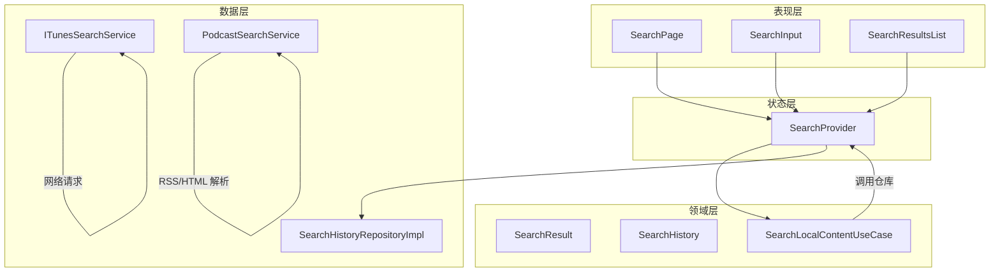
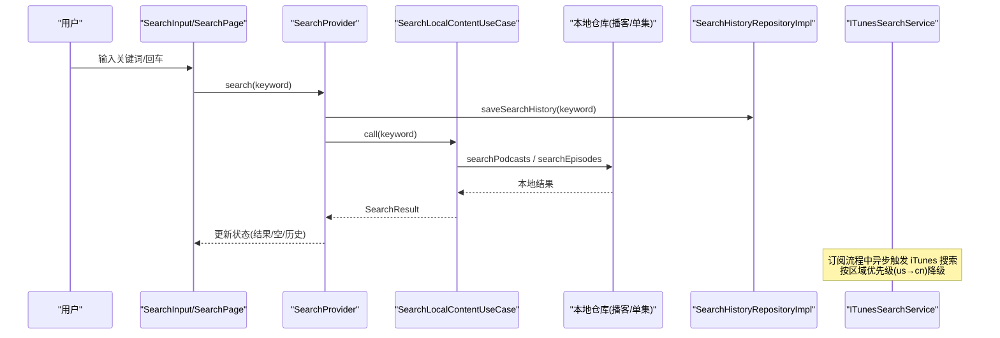
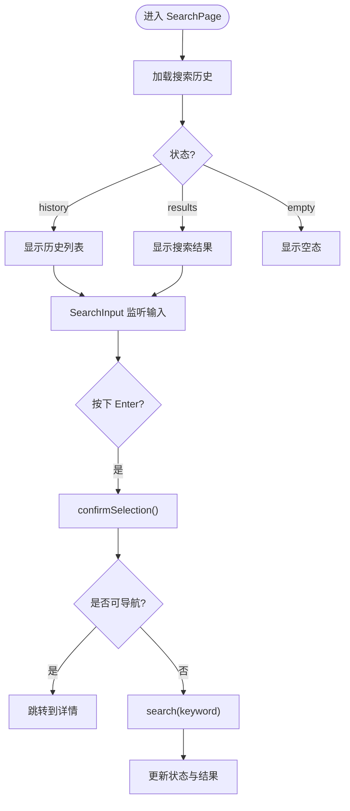
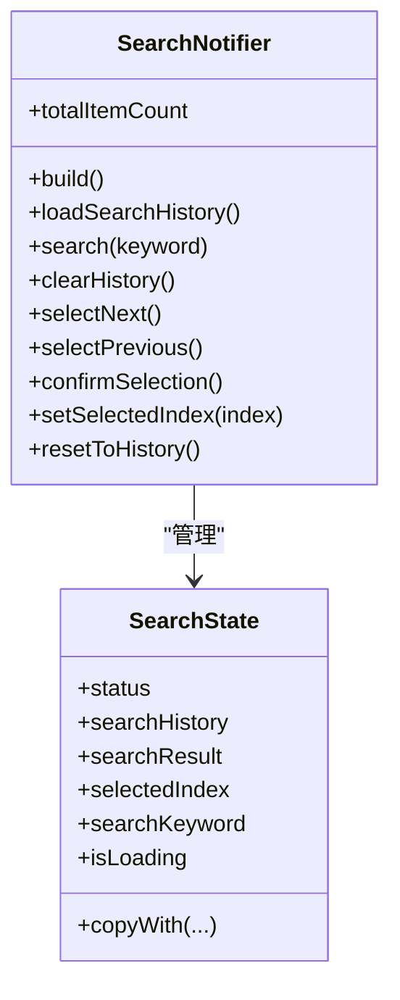
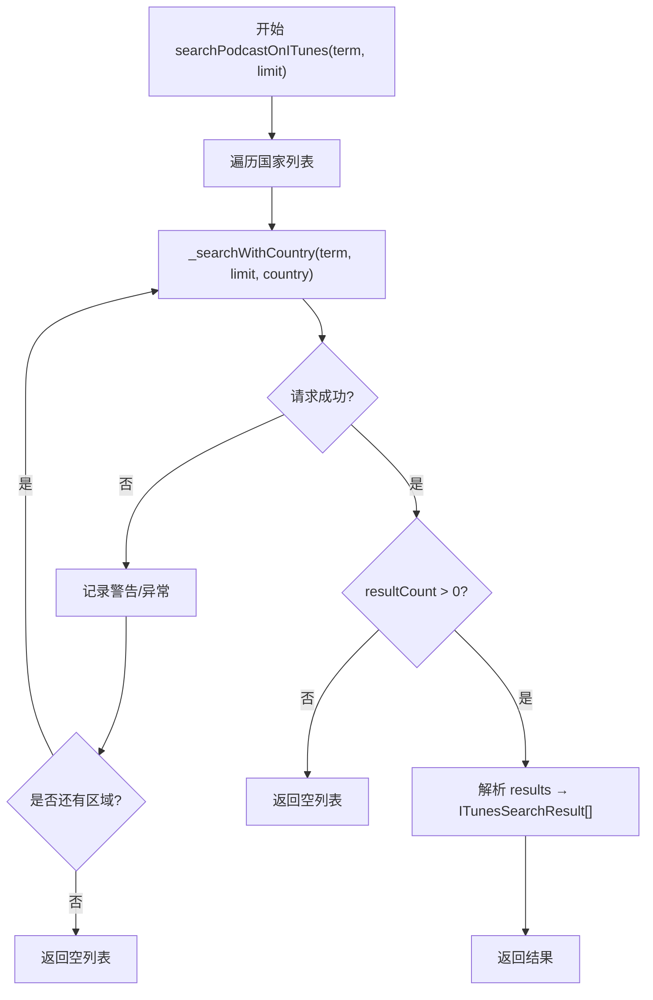
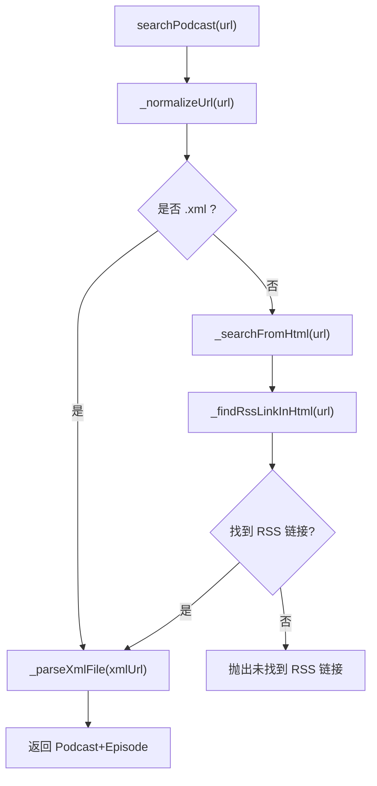
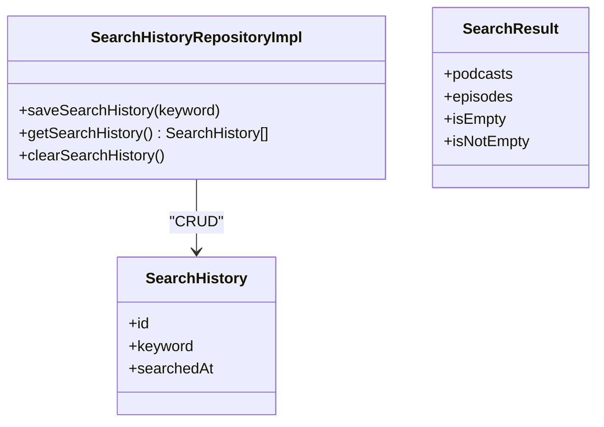
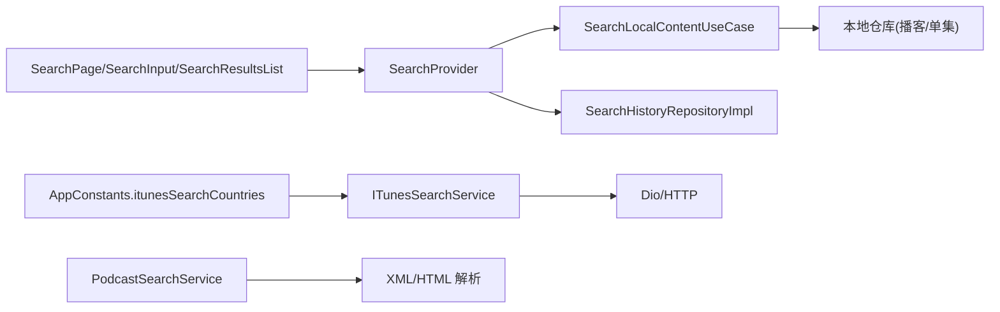

# 搜索功能

<cite>
**本文引用的文件**   
- [search_page.dart](file://lib/presentation/features/search/search_page.dart)
- [search_provider.dart](file://lib/presentation/features/search/search_provider.dart)
- [search_input.dart](file://lib/presentation/features/search/search_input.dart)
- [search_results_list.dart](file://lib/presentation/features/search/search_results/search_results_list.dart)
- [itunes_search_service.dart](file://lib/data/services/itunes_search_service.dart)
- [podcast_search_service.dart](file://lib/data/services/podcast_search_service.dart)
- [search_result.dart](file://lib/domain/entities/search_result.dart)
- [search_local_content_usecase.dart](file://lib/domain/usecases/search_local_content_usecase.dart)
- [search_history_repository_impl.dart](file://lib/data/repositories/search_history_repository_impl.dart)
- [search_history.dart](file://lib/domain/entities/search_history.dart)
- [app_constants.dart](file://lib/core/utils/app_constants.dart)
</cite>

## 目录
1. [简介](#简介)
2. [项目结构](#项目结构)
3. [核心组件](#核心组件)
4. [架构总览](#架构总览)
5. [详细组件分析](#详细组件分析)
6. [依赖关系分析](#依赖关系分析)
7. [性能与优化](#性能与优化)
8. [故障排查指南](#故障排查指南)
9. [结论](#结论)
10. [附录：配置项与参数说明](#附录配置项与参数说明)

## 简介
本文件为 TinyCast 的“搜索”功能提供系统化文档，覆盖本地内容搜索、iTunes 搜索集成、UI 交互、状态管理、网络请求处理、数据库读写以及常见问题的解决方案。重点包括：
- SearchPage 的 UI 结构与交互流程
- SearchProvider 的状态管理与键盘导航
- ITunesSearchService 的多区域降级搜索与重试机制
- PodcastSearchService 的 RSS/XML 解析与 HTML 页面 RSS 链接提取
- 搜索结果数据结构 SearchResult
- 搜索历史持久化（Isar）
- Apple Podcast ID（iTunes ID）字段与数据模型扩展策略
- 搜索算法优化、结果缓存、区域降级与错误恢复

## 项目结构
搜索功能采用分层架构：
- 表现层（presentation）：SearchPage、SearchInput、SearchResultsList 等 UI 组件
- 状态层（Riverpod Provider）：SearchProvider 管理搜索状态与业务编排
- 领域层（domain）：SearchResult、SearchHistory 实体与 UseCase
- 数据层（data）：ITunesSearchService、PodcastSearchService、SearchHistoryRepositoryImpl

图表来源 
- [search_page.dart:10-78](file://lib/presentation/features/search/search_page.dart#L10-L78)
- [search_provider.dart:22-284](file://lib/presentation/features/search/search_provider.dart#L22-L284)
- [search_input.dart:13-165](file://lib/presentation/features/search/search_input.dart#L13-L165)
- [search_results_list.dart:8-71](file://lib/presentation/features/search/search_results/search_results_list.dart#L8-L71)
- [itunes_search_service.dart:106-317](file://lib/data/services/itunes_search_service.dart#L106-L317)
- [podcast_search_service.dart:14-208](file://lib/data/services/podcast_search_service.dart#L14-L208)
- [search_result.dart:4-17](file://lib/domain/entities/search_result.dart#L4-L17)
- [search_history_repository_impl.dart:7-57](file://lib/data/repositories/search_history_repository_impl.dart#L7-L57)

章节来源
- [search_page.dart:10-78](file://lib/presentation/features/search/search_page.dart#L10-L78)
- [search_provider.dart:22-284](file://lib/presentation/features/search/search_provider.dart#L22-L284)
- [search_input.dart:13-165](file://lib/presentation/features/search/search_input.dart#L13-L165)
- [search_results_list.dart:8-71](file://lib/presentation/features/search/search_results/search_results_list.dart#L8-L71)

## 核心组件
- SearchPage：承载搜索输入、历史记录与结果列表，根据状态切换显示
- SearchProvider：统一状态管理，负责加载历史、执行本地搜索、更新选择项与导航目标
- SearchInput：支持键盘导航（上下箭头、回车），同步输入框与状态
- SearchResultsList：渲染播客与单集结果，支持悬停高亮与点击跳转
- ITunesSearchService：调用 iTunes Search API，支持多区域降级与重试
- PodcastSearchService：从 XML 或 HTML 页面获取并解析 RSS，定位播源
- SearchLocalContentUseCase：封装本地搜索逻辑（播客与单集）
- SearchHistoryRepositoryImpl：基于 Isar 的搜索历史增删查
- SearchResult：聚合本地搜索结果（播客 + 单集）

章节来源
- [search_page.dart:10-78](file://lib/presentation/features/search/search_page.dart#L10-L78)
- [search_provider.dart:22-284](file://lib/presentation/features/search/search_provider.dart#L22-L284)
- [search_input.dart:13-165](file://lib/presentation/features/search/search_input.dart#L13-L165)
- [search_results_list.dart:8-71](file://lib/presentation/features/search/search_results/search_results_list.dart#L8-L71)
- [itunes_search_service.dart:106-317](file://lib/data/services/itunes_search_service.dart#L106-L317)
- [podcast_search_service.dart:14-208](file://lib/data/services/podcast_search_service.dart#L14-L208)
- [search_local_content_usecase.dart:4-19](file://lib/domain/usecases/search_local_content_usecase.dart#L4-L19)
- [search_history_repository_impl.dart:7-57](file://lib/data/repositories/search_history_repository_impl.dart#L7-L57)
- [search_result.dart:4-17](file://lib/domain/entities/search_result.dart#L4-L17)

## 架构总览
搜索流程分为两条主线：
- 本地搜索：用户输入关键词 → SearchProvider 调用 SearchLocalContentUseCase → 查询本地数据库 → 返回 SearchResult
- iTunes 搜索：订阅或增强元数据时，通过 ITunesSearchService 发起跨区搜索，失败自动降级到下一区域

图表来源 
- [search_provider.dart:114-144](file://lib/presentation/features/search/search_provider.dart#L114-L144)
- [search_local_content_usecase.dart:9-17](file://lib/domain/usecases/search_local_content_usecase.dart#L9-L17)
- [search_history_repository_impl.dart:9-28](file://lib/data/repositories/search_history_repository_impl.dart#L9-L28)
- [itunes_search_service.dart:200-224](file://lib/data/services/itunes_search_service.dart#L200-L224)

## 详细组件分析

### SearchPage 与 SearchInput：UI 与交互
- SearchPage 根据 SearchStatus 切换显示历史、结果或空态
- SearchInput 支持：
  - 文本同步避免循环更新
  - 键盘事件：上/下箭头移动选中项，Enter 确认或触发搜索
  - 清空按钮重置到历史视图

图表来源 
- [search_page.dart:19-76](file://lib/presentation/features/search/search_page.dart#L19-L76)
- [search_input.dart:44-71](file://lib/presentation/features/search/search_input.dart#L44-L71)
- [search_provider.dart:182-217](file://lib/presentation/features/search/search_provider.dart#L182-L217)

章节来源
- [search_page.dart:19-76](file://lib/presentation/features/search/search_page.dart#L19-L76)
- [search_input.dart:44-71](file://lib/presentation/features/search/search_input.dart#L44-L71)

### SearchProvider：状态管理与业务流程
- 状态字段：status、searchHistory、searchResult、selectedIndex、searchKeyword、isLoading
- 关键方法：
  - loadSearchHistory：加载历史并设置初始状态
  - search：保存历史、执行本地搜索、刷新历史、更新结果与状态
  - clearHistory：清空历史
  - selectNext/selectPrevious：键盘导航
  - confirmSelection：根据当前选中项决定导航目标
  - resetToHistory：回到历史视图

图表来源 
- [search_provider.dart:22-56](file://lib/presentation/features/search/search_provider.dart#L22-L56)
- [search_provider.dart:82-258](file://lib/presentation/features/search/search_provider.dart#L82-L258)

章节来源
- [search_provider.dart:22-284](file://lib/presentation/features/search/search_provider.dart#L22-L284)

### ITunesSearchService：网络请求与区域降级
- 功能：
  - lookupByFeedUrl：通过 feedUrl 精确查找播客
  - searchPodcastOnITunes：关键词搜索，支持 limit 限制
  - _searchWithCountry：带区域的搜索实现，含重试与错误处理
- 特性：
  - 多区域降级：按 AppConstants.itunesSearchCountries 顺序尝试（默认 us→cn）
  - 重试机制：DioException/AppException/未知异常分类处理
  - JSON 解析容错：字符串与 Map 兼容
  - 超时配置：connect/receive/send 超时由 Dio 选项控制

图表来源 
- [itunes_search_service.dart:200-224](file://lib/data/services/itunes_search_service.dart#L200-L224)
- [itunes_search_service.dart:227-315](file://lib/data/services/itunes_search_service.dart#L227-L315)

章节来源
- [itunes_search_service.dart:106-317](file://lib/data/services/itunes_search_service.dart#L106-L317)
- [app_constants.dart:77](file://lib/core/utils/app_constants.dart#L77)

### PodcastSearchService：RSS/XML 与 HTML 页面解析
- 功能：
  - searchPodcast(url)：自动判断是否为 XML 或直接解析 HTML
  - _parseXmlFile(xmlUrl)：直接解析 RSS XML
  - _searchFromHtml(url)：在 HTML 页面中查找 RSS 链接并解析
  - _findRssLinkInHtml(url)：获取 HTML 并提取 RSS 链接
  - _extractRssLinkFromHtml(html, baseUrl)：使用 HtmlRssExtractor 提取
- 特性：
  - 自动补全协议（http/https）
  - 非 XML 内容回退为 HTML 处理
  - 重试与错误分类处理

图表来源 
- [podcast_search_service.dart:43-52](file://lib/data/services/podcast_search_service.dart#L43-L52)
- [podcast_search_service.dart:83-103](file://lib/data/services/podcast_search_service.dart#L83-L103)
- [podcast_search_service.dart:109-127](file://lib/data/services/podcast_search_service.dart#L109-L127)
- [podcast_search_service.dart:133-197](file://lib/data/services/podcast_search_service.dart#L133-L197)

章节来源
- [podcast_search_service.dart:14-208](file://lib/data/services/podcast_search_service.dart#L14-L208)

### 搜索历史与数据模型
- SearchHistory：包含 id、keyword、searchedAt
- SearchHistoryRepositoryImpl：基于 Isar 的增删查（去重更新最近时间）
- SearchResult：聚合本地搜索结果（podcasts + episodes）

图表来源 
- [search_history.dart:1-12](file://lib/domain/entities/search_history.dart#L1-L12)
- [search_history_repository_impl.dart:7-57](file://lib/data/repositories/search_history_repository_impl.dart#L7-L57)
- [search_result.dart:4-17](file://lib/domain/entities/search_result.dart#L4-L17)

章节来源
- [search_history.dart:1-12](file://lib/domain/entities/search_history.dart#L1-L12)
- [search_history_repository_impl.dart:7-57](file://lib/data/repositories/search_history_repository_impl.dart#L7-L57)
- [search_result.dart:4-17](file://lib/domain/entities/search_result.dart#L4-L17)

## 依赖关系分析
- UI 层依赖 Riverpod Provider（SearchProvider）进行状态读取与更新
- SearchProvider 依赖 UseCase（SearchLocalContentUseCase）与 Repository（SearchHistoryRepositoryImpl）
- ITunesSearchService 与 PodcastSearchService 作为独立服务被上层调用（如订阅流程）
- 常量 AppConstants.itunesSearchCountries 控制 iTunes 搜索区域优先级

图表来源 
- [search_provider.dart:58-80](file://lib/presentation/features/search/search_provider.dart#L58-L80)
- [search_local_content_usecase.dart:4-19](file://lib/domain/usecases/search_local_content_usecase.dart#L4-L19)
- [itunes_search_service.dart:124-135](file://lib/data/services/itunes_search_service.dart#L124-L135)
- [podcast_search_service.dart:25-36](file://lib/data/services/podcast_search_service.dart#L25-L36)
- [app_constants.dart:77](file://lib/core/utils/app_constants.dart#L77)

章节来源
- [search_provider.dart:58-80](file://lib/presentation/features/search/search_provider.dart#L58-L80)
- [search_local_content_usecase.dart:4-19](file://lib/domain/usecases/search_local_content_usecase.dart#L4-L19)
- [itunes_search_service.dart:124-135](file://lib/data/services/itunes_search_service.dart#L124-L135)
- [podcast_search_service.dart:25-36](file://lib/data/services/podcast_search_service.dart#L25-L36)
- [app_constants.dart:77](file://lib/core/utils/app_constants.dart#L77)

## 性能与优化
- 本地搜索优化
  - 使用索引字段（如标题、描述）提升匹配速度
  - 分页与懒加载减少首屏渲染压力
  - 防抖输入，避免频繁触发搜索
- 结果缓存
  - 对热门关键词结果做内存缓存（TTL 策略）
  - 对 iTunes 搜索结果做短期缓存，降低重复请求
- 区域降级与重试
  - 优先尝试 us，失败再尝试 cn，缩短整体耗时
  - 指数退避重试，避免雪崩
- 网络请求优化
  - 合理设置超时与并发限制
  - 压缩响应体（服务端支持时）
- 渲染优化
  - ListView.builder 按需构建条目
  - 悬停高亮与选中状态最小化重建

[本节为通用指导，不直接分析具体文件]

## 故障排查指南
- 搜索无结果
  - 检查关键词是否有效，是否存在空格或特殊字符
  - 查看本地仓库搜索条件是否正确
  - 若启用 iTunes 搜索，检查网络连通性与区域配置
- iTunes 搜索失败
  - 检查 AppConstants.itunesSearchCountries 顺序与可用性
  - 查看日志中的区域降级与重试信息
  - 确认 User-Agent 与 Accept 头是否符合要求
- RSS 解析失败
  - 确认 URL 指向的是 XML 或包含 RSS 链接的 HTML
  - 检查 HTML 页面是否能正常访问
  - 查看 HtmlRssExtractor 提取逻辑是否命中
- 搜索历史异常
  - 检查 Isar 事务写入是否成功
  - 确认去重逻辑（相同 keyword 更新时间戳）
- 键盘导航无效
  - 检查 FocusNode 与 KeyEvent 绑定
  - 确认 SearchProvider 的 selectNext/selectPrevious 与 totalItemCount 计算正确

章节来源
- [search_history_repository_impl.dart:9-28](file://lib/data/repositories/search_history_repository_impl.dart#L9-L28)
- [itunes_search_service.dart:227-315](file://lib/data/services/itunes_search_service.dart#L227-L315)
- [podcast_search_service.dart:133-197](file://lib/data/services/podcast_search_service.dart#L133-L197)
- [search_provider.dart:162-180](file://lib/presentation/features/search/search_provider.dart#L162-L180)

## 结论
TinyCast 的搜索功能通过清晰的分层与职责划分，实现了高效的本地搜索与可靠的 iTunes 集成。SearchProvider 统一管理状态与流程，ITunesSearchService 提供健壮的区域降级与重试机制，PodcastSearchService 灵活处理 RSS/XML 与 HTML 场景。结合搜索历史与结果缓存，系统在可用性与性能之间取得良好平衡。后续可进一步引入更细粒度的缓存策略与搜索算法优化，以提升用户体验。

[本节为总结性内容，不直接分析具体文件]

## 附录：配置项与参数说明
- ITunesSearchService
  - 构造参数
    - dioInstance：自定义 Dio 实例（可选）
    - maxRetryCount：最大重试次数（默认来自 AppConstants.maxRetryCount）
    - timeout：超时毫秒数（默认来自 AppConstants.defaultTimeout）
    - countries：国家代码列表，按优先级排序（默认 AppConstants.itunesSearchCountries）
  - 方法
    - lookupByFeedUrl(feedUrl)：通过 feedUrl 精确查找，返回 ITunesSearchResult?
    - searchPodcastOnITunes(term, limit=5)：关键词搜索，返回 List<ITunesSearchResult>
- PodcastSearchService
  - 构造参数
    - dioInstance：自定义 Dio 实例（可选）
    - rssParserService：RSS 解析服务（可选）
    - maxRetryCount：最大重试次数（默认来自 AppConstants.maxRetryCount）
    - timeout：超时毫秒数（默认来自 AppConstants.defaultTimeout）
  - 方法
    - searchPodcast(url)：返回 Map<String, dynamic>（包含 Podcast 与 Episode 列表）
- SearchProvider
  - 状态字段
    - status：SearchStatus（initial/history/results/empty）
    - searchHistory：List<SearchHistory>
    - searchResult：SearchResult?
    - selectedIndex：int
    - searchKeyword：String
    - isLoading：bool
  - 方法
    - loadSearchHistory()：加载历史
    - search(keyword)：执行本地搜索并更新状态
    - clearHistory()：清空历史
    - selectNext()/selectPrevious()：键盘导航
    - confirmSelection()：返回 NavigationTarget?
    - setSelectedIndex(index)：设置选中项
    - resetToHistory()：回到历史视图
- SearchLocalContentUseCase
  - 方法
    - call(keyword)：返回 SearchResult（podcasts + episodes）
- SearchHistoryRepositoryImpl
  - 方法
    - saveSearchHistory(keyword)：保存或更新时间戳
    - getSearchHistory()：按 searchedAt 降序返回历史
    - clearSearchHistory()：清空历史
- AppConstants
  - itunesSearchCountries：默认 ["us", "cn"]

章节来源
- [itunes_search_service.dart:124-135](file://lib/data/services/itunes_search_service.dart#L124-L135)
- [itunes_search_service.dart:200-224](file://lib/data/services/itunes_search_service.dart#L200-L224)
- [podcast_search_service.dart:25-36](file://lib/data/services/podcast_search_service.dart#L25-L36)
- [podcast_search_service.dart:43-52](file://lib/data/services/podcast_search_service.dart#L43-L52)
- [search_provider.dart:22-56](file://lib/presentation/features/search/search_provider.dart#L22-L56)
- [search_provider.dart:82-258](file://lib/presentation/features/search/search_provider.dart#L82-L258)
- [search_local_content_usecase.dart:9-17](file://lib/domain/usecases/search_local_content_usecase.dart#L9-L17)
- [search_history_repository_impl.dart:9-55](file://lib/data/repositories/search_history_repository_impl.dart#L9-L55)
- [app_constants.dart:77](file://lib/core/utils/app_constants.dart#L77)