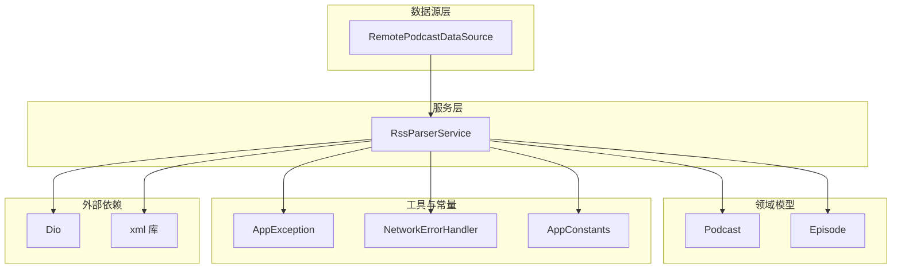
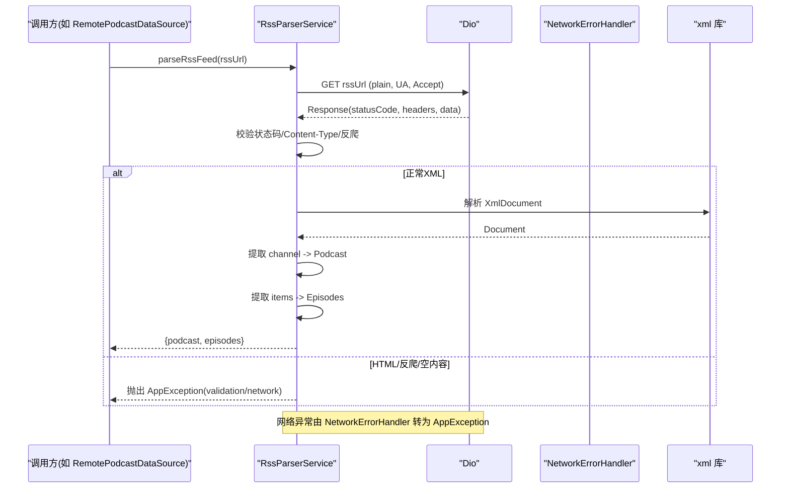
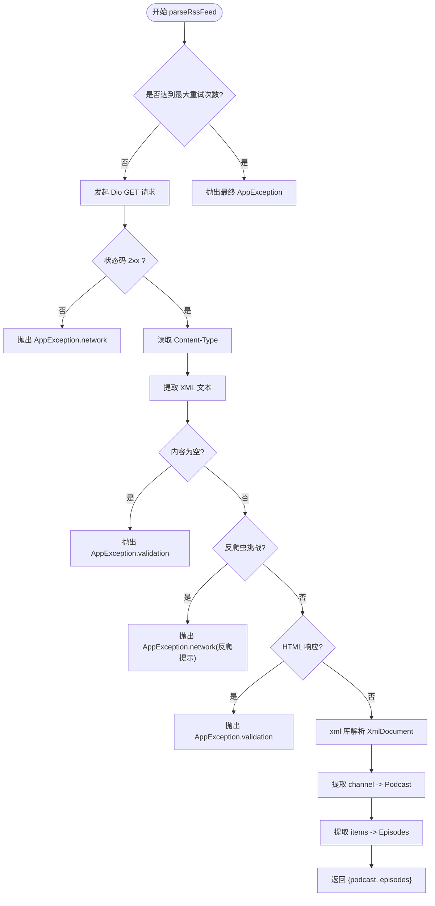
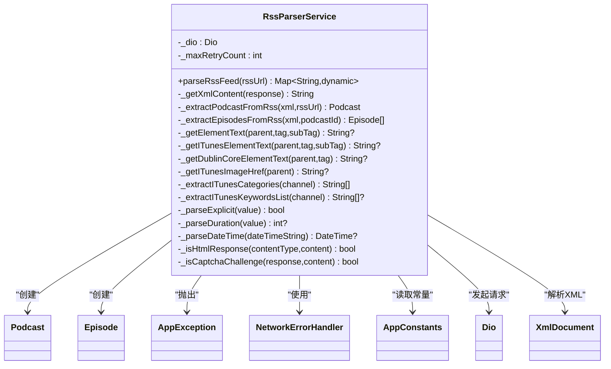

# RSS 解析服务

<cite>
**本文引用的文件**   
- [rss_parser_service.dart](file://lib/data/services/rss_parser_service.dart)
- [app_exception.dart](file://lib/core/utils/app_exception.dart)
- [network_error_handler.dart](file://lib/core/utils/network_error_handler.dart)
- [app_constants.dart](file://lib/core/utils/app_constants.dart)
- [podcast.dart](file://lib/domain/entities/podcast.dart)
- [episode.dart](file://lib/domain/entities/episode.dart)
- [remote_podcast_datasource.dart](file://lib/data/datasources/remote_podcast_datasource.dart)
- [pubspec.yaml](file://pubspec.yaml)
</cite>

## 目录
1. [简介](#简介)
2. [项目结构](#项目结构)
3. [核心组件](#核心组件)
4. [架构总览](#架构总览)
5. [详细组件分析](#详细组件分析)
6. [依赖关系分析](#依赖关系分析)
7. [性能考量](#性能考量)
8. [故障排查指南](#故障排查指南)
9. [结论](#结论)
10. [附录](#附录)

## 简介
本文件为 TinyCast 的 RSS 解析服务提供系统化、可操作的文档。重点围绕 RssParserService 类的实现细节，包括 parseRssFeed() 方法的工作流程、XML 解析逻辑、错误处理与重试策略；说明对 RSS 2.0 与 Atom 的支持方式、iTunes 扩展标签（如 itunes:subtitle、itunes:summary、itunes:image 等）以及 Dublin Core 命名空间的处理；记录网络请求配置、超时设置、Content-Type 检测与反爬虫验证处理；并给出 GUID 缺失、音频时长解析、日期时间格式化等关键场景的处理示例路径。同时解释与 Dio HTTP 客户端的集成方式，以及 AppException 异常处理模式。

## 项目结构
RSS 解析相关代码位于 data/services 层，核心类为 RssParserService，依赖 domain 层的 Podcast/Episode 实体，使用 dio 进行网络请求，使用 xml 库直接解析 XML 内容，并通过 AppException 与 NetworkErrorHandler 统一异常处理。

图表来源
- [remote_podcast_datasource.dart](file://lib/data/datasources/remote_podcast_datasource.dart)
- [rss_parser_service.dart](file://lib/data/services/rss_parser_service.dart)
- [podcast.dart](file://lib/domain/entities/podcast.dart)
- [episode.dart](file://lib/domain/entities/episode.dart)
- [app_exception.dart](file://lib/core/utils/app_exception.dart)
- [network_error_handler.dart](file://lib/core/utils/network_error_handler.dart)
- [app_constants.dart](file://lib/core/utils/app_constants.dart)

章节来源
- [rss_parser_service.dart](file://lib/data/services/rss_parser_service.dart)
- [remote_podcast_datasource.dart](file://lib/data/datasources/remote_podcast_datasource.dart)

## 核心组件
- RssParserService：负责发起网络请求、获取 RSS/Atom XML、校验响应类型与反爬挑战、解析 XML 并提取播客元数据与节目列表，返回包含 podcast 与 episodes 的 Map。
- Podcast/Episode：领域实体，承载从 RSS 解析出的结构化数据，包含 iTunes 扩展字段。
- AppException：统一的异常封装，支持网络、验证、未知等多种类型。
- NetworkErrorHandler：将 Dio 异常分类映射为 AppException，并提供带重试/超时的通用能力。
- AppConstants：集中定义默认超时、最大重试次数、User-Agent 版本等常量。

章节来源
- [rss_parser_service.dart](file://lib/data/services/rss_parser_service.dart)
- [podcast.dart](file://lib/domain/entities/podcast.dart)
- [episode.dart](file://lib/domain/entities/episode.dart)
- [app_exception.dart](file://lib/core/utils/app_exception.dart)
- [network_error_handler.dart](file://lib/core/utils/network_error_handler.dart)
- [app_constants.dart](file://lib/core/utils/app_constants.dart)

## 架构总览
RssParserService 通过 Dio 发起 GET 请求，设置 responseType=plain，接收原始文本后由 xml 库解析 XmlDocument。随后分别提取 channel 与 item 节点，构建 Podcast 与 Episode 对象。过程中对 Content-Type、HTML 响应、反爬虫挑战进行识别与拦截，失败时按策略重试或抛出 AppException。

图表来源
- [rss_parser_service.dart](file://lib/data/services/rss_parser_service.dart)
- [network_error_handler.dart](file://lib/core/utils/network_error_handler.dart)

## 详细组件分析

### RssParserService 类概览
- 职责：网络请求、响应校验、XML 解析、数据提取、错误与重试。
- 关键属性：Dio 实例、最大重试次数。
- 构造器：初始化 Dio 超时（connect/receive/send），默认值来自 AppConstants。
- 入口方法：parseRssFeed(String rssUrl) -> Future<Map<String, dynamic>>。

章节来源
- [rss_parser_service.dart](file://lib/data/services/rss_parser_service.dart)

#### parseRssFeed() 工作流程
- 重试循环：最多 _maxRetryCount 次，指数退避延迟（retryCount 秒）。
- 网络请求：GET 指定 URL，Accept 包含 application/rss+xml、application/xml、text/xml、*/*，User-Agent 为 TinyCast/${appVersion}。
- 响应校验：
  - 状态码非 2xx 则抛 AppException.network。
  - 读取 content-type，若为空或无法解析，继续后续判断。
  - 提取 XML 字符串，空内容抛 AppException.validation。
  - 反爬虫检测：检查 sg-captcha 头或内容匹配正则，命中则抛 AppException.network 并提示用户切换网络或稍后再试。
  - HTML 检测：若 Content-Type 为 text/html 或内容以 <!DOCTYPE html>/<html> 开头，抛 AppException.validation。
- 解析阶段：
  - 使用 xml 库解析 XmlDocument。
  - 提取 channel 生成 Podcast。
  - 遍历 item 生成 Episodes。
- 成功返回：{'podcast': Podcast, 'episodes': List<Episode>}。
- 异常分支：
  - DioException：交由 NetworkErrorHandler.handleDioException(e) 转换为 AppException。
  - AppException：直接记录并中断重试。
  - 其他异常：包装为 AppException.unknown 并中断重试。

图表来源
- [rss_parser_service.dart](file://lib/data/services/rss_parser_service.dart)

章节来源
- [rss_parser_service.dart](file://lib/data/services/rss_parser_service.dart)

#### XML 解析与命名空间处理
- 标准 RSS 2.0：
  - channel 下 title、description、link、language、copyright、lastBuildDate、image/url 等。
  - item 下 title、description、link、guid、author、pubDate、enclosure(url/type)。
- iTunes 扩展（namespace: itunes 或 itunes:*）：
  - 频道级：subtitle、summary、image(href)、explicit、category(text)、keywords、owner(name/email)。
  - 节目级：duration、id、image(href)、explicit。
- Dublin Core（namespace: dc 或 dc:*）：
  - creator、rights 等用于作者与版权信息补充。
- 兼容策略：优先使用 namespace-aware 的 getElement(tagName, namespace:'itunes'|'dc')，回退到 getElement('itunes:tagName') 或 'dc:tagName'。

章节来源
- [rss_parser_service.dart](file://lib/data/services/rss_parser_service.dart)

#### 错误处理与重试策略
- 网络异常：DioException 经 NetworkErrorHandler 分类为连接超时、发送/接收超时、证书错误、HTTP 错误码等，统一转为 AppException。
- 业务异常：如空内容、HTML 响应、反爬虫挑战，直接抛 AppException.validation 或 AppException.network。
- 重试机制：捕获 DioException 后记录日志，延迟 retryCount 秒后重试；遇到 AppException 或其他异常立即中断。
- 最终失败：超过最大重试次数后抛出最后一次错误或默认网络异常。

章节来源
- [rss_parser_service.dart](file://lib/data/services/rss_parser_service.dart)
- [network_error_handler.dart](file://lib/core/utils/network_error_handler.dart)

#### 与 Dio 的集成与配置
- 构造期设置：connectTimeout、receiveTimeout、sendTimeout 均取自 AppConstants.defaultTimeout。
- 请求选项：responseType=plain，headers 中设置 Accept 与 User-Agent。
- 响应处理：statusCode 校验、content-type 读取、data 转字符串。

章节来源
- [rss_parser_service.dart](file://lib/data/services/rss_parser_service.dart)
- [app_constants.dart](file://lib/core/utils/app_constants.dart)

#### 与 AppException 的异常模式
- 统一异常类型：network、validation、unknown 等。
- 携带信息：message、statusCode、originalError、stackTrace。
- 工厂方法：AppException.network/validation/unknown 等便捷创建。

章节来源
- [app_exception.dart](file://lib/core/utils/app_exception.dart)

#### 支持的格式与兼容性
- RSS 2.0：完整支持 channel/item 结构与常用字段。
- Atom：当服务器返回 application/atom+xml 且内容以 XML 声明开头时，仍可按 XML 解析；但当前提取逻辑主要面向 RSS 2.0 的 channel/item 结构。如需完全支持 Atom，可在后续扩展对应节点映射。
- 反爬虫与 HTML 防护：检测到 sg-captcha 头或内容特征、meta refresh 小页面、HTML 标签等，提前阻断并提示用户。

章节来源
- [rss_parser_service.dart](file://lib/data/services/rss_parser_service.dart)

#### 关键数据处理示例（路径引用）
- GUID 缺失处理：当 item.guid 为空时，记录警告并使用 audioUrl 生成稳定标识 auto_guid:$audioUrl，否则回退到 auto_guid:index_$index。
  - 参考路径：[rss_parser_service.dart](file://lib/data/services/rss_parser_service.dart)
- 音频时长解析：支持 HH:mm:ss、MM:ss 与纯秒数，解析失败返回 null。
  - 参考路径：[rss_parser_service.dart](file://lib/data/services/rss_parser_service.dart)
- 日期时间格式化：优先尝试 RFC 822（去除时区后缀后解析），再尝试 ISO 8601，失败返回 null。
  - 参考路径：[rss_parser_service.dart](file://lib/data/services/rss_parser_service.dart)
- iTunes 图片链接：优先取 itunes:image 的 href，其次回退到标准 image/url。
  - 参考路径：[rss_parser_service.dart](file://lib/data/services/rss_parser_service.dart)
- Dublin Core 字段：creator、rights 作为作者与版权信息的补充。
  - 参考路径：[rss_parser_service.dart](file://lib/data/services/rss_parser_service.dart)

章节来源
- [rss_parser_service.dart](file://lib/data/services/rss_parser_service.dart)

### 数据模型与字段映射
- Podcast：包含标题、副标题、作者、描述、封面图、RSS/网站地址、语言、版权、分类、关键词、显式标志、所有者信息、更新时间、节目数量、订阅状态、创建时间，以及 iTunes 相关字段（itunesId、itunesArtworkUrl、流派、国家、发布日期、分级等）。
- Episode：包含标题、描述、链接、GUID、作者、发布时间、音频地址与类型、时长、封面图、显式标志、播放/下载状态、进度、最后播放时间、创建/更新时间，以及 iTunes 相关字段（itunesId、artworkUrl、发布日期、显式性、分级等）。

章节来源
- [podcast.dart](file://lib/domain/entities/podcast.dart)
- [episode.dart](file://lib/domain/entities/episode.dart)

### 调用链与集成点
- RemotePodcastDataSource 在获取播客数据时调用 RssParserService.parseRssFeed(rssUrl)，并将结果传递给上层用例或仓库。
- 依赖注入：RssParserService 可通过构造函数传入 Dio 实例，便于测试与替换。

章节来源
- [remote_podcast_datasource.dart](file://lib/data/datasources/remote_podcast_datasource.dart)
- [rss_parser_service.dart](file://lib/data/services/rss_parser_service.dart)

## 依赖关系分析
- 外部依赖：
  - dio：HTTP 客户端，支持超时、拦截器、重试等高级功能。
  - xml：XML 解析库，直接解析 RSS/Atom 文档。
  - intl：日期格式化（RFC 822/ISO 8601）。
- 内部依赖：
  - AppConstants：默认超时、最大重试次数、应用版本等。
  - AppException：统一异常封装。
  - NetworkErrorHandler：Dio 异常分类与转换。
  - Podcast/Episode：领域实体。

图表来源
- [rss_parser_service.dart](file://lib/data/services/rss_parser_service.dart)
- [podcast.dart](file://lib/domain/entities/podcast.dart)
- [episode.dart](file://lib/domain/entities/episode.dart)
- [app_exception.dart](file://lib/core/utils/app_exception.dart)
- [network_error_handler.dart](file://lib/core/utils/network_error_handler.dart)
- [app_constants.dart](file://lib/core/utils/app_constants.dart)

章节来源
- [rss_parser_service.dart](file://lib/data/services/rss_parser_service.dart)
- [podcast.dart](file://lib/domain/entities/podcast.dart)
- [episode.dart](file://lib/domain/entities/episode.dart)
- [app_exception.dart](file://lib/core/utils/app_exception.dart)
- [network_error_handler.dart](file://lib/core/utils/network_error_handler.dart)
- [app_constants.dart](file://lib/core/utils/app_constants.dart)

## 性能考量
- 网络层：
  - 合理设置 connect/receive/send 超时，避免长时间阻塞。
  - 使用 responseType=plain 减少不必要的序列化开销。
- 解析层：
  - 使用 xml 库直接解析，避免中间层转换带来的额外内存占用。
  - 对每个 item 的解析采用 try-catch 保护，单个节目解析失败不影响整体。
- 重试策略：
  - 指数退避（retryCount 秒）降低瞬时拥塞压力。
  - 限制最大重试次数，防止无限重试导致资源耗尽。
- 内存与日志：
  - 大文档解析时注意内存峰值，必要时可分块处理（当前为全量解析）。
  - 日志级别区分 info/warning/error/debug，便于定位问题。

## 故障排查指南
- 常见错误与定位：
  - 网络超时/连接失败：检查 NetworkErrorHandler 的分类与 AppException.network 消息。
  - HTML 响应：确认 Content-Type 是否为 text/html 或内容以 HTML 标签开头。
  - 反爬虫挑战：检查 sg-captcha 头或内容特征，建议切换网络或稍后再试。
  - GUID 缺失：查看日志中的自动 GUID 生成提示，确保 audioUrl 存在。
  - 时长/日期解析失败：检查 itunes:duration 与 pubDate 格式是否符合预期。
- 调试建议：
  - 启用详细日志（info/warning/error/debug），关注“开始解析”“响应 Content-Type”“解析完成”等关键日志。
  - 使用单元测试或集成测试模拟不同 RSS 源与异常场景。
  - 通过 Dio 拦截器打印请求/响应头，辅助定位 Content-Type 与反爬问题。

章节来源
- [rss_parser_service.dart](file://lib/data/services/rss_parser_service.dart)
- [network_error_handler.dart](file://lib/core/utils/network_error_handler.dart)

## 结论
RssParserService 提供了健壮、可扩展的 RSS 解析能力，覆盖 RSS 2.0 主流字段与 iTunes/Dublin Core 扩展，具备完善的网络与解析错误处理、反爬虫检测与重试策略。通过与 Dio 和 xml 库的深度集成，以及对 AppException 的统一异常管理，确保了在高容错要求下的稳定性与可维护性。建议在后续迭代中增强对 Atom 格式的完整支持，并进一步优化大文档解析的性能与内存占用。

## 附录
- 依赖版本与包管理：
  - dio、xml、intl 等依赖在 pubspec.yaml 中声明，确保版本稳定与兼容。
- 调用示例路径：
  - RemotePodcastDataSource 调用 parseRssFeed 的位置见 [remote_podcast_datasource.dart](file://lib/data/datasources/remote_podcast_datasource.dart)。
- 常量与配置：
  - 默认超时、最大重试次数、应用版本等见 [app_constants.dart](file://lib/core/utils/app_constants.dart)。

章节来源
- [pubspec.yaml](file://pubspec.yaml)
- [remote_podcast_datasource.dart](file://lib/data/datasources/remote_podcast_datasource.dart)
- [app_constants.dart](file://lib/core/utils/app_constants.dart)