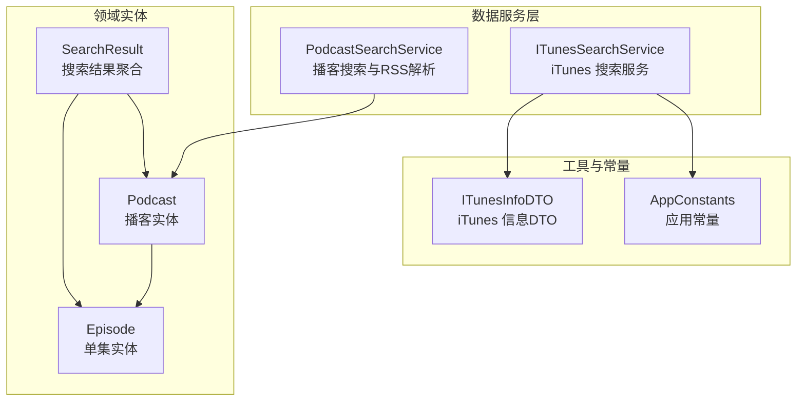
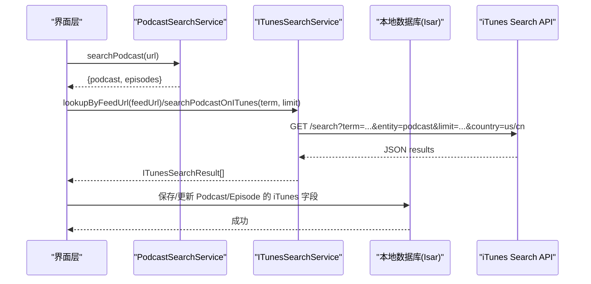
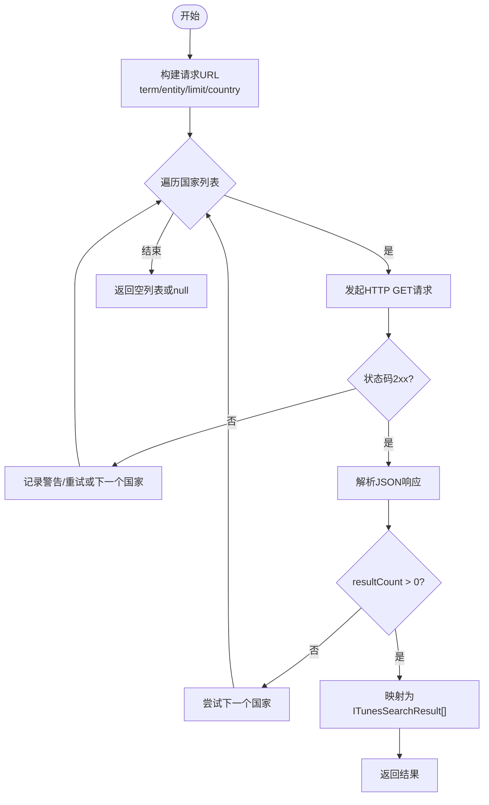
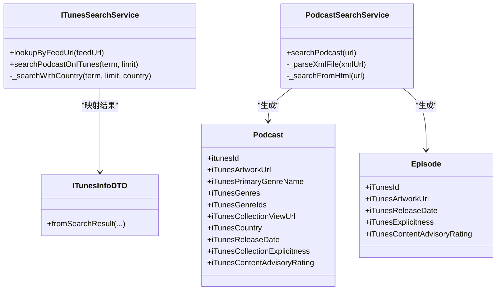

# iTunes 搜索集成

<cite>
**本文引用的文件**   
- [lib/data/services/itunes_search_service.dart](file://lib/data/services/itunes_search_service.dart)
- [lib/core/utils/itunes_info_dto.dart](file://lib/core/utils/itunes_info_dto.dart)
- [lib/data/services/podcast_search_service.dart](file://lib/data/services/podcast_search_service.dart)
- [lib/domain/entities/search_result.dart](file://lib/domain/entities/search_result.dart)
- [lib/domain/entities/podcast.dart](file://lib/domain/entities/podcast.dart)
- [lib/domain/entities/episode.dart](file://lib/domain/entities/episode.dart)
- [lib/core/utils/app_constants.dart](file://lib/core/utils/app_constants.dart)
</cite>

## 目录
1. [简介](#简介)
2. [项目结构](#项目结构)
3. [核心组件](#核心组件)
4. [架构总览](#架构总览)
5. [详细组件分析](#详细组件分析)
6. [依赖关系分析](#依赖关系分析)
7. [性能考虑](#性能考虑)
8. [故障排查指南](#故障排查指南)
9. [结论](#结论)
10. [附录](#附录)

## 简介
本文件为 TinyCast 的 iTunes 搜索集成功能提供系统化、可操作的技术文档。重点围绕 ItunesSearchService 的实现，覆盖以下方面：
- iTunes Search API 调用方式与参数配置
- 响应数据映射与错误处理
- 搜索关键词处理、结果排序策略、分页加载机制与缓存策略
- API 端点使用方式（podcast/episode 过滤、结果数量限制、语言与国家设置等）
- 网络请求优化、错误重试机制与数据去重策略
- 与本地数据库的同步方式与性能优化建议

## 项目结构
iTunes 搜索相关代码主要分布在 data/services 层与 core/utils 层，配合 domain 层的实体模型进行数据流转与持久化。关键文件如下：
- lib/data/services/itunes_search_service.dart：iTunes 搜索服务实现
- lib/core/utils/itunes_info_dto.dart：iTunes 信息数据传输对象
- lib/data/services/podcast_search_service.dart：播客搜索与 RSS 解析入口
- lib/domain/entities/podcast.dart、episode.dart：领域实体，包含 iTunes 字段
- lib/core/utils/app_constants.dart：应用常量（超时、重试、国家列表等）

图表来源
- [lib/data/services/itunes_search_service.dart:103-316](file://lib/data/services/itunes_search_service.dart#L103-L316)
- [lib/core/utils/itunes_info_dto.dart:1-76](file://lib/core/utils/itunes_info_dto.dart#L1-L76)
- [lib/data/services/podcast_search_service.dart:1-208](file://lib/data/services/podcast_search_service.dart#L1-L208)
- [lib/domain/entities/podcast.dart:1-74](file://lib/domain/entities/podcast.dart#L1-L74)
- [lib/domain/entities/episode.dart:1-66](file://lib/domain/entities/episode.dart#L1-L66)
- [lib/domain/entities/search_result.dart:1-17](file://lib/domain/entities/search_result.dart#L1-L17)
- [lib/core/utils/app_constants.dart:1-82](file://lib/core/utils/app_constants.dart#L1-L82)

章节来源
- [lib/data/services/itunes_search_service.dart:103-316](file://lib/data/services/itunes_search_service.dart#L103-L316)
- [lib/core/utils/itunes_info_dto.dart:1-76](file://lib/core/utils/itunes_info_dto.dart#L1-L76)
- [lib/data/services/podcast_search_service.dart:1-208](file://lib/data/services/podcast_search_service.dart#L1-L208)
- [lib/domain/entities/podcast.dart:1-74](file://lib/domain/entities/podcast.dart#L1-L74)
- [lib/domain/entities/episode.dart:1-66](file://lib/domain/entities/episode.dart#L1-L66)
- [lib/domain/entities/search_result.dart:1-17](file://lib/domain/entities/search_result.dart#L1-L17)
- [lib/core/utils/app_constants.dart:1-82](file://lib/core/utils/app_constants.dart#L1-L82)

## 核心组件
- ITunesSearchService：封装对 iTunes Search API 的请求、重试、区域降级、JSON 解析与异常处理；支持通过 feedUrl 精确查找与按关键词搜索。
- ITunesInfoDTO：承载从 iTunes 返回的完整元数据，用于更新 Podcast/Episode 的 iTunes 相关字段。
- PodcastSearchService：统一入口，负责从 XML 或 HTML 页面定位并解析 RSS，作为订阅流程的前置步骤。
- Podcast/Episode 实体：已扩展 iTunes 相关字段，便于存储与展示。
- AppConstants：集中管理超时、重试次数、默认国家列表等配置。

章节来源
- [lib/data/services/itunes_search_service.dart:103-316](file://lib/data/services/itunes_search_service.dart#L103-L316)
- [lib/core/utils/itunes_info_dto.dart:1-76](file://lib/core/utils/itunes_info_dto.dart#L1-L76)
- [lib/data/services/podcast_search_service.dart:1-208](file://lib/data/services/podcast_search_service.dart#L1-L208)
- [lib/domain/entities/podcast.dart:1-74](file://lib/domain/entities/podcast.dart#L1-L74)
- [lib/domain/entities/episode.dart:1-66](file://lib/domain/entities/episode.dart#L1-L66)
- [lib/core/utils/app_constants.dart:1-82](file://lib/core/utils/app_constants.dart#L1-L82)

## 架构总览
iTunes 搜索在订阅流程中异步触发，不阻塞主流程。整体流程包括：
- 输入标准化（URL/域名）→ RSS 解析 → 异步 iTunes 搜索 → 数据映射与持久化 → 前端展示与跳转。

图表来源
- [lib/data/services/podcast_search_service.dart:38-52](file://lib/data/services/podcast_search_service.dart#L38-L52)
- [lib/data/services/itunes_search_service.dart:137-193](file://lib/data/services/itunes_search_service.dart#L137-L193)
- [lib/data/services/itunes_search_service.dart:195-224](file://lib/data/services/itunes_search_service.dart#L195-L224)

## 详细组件分析

### ITunesSearchService：iTunes 搜索服务
职责与能力
- 通过 feedUrl 精确查找播客，优先匹配唯一结果。
- 基于关键词搜索播客，支持 limit 控制结果数量。
- 多区域降级策略：按优先级尝试不同国家（如 us、cn），任一区域成功即返回。
- 内置重试机制：对网络异常进行指数退避式重试，避免瞬时失败。
- 健壮的数据解析：兼容字符串与 Map 类型的响应体，安全解析日期与列表字段。
- 统一的异常体系：将 Dio 异常转换为 AppException，便于上层处理。

关键方法
- lookupByFeedUrl(feedUrl)：通过 feedUrl 精确查找，返回首个有效结果或 null。
- searchPodcastOnITunes(term, limit)：关键词搜索，返回 ITunesSearchResult 列表。
- _searchWithCountry(...)：内部实现，含重试、状态码校验、JSON 解析与异常转换。

图表来源
- [lib/data/services/itunes_search_service.dart:226-315](file://lib/data/services/itunes_search_service.dart#L226-L315)

章节来源
- [lib/data/services/itunes_search_service.dart:137-193](file://lib/data/services/itunes_search_service.dart#L137-L193)
- [lib/data/services/itunes_search_service.dart:195-224](file://lib/data/services/itunes_search_service.dart#L195-L224)
- [lib/data/services/itunes_search_service.dart:226-315](file://lib/data/services/itunes_search_service.dart#L226-L315)

### ITunesInfoDTO：iTunes 信息数据传输对象
作用
- 承载 iTunes Search API 返回的完整元数据，供 Podcast/Episode 模型更新使用。
- 提供 fromSearchResult 工厂方法，简化从搜索结果到 DTO 的转换。

关键字段（部分）
- itunesId、itunesArtworkUrl600、iTunesPrimaryGenreName、iTunesGenres、iTunesGenreIds、iTunesCollectionViewUrl、iTunesCountry、iTunesReleaseDate、iTunesCollectionExplicitness、iTunesContentAdvisoryRating

章节来源
- [lib/core/utils/itunes_info_dto.dart:1-76](file://lib/core/utils/itunes_info_dto.dart#L1-L76)

### PodcastSearchService：播客搜索与 RSS 解析
职责
- 接收 URL 或域名，自动标准化协议前缀。
- 判断是否为 XML 文件，直接解析 RSS；否则从 HTML 页面提取 RSS 链接再解析。
- 对异常进行捕获与提示，确保非致命错误不影响整体流程。

关键方法
- searchPodcast(url)：统一入口，自动选择 XML 或 HTML 路径。
- _parseXmlFile(xmlUrl)：解析 RSS 并返回 Podcast/Episode 列表。
- _searchFromHtml(url)：从 HTML 页面查找 RSS 链接并解析。

章节来源
- [lib/data/services/podcast_search_service.dart:38-52](file://lib/data/services/podcast_search_service.dart#L38-L52)
- [lib/data/services/podcast_search_service.dart:79-103](file://lib/data/services/podcast_search_service.dart#L79-L103)
- [lib/data/services/podcast_search_service.dart:105-127](file://lib/data/services/podcast_search_service.dart#L105-L127)

### 领域实体：Podcast 与 Episode
iTunes 字段扩展
- Podcast：itunesId、itunesArtworkUrl、iTunesPrimaryGenreName、iTunesGenres、iTunesGenreIds、iTunesCollectionViewUrl、iTunesCountry、iTunesReleaseDate、iTunesCollectionExplicitness、iTunesContentAdvisoryRating
- Episode：iTunesId、iTunesArtworkUrl、iTunesReleaseDate、iTunesExplicitness、iTunesContentAdvisoryRating

这些字段用于存储 iTunes 搜索结果，支撑封面图展示、详情页跳转、内容分级显示等功能。

章节来源
- [lib/domain/entities/podcast.dart:1-74](file://lib/domain/entities/podcast.dart#L1-L74)
- [lib/domain/entities/episode.dart:1-66](file://lib/domain/entities/episode.dart#L1-L66)

### 搜索结果聚合：SearchResult
作用
- 聚合 Podcast 与 Episode 列表，提供 isEmpty/isNotEmpty 便捷判断。

章节来源
- [lib/domain/entities/search_result.dart:1-17](file://lib/domain/entities/search_result.dart#L1-L17)

### 配置常量：AppConstants
关键常量
- defaultTimeout：默认网络超时时间
- maxRetryCount：最大重试次数
- itunesSearchCountries：iTunes 搜索国家代码列表（优先级顺序）
- defaultITunesCountry：默认首选国家

章节来源
- [lib/core/utils/app_constants.dart:1-82](file://lib/core/utils/app_constants.dart#L1-L82)

## 依赖关系分析
- ITunesSearchService 依赖 Dio 进行网络请求，依赖 AppConstants 获取超时与重试配置。
- ITunesInfoDTO 被上层用于更新 Podcast/Episode 的 iTunes 字段。
- PodcastSearchService 依赖 RssParserService（由外部注入）完成 RSS 解析。
- Podcast/Episode 实体作为最终数据载体，与 Isar 数据库交互（通过 Repository/DataSource 层）。

图表来源
- [lib/data/services/itunes_search_service.dart:103-316](file://lib/data/services/itunes_search_service.dart#L103-L316)
- [lib/core/utils/itunes_info_dto.dart:1-76](file://lib/core/utils/itunes_info_dto.dart#L1-L76)
- [lib/data/services/podcast_search_service.dart:1-208](file://lib/data/services/podcast_search_service.dart#L1-L208)
- [lib/domain/entities/podcast.dart:1-74](file://lib/domain/entities/podcast.dart#L1-L74)
- [lib/domain/entities/episode.dart:1-66](file://lib/domain/entities/episode.dart#L1-L66)

章节来源
- [lib/data/services/itunes_search_service.dart:103-316](file://lib/data/services/itunes_search_service.dart#L103-L316)
- [lib/core/utils/itunes_info_dto.dart:1-76](file://lib/core/utils/itunes_info_dto.dart#L1-L76)
- [lib/data/services/podcast_search_service.dart:1-208](file://lib/data/services/podcast_search_service.dart#L1-L208)
- [lib/domain/entities/podcast.dart:1-74](file://lib/domain/entities/podcast.dart#L1-L74)
- [lib/domain/entities/episode.dart:1-66](file://lib/domain/entities/episode.dart#L1-L66)

## 性能考虑
- 网络请求优化
  - 合理设置 connect/receive/send 超时，避免长时间阻塞。
  - 启用重试机制，针对瞬时网络抖动提升成功率。
  - 使用 User-Agent 标识客户端版本，便于服务端统计与限流。
- 结果排序与去重
  - 当前实现未内置相关性排序算法，可按 collectionName 相似度或发布日期排序。
  - 建议在返回结果中进行去重（如按 collectionId 或 artworkUrl600），避免重复条目。
- 分页加载机制
  - iTunes Search API 不支持传统分页，可通过 limit 控制单次返回数量。
  - 如需加载更多，可在 UI 层维护滚动加载逻辑，结合用户输入变化重新请求。
- 缓存策略
  - 建议在内存层缓存最近搜索词的结果（LRU），减少重复请求。
  - 对热门播客的 iTunes 元数据可持久化至本地数据库，缩短二次加载时间。
- 异步与非阻塞
  - iTunes 搜索应在订阅流程中异步执行（如 unawaited/Future.microtask），避免阻塞主流程。

[本节为通用指导，不直接分析具体文件]

## 故障排查指南
常见问题与定位要点
- 网络请求失败
  - 检查 Dio 异常类型与状态码，确认是否因超时或服务器不可达导致。
  - 查看重试次数与退避间隔是否符合预期。
- JSON 解析失败
  - 确认响应体是否为字符串或 Map，必要时增加日志输出原始响应。
  - 对日期字段解析进行容错处理，避免整体失败。
- 无搜索结果
  - 检查 term 编码是否正确，entity/media 参数是否匹配。
  - 尝试切换国家代码（us/cn），验证区域差异影响。
- 数据映射异常
  - 核对 ITunesSearchResult 字段与 JSON 键名一致性。
  - 确保 DTO 转换时字段类型正确（如 List<String>、DateTime）。

章节来源
- [lib/data/services/itunes_search_service.dart:226-315](file://lib/data/services/itunes_search_service.dart#L226-L315)
- [lib/data/services/podcast_search_service.dart:105-127](file://lib/data/services/podcast_search_service.dart#L105-L127)

## 结论
iTunes 搜索集成在 TinyCast 中提供了稳定、可扩展的能力，涵盖多区域降级、重试机制、健壮的数据映射与异常处理。通过 PodcastSearchService 与 ITunesSearchService 的协作，实现了从 RSS 解析到 iTunes 元数据补充的完整链路。未来可进一步优化排序、去重与缓存策略，以提升用户体验与系统性能。

[本节为总结性内容，不直接分析具体文件]

## 附录

### API 端点与参数说明
- 基础端点：https://itunes.apple.com/search
- 常用参数
  - term：搜索关键词（需进行 URL 编码）
  - entity：podcast（播客）或 episode（单集）
  - media：podcast（限定媒体类型为播客）
  - limit：返回结果数量上限（默认 5）
  - country：国家代码（如 us、cn），按优先级尝试
- 响应关键字段
  - resultCount：结果总数
  - results：结果数组，包含 collectionId、collectionName、artworkUrl600、feedUrl、website、description、primaryGenreName、genres、genreIds、collectionViewUrl、country、releaseDate、collectionExplicitness、contentAdvisoryRating 等

章节来源
- [lib/data/services/itunes_search_service.dart:235-240](file://lib/data/services/itunes_search_service.dart#L235-L240)
- [lib/core/utils/app_constants.dart:76-81](file://lib/core/utils/app_constants.dart#L76-L81)

### 示例用法（描述性）
- 模糊搜索：传入 term 为播客标题或部分关键词，limit 设为 5，按国家优先级尝试。
- 分类过滤：根据 primaryGenreName 或 genres 字段在前端进行筛选。
- 按相关性排序：可对 collectionName 与 term 的相似度进行打分排序，或按 releaseDate 倒序。
- 分页加载：由于 API 不支持分页，可在 UI 层监听滚动事件，动态调整 limit 或追加新请求。

[本节为概念性说明，不直接分析具体文件]