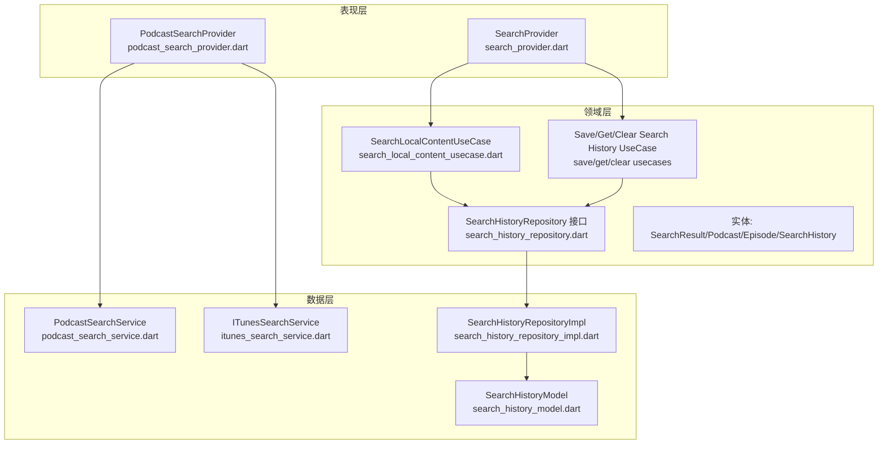
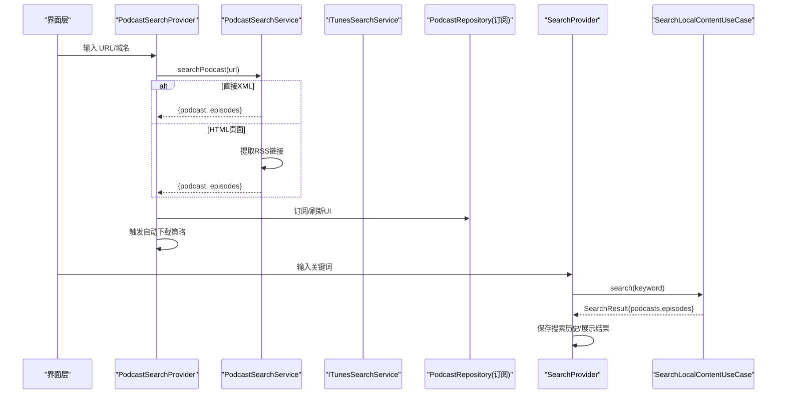
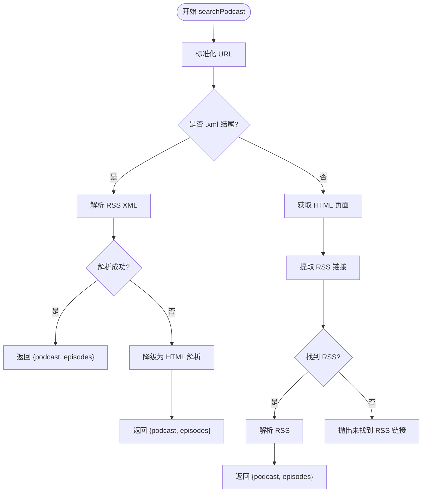
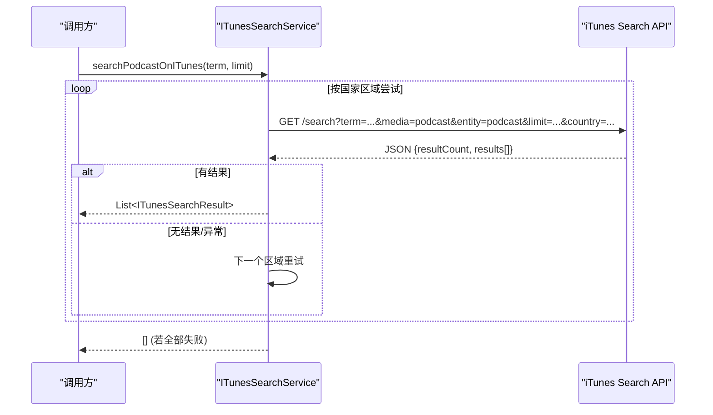
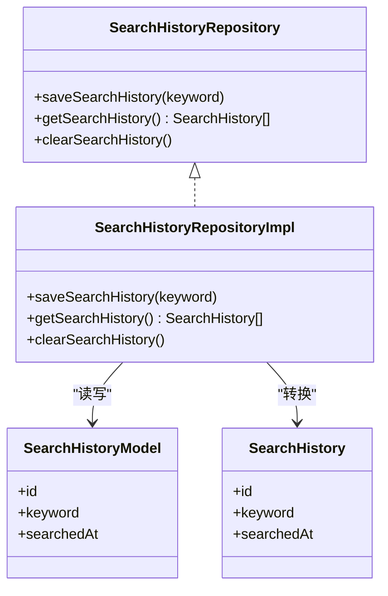
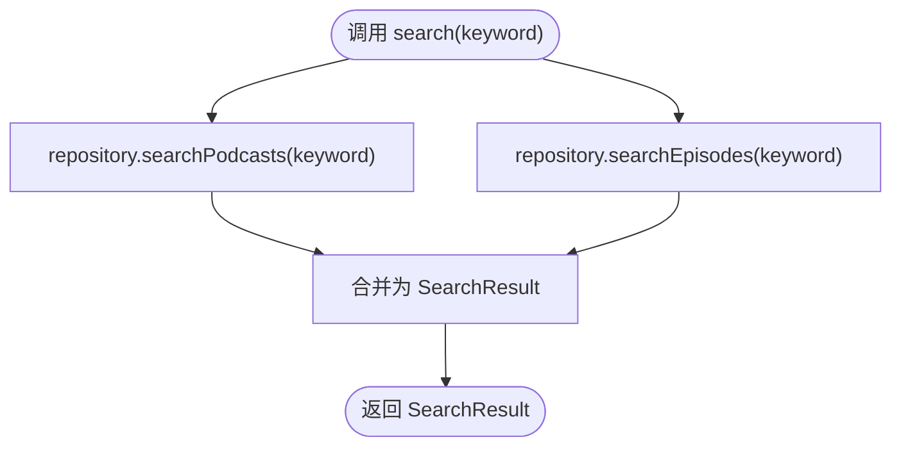
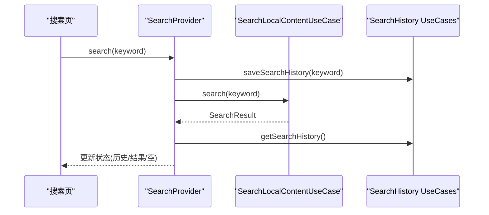
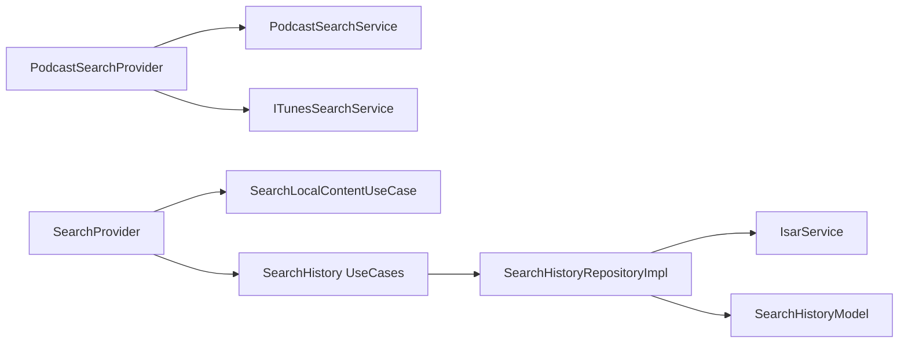
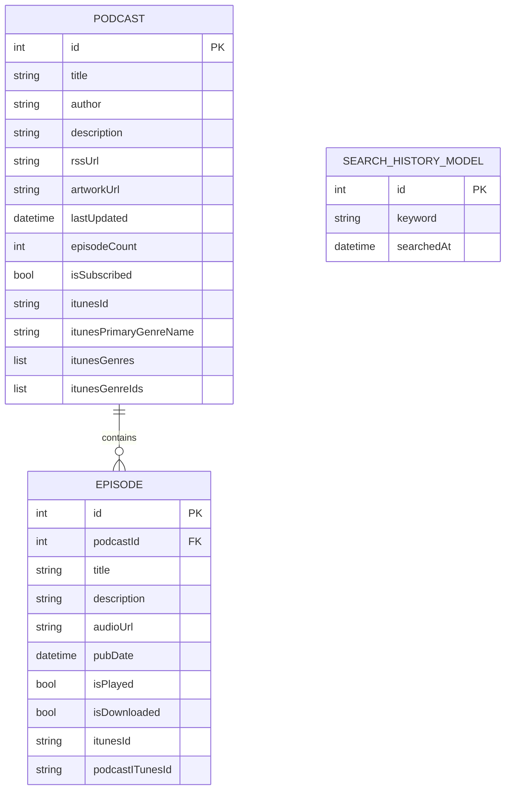

# 播客搜索服务

<cite>
**本文引用的文件**   
- [lib/data/services/podcast_search_service.dart](file://lib/data/services/podcast_search_service.dart)
- [lib/data/services/itunes_search_service.dart](file://lib/data/services/itunes_search_service.dart)
- [lib/domain/entities/search_result.dart](file://lib/domain/entities/search_result.dart)
- [lib/data/models/search_history_model.dart](file://lib/data/models/search_history_model.dart)
- [lib/domain/entities/search_history.dart](file://lib/domain/entities/search_history.dart)
- [lib/domain/repositories/search_history_repository.dart](file://lib/domain/repositories/search_history_repository.dart)
- [lib/data/repositories/search_history_repository_impl.dart](file://lib/data/repositories/search_history_repository_impl.dart)
- [lib/presentation/features/search/podcast_search_provider.dart](file://lib/presentation/features/search/podcast_search_provider.dart)
- [lib/presentation/features/search/search_provider.dart](file://lib/presentation/features/search/search_provider.dart)
- [lib/domain/usecases/search_local_content_usecase.dart](file://lib/domain/usecases/search_local_content_usecase.dart)
- [lib/domain/usecases/save_search_history_usecase.dart](file://lib/domain/usecases/save_search_history_usecase.dart)
- [lib/domain/usecases/get_search_history_usecase.dart](file://lib/domain/usecases/get_search_history_usecase.dart)
- [lib/domain/usecases/clear_search_history_usecase.dart](file://lib/domain/usecases/clear_search_history_usecase.dart)
- [lib/domain/entities/podcast.dart](file://lib/domain/entities/podcast.dart)
- [lib/domain/entities/episode.dart](file://lib/domain/entities/episode.dart)
</cite>

## 目录
1. [简介](#简介)
2. [项目结构](#项目结构)
3. [核心组件](#核心组件)
4. [架构总览](#架构总览)
5. [详细组件分析](#详细组件分析)
6. [依赖关系分析](#依赖关系分析)
7. [性能考量](#性能考量)
8. [故障排查指南](#故障排查指南)
9. [结论](#结论)
10. [附录](#附录)

## 简介
本文件面向 TinyCast 的播客搜索服务，系统性梳理并解释本地搜索与 iTunes API 搜索的双重机制。重点覆盖 PodcastSearchService 与 ITunesSearchService 的实现、搜索算法与排序策略、缓存与分页处理、iTunes Search API 调用方式与参数配置、响应数据映射、错误处理、关键词优化、结果去重、搜索历史管理，以及与数据库层的交互和性能优化策略。文档同时提供流程图与时序图，帮助读者快速理解关键流程。

## 项目结构
围绕搜索功能的核心代码分布在 data、domain、presentation 三层：
- data 层：服务（PodcastSearchService、ITunesSearchService）、仓库实现（SearchHistoryRepositoryImpl）、模型（SearchHistoryModel）
- domain 层：实体（Podcast、Episode、SearchResult、SearchHistory）、仓库接口（SearchHistoryRepository）、用例（SearchLocalContentUseCase、Save/Get/Clear Search History UseCase）
- presentation 层：Riverpod 状态管理与提供者（PodcastSearchProvider、SearchProvider）

图表来源
- [lib/presentation/features/search/podcast_search_provider.dart](file://lib/presentation/features/search/podcast_search_provider.dart)
- [lib/presentation/features/search/search_provider.dart](file://lib/presentation/features/search/search_provider.dart)
- [lib/domain/usecases/search_local_content_usecase.dart](file://lib/domain/usecases/search_local_content_usecase.dart)
- [lib/domain/repositories/search_history_repository.dart](file://lib/domain/repositories/search_history_repository.dart)
- [lib/data/repositories/search_history_repository_impl.dart](file://lib/data/repositories/search_history_repository_impl.dart)
- [lib/data/models/search_history_model.dart](file://lib/data/models/search_history_model.dart)
- [lib/data/services/podcast_search_service.dart](file://lib/data/services/podcast_search_service.dart)
- [lib/data/services/itunes_search_service.dart](file://lib/data/services/itunes_search_service.dart)

章节来源
- [lib/presentation/features/search/podcast_search_provider.dart](file://lib/presentation/features/search/podcast_search_provider.dart)
- [lib/presentation/features/search/search_provider.dart](file://lib/presentation/features/search/search_provider.dart)
- [lib/domain/usecases/search_local_content_usecase.dart](file://lib/domain/usecases/search_local_content_usecase.dart)
- [lib/domain/repositories/search_history_repository.dart](file://lib/domain/repositories/search_history_repository.dart)
- [lib/data/repositories/search_history_repository_impl.dart](file://lib/data/repositories/search_history_repository_impl.dart)
- [lib/data/models/search_history_model.dart](file://lib/data/models/search_history_model.dart)
- [lib/data/services/podcast_search_service.dart](file://lib/data/services/podcast_search_service.dart)
- [lib/data/services/itunes_search_service.dart](file://lib/data/services/itunes_search_service.dart)

## 核心组件
- PodcastSearchService：负责从 URL 或域名定位 RSS 源并解析播客信息；支持 XML 直连与 HTML 页面内查找 RSS 链接两种路径，具备重试与异常降级能力。
- ITunesSearchService：封装 iTunes Search API 的调用，支持按关键词搜索与通过 feedUrl 精确查找，包含多区域回退、JSON 解析与结果映射。
- SearchHistoryRepository + Impl：基于 Isar 的搜索历史持久化，支持保存、查询、清空，且对重复关键词进行更新而非重复插入。
- SearchLocalContentUseCase：聚合本地播客与剧集的模糊搜索，返回统一 SearchResult。
- Presentation Providers：PodcastSearchProvider 驱动订阅与自动下载流程；SearchProvider 驱动本地搜索与历史管理。

章节来源
- [lib/data/services/podcast_search_service.dart](file://lib/data/services/podcast_search_service.dart)
- [lib/data/services/itunes_search_service.dart](file://lib/data/services/itunes_search_service.dart)
- [lib/domain/repositories/search_history_repository.dart](file://lib/domain/repositories/search_history_repository.dart)
- [lib/data/repositories/search_history_repository_impl.dart](file://lib/data/repositories/search_history_repository_impl.dart)
- [lib/domain/usecases/search_local_content_usecase.dart](file://lib/domain/usecases/search_local_content_usecase.dart)
- [lib/presentation/features/search/podcast_search_provider.dart](file://lib/presentation/features/search/podcast_search_provider.dart)
- [lib/presentation/features/search/search_provider.dart](file://lib/presentation/features/search/search_provider.dart)

## 架构总览
下图展示“URL/域名搜索”与“关键词搜索”两条主路径，以及它们如何协同工作：

图表来源
- [lib/presentation/features/search/podcast_search_provider.dart](file://lib/presentation/features/search/podcast_search_provider.dart)
- [lib/data/services/podcast_search_service.dart](file://lib/data/services/podcast_search_service.dart)
- [lib/presentation/features/search/search_provider.dart](file://lib/presentation/features/search/search_provider.dart)
- [lib/domain/usecases/search_local_content_usecase.dart](file://lib/domain/usecases/search_local_content_usecase.dart)

## 详细组件分析

### PodcastSearchService（URL/域名搜索）
职责与流程
- 标准化输入 URL，区分 XML 直链与 HTML 页面两种路径
- XML 直链：直接解析 RSS 源，失败时尝试降级为 HTML 解析
- HTML 页面：抓取页面内容，提取 RSS 链接后继续解析
- 网络请求使用 Dio，带超时与重试逻辑，统一异常包装

关键方法
- searchPodcast(url)：入口，路由到 XML 或 HTML 分支
- _parseXmlFile(xmlUrl)：解析 RSS，捕获 XML 异常并降级
- _searchFromHtml(url)：获取 HTML，提取 RSS 链接并解析
- _findRssLinkInHtml(url)：带重试的网络请求与异常处理
- _extractRssLinkFromHtml(htmlContent, baseUrl)：调用 HTML 提取工具

容错与降级
- XML 解析失败时检测是否为 HTML 内容，自动切换 HTML 路径
- 网络异常统一转为 AppException，便于上层处理

图表来源
- [lib/data/services/podcast_search_service.dart](file://lib/data/services/podcast_search_service.dart)

章节来源
- [lib/data/services/podcast_search_service.dart](file://lib/data/services/podcast_search_service.dart)

### ITunesSearchService（iTunes API 搜索）
职责与流程
- 通过 term 关键词搜索播客，支持 limit 限制
- 通过 feedUrl 精确查找，优先匹配 collectionId
- 多国家区域回退策略，提升可用性
- JSON 响应映射为 ITunesSearchResult 实体

关键方法
- searchPodcastOnITunes(term, limit)：按关键词搜索，逐区尝试直到有结果
- lookupByFeedUrl(feedUrl)：通过 feedUrl 精确查找，返回首个有效结果
- _searchWithCountry(term, limit, country)：具体区域请求、重试与异常处理

API 参数与响应
- 搜索端点：https://itunes.apple.com/search
- 常用参数：term、media=podcast、entity=podcast、limit、country
- 响应字段映射：collectionId、collectionName、artworkUrl600、feedUrl、website、description、primaryGenreName、genres、genreIds、collectionViewUrl、country、releaseDate、collectionExplicitness、contentAdvisoryRating

图表来源
- [lib/data/services/itunes_search_service.dart](file://lib/data/services/itunes_search_service.dart)

章节来源
- [lib/data/services/itunes_search_service.dart](file://lib/data/services/itunes_search_service.dart)

### 搜索历史管理（Repository + UseCases + Model）
职责与流程
- SaveSearchHistoryUseCase：保存关键词，避免重复插入，存在则更新时间戳
- GetSearchHistoryUseCase：按时间倒序返回历史记录
- ClearSearchHistoryUseCase：清空所有记录
- SearchHistoryRepositoryImpl：基于 Isar 的事务写入与查询
- SearchHistoryModel：Isar 集合模型，keyword 与 searchedAt 索引

图表来源
- [lib/domain/repositories/search_history_repository.dart](file://lib/domain/repositories/search_history_repository.dart)
- [lib/data/repositories/search_history_repository_impl.dart](file://lib/data/repositories/search_history_repository_impl.dart)
- [lib/data/models/search_history_model.dart](file://lib/data/models/search_history_model.dart)
- [lib/domain/entities/search_history.dart](file://lib/domain/entities/search_history.dart)

章节来源
- [lib/domain/repositories/search_history_repository.dart](file://lib/domain/repositories/search_history_repository.dart)
- [lib/data/repositories/search_history_repository_impl.dart](file://lib/data/repositories/search_history_repository_impl.dart)
- [lib/data/models/search_history_model.dart](file://lib/data/models/search_history_model.dart)
- [lib/domain/entities/search_history.dart](file://lib/domain/entities/search_history.dart)

### 本地搜索与结果聚合（SearchLocalContentUseCase）
职责与流程
- 聚合 PodcastRepository 的搜索能力，分别检索播客与剧集
- 返回统一的 SearchResult，包含 podcasts 与 episodes 列表

图表来源
- [lib/domain/usecases/search_local_content_usecase.dart](file://lib/domain/usecases/search_local_content_usecase.dart)

章节来源
- [lib/domain/usecases/search_local_content_usecase.dart](file://lib/domain/usecases/search_local_content_usecase.dart)

### 表现层状态与流程（Providers）
PodcastSearchProvider
- 负责 URL/域名搜索、订阅、自动下载策略执行与 UI 刷新
- 维护 addingStatus 以控制单个/批量添加状态

SearchProvider
- 负责本地搜索、历史加载、清空历史、选择导航目标
- 维护 searchHistory、searchResult、selectedIndex 等状态

图表来源
- [lib/presentation/features/search/search_provider.dart](file://lib/presentation/features/search/search_provider.dart)
- [lib/domain/usecases/search_local_content_usecase.dart](file://lib/domain/usecases/search_local_content_usecase.dart)
- [lib/domain/usecases/save_search_history_usecase.dart](file://lib/domain/usecases/save_search_history_usecase.dart)
- [lib/domain/usecases/get_search_history_usecase.dart](file://lib/domain/usecases/get_search_history_usecase.dart)

章节来源
- [lib/presentation/features/search/podcast_search_provider.dart](file://lib/presentation/features/search/podcast_search_provider.dart)
- [lib/presentation/features/search/search_provider.dart](file://lib/presentation/features/search/search_provider.dart)

## 依赖关系分析
- PodcastSearchService 依赖 Dio 与 RSS 解析器，内部还依赖 HTML RSS 提取工具
- ITunesSearchService 依赖 Dio 与 AppConstants（超时、用户代理、国家列表）
- SearchHistoryRepositoryImpl 依赖 IsarService 与 SearchHistoryModel
- SearchLocalContentUseCase 依赖 PodcastRepository（由上层注入）
- Presentation Providers 通过 Riverpod 管理依赖注入与状态流

图表来源
- [lib/presentation/features/search/podcast_search_provider.dart](file://lib/presentation/features/search/podcast_search_provider.dart)
- [lib/presentation/features/search/search_provider.dart](file://lib/presentation/features/search/search_provider.dart)
- [lib/data/repositories/search_history_repository_impl.dart](file://lib/data/repositories/search_history_repository_impl.dart)
- [lib/data/models/search_history_model.dart](file://lib/data/models/search_history_model.dart)
- [lib/domain/usecases/search_local_content_usecase.dart](file://lib/domain/usecases/search_local_content_usecase.dart)

章节来源
- [lib/presentation/features/search/podcast_search_provider.dart](file://lib/presentation/features/search/podcast_search_provider.dart)
- [lib/presentation/features/search/search_provider.dart](file://lib/presentation/features/search/search_provider.dart)
- [lib/data/repositories/search_history_repository_impl.dart](file://lib/data/repositories/search_history_repository_impl.dart)
- [lib/data/models/search_history_model.dart](file://lib/data/models/search_history_model.dart)
- [lib/domain/usecases/search_local_content_usecase.dart](file://lib/domain/usecases/search_local_content_usecase.dart)

## 性能考量
- 网络请求
  - 合理设置连接/接收/发送超时，避免长时间阻塞
  - 重试策略采用指数退避（递增延迟），降低瞬时失败影响
  - 多区域回退提高成功率，减少整体耗时
- 解析与降级
  - XML 解析失败自动降级为 HTML 解析，提升鲁棒性
  - HTML 内容校验（非空）与状态码检查，尽早失败
- 本地搜索
  - 使用 Isar 索引（如 searchedAt）加速查询
  - 事务写入避免并发写冲突
- 结果处理
  - 搜索结果去重建议在 Repository 层实现（例如基于 rssUrl 或 itunesId）
  - 分页处理在 iTunes 搜索中通过 limit 控制单次返回数量，避免一次性拉取过多数据

[本节为通用指导，不直接分析具体文件]

## 故障排查指南
常见问题与定位要点
- XML 解析失败
  - 检查 RSS 链接是否返回 HTML 内容，PodcastSearchService 已做降级处理
  - 查看日志中的 XML 异常类型（如 XmlException、XmlTagException）
- HTML 页面抓取失败
  - 检查网络状态与服务器响应码
  - 确认 User-Agent 与 Accept 头是否符合服务端要求
- iTunes 搜索无结果
  - 调整关键词或扩大 limit
  - 检查国家区域配置与网络连通性
- 搜索历史未保存或重复
  - 确认 Isar 事务与索引配置
  - 验证 SaveSearchHistoryUseCase 的去重逻辑（存在则更新时间戳）

章节来源
- [lib/data/services/podcast_search_service.dart](file://lib/data/services/podcast_search_service.dart)
- [lib/data/services/itunes_search_service.dart](file://lib/data/services/itunes_search_service.dart)
- [lib/data/repositories/search_history_repository_impl.dart](file://lib/data/repositories/search_history_repository_impl.dart)

## 结论
TinyCast 的播客搜索服务通过 PodcastSearchService 与 ITunesSearchService 构建了“本地 RSS 解析 + iTunes 外部搜索”的双通道能力。结合 Riverpod 的状态管理与 Isar 的本地存储，实现了流畅的用户体验与可靠的错误恢复。建议后续在 Repository 层完善结果去重与分页策略，进一步提升搜索质量与性能。

[本节为总结，不直接分析具体文件]

## 附录

### 高级搜索功能示例（思路与步骤）
- 模糊搜索
  - 在 PodcastRepository 的 searchPodcasts/searchEpisodes 中使用大小写不敏感匹配与通配符
  - 对标题、作者、描述、关键词字段进行联合匹配
- 分类过滤
  - 利用 Podcast.categories 与 ITunesSearchResult.primaryGenreName/geners 进行筛选
  - 在前端提供分类下拉框，动态拼接过滤条件
- 按相关性排序
  - 计算关键词命中权重（标题 > 作者 > 描述 > 关键词）
  - 结合发布时间与播放热度（若有）进行综合评分排序

[本节为概念性说明，不直接分析具体文件]

### 数据模型概览

图表来源
- [lib/domain/entities/podcast.dart](file://lib/domain/entities/podcast.dart)
- [lib/domain/entities/episode.dart](file://lib/domain/entities/episode.dart)
- [lib/data/models/search_history_model.dart](file://lib/data/models/search_history_model.dart)

章节来源
- [lib/domain/entities/podcast.dart](file://lib/domain/entities/podcast.dart)
- [lib/domain/entities/episode.dart](file://lib/domain/entities/episode.dart)
- [lib/data/models/search_history_model.dart](file://lib/data/models/search_history_model.dart)